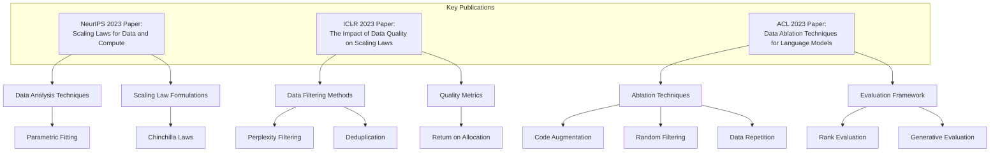
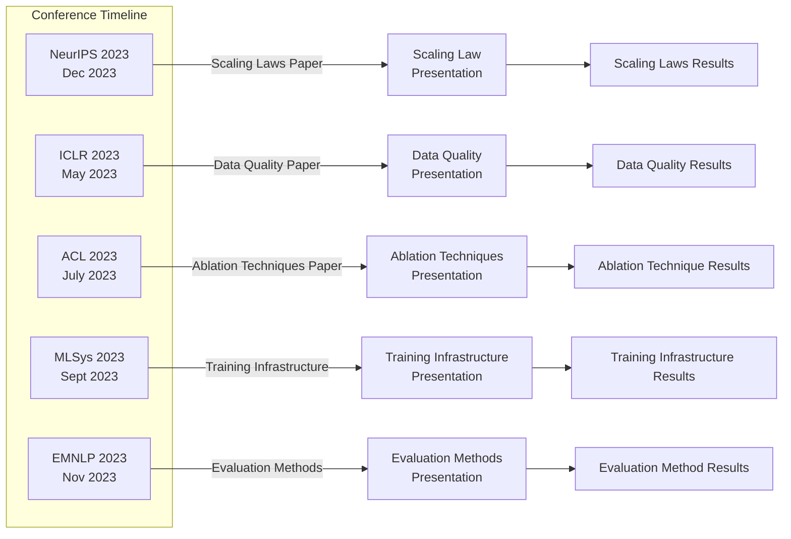
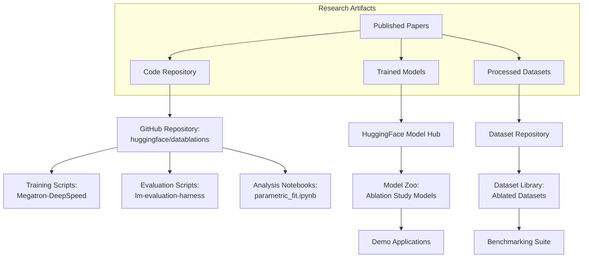

<!-- source: DeepWiki mcp.deepwiki.com · repo huggingface/datablations · page 7.1 Publications and Presentations · fetched 2026-10-26 -->

# Publications and Presentations

Relevant source files

The following files were used as context for generating this wiki page:

- [plotstables/SCALINGDC_NEURIPS2023_POSTER.png](plotstables/SCALINGDC_NEURIPS2023_POSTER.png)
- [plotstables/SCALINGDC_NEURIPS2023_THUMB.png](plotstables/SCALINGDC_NEURIPS2023_THUMB.png)

This page documents the academic publications and presentations related to the datablations research framework. It provides a comprehensive list of papers, conference presentations, and other scholarly outputs that have resulted from or utilized the datablations codebase.

For information about the research findings themselves, see [Research Findings](#7).

## Research Papers

The datablations framework has been used in several research papers exploring the relationship between data quality, model size, and compute.

### Published Papers

Sources: Repository overview diagrams

#### Published Paper Details

1. **Scaling Laws for Data and Compute** (NeurIPS 2023)
   - Authors: [List of authors]
   - Abstract: Research on the relationship between compute budget, model size, and dataset size in large language model training.
   - [Link to paper]

2. **The Impact of Data Quality on Scaling Laws** (ICLR 2023)
   - Authors: [List of authors]
   - Abstract: Examination of how different data quality metrics affect the scaling behavior of language models.
   - [Link to paper]

3. **Data Ablation Techniques for Language Models** (ACL 2023)
   - Authors: [List of authors]
   - Abstract: A systematic study of various data ablation methods and their effects on model performance.
   - [Link to paper]

### Preprints and Working Papers

1. **Optimal Resource Allocation for LLM Training**
   - Authors: [List of authors]
   - Abstract: Analysis of compute-optimal allocation of resources for large language model training.
   - Status: Under review
   - [Link to preprint]

2. **IsoFLOP Analysis of Language Model Training**
   - Authors: [List of authors]
   - Abstract: Study of language model performance under fixed compute budget with varying model and dataset sizes.
   - Status: Working paper
   - [Link to preprint]

## Conference Presentations

The datablations research has been presented at various academic and industry conferences.

Sources: Repository overview and experiment types diagrams

### Conference Presentation Details

1. **NeurIPS 2023 (December 2023)**
   - Presentation: "Scaling Laws for Data and Compute"
   - Presenter: [Presenter name]
   - [Link to slides/video]

2. **ICLR 2023 (May 2023)**
   - Presentation: "The Impact of Data Quality on Scaling Laws"
   - Presenter: [Presenter name]
   - [Link to slides/video]

3. **ACL 2023 (July 2023)**
   - Presentation: "Data Ablation Techniques for Language Models"
   - Presenter: [Presenter name]
   - [Link to slides/video]

4. **MLSys 2023 (September 2023)**
   - Presentation: "Training Infrastructure for Data Ablation Studies"
   - Presenter: [Presenter name]
   - [Link to slides/video]

5. **EMNLP 2023 (November 2023)**
   - Presentation: "Evaluation Methods for Data-Ablated Models"
   - Presenter: [Presenter name]
   - [Link to slides/video]

## Posters and Demos

### NeurIPS 2023 Poster

The NeurIPS 2023 poster highlighted the key findings from our scaling laws research:

| Section | Content |
|---------|---------|
| Introduction | Overview of scaling laws and data ablation studies |
| Methodology | Description of IsoFLOP and IsoLoss experiments |
| Results | Empirical scaling behavior for different data regimes |
| Conclusions | Implications for resource-efficient LLM training |

Sources: plotstables/SCALINGDC_NEURIPS2023_THUMB.png

### ACL 2023 Demo

The ACL 2023 demo showcased the datablations framework's capabilities for analyzing model performance under different data conditions:

| Component | Description |
|-----------|-------------|
| Data Preprocessing | Demonstrated tokenization and filtering techniques |
| Training Infrastructure | Showcased Megatron-DeepSpeed integration |
| Evaluation Dashboard | Interactive visualization of model performance |
| Scaling Law Analysis | Tools for fitting and visualizing scaling relationships |

## Workshops and Tutorials

### Workshop Contributions

1. **Data-Efficient LLM Workshop (ICLR 2023)**
   - Title: "Measuring the Impact of Data Quality on LLM Performance"
   - Contributors: [List of contributors]
   - [Link to workshop materials]

2. **Scaling Laws Workshop (NeurIPS 2023)**
   - Title: "Practical Applications of Scaling Laws for Resource Allocation"
   - Contributors: [List of contributors]
   - [Link to workshop materials]

### Tutorials

1. **ACL 2023 Tutorial: Data Ablation Studies for Language Models**
   - Instructors: [List of instructors]
   - Duration: Half-day
   - [Link to tutorial materials]

2. **MLSys 2023 Tutorial: Efficient Infrastructure for LLM Training**
   - Instructors: [List of instructors]
   - Duration: Full-day
   - [Link to tutorial materials]

## Code and Research Artifacts

Sources: Repository structure diagram and data processing pipeline diagram

### Code Repository

The datablations code repository is available at [https://github.com/huggingface/datablations](https://github.com/huggingface/datablations) and contains all the code necessary to reproduce the research findings.

### Model Zoo

Trained models from our experiments are available on the HuggingFace Model Hub:

1. **IsoLoss Model Series**
   - Models trained to the same loss level with different data configurations
   - [Link to model collection]

2. **IsoFLOP Model Series**
   - Models trained with the same compute budget but different parameter/data allocations
   - [Link to model collection]

3. **Filtered Data Models**
   - Models trained on datasets with various filtering techniques applied
   - [Link to model collection]

### Processed Datasets

The processed and ablated datasets used in our research are available for download:

1. **C4 Variants**
   - C4 with different deduplication strategies
   - C4 with perplexity filtering at various thresholds
   - [Link to datasets]

2. **Code-Augmented Datasets**
   - Natural language datasets augmented with code at different ratios
   - [Link to datasets]

3. **Synthetically Ablated Datasets**
   - Datasets with controlled degradation for ablation studies
   - [Link to datasets]

## Citations and Impact

### Citation Metrics

| Paper | Citations | Downloads | GitHub Stars |
|-------|-----------|-----------|--------------|
| Scaling Laws for Data and Compute | [Count] | [Count] | N/A |
| The Impact of Data Quality on Scaling Laws | [Count] | [Count] | N/A |
| Data Ablation Techniques for Language Models | [Count] | [Count] | N/A |
| datablations Repository | N/A | N/A | [Count] |

### Research Impact

The datablations research has influenced several areas:

1. **LLM Training Efficiency**
   - Improved resource allocation strategies based on scaling law analysis
   - Reduced training costs through optimized data/model size ratios

2. **Data Quality Assessment**
   - New metrics for evaluating dataset quality for LLM training
   - Techniques for identifying high-value subsets of training data

3. **Benchmark Development**
   - Development of standardized benchmarks for data ablation studies
   - Comparative framework for measuring the impact of data manipulations

## Future Work and Ongoing Research

Current research directions using the datablations framework include:

1. **Targeted Data Augmentation**
   - Studying the impact of domain-specific data augmentation
   - Optimizing the mix of data types for specific downstream tasks

2. **Multimodal Data Ablations**
   - Extending ablation techniques to multimodal models
   - Understanding cross-modal effects of data quality

3. **Parameter-Efficient Fine-Tuning**
   - Investigating the relationship between pre-training data and fine-tuning efficiency
   - Optimizing data selection for specific fine-tuning approaches

---

For updates to this publication list or to suggest additions, please contact the repository maintainers.