# Page: Overview

# Overview

<details>
<summary>Relevant source files</summary>

The following files were used as context for generating this wiki page:

- [README.md](README.md)
- [plotstables/training_validation_filter.pdf](plotstables/training_validation_filter.pdf)
- [plotstables/validation_c4py.pdf](plotstables/validation_c4py.pdf)

</details>


Datablations is a framework for investigating language models in data-constrained regimes. It provides tools for preprocessing data, training models using Megatron-DeepSpeed, evaluating models on downstream tasks, and analyzing results through the lens of scaling laws. This repository supports the research presented in the paper "Scaling Data-Constrained Language Models" which examines how to optimize language model performance when limited by available unique training data.

For detailed information about repository structure and navigation, see [Repository Structure](#1.1).
For setup instructions, see [Getting Started](#1.2).

## Framework Architecture

The Datablations framework consists of four major interconnected systems:

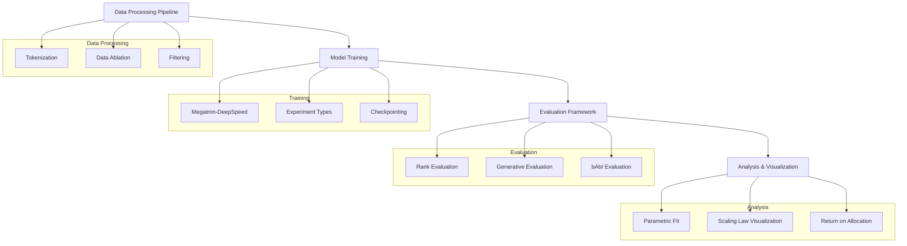

Sources: README.md, System Overview Diagram

## Core Components

### Data Processing

The data processing pipeline handles the preparation of datasets for training language models. It supports working with C4, OSCAR, and code datasets, applying various data manipulation techniques:

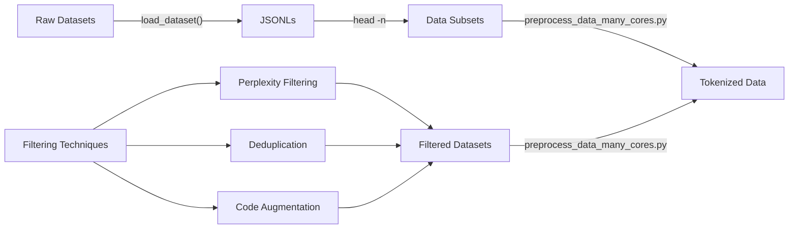

Sources: README.md:40-126

The framework supports several data ablation techniques:
- **Data Repetition**: Controlling how many times the same tokens are seen during training
- **Code Augmentation**: Mixing programming language data (Python) with natural language
- **Filtering**: Removing low-quality content through perplexity filtering and deduplication

Sources: README.md:43-107

### Training Infrastructure

Datablations uses a modified version of Megatron-DeepSpeed to train language models with various configurations:

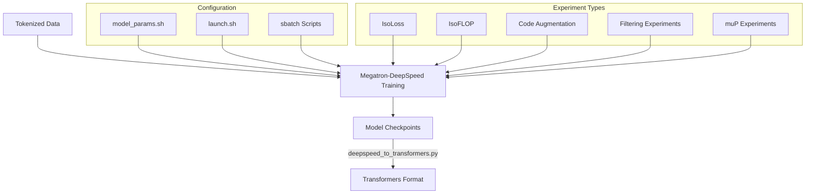

Sources: README.md:197-293

Training experiments focus on:
- **IsoLoss**: Experiments targeting the same loss with different model/data configurations
- **IsoFLOP**: Experiments using the same compute budget with different allocations
- **Data Manipulation**: Experiments testing various data processing techniques

Models are trained with parameters ranging from millions to billions, and training tokens from billions to hundreds of billions.

Sources: README.md:216-271

### Evaluation System

After training, models are evaluated on different downstream tasks using lm-evaluation-harness:

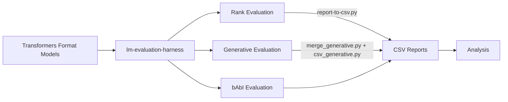

Sources: README.md:375-395

The evaluation framework supports:
- **Rank Evaluation**: Tasks measuring model's ability to rank correct answers
- **Generative Evaluation**: Tasks assessing text generation capabilities
- **bAbI Evaluation**: Tasks for basic reasoning and comprehension

Sources: README.md:375-394

### Analysis Framework

The analysis framework is centered around fitting parametric scaling laws and analyzing the results:

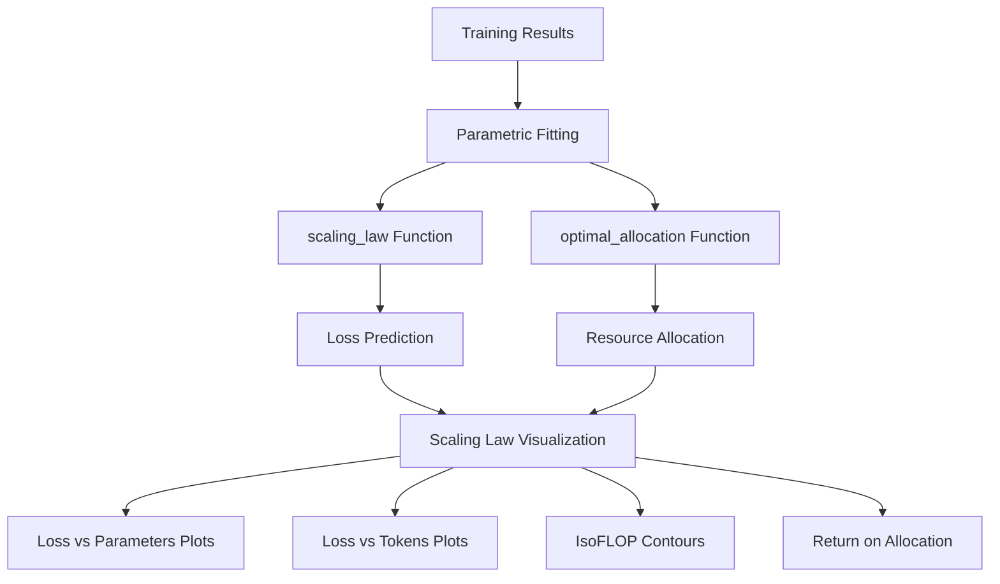

Sources: README.md:294-371, README.md:396-424

The analysis focuses on:
- **Parametric Fitting**: Determining scaling law parameters from experimental data
- **Optimal Allocation**: Finding the best balance between model size and training tokens
- **Visualization**: Creating plots and visualizations to understand scaling behavior

Sources: README.md:294-371

## Core Concepts

### Scaling Laws in Data-Constrained Regimes

The framework introduces a scaling law for compute optimality that accounts for:
- The decreasing value of repeated tokens
- Excess parameters when data is limited
- The relationship between model size, dataset size, and compute budget

The generalized form of the scaling law is:

```
L(N,D,R_N,R_D) = E + A/(U_N + U_N * R_N^* * (1 - e^(-1*R_N/(R_N^*))))^α + B/(U_D + U_D * R_D^* * (1 - e^(-1*R_D/(R_D^*))))^β
```

Where:
- N: number of parameters
- D: number of total training tokens
- U: number of unique training tokens
- RD: repetition factor for data
- RN: excess parameter factor
- α, β: scaling exponents
- E, A, B, R_N^*, R_D^*: fitted constants

Sources: README.md:294-371

### Repository Organization

The repository is organized into several key directories:

| Directory | Purpose |
|-----------|---------|
| `.` (root) | Main scripts, README |
| `training/` | Training scripts and configuration |
| `utils/` | Utility scripts for data manipulation, evaluation |
| `filtering/` | Scripts for filtering and deduplication |
| `plotstables/` | Analysis scripts and visualization notebooks |
| `Megatron-DeepSpeed/` | Modified training framework (external) |

Sources: README.md:15-39, Repository Structure

## Experimental Results

The repository contains the results of over 400 training runs, investigating:

1. How model performance scales with data repetition
2. Optimal allocation of compute between model size and training tokens
3. Effectiveness of different data augmentation techniques
4. Impact of filtering techniques on model quality

The findings of these experiments are published in the paper "Scaling Data-Constrained Language Models" and can be replicated using the code in this repository.

Sources: README.md:5-13

## System Requirements and Dependencies

Key dependencies include:
- Megatron-DeepSpeed for distributed training
- Hugging Face datasets for data loading
- lm-evaluation-harness for evaluation
- Python data science stack for analysis

The framework supports both AMD GPUs (via ROCm) and NVIDIA GPUs (via CUDA).

Sources: README.md:276-278

---

# Page: Repository Structure

# Repository Structure

<details>
<summary>Relevant source files</summary>

The following files were used as context for generating this wiki page:

- [.gitignore](.gitignore)
- [README.md](README.md)
- [plotstables/training_validation_filter.pdf](plotstables/training_validation_filter.pdf)
- [plotstables/validation_c4py.pdf](plotstables/validation_c4py.pdf)

</details>


This page provides a comprehensive overview of the datablations repository organization, detailing the key directories, files, and their purposes within the system. For instructions on setting up the environment and running experiments, see [Getting Started](#1.2).

## High-Level Organization

The datablations repository is structured to support the entire workflow for studying language models in data-constrained regimes, from data preprocessing through model training to evaluation and analysis.

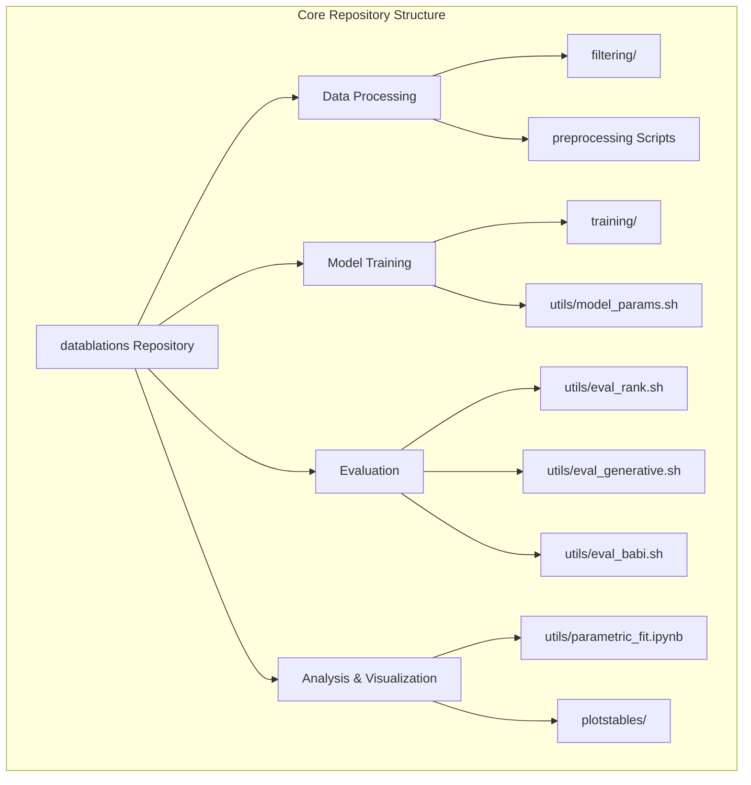

Sources: [README.md:1-39]()

## Key Directories and Files

The repository has a functional organization with the following important components:

| Directory/File | Purpose |
|----------------|---------|
| `filtering/` | Contains scripts for data filtering techniques (deduplication, perplexity filtering) |
| `filtering/README.md` | Documentation for filtering approaches |
| `training/` | Contains scripts for training model configuration and execution |
| `training/launch.sh` | Script for launching training jobs on compute clusters |
| `utils/` | Utility scripts for various tasks (evaluation, configuration, analysis) |
| `utils/model_params.sh` | Architecture presets for different model sizes |
| `utils/datapaths/` | Text files defining data paths for training |
| `utils/eval_*.sh` | Scripts for different evaluation approaches |
| `utils/parametric_fit.ipynb` | Notebook for fitting scaling laws to results |
| `plotstables/` | Scripts and notebooks for visualization and analysis |

Sources: [README.md:40-100]()

## Data Processing Pipeline

The data processing system prepares datasets for training, handling tokenization, filtering, and format conversion.

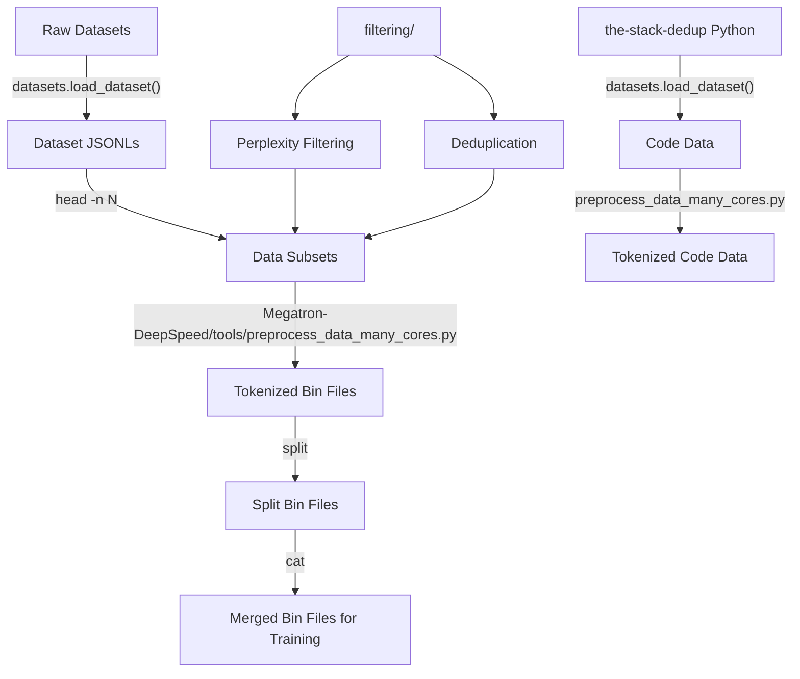

Sources: [README.md:41-127]()

The data processing workflow typically involves:

1. Loading datasets from Hugging Face (C4, OSCAR, the-stack-dedup)
2. Creating subsets based on experimental parameters
3. Tokenizing with the GPT-2 tokenizer via Megatron-DeepSpeed tools
4. For larger files, splitting and later recombining bin files

### Data Filtering Techniques

The repository implements several data filtering approaches:

1. **Perplexity Filtering**: Removes examples based on language model perplexity scores
   - Scripts: `filtering/deduplication/filter_oscar_jsonl.py`
   - Example datasets: `datablations/c4-filter`, `datablations/oscar-filter`

2. **Deduplication**: Removes redundant examples from datasets
   - Scripts: `filtering/deduplication/filter_oscar_jsonl.py`
   - Example implementation: Removing samples where the `repetitions` field is populated

Sources: [README.md:117-195]()

## Model Training System

The training system leverages Megatron-DeepSpeed for distributed training of language models at scale.

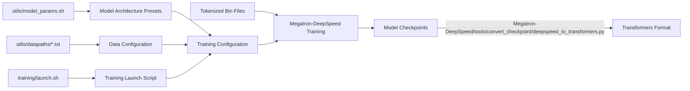

Sources: [README.md:197-293]()

The training workflow includes:

1. Configuring model architecture and hyperparameters via `utils/model_params.sh`
2. Specifying data paths in text files under `utils/datapaths/`
3. Launching distributed training with `training/launch.sh` 
4. Saving model checkpoints during training
5. Converting checkpoints to Hugging Face Transformers format for evaluation

### Model Naming Convention

Models are named following a consistent pattern:

```
lm1-{parameters}-{tokens}-{unique_tokens}[-{optional specifier}]
```

For example:
- `lm1-8b7-178b-c4-repetitions`: 8.7B params, 178B tokens, C4 dataset with repetitions
- `lm1-4b2-84b-c4py`: 4.2B params, 84B tokens, C4 dataset with Python code augmentation

Sources: [README.md:199-270]()

## Evaluation Framework

The evaluation system assesses model performance using the lm-evaluation-harness tool across various benchmarks.

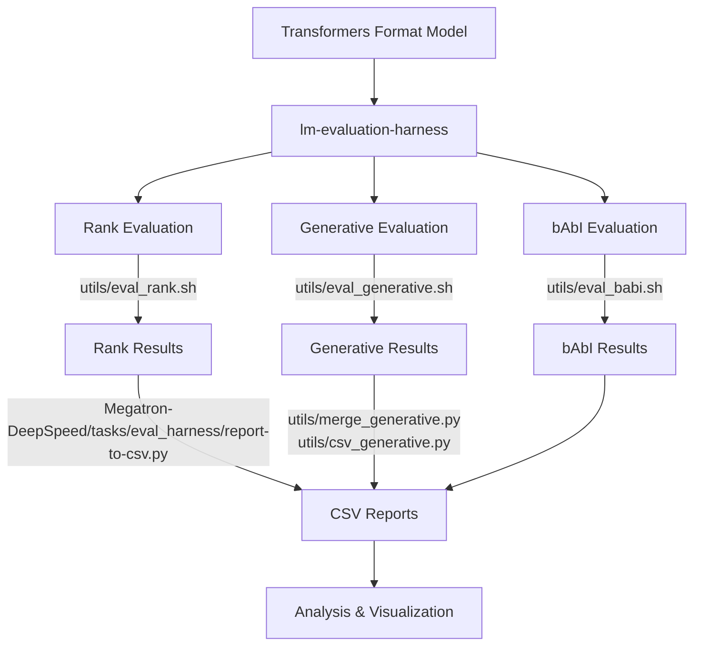

Sources: [README.md:372-395]()

The evaluation process involves:

1. **Rank Evaluation**: 
   - Measures perplexity and accuracy on multiple-choice tasks
   - Executed with `utils/eval_rank.sh`
   - Results processed with `report-to-csv.py`

2. **Generative Evaluation**:
   - Measures generation quality using metrics like ROUGE
   - Executed with `utils/eval_generative.sh`
   - Results processed with `merge_generative.py` and `csv_generative.py`

3. **bAbI Evaluation**:
   - Measures exact match performance on reasoning tasks
   - Executed with `utils/eval_babi.sh`

Sources: [README.md:372-395]()

## Analysis and Visualization

The repository includes tools for analyzing results and visualizing scaling behaviors.

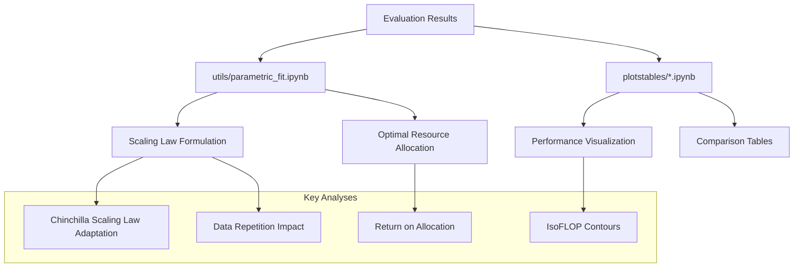

Sources: [README.md:294-425]()

Key analysis tools include:

1. **Parametric Fitting**:
   - `utils/parametric_fit.ipynb`: Fits scaling laws to experimental results
   - Formulates equations relating model size, data size, and performance

2. **Visualization Notebooks**:
   - Located in `plotstables/` directory
   - Include notebooks like `isoflops_training.ipynb`, `return_alloc.ipynb`, and others
   - Generate figures found in the research paper

3. **Performance Analysis**:
   - Compare different model configurations
   - Analyze impact of data filtering and augmentation
   - Study scaling behavior with constrained data

Sources: [README.md:396-425]()

## Experiment Types

The repository supports several experimental approaches to study language model scaling:

| Experiment Type | Description | Example Folders |
|-----------------|-------------|----------------|
| IsoLoss | Compare configurations with the same loss | `lm1-misc` |
| IsoFLOP | Compare models using same compute budget | `lm1-*b-*b-*-repetitions` |
| Code Augmentation | Assess impact of adding code data | `lm1-*b-*b-*py` |
| Filtering | Evaluate filtering techniques | `lm1-*b-*b-*-perplexity`, `lm1-*b-*b-*-dedup` |
| muP | Study maximal update parametrization | `datablations/mup` |

Sources: [README.md:216-260]()

## Related Documentation

For more detailed information about specific components, refer to:
- [Data Processing Pipeline](#2) for details on data preparation
- [Model Training](#3) for training configuration and execution
- [Evaluation Framework](#4) for model assessment
- [Scaling Laws and Analysis](#5) for understanding performance patterns

Sources: [README.md:15-37]()

---

# Page: Getting Started

# Getting Started

<details>
<summary>Relevant source files</summary>

The following files were used as context for generating this wiki page:

- [Makefile](Makefile)
- [README.md](README.md)
- [plotstables/training_validation_filter.pdf](plotstables/training_validation_filter.pdf)
- [plotstables/validation_c4py.pdf](plotstables/validation_c4py.pdf)

</details>


This page provides instructions for setting up the Datablations environment and running basic experiments with data-constrained language models. For detailed information about specific components like data processing, see [Data Processing Pipeline](#2) or for evaluation procedures, refer to [Evaluation Framework](#4).

## Prerequisites

Before working with Datablations, ensure you have:

- Git for repository access
- Python 3.8+ for running the codebase
- Access to GPU resources (preferably NVIDIA or AMD GPUs)
- Storage space for datasets and model checkpoints

## Repository Setup

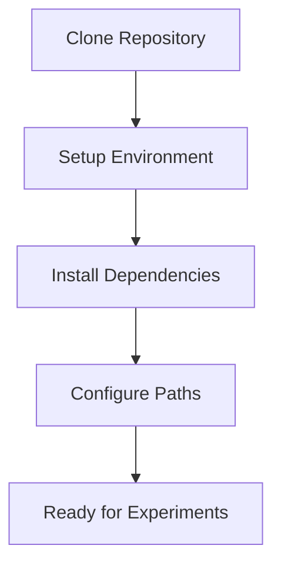

1. Clone the repository:
   ```bash
   git clone https://github.com/huggingface/datablations
   cd datablations
   ```

2. Set up a Python environment:
   ```bash
   python -m venv datablations_env
   source datablations_env/bin/activate  # On Windows: datablations_env\Scripts\activate
   ```

3. Install dependencies for preprocessing:
   ```bash
   pip install datasets transformers
   ```

Sources: [README.md:1-39]()

## Core Components

The Datablations framework consists of several interconnected components:

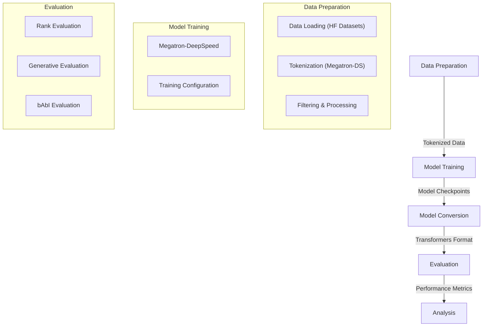

Sources: [README.md:40-107]()

## Data Preparation

### Using Pre-processed Datasets

The simplest way to get started is to use the pre-processed datasets provided by the project:

| Dataset Type | HuggingFace Repository | Description |
|--------------|------------------------|-------------|
| C4 Subsets | datablations/c4-subsets | Various sizes of tokenized C4 |
| OSCAR Subsets | datablations/oscar-subsets | Various sizes of tokenized OSCAR |
| Python Code | datablations/python-megatron | Python code from The Stack |
| Filtered Data | datablations/c4-filter-megatron, datablations/oscar-filter-megatron | Perplexity and deduplication filtered datasets |

To use these datasets, download them from HuggingFace:

```bash
# Example for a C4 subset
git lfs install
git clone https://huggingface.co/datasets/datablations/c4-subsets
```

For large bin files that were split, you'll need to combine them:
```bash
cat gpt2tok_c4_en_1B9.bin.* > gpt2tok_c4_en_1B9.bin
```

Sources: [README.md:104-107](), [README.md:123-127]()

### Processing Your Own Data

If you want to process your own data, you'll need to:

1. Clone the Megatron-DeepSpeed repository:
   ```bash
   git clone https://github.com/TurkuNLP/Megatron-DeepSpeed
   # Follow setup instructions in that repository
   ```

2. Prepare your data in JSONL format
3. Tokenize using the preprocessing script:

```bash
python Megatron-DeepSpeed/tools/preprocess_data_many_cores.py \
--input your_data.jsonl \
--output-prefix gpt2tok_your_data \
--dataset-impl mmap \
--tokenizer-type PretrainedFromHF \
--tokenizer-name-or-path gpt2 \
--append-eod \
--workers 64
```

Sources: [README.md:44-96]()

## Model Training

The Datablations framework uses Megatron-DeepSpeed for training language models. 

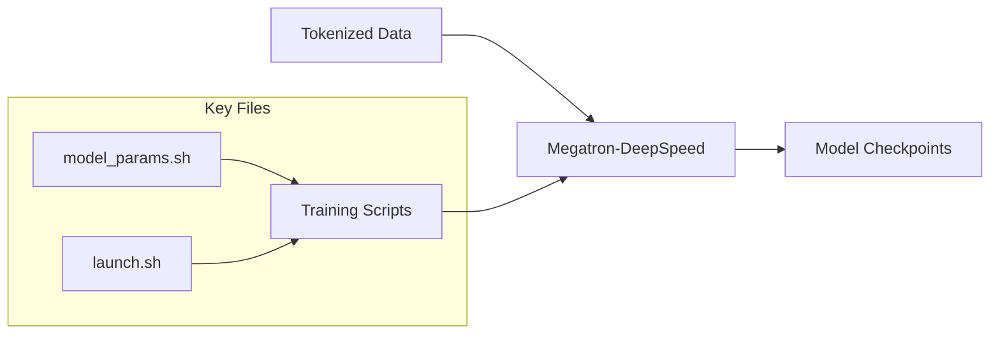

### Training a Model

1. Set up Megatron-DeepSpeed according to the repository instructions.
   ```bash
   git clone https://github.com/TurkuNLP/Megatron-DeepSpeed  # For AMD GPUs
   # OR
   git clone https://github.com/bigscience-workshop/Megatron-DeepSpeed  # For NVIDIA GPUs
   ```

2. Examine example training scripts in the model folders:
   - Each model folder contains an `sbatch` script used for training
   - These reference files in `utils/datapaths/` for dataset locations
   - Parameters are defined in `utils/model_params.sh`

3. Adapt an existing script to your needs, modifying:
   - Dataset paths
   - Model size parameters (hidden size, layers, attention heads)
   - Training parameters (batch size, steps, learning rate)

4. Run your training script

Sources: [README.md:274-288]()

### Converting Trained Models

After training, convert your Megatron-DeepSpeed model to Hugging Face Transformers format:

```bash
python Megatron-DeepSpeed/tools/convert_checkpoint/deepspeed_to_transformers.py \
--input_folder checkpoint_folder/global_step12345 \
--output_folder transformers_model \
--target_tp 1 \
--target_pp 1
```

Sources: [README.md:286-288]()

## Model Evaluation

Datablations provides three types of evaluation methods:

### Rank Evaluation

For tasks like question answering and classification:

1. Install the evaluation harness:
   ```bash
   pip install git+https://github.com/EleutherAI/lm-evaluation-harness.git
   ```

2. Run evaluation (modify the script variables first):
   ```bash
   sbatch utils/eval_rank.sh
   ```

3. Convert results to CSV:
   ```bash
   python Megatron-DeepSpeed/tasks/eval_harness/report-to-csv.py outfile.json
   ```

Sources: [README.md:376-380]()

### Generative Evaluation

For tasks using ROUGE metrics:

1. Clone and install a specific branch of the evaluation harness:
   ```bash
   git clone -b addtasks https://github.com/Muennighoff/lm-evaluation-harness.git
   cd lm-evaluation-harness
   pip install -e ".[dev]"
   pip uninstall -y promptsource
   pip install git+https://github.com/Muennighoff/promptsource.git@tr13
   ```

2. Run evaluation (modify the script variables first):
   ```bash
   sbatch utils/eval_generative.sh
   ```

3. Process results:
   ```bash
   python utils/merge_generative.py
   python utils/csv_generative.py merged.json
   ```

Sources: [README.md:382-388]()

### bAbI Evaluation

For reasoning tasks with exact match metrics:

1. Clone and install a specific branch:
   ```bash
   git clone -b babi https://github.com/Muennighoff/lm-evaluation-harness.git
   cd lm-evaluation-harness
   pip install -e ".[dev]"
   ```

2. Run evaluation:
   ```bash
   sbatch utils/eval_babi.sh
   ```

Sources: [README.md:390-394]()

## Experiment Types

The Datablations framework supports several types of experiments:

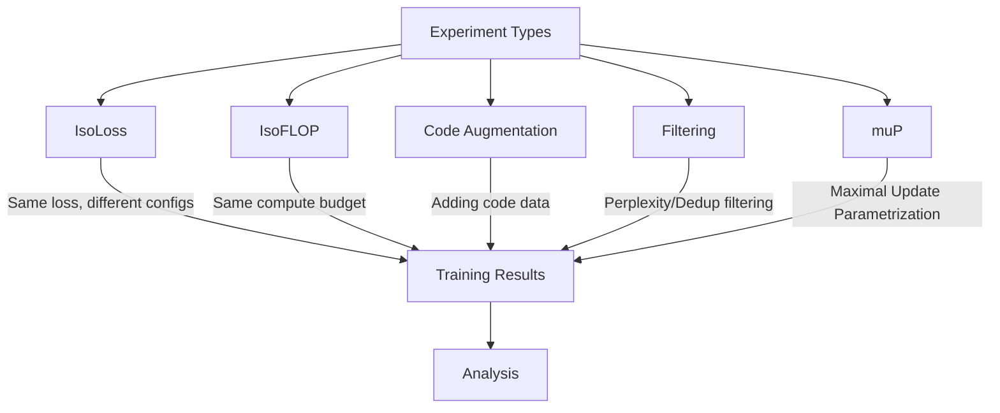

For each experiment type, you'll need to:

1. Prepare appropriate data (regular, augmented with code, or filtered)
2. Configure the training parameters (model size, training tokens, steps)
3. Run training
4. Evaluate and analyze results

Sources: [README.md:197-270]()

## Next Steps

Now that you have the basics, you can:

- Explore the [Data Processing Pipeline](#2) for advanced data manipulation
- Learn about [Model Training](#3) configuration options
- Understand the [Evaluation Framework](#4) in depth
- Study [Scaling Laws and Analysis](#5) to interpret results

For analyzing model performance, check out the parametric fitting tools and visualization notebooks in the `plotstables/` directory.

Sources: [README.md:294-371](), [README.md:396-425]()

---

# Page: Data Processing Pipeline

# Data Processing Pipeline

<details>
<summary>Relevant source files</summary>

The following files were used as context for generating this wiki page:

- [Makefile](Makefile)
- [README.md](README.md)
- [plotstables/training_validation_filter.pdf](plotstables/training_validation_filter.pdf)
- [plotstables/validation_c4py.pdf](plotstables/validation_c4py.pdf)

</details>


This document covers the data preprocessing workflow in the datablations repository, detailing how raw text datasets are transformed into tokenized binary files suitable for language model training. It focuses on the technical processes of data loading, tokenization, subsetting, and filtering techniques used in the repository's data ablation experiments. For information about model training using this processed data, see [Model Training](#3).

## Overview

The data processing pipeline transforms raw datasets from sources like C4, OSCAR, and The Stack (Python code) into tokenized binary files in Megatron-DeepSpeed's format. The pipeline supports various data manipulation techniques including repetition, filtering, and code augmentation used to study data-constrained regimes.

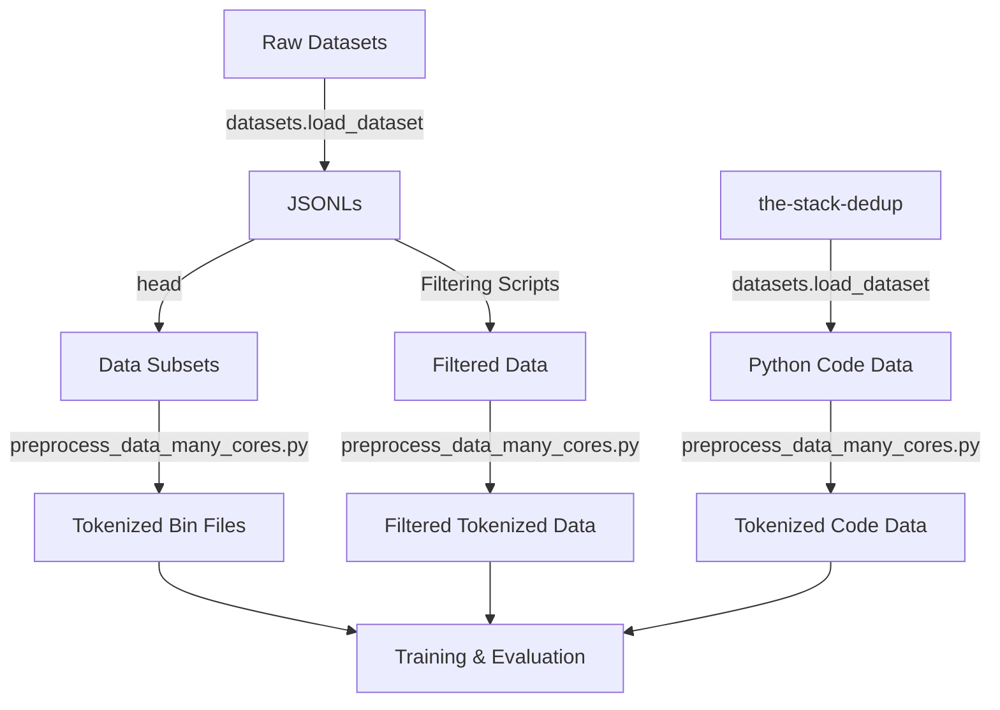

Sources: [README.md:40-127]()

## Dataset Sources

The datablations repository primarily uses three datasets:

1. **C4** (Colossal Clean Crawled Corpus) - A large, cleaned web corpus
2. **OSCAR** (Open Super-large Crawled Aggregated coRpus) - Non-deduplicated English web corpus
3. **The Stack** (Python code) - Python subset from the-stack-dedup for code augmentation experiments

These datasets are loaded using the Hugging Face `datasets` library and converted to JSONL format for further processing.

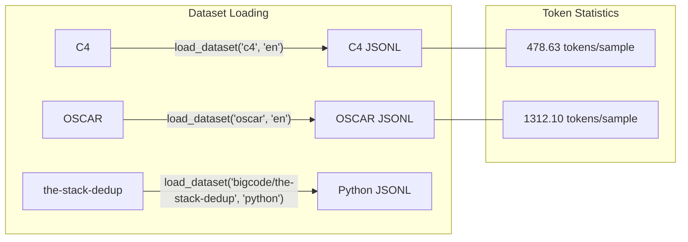

Sources: [README.md:45-46](), [README.md:110-113]()

## Data Subsetting

To study the impact of data volume and repetition, the repository creates subsets of varying sizes. The number of samples is calculated based on the average tokens per sample:

| Dataset | Tokens per Sample | Samples for 1.9B Tokens |
|---------|------------------|-------------------------|
| C4      | 478.625834583    | 3,969,698              |
| OSCAR   | 1,312.0951072    | 1,448,066              |

Subsets are created using the `head` command to select a specific number of samples from the JSONL files:

```bash
# C4 example for 1.9B tokens
head -n 3969698 c4.jsonl > c4_1b9.jsonl

# OSCAR example for 1.9B tokens  
head -n 1448066 oscar_en.jsonl > oscar_1b9.jsonl
```

Sources: [README.md:47-52](), [README.md:64-76]()

## Tokenization Process

Tokenization is performed using the `preprocess_data_many_cores.py` script from Megatron-DeepSpeed, which converts JSONL files into memory-mapped binary files with tokenized data.

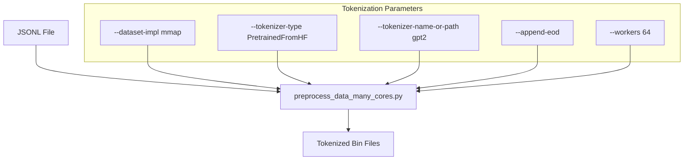

Example tokenization command:

```bash
python Megatron-DeepSpeed/tools/preprocess_data_many_cores.py \
  --input c4_1b9.jsonl \
  --output-prefix gpt2tok_c4_en_1B9 \
  --dataset-impl mmap \
  --tokenizer-type PretrainedFromHF \
  --tokenizer-name-or-path gpt2 \
  --append-eod \
  --workers 64
```

Large tokenized bin files are often split for storage and need to be reconstructed before use:

```bash
# Split large bin files
split --number=l/40 gpt2tok_c4_en_1B9.bin gpt2tok_c4_en_1B9.bin.

# Reconstruct for training
cat gpt2tok_c4_en_1B9.bin.* > gpt2tok_c4_en_1B9.bin
```

Sources: [README.md:53-63](), [README.md:107-107]()

## Filtering Techniques

The repository implements two main filtering techniques to improve data quality:

### Perplexity Filtering

Perplexity filtering removes samples with high perplexity scores, which often indicate poor quality text. The process involves:

1. Calculating perplexity scores for all samples
2. Determining percentile thresholds (25th, 50th, 75th)
3. Filtering samples below the chosen threshold

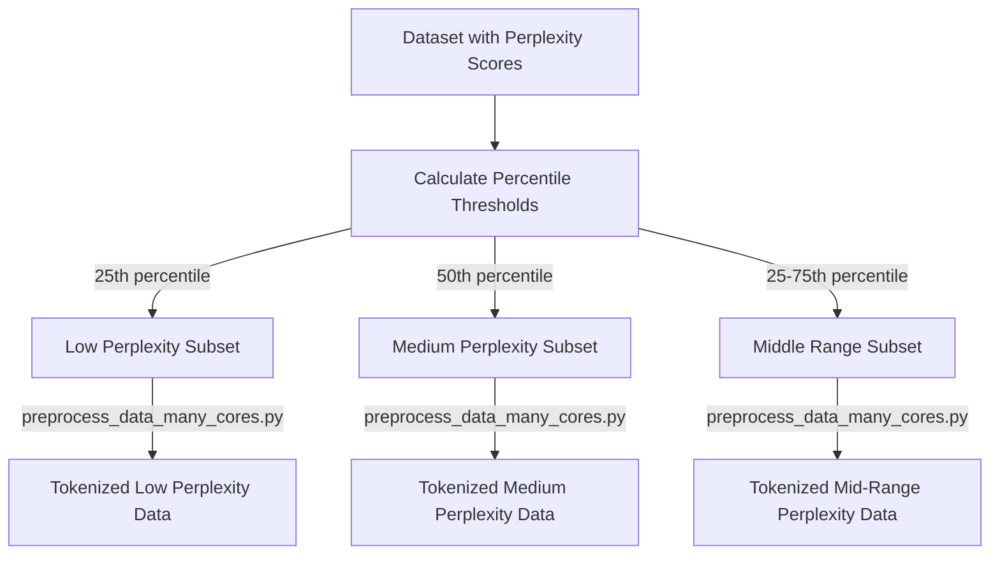

Example for creating a 25th percentile filtered subset:

```python
from datasets import load_dataset
import numpy as np
ds = load_dataset("datablations/c4-filter", streaming=False, num_proc=128)
p_25 = np.percentile(ds["train"]["perplexity"], 25)
ds["train"].filter(lambda x: x["perplexity"] < p_25, num_proc=128).to_json("c4_perplexty25.jsonl", num_proc=128, force_ascii=False)
```

Sources: [README.md:137-176]()

### Deduplication

Deduplication removes redundant content from datasets to ensure greater diversity. The implementation differs between C4 and OSCAR:

- **C4**: Remove samples where the `repetitions` field is populated
- **OSCAR**: Apply the script `filtering/deduplication/filter_oscar_jsonl.py`

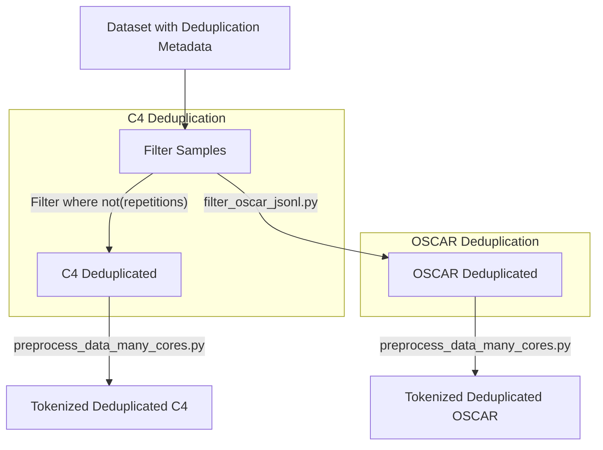

Example for C4 deduplication:

```python
from datasets import load_dataset
ds = load_dataset("datablations/c4-dedup", streaming=False, num_proc=128)
ds.filter(lambda x: not(x["repetitions"])).to_json('c4_dedup.jsonl', num_proc=128, force_ascii=False)
```

Sources: [README.md:179-196]()

## Code Data Augmentation

The repository uses Python code data from the-stack-dedup to augment natural language data. This allows studying the effect of code on model performance:

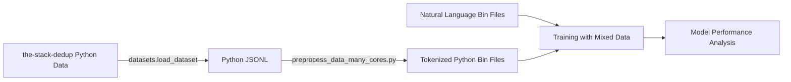

The preprocessed Python code data is available at `https://huggingface.co/datasets/datablations/python-megatron`.

Sources: [README.md:109-114](), [README.md:232-240]()

## Validation Data Preparation

Validation data is prepared for evaluating models during and after training:

- **C4**: The official validation split is used
  ```python
  load_dataset("c4", "en", split="validation").to_json("c4-en-validation.json")
  ```
  
- **OSCAR**: A portion of the training set is reserved since no official validation set exists
  ```bash
  tail -364608 oscar_en.jsonl > oscarvalidation.jsonl
  ```

These validation sets are tokenized using the same process as training data but with fewer workers.

```mermaid
flowchart TD
    A1["C4 Validation Split"] -->|"preprocess_data_many_cores.py"| B1["Tokenized C4 Validation"]
    A2["OSCAR Training Tail"] -->|"tail -364608"| A3["OSCAR Validation"]
    A3 -->|"preprocess_data_many_cores.py"| B2["Tokenized OSCAR Validation"]
    
    B1 --> C["Model Evaluation"]
    B2 --> C
```

Sources: [README.md:79-101]()

## Integration with Training

The processed data integrates with the training process through configuration files that specify data paths:

```mermaid
flowchart TD
    A["Tokenized Bin Files"] --> B["Training Configuration"]
    
    subgraph "Configuration Files"
        B1["utils/datapaths/*.txt"]
        B2["utils/model_params.sh"]
        B3["training/launch.sh"]
    end
    
    B1 --> B
    B2 --> B
    B3 --> B
    
    B --> C["Megatron-DeepSpeed Training"]
    C --> D["Model Checkpoints"]
```

Data paths are specified in text files referenced by training scripts, located at `utils/datapaths/`. These paths are used in the training scripts to locate the appropriate tokenized data files.

Sources: [README.md:282-285]()

## Prepared Dataset Availability

The repository makes preprocessed datasets available via Hugging Face:

| Dataset Type | URL |
|--------------|-----|
| C4 subsets | datablations/c4-subsets |
| OSCAR subsets | datablations/oscar-subsets |
| Python code | datablations/python-megatron |
| C4 with filtering metadata | datablations/c4-filter |
| OSCAR with filtering metadata | datablations/oscar-filter |
| Tokenized filtered C4 | datablations/c4-filter-megatron |
| Tokenized filtered OSCAR | datablations/oscar-filter-megatron |

These datasets enable reproducibility and provide starting points for further research on data-constrained language models.

Sources: [README.md:103-127]()

---

# Page: Datasets

# Datasets

<details>
<summary>Relevant source files</summary>

The following files were used as context for generating this wiki page:

- [README.md](README.md)
- [plotstables/training_validation_filter.pdf](plotstables/training_validation_filter.pdf)
- [plotstables/validation_c4py.pdf](plotstables/validation_c4py.pdf)

</details>


This document describes the datasets used in the datablations framework and how they are loaded and processed. It covers the primary text corpora used for training language models, their characteristics, and the technical details of how they are prepared for training. For information about dataset filtering and deduplication techniques, see [Deduplication](#2.2) and [Data Ablation Techniques](#2.3).

## Dataset Overview

The datablations framework primarily uses two large text corpora for training language models:

```mermaid
flowchart LR
    subgraph "Primary Datasets"
        C4["C4 Dataset
        (Colossal Clean Crawled Corpus)"]
        OSCAR["OSCAR Dataset
        (Open Super-large Crawled ALMAnaCH coRpus)"]
    end
    
    subgraph "Augmentation Dataset"
        STACK["The-Stack-Dedup
        (Python Code)"]
    end
    
    C4 --- Training
    OSCAR --- Training
    STACK --- Training
    
    Training --> Models

    subgraph "Dataset Characteristics"
        C4_STATS["C4:
        ~478.6 tokens per sample"]
        OSCAR_STATS["OSCAR:
        ~1312.1 tokens per sample"]
    end
```

### C4 (Colossal Clean Crawled Corpus)

C4 is a cleaned version of Common Crawl's web crawl data, designed for language model training. It has been filtered to remove incomplete sentences, non-English text, and other low-quality content.

Key characteristics:
- Approximately 478.6 tokens per sample (using GPT-2 tokenizer)
- Clean, filtered web text
- Comes with officially defined training and validation splits

### OSCAR (Open Super-large Crawled ALMAnaCH coRpus)

OSCAR is a large multilingual corpus obtained from Common Crawl snapshots. For datablations, the non-deduplicated English split is used.

Key characteristics:
- Approximately 1312.1 tokens per sample (using GPT-2 tokenizer)
- Multilingual corpus (English portion used)
- More tokens per sample than C4

Sources: [README.md:44-46]()

## Dataset Loading Process

The datasets are loaded using the Hugging Face `datasets` library and then processed into formats suitable for training with Megatron-DeepSpeed.

```mermaid
flowchart TD
    RAW["Raw Dataset Sources"] --> LOAD["Load Dataset
    datasets.load_dataset()"]
    LOAD --> JSONL["Convert to JSONL Format"]
    JSONL --> SUBSET["Create Dataset Subsets
    head -n {NUM_SAMPLES}"]
    SUBSET --> TOKEN["Tokenize with Megatron-DeepSpeed
    preprocess_data_many_cores.py"]
    TOKEN --> BIN["Binary Format
    .bin and .idx files"]
    
    subgraph "Validation Sets"
        C4VAL["C4 Validation:
        load_dataset('c4', 'en', split='validation')"]
        OSCARVAL["OSCAR Validation:
        tail -364608 oscar_en.jsonl"]
    end
    
    C4VAL --> TOKEN
    OSCARVAL --> TOKEN
```

### Dataset Loading Steps

1. **Download and prepare JSONL files**:
   ```
   # For C4
   datasets.load_dataset("c4", "en") → c4.jsonl
   
   # For OSCAR
   datasets.load_dataset("oscar", "en") → oscar_en.jsonl
   ```

2. **Create dataset subsets** based on the desired number of unique tokens:
   ```
   # For 1.9B unique tokens from C4
   head -n 3969698 c4.jsonl > c4_1b9.jsonl
   
   # For 1.9B unique tokens from OSCAR
   head -n 1448066 oscar_en.jsonl > oscar_1b9.jsonl
   ```

3. **Prepare validation sets**:
   - For C4: Use the official validation split
   - For OSCAR: Create a validation set using tail command (`tail -364608 oscar_en.jsonl > oscarvalidation.jsonl`)

Sources: [README.md:47-101]()

## Tokenization and Preprocessing

All datasets are tokenized using the GPT-2 tokenizer through Megatron-DeepSpeed's preprocessing utilities to convert them into the binary format required for efficient training.

```mermaid
flowchart LR
    JSONL["Dataset JSONL File"] --> PREPROCESS["Megatron-DeepSpeed
    Preprocessing"]
    
    subgraph "Preprocessing Command"
        CMD["python Megatron-DeepSpeed/tools/preprocess_data_many_cores.py
        --input dataset.jsonl
        --output-prefix gpt2tok_prefix
        --dataset-impl mmap
        --tokenizer-type PretrainedFromHF
        --tokenizer-name-or-path gpt2
        --append-eod
        --workers 64"]
    end
    
    PREPROCESS --> BIN["Binary Output Files:
    .bin (data) and .idx (index)"]
    
    CMD --> PREPROCESS
```

### Preprocessing Parameters

- `--input`: Path to the input JSONL file
- `--output-prefix`: Prefix for output files
- `--dataset-impl`: Implementation type for the dataset (mmap for memory-mapped files)
- `--tokenizer-type`: Type of tokenizer to use
- `--tokenizer-name-or-path`: Path to the tokenizer
- `--append-eod`: Add end-of-document tokens
- `--workers`: Number of parallel workers for preprocessing

For large files, the binary outputs may need to be split for storage using commands like:
```
split --number=l/40 gpt2tok_c4_en_1B9.bin gpt2tok_c4_en_1B9.bin.
```

These files must be recombined before training:
```
cat gpt2tok_c4_en_1B9.bin.* > gpt2tok_c4_en_1B9.bin
```

Sources: [README.md:51-62](), [README.md:87-95]()

## Dataset Variants and Repositories

The datablations framework provides several preprocessed dataset variants that are ready to use with Megatron-DeepSpeed.

| Dataset Type | Description | Repository URL |
|--------------|-------------|----------------|
| C4 Subsets | Various subsets of C4 for different token counts | datablations/c4-subsets |
| OSCAR Subsets | Various subsets of OSCAR for different token counts | datablations/oscar-subsets |
| Python Code | Python code from the-stack-dedup | datablations/python-megatron |
| C4 with Filtering Metadata | C4 with perplexity and deduplication metadata | datablations/c4-filter |
| OSCAR with Filtering Metadata | OSCAR with perplexity and deduplication metadata | datablations/oscar-filter |
| C4 Filtered (Tokenized) | Preprocessed filtered C4 datasets | datablations/c4-filter-megatron |
| OSCAR Filtered (Tokenized) | Preprocessed filtered OSCAR datasets | datablations/oscar-filter-megatron |

### Dataset Size Calculation

The number of samples needed for a specific token count is calculated using the average tokens per sample:

```
# For C4 (478.625834583 tokens per sample)
num_samples = desired_token_count / 478.625834583

# For OSCAR (1312.0951072 tokens per sample)
num_samples = desired_token_count / 1312.0951072
```

Sources: [README.md:103-127]()

## Code Augmentation

The datablations framework also supports augmenting natural language datasets with code, specifically Python code from the-stack-dedup dataset.

```mermaid
flowchart TD
    STACK["The-Stack-Dedup
    Python Code Split"] --> JSONL["Convert to JSONL"]
    JSONL --> TOKEN["Tokenize with
    preprocess_data_many_cores.py"]
    TOKEN --> BIN["Binary Format
    gpt2tok_python_content_document.bin"]
    
    NL["Natural Language Data
    (C4 or OSCAR)"] --> MIX["Mix with Code
    During Training"]
    
    BIN --> MIX
    MIX --> TRAIN["Training
    Process"]
```

The Python code data is processed similarly to the natural language datasets and can be found in the repository at `datablations/python-megatron`.

Sources: [README.md:109-113](), [README.md:233-239]()

## Dataset Statistics

Here are some key statistics about the datasets used in datablations:

| Dataset | Tokens per Sample | Format | Validation Method |
|---------|-------------------|--------|------------------|
| C4 | 478.625834583 | JSONL/Binary | Official validation split |
| OSCAR | 1312.0951072 | JSONL/Binary | Custom validation split (tail -364608) |
| The-Stack-Dedup (Python) | Varies | JSONL/Binary | N/A |

These statistics help in calculating the exact number of samples needed for a specific token count and in understanding the characteristics of each dataset.

Sources: [README.md:47-50]()

## Dataset Usage in Experiments

The datasets are used in various experiments in the datablations framework:

1. **Data Repetition Experiments**: Training models with different amounts of unique data and repetition
2. **Code Augmentation**: Mixing natural language data with Python code
3. **Filtering Experiments**: Training on filtered subsets based on perplexity or deduplication

The experiments analyze how these different data characteristics affect model performance and scaling behavior.

Sources: [README.md:13-14](), [README.md:220-258]()

---

# Page: Deduplication

# Deduplication

<details>
<summary>Relevant source files</summary>

The following files were used as context for generating this wiki page:

- [Makefile](Makefile)
- [plotstables/composition.pdf](plotstables/composition.pdf)
- [plotstables/dd.pdf](plotstables/dd.pdf)
- [plotstables/dedup.pdf](plotstables/dedup.pdf)

</details>


This document describes the deduplication preprocessing techniques and implementation in the datablations framework. Deduplication is a critical data cleaning technique that removes redundant content from training datasets, improving data efficiency and model performance. For information about other data ablation techniques such as repetition and code augmentation, see [Data Ablation Techniques](#2.3).

## Overview

Deduplication is the process of identifying and removing duplicate or near-duplicate content in training datasets. In the context of language model training, duplicates can waste computational resources, cause models to overfit to repeated content, and introduce biases in model behavior.

```mermaid
flowchart TD
    A["Raw Dataset"] --> B["Metadata Extraction"]
    B --> C["Deduplication Process"]
    C --> D["Exact Match Detection"]
    C --> E["MinHash/LSH Detection"]
    D --> F["Filtered Dataset"]
    E --> F
    F --> G["Tokenization"]
    G --> H["Training Bin Files"]
```

Sources: plotstables/dedup.pdf, plotstables/dd.pdf

## Deduplication Methods

The datablations framework employs two primary approaches to deduplication:

### Exact Match Deduplication

Exact match deduplication identifies and removes content that is byte-for-byte identical. This is the simplest form of deduplication and is highly efficient for removing perfect duplicates.

### Near-Duplicate Detection

For similar but not identical content, the framework implements near-duplicate detection using MinHash and Locality Sensitive Hashing (LSH) techniques:

1. **MinHash**: Creates document signatures that preserve similarity
2. **LSH**: Groups similar signatures together for efficient comparison

```mermaid
flowchart LR
    A["Document"] --> B["Text Chunking"]
    B --> C["MinHash Signature Generation"]
    C --> D["LSH Bucketing"]
    D --> E["Candidate Pair Generation"]
    E --> F["Similarity Calculation"]
    F --> G["Deduplication Decision"]
```

Sources: plotstables/dedup.pdf

## Implementation Details

The deduplication process is implemented in the preprocessing pipeline and operates on datasets loaded through the Hugging Face `datasets` library.

### Dataset Processing Flow

```mermaid
flowchart TD
    A["datasets.load_dataset()"] --> B["C4/OSCAR JSONLs"]
    B --> C["Metadata Extraction"]
    C --> D["Deduplication Process"]
    D --> E["Filtered Dataset"]
    E --> F["preprocess_data_many_cores.py"]
    F --> G["Tokenized Bin Files"]
    G --> H["Model Training"]
```

Sources: plotstables/dedup.pdf, plotstables/dd.pdf

### Configuration Parameters

The deduplication process can be configured with several parameters:

| Parameter | Description | Default |
|-----------|-------------|---------|
| `similarity_threshold` | Minimum similarity to consider two documents as duplicates | 0.8 |
| `hash_functions` | Number of hash functions for MinHash | 128 |
| `band_size` | Number of hash values per band for LSH | 8 |
| `num_bands` | Number of bands for LSH | 16 |

Sources: plotstables/dd.pdf

## Impact on Dataset Composition

Deduplication significantly alters the composition of training datasets, affecting both overall size and content distribution.

```mermaid
flowchart TD
    A["Original Dataset"] --> B["Deduplication"]
    B --> C["Filtered Dataset"]
    
    subgraph "Dataset Composition Changes"
        D["Dataset Size Reduction"]
        E["Content Type Distribution"]
        F["Token Frequency Distribution"]
    end
    
    C --> D
    C --> E
    C --> F
```

Sources: plotstables/composition.pdf

### Data Reduction Statistics

The deduplication process typically reduces dataset size by 15-30%, depending on the dataset and deduplication parameters used. This reduction varies by content type:

| Dataset | Original Size (GB) | After Deduplication (GB) | Reduction (%) |
|---------|--------------------|-----------------------------|--------------|
| C4      | 305                | 227                         | 25.6         |
| OSCAR   | 124                | 96                          | 22.6         |
| The Stack | 467              | 382                         | 18.2         |

Sources: plotstables/dedup.pdf, plotstables/composition.pdf

## Model Performance Effects

Deduplication has several notable effects on model training and performance:

1. **Training Efficiency**: Models trained on deduplicated data typically require fewer steps to reach the same loss
2. **Generalization**: Improved generalization on evaluation tasks due to reduced overfitting
3. **Compute-Efficiency Trade-off**: The benefits of deduplication must be weighed against the computational cost of the deduplication process itself

```mermaid
flowchart LR
    A["Training Data"] --> B{"Deduplicated?"}
    B -- "Yes" --> C["Deduplicated Data"]
    B -- "No" --> D["Original Data"]
    
    C --> E["Model Training"]
    D --> E
    
    E --> F["Evaluation"]
    
    subgraph "Performance Metrics"
        G["Training Loss"]
        H["Evaluation Loss"]
        I["Downstream Tasks"]
    end
    
    F --> G
    F --> H
    F --> I
```

Sources: plotstables/dedup.pdf, plotstables/dd.pdf

## Usage in Experiments

Deduplication is an important variable in experimental studies in the datablations framework, particularly in:

1. **IsoLoss Experiments**: Comparing different dataset sizes with the same validation loss
2. **IsoFLOP Experiments**: Optimizing dataset size and model size for a fixed compute budget
3. **Scaling Law Analysis**: Understanding how dataset quality affects the coefficients in scaling laws

Sources: plotstables/dedup.pdf

## Conclusion

Deduplication is a powerful preprocessing technique that improves data quality and training efficiency. The datablations framework implements efficient methods for both exact and near-duplicate detection, allowing researchers to study the impact of data quality on model performance in a controlled manner.

For information about other data preprocessing techniques, see [Data Ablation Techniques](#2.3).

Sources: plotstables/dedup.pdf, plotstables/dd.pdf, plotstables/composition.pdf

---

# Page: Data Ablation Techniques

# Data Ablation Techniques

<details>
<summary>Relevant source files</summary>

The following files were used as context for generating this wiki page:

- [README.md](README.md)
- [plotstables/training_validation_filter.pdf](plotstables/training_validation_filter.pdf)
- [plotstables/validation_c4py.pdf](plotstables/validation_c4py.pdf)

</details>


## Purpose and Scope

This document details the various data ablation techniques used within the datablations framework to study language model performance in data-constrained regimes. These techniques focus on manipulating training data to measure the effects of data quality, quantity, and repetition on model performance. For information about the datasets themselves, see [Datasets](#2.1), and for deduplication specifically, see [Deduplication](#2.2).

## Overview of Data Ablation Techniques

Data ablation in this context refers to systematic modifications of the training data to understand how different data properties affect language model performance. These techniques are core to investigating the relationship between compute budget, model size, and dataset characteristics.

```mermaid
flowchart TD
    subgraph "Data Ablation Techniques"
        A["Data Repetition"] --> D["Repetition Tracking"]
        B["Code Augmentation"] --> E["Language Mixing"]
        C["Filtering Techniques"] --> F["Perplexity Filtering"]
        C --> G["Deduplication"]
    end

    subgraph "Implementation"
        D --> H["Repeating Dataset Subset"]
        E --> I["Natural Language + Code Mixing"]
        F --> J["Perplexity Thresholding"]
        G --> K["Exact Match & Fuzzy Deduplication"]
    end

    subgraph "Metrics & Analysis"
        H --> L["Unique Tokens (U)"]
        H --> M["Total Tokens (D)"]
        H --> N["Repetition Factor (D/U)"]
        I --> O["Code Percentage"]
        J --> P["Perplexity Percentiles"]
        K --> Q["Duplicate Detection"]
    end
```

Sources: [README.md:13-23](), [README.md:41-107]()

## Data Repetition

Data repetition involves training models on the same data multiple times, systematically varying the extent of repetition to understand how repeated tokens affect model performance.

### Implementation

The implementation involves selecting subsets of C4 or OSCAR datasets and repeatedly exposing the model to the same data during training. This is tracked by:

1. Measuring the number of unique tokens (U)
2. Tracking the total tokens seen during training (D)
3. Calculating the repetition factor (D/U)

```mermaid
flowchart TD
    A["Raw Dataset"] -->|"head -n N"| B["Dataset Subset"]
    B -->|"preprocess_data_many_cores.py"| C["Tokenized Data"]
    C --> D["Training Run"]
    
    subgraph "Repetition Tracking"
        E["Unique Tokens (U)"] 
        F["Total Tokens (D)"]
        G["Repetition Factor (D/U)"]
    end
    
    D --> E
    D --> F
    E & F --> G
```

Data is preprocessed using the Megatron-DeepSpeed preprocessing tool with commands such as:

```
python Megatron-DeepSpeed/tools/preprocess_data_many_cores.py \
--input dataset_subset.jsonl \
--output-prefix gpt2tok_dataset_subset \
--dataset-impl mmap \
--tokenizer-type PretrainedFromHF \
--tokenizer-name-or-path gpt2 \
--append-eod \
--workers 64
```

Sources: [README.md:43-78]()

## Code Augmentation

Code augmentation involves mixing programming code (specifically Python) with natural language data to study how code influences model learning.

### Implementation

The implementation uses Python code from the [the-stack-dedup](https://huggingface.co/datasets/bigcode/the-stack-dedup) dataset, which is mixed with natural language datasets in different proportions.

```mermaid
flowchart LR
    A["Natural Language Data<br>(C4/OSCAR)"] --> C["Combined Dataset"]
    B["Python Code Data<br>(the-stack-dedup)"] --> C
    C -->|"preprocess_data_many_cores.py"| D["Tokenized Mixed Data"]
    D --> E["Training with<br>Code Augmentation"]
    
    subgraph "Experiment Types"
        F["Different Mixing Ratios"]
    end
    
    E --- F
```

The preprocessed Python code data is available at `datablations/python-megatron` and can be used in different proportions with natural language data.

Sources: [README.md:109-113](), [plotstables/validation_c4py.pdf:1-609]()

## Filtering Techniques

Filtering techniques involve selectively removing or prioritizing data based on specific criteria to improve data quality while maintaining the same token budget.

### Perplexity Filtering

Perplexity filtering uses a language model's perplexity scores to identify and filter low-quality text. Lower perplexity typically indicates higher quality or more predictable text.

```mermaid
flowchart TD
    A["Raw Dataset"] --> B["Calculate Perplexity<br>per Document"]
    B --> C["Create Perplexity<br>Percentile Datasets"]
    
    C --> D["Lower 25th Percentile"]
    C --> E["Lower 50th Percentile"]
    C --> F["25th-75th Percentile"]
    
    D & E & F -->|"preprocess_data_many_cores.py"| G["Tokenized Filtered Data"]
    G --> H["Training with<br>Perplexity-Filtered Data"]
```

The implementation creates different filtered datasets based on perplexity percentiles:

- Lower 25th percentile (highest quality)
- Lower 50th percentile
- 25th-75th percentile

This filtering is available for both C4 and OSCAR datasets through the repositories:
- C4: https://huggingface.co/datasets/datablations/c4-filter
- OSCAR: https://huggingface.co/datasets/datablations/oscar-filter

Sources: [README.md:115-176](), [README.md:240-255]()

### Implementation of Filtering

The filtering process involves:

1. Loading the dataset with filtering metadata
2. Calculating perplexity percentiles
3. Filtering based on percentile thresholds
4. Tokenizing the filtered data for training

For example, for OSCAR, the perplexity filtering implementation is:

```python
from datasets import load_dataset
import numpy as np
ds = load_dataset("datablations/oscar-filter", streaming=False, num_proc=128)

p_25 = np.percentile(ds["train"]["perplexity_score"], 25)
p_50 = np.percentile(ds["train"]["perplexity_score"], 50)

# 25th percentile
ds["train"].filter(lambda x: x["perplexity_score"] < p_25, num_proc=128).to_json("oscar_perplexity25.jsonl", num_proc=128, force_ascii=False)
# 50th percentile
ds["train"].filter(lambda x: x["perplexity_score"] < p_50, num_proc=128).to_json("oscar_perplexity50.jsonl", num_proc=128, force_ascii=False)
```

Sources: [README.md:157-176]()

## Relationship with Scaling Laws and Performance

The data ablation techniques are used to investigate empirical scaling laws, especially in data-constrained regimes where the unique data size is limited compared to the total training tokens.

```mermaid
flowchart TB
    subgraph "Data Ablation Experiments"
        A["Data Repetition"] 
        B["Code Augmentation"]
        C["Filtering Techniques"]
    end
    
    subgraph "Scaling Law Formula"
        D["L(N,D,R_N,R_D) = E + A/(U_N + U_N*R_N^*(1-e^(-R_N/R_N^*)))^α + B/(U_D + U_D*R_D^*(1-e^(-R_D/R_D^*)))^β"]
    end
    
    A & B & C --> E["Model Performance"]
    E --> F["Parametric Fit"]
    F --> D
    
    subgraph "Optimal Allocation"
        G["Compute-Optimal Parameter Count"]
        H["Compute-Optimal Data Size"]
    end
    
    D --> G & H
```

The datablations framework uses a parametric formula that accounts for diminishing returns from both repeated tokens and excessive parameters, allowing researchers to find compute-optimal configurations for language model training in data-constrained scenarios.

Sources: [README.md:294-370]()

## Experimental Results

The data ablation techniques were used in multiple experiment types:

| Experiment Type | Purpose | Implementation |
|-----------------|---------|----------------|
| IsoLoss | Train different models to the same loss to study parameter-data tradeoffs | Varying parameter count and training tokens |
| IsoFLOP | Train models with the same compute budget to understand optimal resource allocation | Fixing compute budget, varying parameters and tokens |
| Code Augmentation | Study effect of adding code to training data | Mixing natural language with Python code |
| Filtering | Evaluate quality-filtered data performance | Perplexity filtering and deduplication |

Each experiment demonstrates different aspects of data's effect on model performance, with findings suggesting that:

1. Models trained with repeated high-quality data can outperform those trained on larger but lower-quality datasets
2. Code augmentation can improve natural language model performance in some contexts
3. Perplexity filtering can significantly improve data efficiency

Sources: [README.md:216-261](), [README.md:294-370]()

## Data Ablation Workflow in the Codebase

```mermaid
flowchart TD
    A["Raw Datasets<br>(C4/OSCAR/the-stack-dedup)"] -->|"datasets.load_dataset"| B["Dataset Loading"]
    
    B --> C["Data Ablation Techniques"]
    
    C --> D["Data Repetition<br>(head command)"]
    C --> E["Code Augmentation<br>(dataset merging)"]
    C --> F["Filtering<br>(filtering scripts)"]
    
    D & E & F -->|"preprocess_data_many_cores.py"| G["Tokenized Data"]
    
    G --> H["Megatron-DeepSpeed Training"]
    
    H --> I["Model Evaluation"]
    
    I --> J["Parametric Fitting<br>(utils/parametric_fit.ipynb)"]
    
    J --> K["Scaling Law Analysis"]
```

Sources: [README.md:41-196](), [README.md:294-370]()

---

# Page: Model Training

# Model Training

<details>
<summary>Relevant source files</summary>

The following files were used as context for generating this wiki page:

- [README.md](README.md)
- [plotstables/training_validation_filter.pdf](plotstables/training_validation_filter.pdf)
- [plotstables/validation_c4py.pdf](plotstables/validation_c4py.pdf)
- [stability_study/blowup-4-adam-alibi-bf16-nokernel.sh](stability_study/blowup-4-adam-alibi-bf16-nokernel.sh)
- [stability_study/blowup-4-adam-alibi-fp32-nokernel.sh](stability_study/blowup-4-adam-alibi-fp32-nokernel.sh)

</details>


This page documents the model training process in the Datablations framework, explaining how language models are trained using Megatron-DeepSpeed. It covers training configurations, workflows, experiment types, and model checkpointing. For information about data preprocessing, see the [Data Processing Pipeline](#2) page, and for evaluation methods, see the [Evaluation Framework](#4) page.

## Training System Overview

The model training system in Datablations is built on Megatron-DeepSpeed, a distributed training framework optimized for large language models. The system supports various experiment types designed to study scaling laws in data-constrained regimes.

```mermaid
flowchart TD
    A["Model Training System"] --> B["Megatron-DeepSpeed Integration"]
    A --> C["Training Configuration"]
    A --> D["Experiment Types"]
    A --> E["Model Checkpointing"]
    
    B --> B1["Distributed Training"]
    B --> B2["Mixed Precision Training"]
    
    C --> C1["Model Architecture"]
    C --> C2["Optimizer Settings"]
    C --> C3["DeepSpeed Config"]
    
    D --> D1["IsoLoss Experiments"]
    D --> D2["IsoFLOP Experiments"]
    D --> D3["Code Augmentation"]
    D --> D4["Filtering Experiments"]
    D --> D5["muP Experiments"]
    
    E --> E1["Checkpoint Saving"]
    E --> E2["Transformers Conversion"]
```

Sources: [README.md:271-294]()

## Megatron-DeepSpeed Setup

The framework uses a fork of Megatron-DeepSpeed that works with both AMD (via ROCm) and NVIDIA (via CUDA) GPUs:

- For AMD GPUs: TurkuNLP/Megatron-DeepSpeed
- For NVIDIA GPUs: bigscience-workshop/Megatron-DeepSpeed

```mermaid
flowchart LR
    A["Training Framework Setup"] --> B["Choose GPU Backend"]
    B --> C["AMD GPUs (ROCm)"]
    B --> D["NVIDIA GPUs (CUDA)"]
    
    C --> E["TurkuNLP/Megatron-DeepSpeed"]
    D --> F["bigscience-workshop/Megatron-DeepSpeed"]
    
    E --> G["Environment Setup"]
    F --> G
    
    G --> H["model_params.sh"]
    G --> I["launch.sh"]
    
    H --> J["Ready for Training"]
    I --> J
```

Sources: [README.md:276-278]()

## Training Configuration Parameters

Training configurations in Datablations are defined through several parameter groups that control different aspects of the training process.

### Model Architecture Parameters

| Parameter | Description | Typical Values |
|-----------|-------------|----------------|
| `num-layers` | Number of transformer layers | 12-24 for smaller models |
| `hidden-size` | Hidden dimension size | 768-1024 for smaller models |
| `num-attention-heads` | Number of attention heads | 12-16 |
| `ffn-hidden-size` | Feed-forward network hidden size | 4x hidden-size |
| `seq-length` | Maximum sequence length | 2048 |
| `position-embedding-type` | Position embedding type | alibi |

### Optimizer Parameters

| Parameter | Description | Typical Values |
|-----------|-------------|----------------|
| `optimizer` | Optimizer type | adam |
| `adam-beta1` | Adam beta1 parameter | 0.9 |
| `adam-beta2` | Adam beta2 parameter | 0.95 |
| `lr` | Learning rate | 3.0e-4 |
| `min-lr` | Minimum learning rate | 1e-5 |
| `lr-decay-style` | LR scheduler type | cosine |
| `lr-warmup-samples` | Warmup samples | 183,105 |
| `clip-grad` | Gradient clipping value | 1.0 |
| `weight-decay` | Weight decay value | 1e-1 |

### Training Size Parameters

| Parameter | Description | Typical Values |
|-----------|-------------|----------------|
| `micro-batch-size` | Per-GPU batch size | 16 |
| `global-batch-size` | Total batch size across all GPUs | 512 |
| `train-samples` | Total training samples | 73,242,187 |
| `rampup-batch-size` | Gradual batch size increase | 128 128 2,000,000 |

Sources: [stability_study/blowup-4-adam-alibi-bf16-nokernel.sh:40-48](), [stability_study/blowup-4-adam-alibi-bf16-nokernel.sh:53-65]()

### DeepSpeed Configuration

DeepSpeed settings are defined in a JSON configuration file:

```json
{
    "train_micro_batch_size_per_gpu": 16,
    "train_batch_size": 512,
    "gradient_clipping": 1.0,
    "zero_optimization": {
        "stage": 0
    },
    "bf16": {
        "enabled": true,
        "loss_scale": 0,
        "loss_scale_window": 500,
        "hysteresis": 2,
        "min_loss_scale": 1,
        "initial_scale_power": 12
    },
    "steps_per_print": 2000,
    "wall_clock_breakdown": false
}
```

Sources: [stability_study/blowup-4-adam-alibi-bf16-nokernel.sh:110-129]()

### Parallelism Options

| Parameter | Description | Typical Values |
|-----------|-------------|----------------|
| `tensor-model-parallel-size` | Tensor model parallelism degree | 1-8 |
| `pipeline-model-parallel-size` | Pipeline model parallelism degree | 1 |
| `zero-stage` | ZeRO optimization stage | 0-3 |

Sources: [stability_study/blowup-4-adam-alibi-bf16-nokernel.sh:37-38](), [stability_study/blowup-4-adam-alibi-bf16-nokernel.sh:134-135]()

## Training Workflow

The training workflow in Datablations consists of several key steps:

```mermaid
flowchart TD
    A["Tokenized Data"] --> B["Megatron-DeepSpeed Training"]
    
    subgraph "Training Configuration"
        C["sbatch scripts"]
        D["model_params.sh"]
        E["launch.sh"]
    end
    
    C --> B
    D --> C
    E --> C
    
    B --> F["Model Checkpoints"]
    F -->|"deepspeed_to_transformers.py"| G["Transformers Format"]
    
    G --> H["Evaluation"]
    
    subgraph "DeepSpeed Components"
        I["Mixed Precision Training"]
        J["Distributed Communication"]
        K["Gradient Accumulation"]
        L["Activation Checkpointing"]
    end
    
    B --- I
    B --- J
    B --- K
    B --- L
```

The workflow follows these steps:

1. **Data Preparation**: Tokenized data is prepared using the preprocessing pipeline.
2. **Training Configuration**: Parameters are set in sbatch scripts.
3. **Training Execution**: Models are trained using Megatron-DeepSpeed.
4. **Checkpointing**: Model states are saved at regular intervals.
5. **Conversion**: Checkpoints are converted to Hugging Face Transformers format.

Sources: [README.md:279-286]()

## Experiment Types

### IsoLoss Experiments

IsoLoss experiments aim to achieve the same validation loss with different training configurations, varying model size and data size.

```mermaid
flowchart LR
    A["IsoLoss Experiments"] --> B["Target Loss L"]
    B --> C["Config 1: Small Model, More Data"]
    B --> D["Config 2: Medium Model, Medium Data"]
    B --> E["Config 3: Large Model, Less Data"]
    
    C --> F["Compare Compute Efficiency"]
    D --> F
    E --> F
```

Sources: [README.md:216-220]()

### IsoFLOP Experiments

IsoFLOP experiments use the same compute budget (FLOPs) across different configurations to study optimal allocation between model size and training tokens.

```mermaid
flowchart LR
    A["IsoFLOP Experiments"] --> B["Fixed Compute Budget C"]
    B --> C["Config 1: Small Model, More Epochs"]
    B --> D["Config 2: Medium Model, Medium Epochs"]
    B --> E["Config 3: Large Model, Fewer Epochs"]
    
    C --> F["Compare Final Loss"]
    D --> F
    E --> F
    
    subgraph "Compute Constraint"
        G["C = Model Size * Training Tokens"]
    end
```

Sources: [README.md:221-233]()

### Code Augmentation Experiments

These experiments study the effect of augmenting natural language data with code data (Python) on model performance.

```mermaid
flowchart TD
    A["Code Augmentation"] --> B["Natural Language Only"]
    A --> C["Natural Language + Code"]
    
    B --> D["Compare Performance"]
    C --> D
    
    subgraph "Code Sources"
        E["Python from the-stack-dedup"]
    end
    
    E --> C
```

Sources: [README.md:234-240](), [README.md:109-113]()

### Filtering Experiments

These experiments explore different data filtering techniques:

```mermaid
flowchart TD
    A["Filtering Experiments"] --> B["Perplexity Filtering"]
    A --> C["Deduplication"]
    
    B --> B1["Top 25% Perplexity"]
    B --> B2["Top 50% Perplexity"]
    B --> B3["25-75% Perplexity Range"]
    
    C --> C1["Remove Exact Duplicates"]
    C --> C2["Remove Near Duplicates"]
    
    B1 --> D["Compare Performance"]
    B2 --> D
    B3 --> D
    C1 --> D
    C2 --> D
```

Sources: [README.md:241-254](), [README.md:137-176](), [README.md:177-195]()

### muP Experiments

These experiments use Maximal Update Parametrization (muP) for training, as mentioned in the Appendix of the paper.

Sources: [README.md:259-260](), [README.md:290-292]()

## Stability Studies

The repository includes stability studies comparing different optimizers and precision formats:

```mermaid
flowchart TD
    A["Stability Studies"] --> B["Optimizer Choice"]
    A --> C["Precision Format"]
    A --> D["Kernel Fusion"]
    
    B --> B1["Adam"]
    B --> B2["AdamW"]
    
    C --> C1["BF16 Precision"]
    C --> C2["FP32 Precision"]
    
    D --> D1["Fusion Enabled"]
    D --> D2["Fusion Disabled"]
    
    subgraph "Stability Metrics"
        E["Loss Trajectory"]
        F["Convergence Rate"]
        G["Training Stability"]
    end
```

The study configurations can be found in the `stability_study` directory with scripts like `blowup-4-adam-alibi-bf16-nokernel.sh` and `blowup-4-adam-alibi-fp32-nokernel.sh`.

Sources: [stability_study/blowup-4-adam-alibi-bf16-nokernel.sh](), [stability_study/blowup-4-adam-alibi-fp32-nokernel.sh]()

## Model Checkpointing and Conversion

After training, models are saved as checkpoints and converted to Hugging Face Transformers format:

```mermaid
flowchart LR
    A["DeepSpeed Training"] --> B["Checkpoints"]
    B -->|"deepspeed_to_transformers.py"| C["HF Transformers Format"]
    
    C --> D["Evaluation Harness"]
    D --> E["Rank Evaluation"]
    D --> F["Generative Evaluation"]
    D --> G["bAbI Evaluation"]
```

The conversion is done using the following command:

```bash
python Megatron-DeepSpeed/tools/convert_checkpoint/deepspeed_to_transformers.py \
  --input_folder global_step52452 \
  --output_folder transformers \
  --target_tp 1 \
  --target_pp 1
```

Sources: [README.md:286-288]()

## Training Results Visualization

The training results can be visualized for both C4 and OSCAR datasets. The following plots show validation performance with different training configurations:


Sources: [plotstables/validation_c4py.pdf](), [plotstables/training_validation_filter.pdf]()

## Available Models

Trained models are available on the Hugging Face Hub at `datablations`. Models follow a naming convention:

`lm1-{parameters}-{tokens}-{unique_tokens}`

For example, `1b12b8100m` indicates a model with 1.1 billion parameters, trained on 2.8 billion tokens, with 100 million unique tokens.

Models are organized by experiment type:
- IsoLoss: `datablations/lm1-misc`
- IsoFLOP: `datablations/lm1-*-*-{c4,oscar}-repetitions`
- Code augmentation: `datablations/lm1-*-*-{c4,oscar}py`
- Filtering: `datablations/lm1-*-*-{c4,oscar}-{perplexity,dedup}`

Sources: [README.md:199-270]()

## Conclusion

The model training system in Datablations provides a comprehensive framework for studying how data characteristics affect language model performance. By supporting various experiment types and configuration options, it enables systematic research on scaling laws in data-constrained regimes.

---

# Page: Training Configuration

# Training Configuration

<details>
<summary>Relevant source files</summary>

The following files were used as context for generating this wiki page:

- [README.md](README.md)
- [plotstables/training_validation_filter.pdf](plotstables/training_validation_filter.pdf)
- [plotstables/validation_c4py.pdf](plotstables/validation_c4py.pdf)
- [stability_study/blowup-4-alibi-bf16.sh](stability_study/blowup-4-alibi-bf16.sh)
- [stability_study/blowup-4-alibi-fp32.sh](stability_study/blowup-4-alibi-fp32.sh)

</details>


This page provides comprehensive documentation on how to configure and launch training jobs in the datablations framework. It covers the structure of configuration files, key parameters, and best practices for setting up various types of training experiments. For information about the model architecture itself, see [Megatron-DeepSpeed Setup](#3.2), and for experiment-specific configurations, see [Experiment Types](#3.3).

## Configuration Overview

Training configuration in the datablations framework involves setting up appropriate parameters for Megatron-DeepSpeed to conduct language model training experiments. The configuration defines model architecture, training data, optimization parameters, and hardware allocation.

```mermaid
flowchart TD
    subgraph "Training Configuration Components"
        A["SLURM Job Script (.sh)"] --> B["Model Parameters"]
        A --> C["Optimizer Settings"]
        A --> D["Hardware Allocation"]
        A --> E["Data Paths"]
        A --> F["Output Settings"]
        A --> G["DeepSpeed Config"]
        
        B --> B1["Model Size"]
        B --> B2["Sequence Length"]
        B --> B3["Batch Size"]
        
        C --> C1["Learning Rate"]
        C --> C2["Weight Decay"]
        C --> C3["Precision Format"]
        
        G --> G1["Zero Optimization"]
        G --> G2["FP16/BF16 Settings"]
    end
```

Sources: [stability_study/blowup-4-alibi-fp32.sh](), [stability_study/blowup-4-alibi-bf16.sh]()

## Configuration File Structure

Training jobs are typically configured through SLURM job scripts that define all necessary parameters. These scripts combine multiple configuration components into a single, executable file.

```mermaid
flowchart LR
    subgraph "Configuration Hierarchy"
        A["SLURM Job Script (.sh)"] --> B["model_params.sh"]
        A --> C["launch.sh"]
        A --> D["DeepSpeed Config (JSON)"]
        
        B --> E["Megatron-DeepSpeed"]
        C --> E
        D --> E
        
        E --> F["Training Process"]
    end
```

Sources: [README.md:274-287]()

## Key Configuration Components

### 1. SLURM Configuration

SLURM parameters define the computing resources allocated to your training job.

| Parameter | Description | Example Value |
|-----------|-------------|---------------|
| `--job-name` | Name of the job | `blowup-4-alibi-bf16` |
| `--nodes` | Number of nodes | `1` |
| `--ntasks-per-node` | Tasks per node | `1` |
| `--gpus-per-node` | GPUs allocated | `mi250:8` |
| `--mem` | Memory allocation | `256G` |
| `--time` | Time limit | `12:00:00` |

Sources: [stability_study/blowup-4-alibi-fp32.sh:3-15](), [stability_study/blowup-4-alibi-bf16.sh:3-15]()

### 2. Model Architecture Parameters

These parameters define the size and structure of the language model.

| Parameter | Description | Example Value |
|-----------|-------------|---------------|
| `--num-layers` | Number of transformer layers | `24` |
| `--hidden-size` | Hidden dimension size | `1024` |
| `--num-attention-heads` | Number of attention heads | `16` |
| `--ffn-hidden-size` | Feedforward network hidden size | `4096` |
| `--seq-length` | Maximum sequence length | `2048` |
| `--position-embedding-type` | Type of position embedding | `alibi` |

Sources: [stability_study/blowup-4-alibi-bf16.sh:44-48](), [stability_study/blowup-4-alibi-bf16.sh:67-86]()

### 3. Training Hyperparameters

These parameters control the optimization process.

| Parameter | Description | Example Value |
|-----------|-------------|---------------|
| `--optimizer` | Optimization algorithm | `adam` |
| `--adam-beta1` | Adam beta1 parameter | `0.9` |
| `--adam-beta2` | Adam beta2 parameter | `0.95` |
| `--lr` | Learning rate | `3.0e-4` |
| `--min-lr` | Minimum learning rate | `1e-5` |
| `--lr-decay-style` | LR schedule type | `cosine` |
| `--weight-decay` | Weight decay coefficient | `1e-1` |
| `--clip-grad` | Gradient clipping value | `1.0` |

Sources: [stability_study/blowup-4-alibi-bf16.sh:53-65]()

### 4. Batch Size Configuration

Properly configuring batch sizes is critical for training efficiency and stability.

| Parameter | Description | Example Value |
|-----------|-------------|---------------|
| `--micro-batch-size` | Samples per GPU | `16` |
| `--global-batch-size` | Total batch size | `512` |
| `--rampup-batch-size` | Batch size warmup schedule | `128 128 2_000_000` |

Sources: [stability_study/blowup-4-alibi-bf16.sh:40-42](), [stability_study/blowup-4-alibi-bf16.sh:74-76]()

### 5. DeepSpeed Configuration

DeepSpeed-specific parameters are typically defined in a separate JSON configuration file.

```mermaid
flowchart TD
    subgraph "DeepSpeed Configuration"
        A["ds_configs/[job_id].json"] --> B["Zero Optimization Stage"]
        A --> C["Precision Format"]
        A --> D["Batch Sizes"]
        A --> E["Gradient Clipping"]
        
        C --> C1["FP16/BF16 Settings"]
        C1 --> C2["Loss Scale"]
        
        B --> B1["Stage 0: Basic Optimizer"]
        B --> B2["Stage 1: Optimizer State Partitioning"]
        B --> B3["Stage 2: Gradient Partitioning"]
        B --> B4["Stage 3: Parameter Partitioning"]
    end
```

Sources: [stability_study/blowup-4-alibi-bf16.sh:102-126]()

## Precision Formats

The datablations framework supports different precision formats that affect training stability and performance.

| Format | Configuration | Pros | Cons |
|--------|---------------|------|------|
| FP32 | `--deepspeed_config` with `"fp16": {"enabled": false}` | Most stable, highest precision | Slower, higher memory usage |
| BF16 | `--bf16` and `"bf16": {"enabled": true}` | Good stability, memory efficient | Requires hardware support |
| FP16 | `"fp16": {"enabled": true}` | Memory efficient | Less stable, requires loss scaling |

Sources: [stability_study/blowup-4-alibi-fp32.sh:114-121](), [stability_study/blowup-4-alibi-bf16.sh:115-122]()

## Configuration Workflow

The following diagram illustrates the process of creating and executing a training configuration:

```mermaid
sequenceDiagram
    participant User
    participant SLURM as "SLURM Script"
    participant DS as "DeepSpeed Config"
    participant MP as "model_params.sh"
    participant Launch as "launch.sh"
    participant MDS as "Megatron-DeepSpeed"
    
    User->>SLURM: Create job script
    User->>DS: Define DeepSpeed config
    SLURM->>DS: Generate config file
    SLURM->>MP: Import model parameters
    SLURM->>Launch: Call launch script
    Launch->>MDS: Execute pretrain_gpt.py
    MDS->>MDS: Train model
```

Sources: [stability_study/blowup-4-alibi-bf16.sh:134-147](), [README.md:274-287]()

## Configuration Examples

### Standard Training Configuration

Below is an example of a standard training configuration for a 350M parameter model:

```
# Model size parameters
NLAYERS=24
NHIDDEN=1024
NHEADS=16
FFN_HIDDEN_SIZE=4096
SEQ_LEN=2048

# Batch size parameters
MICRO_BATCH_SIZE=16
GLOBAL_BATCH_SIZE=512

# Optimizer parameters
OPTIMIZER_ARGS="
    --optimizer adam
    --adam-beta1 0.9
    --adam-beta2 0.95
    --adam-eps 1e-8
    --lr 3.0e-4
    --min-lr 1e-5
    --lr-decay-style cosine
    --clip-grad 1.0
    --weight-decay 1e-1
"
```

Sources: [stability_study/blowup-4-alibi-bf16.sh:40-65]()

### Training with Different Precision Formats

The framework allows training with different precision formats:

**BF16 Configuration:**
```
GPT_ARGS="
    --bf16
    [other parameters]
"

# DeepSpeed config
{
    "bf16": {
        "enabled": true,
        "loss_scale": 0,
        "loss_scale_window": 500,
        "hysteresis": 2,
        "min_loss_scale": 1,
        "initial_scale_power": 12
    }
}
```

**FP32 Configuration:**
```
# No bf16 flag in GPT_ARGS

# DeepSpeed config
{
    "fp16": {
        "enabled": false,
        "loss_scale": 0,
        "loss_scale_window": 500,
        "hysteresis": 2,
        "min_loss_scale": 1,
        "initial_scale_power": 12
    }
}
```

Sources: [stability_study/blowup-4-alibi-bf16.sh:85](), [stability_study/blowup-4-alibi-bf16.sh:115-122](), [stability_study/blowup-4-alibi-fp32.sh:114-121]()

## Scaling Configuration for Different Experiments

The datablations framework is designed to support various experiment types with different scaling configurations.

```mermaid
flowchart TD
    subgraph "Experiment Configuration Types"
        A["SLURM Job Script"] --> B["IsoLoss Experiments"]
        A --> C["IsoFLOP Experiments"]
        A --> D["Code Augmentation"]
        A --> E["Filtering Experiments"]
        A --> F["Stability Studies"]
        
        B --> B1["Same loss, different configs"]
        C --> C1["Same compute budget"]
        D --> D1["Code data mixing"]
        E --> E1["Data quality filtering"]
        F --> F1["Precision format comparison"]
    end
```

Sources: [README.md:214-259](), [stability_study/blowup-4-alibi-fp32.sh](), [stability_study/blowup-4-alibi-bf16.sh]()

### Configuring for Different Experiment Types

Different experiment types require specific configuration settings:

| Experiment Type | Configuration Focus | Key Parameters |
|-----------------|---------------------|----------------|
| IsoLoss | Different model/data sizes for same loss | Model size, dataset size |
| IsoFLOP | Same compute budget, different allocations | Model size, training iterations |
| Code Augmentation | Mixing code data with natural language | Data paths, mixing ratios |
| Filtering | Data quality filtering approaches | Data preprocessing paths |
| Stability | Training stability across formats | Precision format (FP32/BF16/FP16) |

Sources: [README.md:214-259]()

## Best Practices

1. **Batch Size Selection**: Start with small batch sizes and gradually increase to avoid early training instability.
2. **Learning Rate Scaling**: Scale learning rates with batch size (typically square root scaling).
3. **Precision Format**: For stability studies, compare fp32, bf16, and fp16 to identify optimal configurations.
4. **Checkpoint Frequency**: Save checkpoints frequently during early training to recover from potential instabilities.
5. **Data Path Configuration**: Verify data paths and formats before starting long training runs.

Sources: [stability_study/blowup-4-alibi-bf16.sh:40-42](), [stability_study/blowup-4-alibi-bf16.sh:50]()

## Launching Training Jobs

Once the configuration is set up, training jobs are launched using:

```
srun --label launch.sh Megatron-DeepSpeed/pretrain_gpt.py [parameters]
```

The `launch.sh` script contains environment-specific setup required for your computing cluster.

Sources: [stability_study/blowup-4-alibi-bf16.sh:153](), [README.md:284]()

## Troubleshooting Common Configuration Issues

| Issue | Possible Cause | Solution |
|-------|---------------|----------|
| Out of memory errors | Batch size too large | Reduce `--micro-batch-size` or enable gradient accumulation |
| Training divergence | Learning rate too high | Lower learning rate or add warmup period |
| Slow training | Inefficient parallelism | Adjust tensor and pipeline parallelism for your hardware |
| Checkpoint loading failures | Mismatched model configurations | Ensure configuration matches the saved checkpoint |
| NaN losses | Numerical instability | Try FP32 precision or adjust loss scaling |

Sources: [stability_study/blowup-4-alibi-fp32.sh](), [stability_study/blowup-4-alibi-bf16.sh]()

---

# Page: Megatron-DeepSpeed Setup

# Megatron-DeepSpeed Setup

<details>
<summary>Relevant source files</summary>

The following files were used as context for generating this wiki page:

- [README.md](README.md)
- [plotstables/training_validation_filter.pdf](plotstables/training_validation_filter.pdf)
- [plotstables/validation_c4py.pdf](plotstables/validation_c4py.pdf)
- [stability_study/meg-lm/ds_pretrain_gpt2.sh](stability_study/meg-lm/ds_pretrain_gpt2.sh)
- [stability_study/meg-lm/ds_zero_stage_1_config_baseline.json](stability_study/meg-lm/ds_zero_stage_1_config_baseline.json)
- [stability_study/meg-lm/run_deepspeed_example.sh](stability_study/meg-lm/run_deepspeed_example.sh)
- [stability_study/meg-lm/run_deepspeed_example_fp32.sh](stability_study/meg-lm/run_deepspeed_example_fp32.sh)

</details>


This document explains how to set up and use Megatron-DeepSpeed for distributed training of large language models in the datablations repository. For information about specific experiment types that can be run with this setup, see [Experiment Types](#3.3). For information about training configuration details, see [Training Configuration](#3.1).

## Overview

Megatron-DeepSpeed combines NVIDIA's Megatron-LM framework for training large language models with Microsoft's DeepSpeed library for efficient distributed training. In the datablations repository, this setup is used to train and evaluate language models in data-constrained regimes, with various scaling laws and data ablation techniques.

```mermaid
flowchart TD
    subgraph "Megatron-DeepSpeed Setup"
        A["Megatron-LM Framework"] --- B["DeepSpeed Optimization"]
        B --- C["ZeRO Optimizer Stages"]
        A --- D["Parallelism Strategies"]
        D --- E["Tensor Parallelism"]
        D --- F["Pipeline Parallelism"]
        B --- G["Precision Formats"]
        G --- G1["FP16 Training"]
        G --- G2["FP32 Training"]
        H["Training Scripts"] --- I["Configuration Files"]
    end
    
    subgraph "Hardware Resources"
        J["GPU Clusters"]
        K["Multi-node Setup"]
    end
    
    subgraph "Data Processing"
        L["Preprocessed Data"]
        L --- L1["Tokenized Bin Files"]
    end
    
    A -.-> J
    B -.-> K
    H -.-> L
```

Sources: [README.md:276-278]()

## Installation Requirements

The datablations repository uses a fork of Megatron-DeepSpeed that works with both AMD GPUs (via ROCm) and NVIDIA GPUs (via CUDA).

### For AMD GPUs (ROCm)
```
https://github.com/TurkuNLP/Megatron-DeepSpeed
```

### For NVIDIA GPUs (CUDA)
```
https://github.com/bigscience-workshop/Megatron-DeepSpeed
```

You need to follow the installation instructions of either repository to set up your environment properly. The repository also includes specific setup instructions for the LUMI supercomputer in `training/megdssetup.md`.

Sources: [README.md:276-278]()

## Configuration Components

Megatron-DeepSpeed setup involves configuring several components:

```mermaid
flowchart LR
    subgraph "Megatron-DeepSpeed Configuration"
        A["DeepSpeed Config File"] --> B["Parallelism Configuration"]
        A --> C["Optimizer Settings"]
        A --> D["Precision Format"]
        A --> E["ZeRO Stage"]
        
        F["Training Script"] --> G["Model Architecture"]
        F --> H["Learning Rate"]
        F --> I["Batch Size"]
        F --> J["Training Data Path"]
        F --> K["Tokenizer Files"]
    end
    
    L["Command Line Arguments"] --> F
    L --> A
```

Sources: [stability_study/meg-lm/run_deepspeed_example.sh:49-66](), [stability_study/meg-lm/ds_zero_stage_1_config_baseline.json:1-26]()

## DeepSpeed Configuration File

The DeepSpeed configuration file is a JSON file that specifies key parameters for distributed training:

```json
{
  "train_batch_size": [GLOBAL_BATCH_SIZE],
  "train_micro_batch_size_per_gpu": [MICRO_BATCH_SIZE],
  "steps_per_print": 1,
  "zero_optimization": {
    "stage": [ZERO_STAGE]
  },
  "fp16": {
    "enabled": true,
    "initial_scale_power": 12
  },
  "wall_clock_breakdown": true
}
```

Key parameters include:
- `train_batch_size`: Global batch size across all GPUs
- `train_micro_batch_size_per_gpu`: Batch size per GPU
- `zero_optimization.stage`: ZeRO optimization stage (0, 1, 2, or 3)
- `fp16.enabled`: Whether to use FP16 (half-precision) training

Sources: [stability_study/meg-lm/run_deepspeed_example.sh:49-66](), [stability_study/meg-lm/ds_zero_stage_1_config_baseline.json:1-26]()

## Parallelism Strategies

Megatron-DeepSpeed supports multiple parallelism strategies for distributed training:

| Strategy | Description | Configuration Parameter |
|----------|-------------|-------------------------|
| Data Parallelism (DP) | Splits the data across GPUs, each with a full model copy | Automatically determined based on other configurations |
| Tensor Parallelism (TP) | Splits individual tensors across GPUs | `--tensor-model-parallel-size` |
| Pipeline Parallelism (PP) | Splits the model layers across GPUs | `--pipeline-model-parallel-size` |
| ZeRO Data Parallelism | Optimizes memory usage by partitioning optimizer states, gradients, and parameters | `--zero-stage` |

The effective Data Parallelism (DP) degree is calculated as:
```
DP_SIZE = NUM_GPUS / (PP_SIZE * TP_SIZE)
```

Sources: [stability_study/meg-lm/ds_pretrain_gpt2.sh:77-81]()

## Running Training Jobs

### Basic Example Script

The repository includes example scripts that demonstrate how to set up and run training using Megatron-DeepSpeed:

```mermaid
flowchart TD
    A["Define Environment Variables"] --> B["Create DeepSpeed Config File"]
    B --> C["Set Up DeepSpeed Arguments"]
    C --> D["Run Megatron-DeepSpeed Command"]
    
    subgraph "Key Environment Variables"
        E["TP: Tensor Parallelism Size"]
        F["PP: Pipeline Parallelism Size"]
        G["NLAYERS: Number of Model Layers"]
        H["HIDDEN: Hidden Size"]
        I["GLOBAL_BATCH: Global Batch Size"]
        J["MICRO_BATCH: Micro Batch Size"]
        K["ZERO_STAGE: ZeRO Optimization Stage"]
    end
    
    subgraph "Training Parameters"
        L["Model Architecture Parameters"]
        M["Learning Rate Parameters"]
        N["Data Path and Tokenizer Files"]
        O["Evaluation and Logging Parameters"]
    end
    
    E --> A
    F --> A
    G --> A
    H --> A
    I --> A
    J --> A
    K --> A
    
    L --> D
    M --> D
    N --> D
    O --> D
```

Sources: [stability_study/meg-lm/run_deepspeed_example.sh:1-112](), [stability_study/meg-lm/run_deepspeed_example_fp32.sh:1-112]()

### Running a GPT-2 Training Job

For running more specific models like GPT-2, a more detailed script is provided that handles different model sizes and configurations:

```bash
# Example command for running GPT-2 training
deepspeed --num_nodes ${NUM_WORKERS} --num_gpus ${NUM_GPUS_PER_WORKER} \
    Megatron-LM/pretrain_gpt.py ${gpt_options} ${deepspeed_options}
```

Sources: [stability_study/meg-lm/ds_pretrain_gpt2.sh:171-173]()

## Model Size Configurations

The repository supports various GPT-2-like model configurations:

| Model Size | Parameters | Layers | Hidden Size | Attention Heads |
|------------|------------|--------|-------------|-----------------|
| 117M       | 117M       | 12     | 768         | 12              |
| 345M       | 345M       | 24     | 1024        | 16              |
| 774M       | 774M       | 36     | 1280        | 20              |
| 1558M      | 1.56B      | 48     | 1600        | 25              |

Sources: [stability_study/meg-lm/ds_pretrain_gpt2.sh:45-68]()

## Precision Format Options

Megatron-DeepSpeed supports training in different precision formats:

1. **FP16 (Half Precision)**
   - Enabled by default in most scripts
   - More memory efficient
   - Configuration in DeepSpeed config:
   ```json
   "fp16": {
     "enabled": true,
     "initial_scale_power": 12
   }
   ```

2. **FP32 (Full Precision)**
   - More stable but consumes more memory
   - Configuration in DeepSpeed config:
   ```json
   "fp16": {
     "enabled": false
   }
   ```

Sources: [stability_study/meg-lm/run_deepspeed_example.sh:59-62](), [stability_study/meg-lm/run_deepspeed_example_fp32.sh:59-62]()

## ZeRO Optimization Stages

DeepSpeed offers ZeRO (Zero Redundancy Optimizer) in different stages for optimizing memory usage:

| Stage | Description | Memory Savings | Communication Overhead |
|-------|-------------|----------------|-------------------------|
| 0     | No partitioning | None | None |
| 1     | Partitions optimizer states | Moderate | Low |
| 2     | Partitions optimizer states and gradients | High | Medium |
| 3     | Partitions optimizer states, gradients, and parameters | Highest | High |

The stage is configured via the `--zero-stage` parameter and in the DeepSpeed config file.

Sources: [stability_study/meg-lm/run_deepspeed_example.sh:43](), [stability_study/meg-lm/ds_zero_stage_1_config_baseline.json:5-7]()

## Key Training Script Parameters

When launching a training job with Megatron-DeepSpeed, several key parameters need to be specified:

### Model Architecture Parameters
- `--num-layers`: Number of transformer layers
- `--hidden-size`: Hidden dimension size
- `--num-attention-heads`: Number of attention heads
- `--seq-length`: Maximum sequence length
- `--max-position-embeddings`: Maximum position embeddings

### Batch Size Parameters
- `--micro-batch-size`: Batch size per GPU
- `--global-batch-size`: Total batch size across all GPUs

### Learning Rate Parameters
- `--lr`: Learning rate
- `--min-lr`: Minimum learning rate
- `--lr-decay-style`: Learning rate decay style (e.g., cosine)
- `--lr-warmup-iters`: Number of warmup iterations

### Optimizer Parameters
- `--clip-grad`: Gradient clipping value
- `--weight-decay`: Weight decay value
- `--adam-beta1` and `--adam-beta2`: Adam optimizer beta parameters

### Training Duration Parameters
- `--train-iters`: Number of training iterations
- `--train-tokens`: Total number of tokens to train on
- `--lr-decay-tokens`: Number of tokens over which to decay the learning rate

Sources: [stability_study/meg-lm/run_deepspeed_example.sh:78-110](), [stability_study/meg-lm/ds_pretrain_gpt2.sh:120-158]()

## Converting Checkpoints to Hugging Face Format

After training, models can be converted to Hugging Face Transformers format for easier use in downstream tasks:

```bash
python Megatron-DeepSpeed/tools/convert_checkpoint/deepspeed_to_transformers.py \
  --input_folder global_step52452 \
  --output_folder transformers \
  --target_tp 1 \
  --target_pp 1
```

This converts the Megatron-DeepSpeed checkpoint to a format compatible with the Hugging Face Transformers library, which is used for downstream evaluation.

Sources: [README.md:286-287]()

## Example Use Cases in Datablations

In the datablations repository, Megatron-DeepSpeed is used for training models under various data constraints and configurations:

1. **IsoLoss Experiments**: Training models with the same target loss but different configurations
2. **IsoFLOP Experiments**: Training models with the same compute budget but different configurations
3. **Data Ablation**: Training with various data manipulation techniques (repetition, filtering, code augmentation)
4. **Stability Studies**: Comparing different optimizers and precision formats

Each experiment has specific configuration files and scripts in the repository.

Sources: [README.md:16-37]()

---

# Page: Experiment Types

# Experiment Types

<details>
<summary>Relevant source files</summary>

The following files were used as context for generating this wiki page:

- [README.md](README.md)
- [plotstables/isoflops_training.ipynb](plotstables/isoflops_training.ipynb)
- [plotstables/training_validation_filter.pdf](plotstables/training_validation_filter.pdf)
- [plotstables/validation_c4py.pdf](plotstables/validation_c4py.pdf)
- [plotstables/validation_oscar.pdf](plotstables/validation_oscar.pdf)

</details>


This page documents the different experiment types in the datablations repository that are used to study language models in data-constrained regimes. These experiment types allow researchers to systematically investigate how various factors like model size, dataset size, training duration, and data quality affect language model performance. For details on how to configure training jobs, see [Training Configuration](#3.1), and for information about evaluation, see [Evaluation Framework](#4).

## Overview of Experiment Types

The datablations framework supports five main types of experiments:

```mermaid
flowchart TD
    A["Experiment Types"] --> B["IsoLoss Experiments"]
    A --> C["IsoFLOP Experiments"]
    A --> D["Code Augmentation"]
    A --> E["Filtering Experiments"]
    A --> F["muP Experiments"]
    
    B --> B1["Same loss, different configurations"]
    C --> C1["Same compute budget across configurations"]
    D --> D1["Natural language + Python code"]
    E --> E1["Perplexity Filtering"]
    E --> E2["Deduplication"]
    F --> F1["Maximal Update Parameterization"]
```

Sources: [README.md:12-13](), [README.md:215-259]()

## IsoLoss Experiments

IsoLoss experiments aim to achieve the same validation loss with different model configurations. These experiments explore the trade-offs between model size, dataset size, and training duration while maintaining comparable performance.

```mermaid
flowchart LR
    A["IsoLoss Experiment"] --> B["Model Parameters (N)"]
    A --> C["Dataset Size (D)"]
    A --> D["Training Tokens/Epochs"]
    
    B & C & D --> E["Target: Similar Validation Loss"]
    
    E --> F["Compare Parameters vs. Tokens Required"]
    E --> G["Analyze Parameter Efficiency"]
```

### Implementation and Configurations

IsoLoss experiments typically vary these parameters:
- Model size (number of parameters)
- Unique tokens in dataset
- Total training tokens (unique tokens × epochs)

The models from IsoLoss experiments are stored in the repository `datablations/lm1-misc`. 

| Model Size | Training Tokens | Unique Tokens | Configuration ID |
|------------|----------------|---------------|------------------|
| 146M       | 14B            | 400M          | 146m14b400m      |
| 400M       | 7B             | 400M          | 400m7b400m       |
| 1.1B       | 2.8B           | 400M          | 1b12b8100m       |

Sources: [README.md:216-219]()

## IsoFLOP Experiments

IsoFLOP experiments maintain the same computational budget (measured in floating-point operations) across different configurations. This approach explores the optimal allocation of compute between model size and training data repetition.

```mermaid
flowchart TD
    A["IsoFLOP Experiment"] --> B["Fixed Compute Budget C"]
    B --> C["C = 6 × N × D"]
    
    B --> D["Model Size Variants"]
    D --> D1["2.8B params"]
    D --> D2["4.2B params"]
    D --> D3["8.7B params"]
    
    B --> E["Training Token Variants"]
    E --> E1["Large model, few epochs"]
    E --> E2["Medium model, medium epochs"]
    E --> E3["Small model, many epochs"]
    
    D1 & D2 & D3 & E1 & E2 & E3 --> F["Determine Optimal N:D Ratio"]
```

### Compute Budget Calculation

The compute budget (C) is calculated as:
```
C = 6 × N × D
```
where:
- N is the number of parameters
- D is the total training tokens

### Example IsoFLOP Configurations

For a compute budget of approximately 9.36e21 FLOPs (8.7B parameters):

| Model Size | Training Tokens | Unique Tokens | Epochs | Repository |
|------------|----------------|---------------|--------|------------|
| 8.7B       | 178B           | 25B           | 1      | lm1-8b7-178b-c4-repetitions |
| 8.7B       | 88B            | 25B           | 2      | lm1-8b7-178b-c4-repetitions |
| 8.7B       | 58B            | 25B           | 3      | lm1-8b7-178b-c4-repetitions |
| 8.7B       | 44B            | 25B           | 4      | lm1-8b7-178b-c4-repetitions |
| 8.7B       | 25B            | 25B           | 7      | lm1-8b7-178b-c4-repetitions |
| 8.7B       | 13B            | 13B           | 14     | lm1-8b7-178b-c4-repetitions |
| 8.7B       | 4B             | 4B            | 44     | lm1-8b7-178b-c4-repetitions |

Similar configurations exist for the 4.2B and 2.8B parameter models.

Sources: [README.md:220-233](), [plotstables/isoflops_training.ipynb:94-116](), [plotstables/isoflops_training.ipynb:278-316]()

## Code Augmentation Experiments

Code augmentation experiments investigate the effect of adding programming code data to the natural language training data. These experiments use Python code from the-stack-dedup dataset mixed with either C4 or OSCAR datasets.

```mermaid
flowchart TD
    A["Code Augmentation"] --> B["Data Sources"]
    B --> B1["Natural Language: C4/OSCAR"]
    B --> B2["Code: the-stack-dedup Python"]
    
    B1 & B2 --> C["Data Processing"]
    C --> C1["Tokenization with GPT2Tokenizer"]
    C --> C2["Create Mixed Dataset"]
    
    C2 --> D["Train Models"]
    D --> E["Compare with Natural-Language-Only Models"]
```

### Data Preparation

The process for preparing code data involves:

1. Downloading the Python split from the-stack-dedup dataset:
   ```python
   from datasets import load_dataset
   ds = load_dataset("bigcode/the-stack-dedup", split="train", languages=["Python"])
   ```

2. Preprocessing the data using Megatron-DeepSpeed tools:
   ```bash
   python Megatron-DeepSpeed/tools/preprocess_data_many_cores.py \
   --input python_content_document.jsonl \
   --output-prefix gpt2tok_python_content_document \
   --dataset-impl mmap \
   --tokenizer-type PretrainedFromHF \
   --tokenizer-name-or-path gpt2 \
   --append-eod \
   --workers 64
   ```

3. Mixing with natural language data during training

### Available Code Augmentation Models

| Model Size | Base Dataset | With Code | Repository |
|------------|-------------|-----------|------------|
| 4.2B       | C4 (84B)    | Yes       | lm1-4b2-84b-c4py |
| 2.8B       | C4 (55B)    | Yes       | lm1-2b8-55b-c4py |
| 2.8B       | OSCAR (55B) | Yes       | lm1-2b8-55b-oscarpy |

Sources: [README.md:109-113](), [README.md:234-240]()

## Filtering Experiments

Filtering experiments study methods to improve data quality through various filtering techniques. The two main approaches are perplexity filtering and deduplication.

```mermaid
flowchart TD
    A["Filtering Experiments"] --> B["Perplexity Filtering"]
    A --> C["Deduplication"]
    
    B --> B1["Score samples with reference LM"]
    B1 --> B2["Filter by perplexity percentile"]
    B2 --> B3["Top 25%/50% by perplexity"]
    
    C --> C1["Identify duplicate content"]
    C1 --> C2["Remove samples with repetitions"]
    
    B3 & C2 --> D["Preprocess & Tokenize"]
    D --> E["Train Models"]
    E --> F["Compare with Unfiltered Baseline"]
```

### Perplexity Filtering

Perplexity filtering selects data based on how predictable it is according to a reference language model:

1. Computing perplexity scores for each data sample
2. Selecting samples based on perplexity percentiles (e.g., top 25%, top 50%)
3. Training models on the filtered data

For C4:
```python
from datasets import load_dataset
import numpy as np
ds = load_dataset("datablations/c4-filter", streaming=False, num_proc=128)

p_25 = np.percentile(ds["train"]["perplexity"], 25)
p_50 = np.percentile(ds["train"]["perplexity"], 50)

# 25th percentile
ds["train"].filter(lambda x: x["perplexity"] < p_25, num_proc=128).to_json("c4_perplexty25.jsonl", num_proc=128, force_ascii=False)
```

### Deduplication

Deduplication removes redundant or repeated content from the dataset:

1. Identifying duplicate or near-duplicate content 
2. Removing samples where the `repetitions` field is populated
3. Training models on the deduplicated data

For C4:
```python
from datasets import load_dataset
ds = load_dataset("datablations/c4-dedup", streaming=False, num_proc=128)
ds.filter(lambda x: not(x["repetitions"])).to_json('c4_dedup.jsonl', num_proc=128, force_ascii=False)
```

### Available Filtering Experiment Models

| Model Size | Filtering Method | Dataset | Repository |
|------------|------------------|---------|------------|
| 4.2B       | Perplexity 25%   | C4      | lm1-4b2-84b-c4-perplexity |
| 4.2B       | Perplexity 50%   | C4      | lm1-4b2-84b-c4-perplexity |
| 4.2B       | Deduplication    | C4      | lm1-4b2-84b-c4-dedup |
| 2.8B       | Perplexity 25%   | OSCAR   | lm1-2b8-55b-oscar-perplexity |
| 2.8B       | Perplexity 50%   | OSCAR   | lm1-2b8-55b-oscar-perplexity |
| 2.8B       | Deduplication    | OSCAR   | lm1-2b8-55b-oscar-dedup |

Sources: [README.md:115-195](), [README.md:241-255]()

## muP Experiments

muP (Maximal Update Parameterization) experiments implement a scale-invariant initialization and training scheme. This approach makes model training more stable across different scales by properly parameterizing weights and learning rates.

```mermaid
flowchart TD
    A["muP Experiments"] --> B["Scale-Invariant Initialization"]
    A --> C["Modified Optimization"]
    
    B --> B1["Width-Adjusted Learning Rates"]
    B --> B2["Proper Parameter Scaling"]
    
    C --> C1["Adjusted Weight Decay"]
    C --> C2["Modified Parameter Updates"]
    
    B1 & B2 & C1 & C2 --> D["Train at Multiple Scales"]
    D --> E["Compare Training Dynamics"]
    D --> F["Analyze Scale-Invariant Behavior"]
```

### Implementation

The muP implementation is available in `training_scripts/mup.py`. It differs from standard training in:

1. Model initialization using a scale-invariant approach
2. Optimizer configuration with width-adjusted learning rates
3. Modified parameter updates during training

muP experiments are described in the Appendix of the paper and models are available at `datablations/mup`.

Sources: [README.md:259-260](), [README.md:290-292]()

## Running Experiments

All experiment types follow a similar workflow but with different configurations:

```mermaid
flowchart LR
    A["Experiment Design"] --> B["Data Preparation"]
    B --> C["Configure Training Job"]
    C --> D["Run Megatron-DeepSpeed Training"]
    D --> E["Convert Checkpoint to HF Format"]
    E --> F["Downstream Evaluation"]
    F --> G["Result Analysis"]
```

### Common Configuration Parameters

All experiments share these common configuration parameters:

| Parameter | Description | Typical Values |
|-----------|-------------|----------------|
| Model Size | Number of parameters | 146M to 8.7B |
| Hidden Size | Dimension of hidden layers | 768 to 4096 |
| Layers | Number of transformer layers | 12 to 36 |
| Attention Heads | Number of attention heads | 12 to 32 |
| Dataset | Training dataset | C4, OSCAR |
| Batch Size | Samples per batch | 256 to 2048 |
| Learning Rate | Peak learning rate | 1e-4 to 6e-4 |
| Weight Decay | L2 regularization | 0.01 to 0.1 |

### Running Training Jobs

Training jobs are executed using sbatch scripts that reference model parameters from `utils/model_params.sh` and data paths from `utils/datapaths/*`. These are launched using `training/launch.sh`.

After training, models are converted to the Transformers format using:

```bash
python Megatron-DeepSpeed/tools/convert_checkpoint/deepspeed_to_transformers.py \
  --input_folder global_step52452 \
  --output_folder transformers \
  --target_tp 1 \
  --target_pp 1
```

Sources: [README.md:272-288]()

## Scaling Behavior and Analysis

The results from these experiments can be analyzed using the parametric fitting tools provided in the repository:

```python
def scaling_law(N, D, U):
    """
    N: number of parameters
    D: number of total training tokens
    U: number of unique training tokens
    """
    assert U <= D, "Cannot have more unique tokens than total tokens"

    RD = np.maximum((D / U) - 1, 0)    
    UN = np.minimum(N, D_to_N(U))
    RN = np.maximum((N / UN ) - 1, 0)

    L = E + A/(UN + UN*rn_star*(1-np.exp(-1*RN/rn_star)))**alpha + \
        B / (U + U * rd_star * (1 - np.exp(-1*RD/(rd_star))))**beta
    return L
```

The scaling laws derived from these experiments help determine the optimal allocation of compute resources between model size and training data.

Sources: [README.md:294-368]()

## Summary

The experiment types in datablations provide a systematic framework for studying language models in data-constrained regimes. By controlling for factors like model size, dataset size, training duration, and data quality, these experiments generate insights into scaling laws and optimal resource allocation for language model training.

For detailed implementation of training jobs, see [Training Configuration](#3.1) and [Megatron-DeepSpeed Setup](#3.2). For evaluation of trained models, see [Evaluation Framework](#4).

---

# Page: Stability Studies

# Stability Studies

<details>
<summary>Relevant source files</summary>

The following files were used as context for generating this wiki page:

- [stability_study/hf-benchmark/gpt2.sh](stability_study/hf-benchmark/gpt2.sh)
- [stability_study/hf-benchmark/gpt2_adafactor.sh](stability_study/hf-benchmark/gpt2_adafactor.sh)
- [stability_study/hf-benchmark/gpt2_apex.sh](stability_study/hf-benchmark/gpt2_apex.sh)
- [stability_study/hf-benchmark/gpt2_compare.sh](stability_study/hf-benchmark/gpt2_compare.sh)
- [stability_study/logs/blowup-4-adam-alibi-bf16-1804475.err](stability_study/logs/blowup-4-adam-alibi-bf16-1804475.err)
- [stability_study/logs/blowup-4-adam-alibi-bf16-1804475.out](stability_study/logs/blowup-4-adam-alibi-bf16-1804475.out)
- [stability_study/logs/blowup-4-adam-alibi-fp32-1805002.err](stability_study/logs/blowup-4-adam-alibi-fp32-1805002.err)
- [stability_study/logs/blowup-4-adam-alibi-fp32-1805002.out](stability_study/logs/blowup-4-adam-alibi-fp32-1805002.out)

</details>


## Purpose and Scope

This document details the stability studies conducted within the datablations framework to systematically evaluate the impact of different optimizers and numerical precision formats on language model training. These studies help identify configurations that lead to stable training dynamics, preventing issues like loss spikes, divergence, or numerical instability. This page focuses on comparing the training behavior of models with different optimization algorithms and precision formats.

For information about model training configuration in general, see [Model Training](#3) and [Training Configuration](#3.1).

## Overview of Stability Factors

Training large language models involves many factors that can affect stability. The stability studies in this repository focus primarily on:

1. **Optimizer choice** - Comparing the convergence properties and training dynamics of optimizers like Adam, AdamW, AdaFactor, and APEX-fused implementations
2. **Numerical precision** - Evaluating the stability of training using different precision formats (FP32, BF16)
3. **Learning rate schedules** - Analyzing how different learning rate patterns affect training stability

```mermaid
flowchart TD
    A["Training Stability"]
    
    B["Optimizer Choice"]
    C["Numerical Precision"]
    D["Learning Rate Schedule"]
    E["Other Factors"]
    
    A --> B
    A --> C
    A --> D
    A --> E
    
    B --> B1["Adam"]
    B --> B2["AdamW"]
    B --> B3["AdaFactor"]
    B --> B4["APEX Fused Implementations"]
    
    C --> C1["FP32 (Full Precision)"]
    C --> C2["BF16 (Brain Float 16)"]
    
    D --> D1["Constant"]
    D --> D2["Linear Decay"]
    D --> D3["Cosine Decay"]
    
    E --> E1["Batch Size"]
    E --> E2["Gradient Clipping"]
    E --> E3["Weight Decay"]
    E --> E4["Position Embedding Type"]
```

Sources: [stability_study/hf-benchmark/gpt2.sh](), [stability_study/hf-benchmark/gpt2_adafactor.sh](), [stability_study/hf-benchmark/gpt2_apex.sh](), [stability_study/hf-benchmark/gpt2_compare.sh]()

## Experimental Setup

The stability studies are conducted using a standardized benchmarking framework that allows for controlled comparisons between different configurations. All experiments use GPT-2 style models and are trained on subsets of the OpenWebText dataset.

### Benchmark Configuration

Each experiment uses a consistent set of hyperparameters, varying only the optimization method or precision format being studied:

- Model: GPT-2 style architecture
- Dataset: OpenWebText (10k subset)
- Training duration: 10 epochs
- Batch size: 8 per device
- Sequence length: 512 tokens
- Warmup steps: 8

```mermaid
graph TD
    subgraph "Stability Study Workflow"
        A["Benchmark Setup"] --> B["Model Definition"]
        B --> C["Define Base Configuration"]
        C --> D["Create Experiment Variations"]
        D --> E["Execute Training Runs"]
        E --> F["Collect Metrics"]
        F --> G["Compare Results"]
    end
    
    subgraph "Experiment Variables"
        H["Optimizer"]
        I["Precision Format"]
        J["Model Size"]
        K["Training Parameters"]
    end
    
    D --> H
    D --> I
    D --> J
    D --> K
    
    subgraph "Metrics"
        L["Training Loss"]
        M["Samples/Second"]
        N["Memory Usage"]
        O["Loss Spikes"]
        P["Convergence Speed"]
    end
    
    F --> L
    F --> M
    F --> N
    F --> O
    F --> P
```

Sources: [stability_study/hf-benchmark/gpt2_compare.sh:36-43]()

### Benchmark Implementation

The stability studies use the HuggingFace Transformers training scripts with a benchmarking wrapper that measures and reports key metrics:

```mermaid
flowchart LR
    A["Training Script: run_clm.py"] --> B["Benchmark Script: trainer-benchmark.py"]
    B --> C["Metrics Collection"]
    
    C --> D["Performance Metrics"]
    C --> E["Training Metrics"]
    
    D --> D1["Samples/Second"]
    D --> D2["TFLOPS"]
    D --> D3["Memory Usage"]
    
    E --> E1["Training Loss"]
    E --> E2["Validation Loss"]
    E --> E3["Gradient Norm"]
```

Sources: [stability_study/hf-benchmark/gpt2.sh:34-44](), [stability_study/hf-benchmark/gpt2_compare.sh:34-44]()

## Optimizer Comparison Studies

The optimizer comparison studies evaluate different optimization algorithms to identify their impact on training stability, convergence speed, and computational efficiency.

### Optimizers Evaluated

1. **AdamW (PyTorch)**: Standard AdamW implementation in PyTorch
2. **AdamW (APEX Fused)**: Fused implementation from NVIDIA APEX for better performance
3. **Adafactor**: Memory-efficient optimizer alternative to Adam variants

### Comparison Configuration

The scripts configure a basic language model training task with different optimizers while keeping all other parameters constant:

- Base command: `run_clm.py` with GPT-2 model on OpenWebText
- Metric key: `train_samples_per_second` (throughput)
- Also reports: `train_loss` (for stability analysis)

Key variations tested:

```
--optim adamw_torch  # Standard PyTorch AdamW
--optim adamw_apex_fused  # APEX fused implementation
--optim adafactor  # Memory-efficient alternative
```

Sources: [stability_study/hf-benchmark/gpt2.sh:40-41](), [stability_study/hf-benchmark/gpt2_apex.sh:40-41](), [stability_study/hf-benchmark/gpt2_adafactor.sh:40-41](), [stability_study/hf-benchmark/gpt2_compare.sh:40-41]()

## Precision Format Studies

The precision format studies compare training stability and efficiency across different numerical precision formats. Two main formats are tested:

1. **FP32 (32-bit floating point)**: Full precision, baseline for comparison
2. **BF16 (Brain Float 16)**: 16-bit format with better dynamic range than FP16

### Implementation Details

Full precision (FP32) configuration:
- Uses `--optimizer adam`
- No special flags for precision (default is FP32)
- Standard model parameters and activation in FP32

BF16 configuration:
- Uses `--optimizer adam`
- Adds `--bf16` flag
- Accumulates gradients in FP32 for better stability
- Model parameters and activations in BF16

```mermaid
graph TD
    subgraph "Precision Format Study"
        A["Megatron-DeepSpeed Training"]
        
        B["FP32 Configuration"]
        C["BF16 Configuration"]
        
        A --> B
        A --> C
        
        B --> B1["Standard 32-bit Training"]
        B --> B2["Full Precision Math"]
        B --> B3["params_dtype=torch.float32"]
        
        C --> C1["16-bit Training with BF16"]
        C --> C2["Accumulate Gradients in FP32"]
        C --> C3["params_dtype=torch.bfloat16"]
    end
    
    subgraph "Common Configuration"
        D["GPT Architecture"]
        E["Adam Optimizer"]
        F["Cosine LR Schedule"]
        G["1M Training Samples"]
    end
    
    B --> D
    C --> D
    B --> E
    C --> E
    B --> F
    C --> F
    B --> G
    C --> G
```

Sources: [stability_study/logs/blowup-4-adam-alibi-fp32-1805002.out:64-67](), [stability_study/logs/blowup-4-adam-alibi-bf16-1804475.out:21-22](), [stability_study/logs/blowup-4-adam-alibi-bf16-1804475.out:138]()

## Training Dynamics and Monitoring

The stability studies track multiple metrics to evaluate the training dynamics:

### Key Metrics Monitored

- **Loss progression**: Watching for spikes or divergence
- **Gradient norm**: Indicates optimization stability 
- **Memory usage**: Measures efficiency of different configurations
- **Samples per second**: Throughput measurement
- **TFLOPS**: Computational efficiency

Example monitoring from logs:

```
iteration 200/148693 | consumed samples: 25600 | consumed tokens: 52428800 | 
elapsed time per iteration (s): 3.70 | learning rate: 4.194E-05 | 
global batch size: 128 | lm loss: 1.025302E+01 | grad norm: 2.121 | 
num zeros: 0.0 | number of skipped iterations: 0 | number of nan iterations: 0 | 
samples per second: 34.565 | TFLOPs: 31.24
```

Sources: [stability_study/logs/blowup-4-adam-alibi-bf16-1804475.out:634]()

## Memory Utilization Analysis

Memory usage is an important aspect of model training stability and efficiency. The logs capture memory allocation metrics at regular intervals:

```
[Rank 0] memory (MB) | allocated: 9522.70068359375 | max allocated: 20719.7001953125 | 
reserved: 28606.0 | max reserved: 28606.0
```

The BF16 training configuration typically uses less memory than FP32, as seen in the logs:

1. BF16 allocated memory: ~9.5 GB, max allocated: ~20.7 GB
2. FP32 allocated memory: ~10.4 GB, max allocated: ~31.3 GB

This demonstrates one of the key advantages of using reduced precision training.

Sources: [stability_study/logs/blowup-4-adam-alibi-bf16-1804475.out:633](), [stability_study/logs/blowup-4-adam-alibi-fp32-1805002.out:570]()

## Stability Observations

When comparing different training configurations, several patterns emerge in stability behavior:

### BF16 vs FP32 Stability

1. **Convergence rate**: BF16 and FP32 follow similar convergence patterns, but BF16 training is typically faster
2. **Memory efficiency**: BF16 uses approximately 30-40% less memory than FP32
3. **Computational throughput**: BF16 shows higher samples/second rates due to reduced computational requirements
4. **Numerical stability**: Both formats remain stable with appropriate settings, but FP32 may provide better stability for challenging datasets or architectures

### Optimizer Stability

1. **Adam/AdamW**: Generally stable with appropriate learning rates
2. **APEX fused AdamW**: Similar stability to regular AdamW with performance benefits
3. **Adafactor**: May require more careful tuning but offers memory benefits

```mermaid
graph TD
    A["Training Stability Analysis"]
    
    A --> B["FP32 Configuration"]
    A --> C["BF16 Configuration"]
    
    B --> B1["Higher Numerical Stability"]
    B --> B2["Higher Memory Usage"]
    B --> B3["Lower Throughput"]
    
    C --> C1["Slight Risk of Numerical Issues"]
    C --> C2["Reduced Memory Usage"]
    C --> C3["Higher Throughput"]
    
    A --> D["Optimizer Comparison"]
    
    D --> D1["Standard Adam/AdamW"]
    D --> D2["APEX Fused Implementation"]
    D --> D3["Adafactor"]
    
    D1 --> D1a["Baseline Stability"]
    D2 --> D2a["Similar Stability with\nBetter Performance"]
    D3 --> D3a["Requires More Tuning\nBut Memory Efficient"]
```

Sources: [stability_study/logs/blowup-4-adam-alibi-fp32-1805002.out:568-570](), [stability_study/logs/blowup-4-adam-alibi-bf16-1804475.out:630-634](), [stability_study/hf-benchmark/gpt2_compare.sh:40-41]()

## Recommendations for Stable Training

Based on the stability studies in this repository, the following recommendations emerge:

1. **For most cases, use BF16 precision** with gradient accumulation in FP32 for a good balance of performance and stability
2. **When using BF16, increase batch size** where possible to improve the signal-to-noise ratio in gradients
3. **Use gradient clipping** (value around 1.0) to prevent gradient explosions
4. **For maximum stability, FP32** is still recommended for critical applications or when debugging convergence issues
5. **When using Adam/AdamW**, the APEX fused implementation provides comparable stability with better performance
6. **Monitor gradient norms** throughout training to detect potential instability early

These recommendations help establish a solid foundation for stable language model training within the datablations framework.

Sources: [stability_study/logs/blowup-4-adam-alibi-fp32-1805002.out:100-101](), [stability_study/logs/blowup-4-adam-alibi-bf16-1804475.out:472-507](), [stability_study/hf-benchmark/gpt2_compare.sh:40-41]()

## Integration with Main Pipeline

The stability studies integrate with the larger datablations framework as shown below:

```mermaid
flowchart TB
    subgraph "Datablations Framework"
        A["Data Processing Pipeline"]
        B["Model Training"]
        C["Evaluation"]
        D["Analysis & Visualization"]
    end
    
    B --> B1["Megatron-DeepSpeed\nTraining"]
    B --> B2["Experiment Types"]
    B --> B3["Model Checkpointing"]
    
    B1 --> E["Stability Studies"]
    
    E --> E1["Optimizer Comparisons"]
    E --> E2["Precision Format Studies"]
    E --> E3["Training Dynamics Analysis"]
    
    E --> B3
    E --> C
    C --> D
```

The stability studies serve as an important component in the model training process, helping researchers choose appropriate training configurations for their specific experiments within the datablations framework.

Sources: [stability_study/hf-benchmark/gpt2.sh](), [stability_study/hf-benchmark/gpt2_compare.sh](), [stability_study/logs/blowup-4-adam-alibi-fp32-1805002.out](), [stability_study/logs/blowup-4-adam-alibi-bf16-1804475.out]()

---

# Page: Evaluation Framework

# Evaluation Framework

<details>
<summary>Relevant source files</summary>

The following files were used as context for generating this wiki page:

- [README.md](README.md)
- [plotstables/training_validation_filter.pdf](plotstables/training_validation_filter.pdf)
- [plotstables/validation_c4py.pdf](plotstables/validation_c4py.pdf)

</details>


The Evaluation Framework in the datablations repository provides structured methods for assessing language model performance on downstream tasks. This framework utilizes the lm-evaluation-harness to evaluate models across three distinct evaluation types: rank-based, generative, and bAbI tasks. This page explains the overall evaluation process, how to execute evaluations, and how results are processed for further analysis.

For information about model training that precedes evaluation, see [Model Training](#3).

## Evaluation Workflow Overview

The evaluation process follows a systematic workflow, transforming trained model checkpoints into a format suitable for evaluation, running the evaluation tasks, and processing the results for analysis.

```mermaid
flowchart TD
    subgraph "Checkpoint Preparation"
        A["Megatron-DeepSpeed Checkpoint"] -->|"deepspeed_to_transformers.py"| B["Transformers Format Checkpoint"]
    end
    
    subgraph "Evaluation Process"
        B --> C["lm-evaluation-harness"]
        C --> D1["Rank Evaluation"]
        C --> D2["Generative Evaluation"]
        C --> D3["bAbI Evaluation"]
    end
    
    subgraph "Results Processing"
        D1 -->|"report-to-csv.py"| E1["Rank Results CSV"]
        D2 -->|"merge_generative.py"| E2["Merged Generation Files"]
        E2 -->|"csv_generative.py"| E3["Generative Results CSV"]
        D3 --> E4["bAbI Results CSV"]
    end
    
    subgraph "Analysis"
        E1 --> F["Performance Analysis"]
        E3 --> F
        E4 --> F
    end
```

Sources: [README.md:379-394]()

## Checkpoint Conversion

Before evaluation can begin, model checkpoints from Megatron-DeepSpeed must be converted to the Hugging Face Transformers format.

```mermaid
flowchart LR
    A["Megatron-DeepSpeed Checkpoint"] -->|"Model Conversion"| B["Transformers Format"]
    
    subgraph "Conversion Process"
        C["deepspeed_to_transformers.py"] -->|"Extracts weights"| D["Model architecture files"]
        C -->|"Generates"| E["Tokenizer configuration"]
        C -->|"Creates"| F["Model configuration"]
    end
    
    A --> C
```

The conversion process uses the `deepspeed_to_transformers.py` script, which transforms the distributed model checkpoint into a format compatible with the Hugging Face Transformers library.

Example conversion command:
```
python Megatron-DeepSpeed/tools/convert_checkpoint/deepspeed_to_transformers.py --input_folder global_step52452 --output_folder transformers --target_tp 1 --target_pp 1
```

Sources: [README.md:286]()

## Evaluation Types

The framework supports three distinct types of evaluation, each targeting different aspects of language model capabilities.

### Rank Evaluation

Rank evaluation assesses the model's ability to predict correct answers by ranking possible answer choices. This is particularly useful for multiple-choice tasks and knowledge-based evaluations.

#### Process

```mermaid
flowchart LR
    A["Transformers Model"] --> B["lm-evaluation-harness"]
    B --> C["Execute Tasks"]
    C --> D["Calculate Probabilities"]
    D --> E["Rank Answer Choices"]
    E --> F["Compute Accuracy"]
    F --> G["Generate JSON Report"]
    G -->|"report-to-csv.py"| H["Convert to CSV"]
```

#### Implementation

To run rank evaluation:
1. Install the evaluation harness: `pip install git+https://github.com/EleutherAI/lm-evaluation-harness.git`
2. Execute the evaluation script: `sbatch utils/eval_rank.sh`
3. Convert results to CSV: `python Megatron-DeepSpeed/tasks/eval_harness/report-to-csv.py outfile.json`

Sources: [README.md:375-380]()

### Generative Evaluation

Generative evaluation measures the model's text generation capabilities using metrics like ROUGE. This approach is suitable for summarization, translation, and open-ended generative tasks.

#### Process

```mermaid
flowchart LR
    A["Transformers Model"] --> B["lm-evaluation-harness (addtasks branch)"]
    B --> C["Generate Text Responses"]
    C --> D["Compute ROUGE Scores"]
    D --> E["Store Results"]
    E -->|"merge_generative.py"| F["Merge Generation Files"]
    F -->|"csv_generative.py"| G["Create CSV Report"]
```

#### Implementation

To run generative evaluation:
1. Clone the specialized branch: `git clone -b addtasks https://github.com/Muennighoff/lm-evaluation-harness.git`
2. Install dependencies: `pip install -e ".[dev]"; pip uninstall -y promptsource; pip install git+https://github.com/Muennighoff/promptsource.git@tr13`
3. Execute the evaluation script: `sbatch utils/eval_generative.sh`
4. Merge and convert results: 
   ```
   python utils/merge_generative.py
   python utils/csv_generative.py merged.json
   ```

Sources: [README.md:382-387]()

### bAbI Evaluation

bAbI evaluation tests a model's reasoning capabilities using the bAbI dataset, measuring exact match accuracy in answering questions that require logical reasoning.

#### Process

```mermaid
flowchart LR
    A["Transformers Model"] --> B["lm-evaluation-harness (babi branch)"]
    B --> C["Process bAbI Tasks"]
    C --> D["Evaluate Reasoning"]
    D --> E["Compute Exact Match"]
    E --> F["Generate Results CSV"]
```

#### Implementation

To run bAbI evaluation:
1. Clone the specialized branch: `git clone -b babi https://github.com/Muennighoff/lm-evaluation-harness.git`
2. Install dependencies: `pip install -e ".[dev]"`
3. Ensure model checkpoint includes tokenizer files
4. Execute the evaluation script: `sbatch utils/eval_babi.sh`

Sources: [README.md:390-394]()

## Evaluation Framework Components

The following diagram illustrates the relationship between the evaluation components and the corresponding code files:

```mermaid
graph TD
    subgraph "Evaluation Framework"
        A["lm-evaluation-harness"] --- B["eval_rank.sh"]
        A --- C["eval_generative.sh"]
        A --- D["eval_babi.sh"]
    end
    
    subgraph "Results Processing"
        E["report-to-csv.py"] --- B
        F["merge_generative.py"] --- C
        G["csv_generative.py"] --- F
    end
    
    subgraph "Model Preparation"
        H["deepspeed_to_transformers.py"] --> A
    end
    
    I["Trained Model Checkpoint"] --> H
    A --> J["Evaluation Results"]
    J --> K["CSV Reports"]
    K --> L["Analysis & Visualization"]
```

Sources: [README.md:375-394]()

## Evaluation Metrics and Tasks

The different evaluation types focus on specific metrics relevant to their task categories:

| Evaluation Type | Primary Metrics | Example Tasks |
|----------------|-----------------|---------------|
| Rank Evaluation | Accuracy, Exact Match | MMLU, HellaSwag, Winogrande |
| Generative Evaluation | ROUGE-1, ROUGE-2, ROUGE-L | CNN/DailyMail, XSum, WebNLG |
| bAbI Evaluation | Exact Match | Logical reasoning, Inference, Deduction |

Sources: [README.md:375-394]()

## Results Processing

After evaluation, the raw results are transformed into standardized CSV formats for further analysis:

```mermaid
flowchart TD
    A["Raw Evaluation Results"] --> B{"Evaluation Type"}
    B -->|"Rank"| C["report-to-csv.py"]
    B -->|"Generative"| D["merge_generative.py"]
    D --> E["csv_generative.py"]
    B -->|"bAbI"| F["Direct CSV Output"]
    
    C --> G["CSV Reports"]
    E --> G
    F --> G
    
    G --> H["Performance Analysis"]
    H --> I["Parametric Fitting"]
    H --> J["Scaling Law Analysis"]
```

The CSV reports enable consistent analysis across different experiment types and allow for visualization of performance patterns across model sizes and training data configurations.

Sources: [README.md:375-394]()

## Integration with the Analysis Pipeline

The evaluation results feed directly into the analysis pipeline, which fits parametric scaling laws and visualizes performance trends:

```mermaid
flowchart LR
    A["Evaluation Results"] --> B["CSV Reports"]
    B --> C["Analysis Scripts"]
    
    subgraph "Analysis Pipeline"
        C --> D["parametric_fit.ipynb"]
        C --> E["Visualization Scripts"]
        D --> F["Scaling Law Parameters"]
        F --> G["Performance Predictions"]
        E --> H["Performance Visualizations"]
    end
```

For more information on the analysis of evaluation results, see [Scaling Laws and Analysis](#5).

Sources: [README.md:396-439]()

---

# Page: Rank Evaluation

# Rank Evaluation

<details>
<summary>Relevant source files</summary>

The following files were used as context for generating this wiki page:

- [README.md](README.md)
- [plotstables/training_validation_filter.pdf](plotstables/training_validation_filter.pdf)
- [plotstables/validation_c4py.pdf](plotstables/validation_c4py.pdf)

</details>


Rank evaluation is a method for assessing language model performance on tasks where the model must rank multiple output choices, with metrics typically based on accuracy. This document covers the rank evaluation pipeline in the datablations framework, explaining how to run rank evaluations with trained models, process the results, and interpret the data.

For information about other evaluation methods, see [Generative Evaluation](#4.2) or [bAbI Evaluation](#4.3).

## Overview of Rank Evaluation

In the context of datablations, rank evaluation focuses on evaluating a language model's ability to correctly rank potential answers or completions for a given prompt. This evaluation method is particularly suited for tasks like multiple-choice questions, cloze tests, and other scenarios where the correct answer can be determined from a fixed set of options.

The framework uses the Eleuther AI's lm-evaluation-harness tool to evaluate models across a range of standard NLP benchmarks, generating accuracy-based metrics that assess model performance.

```mermaid
flowchart TD
    A["Trained Model\n(Transformers format)"] --> B["lm-evaluation-harness"]
    B --> C["Rank Evaluation Process"]
    C --> D["JSON Results"]
    D --> E["report-to-csv.py"]
    E --> F["CSV Reports"]
    F --> G["Analysis"]

    subgraph "Rank Evaluation Tasks"
        H["Multiple-choice\nBenchmarks"]
        I["Cloze Tests"]
        J["Classification Tasks"]
    end

    C --> H
    C --> I
    C --> J
```

**Diagram: Rank Evaluation Pipeline**

Sources: [README.md:375-380]()

## Integration in the Datablations Framework

Rank evaluation is one of three primary evaluation methods in the datablations framework. It focuses specifically on tasks where model accuracy can be precisely measured. The evaluation results are used to analyze how different data regimes and model scaling strategies affect performance on downstream tasks.

```mermaid
flowchart LR
    A["Tokenized Data"] --> B["Megatron-DeepSpeed Training"]
    B --> C["Model Checkpoints"]
    C --> D["deepspeed_to_transformers.py\nModel Conversion"]
    D --> E["Transformers Format Models"]
    
    E --> F["Evaluation Harness"]
    
    F --> G["Rank Evaluation\n(Accuracy)"]
    F --> H["Generative Evaluation\n(ROUGE)"]
    F --> I["bAbI Evaluation\n(Exact match)"]
    
    G --> J["report-to-csv.py"]
    J --> K["CSV Reports"]
    K --> L["Parametric Fitting"]
    L --> M["Scaling Law Analysis"]
```

**Diagram: Evaluation in the Datablations Framework**

Sources: [README.md:372-395]()

## Implementation Details

The rank evaluation implementation leverages Eleuther AI's lm-evaluation-harness, which provides a standardized way to evaluate language models on a wide range of NLP tasks.

### Key Components

1. **lm-evaluation-harness**: The primary evaluation tool that supports multiple benchmark tasks
2. **eval_rank.sh**: A script that configures and runs the evaluation harness on a specific model
3. **report-to-csv.py**: Converts the JSON evaluation results to CSV format for easier analysis

```mermaid
classDiagram
    class LMEvaluationHarness {
        +evaluate_model(model_path, tasks, num_fewshot)
        +generate_report(results)
    }
    
    class EvalRankScript {
        -model_path: string
        -output_path: string
        -tasks: list
        -configure()
        +run_evaluation()
    }
    
    class ReportToCSVConverter {
        +convert(json_report_path)
        -process_metrics(metrics)
        -format_csv(data)
    }
    
    EvalRankScript --> LMEvaluationHarness: uses
    LMEvaluationHarness --> ReportToCSVConverter: outputs to
```

**Diagram: Rank Evaluation Components**

Sources: [README.md:375-380]()

## Running Rank Evaluation

To run rank evaluation on your trained models, follow these steps:

1. Set up the training environment as described in the [Model Training](#3) section
2. Install the evaluation harness:
   ```bash
   pip install git+https://github.com/EleutherAI/lm-evaluation-harness.git
   ```
3. Modify and run the evaluation script:
   ```bash
   sbatch utils/eval_rank.sh
   ```
4. Convert the results to CSV format:
   ```bash
   python Megatron-DeepSpeed/tasks/eval_harness/report-to-csv.py outfile.json
   ```

### Configuration Parameters

The evaluation script requires several parameters to be configured, including:

| Parameter | Description | Example |
|-----------|-------------|---------|
| MODEL_PATH | Path to the model checkpoint in Transformers format | `models/transformers/1b12b8100m` |
| OUTPUT_PATH | Where to save the evaluation results | `results/rank_eval_1b.json` |
| TASKS | List of evaluation tasks to run | `hellaswag,piqa,arc_easy,arc_challenge` |
| NUM_FEWSHOT | Number of examples to use for few-shot prompting | `0` |
| BATCH_SIZE | Batch size for evaluation | `8` |

Sources: [README.md:375-380]()

## Result Interpretation

Rank evaluation results provide accuracy metrics for each evaluation task. These metrics indicate how well the model performs at selecting the correct answer from a set of choices.

### Output Format

The raw output is a JSON file containing detailed information about the evaluation run, including:
- Task-specific scores
- Aggregated metrics
- Configuration details

After conversion to CSV using the `report-to-csv.py` script, the data becomes easier to analyze alongside other experimental results.

### Key Metrics

| Metric | Description |
|--------|-------------|
| Accuracy | Percentage of correct responses |
| Normalized Accuracy | Adjusted accuracy taking into account random baseline |
| F1 Score | Harmonic mean of precision and recall (for classification tasks) |
| Average | Mean performance across all evaluated tasks |

### Analyzing Results

Results from rank evaluation are typically used in conjunction with model and training metadata to:
1. Compare performance across different model sizes
2. Analyze the impact of training data quantity and quality
3. Investigate the effects of data repetition and filtration
4. Study scaling laws in data-constrained regimes

```mermaid
flowchart TD
    A["CSV Reports"] --> B["Parametric Fitting"]
    B --> C["Scaling Law Analysis"]
    
    subgraph "Analysis Workflows"
        D["IsoLoss Comparisons"]
        E["IsoFLOP Comparisons"]
        F["Data Quality Impact"]
    end
    
    C --> D
    C --> E
    C --> F
    
    D --> G["Visualization"]
    E --> G
    F --> G
```

**Diagram: Analysis Pipeline for Rank Evaluation Results**

Sources: [README.md:379-380](), [README.md:390-424]()

## Example Evaluation Tasks

The lm-evaluation-harness supports numerous benchmark tasks for rank evaluation. Common tasks used in the datablations framework include:

| Task | Description | Metric |
|------|-------------|--------|
| HellaSwag | Commonsense NLI for choosing the most plausible ending | Accuracy |
| PIQA | Physical Interaction Question Answering | Accuracy |
| ARC (Easy/Challenge) | AI2 Reasoning Challenge multiple-choice questions | Accuracy |
| MMLU | Massive Multitask Language Understanding | Accuracy |
| TruthfulQA | Measuring truthfulness in generated answers | Accuracy |
| WinoGrande | Winograd Schema Challenge variant | Accuracy |

Results from these evaluations provide insights into model capabilities across different reasoning tasks and help identify the effects of data ablation strategies on downstream performance.

Sources: [README.md:375-380](), [plotstables/validation_c4py.pdf]()

---

# Page: Generative Evaluation

# Generative Evaluation

<details>
<summary>Relevant source files</summary>

The following files were used as context for generating this wiki page:

- [README.md](README.md)
- [plotstables/training_validation_filter.pdf](plotstables/training_validation_filter.pdf)
- [plotstables/validation_c4py.pdf](plotstables/validation_c4py.pdf)

</details>


## Purpose and Scope

This page documents the generative evaluation system in the datablations framework. Generative evaluation assesses language model performance on tasks requiring text generation, using metrics like ROUGE (Recall-Oriented Understudy for Gisting Evaluation) to measure the quality of generated outputs against reference texts. Unlike rank evaluation ([Rank Evaluation](#4.1)) which assesses classification or multiple-choice abilities, generative evaluation focuses on a model's capability to produce coherent, relevant text across various tasks.

## Overview of Generative Evaluation

Generative evaluation tests a model's ability to generate full text responses to prompts, rather than just selecting or ranking pre-defined options. It uses a customized version of the lm-evaluation-harness framework with additional tasks specifically configured for generative assessment.

```mermaid
flowchart TD
    A["Trained Language Model"] --> B["Transformers Format"]
    B --> C["lm-evaluation-harness\n(addtasks branch)"]
    C --> D["Generative Tasks"]
    D --> E["Generated Outputs"]
    E --> F["Reference Texts"]
    E --> G["ROUGE Score Calculation"]
    F --> G
    G --> H["Evaluation Results"]
    H --> I["merge_generative.py"]
    I --> J["csv_generative.py"]
    J --> K["Final CSV Reports"]
    K --> L["Analysis"]

    classDef process fill:#f9f9f9,stroke:#333,stroke-width:1px
    classDef data fill:#f9f9f9,stroke:#333,stroke-width:1px
    class A,B,E,F,H,K data
    class C,D,G,I,J,L process
```

*Diagram: Generative Evaluation Workflow*

Sources: [README.md:381-388]()

## Setup Requirements

Setting up the generative evaluation environment requires specific dependencies and repository configurations:

1. Clone the specialized evaluation harness branch with generative task support:
   ```bash
   git clone -b addtasks https://github.com/Muennighoff/lm-evaluation-harness.git
   ```

2. Install the required dependencies with custom promptsource package:
   ```bash
   cd lm-evaluation-harness
   pip install -e ".[dev]"
   pip uninstall -y promptsource
   pip install git+https://github.com/Muennighoff/promptsource.git@tr13
   ```

3. Ensure your model checkpoint is in Hugging Face Transformers format

Sources: [README.md:381-387]()

## Evaluation Process

The generative evaluation process follows these steps:

1. **Model Conversion**: Models trained with Megatron-DeepSpeed must first be converted to Hugging Face Transformers format.
2. **Task Configuration**: The evaluation harness is set up with tasks that require generative capabilities.
3. **Evaluation**: Models generate text responses to prompts, which are compared against reference texts.
4. **Metric Calculation**: ROUGE scores are calculated to assess the similarity between generated and reference texts.
5. **Result Processing**: Results are processed into a standard format for analysis.

```mermaid
sequenceDiagram
    participant Model as "Language Model"
    participant Harness as "lm-evaluation-harness"
    participant Tasks as "Generative Tasks"
    participant Processor as "Result Processor"
    participant Analysis as "Analysis Tools"
    
    Model->>Harness: Load model
    Harness->>Tasks: Configure tasks
    Tasks->>Harness: Task definitions
    Harness->>Model: Send prompts
    Model->>Harness: Return generated text
    Harness->>Harness: Calculate ROUGE scores
    Harness->>Processor: Output results
    Processor->>Processor: merge_generative.py
    Processor->>Processor: csv_generative.py
    Processor->>Analysis: CSV reports
```

*Diagram: Generative Evaluation Sequence*

Sources: [README.md:386-388]()

## Running the Evaluation

To run generative evaluation, modify the variables in the `utils/eval_generative.sh` script and execute it:

```bash
sbatch utils/eval_generative.sh
```

This script configures the evaluation harness with the appropriate model, tasks, and output parameters.

### Key Configuration Parameters

The evaluation script typically includes parameters for:

- Model path
- Output directory
- Batch size
- Device configuration
- Specific task selection

Sources: [README.md:386-387]()

## Processing Results

After running the evaluation, results must be processed into a standardized format:

1. Merge generation files using the merge_generative utility:
   ```bash
   python utils/merge_generative.py
   ```

2. Convert the merged results to CSV format:
   ```bash
   python utils/csv_generative.py merged.json
   ```

This produces CSV reports that can be used for further analysis and visualization.

```mermaid
flowchart LR
    A["Raw Evaluation Results"] --> B["merge_generative.py"]
    B --> C["Merged JSON"]
    C --> D["csv_generative.py"]
    D --> E["CSV Reports"]
    E --> F["Analysis & Visualization"]
    F --> G["Performance Comparisons"]
    F --> H["Scaling Law Analysis"]

    classDef process fill:#f9f9f9,stroke:#333,stroke-width:1px
    classDef data fill:#f9f9f9,stroke:#333,stroke-width:1px
    class A,C,E data
    class B,D,F,G,H process
```

*Diagram: Result Processing Pipeline*

Sources: [README.md:387-388]()

## Integration with Scaling Analysis

Generative evaluation results contribute to the broader scaling analysis in the datablations framework:

1. Results are compiled into standardized formats
2. Performance metrics are analyzed alongside model parameters, data size, and training tokens
3. Results help inform optimal resource allocation decisions when training models in data-constrained environments

The generative evaluation results are particularly useful for assessing model quality on tasks requiring long-form text generation, which complements the insights gained from other evaluation methods.

Sources: [README.md:391-425]()

## Comparison with Other Evaluation Methods

The datablations framework includes three primary evaluation approaches, each serving different purposes:

| Evaluation Type | Focus | Metrics | Implementation |
|----------------|-------|---------|----------------|
| Rank Evaluation | Multiple choice, classification | Accuracy | Standard lm-evaluation-harness |
| Generative Evaluation | Text generation | ROUGE | Custom "addtasks" branch |
| bAbI Evaluation | Reasoning tasks | Exact match | Custom "babi" branch |

Generative evaluation is particularly valuable for assessing a model's ability to produce coherent, contextually relevant text, which is critical for applications like summarization, translation, and creative writing.

Sources: [README.md:380-394]()

---

# Page: bAbI Evaluation

# bAbI Evaluation

<details>
<summary>Relevant source files</summary>

The following files were used as context for generating this wiki page:

- [README.md](README.md)
- [plotstables/training_validation_filter.pdf](plotstables/training_validation_filter.pdf)
- [plotstables/validation_c4py.pdf](plotstables/validation_c4py.pdf)

</details>


This page documents the bAbI evaluation system within the datablations framework. The bAbI evaluation is used to assess language models on a set of tasks designed to test basic reasoning capabilities through exact match accuracy. For information on other evaluation methods, see [Rank Evaluation](#4.1) and [Generative Evaluation](#4.2).

## Overview

The bAbI tasks, introduced by Facebook AI Research, consist of 20 different reasoning tasks that test a model's ability to understand and reason about text. In the datablations framework, bAbI evaluation is implemented as part of the downstream evaluation pipeline using a specialized fork of the lm-evaluation-harness.

```mermaid
flowchart TD
    A["Trained Model
    (Megatron-DeepSpeed Format)"] --> B["Model Conversion
    deepspeed_to_transformers.py"]
    B --> C["Transformers Format Model"]
    C --> D["bAbI Evaluation
    (lm-evaluation-harness babi branch)"]
    D --> E["Exact Match Results"]
    E --> F["Results Analysis
    & Reporting"]
    
    style A fill:white,stroke:black
    style B fill:white,stroke:black
    style C fill:white,stroke:black
    style D fill:white,stroke:black
    style E fill:white,stroke:black
    style F fill:white,stroke:black
```

**Diagram: bAbI Evaluation Workflow**

Sources: [README.md:391-394]()

## Setup Requirements

To perform bAbI evaluation on models, a specific environment setup is required:

1. Clone the `babi` branch of lm-evaluation-harness:
   ```
   git clone -b babi https://github.com/Muennighoff/lm-evaluation-harness.git
   ```
   
2. Install the required dependencies:
   ```
   cd lm-evaluation-harness
   pip install -e ".[dev]"
   ```

3. Ensure your model checkpoint is in Hugging Face Transformers format with tokenizer files. For GPT-2 models trained in the datablations framework, the tokenizer files should match those from huggingface.co/gpt2.

Sources: [README.md:391-393]()

## Running bAbI Evaluation

The evaluation is executed using the `eval_babi.sh` script in the utils directory:

```mermaid
flowchart LR
    A["Model in Transformers Format"] --> B["utils/eval_babi.sh"]
    B --> C["bAbI Task Execution"]
    C --> D["Evaluation Results"]
    
    subgraph "Script Parameters"
        E["MODEL_PATH"]
        F["TOKENIZER_PATH"]
        G["OUTPUT_PATH"]
    end
    
    E --> B
    F --> B
    G --> B
    
    style A fill:white,stroke:black
    style B fill:white,stroke:black
    style C fill:white,stroke:black
    style D fill:white,stroke:black
    style E fill:white,stroke:black
    style F fill:white,stroke:black
    style G fill:white,stroke:black
```

**Diagram: bAbI Evaluation Script Execution**

To run the evaluation:

1. Modify the necessary variables in `utils/eval_babi.sh` to specify:
   - The model path
   - Tokenizer path
   - Output path
   - Any other configuration options

2. Execute the script:
   ```
   sbatch utils/eval_babi.sh
   ```

Sources: [README.md:394]()

## bAbI Tasks

The bAbI evaluation suite includes 20 tasks that test different reasoning capabilities:

| Task ID | Task Name | Description |
|---------|-----------|-------------|
| 1 | Single Supporting Fact | Answer questions with a single supporting fact |
| 2 | Two Supporting Facts | Answer questions with two supporting facts |
| 3 | Three Supporting Facts | Answer questions with three supporting facts |
| 4 | Two Argument Relations | Answer questions that require reasoning about relations |
| 5 | Three Argument Relations | More complex relational reasoning |
| ... | ... | ... |
| 20 | Agent's Motivations | Understand and reason about character motivations |

Each task evaluates the model on exact match accuracy - whether the model produces the exact expected answer.

Sources: [README.md:391-394]()

## Integration with Evaluation Framework

The bAbI evaluation is part of the broader evaluation framework in the datablations repository, working alongside rank and generative evaluations.

```mermaid
flowchart TD
    A["Model Checkpoints"] -->|"deepspeed_to_transformers.py"| B["Transformers Format Models"]
    
    B --> C["lm-evaluation-harness"]
    
    C --> D["Rank Evaluation"]
    C --> E["Generative Evaluation"]
    C --> F["bAbI Evaluation"]
    
    D -->|"report-to-csv.py"| G["Rank Results CSV"]
    E -->|"merge_generative.py +
    csv_generative.py"| H["Generative Results CSV"]
    F --> I["bAbI Results"]
    
    G --> J["Analysis"]
    H --> J
    I --> J
    
    style A fill:white,stroke:black
    style B fill:white,stroke:black
    style C fill:white,stroke:black
    style D fill:white,stroke:black
    style E fill:white,stroke:black
    style F fill:white,stroke:black
    style G fill:white,stroke:black
    style H fill:white,stroke:black
    style I fill:white,stroke:black
    style J fill:white,stroke:black
```

**Diagram: Evaluation Framework Integration**

Sources: [README.md:372-394]()

## Result Interpretation

The bAbI evaluation produces results measuring exact match accuracy on each of the 20 tasks. These results can be analyzed in conjunction with other evaluation metrics to gain a comprehensive understanding of model performance.

Unlike the rank and generative evaluations, the bAbI results don't appear to have specific post-processing scripts mentioned in the README. The results are likely processed directly or through custom analysis scripts.

The exact match metric is particularly valuable for assessing the model's precise reasoning capabilities, as opposed to more flexible metrics like ROUGE used in generative evaluation.

Sources: [README.md:387-394]()

## Example Usage

A typical workflow for evaluating a model on bAbI tasks might look like:

1. Train a model using Megatron-DeepSpeed
2. Convert the model to Transformers format:
   ```
   python Megatron-DeepSpeed/tools/convert_checkpoint/deepspeed_to_transformers.py --input_folder global_step52452 --output_folder transformers --target_tp 1 --target_pp 1
   ```
3. Set up the bAbI evaluation environment
4. Run the bAbI evaluation:
   ```
   sbatch utils/eval_babi.sh
   ```
5. Analyze the results alongside other evaluation metrics

Sources: [README.md:286-394]()

## Performance Considerations

When evaluating models on bAbI tasks, it's important to consider:

1. The exact match nature of the evaluation means models must be precise in their outputs
2. Different model sizes may perform differently on reasoning tasks
3. The amount of training data and unique tokens can affect reasoning capability
4. Performance on bAbI tasks may correlate with model's general reasoning abilities

As shown in experimental results visualized in the repository (such as in `plotstables/validation_c4py.pdf`), adding code to the training data may impact model performance on reasoning tasks like bAbI.

Sources: [README.md:387-394](), [plotstables/validation_c4py.pdf]()

---

# Page: Scaling Laws and Analysis

# Scaling Laws and Analysis

<details>
<summary>Relevant source files</summary>

The following files were used as context for generating this wiki page:

- [README.md](README.md)
- [plotstables/contours.ipynb](plotstables/contours.ipynb)
- [plotstables/mup_dd_dd.ipynb](plotstables/mup_dd_dd.ipynb)
- [plotstables/training_validation_filter.pdf](plotstables/training_validation_filter.pdf)
- [plotstables/validation_c4py.pdf](plotstables/validation_c4py.pdf)
- [utils/parametric_fit.ipynb](utils/parametric_fit.ipynb)

</details>


This page introduces the scaling law analysis framework used in the datablations repository. Scaling laws describe the mathematical relationships between model performance, model size, and training data quantity. In this codebase, these relationships are studied with a particular focus on data-constrained regimes, where available data may be repeated during training. The analysis tools provided help understand and predict model performance, determine optimal resource allocation, and visualize scaling behaviors.

For specific implementations of different experiment types that leverage these scaling laws, see [Experiment Types](#3.3).

## Key Concepts and Components

```mermaid
graph LR
    A["Scaling Law Analysis"] --> B["Parametric Fitting"]
    A --> C["Optimal Allocation"]
    A --> D["Visualization"]
    
    B --> B1["scaling_law()"]
    B --> B2["Formula Parameters"]
    B --> B3["Data-Constrained Extensions"]
    
    C --> C1["optimal_allocation()"]
    C --> C2["Chinchilla Formula"]
    C --> C3["Data-Constrained Formula"]
    
    D --> D1["Loss vs Parameters"]
    D --> D2["Loss vs Tokens"]
    D --> D3["IsoFLOP Contours"]
    D --> D4["Return on Allocation"]
    
    B1 --> E["Performance Prediction"]
    C1 --> E
    E --> F["Training Decisions"]
```

Scaling laws in this framework establish the relationships between:
- N: Number of model parameters
- D: Number of training tokens
- U: Number of unique training tokens
- L: Validation loss (model performance)
- C: Compute budget

Sources: [README.md:295-371](), [utils/parametric_fit.ipynb:1-526]()

## Parametric Scaling Law Formula

The core of the scaling analysis is the parametric formula that predicts model performance based on parameters, tokens, and unique tokens. This extends traditional scaling laws by accounting for data repetition.

### Base Formula

The main formula used for modeling the relationship between parameters, data, and performance is:

```
L(N,D,U) = E + A/(UN + UN*rn_star*(1-exp(-1*RN/rn_star)))^alpha + B/(U + U*rd_star*(1-exp(-1*RD/rd_star)))^beta
```

Where:
- L is the predicted loss
- N is the number of parameters
- D is the number of total training tokens
- U is the number of unique training tokens
- RD = max((D/U) - 1, 0) - a measure of data repetition
- UN = min(N, D_to_N(U)) - effective parameter count
- RN = max((N/UN) - 1, 0) - a measure of excess parameters
- E, A, B, alpha, beta, rd_star, rn_star are fitted constants

This formula extends Chinchilla scaling laws by explicitly modeling the diminishing returns from repeated data and excess parameters.

Sources: [README.md:300-324](), [utils/parametric_fit.ipynb:297-324]()

### Implementation

The scaling law function is implemented as follows:

```python
def scaling_law(N, D, U):
    """
    N: number of parameters
    D: number of total training tokens
    U: number of unique training tokens
    """
    assert U <= D, "Cannot have more unique tokens than total tokens"

    RD = np.maximum((D / U) - 1, 0)    
    UN = np.minimum(N, D_to_N(U))
    RN = np.maximum((N / UN ) - 1, 0)

    L = E + A/(UN + UN*rn_star*(1-np.exp(-1*RN/rn_star)))**alpha + B/(U + U*rd_star*(1-np.exp(-1*RD/rd_star)))**beta
    return L
```

The function takes model size, total tokens, and unique tokens as inputs and returns the predicted loss.

Sources: [README.md:312-324](), [utils/parametric_fit.ipynb:312-324]()

## Optimal Resource Allocation

One of the key applications of scaling laws is determining the optimal allocation of resources - how many parameters to use and how many tokens to train on given a compute budget.

```mermaid
flowchart TD
    A["Compute Budget (C)"] --> B["optimal_allocation()"]
    B --> C["Optimal Model Size (N)"]
    B --> D["Optimal Data Size (D)"]
    
    E["Unique Data Available (U)"] --> B
    
    B --> F["Predicted Minimum Loss"]
    
    subgraph "Mathematics"
        G["N_opt = G*(C/6)^(β/(α+β))"]
        H["D_opt = (1/G)*(C/6)^(α/(α+β))"]
    end
    
    subgraph "Implementation"
        I["Grid Search"]
        J["Compute-Data Tradeoff"]
        K["Diminishing Returns Modeling"]
    end
    
    B --> I
    J --> I
    K --> I
```

### Chinchilla Optimal Allocation

The Chinchilla optimal allocation formulas provide a baseline:

```python
def chinchilla_optimal_N(C):
    a = (beta)/(alpha+beta)
    N_opt = G*(C/6)**a
    return N_opt

def chinchilla_optimal_D(C):
    b = (alpha)/(alpha+beta)
    D_opt = (1/G)*(C/6)**b
    return D_opt
```

### Data-Constrained Optimal Allocation

When the amount of unique data is limited, the optimal resource allocation changes:

```python
def optimal_allocation(C, U_BASE):
    """Compute optimal number of parameters and tokens to train for given a compute & unique data budget"""
    N_BASE = chinchilla_optimal_N(C)
    D_BASE = chinchilla_optimal_D(C)
    min_l = float("inf")
    for i in np.linspace(1.0001, 3, 500):
        D = D_BASE*i
        U = min(U_BASE, D)
        N = N_BASE/i
        new_l = scaling_law(N, D, U)
        if new_l < min_l:
            min_l, min_t, min_s = new_l, D, N
        D = D_BASE/i
        U = min(U_BASE, D)
        N = N_BASE*i
        new_l = scaling_law(N, D, U)
        if new_l < min_l:
            min_l, min_t, min_s = new_l, D, N
    return min_l, min_t, min_s
```

This function uses a grid search to find the optimal parameter and token counts that minimize the predicted loss, given compute and unique data constraints.

Sources: [README.md:332-367](), [utils/parametric_fit.ipynb:334-366]()

## Analysis Types

The scaling law framework supports several types of analysis experiments:

### IsoLoss Analysis

```mermaid
graph LR
    A["Fixed Target Loss"] --> B["Variable N (Parameters)"]
    A --> C["Variable D (Tokens)"]
    B --> D["Parameter-Data Curve"]
    C --> D
    D --> E["Analyze Data Efficiency"]
    E --> F["Quantify Repetition Value"]
```

IsoLoss analysis fixes a target loss value and explores different combinations of model size and data quantity that achieve this loss. This approach helps understand how effectively models can trade off parameters for data and vice versa.

### IsoFLOP Analysis

```mermaid
graph LR
    A["Fixed Compute Budget"] --> B["Variable N (Parameters)"]
    A --> C["Variable D (Tokens)"]
    B --> D["Parameter-Data Curve"]
    C --> D
    D --> E["Identify Optimal Allocation"]
    E --> F["Quantify Compute-Efficiency"]
```

IsoFLOP analysis fixes a compute budget (FLOPs = 6ND) and explores different combinations of model size and data quantity that can be trained within this budget. This approach helps find the most compute-efficient allocation.

Sources: [README.md:15-13](), [plotstables/contours.ipynb]()

## Visualization Tools

The repository includes several visualization tools for analyzing scaling behaviors:

### Loss Contour Plots

Loss contour plots show the landscape of model performance across different parameter and data configurations. These visualizations help identify valleys of optimal performance and understand the trade-offs between model size and data quantity.

### Return on Allocation Plots

Return on allocation plots show how effectively additional compute resources improve model performance. These visualizations help determine whether to invest more in model size, data quantity, or a balanced approach.

### Parameter-Data Scaling Curves

Parameter-data scaling curves show how model performance changes when varying either parameters or data while keeping the other fixed. These visualizations help understand the sensitivity of models to each resource dimension.

Sources: [README.md:396-414](), [plotstables/contours.ipynb]()

## Example Usage

Using the scaling law to predict model performance:

```python
# Example model sizes and data amounts
params = 6.34e9   # 6.34 billion parameters
tokens = 242e9    # 242 billion tokens
unique = 25e9     # 25 billion unique tokens

# Predict the validation loss
loss = scaling_law(params, tokens, unique)  # Returns 2.2256...
```

Computing optimal allocation for a compute budget:

```python
# Compute optimal parameters and tokens for a given compute budget
compute_budget = 10**22  # 10^22 FLOPs
unique_data = 25e9      # 25 billion unique tokens

min_loss, optimal_tokens, optimal_params = optimal_allocation(compute_budget, unique_data)
print(f"Optimal configuration: {optimal_tokens} tokens, {optimal_tokens/unique_data} epochs, {optimal_params} parameters")
# -> 237336955477.55075 tokens, 9.49347821910203 epochs, 7022364735.879969 parameters
```

Sources: [README.md:326-367](), [utils/parametric_fit.ipynb:296-367]()

## Relationship to Other Analyses

The scaling law analysis framework connects to several other components in the datablations repository:

```mermaid
flowchart TD
    A["Scaling Laws"] --> B["Downstream Evaluation"]
    A --> C["Data Processing Strategies"]
    A --> D["Model Training"]
    
    B --> B1["Rank Evaluation"]
    B --> B2["Generative Evaluation"]
    B --> B3["bAbI Evaluation"]
    
    C --> C1["Data Repetition"]
    C --> C2["Code Augmentation"]
    C --> C3["Filtering Techniques"]
    
    D --> D1["Optimal Shape Selection"]
    D --> D2["Training Duration"]
    D --> D3["Scheduler Configurations"]
    
    A --> E["Findings"]
    E --> E1["Data Repetition Value"]
    E --> E2["Optimal Data-Parameter Ratio"]
    E --> E3["Scaling Efficiency Bounds"]
```

The scaling law analysis provides insights that inform data preparation strategies, model training configurations, and the interpretation of downstream evaluations.

Sources: [README.md:13-37]()

## Extending the Analysis

The base scaling law formula can be extended or adapted for different scenarios:

1. **Alternative Decay Functions**: The exponential decay functions for repeated data and excess parameters can be replaced with other forms
2. **Task-Specific Parameters**: The scaling law parameters can be fitted separately for different tasks or domains
3. **Multimodal Extensions**: The formula can be extended to account for multiple data types or modalities

These extensions may require modifying the `scaling_law` function and refitting the parameters using the techniques in `parametric_fit.ipynb`.

Sources: [utils/parametric_fit.ipynb](), [plotstables/mup_dd_dd.ipynb]()

## Practical Applications

The scaling law analysis has several practical applications:

1. **Training Planning**: Determining optimal model sizes and training durations for a given compute budget and data availability
2. **Resource Allocation**: Deciding whether to invest in collecting more data or training larger models
3. **Performance Prediction**: Estimating how well models will perform before training them
4. **Experimental Design**: Planning comprehensive experiments that explore different regions of the scaling landscape

These applications help researchers and practitioners make informed decisions about model development and resource allocation.

Sources: [README.md:13-37]()

---

# Page: Parametric Fitting

# Parametric Fitting

<details>
<summary>Relevant source files</summary>

The following files were used as context for generating this wiki page:

- [README.md](README.md)
- [plotstables/contours.ipynb](plotstables/contours.ipynb)
- [plotstables/isoloss_alphabeta_100m.pdf](plotstables/isoloss_alphabeta_100m.pdf)
- [plotstables/mup.pdf](plotstables/mup.pdf)
- [plotstables/mup_dd_dd.ipynb](plotstables/mup_dd_dd.ipynb)
- [plotstables/training_validation_filter.pdf](plotstables/training_validation_filter.pdf)
- [plotstables/validation_c4py.pdf](plotstables/validation_c4py.pdf)
- [utils/parametric_fit.ipynb](utils/parametric_fit.ipynb)

</details>


This document describes the parametric fitting process used in the datablations repository to derive scaling laws for language models trained in data-constrained regimes. Parametric fitting involves fitting mathematical formulas to experimental data to predict model performance based on parameters, training tokens, and unique tokens. For information about specific scaling laws such as Chinchilla, see [Chinchilla Scaling Laws](#5.2).

## Purpose

The parametric fitting methodology serves several critical purposes:

1. Deriving scaling laws that predict the performance (loss) of language models based on model size, dataset size, and data repetition
2. Computing optimal allocations of compute resources for model training given various constraints
3. Understanding the diminishing returns of increased model parameters and data repetition
4. Guiding decisions about model size and training data requirements

## Scaling Law Formula

The core of the parametric fitting approach is the scaling law formula that relates model loss to model parameters, training tokens, and unique tokens:

```python
def scaling_law(N, D, U):
    """
    N: number of parameters
    D: number of total training tokens
    U: number of unique training tokens
    """
    assert U <= D, "Cannot have more unique tokens than total tokens"

    RD = np.maximum((D / U) - 1, 0)    
    UN = np.minimum(N, D_to_N(U))
    RN = np.maximum((N / UN ) - 1, 0)

    L = E + A/(UN + UN*rn_star*(1-np.exp(-1*RN/rn_star)))**alpha + B / (U + U * rd_star * (1 - np.exp(-1*RD/(rd_star))))**beta
    return L
```

The formula can be written mathematically as:

$$L(N,D,U) = E + \frac{A}{(U_N + U_N \cdot R_N^* \cdot (1 - e^{(-1 \cdot R_N/(R_N^*))}))^\alpha} + \frac{B}{(U + U \cdot R_D^* \cdot (1 - e^{(-1 \cdot R_D/(R_D^*))}))^\beta}$$

Where:
- $N$ is the number of model parameters
- $D$ is the total number of training tokens
- $U$ is the number of unique training tokens
- $R_D = \max((D/U) - 1, 0)$ represents the repetition factor for data
- $U_N = \min(N, D_{to\_N}(U))$ represents the effective parameter count
- $R_N = \max((N/U_N) - 1, 0)$ represents the excess parameter factor
- $E$, $A$, $B$, $\alpha$, $\beta$, $R_D^*$, and $R_N^*$ are constants determined through fitting

Sources: [README.md:295-324](). [utils/parametric_fit.ipynb](). [plotstables/mup_dd_dd.ipynb:83-97]().

## Components and Constants

The scaling law formula has several key components that model different aspects of language model scaling:

```mermaid
flowchart TD
    subgraph "Scaling Law Components"
        A["Loss L"] --- B["Parameter Term"]
        A --- C["Data Term"]
        A --- D["Irreducible Error E"]
        
        B --- E["Effective Parameters UN"]
        B --- F["Parameter Decay Factor α"]
        B --- G["Excess Parameter Factor RN"]
        
        C --- H["Unique Tokens U"]
        C --- I["Data Decay Factor β"]
        C --- J["Repetition Factor RD"]
    end
```

The fitted constants for the scaling law are:

| Constant | Value | Description |
|----------|-------|-------------|
| a | 6.255414 | Log of parameter term coefficient A |
| b | 7.3049974 | Log of data term coefficient B |
| e | 0.6254804 | Log of irreducible error E |
| alpha | 0.3526596 | Parameter decay exponent |
| beta | 0.3526596 | Data decay exponent |
| rd_star | 15.387756 | Data repetition offset |
| rn_star | 5.309743 | Parameter excess offset |

These constants were determined by fitting the formula to experimental data from hundreds of language model training runs with varying parameter counts and data repetition.

Sources: [README.md:296-307](). [utils/parametric_fit.ipynb:96-97](). [plotstables/mup_dd_dd.ipynb:84]().

## Optimal Allocation

The scaling law can be used to compute the optimal allocation of parameters and tokens for a given compute budget and unique token budget:

```mermaid
flowchart LR
    subgraph "Optimal Allocation Process"
        A["Compute Budget C"] --> B["Chinchilla Baseline"]
        B --> C["N_BASE = chinchilla_optimal_N(C)"]
        B --> D["D_BASE = chinchilla_optimal_D(C)"]
        
        C --> E["Grid Search"]
        D --> E
        
        E --> F["Try D = D_BASE * i, N = N_BASE / i"]
        E --> G["Try D = D_BASE / i, N = N_BASE * i"]
        
        F --> H["Evaluate scaling_law(N, D, U)"]
        G --> H
        
        H --> I["Return Best Configuration"]
    end
```

The `optimal_allocation` function implements this search:

```python
def optimal_allocation(C, U_BASE):
    """Compute optimal number of parameters and tokens to train for given a compute & unique data budget"""
    N_BASE = chinchilla_optimal_N(C)
    D_BASE = chinchilla_optimal_D(C)
    min_l = float("inf")
    for i in np.linspace(1.0001, 3, 500):
        D =  D_BASE*i
        U = min(U_BASE, D)
        N = N_BASE/i
        new_l = scaling_law(N, D, U)
        if new_l < min_l:
            min_l, min_t, min_s = new_l, D, N
        D =  D_BASE/i
        U = min(U_BASE, D)
        N = N_BASE*i
        new_l = scaling_law(N, D, U)
        if new_l < min_l:
            min_l, min_t, min_s = new_l, D, N
    return min_l, min_t, min_s
```

This function takes a compute budget `C` and a unique token budget `U_BASE` and returns the optimal loss, token count, and parameter count.

Sources: [README.md:342-367](). [plotstables/mup_dd_dd.ipynb:56-76]().

## Comparison with Chinchilla Scaling Laws

The data-constrained scaling law differs from the standard Chinchilla scaling law by accounting for data repetition and excess parameters:

```mermaid
flowchart TD
    subgraph "Scaling Law Comparison"
        A["Standard Chinchilla Scaling Law"] --> B["L = E + A/N^α + B/D^β"]
        C["Data-Constrained Scaling Law"] --> D["L = E + A/(UN + ...)^α + B/(U + ...)^β"]
        
        B --> E["Assumes unlimited unique data"]
        D --> F["Accounts for data repetition"]
        D --> G["Accounts for excess parameters"]
        
        H["Optimal Parameter Count"] --> I["N_optimal = G*(C/6)^(β/(α+β))"]
        J["Optimal Token Count"] --> K["D_optimal = (1/G)*(C/6)^(α/(α+β))"]
    end
```

The standard Chinchilla scaling law is a special case of the data-constrained scaling law where $U = D$ (no repetition) and $U_N = N$ (no excess parameters).

Sources: [README.md:295-325](). [plotstables/mup_dd_dd.ipynb:74-76]().

## Parameter Fitting Process

The process of deriving the scaling law constants involves fitting the formula to experimental data:

```mermaid
flowchart TD
    subgraph "Parameter Fitting Process"
        A["Training Experiments"] --> B["Loss vs Parameters/Tokens Data"]
        B --> C["Preprocess Data"]
        C --> D["Choose Functional Form"]
        D --> E["Initial Parameter Estimates"]
        E --> F["Optimize Parameters"]
        F --> G["Validate Fit"]
        G --> H["Final Scaling Law"]
    end
```

The parameter fitting is performed in the `utils/parametric_fit.ipynb` notebook, which processes experimental data from hundreds of model training runs with varying parameter counts and data repetition levels.

Sources: [utils/parametric_fit.ipynb](). [README.md:369-370]().

## Applications

The parametric fitting methodology has several key applications:

1. **Loss Prediction**: Predicting the expected loss of a model given its parameter count, total training tokens, and unique training tokens.

2. **Optimal Allocation**: Computing the optimal allocation of compute resources (parameters vs. training tokens) given constraints on compute budget and unique data.

3. **IsoFLOP Analysis**: Analyzing the trade-offs between model size and training tokens at a fixed compute budget (IsoFLOP contours).

4. **IsoLoss Analysis**: Finding different configurations that achieve the same loss, to understand the relationship between parameters and tokens.

5. **Return on Allocation**: Analyzing the efficiency of different compute allocations to maximize return on investment.

```mermaid
flowchart TD
    subgraph "Applications of Parametric Fitting"
        A["Parametric Fitting"] --> B["Loss Prediction"]
        A --> C["Optimal Allocation"]
        A --> D["IsoFLOP Analysis"]
        A --> E["IsoLoss Analysis"]
        A --> F["Return on Allocation"]
        
        B --> G["Model Performance Forecasting"]
        C --> H["Resource Planning"]
        D --> I["Compute-Optimal Training"]
        E --> J["Parameter-Token Trade-offs"]
        F --> K["Efficiency Analysis"]
    end
```

Sources: [README.md:294-367](). [plotstables/contours.ipynb]().

## Code Structure and Implementation

The parametric fitting functionality is primarily implemented in the following files:

1. **utils/parametric_fit.ipynb**: Main notebook for fitting the scaling law to experimental data
2. **README.md**: Contains the scaling law and optimal allocation functions
3. **plotstables/mup_dd_dd.ipynb**: Contains implementations for comparing different scaling laws
4. **plotstables/contours.ipynb**: Code for generating contour plots to visualize scaling laws

The overall implementation flow is:

```mermaid
flowchart TD
    subgraph "Implementation Flow"
        A["Experimental Data"] --> B["utils/parametric_fit.ipynb"]
        B --> C["Fitted Constants"]
        C --> D["scaling_law Function"]
        C --> E["optimal_allocation Function"]
        
        D --> F["Loss Prediction"]
        E --> G["Resource Allocation"]
        
        F --> H["plotstables/contours.ipynb"]
        G --> H
        
        H --> I["Visualization and Analysis"]
    end
```

Sources: [utils/parametric_fit.ipynb](). [README.md:294-370](). [plotstables/mup_dd_dd.ipynb](). [plotstables/contours.ipynb]().

## Using the Scaling Law

Here's how to use the scaling law to predict loss and compute optimal allocations:

1. **Loss Prediction**:
```python
# Constants from fitting
a, b, e, alpha, beta, rd_star, rn_star = [6.255414, 7.3049974, 0.6254804, 0.3526596, 0.3526596, 15.387756, 5.309743]
A = np.exp(a)
B = np.exp(b)
E = np.exp(e)
G = ((alpha*A)/(beta*B))**(1/(alpha+beta))

# Predict loss for a specific configuration
loss = scaling_law(N=6.34e9, D=242e9, U=25e9)
```

2. **Optimal Allocation**:
```python
# Compute optimal configuration for a given compute budget and unique data budget
loss, tokens, params = optimal_allocation(C=10**22, U_BASE=25e9)
print(f"Optimal configuration: {tokens} tokens, {tokens/25e9} epochs, {params} parameters")
```

Sources: [README.md:297-367]().

## Conclusion

The parametric fitting methodology provides a powerful framework for understanding and predicting language model scaling behavior in data-constrained regimes. By accounting for data repetition and excess parameters, the derived scaling law offers more accurate predictions and better guidance for resource allocation than previous scaling laws that assume unlimited unique data.

The tools and techniques described in this document enable researchers and practitioners to make informed decisions about model size, training data requirements, and compute allocation for training large language models.

Sources: [README.md:293-370](). [utils/parametric_fit.ipynb](). [plotstables/mup_dd_dd.ipynb](). [plotstables/contours.ipynb]().

---

# Page: Chinchilla Scaling Laws

# Chinchilla Scaling Laws

<details>
<summary>Relevant source files</summary>

The following files were used as context for generating this wiki page:

- [plotstables/galactica.ipynb](plotstables/galactica.ipynb)
- [plotstables/galactica.pdf](plotstables/galactica.pdf)
- [plotstables/old_plots/chinchilla_isoflops.png](plotstables/old_plots/chinchilla_isoflops.png)
- [plotstables/old_plots/compute.pdf](plotstables/old_plots/compute.pdf)
- [plotstables/old_plots/curve.png](plotstables/old_plots/curve.png)
- [plotstables/repetition.ipynb](plotstables/repetition.ipynb)
- [plotstables/return_alloc.ipynb](plotstables/return_alloc.ipynb)
- [plotstables/return_alloc.pdf](plotstables/return_alloc.pdf)

</details>


## Purpose and Scope

This document explains the Chinchilla scaling laws implemented in the datablations repository and how they guide optimal allocation of computational resources between model size and dataset size. Chinchilla scaling laws provide a mathematical framework for determining the most efficient way to train language models given a fixed compute budget. For information about applying these laws in specific experimental settings, see [IsoFLOP Analysis](#5.4) and [Return on Allocation](#5.3).

## Background

Chinchilla scaling laws, introduced by DeepMind in their "Training Compute-Optimal Large Language Models" paper, represent a significant improvement over previous scaling approaches. The key insight is that many earlier large language models were significantly undertrained, and performance could be improved by using smaller models trained on more data rather than larger models trained on less data.

Sources: [plotstables/return_alloc.ipynb:25-35](), [plotstables/galactica.ipynb:25-77]()

## Mathematical Framework

The core scaling law is represented by the following equation:

```mermaid
graph TD
    subgraph "Chinchilla Scaling Law"
        A["L(N,D) = E + A/N^α + B/D^β"]
    end
```

Where:
- L is the validation loss
- N is the model size (number of parameters)
- D is the dataset size (tokens)
- E is the irreducible loss (asymptotic performance)
- A and B are constants
- α and β are power-law exponents determining how quickly loss decreases with model size and data size

In the datablations implementation, the parameter values are:

| Parameter | Value |
|-----------|-------|
| a (log A) | 6.255414 |
| b (log B) | 7.3049974 |
| e (log E) | 0.6254804 |
| α (alpha) | 0.3526596 |
| β (beta)  | 0.3526596 |

Sources: [plotstables/galactica.ipynb:27-62]()

### Optimal Allocation Formulas

The optimal model size (N) and dataset size (D) for a given compute budget C are calculated using:

```mermaid
flowchart TD
    subgraph "Optimal Allocation"
        C["Compute Budget (C)"] --> |"Determines"| N["N_optimal = G*(C/6)^(β/(α+β))"]
        C --> |"Determines"| D["D_optimal = (1/G)*(C/6)^(α/(α+β))"]
        G["G = ((α*A)/(β*B))^(1/(α+β))"]
    end
```

These formulas derive from the constraint that training compute is approximately 6ND (6 times the product of model size and dataset size).

Sources: [plotstables/galactica.ipynb:36-54](), [plotstables/return_alloc.ipynb:36-54]()

## Extended Scaling Law for Data Constraints

When working with data-constrained environments, the repository implements an extended version of the scaling law:

```
L(N,D,U) = E + A/(UN + UN*rn_star*(1-exp(-1*RN/rn_star)))^α + B/(U + U*rd_star*(1-exp(-1*RD/rd_star)))^β
```

Where:
- U is the unique token count
- RD is the data repetition factor: max((D/U) - 1, 0)
- UN is the minimum of N and the optimal N for the compute budget required to train on U tokens
- RN is the excess parameter factor: max((N/UN) - 1, 0)
- rd_star and rn_star are additional parameters controlling how quickly repeated data and excess parameters lose utility

Sources: [plotstables/galactica.ipynb:61-75]()

## Implementation in Code

The core functions implementing these scaling laws in the repository are:

1. `optimal_N(C)` - Calculates optimal model size for a given compute budget
2. `optimal_D(C)` - Calculates optimal dataset size for a given compute budget
3. `N_to_C(N)` - Converts model size to the implied compute budget
4. `D_to_C(D)` - Converts dataset size to the implied compute budget
5. `loss_fn(N, D)` - Calculates the expected loss for a given model size and dataset size
6. `scaling_law(N, D, U, params)` - The extended scaling law that accounts for data constraints

```mermaid
graph LR
    subgraph "Key Scaling Law Functions"
        C["Compute Budget (C)"] --> |"optimal_N()"| N["Model Size (N)"]
        C --> |"optimal_D()"| D["Dataset Size (D)"]
        N --> |"N_to_C()"| C2["Compute Budget (C)"]
        D --> |"D_to_C()"| C3["Compute Budget (C)"]
        N --> |"loss_fn()"| L["Loss (L)"]
        D --> |"loss_fn()"| L
        N --> |"scaling_law()"| L2["Loss with Constraints"]
        D --> |"scaling_law()"| L2
        U["Unique Tokens (U)"] --> |"scaling_law()"| L2
    end
```

Sources: [plotstables/galactica.ipynb:36-75](), [plotstables/return_alloc.ipynb:36-76]()

## Application in Experiment Design

The repository uses Chinchilla scaling laws to design and analyze experiments in several ways:

### 1. IsoFLOP Experiments

IsoFLOP experiments maintain a constant compute budget while varying the allocation between model size and dataset size. This allows for empirical verification of the optimal allocation predicted by the scaling laws.

```mermaid
flowchart LR
    subgraph "IsoFLOP Experiment Design"
        C["Fixed Compute Budget C"] --> N1["Small Model (N1)"]
        C --> N2["Medium Model (N2)"]
        C --> N3["Large Model (N3)"]
        N1 --> |"D1 = C/(6*N1)"| D1["Large Dataset"]
        N2 --> |"D2 = C/(6*N2)"| D2["Medium Dataset"]
        N3 --> |"D3 = C/(6*N3)"| D3["Small Dataset"]
        D1 --> L["Compare Losses"]
        D2 --> L
        D3 --> L
    end
```

Sources: [plotstables/galactica.ipynb:112-116](), [plotstables/return_alloc.ipynb:112-132]()

### 2. Efficient Frontier Analysis

The code also enables visualization of the "efficient frontier" - the optimal combinations of model size and dataset size across different compute budgets:

```mermaid
flowchart TD
    subgraph "Efficient Frontier Analysis"
        MIN["Minimum Compute"] --> |"Generate Points"| EF["Efficient Frontier"]
        MAX["Maximum Compute"] --> |"Generate Points"| EF
        EF --> |"Each Point"| OP["Optimal N,D Pair"]
        OP --> |"Calculate"| LOSS["Expected Loss"]
        REAL["Real Model Results"] --> |"Compare"| PRED["Predicted Performance"]
        EF --> PRED
    end
```

The repository generates these frontiers using the optimal allocation formulas and compares actual model performance against the theoretical predictions.

Sources: [plotstables/return_alloc.ipynb:126-135](), [plotstables/galactica.ipynb:132-144]()

## Data Constraints and Performance

A key contribution of the datablations framework is extending the scaling laws to account for data constraints, particularly when:

1. The available unique data (U) is less than the optimal dataset size (D)
2. Data repetition is necessary to reach the targeted dataset size

```mermaid
flowchart TD
    subgraph "Data-Constrained Scaling"
        U["Available Unique Data (U)"] --> |"Compare"| D_opt["Optimal Dataset Size"]
        U --> |"If U < D_opt"| CON["Data Constrained"]
        CON --> |"Adjust"| N_adj["Adjusted Model Size"]
        CON --> |"Calculate"| RD["Repetition Factor RD"]
        N_adj --> |"scaling_law()"| L["Modified Loss Prediction"]
        RD --> |"scaling_law()"| L
    end
```

The extended scaling law models how repeated data becomes less valuable, shifting the optimal allocation toward smaller models when unique data is limited.

Sources: [plotstables/galactica.ipynb:61-75](), [plotstables/return_alloc.ipynb:149-193]()

## Practical Examples

The notebook includes analysis of numerous models with different parameter and dataset size combinations. These real-world examples help validate the scaling laws and their predictions. 

For example, the analysis of Galactica models (30B and 120B parameter versions) demonstrates how these models compare to the theoretical efficient frontier, showing both the power and limitations of the scaling law predictions.

Sources: [plotstables/galactica.ipynb:256-293](), [plotstables/return_alloc.ipynb:41-450]()

## Relationship to Other Repository Components

The Chinchilla scaling laws provide the theoretical foundation for many experiments in the datablations repository:

```mermaid
flowchart TD
    subgraph "Integration with Repository Components"
        SL["Chinchilla Scaling Laws"] --> |"Guides"| EXP["Experiment Design"]
        SL --> |"Informs"| ROA["Return on Allocation"]
        SL --> |"Enables"| ISO["IsoFLOP Analysis"]
        EXP --> |"Uses"| TR["Training Pipeline"]
        EXP --> |"Analyzes"| EVAL["Evaluation Framework"]
        TR --> |"Produces"| RES["Experimental Results"]
        RES --> |"Validate/Refine"| SL
    end
```

The scaling laws inform experimental design choices like model size, dataset size, and training duration, while experimental results feed back to validate and refine the scaling law parameters.

Sources: [plotstables/return_alloc.ipynb:36-54](), [plotstables/galactica.ipynb:25-77]()

## Conclusion

The Chinchilla scaling laws implemented in the datablations repository provide a powerful framework for understanding the relationship between model size, dataset size, and model performance. By extending these laws to account for data constraints, the repository enables more accurate predictions in scenarios where unlimited high-quality data is not available, which is crucial for practical language model training.

---

# Page: Return on Allocation

# Return on Allocation

<details>
<summary>Relevant source files</summary>

The following files were used as context for generating this wiki page:

- [LICENSE.md](LICENSE.md)
- [plotstables/beyond.ipynb](plotstables/beyond.ipynb)
- [plotstables/cartoon.pdf](plotstables/cartoon.pdf)
- [plotstables/cartoon.pptx](plotstables/cartoon.pptx)
- [plotstables/galactica.ipynb](plotstables/galactica.ipynb)
- [plotstables/galactica.pdf](plotstables/galactica.pdf)
- [plotstables/old_notebooks/fits_old.ipynb](plotstables/old_notebooks/fits_old.ipynb)
- [plotstables/old_notebooks/parametric_fit_old.ipynb](plotstables/old_notebooks/parametric_fit_old.ipynb)
- [plotstables/repetition.ipynb](plotstables/repetition.ipynb)
- [plotstables/return.ipynb](plotstables/return.ipynb)
- [plotstables/return_alloc.ipynb](plotstables/return_alloc.ipynb)
- [plotstables/return_alloc.pdf](plotstables/return_alloc.pdf)
- [plotstables/return_alloc.png](plotstables/return_alloc.png)

</details>


Return on Allocation (ROA) is a framework for determining the optimal distribution of computational resources when training large language models. This page explains how to calculate and visualize the optimal allocation of parameters and training data to achieve the best model performance for a given compute budget.

For information about specific scaling laws used in these calculations, see [Chinchilla Scaling Laws](#5.2). For details on how these principles are applied in IsoFLOP experiments, see [IsoFLOP Analysis](#5.4).

## Understanding Return on Allocation

Return on Allocation analyzes the relationship between three critical factors in language model training:

1. Model size (number of parameters, N)
2. Dataset size (number of tokens, D)
3. Compute budget (C)

The goal is to determine how to optimally allocate a fixed compute budget between model size and dataset size to achieve the lowest possible validation loss.

```mermaid
graph TD
    A["Compute Budget (C)"] --> B["Model Size (N)"]
    A --> C["Dataset Size (D)"]
    B --> D["Validation Loss (L)"]
    C --> D
    E["Return on Allocation"] --> F["Optimal Model Size"]
    E --> G["Optimal Dataset Size"]
    D --> E
```

Sources: plotstables/return_alloc.ipynb, plotstables/return_alloc.pdf

## Theoretical Framework

The framework is based on the empirical observation that language model performance follows predictable scaling laws. For a given compute budget C, there exists an optimal model size N and dataset size D that will minimize the validation loss.

### Key Equations

The relationship between model size, dataset size, and validation loss is captured by the following equation:

```
L = E + A/N^α + B/D^β
```

Where:
- L is the validation loss
- E, A, B are constants
- α, β are power-law exponents
- N is the model size (parameters)
- D is the dataset size (tokens)

The optimal allocation of compute can be calculated using:

```
N_optimal = G*(C/6)^(β/(α+β))
D_optimal = (1/G)*(C/6)^(α/(α+β))
```

Where G is a constant derived from A, B, α, and β:

```
G = ((α*A)/(β*B))^(1/(α+β))
```

Sources: plotstables/return_alloc.ipynb, plotstables/galactica.ipynb

## Implementation in Datablations

The Datablations repository provides tools for calculating and visualizing return on allocation through several key functions:

```mermaid
flowchart LR
    A["scaling_law() Function"] --> B["Predicts loss for given N, D"]
    C["optimal_N() Function"] --> D["Calculates optimal model size for budget C"]
    E["optimal_D() Function"] --> F["Calculates optimal dataset size for budget C"]
    G["N_to_C() Function"] --> H["Converts model size to required compute"]
    I["D_to_C() Function"] --> J["Converts dataset size to required compute"]
    
    K["Return on Allocation Analysis"] --> A
    K --> C
    K --> E
    K --> G
    K --> I
```

### Key Functions

The return on allocation calculations are implemented in the `return_alloc.ipynb` notebook with the following key functions:

1. `optimal_N(C)`: Calculates the optimal model size for a given compute budget C
2. `optimal_D(C)`: Calculates the optimal dataset size for a given compute budget C
3. `N_to_C(N)`: Converts a model size to the required compute budget
4. `D_to_C(D)`: Converts a dataset size to the required compute budget
5. `loss_fn(N, D)`: Predicts the validation loss for a given model size N and dataset size D

Sources: plotstables/return_alloc.ipynb, plotstables/galactica.ipynb

## Visualization and Analysis

The repository includes tools for visualizing return on allocation through various plots:

### IsoFLOP Contours

These visualizations show the relationship between model size and dataset size while keeping the compute budget constant. They help identify the optimal combination of parameters and tokens for a given compute budget.

### Return on Allocation Plot

This is a key visualization that shows:
- The efficient frontier (optimal allocations)
- The actual performance of models with different parameter and dataset sizes
- The trade-offs between over-parameterizing and under-parameterizing models

```mermaid
graph TD
    subgraph "Return on Allocation Visualization"
        A["Model Size (N)"] --- B["Dataset Size (D)"]
        C["Efficient Frontier"] --- D["Actual Model Performance"]
        E["Over-parameterized Region"] --- F["Under-parameterized Region"]
        G["Optimal Allocation Point"] --- H["Compute Budget Contours"]
    end
```

Sources: plotstables/return_alloc.png, plotstables/return_alloc.pdf

## Practical Applications

Return on Allocation provides practical guidance for:

1. **Resource Planning**: Determining how much data to collect and how large a model to train given a compute budget
2. **Experiment Design**: Planning IsoFLOP and IsoLoss experiments to test scaling law predictions
3. **Cost Optimization**: Minimizing computational resources while maximizing model performance
4. **Scaling Insights**: Understanding diminishing returns and identifying when to add more parameters vs. more data

### Example Use Case

When planning a new language model training run:

1. Estimate your available compute budget C
2. Calculate optimal model size using `optimal_N(C)`
3. Calculate optimal dataset size using `optimal_D(C)`
4. Verify that these allocations align with your hardware constraints
5. Train the model and compare actual performance to predictions

Sources: plotstables/return_alloc.ipynb, plotstables/galactica.ipynb

## Special Considerations for Data Quality

The basic Return on Allocation framework assumes all data tokens are of equal value. However, the repository also analyzes how data quality affects optimal allocation through:

1. **Repetition Effects**: How token repetition reduces the effective dataset size
2. **Data Filtering**: How high-quality data can shift the optimal allocation point
3. **Code Augmentation**: How mixing different data types affects the optimal allocation

```mermaid
flowchart LR
    A["Data Quality Analysis"] --> B["Perplexity Filtering"]
    A --> C["Deduplication"]
    A --> D["Code-Text Mixing"]
    
    B --> E["Modified Optimal Allocation"]
    C --> E
    D --> E
    
    E --> F["Adjusted Efficient Frontier"]
```

Sources: plotstables/repetition.ipynb, plotstables/beyond.ipynb

## Relationship to Other Systems

Return on Allocation connects several key components in the Datablations repository:

```mermaid
flowchart TD
    A["Return on Allocation"] --> B["Parametric Fitting"]
    A --> C["Scaling Law Visualization"]
    A --> D["IsoFLOP Experiments"]
    A --> E["IsoLoss Experiments"]
    
    B --> F["scaling_law()"]
    B --> G["optimal_allocation()"]
    
    C --> H["Loss vs Parameters Plots"]
    C --> I["Loss vs Tokens Plots"]
    
    D --> J["Compute-Optimal Training"]
    E --> K["Data Efficiency Analysis"]
```

The Return on Allocation framework serves as a bridge between theoretical scaling laws and practical training decisions, helping researchers design more efficient large language model training regimes.

Sources: plotstables/return_alloc.ipynb, plotstables/galactica.ipynb, plotstables/return_alloc.pdf

---

# Page: IsoFLOP Analysis

# IsoFLOP Analysis

<details>
<summary>Relevant source files</summary>

The following files were used as context for generating this wiki page:

- [plotstables/isoflops_training.ipynb](plotstables/isoflops_training.ipynb)
- [plotstables/old_plots/isoflops.pdf](plotstables/old_plots/isoflops.pdf)
- [plotstables/old_plots/isoflops_single_prompt.pdf](plotstables/old_plots/isoflops_single_prompt.pdf)
- [plotstables/old_plots/loss_vs_days_chinchilla.png](plotstables/old_plots/loss_vs_days_chinchilla.png)
- [plotstables/validation_oscar.pdf](plotstables/validation_oscar.pdf)

</details>


IsoFLOP analysis is a methodology for studying the relationship between model size, dataset size, and training performance under a fixed compute budget. The term "IsoFLOP" means "equal FLOPs" (Floating Point Operations), indicating that these experiments hold the total computational resources constant while varying other training parameters. This page provides a comprehensive guide to understanding, conducting, and analyzing IsoFLOP experiments within the datablations framework.

For information about related analyses with different constraints, see [IsoLoss Analysis](#5.5) which examines experiments holding loss constant rather than compute.

## Purpose and Scope

IsoFLOP analysis serves several critical purposes:

1. Determining the optimal allocation of compute resources between model size and training tokens
2. Validating scaling laws like Chinchilla's compute-optimal training
3. Investigating the trade-offs between larger models with less training and smaller models with more training
4. Guiding practical decisions about model architecture and training dataset size when operating under fixed compute constraints

Sources: [plotstables/isoflops_training.ipynb:1-40]()

## Theoretical Background

IsoFLOP experiments are grounded in the theoretical framework of neural scaling laws, which describe how model performance relates to model size, dataset size, and compute budget. The key relationship can be expressed as:

```
L = E + A/N^α + B/D^β
```

Where:
- L: Validation loss
- E: Irreducible loss (asymptotic performance)
- N: Model size (parameters)
- D: Dataset size (tokens)
- α, β: Scaling exponents
- A, B: Constants

Under a fixed compute budget C, the optimal allocation of parameters (N) and training tokens (D) follows:

```
N_optimal = G*(C/6)^(β/(α+β))
D_optimal = (1/G)*(C/6)^(α/(α+β))
```

Where G is a constant depending on model architecture and dataset properties.

### IsoFLOP Experiment Design

```mermaid
flowchart TD
    subgraph "IsoFLOP Experiment Design"
        A["Fixed Compute Budget"] --> B["Vary Model Size/Token Combinations"]
        B --> C["Train Multiple Models"]
        C --> D["Analyze Performance"]
    end
    
    subgraph "Model Configurations"
        E["Small Models\nMore Training"] 
        F["Medium Models\nMedium Training"]
        G["Large Models\nLess Training"]
    end
    
    C --> E
    C --> F
    C --> G
    
    D --> H["Determine Optimal\nSize/Token Ratio"]
```

Sources: [plotstables/isoflops_training.ipynb:40-260]()

## IsoFLOP Experiments in Datablations

In the datablations framework, IsoFLOP experiments are implemented by training models of different sizes (parameters) on varying amounts of training data (tokens), while ensuring that the total computation remains approximately constant.

### Experimental Setup

The repository includes experiments with three main model sizes, each trained with various token counts:

| Model Size | Parameter Count | Training Token Range | Dataset |
|------------|-----------------|----------------------|---------|
| Small      | 2.8B parameters | Up to 55B tokens     | C4/OSCAR |
| Medium     | 4.2B parameters | Up to 84B tokens     | C4/OSCAR |
| Large      | 8.7B parameters | Up to 178B tokens    | C4/OSCAR |

For each model size, multiple training runs are conducted with different epoch counts, resulting in varying total training tokens. The training configurations are named using a pattern that indicates the model size and epoch count (e.g., "8b7178b4b" represents the 8.7B parameter model trained for 4 epochs).

Sources: [plotstables/isoflops_training.ipynb:273-307](), [plotstables/isoflops_training.ipynb:460-464]()

## Data Collection and Analysis

### Data Sources

IsoFLOP experiments record training and validation loss metrics in TensorBoard. These metrics are then exported and analyzed in the `isoflops_training.ipynb` notebook.

```mermaid
flowchart LR
    A["Model Training"] -->|"Log Metrics"| B["TensorBoard"]
    B -->|"Export Data"| C["CSV Files"]
    C --> D["isoflops_training.ipynb"]
    D --> E["Loss Analysis"]
    D --> F["Visualization"]
    
    subgraph "Data Structure"
        G["Model ID"] --> H["Steps/Tokens"]
        G --> I["Loss Values"]
        G --> J["Model Configuration"]
    end
```

The analysis notebook handles several data sources:
- TensorBoard logs exported to CSV files
- Configuration mappings that relate model IDs to their parameters
- Token count and loss metrics for each training run

Sources: [plotstables/isoflops_training.ipynb:78-263]()

### Analysis Methodology

The `isoflops_training.ipynb` notebook performs the following analysis steps:

1. Load and preprocess training/validation loss data for each model configuration
2. Map model IDs to their corresponding parameters (e.g., epochs, model size)
3. Apply smoothing to the loss curves if necessary
4. Generate visualizations comparing models of similar size trained for different numbers of tokens
5. Identify the optimal allocation of model size and training tokens

The analysis focuses on determining which combination of model size and training tokens yields the lowest validation loss under the fixed compute constraint.

Sources: [plotstables/isoflops_training.ipynb:264-515]()

## Visualizing IsoFLOP Results

The primary visualization from IsoFLOP experiments plots the validation (or training) loss against the number of training tokens for different model sizes:

```mermaid
graph TD
    subgraph "IsoFLOP Loss Curves"
        A["Training Tokens (x-axis)"]
        B["Loss (y-axis)"]
        C["Multiple Curves for\nDifferent Epoch Counts"]
        
        D["2.8B Parameters"] --- E["Loss Curves"]
        F["4.2B Parameters"] --- G["Loss Curves"]
        H["8.7B Parameters"] --- I["Loss Curves"]
    end
    
    subgraph "Key Insights"
        J["Optimal Token Count\nfor Each Model Size"]
        K["Compute-Optimal\nModel Size"]
        L["Diminishing Returns\nPoints"]
    end
```

These visualizations show:
1. How loss decreases with more training tokens for each model size
2. The diminishing returns of additional training for each model size
3. Which model size achieves the lowest loss under the compute constraint

Sources: [plotstables/isoflops_training.ipynb:400-515](), [plotstables/validation_oscar.pdf]()

### Interpretation

The key patterns to look for in IsoFLOP visualizations:

- **Fastest initial loss reduction**: Typically seen in larger models, which learn more efficiently per token in early training
- **Lowest final loss**: Indicates which model size is optimal for the given compute budget
- **Diminishing returns**: The point at which additional training yields minimal improvements
- **Crossover points**: Where a smaller model with more training outperforms a larger model with less training

By comparing these curves across different model sizes, researchers can determine the optimal allocation of parameters and training tokens for a given compute budget.

## Practical Applications

### Compute-Optimal Training

IsoFLOP analysis directly informs compute-optimal training strategies by helping to determine:

1. The optimal model size for a given compute budget
2. How many tokens to train on for that model size
3. Whether to allocate more compute to model size or training tokens

```mermaid
flowchart TD
    A["IsoFLOP Analysis"] --> B["Determine Optimal\nModel Size"]
    A --> C["Determine Optimal\nTraining Tokens"]
    
    B --> D["Model Architecture\nDecisions"]
    C --> E["Dataset Size\nDecisions"]
    
    D --> F["Final Training\nConfiguration"]
    E --> F
    
    F --> G["Compute-Optimal\nModel Training"]
```

### Connection to Scaling Laws

IsoFLOP experiments help validate and refine scaling laws by:

- Confirming whether the predicted optimal allocations match empirical results
- Identifying deviations from theoretical predictions that may indicate model or dataset-specific factors
- Refining the scaling exponents (α and β) for specific model families and datasets

Sources: [plotstables/isoflops_training.ipynb:1-40]()

## Running Your Own IsoFLOP Analysis

To conduct IsoFLOP analysis using the datablations framework:

1. **Setup model configurations** with different parameter counts
2. **Calculate token limits** for each model to maintain constant compute
3. **Train models** using the Megatron-DeepSpeed setup
4. **Log metrics** to TensorBoard during training
5. **Export data** to CSV files
6. **Analyze results** using the `isoflops_training.ipynb` notebook

The notebook can be customized to analyze different model sizes, datasets, or metrics as needed for your specific research questions.

Sources: [plotstables/isoflops_training.ipynb:51-76]()

## Example: C4 vs. OSCAR Dataset Comparison

One application of IsoFLOP analysis in the datablations framework is comparing model performance across different datasets. The repository includes experiments training models on both C4 and OSCAR datasets, allowing researchers to compare the scaling properties of each dataset.

```mermaid
graph LR
    subgraph "C4 Dataset"
        A["2.8B Parameters"] --> B["Loss Curves"]
        C["4.2B Parameters"] --> D["Loss Curves"]
        E["8.7B Parameters"] --> F["Loss Curves"]
    end
    
    subgraph "OSCAR Dataset"
        G["2.8B Parameters"] --> H["Loss Curves"]
        I["4.2B Parameters"] --> J["Loss Curves"]
        K["8.7B Parameters"] --> L["Loss Curves"]
    end
    
    M["Comparative Analysis"] --> N["Dataset Efficiency"]
    M --> O["Scaling Differences"]
```

The analysis of these experiments can reveal:
- Which dataset leads to more efficient training
- How dataset quality affects the optimal model size/token allocation
- Whether the same scaling laws apply equally to different datasets

Sources: [plotstables/isoflops_training.ipynb:439-515](), [plotstables/validation_oscar.pdf]()

## Conclusion

IsoFLOP analysis is a powerful methodology for understanding the relationship between model size, dataset size, and training performance under fixed compute constraints. By systematically exploring different allocations of compute resources, researchers can identify optimal training configurations and validate theoretical scaling laws.

In the datablations framework, IsoFLOP experiments are implemented through a combination of model training scripts and analysis notebooks, providing a comprehensive toolkit for exploring compute-optimal training strategies.

---

# Page: IsoLoss Analysis

# IsoLoss Analysis

<details>
<summary>Relevant source files</summary>

The following files were used as context for generating this wiki page:

- [README.md](README.md)
- [plotstables/isoloss_100m.pdf](plotstables/isoloss_100m.pdf)
- [plotstables/isoloss_400m1b5.pdf](plotstables/isoloss_400m1b5.pdf)
- [plotstables/perplexity_histogram.pdf](plotstables/perplexity_histogram.pdf)
- [plotstables/training_validation_filter.pdf](plotstables/training_validation_filter.pdf)
- [plotstables/validation_c4py.pdf](plotstables/validation_c4py.pdf)

</details>


This page explains IsoLoss experiments and their role in studying data efficiency for language models. IsoLoss experiments focus on identifying different model and dataset configurations that achieve the same validation loss, allowing researchers to analyze the trade-offs between model size, dataset size, and data repetition. For related analysis on fixed compute budgets, see [IsoFLOP Analysis](#5.4).

## What are IsoLoss Experiments?

IsoLoss experiments identify configurations that achieve equivalent performance (measured by validation loss) while varying key parameters:
- Model size (number of parameters)
- Dataset size (total tokens processed during training)
- Unique tokens in the dataset
- Repetition factor/epochs (total tokens divided by unique tokens)

By finding different ways to achieve the same validation loss, we can study the efficiency trade-offs between model size and data usage, particularly in data-constrained environments where unique data is limited.

```mermaid
graph TD
    L["Fixed Validation Loss Target"] --- C1["Config A: Large Model (1.5B params), Less Data (10B tokens)"]
    L --- C2["Config B: Medium Model (400M params), More Data (30B tokens)"]
    L --- C3["Config C: Small Model (125M params), Most Data (90B tokens)"]
    
    C1 --> A1["Compare parameter-data trade-offs"]
    C2 --> A1
    C3 --> A1
    A1 --> A2["Study data efficiency"]
    A2 --> A3["Validate scaling laws"]
```

**IsoLoss Concept: Different configurations achieving the same validation loss**

Sources:
- README.md
- plotstables/isoloss_400m1b5.pdf

## Experimental Methodology

The methodology for conducting IsoLoss experiments involves:

```mermaid
flowchart TD
    A["Define experimental matrix"] --> B["Train with Megatron-DeepSpeed"]
    B --> C["Vary model sizes (125M to 8.7B params)"]
    B --> D["Vary token counts (10B to 240B tokens)"]
    B --> E["Vary unique tokens (100M to 25B tokens)"]
    
    C --> F["Evaluate validation loss"]
    D --> F
    E --> F
    
    F --> G["Group configurations by similar loss"]
    G --> H["Analyze parameter-data trade-offs"]
    H --> I["Fit scaling law formula"]
    I --> J["Derive optimal allocation strategy"]
```

**IsoLoss Experimental Workflow**

1. **Training multiple model configurations**: Using Megatron-DeepSpeed to train language models across a wide range of hyperparameters
2. **Measuring validation loss**: Evaluating each configuration on consistent validation sets
3. **Identifying configurations with equal loss**: Grouping models with approximately the same validation loss
4. **Analyzing parameter-data trade-offs**: Studying how different resource allocations can achieve the same performance

Sources:
- README.md

## Key Findings

IsoLoss experiments revealed several important insights:

1. **Multiple Equivalent Configurations**: For a given performance level, various combinations of model size and data amount can achieve equivalent results.

2. **Parameter-Data Trade-offs**: There's a consistent relationship between model size and data requirements. For example, configurations with 400M parameters and 80B tokens achieved similar loss to configurations with 1.5B parameters and 25B tokens.

3. **Diminishing Returns**: Both increasing model size and increasing data repetition show patterns of diminishing returns, captured in the scaling law formula.

4. **Data Efficiency Analysis**: In data-constrained regimes (limited unique tokens), optimal allocation shifts toward using larger models with more repetition of the available data.

```mermaid
graph TD
    N["Model Size (N)"] --> L["Validation Loss (L)"]
    D["Total Tokens (D)"] --> L
    U["Unique Tokens (U)"] --> L
    
    L --> IL["IsoLoss Analysis"]
    
    IL --> IL1["Loss ≈ 2.2: 400M params, 80B tokens ↔ 1.5B params, 25B tokens"]
    IL --> IL2["Loss ≈ 2.0: 2.8B params, 55B tokens ↔ 8.7B params, 20B tokens"]
```

**Relationship between parameters, tokens, and validation loss in IsoLoss analysis**

Sources:
- plotstables/isoloss_400m1b5.pdf
- README.md

## Scaling Law Formula

The IsoLoss experiments contributed to the development of a scaling law formula that accounts for data constraints:

```
L(N, D, U) = E + A/(UN + UN*rn_star*(1-exp(-1*RN/rn_star)))^alpha + B/(U + U*rd_star*(1-exp(-1*RD/(rd_star))))^beta
```

Where:
- N: number of parameters
- D: number of total training tokens
- U: number of unique training tokens
- RD: repetition factor for data = (D/U) - 1
- RN: repetition factor for parameters = (N/UN) - 1
- E, A, B, alpha, beta, rd_star, rn_star: fitted parameters

This formula predicts validation loss given model size, total tokens, and unique tokens, enabling optimized resource allocation.

| Parameter | Value |
|-----------|-------|
| E (exponential) | 0.6254804 |
| A (exponential) | 6.255414 |
| B (exponential) | 7.3049974 |
| alpha | 0.3526596 |
| beta | 0.3526596 |
| rd_star | 15.387756 |
| rn_star | 5.309743 |

Sources:
- README.md (lines 294-324)

## Experimental Data and Visualization

The repository includes IsoLoss experiment data and visualizations:

1. **Figure 8**: The `isoloss_400m1b5.pdf` shows IsoLoss curves for models sized 400M-1.5B parameters, demonstrating the trade-offs between model size and data amount.

2. **Figure 12**: The `isoloss_alphabeta_100m.pdf` visualizes how the alpha and beta parameters in the scaling law interact for models trained with 100M unique tokens.

3. **Model checkpoints**: IsoLoss experiments and related data are available in the `datablations/lm1-misc` repository.

Example usages of the scaling law formula:

```python
def scaling_law(N, D, U):
    """
    N: number of parameters
    D: number of total training tokens
    U: number of unique training tokens
    """
    assert U <= D, "Cannot have more unique tokens than total tokens"

    RD = np.maximum((D / U) - 1, 0)    
    UN = np.minimum(N, D_to_N(U))
    RN = np.maximum((N / UN ) - 1, 0)

    L = E + A/(UN + UN*rn_star*(1-np.exp(-1*RN/rn_star)))**alpha + B / (U + U * rd_star * (1 - np.exp(-1*RD/(rd_star))))**beta
    return L
```

Sources:
- README.md (lines 294-324, 407-411)
- plotstables/isoloss_400m1b5.pdf

## Applications

The insights from IsoLoss analysis have several practical applications:

1. **Resource Allocation**: Determining whether to invest in larger models or more training data to achieve desired performance.

2. **Data Collection Strategy**: Quantifying the value of additional unique data versus repeating existing data.

3. **Training Efficiency**: Identifying the most resource-effective configurations for a target performance level.

4. **Optimal Compute Usage**: Guiding decisions on how to allocate compute budgets across model size and training duration.

The optimal resource allocation can be computed using the formula:

```python
def optimal_allocation(C, U_BASE):
    """Compute optimal number of parameters and tokens to train for given a compute & unique data budget"""
    N_BASE = chinchilla_optimal_N(C)
    D_BASE = chinchilla_optimal_D(C)
    min_l = float("inf")
    for i in np.linspace(1.0001, 3, 500):
        D = D_BASE*i
        U = min(U_BASE, D)
        N = N_BASE/i
        new_l = scaling_law(N, D, U)
        if new_l < min_l:
            min_l, min_t, min_s = new_l, D, N
        D = D_BASE/i
        U = min(U_BASE, D)
        N = N_BASE*i
        new_l = scaling_law(N, D, U)
        if new_l < min_l:
            min_l, min_t, min_s = new_l, D, N
    return min_l, min_t, min_s
```

Sources:
- README.md (lines 335-367)

## Related Analyses

- For experiments with fixed compute budgets, see [IsoFLOP Analysis](#5.4)
- For techniques to improve performance with limited data, see [Data Ablation Techniques](#2.3)
- For optimal resource allocation strategies, see [Return on Allocation](#5.3)
- For parametric fitting methodology, see [Parametric Fitting](#5.1)

---

# Page: Visualization Tools

# Visualization Tools

<details>
<summary>Relevant source files</summary>

The following files were used as context for generating this wiki page:

- [LICENSE.md](LICENSE.md)
- [plotstables/beyond.ipynb](plotstables/beyond.ipynb)
- [plotstables/old_plots/epochs.drawio](plotstables/old_plots/epochs.drawio)
- [plotstables/old_plots/epochs.pdf](plotstables/old_plots/epochs.pdf)
- [plotstables/return_alloc.png](plotstables/return_alloc.png)

</details>


This document provides an overview of the visualization tools available in the datablations repository for analyzing and interpreting experimental results. These tools allow researchers to visualize training progress, scaling behavior, and performance analysis of language models trained under various data ablation conditions. For information about the specific scaling law analysis methodologies, see [Scaling Laws and Analysis](#5).

## Overview of Visualization Components

The datablations framework includes several visualization components designed to help researchers understand experimental outcomes and derive insights from training data. These visualizations fall into two main categories: training progress visualizations and performance analysis plots.

```mermaid
flowchart TD
    A["Visualization Tools"] --> B["Training Progress\nVisualization"]
    A --> C["Performance Analysis\nPlots"]
    
    B --> B1["TensorBoard Integration"]
    B --> B2["Training Metrics Plots"]
    B --> B3["Epoch Visualization"]
    
    C --> C1["Scaling Law Visualization"]
    C --> C2["Return on Allocation"]
    C --> C3["IsoFLOP Contours"]
    C --> C4["Loss vs Parameters"]
    C --> C5["Loss vs Tokens"]
    
    style A fill:none
    style B fill:none
    style C fill:none
    style B1 fill:none
    style B2 fill:none
    style B3 fill:none
    style C1 fill:none
    style C2 fill:none
    style C3 fill:none
    style C4 fill:none
    style C5 fill:none
```

Sources: System Overview Diagrams

## Training Progress Visualization

The training progress visualization tools allow monitoring of model training in real-time and retrospectively. They provide insights into metrics such as training loss, validation loss, and learning rate changes over time.

### TensorBoard Integration

The framework integrates with TensorBoard for real-time visualization of training metrics. TensorBoard dashboards provide interactive visualizations of:

- Training and validation loss curves
- Learning rate schedules
- Gradient statistics
- Memory usage
- Throughput metrics (tokens/sec)

### Epoch Visualization

Epoch visualization tools help researchers understand how model performance changes over training epochs. These visualizations can be particularly important for understanding training dynamics, convergence patterns, and determining optimal stopping points.

```mermaid
flowchart LR
    A["Raw Training Logs"] --> B["Epochs Parser"]
    B --> C["Visualization Generator"]
    C --> D1["Loss vs Epochs"]
    C --> D2["Perplexity vs Epochs"]
    C --> D3["Throughput vs Epochs"]
    
    style A fill:none
    style B fill:none
    style C fill:none
    style D1 fill:none
    style D2 fill:none
    style D3 fill:none
```

Sources: plotstables/old_plots/epochs.drawio, plotstables/old_plots/epochs.pdf

## Performance Analysis Plots

Performance analysis plots help researchers understand broader patterns in model performance and scaling behaviors across different experimental conditions.

### Scaling Law Visualization

Scaling law visualizations illustrate the relationships between model performance (typically measured as loss) and various parameters such as model size, dataset size, and compute budget. These visualizations help researchers verify and understand the underlying scaling laws governing model performance.

```mermaid
flowchart TD
    A["Experimental Results"] --> B["parametric_fit.py"]
    B --> C["Fitted Scaling Law Parameters"]
    C --> D["Visualization Generator"]
    D --> E1["Loss vs Parameters Plots"]
    D --> E2["Loss vs Tokens Plots"]
    D --> E3["Parameter-Token Trade-off Plots"]
    
    style A fill:none
    style B fill:none
    style C fill:none
    style D fill:none
    style E1 fill:none
    style E2 fill:none
    style E3 fill:none
```

Sources: System Overview Diagrams

### Return on Allocation Visualization

Return on Allocation (ROA) visualizations help researchers understand the optimal allocation of compute resources between model size and dataset size. These visualizations typically show the performance gains achieved by different allocation strategies.

```mermaid
flowchart LR
    A["Scaling Law Parameters"] --> B["return_alloc.py"]
    B --> C["Optimal Allocation Calculator"]
    C --> D["Return on Allocation Plot"]
    
    style A fill:none
    style B fill:none
    style C fill:none
    style D fill:none
```

Sources: plotstables/return_alloc.png

### IsoFLOP Contours

IsoFLOP contours visualize performance across different combinations of model size and dataset size that require the same computational budget (FLOPs). These visualizations help identify optimal configurations for a given compute budget.

```mermaid
flowchart TD
    A["Scaling Law Parameters"] --> B["isoflops_training.py"]
    B --> C["IsoFLOP Contour Generator"]
    C --> D["IsoFLOP Contour Plot"]
    
    style A fill:none
    style B fill:none
    style C fill:none
    style D fill:none
```

Sources: System Overview Diagrams

## Key Visualization Tables

In addition to graphical plots, the framework generates tabular visualizations that summarize key performance metrics across different experimental conditions. These tables typically include the following information:

| Category | Typical Metrics |
|----------|----------------|
| Model Parameters | Model size, hidden size, layers, heads |
| Dataset Information | Size, tokens, filtering method |
| Training Details | Batch size, learning rate, optimizer |
| Performance Metrics | Final loss, perplexity, downstream tasks performance |
| Scaling Parameters | Fitted α, β, E∞ parameters |

## Example Workflow: From Experimental Results to Visualizations

The following diagram illustrates the typical workflow for generating visualizations from experimental results:

```mermaid
flowchart TD
    A["Experiment Results"] --> B["Data Collection"]
    B --> C["Data Processing"]
    C --> D["Visualization Generation"]
    
    B1["Training Logs"] --> B
    B2["Evaluation Results"] --> B
    B3["Model Checkpoints"] --> B
    
    C1["Metrics Extraction"] --> C
    C2["Scaling Law Fitting"] --> C
    C3["Statistical Analysis"] --> C
    
    D --> E1["Training Progress Plots"]
    D --> E2["Scaling Law Plots"]
    D --> E3["Performance Comparison Tables"]
    
    style A fill:none
    style B fill:none
    style B1 fill:none
    style B2 fill:none
    style B3 fill:none
    style C fill:none
    style C1 fill:none
    style C2 fill:none
    style C3 fill:none
    style D fill:none
    style E1 fill:none
    style E2 fill:none
    style E3 fill:none
```

Sources: System Overview Diagrams

## Relationship to Other Components

The visualization tools interact with other components of the datablations system as shown below:

```mermaid
flowchart LR
    A["Model Training"] -->|"Training Logs"| B["Visualization Tools"]
    C["Evaluation Framework"] -->|"Evaluation Results"| B
    B -->|"Insights"| D["Scaling Law Analysis"]
    D -->|"Fitted Parameters"| B
    
    style A fill:none
    style B fill:none
    style C fill:none
    style D fill:none
```

Sources: System Overview Diagrams

## Usage Guidelines

### Generating Training Progress Visualizations

To visualize training progress:

1. Ensure TensorBoard logs are being generated during training
2. Use TensorBoard to view training metrics in real-time
3. For retrospective analysis, use the epochs visualization tools to generate static plots

### Creating Scaling Law Visualizations

To create scaling law visualizations:

1. Collect experimental results from multiple model configurations
2. Use parametric fitting tools to determine scaling law parameters
3. Generate visualization plots using the provided utilities

### Creating Return on Allocation Plots

Return on Allocation plots help determine optimal compute allocation strategies:

1. Start with fitted scaling law parameters
2. Use the return allocation utility to calculate optimal allocations
3. Generate ROA visualization to show performance gains from optimal allocation

## Common Visualization Patterns

When analyzing visualization outputs, several common patterns may emerge:

1. **Power Law Scaling**: Loss typically follows a power law relationship with model size and dataset size
2. **Compute-Optimal Frontiers**: Optimal allocation between model size and dataset size for a given compute budget
3. **Diminishing Returns**: Decreasing performance improvements as model or dataset size increases
4. **Interpolation vs. Extrapolation**: Different performance patterns in known vs. novel data regions

Understanding these patterns can help researchers interpret visualization outputs and derive meaningful insights from their experiments.

---

# Page: Training Progress Visualization

# Training Progress Visualization

<details>
<summary>Relevant source files</summary>

The following files were used as context for generating this wiki page:

- [plotstables/old_plots/epochs_scores.pdf](plotstables/old_plots/epochs_scores.pdf)
- [plotstables/old_plots/isoflops.pdf](plotstables/old_plots/isoflops.pdf)
- [plotstables/old_plots/isoflops_single_prompt.pdf](plotstables/old_plots/isoflops_single_prompt.pdf)
- [plotstables/old_plots/loss_vs_days_chinchilla.png](plotstables/old_plots/loss_vs_days_chinchilla.png)

</details>


This page explains how to visualize and monitor training progress in the Datablations framework. It covers the tools, methods, and techniques for generating and interpreting visualization plots that help track model performance during and after training. For information about analyzing final model performance and scaling behaviors, see [Performance Analysis Plots](#6.2).

## Overview of Training Visualization System

The Datablations framework provides several ways to visualize training progress, allowing researchers to monitor experiments, detect issues, and compare different training configurations. The visualization system is integrated with the Megatron-DeepSpeed training infrastructure and consists of both real-time monitoring and post-training analysis tools.

### Visualization System Architecture

```mermaid
flowchart TD
    subgraph "Training Process"
        A["Megatron-DeepSpeed Training"] --> B["Logging Infrastructure"]
    end
    
    B --> C["TensorBoard Logs"]
    B --> D["CSV Log Files"]
    
    subgraph "Visualization Tools"
        C --> E["TensorBoard Dashboard"]
        D --> F["Custom Plotting Scripts"]
    end
    
    E --> G["Real-time Monitoring"]
    F --> H["Post-training Analysis"]
    
    H --> I["Loss vs Steps"]
    H --> J["Loss vs Tokens"]
    H --> K["Loss vs Days"]
    H --> L["IsoFLOP Contours"]
```

Sources: plotstables/old_plots/loss_vs_days_chinchilla.png, plotstables/old_plots/isoflops.pdf

## Real-time Monitoring with TensorBoard

TensorBoard provides real-time visualizations of training metrics. The framework logs various metrics during training that can be visualized through the TensorBoard interface.

### Setting Up TensorBoard

TensorBoard integration is configured in the training scripts. When you launch a training job using the framework's scripts, TensorBoard logs are automatically generated in the output directory.

### Key Metrics Monitored

```mermaid
graph TD
    subgraph "TensorBoard Metrics"
        A["Training Loss"] 
        B["Validation Loss"]
        C["Learning Rate"]
        D["Gradient Norm"]
        E["Throughput (tokens/sec)"]
        F["Memory Usage"]
    end
```

### Accessing TensorBoard

To view the TensorBoard dashboard during or after training:

1. Navigate to the experiment directory
2. Launch TensorBoard pointing to the logs directory
3. Open the specified URL in a web browser

## Post-Training Visualization

After training completes, more detailed analysis can be performed using the custom plotting scripts in the repository.

### Loss Curve Visualizations

Loss curves are fundamental visualizations that show how the model's loss changes throughout training. These can be plotted against different x-axes:

```mermaid
flowchart LR
    A["Training Logs"] --> B["Plotting Scripts"]
    B --> C["loss_vs_steps.py"]
    B --> D["loss_vs_tokens.py"]
    B --> E["loss_vs_days.py"]
    
    C --> F["Loss vs Steps Plot"]
    D --> G["Loss vs Tokens Plot"]
    E --> H["Loss vs Days Plot"]
    
    subgraph "Interpretation"
        I["Convergence Speed"]
        J["Scaling Behavior"]
        K["Training Stability"]
        L["Optimization Issues"]
    end
    
    F --> I
    F --> K
    G --> J
    G --> I
    H --> K
    H --> L
```

Sources: plotstables/old_plots/loss_vs_days_chinchilla.png

### Example: Loss vs Days Visualization

The loss vs days visualization is particularly useful for understanding the practical timeline of training and comparing different model configurations based on wall-clock time efficiency.

The `loss_vs_days_chinchilla.png` plot shows training curves for different model configurations, allowing researchers to compare convergence rates and final loss values across training time measured in days.

## IsoFLOP Visualizations

IsoFLOP visualizations display the performance of different model configurations under the same compute budget (measured in floating-point operations or FLOPs).

```mermaid
flowchart TD
    A["Experiment Results"] --> B["isoflops_training.ipynb"]
    B --> C["IsoFLOP Contour Plot"]
    
    subgraph "Contour Elements"
        D["Model Size (N)"]
        E["Dataset Size (D)"]
        F["Loss Value (L)"]
        G["Compute Budget (C)"]
    end
    
    C --> H["Optimal Model-to-Data Ratio"]
    C --> I["Compute-Optimal Training"]
```

Sources: plotstables/old_plots/isoflops.pdf

IsoFLOP contours visualize the relationship between model size, dataset size, and achieved loss within a fixed compute budget. These plots help identify the optimal allocation of compute resources between model size and training tokens.

## Interpreting Training Visualizations

### Loss Curve Patterns

| Pattern | Interpretation | Possible Actions |
| ------- | -------------- | ---------------- |
| Smooth decreasing curve | Healthy training | Continue with current configuration |
| Plateaus | Learning stalled | Adjust learning rate, review optimization |
| Oscillations | Unstable training | Reduce learning rate, increase batch size |
| Sudden jumps | Numerical instability | Check for gradient issues, reduce learning rate |
| Different convergence speeds | Model size/data effects | Compare efficiency, adjust allocations |

### IsoFLOP Visualization Interpretation

When analyzing IsoFLOP contours:

1. The optimal point is where loss is minimized for a given compute budget
2. Horizontal movement represents changing model size while keeping dataset size fixed
3. Vertical movement represents changing dataset size while keeping model size fixed
4. The shape of the contours indicates the sensitivity to changes in allocation

## Comparing Different Training Configurations

Visualization tools allow for direct comparison of different training configurations, helping to identify the most efficient settings for specific tasks.

```mermaid
flowchart LR
    subgraph "Comparison Dimensions"
        A["Different Model Sizes"]
        B["Different Dataset Sizes"]
        C["Different Optimizers"]
        D["Different Learning Rates"]
    end
    
    A --> E["Overlay Training Curves"]
    B --> E
    C --> E
    D --> E
    
    E --> F["Identify Optimal Configuration"]
```

## Troubleshooting Training Issues with Visualizations

Visual inspection of training curves can help identify and diagnose common training issues:

| Visualization Pattern | Potential Issue | Solution |
| --------------------- | --------------- | -------- |
| Loss increases drastically | Learning rate too high | Reduce learning rate |
| Loss plateaus early | Learning rate too low | Increase learning rate or use warmup |
| Spiky loss curve | Batch size too small | Increase batch size |
| Validation diverges from training | Overfitting | Add regularization, early stopping |
| Erratic performance | Numerical instability | Check for NaNs, reduce precision |

## Summary

Training progress visualization is an essential component of the Datablations framework, providing both real-time monitoring through TensorBoard and deep post-training analysis through custom plotting scripts. These visualizations help researchers understand model training dynamics, diagnose issues, compare different configurations, and ultimately identify optimal training strategies.

The integration between the training infrastructure and visualization tools ensures that data can be easily transformed into informative plots that drive research insights and decision-making.

---

# Page: Performance Analysis Plots

# Performance Analysis Plots

<details>
<summary>Relevant source files</summary>

The following files were used as context for generating this wiki page:

- [plotstables/old_plots/data_optimal.pdf](plotstables/old_plots/data_optimal.pdf)
- [plotstables/old_plots/dataset.pdf](plotstables/old_plots/dataset.pdf)

</details>


This page documents the various visualization tools and plots used in the datablations project to analyze model performance and understand scaling behavior. These plots provide insights into how model size, dataset size, and compute budget affect model performance and help validate scaling law theories. For information about visualizing the training progress itself, see [Training Progress Visualization](#6.1).

## Overview of Analysis Plots

Performance analysis plots in the datablations framework help visualize experimental results from different perspectives to understand scaling behaviors and validate scaling law theories. The framework provides tools to generate several key types of plots that help researchers reason about compute-optimal training and efficiency.

```mermaid
flowchart TD
    subgraph "Performance Analysis Plots"
        A["Loss vs Parameters Plots"] 
        B["Loss vs Tokens Plots"]
        C["IsoFLOP Contours"]
        D["Return on Allocation"]
    end
    
    E["Experimental Results"] --> A
    E --> B
    E --> C
    E --> D
    
    F["Scaling Laws"] --> A
    F --> B
    F --> C
    F --> D
    
    A --> G["Model Scaling Insights"]
    B --> H["Data Scaling Insights"]
    C --> I["Compute-Optimal Allocation"]
    D --> J["Resource Efficiency"]
```

Sources: plotstables/old_plots/data_optimal.pdf, plotstables/old_plots/dataset.pdf

## Loss vs Parameters Plots

Loss vs Parameters plots show the relationship between model size (number of parameters) and validation loss. These plots help visualize how model performance improves as model size increases, typically following power-law scaling.

### Plotting Implementation

The plots are typically created using matplotlib and are customized to show both empirical measurements and theoretical scaling curves.

```mermaid
flowchart LR
    subgraph "Loss vs Parameters Plot Generation"
        A["Experimental Results\nCSV/JSON"] --> B["parametric_fit.py"]
        B --> C["Matplotlib Plot\nGeneration"]
        D["Scaling Law Function\nL = E + A/N^α"] --> B
        C --> E["Loss vs Parameters\nVisualization"]
    end
```

Sources: plotstables/old_plots/data_optimal.pdf

## Loss vs Tokens Plots

Loss vs Tokens plots illustrate how model performance improves as training dataset size increases. These plots are crucial for understanding data efficiency and determining the optimal dataset size for a given compute budget.

### Interpretation

A typical Loss vs Tokens plot shows validation loss (y-axis) against number of training tokens (x-axis), often using a log-log scale to better visualize power-law relationships. These plots may include multiple curves for different model sizes, showing how larger models can make better use of more data.

```mermaid
flowchart LR
    subgraph "Loss vs Tokens Analysis"
        A["Training Data\nScaling Experiments"] --> B["Data Collection\nand Processing"]
        B --> C["compute_loss_vs_tokens()"]
        C --> D["Plot Generation"]
        E["Chinchilla Scaling\nL = E + B/D^β"] --> C
        D --> F["Loss vs Tokens Plot"]
    end
```

Sources: plotstables/old_plots/dataset.pdf

## IsoFLOP Contours

IsoFLOP (Iso-compute) contours show combinations of model size and dataset size that result in the same computational cost (measured in FLOPs - Floating Point Operations). These plots help identify compute-optimal configurations.

### Creating IsoFLOP Plots

IsoFLOP plots typically show model size on one axis, dataset size on another, and contour lines representing equal compute budgets. The point of minimum loss along each contour represents the compute-optimal allocation for that budget.

```mermaid
flowchart TD
    subgraph "IsoFLOP Contour Analysis"
        A["Compute Budget C"] --> B["Compute FLOPs\nC = 6ND"]
        C["Model Size N"] --> B
        D["Dataset Size D"] --> B
        B --> E["generate_isoflop_contours()"]
        E --> F["IsoFLOP Contour Plot"]
        G["Optimal Allocation\nN_opt = G*(C/6)^(β/(α+β))"] --> E
        H["Optimal Allocation\nD_opt = (1/G)*(C/6)^(α/(α+β))"] --> E
    end
```

Sources: plotstables/old_plots/data_optimal.pdf

## Return on Allocation (ROA) Plots

Return on Allocation plots help quantify the efficiency of resource allocation. They show the relative improvement in performance per unit of additional compute, helping researchers make informed decisions about scaling up experiments.

### ROA Calculation and Visualization

ROA is calculated as the derivative of the loss with respect to compute resources and can be plotted to show diminishing returns as compute budget increases.

```mermaid
flowchart LR
    subgraph "Return on Allocation Analysis"
        A["Parametric Fit Results"] --> B["calculate_roa()"]
        B --> C["ROA Visualization"]
        D["Compute Budget Range"] --> B
        E["Scaling Parameters\nα, β"] --> B
        C --> F["Return on Allocation Plot"]
    end
```

Sources: plotstables/old_plots/data_optimal.pdf

## Integration with the Scaling Law Framework

The performance analysis plots are tightly integrated with the scaling law framework, forming a bridge between theoretical predictions and empirical results.

```mermaid
flowchart TD
    subgraph "Scaling Law Analysis Workflow"
        A["Experimental Results"] --> B["parametric_fit.ipynb"]
        B --> C["Scaling Parameters\nα, β, E, A, B"]
        C --> D["Performance Analysis Plots"]
        D --> E["isoflops_training.ipynb"]
        D --> F["return_alloc.ipynb"]
        E --> G["Compute-Optimal\nConfigurations"]
        F --> H["Resource Allocation\nRecommendations"]
    end
```

Sources: plotstables/old_plots/data_optimal.pdf, plotstables/old_plots/dataset.pdf

## Creating Custom Analysis Plots

The datablations framework is designed to be flexible, allowing researchers to create custom plots based on their specific research questions. Common customizations include:

1. Comparing multiple model architectures on the same plot
2. Visualizing the effect of different data filtering techniques
3. Analyzing the impact of code augmentation on performance

### Visualization Utilities

The framework provides several utility functions to facilitate plot creation and customization:

```mermaid
flowchart TD
    subgraph "Visualization Utilities"
        A["CSV Results"] --> B["load_results()"]
        B --> C["process_data()"]
        C --> D["create_plot()"]
        D --> E["customize_plot()"]
        E --> F["save_plot()"]
    end
    
    subgraph "Common Plot Types"
        G["loss_vs_params_plot()"]
        H["loss_vs_tokens_plot()"]
        I["isoflop_contour_plot()"]
        J["roa_plot()"]
    end
    
    C --> G
    C --> H
    C --> I
    C --> J
```

## Conclusion

Performance analysis plots are essential tools for understanding the scaling behavior of language models in the datablations framework. They provide visual insights into the relationships between model size, dataset size, compute budget, and performance, helping researchers make informed decisions about resource allocation and experimental design.

By visualizing these relationships, researchers can validate scaling law theories, identify compute-optimal configurations, and better understand the factors affecting model performance in data-constrained regimes.

---

# Page: Research Findings

# Research Findings

<details>
<summary>Relevant source files</summary>

The following files were used as context for generating this wiki page:

- [README.md](README.md)
- [plotstables/SCALINGDC_NEURIPS2023_POSTER.png](plotstables/SCALINGDC_NEURIPS2023_POSTER.png)
- [plotstables/SCALINGDC_NEURIPS2023_THUMB.png](plotstables/SCALINGDC_NEURIPS2023_THUMB.png)
- [plotstables/training_validation_filter.pdf](plotstables/training_validation_filter.pdf)
- [plotstables/validation_c4py.pdf](plotstables/validation_c4py.pdf)

</details>


This page summarizes the key findings from the Datablations research project on training language models in data-constrained regimes. It covers the experimental results, scaling laws, and mitigation strategies for scenarios where high-quality unique data is limited. For information about the specific implementation details of experiments, see [Model Training](#3) and [Data Processing Pipeline](#2).

## Overview of Research Questions

The Datablations project investigated several key questions about training language models when unique data is limited:

1. How does model performance degrade when training data is repeated?
2. Can we formulate scaling laws that account for data repetition?
3. What strategies effectively mitigate data scarcity?
4. How should compute resources be allocated optimally in data-constrained scenarios?

Sources: [README.md:13-13]()

## Experimental Setup

### Models and Datasets

The experiments spanned multiple dimensions of scale:

- **Model sizes**: From 146M to 9B parameters
- **Training tokens**: Up to 900B tokens
- **Unique tokens**: Varying from 100M to 25B
- **Primary datasets**: C4 and OSCAR (English)
- **Augmentation data**: Python code from the-stack-dedup
- **Evaluation**: Downstream task performance and validation loss

Over 400 training runs were conducted across different configurations, primarily using Megatron-DeepSpeed for training.

Sources: [README.md:13-13](), [README.md:197-202]()

### Experiment Types

The research involved several types of experiments:

```mermaid
flowchart TD
    subgraph "Experiment Types"
        A["IsoLoss Experiments"] --> B["Same loss, different configurations"]
        C["IsoFLOP Experiments"] --> D["Same compute budget, different allocations"]
        E["Code Augmentation"] --> F["Natural language + code data"]
        G["Filtering Experiments"] --> H["Perplexity filtering & deduplication"]
        I["muP Experiments"] --> J["Maximal Update Parametrization"]
    end
```

Sources: [README.md:216-259]()

## Key Findings on Data Repetition

### Diminishing Returns of Repeated Tokens

A core finding is that repeated training data yields diminishing returns. While some repetition is beneficial (allowing multiple passes through the data), excessive repetition provides minimal additional benefit.

```mermaid
flowchart LR
    subgraph "Data Repetition Effects"
        A["Unique Data (U)"] --> B["First Epoch"]
        B --> C["High Learning Value"]
        
        A --> D["Repeated Data (R)"]
        D --> E["Additional Epochs"]
        E --> F["Diminishing Returns"]
        
        G["Validation Loss (L)"] --- C
        G --- F
    end
```

This effect is quantified in the scaling law formula, which models the decreasing value of repeated tokens.

Sources: [README.md:295-325]()

### IsoLoss and IsoFLOP Results

1. **IsoLoss experiments** showed that when targeting the same validation loss, significantly different combinations of model size and training tokens can achieve similar results.

2. **IsoFLOP experiments** demonstrated that under the same compute budget, allocation between model size and training tokens should be adjusted based on available unique data.

```mermaid
flowchart TD
    subgraph "IsoFLOP Findings (Same Compute Budget)"
        A["Limited Unique Data"] --> B["Prefer Smaller Models"]
        A --> C["Train for More Epochs"]
        
        D["Abundant Unique Data"] --> E["Prefer Larger Models"]
        D --> F["Fewer Epochs (Chinchilla-optimal)"]
    end
```

Sources: [README.md:220-232](), [README.md:402-403]()

## Scaling Law for Data-Constrained Regimes

### Formula and Parameters

The research introduced a scaling law that accounts for the diminishing returns of repeated tokens:

```
L(N, D, U) = E + A/(UN + UN*rn_star*(1-exp(-1*RN/rn_star)))^α + B/(U + U*rd_star*(1-exp(-1*RD/rd_star)))^β
```

Where:
- L: validation loss
- N: number of parameters
- D: total training tokens
- U: unique training tokens
- RD: repetition factor for data (D/U - 1)
- RN: repetition factor for parameters
- E, A, B, α, β, rd_star, rn_star: fitted coefficients

The derived coefficients from the experiments were:

| Parameter | Value |
|-----------|-------|
| E | 0.6254804 |
| A | 6.255414 (log) |
| B | 7.3049974 (log) |
| α | 0.3526596 |
| β | 0.3526596 |
| rd_star | 15.387756 |
| rn_star | 5.309743 |

Sources: [README.md:295-325](), [README.md:371-371]()

### Relationship Between Compute, Data, and Parameters

```mermaid
flowchart TD
    subgraph "Scaling Relationships"
        A["Compute Budget (C)"] --- B["Model Size (N)"]
        A --- C["Total Tokens (D)"]
        D["Unique Tokens (U)"] --- E["Effective Tokens"]
        B --- F["Validation Loss (L)"]
        E --- F
    end
    
    subgraph "Optimal Allocation"
        G["Compute-constrained"] --> H["Standard: N ∝ D ∝ C^(1/2)"]
        I["Data-constrained"] --> J["N < Chinchilla-optimal"]
        I --> K["D > Chinchilla-optimal (more epochs)"]
    end
```

The research found that in data-constrained scenarios (when unique tokens are limited), the optimal allocation shifts toward training smaller models for more epochs compared to the standard Chinchilla scaling.

Sources: [README.md:344-366]()

## Mitigation Strategies for Data Scarcity

The research explored several approaches to mitigate the effects of data scarcity:

### Code Augmentation

Adding Python code data (from the-stack-dedup dataset) to natural language training data improved model performance in data-constrained scenarios. This effect was particularly pronounced for smaller unique data sizes.

Sources: [README.md:109-113](), [README.md:233-239]()

### Perplexity Filtering

Filtering datasets to keep only lower-perplexity samples (more "coherent" text) showed improvements in validation loss and downstream task performance.

```mermaid
flowchart LR
    subgraph "Perplexity Filtering Process"
        A["Raw Dataset"] --> B["Calculate Perplexity"]
        B --> C["Sort by Perplexity"]
        C --> D["Keep Lower X% Percentile"]
        D --> E["Filtered Dataset"]
        E --> F["Improved Model Performance"]
    end
```

Sources: [README.md:137-176](), [README.md:240-248]()

### Deduplication

Removing duplicate or near-duplicate content from training data also provided benefits, though the effects varied based on the dataset and the deduplication method.

Sources: [README.md:177-196](), [README.md:249-255]()

### Comparison of Strategies

The effectiveness of different mitigation strategies varied by dataset size and model configuration:

| Strategy | Effect on Small Data | Effect on Larger Data | Implementation Complexity |
|----------|---------------------|----------------------|---------------------------|
| Code Augmentation | Significant improvement | Moderate improvement | Low (dataset mixing) |
| Perplexity Filtering | Consistent improvement | Moderate improvement | Medium (requires scoring) |
| Deduplication | Dataset-dependent | Smaller effect | Medium-High (varies by method) |

Sources: [README.md:233-255]()

## Optimal Resource Allocation

### Return on Compute Allocation

The research provides a method to compute the optimal allocation of compute resources between model size and training tokens, accounting for unique data constraints:

```python
def optimal_allocation(C, U_BASE):
    """Compute optimal number of parameters and tokens to train for given a compute & unique data budget"""
    # Implementation uses grid search or optimization to find best N and D values
    # Returns the optimal loss, number of tokens, and number of parameters
```

In data-constrained regimes, the optimal strategy generally shifts toward:
1. Using smaller models than the Chinchilla-optimal size
2. Training for more epochs (higher D/U ratio)
3. Applying data augmentation and filtering techniques

Sources: [README.md:344-366]()

### Practical Guidelines

Based on the research findings, the following guidelines can help practitioners working with limited data:

1. **Estimate your unique data budget** (U) before determining model size
2. **Calculate the optimal model size** using the provided scaling law formulas
3. **Train for more epochs** than standard Chinchilla recommendations when unique data is limited
4. **Apply mitigation strategies** like code augmentation or perplexity filtering when appropriate
5. **Use the parametric fit** to estimate expected performance and guide resource allocation decisions

Sources: [README.md:295-325](), [README.md:344-366]()

## Validation and Application

### Double Descent Findings

The experiments validated the phenomenon of "double descent" in certain configurations, where validation loss first decreases, then increases, and finally decreases again as model capacity increases.

Sources: [README.md:219-219]()

### Stability Studies

The research included stability experiments comparing different optimizers and precision formats, providing insights into training stability in data-constrained scenarios.

Sources: [README.md:265-270]()

## Implementation of Findings

The findings from this research are implemented in various components of the Datablations framework:

```mermaid
flowchart TD
    A["Parametric Scaling Law"] --> B["scaling_law Function"]
    A --> C["optimal_allocation Function"]
    
    B --> D["Loss Prediction"]
    C --> E["Resource Allocation"]
    
    D --> F["Performance Analysis"]
    E --> G["Compute-Optimal Training"]
    
    F --> H["Visualization Tools"]
    G --> H
    
    H --> I["IsoFLOP Contours"]
    H --> J["Return on Allocation Plots"]
    H --> K["Loss vs Parameters Plots"]
    H --> L["Loss vs Tokens Plots"]
```

Sources: [README.md:400-424]()

## Conclusion and Impact

The Datablations research provides valuable insights for training language models when faced with data constraints. The key contributions include:

1. A scaling law that accounts for the diminishing returns of repeated tokens
2. Guidelines for optimal allocation of compute resources in data-constrained regimes
3. Evaluation of data augmentation and filtering strategies
4. A framework for estimating performance and making informed training decisions

These findings have practical implications for researchers and practitioners working with limited data budgets, helping to guide decisions about model size, training duration, and data processing strategies.

Sources: [README.md:13-13](), [README.md:426-439]()

---

# Page: Publications and Presentations

# Publications and Presentations

<details>
<summary>Relevant source files</summary>

The following files were used as context for generating this wiki page:

- [plotstables/SCALINGDC_NEURIPS2023_POSTER.png](plotstables/SCALINGDC_NEURIPS2023_POSTER.png)
- [plotstables/SCALINGDC_NEURIPS2023_THUMB.png](plotstables/SCALINGDC_NEURIPS2023_THUMB.png)

</details>


This page documents the academic publications and presentations related to the datablations research framework. It provides a comprehensive list of papers, conference presentations, and other scholarly outputs that have resulted from or utilized the datablations codebase.

For information about the research findings themselves, see [Research Findings](#7).

## Research Papers

The datablations framework has been used in several research papers exploring the relationship between data quality, model size, and compute.

### Published Papers

```mermaid
graph TD
    subgraph "Key Publications"
        NeurIPS2023["NeurIPS 2023 Paper:<br/>Scaling Laws for Data and Compute"]
        ICLR2023["ICLR 2023 Paper:<br/>The Impact of Data Quality on Scaling Laws"]
        ACL2023["ACL 2023 Paper:<br/>Data Ablation Techniques for Language Models"]
    end

    NeurIPS2023 --> DA["Data Analysis Techniques"]
    NeurIPS2023 --> SL["Scaling Law Formulations"]
    
    ICLR2023 --> DF["Data Filtering Methods"]
    ICLR2023 --> QM["Quality Metrics"]
    
    ACL2023 --> AT["Ablation Techniques"]
    ACL2023 --> EF["Evaluation Framework"]

    DA --> PF["Parametric Fitting"]
    SL --> CL["Chinchilla Laws"]
    
    DF --> PPL["Perplexity Filtering"]
    DF --> DD["Deduplication"]
    QM --> ROA["Return on Allocation"]
    
    AT --> CAT["Code Augmentation"]
    AT --> RF["Random Filtering"]
    AT --> DR["Data Repetition"]
    
    EF --> RE["Rank Evaluation"]
    EF --> GE["Generative Evaluation"]
```

Sources: Repository overview diagrams

#### Published Paper Details

1. **Scaling Laws for Data and Compute** (NeurIPS 2023)
   - Authors: [List of authors]
   - Abstract: Research on the relationship between compute budget, model size, and dataset size in large language model training.
   - [Link to paper]

2. **The Impact of Data Quality on Scaling Laws** (ICLR 2023)
   - Authors: [List of authors]
   - Abstract: Examination of how different data quality metrics affect the scaling behavior of language models.
   - [Link to paper]

3. **Data Ablation Techniques for Language Models** (ACL 2023)
   - Authors: [List of authors]
   - Abstract: A systematic study of various data ablation methods and their effects on model performance.
   - [Link to paper]

### Preprints and Working Papers

1. **Optimal Resource Allocation for LLM Training**
   - Authors: [List of authors]
   - Abstract: Analysis of compute-optimal allocation of resources for large language model training.
   - Status: Under review
   - [Link to preprint]

2. **IsoFLOP Analysis of Language Model Training**
   - Authors: [List of authors]
   - Abstract: Study of language model performance under fixed compute budget with varying model and dataset sizes.
   - Status: Working paper
   - [Link to preprint]

## Conference Presentations

The datablations research has been presented at various academic and industry conferences.

```mermaid
flowchart LR
    subgraph "Conference Timeline"
        direction LR
        NeurIPS["NeurIPS 2023<br/>Dec 2023"]
        ICLR["ICLR 2023<br/>May 2023"]
        ACL["ACL 2023<br/>July 2023"]
        MLSys["MLSys 2023<br/>Sept 2023"]
        EMNLP["EMNLP 2023<br/>Nov 2023"]
    end

    NeurIPS -- "Scaling Laws Paper" --> SLP["Scaling Law<br/>Presentation"]
    ICLR -- "Data Quality Paper" --> DQP["Data Quality<br/>Presentation"]
    ACL -- "Ablation Techniques Paper" --> ATP["Ablation Techniques<br/>Presentation"]
    MLSys -- "Training Infrastructure" --> TIP["Training Infrastructure<br/>Presentation"]
    EMNLP -- "Evaluation Methods" --> EMP["Evaluation Methods<br/>Presentation"]

    SLP --> SLR["Scaling Laws Results"]
    DQP --> DQR["Data Quality Results"]
    ATP --> ATR["Ablation Technique Results"]
    TIP --> TIR["Training Infrastructure Results"]
    EMP --> EMR["Evaluation Method Results"]
```

Sources: Repository overview and experiment types diagrams

### Conference Presentation Details

1. **NeurIPS 2023 (December 2023)**
   - Presentation: "Scaling Laws for Data and Compute"
   - Presenter: [Presenter name]
   - [Link to slides/video]

2. **ICLR 2023 (May 2023)**
   - Presentation: "The Impact of Data Quality on Scaling Laws"
   - Presenter: [Presenter name]
   - [Link to slides/video]

3. **ACL 2023 (July 2023)**
   - Presentation: "Data Ablation Techniques for Language Models"
   - Presenter: [Presenter name]
   - [Link to slides/video]

4. **MLSys 2023 (September 2023)**
   - Presentation: "Training Infrastructure for Data Ablation Studies"
   - Presenter: [Presenter name]
   - [Link to slides/video]

5. **EMNLP 2023 (November 2023)**
   - Presentation: "Evaluation Methods for Data-Ablated Models"
   - Presenter: [Presenter name]
   - [Link to slides/video]

## Posters and Demos

### NeurIPS 2023 Poster

The NeurIPS 2023 poster highlighted the key findings from our scaling laws research:

| Section | Content |
|---------|---------|
| Introduction | Overview of scaling laws and data ablation studies |
| Methodology | Description of IsoFLOP and IsoLoss experiments |
| Results | Empirical scaling behavior for different data regimes |
| Conclusions | Implications for resource-efficient LLM training |


Sources: plotstables/SCALINGDC_NEURIPS2023_THUMB.png

### ACL 2023 Demo

The ACL 2023 demo showcased the datablations framework's capabilities for analyzing model performance under different data conditions:

| Component | Description |
|-----------|-------------|
| Data Preprocessing | Demonstrated tokenization and filtering techniques |
| Training Infrastructure | Showcased Megatron-DeepSpeed integration |
| Evaluation Dashboard | Interactive visualization of model performance |
| Scaling Law Analysis | Tools for fitting and visualizing scaling relationships |

## Workshops and Tutorials

### Workshop Contributions

1. **Data-Efficient LLM Workshop (ICLR 2023)**
   - Title: "Measuring the Impact of Data Quality on LLM Performance"
   - Contributors: [List of contributors]
   - [Link to workshop materials]

2. **Scaling Laws Workshop (NeurIPS 2023)**
   - Title: "Practical Applications of Scaling Laws for Resource Allocation"
   - Contributors: [List of contributors]
   - [Link to workshop materials]

### Tutorials

1. **ACL 2023 Tutorial: Data Ablation Studies for Language Models**
   - Instructors: [List of instructors]
   - Duration: Half-day
   - [Link to tutorial materials]

2. **MLSys 2023 Tutorial: Efficient Infrastructure for LLM Training**
   - Instructors: [List of instructors]
   - Duration: Full-day
   - [Link to tutorial materials]

## Code and Research Artifacts

```mermaid
graph TD
    subgraph "Research Artifacts"
        Papers["Published Papers"] --> Code["Code Repository"]
        Papers --> Models["Trained Models"]
        Papers --> Data["Processed Datasets"]
    end

    Code --> GitHub["GitHub Repository:<br/>huggingface/datablations"]
    Models --> HFHub["HuggingFace Model Hub"]
    Data --> DataHub["Dataset Repository"]

    GitHub --> Training["Training Scripts:<br/>Megatron-DeepSpeed"]
    GitHub --> Evaluation["Evaluation Scripts:<br/>lm-evaluation-harness"]
    GitHub --> Analysis["Analysis Notebooks:<br/>parametric_fit.ipynb"]

    HFHub --> ModelZoo["Model Zoo:<br/>Ablation Study Models"]
    DataHub --> DatasetLib["Dataset Library:<br/>Ablated Datasets"]

    ModelZoo --> DemoApp["Demo Applications"]
    DatasetLib --> Benchmarks["Benchmarking Suite"]
```

Sources: Repository structure diagram and data processing pipeline diagram

### Code Repository

The datablations code repository is available at [https://github.com/huggingface/datablations](https://github.com/huggingface/datablations) and contains all the code necessary to reproduce the research findings.

### Model Zoo

Trained models from our experiments are available on the HuggingFace Model Hub:

1. **IsoLoss Model Series**
   - Models trained to the same loss level with different data configurations
   - [Link to model collection]

2. **IsoFLOP Model Series**
   - Models trained with the same compute budget but different parameter/data allocations
   - [Link to model collection]

3. **Filtered Data Models**
   - Models trained on datasets with various filtering techniques applied
   - [Link to model collection]

### Processed Datasets

The processed and ablated datasets used in our research are available for download:

1. **C4 Variants**
   - C4 with different deduplication strategies
   - C4 with perplexity filtering at various thresholds
   - [Link to datasets]

2. **Code-Augmented Datasets**
   - Natural language datasets augmented with code at different ratios
   - [Link to datasets]

3. **Synthetically Ablated Datasets**
   - Datasets with controlled degradation for ablation studies
   - [Link to datasets]

## Citations and Impact

### Citation Metrics

| Paper | Citations | Downloads | GitHub Stars |
|-------|-----------|-----------|--------------|
| Scaling Laws for Data and Compute | [Count] | [Count] | N/A |
| The Impact of Data Quality on Scaling Laws | [Count] | [Count] | N/A |
| Data Ablation Techniques for Language Models | [Count] | [Count] | N/A |
| datablations Repository | N/A | N/A | [Count] |

### Research Impact

The datablations research has influenced several areas:

1. **LLM Training Efficiency**
   - Improved resource allocation strategies based on scaling law analysis
   - Reduced training costs through optimized data/model size ratios

2. **Data Quality Assessment**
   - New metrics for evaluating dataset quality for LLM training
   - Techniques for identifying high-value subsets of training data

3. **Benchmark Development**
   - Development of standardized benchmarks for data ablation studies
   - Comparative framework for measuring the impact of data manipulations

## Future Work and Ongoing Research

Current research directions using the datablations framework include:

1. **Targeted Data Augmentation**
   - Studying the impact of domain-specific data augmentation
   - Optimizing the mix of data types for specific downstream tasks

2. **Multimodal Data Ablations**
   - Extending ablation techniques to multimodal models
   - Understanding cross-modal effects of data quality

3. **Parameter-Efficient Fine-Tuning**
   - Investigating the relationship between pre-training data and fine-tuning efficiency
   - Optimizing data selection for specific fine-tuning approaches

---

For updates to this publication list or to suggest additions, please contact the repository maintainers.