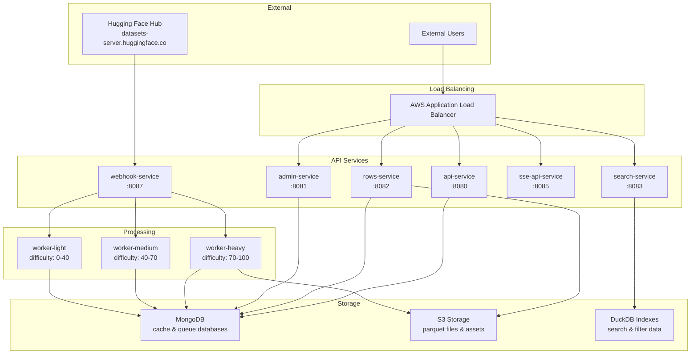
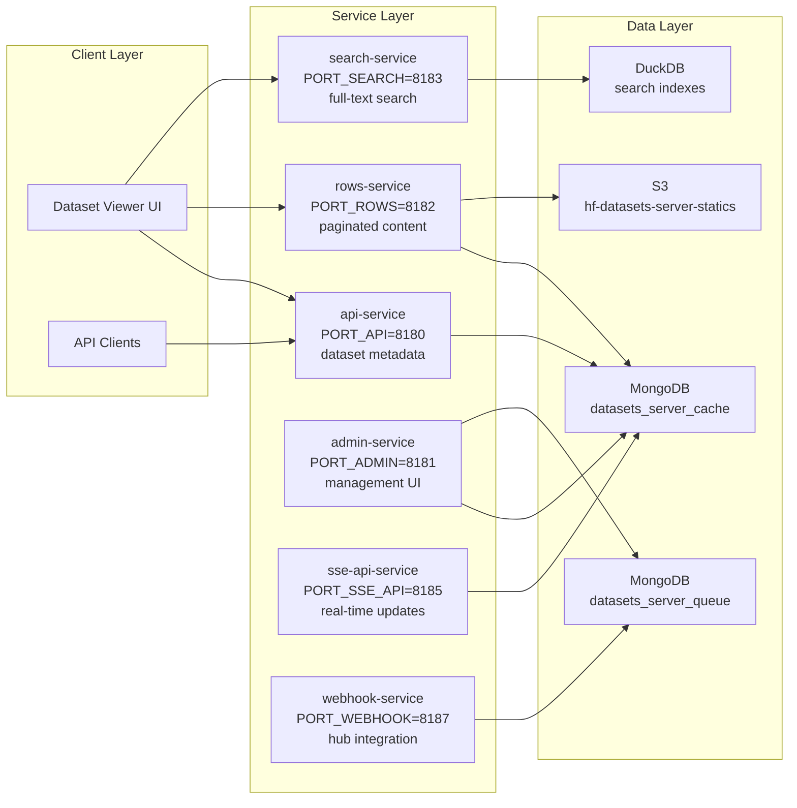
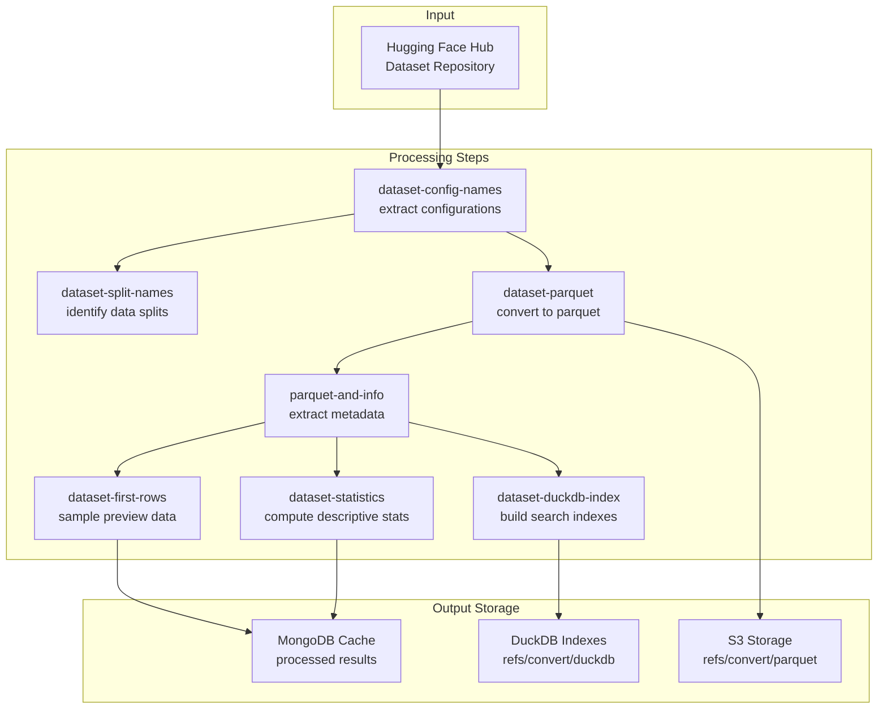

<!-- source: DeepWiki mcp.deepwiki.com · repo huggingface/dataset-viewer · page 1 Overview · fetched 2026-10-26 -->

# Overview

Relevant source files

The following files were used as context for generating this wiki page:

- [Makefile](Makefile)
- [README.md](README.md)
- [chart/Chart.yaml](chart/Chart.yaml)
- [chart/env/prod.yaml](chart/env/prod.yaml)
- [chart/env/staging.yaml](chart/env/staging.yaml)
- [chart/templates/_common/_helpers.tpl](chart/templates/_common/_helpers.tpl)
- [chart/templates/cron-jobs/backfill/_container.tpl](chart/templates/cron-jobs/backfill/_container.tpl)
- [chart/values.yaml](chart/values.yaml)
- [front/admin_ui/poetry.lock](front/admin_ui/poetry.lock)
- [jobs/cache_maintenance/README.md](jobs/cache_maintenance/README.md)
- [jobs/cache_maintenance/poetry.lock](jobs/cache_maintenance/poetry.lock)
- [jobs/cache_maintenance/src/cache_maintenance/backfill.py](jobs/cache_maintenance/src/cache_maintenance/backfill.py)
- [jobs/cache_maintenance/src/cache_maintenance/config.py](jobs/cache_maintenance/src/cache_maintenance/config.py)
- [jobs/cache_maintenance/src/cache_maintenance/main.py](jobs/cache_maintenance/src/cache_maintenance/main.py)
- [jobs/mongodb_migration/poetry.lock](jobs/mongodb_migration/poetry.lock)
- [libs/libapi/poetry.lock](libs/libapi/poetry.lock)
- [libs/libcommon/poetry.lock](libs/libcommon/poetry.lock)
- [services/admin/poetry.lock](services/admin/poetry.lock)
- [services/api/poetry.lock](services/api/poetry.lock)
- [services/rows/poetry.lock](services/rows/poetry.lock)
- [services/search/poetry.lock](services/search/poetry.lock)
- [services/sse-api/poetry.lock](services/sse-api/poetry.lock)
- [services/worker/poetry.lock](services/worker/poetry.lock)

The dataset-viewer is a microservices backend system that powers the Hugging Face Dataset Viewer interface. It provides pre-computed dataset information and content through REST APIs for all datasets on the Hugging Face Hub. The system automatically processes datasets into optimized formats, extracts metadata, and serves paginated data access, search capabilities, and statistical insights.

This document covers the overall system architecture, core services, and data processing pipeline. For specific service implementation details, see the individual service documentation in sections [3.1](#3.1) through [3.5]. For deployment and infrastructure details, see [7.1](#7.1).

## System Architecture

The dataset-viewer implements a cloud-native microservices architecture deployed on Kubernetes, with services organized into API, processing, and storage layers.

### High-Level Architecture

Sources: [chart/env/prod.yaml:1-585](), [chart/values.yaml:1-630](), [README.md:1-67]()

## Core Services

The system consists of six primary microservices, each with distinct responsibilities for serving and processing dataset information.

### Service Architecture Diagram

Sources: [Makefile:2-13](), [chart/values.yaml:162-167](), [chart/env/prod.yaml:138-143]()

### Service Responsibilities

| Service | Purpose | Key Features |
|---------|---------|--------------|
| `api-service` | Dataset metadata and configuration | Config names, split info, dataset info endpoints |
| `rows-service` | Paginated dataset content access | Parquet file streaming, asset serving, row slicing |
| `search-service` | Full-text search and filtering | DuckDB integration, search indexing, filter operations |
| `admin-service` | System administration and monitoring | Gradio UI, cache reports, job management |
| `sse-api-service` | Server-sent events for real-time updates | Live status updates, progress streaming |
| `webhook-service` | Hugging Face Hub integration | Dataset change notifications, job triggering |

Sources: [chart/values.yaml:439-629](), [chart/env/prod.yaml:274-584]()

## Data Processing Pipeline

The system processes datasets through a multi-stage pipeline that converts raw datasets into optimized formats for fast access and search.

Sources: [chart/values.yaml:199-271](), [chart/env/prod.yaml:127-153]()

## Deployment Configuration

The system deploys to production at `datasets-server.huggingface.co` with the following service scaling:

| Service | Replicas | Resources | Node Selector |
|---------|----------|-----------|---------------|
| `api` | 20 | 4 CPU, 14Gi RAM | `role-datasets-server-api` |
| `rows` | 12 | 1-4 CPU, 6.5Gi RAM | `role-datasets-server-rows` |
| `search` | 3 | 1-64 CPU, 250Gi RAM | `role-datasets-server-search` |
| `worker-heavy` | 4-40 (autoscaling) | 8 CPU, 44Gi RAM | `role-datasets-server-worker` |
| `worker-medium` | 10-80 (autoscaling) | 2 CPU, 14Gi RAM | `role-datasets-server-worker` |
| `worker-light` | 4-50 (autoscaling) | 200m-2 CPU, 1Gi RAM | `role-datasets-server-worker-light` |

Sources: [chart/env/prod.yaml:318-550]()

## Storage Systems

The architecture uses three primary storage systems:

- **MongoDB**: Stores processed cache responses and job queue data in `datasets_server_cache` and `datasets_server_queue` databases
- **S3**: Hosts converted Parquet files and static assets under `hf-datasets-server-statics/` with CloudFront CDN distribution  
- **DuckDB**: Provides search indexes stored as files for full-text search and filtering capabilities

Sources: [chart/values.yaml:162-271](), [chart/env/prod.yaml:138-153]()

---

