<!-- source: DeepWiki mcp.deepwiki.com · repo huggingface/dataset-viewer · page 2 System Architecture · fetched 2026-10-26 -->

# System Architecture

Relevant source files

The following files were used as context for generating this wiki page:

- [Makefile](Makefile)
- [README.md](README.md)
- [chart/Chart.yaml](chart/Chart.yaml)
- [chart/env/prod.yaml](chart/env/prod.yaml)
- [chart/env/staging.yaml](chart/env/staging.yaml)
- [chart/templates/_common/_helpers.tpl](chart/templates/_common/_helpers.tpl)
- [chart/templates/cron-jobs/backfill/_container.tpl](chart/templates/cron-jobs/backfill/_container.tpl)
- [chart/values.yaml](chart/values.yaml)
- [jobs/cache_maintenance/README.md](jobs/cache_maintenance/README.md)
- [jobs/cache_maintenance/src/cache_maintenance/backfill.py](jobs/cache_maintenance/src/cache_maintenance/backfill.py)
- [jobs/cache_maintenance/src/cache_maintenance/config.py](jobs/cache_maintenance/src/cache_maintenance/config.py)
- [jobs/cache_maintenance/src/cache_maintenance/main.py](jobs/cache_maintenance/src/cache_maintenance/main.py)
- [libs/libcommon/src/libcommon/processing_graph.py](libs/libcommon/src/libcommon/processing_graph.py)
- [libs/libcommon/tests/test_backfill_on_real_graph.py](libs/libcommon/tests/test_backfill_on_real_graph.py)
- [libs/libcommon/tests/test_processing_graph.py](libs/libcommon/tests/test_processing_graph.py)
- [services/worker/src/worker/dtos.py](services/worker/src/worker/dtos.py)
- [services/worker/src/worker/job_runners/dataset/compatible_libraries.py](services/worker/src/worker/job_runners/dataset/compatible_libraries.py)
- [services/worker/src/worker/job_runners/dataset/hub_cache.py](services/worker/src/worker/job_runners/dataset/hub_cache.py)
- [services/worker/tests/job_runners/dataset/test_compatible_libraries.py](services/worker/tests/job_runners/dataset/test_compatible_libraries.py)
- [services/worker/tests/job_runners/dataset/test_hub_cache.py](services/worker/tests/job_runners/dataset/test_hub_cache.py)

## Purpose and Scope

This document provides a comprehensive overview of the dataset-viewer system architecture, covering the microservices design, data processing pipeline, storage systems, and deployment infrastructure. The dataset-viewer is a backend service that processes datasets from the Hugging Face Hub and provides APIs for dataset viewing, search, and metadata access.

For information about specific service implementations, see [Core Services](#3). For details about shared libraries and utilities, see [Shared Libraries](#4). For data processing job runners, see [Data Processing](#5).

## High-Level Architecture Overview

The dataset-viewer follows a microservices architecture with clear separation of concerns. The system processes datasets through a directed acyclic graph of processing steps, caches results in MongoDB, stores assets in S3, and serves data through multiple specialized API services.

### System Components Diagram

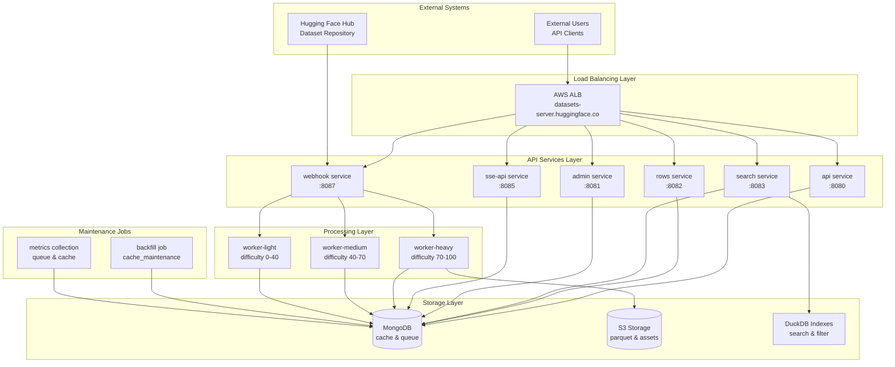

Sources: [chart/env/prod.yaml:1-585](), [Makefile:1-64](), [chart/values.yaml:1-630]()

### Processing Graph Architecture

The system uses a directed acyclic graph defined in `ProcessingGraph` to orchestrate dataset processing steps with dependencies.

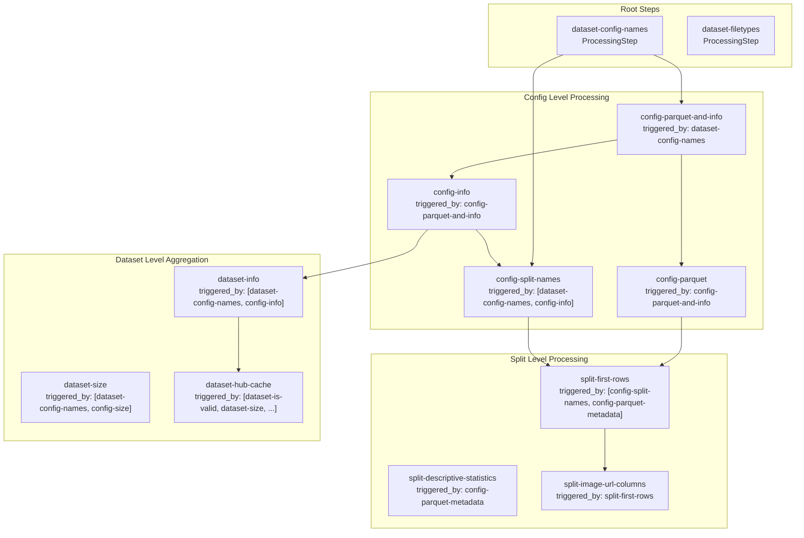

Sources: [libs/libcommon/src/libcommon/processing_graph.py:490-705](), [libs/libcommon/tests/test_processing_graph.py:1-402]()

## Service Architecture  

### Core Service Components

The system consists of six main microservices, each with specific responsibilities:

| Service | Port | Purpose | Key Classes |
|---------|------|---------|-------------|
| `api` | 8080 | Dataset metadata APIs | N/A |
| `rows` | 8082 | Paginated dataset content | N/A |
| `search` | 8083 | Full-text search & filtering | N/A |
| `admin` | 8081 | System administration | N/A |
| `sse-api` | 8085 | Server-sent events | N/A |
| `webhook` | 8087 | Hub webhook integration | N/A |

### Worker Service Architecture

The worker service implements a difficulty-based job distribution system with three worker types:

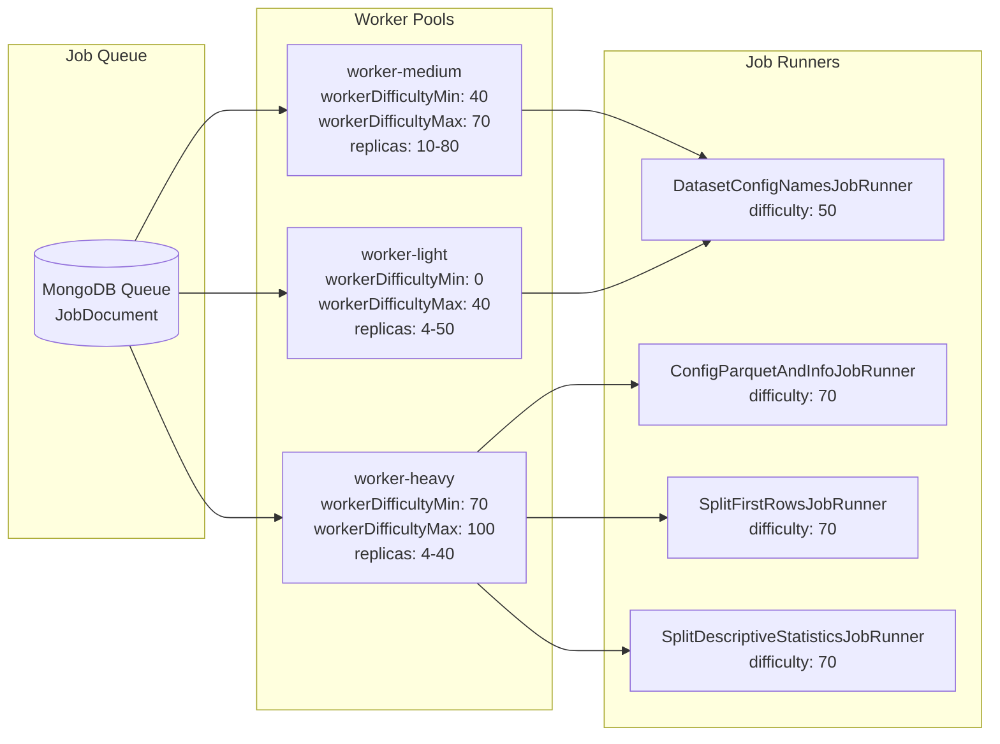

Sources: [chart/env/prod.yaml:462-550](), [services/worker/src/worker/dtos.py:11-14](), [libs/libcommon/src/libcommon/processing_graph.py:490-705]()

### Service Communication Pattern

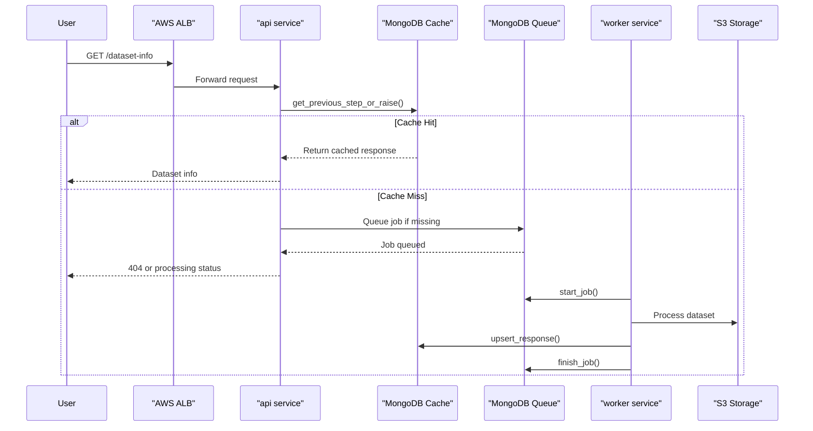

Sources: [libcommon/simple_cache.py functions referenced in services](), [Queue operations in worker service]()

## Data Processing Pipeline

### Processing Step Execution Flow

The data processing follows the `ProcessingGraph` specification with automatic dependency resolution:

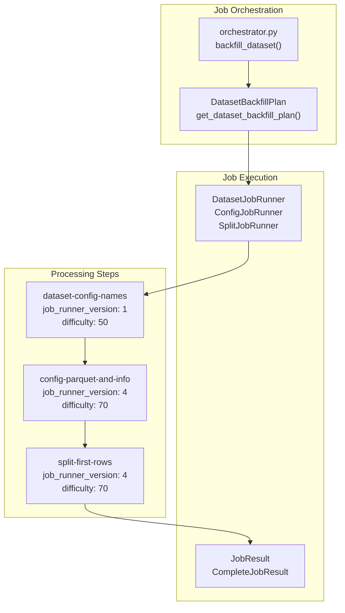

Sources: [libs/libcommon/src/libcommon/operations.py functions](), [services/worker/src/worker/dtos.py:16-30](), [libs/libcommon/src/libcommon/processing_graph.py:82-122]()

### Job Runner Implementation Pattern

Each processing step is implemented as a job runner following a common pattern:

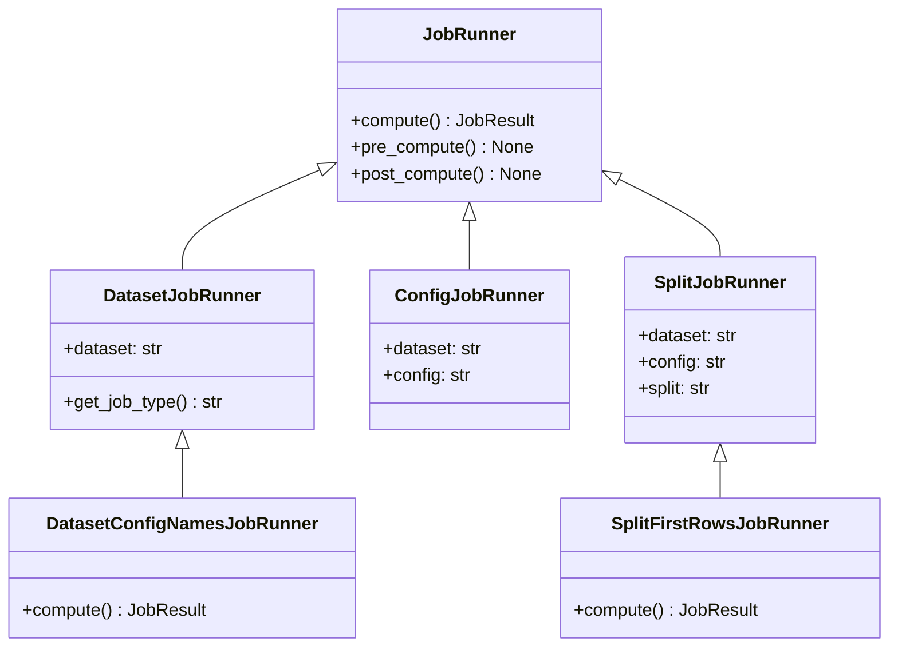

Sources: [services/worker/src/worker/job_runners/ directory structure](), [services/worker/src/worker/dtos.py:17-29]()

## Storage Architecture

### MongoDB Schema and Collections

The system uses MongoDB for caching processed results and managing job queues:

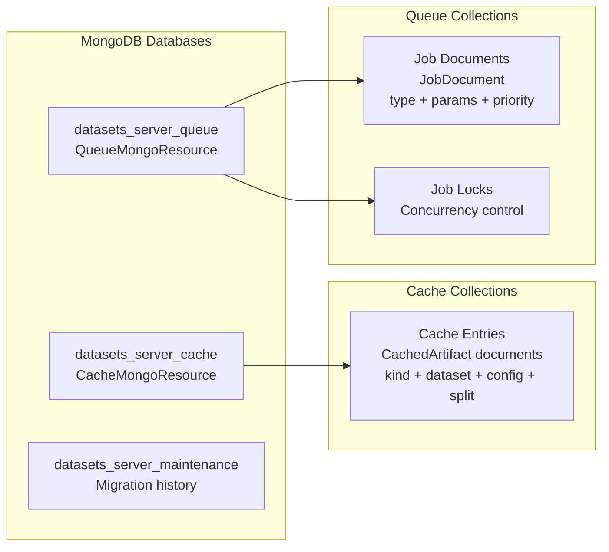

Sources: [chart/values.yaml:162-167](), [libs/libcommon/resources.py MongoDB classes](), [libs/libcommon/simple_cache.py cache operations]()

### S3 Storage Organization

Assets and processed datasets are stored in S3 with organized bucket structure:

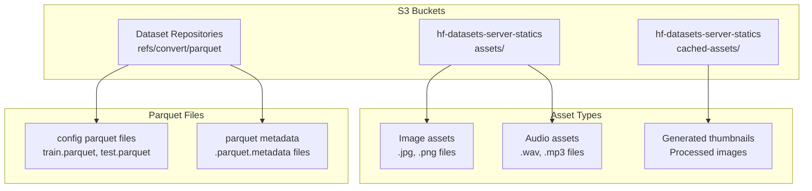

Sources: [chart/env/prod.yaml:137-143](), [chart/values.yaml:240-252](), [libcommon/storage_client.py S3 operations]()

### DuckDB Search Indexes

The search service uses DuckDB for efficient filtering and full-text search:

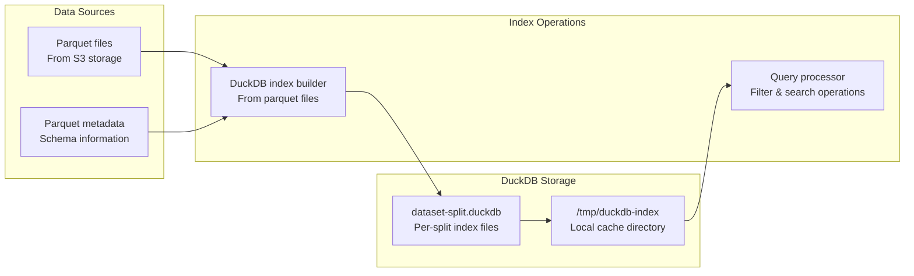

Sources: [chart/values.yaml:258-271](), [libapi/duckdb.py DuckDB operations](), [search service DuckDB integration]()

## Deployment Architecture

### Kubernetes Deployment Structure

The system is deployed on Kubernetes with environment-specific configurations:

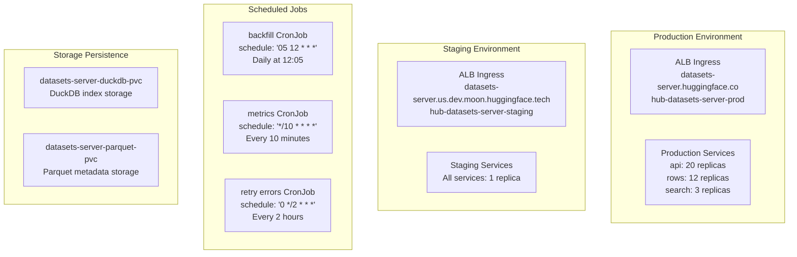

Sources: [chart/env/prod.yaml:255-585](), [chart/env/staging.yaml:160-329](), [chart/values.yaml:307-374]()

### Resource Allocation and Scaling

The deployment uses different resource allocations and autoscaling for each service type:

| Service | CPU Request | Memory Request | CPU Limit | Memory Limit | Autoscaling |
|---------|-------------|----------------|-----------|--------------|-------------|
| `api` | 4 | 14Gi | 4 | 14Gi | 20 replicas |
| `rows` | 1 | 6500Mi | 4 | 6500Mi | 12 replicas |
| `search` | 1 | 250Gi | 64 | 250Gi | 3 replicas |
| `worker-heavy` | 8 | 34Gi | 8 | 44Gi | 4-40 replicas |
| `worker-medium` | 2 | 14Gi | 2 | 14Gi | 10-80 replicas |
| `worker-light` | 200m | 100Mi | 2 | 1Gi | 4-50 replicas |

Sources: [chart/env/prod.yaml:345-549]()

### Monitoring and Maintenance

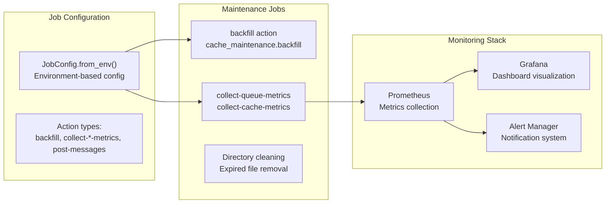

Sources: [jobs/cache_maintenance/src/cache_maintenance/main.py:19-118](), [jobs/cache_maintenance/src/cache_maintenance/config.py:69-97](), [chart/env/prod.yaml:170-253]()

---

