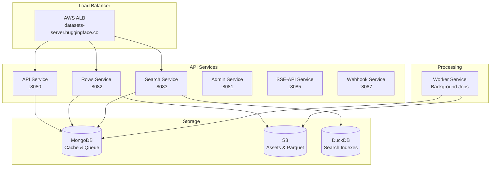
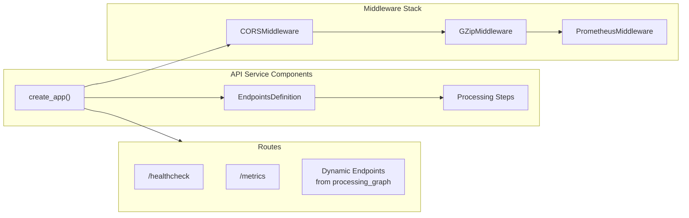
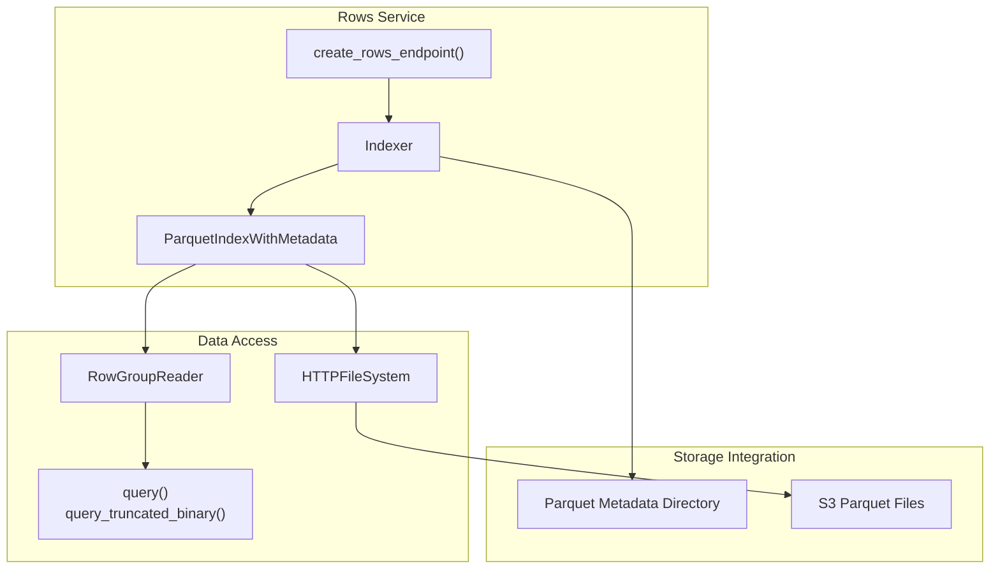
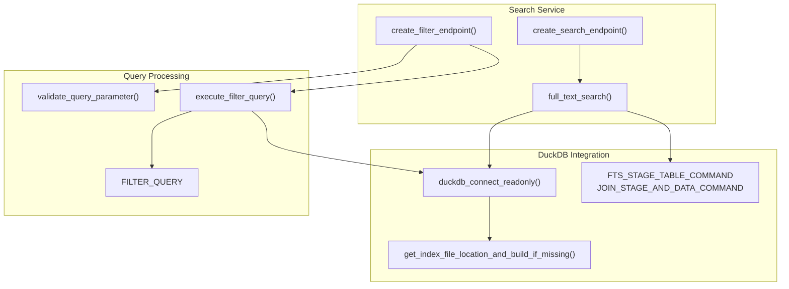
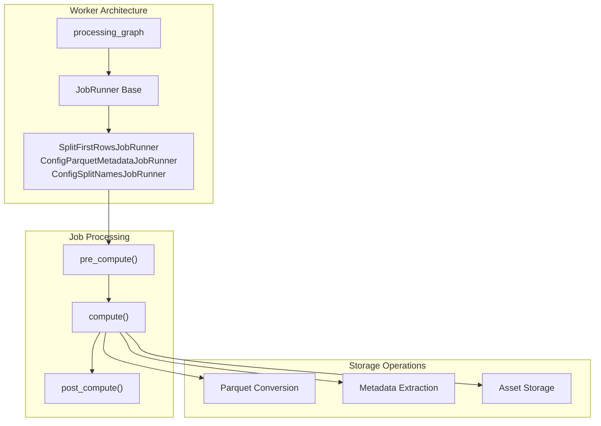
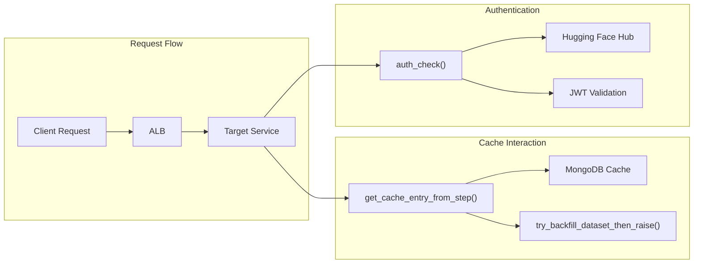
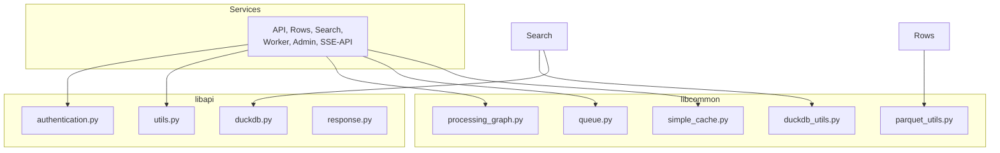

<!-- source: DeepWiki mcp.deepwiki.com · repo huggingface/dataset-viewer · page 2.1 Service Architecture · fetched 2026-10-26 -->

# Service Architecture

Relevant source files

The following files were used as context for generating this wiki page:

- [chart/templates/_env/_envWorker.tpl](chart/templates/_env/_envWorker.tpl)
- [chart/templates/services/api/_container.tpl](chart/templates/services/api/_container.tpl)
- [libs/libapi/src/libapi/duckdb.py](libs/libapi/src/libapi/duckdb.py)
- [libs/libapi/src/libapi/utils.py](libs/libapi/src/libapi/utils.py)
- [libs/libcommon/src/libcommon/duckdb_utils.py](libs/libcommon/src/libcommon/duckdb_utils.py)
- [libs/libcommon/src/libcommon/parquet_utils.py](libs/libcommon/src/libcommon/parquet_utils.py)
- [services/api/README.md](services/api/README.md)
- [services/api/src/api/app.py](services/api/src/api/app.py)
- [services/api/src/api/routes/endpoint.py](services/api/src/api/routes/endpoint.py)
- [services/api/tests/conftest.py](services/api/tests/conftest.py)
- [services/api/tests/test_app.py](services/api/tests/test_app.py)
- [services/rows/src/rows/routes/rows.py](services/rows/src/rows/routes/rows.py)
- [services/rows/tests/conftest.py](services/rows/tests/conftest.py)
- [services/search/src/search/duckdb_connection.py](services/search/src/search/duckdb_connection.py)
- [services/search/src/search/routes/filter.py](services/search/src/search/routes/filter.py)
- [services/search/src/search/routes/search.py](services/search/src/search/routes/search.py)
- [services/search/tests/conftest.py](services/search/tests/conftest.py)
- [services/search/tests/routes/test_search.py](services/search/tests/routes/test_search.py)
- [services/worker/src/worker/job_runners/config/parquet_metadata.py](services/worker/src/worker/job_runners/config/parquet_metadata.py)
- [services/worker/src/worker/job_runners/config/split_names.py](services/worker/src/worker/job_runners/config/split_names.py)
- [services/worker/src/worker/job_runners/split/first_rows.py](services/worker/src/worker/job_runners/split/first_rows.py)
- [services/worker/tests/job_runners/config/test_parquet_metadata.py](services/worker/tests/job_runners/config/test_parquet_metadata.py)
- [services/worker/tests/job_runners/split/test_first_rows.py](services/worker/tests/job_runners/split/test_first_rows.py)
- [tools/docker-compose-dataset-viewer.yml](tools/docker-compose-dataset-viewer.yml)
- [tools/docker-compose-dev-dataset-viewer.yml](tools/docker-compose-dev-dataset-viewer.yml)

This document details the microservices architecture of the dataset-viewer system, which provides a backend infrastructure for serving dataset information from the Hugging Face Hub. The system processes datasets through multiple specialized services that handle different aspects of data ingestion, transformation, and serving.

For information about data processing workflows, see [Data Processing Pipeline](#2.2). For storage layer details, see [Storage Architecture](#2.3).

## Overview

The dataset-viewer system implements a distributed microservices architecture where each service has a specific responsibility in the data processing and serving pipeline. Services communicate through HTTP APIs and share data through common storage layers including MongoDB for caching and coordination, S3 for asset storage, and DuckDB for search indexing.

Sources: [services/api/src/api/app.py:27-113](), [services/rows/src/rows/routes/rows.py:41-152](), [services/search/src/search/routes/search.py:119-250](), [tools/docker-compose-dataset-viewer.yml:1-300]()

## Core Services

### API Service

The API Service serves as the main REST API endpoint, providing dataset metadata and orchestrating requests across the system. It implements a Starlette-based web application with multiple endpoints corresponding to different processing steps.

The service uses the `create_endpoint()` function to dynamically generate endpoints based on the processing graph configuration. Each endpoint maps to specific processing steps through `StepByInputType` mappings.

Sources: [services/api/src/api/app.py:27-113](), [services/api/src/api/routes/endpoint.py:39-219](), [services/api/tests/test_app.py:9-123]()

### Rows Service

The Rows Service provides paginated access to dataset content by reading from processed Parquet files. It uses the `Indexer` class to efficiently query large datasets and handle memory constraints.

The service implements sophisticated memory management through `max_arrow_data_in_memory` limits and supports binary data truncation for large cells via `query_truncated_binary()`.

Sources: [services/rows/src/rows/routes/rows.py:41-152](), [libs/libcommon/src/libcommon/parquet_utils.py:512-657](), [services/worker/src/worker/job_runners/split/first_rows.py:273-348]()

### Search Service

The Search Service provides full-text search and filtering capabilities using DuckDB indexes. It supports both search queries and SQL-like filtering operations.

The search service dynamically builds DuckDB indexes from Parquet files when needed and caches them for subsequent queries. It uses specialized SQL commands for full-text search integration.

Sources: [services/search/src/search/routes/search.py:55-250](), [services/search/src/search/routes/filter.py:61-227](), [libs/libapi/src/libapi/duckdb.py:82-313]()

### Worker Service

The Worker Service handles background job processing through a system of specialized job runners. Each job runner implements specific data processing tasks in the pipeline.

Worker services are distributed across multiple difficulty levels, with job routing based on computational requirements and resource availability.

Sources: [services/worker/src/worker/job_runners/split/first_rows.py:273-348](), [services/worker/src/worker/job_runners/config/parquet_metadata.py:145-173](), [services/worker/src/worker/job_runners/config/split_names.py:138-163]()

## Service Communication Patterns

Services in the dataset-viewer architecture communicate through several patterns:

### Response Caching Strategy

All services implement a unified caching strategy through the `libapi.utils` module:

- **Cache Hit**: Return cached response with appropriate `max_age` headers
- **Cache Miss**: Trigger background job processing and return `ResponseNotReadyError`
- **Error Handling**: Use `get_json_api_error_response()` for consistent error formatting

Sources: [libs/libapi/src/libapi/utils.py:147-194](), [services/api/src/api/routes/endpoint.py:108-194]()

### Shared Libraries Integration

The architecture relies heavily on two shared libraries that provide common functionality:

These libraries ensure consistent behavior across services for caching, authentication, error handling, and data processing operations.

Sources: [libs/libapi/src/libapi/utils.py:1-242](), [libs/libcommon/src/libcommon/parquet_utils.py:1-657](), [libs/libcommon/src/libcommon/duckdb_utils.py:1-400]()

---

