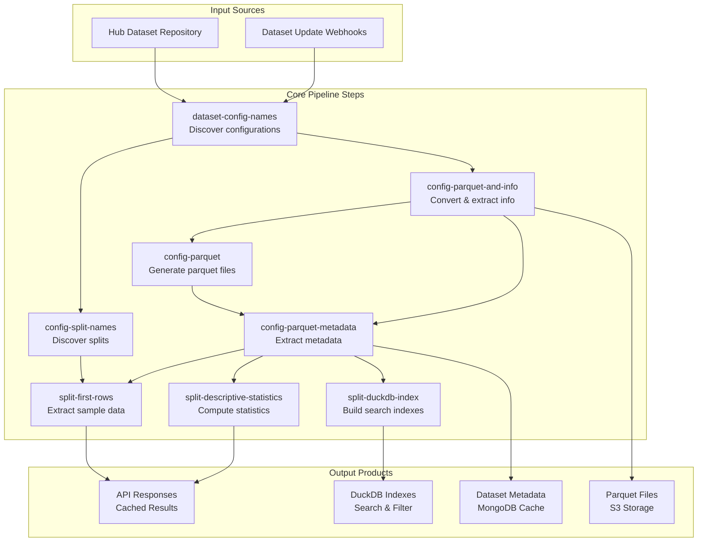
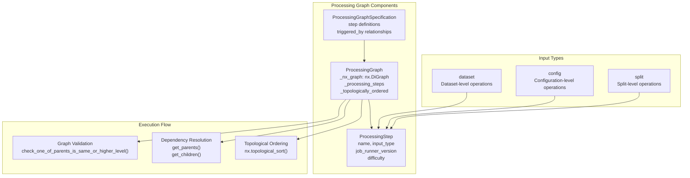
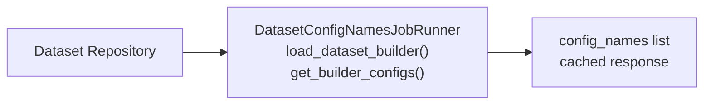
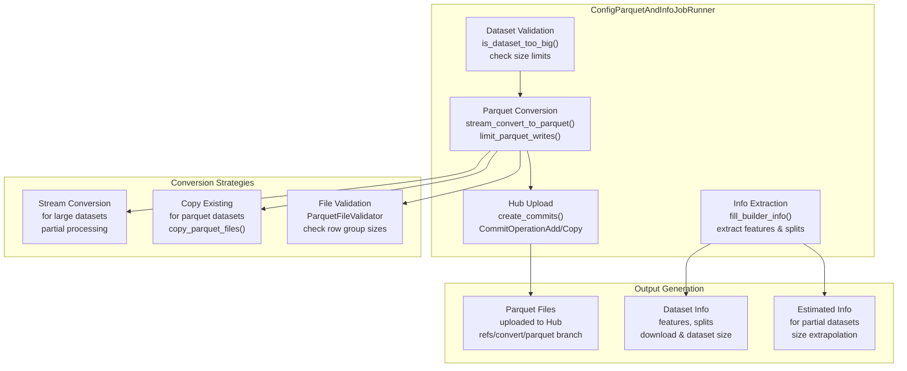
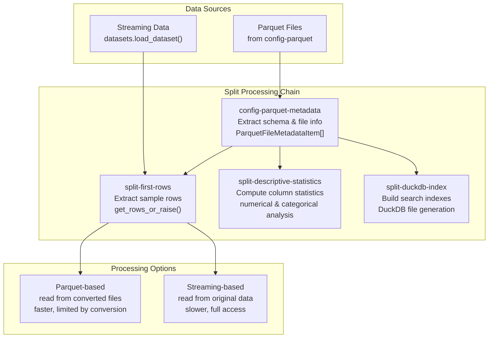
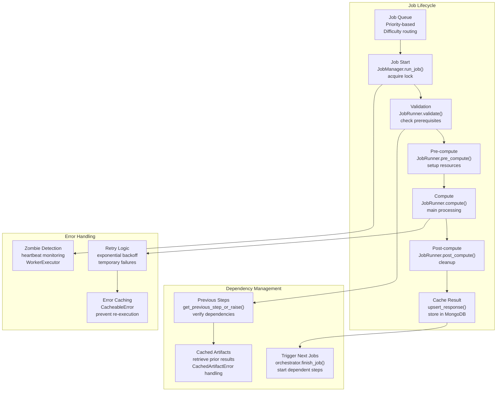
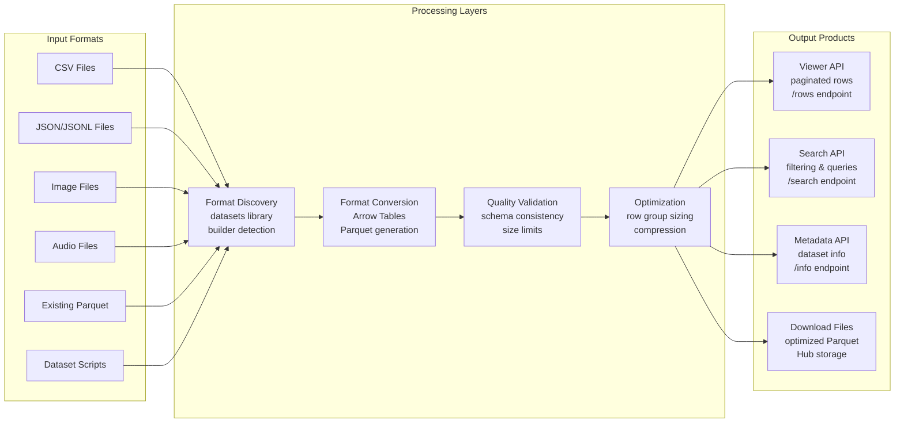

<!-- source: DeepWiki mcp.deepwiki.com · repo huggingface/dataset-viewer · page 2.2 Data Processing Pipeline · fetched 2026-10-26 -->

# Data Processing Pipeline

Relevant source files

The following files were used as context for generating this wiki page:

- [chart/templates/worker/_container.tpl](chart/templates/worker/_container.tpl)
- [jobs/mongodb_migration/src/mongodb_migration/collector.py](jobs/mongodb_migration/src/mongodb_migration/collector.py)
- [jobs/mongodb_migration/src/mongodb_migration/deletion_migrations.py](jobs/mongodb_migration/src/mongodb_migration/deletion_migrations.py)
- [jobs/mongodb_migration/src/mongodb_migration/migration.py](jobs/mongodb_migration/src/mongodb_migration/migration.py)
- [jobs/mongodb_migration/tests/test_deletion_migrations.py](jobs/mongodb_migration/tests/test_deletion_migrations.py)
- [libs/libcommon/src/libcommon/exceptions.py](libs/libcommon/src/libcommon/exceptions.py)
- [libs/libcommon/src/libcommon/processing_graph.py](libs/libcommon/src/libcommon/processing_graph.py)
- [libs/libcommon/tests/test_backfill_on_real_graph.py](libs/libcommon/tests/test_backfill_on_real_graph.py)
- [libs/libcommon/tests/test_processing_graph.py](libs/libcommon/tests/test_processing_graph.py)
- [services/worker/src/worker/dtos.py](services/worker/src/worker/dtos.py)
- [services/worker/src/worker/executor.py](services/worker/src/worker/executor.py)
- [services/worker/src/worker/job_manager.py](services/worker/src/worker/job_manager.py)
- [services/worker/src/worker/job_runners/config/parquet_and_info.py](services/worker/src/worker/job_runners/config/parquet_and_info.py)
- [services/worker/src/worker/job_runners/dataset/compatible_libraries.py](services/worker/src/worker/job_runners/dataset/compatible_libraries.py)
- [services/worker/src/worker/job_runners/dataset/hub_cache.py](services/worker/src/worker/job_runners/dataset/hub_cache.py)
- [services/worker/src/worker/loop.py](services/worker/src/worker/loop.py)
- [services/worker/src/worker/utils.py](services/worker/src/worker/utils.py)
- [services/worker/tests/fixtures/files.py](services/worker/tests/fixtures/files.py)
- [services/worker/tests/fixtures/hub.py](services/worker/tests/fixtures/hub.py)
- [services/worker/tests/job_runners/config/test_parquet_and_info.py](services/worker/tests/job_runners/config/test_parquet_and_info.py)
- [services/worker/tests/job_runners/dataset/test_compatible_libraries.py](services/worker/tests/job_runners/dataset/test_compatible_libraries.py)
- [services/worker/tests/job_runners/dataset/test_hub_cache.py](services/worker/tests/job_runners/dataset/test_hub_cache.py)
- [services/worker/tests/test_job_manager.py](services/worker/tests/test_job_manager.py)
- [services/worker/tests/test_loop.py](services/worker/tests/test_loop.py)

This document describes the data processing pipeline that powers the dataset-viewer system, explaining how datasets are transformed from their original formats into processed outputs including Parquet files, metadata, and search indexes. For information about the individual services that execute these pipeline steps, see [Core Services](#3). For details about storage systems, see [Storage Architecture](#2.3).

## Overview

The data processing pipeline is a directed acyclic graph (DAG) of interconnected processing steps that transform datasets from the Hugging Face Hub into formats optimized for viewing, searching, and analysis. The pipeline handles dataset discovery, format conversion, metadata extraction, validation, and index generation through a series of dependent job types.

Sources: [libs/libcommon/src/libcommon/processing_graph.py:490-600](), [services/worker/src/worker/job_runners/config/parquet_and_info.py:1-100]()

## Processing Graph Structure

The pipeline is defined as a `ProcessingGraph` that manages job dependencies and execution order. Each processing step is represented as a `ProcessingStep` with specific input types and dependency relationships.

The processing graph enforces several key constraints:
- Dataset-level steps can only depend on other dataset-level steps
- Config-level steps can depend on dataset-level or config-level steps  
- Split-level steps can depend on any level
- The graph must be acyclic to prevent infinite loops

Sources: [libs/libcommon/src/libcommon/processing_graph.py:134-228](), [libs/libcommon/src/libcommon/processing_graph.py:42-65]()

## Key Processing Steps

### Dataset Configuration Discovery

The `dataset-config-names` step discovers all available configurations in a dataset repository. This is always the first step executed for any dataset.

Sources: [libs/libcommon/src/libcommon/processing_graph.py:491-495]()

### Parquet Conversion and Info Extraction

The `config-parquet-and-info` step is the core processing component that converts datasets to Parquet format and extracts comprehensive metadata.

The conversion process handles multiple scenarios:
- **Streaming conversion**: For large datasets, converts incrementally up to size limits
- **File copying**: For datasets already in Parquet format, copies files efficiently  
- **Partial processing**: When datasets exceed limits, processes subset and estimates total size
- **Validation**: Ensures Parquet files meet quality standards for the viewer

Sources: [services/worker/src/worker/job_runners/config/parquet_and_info.py:84-93](), [services/worker/src/worker/job_runners/config/parquet_and_info.py:406-431](), [services/worker/src/worker/job_runners/config/parquet_and_info.py:895-950]()

### Split Processing Steps

Split-level processing operates on individual dataset splits to extract viewable data and compute analytics.

The pipeline intelligently chooses between Parquet-based and streaming-based processing depending on data availability and performance requirements.

Sources: [libs/libcommon/src/libcommon/processing_graph.py:496-504](), [libs/libcommon/src/libcommon/processing_graph.py:517-522](), [services/worker/src/worker/utils.py:88-141]()

## Job Execution Flow

Jobs are executed by the Worker service through a managed pipeline that handles dependencies, resource allocation, and error recovery.

Sources: [services/worker/src/worker/job_manager.py:98-177](), [services/worker/src/worker/loop.py:108-150](), [services/worker/src/worker/executor.py:156-165]()

## Data Flow and Transformations

The pipeline transforms raw datasets through multiple stages, with each step adding value and preparing data for different use cases.

Key transformations include:
- **Format standardization**: Converting diverse input formats to Parquet
- **Schema extraction**: Inferring and validating data schemas
- **Size optimization**: Adjusting row group sizes for optimal random access
- **Asset processing**: Converting images, audio to web-compatible formats
- **Index generation**: Building search indexes for efficient querying

Sources: [services/worker/src/worker/job_runners/config/parquet_and_info.py:349-375](), [services/worker/src/worker/job_runners/config/parquet_and_info.py:626-716](), [services/worker/src/worker/utils.py:49-86]()

## Pipeline Configuration and Limits

The processing pipeline includes sophisticated resource management and safety limits to handle datasets of varying sizes and complexities.

| Component | Configuration | Purpose |
|-----------|---------------|---------|
| Dataset Size Limits | `max_dataset_size_bytes` | Prevent processing of excessively large datasets |
| Row Group Sizing | `get_writer_batch_size_from_info()` | Optimize Parquet files for different data types |
| Partial Processing | `limit_parquet_writes` context manager | Handle oversized datasets gracefully |
| File Validation | `ParquetFileValidator` | Ensure quality of copied Parquet files |
| Difficulty Routing | Job difficulty scores | Route jobs to appropriate worker pools |

The pipeline automatically adapts processing strategies based on dataset characteristics, balancing completeness with performance and resource constraints.

Sources: [services/worker/src/worker/job_runners/config/parquet_and_info.py:221-291](), [services/worker/src/worker/job_runners/config/parquet_and_info.py:510-541](), [services/worker/src/worker/job_runners/config/parquet_and_info.py:660-716]()

---

