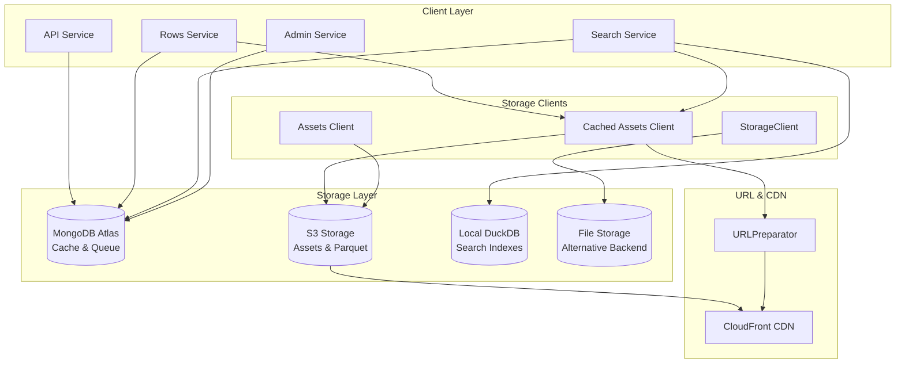
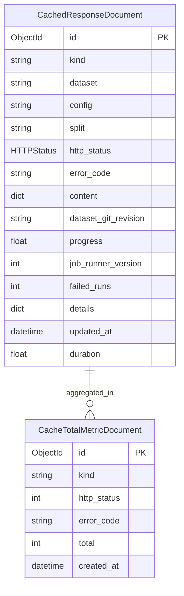
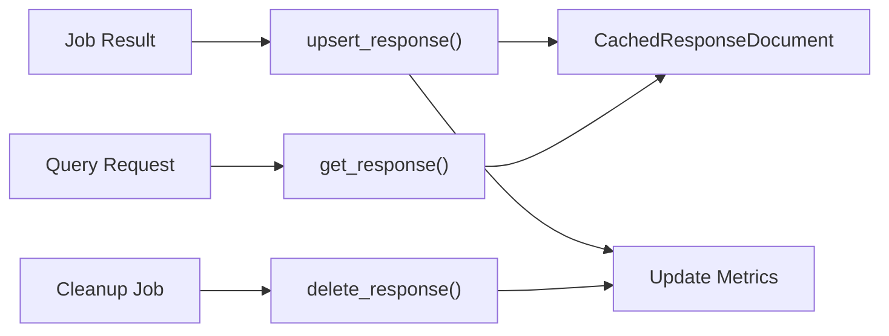
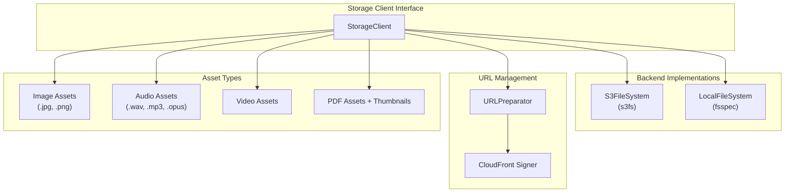
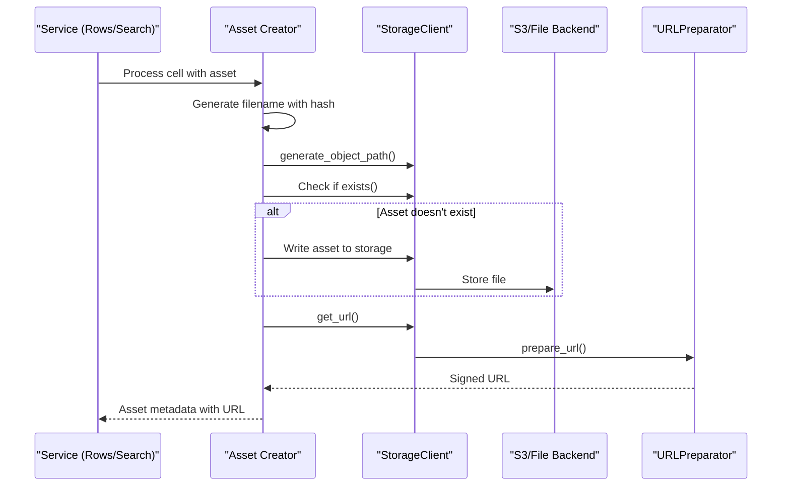
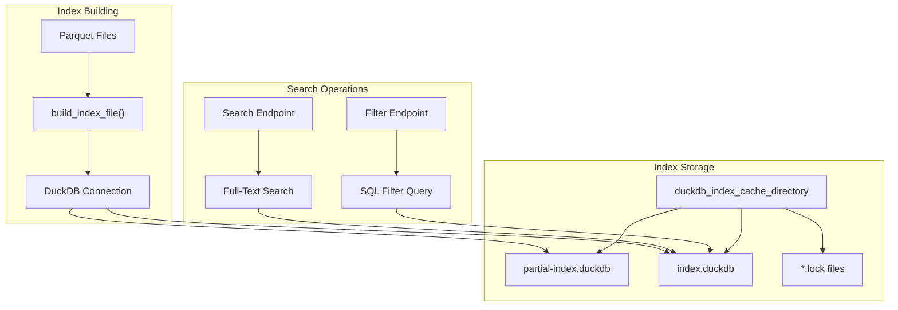
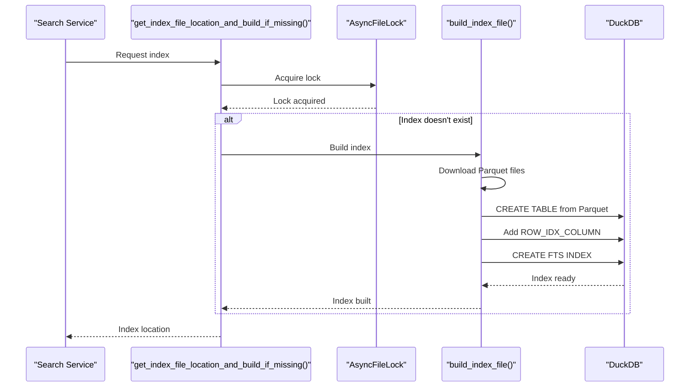
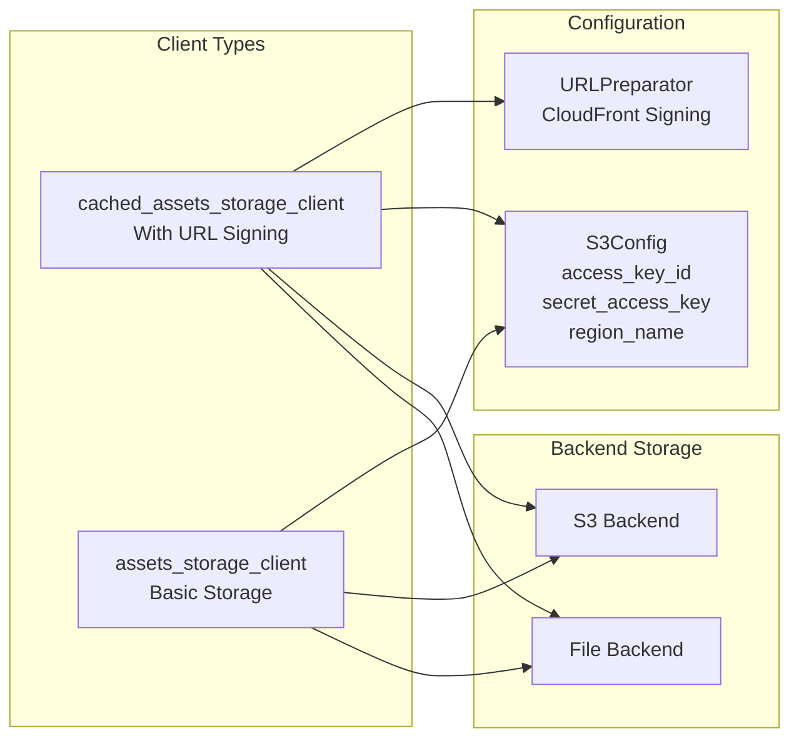
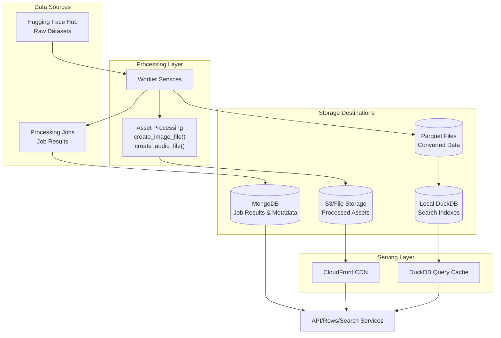

<!-- source: DeepWiki mcp.deepwiki.com · repo huggingface/dataset-viewer · page 2.3 Storage Architecture · fetched 2026-10-26 -->

# Storage Architecture

<details>
<summary>Relevant source files</summary>

The following files were used as context for generating this wiki page:

- [chart/templates/_env/_envWorker.tpl](chart/templates/_env/_envWorker.tpl)
- [chart/templates/services/rows/_container.tpl](chart/templates/services/rows/_container.tpl)
- [chart/templates/services/search/_container.tpl](chart/templates/services/search/_container.tpl)
- [libs/libapi/src/libapi/duckdb.py](libs/libapi/src/libapi/duckdb.py)
- [libs/libcommon/src/libcommon/duckdb_utils.py](libs/libcommon/src/libcommon/duckdb_utils.py)
- [libs/libcommon/src/libcommon/orchestrator.py](libs/libcommon/src/libcommon/orchestrator.py)
- [libs/libcommon/src/libcommon/simple_cache.py](libs/libcommon/src/libcommon/simple_cache.py)
- [libs/libcommon/src/libcommon/state.py](libs/libcommon/src/libcommon/state.py)
- [libs/libcommon/src/libcommon/storage_client.py](libs/libcommon/src/libcommon/storage_client.py)
- [libs/libcommon/src/libcommon/viewer_utils/asset.py](libs/libcommon/src/libcommon/viewer_utils/asset.py)
- [libs/libcommon/src/libcommon/viewer_utils/features.py](libs/libcommon/src/libcommon/viewer_utils/features.py)
- [libs/libcommon/tests/conftest.py](libs/libcommon/tests/conftest.py)
- [libs/libcommon/tests/test_backfill.py](libs/libcommon/tests/test_backfill.py)
- [libs/libcommon/tests/test_integration_s3_cloudfront.py](libs/libcommon/tests/test_integration_s3_cloudfront.py)
- [libs/libcommon/tests/test_orchestrator.py](libs/libcommon/tests/test_orchestrator.py)
- [libs/libcommon/tests/test_orchestrator_smart_update.py](libs/libcommon/tests/test_orchestrator_smart_update.py)
- [libs/libcommon/tests/test_simple_cache.py](libs/libcommon/tests/test_simple_cache.py)
- [libs/libcommon/tests/test_state.py](libs/libcommon/tests/test_state.py)
- [libs/libcommon/tests/test_url_preparator.py](libs/libcommon/tests/test_url_preparator.py)
- [libs/libcommon/tests/utils.py](libs/libcommon/tests/utils.py)
- [libs/libcommon/tests/viewer_utils/test_assets.py](libs/libcommon/tests/viewer_utils/test_assets.py)
- [libs/libcommon/tests/viewer_utils/test_features.py](libs/libcommon/tests/viewer_utils/test_features.py)
- [services/rows/src/rows/app.py](services/rows/src/rows/app.py)
- [services/search/src/search/app.py](services/search/src/search/app.py)
- [services/search/src/search/config.py](services/search/src/search/config.py)
- [services/search/src/search/duckdb_connection.py](services/search/src/search/duckdb_connection.py)
- [services/search/src/search/routes/filter.py](services/search/src/search/routes/filter.py)
- [services/search/src/search/routes/search.py](services/search/src/search/routes/search.py)
- [services/search/tests/routes/test_search.py](services/search/tests/routes/test_search.py)
- [tools/docker-compose-dataset-viewer.yml](tools/docker-compose-dataset-viewer.yml)
- [tools/docker-compose-dev-dataset-viewer.yml](tools/docker-compose-dev-dataset-viewer.yml)

</details>


This document describes the storage layer of the dataset-viewer system, covering how data is persisted, cached, and served across different storage backends. This includes MongoDB for caching and job queues, S3/file storage for assets, and DuckDB for search indexing.

For information about data processing workflows, see [Data Processing Pipeline](#2.2). For details about individual services that consume storage, see [Core Services](#3).

## Storage Components Overview

The dataset-viewer system uses a multi-layered storage architecture with specialized storage systems for different data types and access patterns:



Sources: [libs/libcommon/src/libcommon/simple_cache.py:121-174](), [libs/libcommon/src/libcommon/storage_client.py:20-156](), [services/search/src/search/app.py:64-86]()

## MongoDB Cache and Queue Storage

MongoDB serves as the primary metadata and job queue storage, implemented through the `CachedResponseDocument` and related classes.

### Cache Document Structure



### Cache Operations

The cache supports standard CRUD operations with automatic metrics tracking:

- **Upsert Response**: `upsert_response()` stores processed job results
- **Retrieve Response**: `get_response()` fetches cached content
- **Delete Operations**: `delete_response()` and `delete_dataset_responses()` for cleanup
- **Metrics Tracking**: Automatic increment/decrement of `CacheTotalMetricDocument` entries



Sources: [libs/libcommon/src/libcommon/simple_cache.py:272-301](), [libs/libcommon/src/libcommon/simple_cache.py:515-531](), [libs/libcommon/src/libcommon/simple_cache.py:341-345]()

## S3 and File Storage for Assets

The `StorageClient` class provides a unified interface for storing dataset assets across different backends, primarily S3 and local file systems.

### Storage Client Architecture



### Asset Storage Path Structure

Assets are stored using a hierarchical path structure that encodes dataset metadata:

```
{dataset}/{DATASET_SEPARATOR}/{revision}/{DATASET_SEPARATOR}/{config}/{split}/{row_idx}/{column}/{filename}
```

Where `DATASET_SEPARATOR` is `"--"` and components are URL-encoded. For example:
```
my-dataset/--/abc123def/--/default/train/0/image/image-1a2b.jpg
```

Sources: [libs/libcommon/src/libcommon/storage_client.py:149-152](), [libs/libcommon/src/libcommon/constants.py:12]()

### Asset Creation Workflow



Sources: [libs/libcommon/src/libcommon/viewer_utils/asset.py:45-82](), [libs/libcommon/src/libcommon/storage_client.py:85-98]()

## DuckDB Search Indexing

DuckDB provides local search indexes built on-demand from Parquet files, enabling full-text search and filtering capabilities.

### Index File Management



### Index Building Process

The index building process downloads Parquet files and creates DuckDB indexes with full-text search capabilities:

1. **Download Parquet Files**: Files are downloaded from the Hub to local cache
2. **Create Data Table**: DuckDB table created from Parquet files with row index column
3. **Build FTS Index**: Full-text search index created on indexable string columns
4. **Stemmer Selection**: Language-specific stemmer applied based on dataset metadata



Sources: [libs/libapi/src/libapi/duckdb.py:185-264](), [libs/libapi/src/libapi/duckdb.py:82-183]()

## Storage Configuration and Client Management

The system supports multiple storage configurations through environment-based configuration and multiple client instances.

### Storage Client Types



### Storage Client Configuration

The storage clients are configured with different capabilities:

- **Cached Assets Client**: Includes URL signing for CloudFront, used for processed assets
- **Assets Client**: Basic storage without signing, used for raw dataset assets
- **Protocol Support**: Both S3 (`s3://`) and file (`file://`) protocols supported
- **URL Preparation**: Revision replacement and CloudFront signing when configured

Sources: [services/search/src/search/app.py:72-86](), [libs/libcommon/src/libcommon/storage_client.py:40-68]()

## Data Flow Through Storage Layers

The complete data flow shows how different types of data move through the storage architecture:



Sources: [libs/libcommon/src/libcommon/orchestrator.py:272-301](), [libs/libcommon/src/libcommon/viewer_utils/asset.py:45-259](), [services/search/src/search/routes/search.py:185-264]()

---

