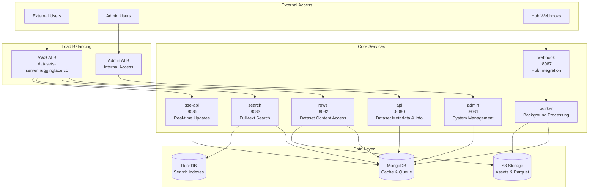
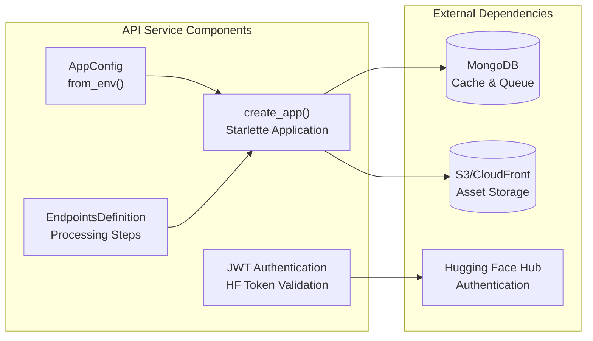
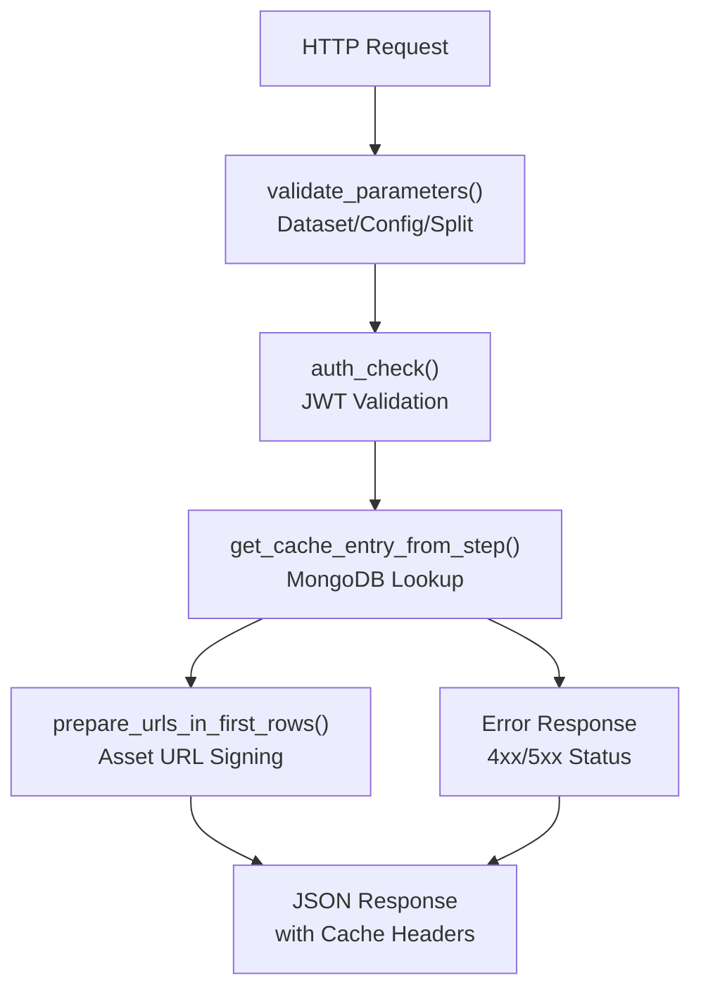
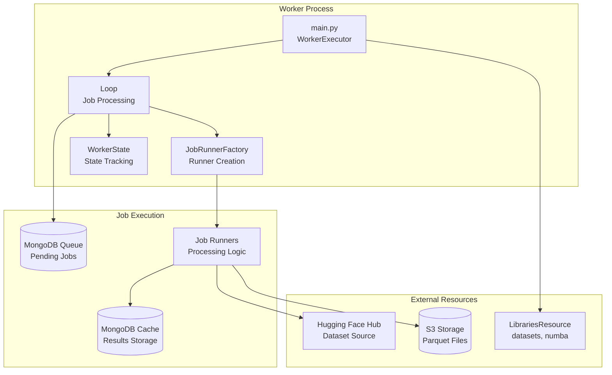
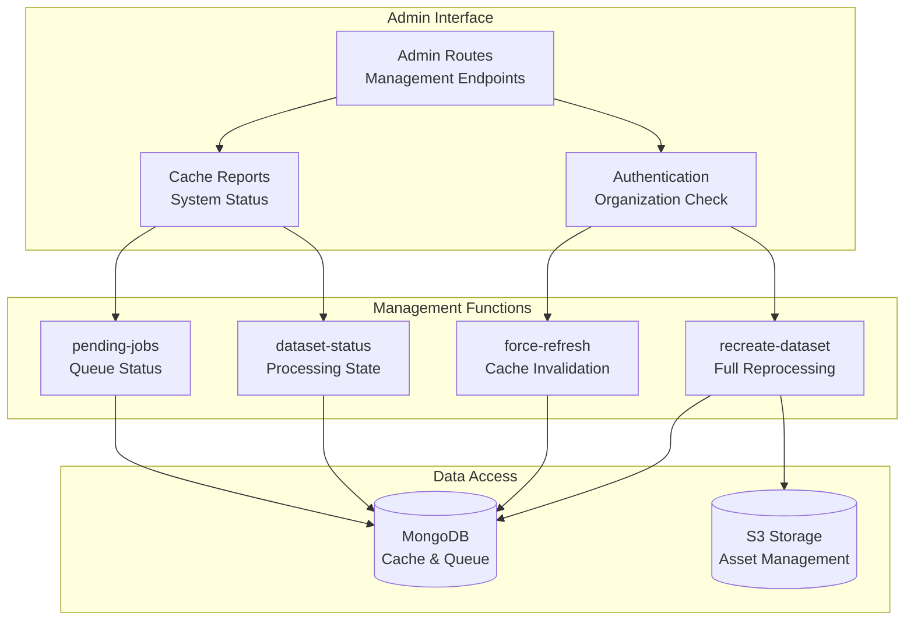
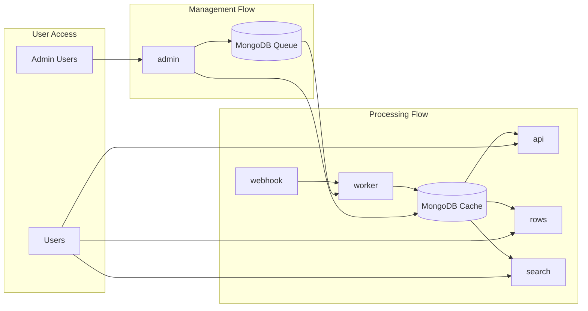

<!-- source: DeepWiki mcp.deepwiki.com · repo huggingface/dataset-viewer · page 3 Core Services · fetched 2026-10-26 -->

# Core Services

<details>
<summary>Relevant source files</summary>

The following files were used as context for generating this wiki page:

- [chart/templates/services/admin/_container.tpl](chart/templates/services/admin/_container.tpl)
- [chart/templates/services/api/_container.tpl](chart/templates/services/api/_container.tpl)
- [services/admin/README.md](services/admin/README.md)
- [services/admin/src/admin/app.py](services/admin/src/admin/app.py)
- [services/admin/src/admin/authentication.py](services/admin/src/admin/authentication.py)
- [services/admin/src/admin/config.py](services/admin/src/admin/config.py)
- [services/admin/tests/test_app.py](services/admin/tests/test_app.py)
- [services/admin/tests/test_authentication.py](services/admin/tests/test_authentication.py)
- [services/admin/tests/utils.py](services/admin/tests/utils.py)
- [services/api/README.md](services/api/README.md)
- [services/api/src/api/app.py](services/api/src/api/app.py)
- [services/api/src/api/routes/endpoint.py](services/api/src/api/routes/endpoint.py)
- [services/api/tests/conftest.py](services/api/tests/conftest.py)
- [services/api/tests/test_app.py](services/api/tests/test_app.py)
- [services/worker/README.md](services/worker/README.md)
- [services/worker/src/worker/config.py](services/worker/src/worker/config.py)
- [services/worker/src/worker/main.py](services/worker/src/worker/main.py)
- [services/worker/src/worker/start_worker_loop.py](services/worker/src/worker/start_worker_loop.py)
- [services/worker/tests/conftest.py](services/worker/tests/conftest.py)
- [services/worker/tests/test_executor.py](services/worker/tests/test_executor.py)
- [services/worker/tests/test_job_runner_factory.py](services/worker/tests/test_job_runner_factory.py)

</details>


This document covers the core microservices that comprise the dataset-viewer system architecture. These services work together to provide dataset metadata, content access, search capabilities, background processing, and administrative functionality.

For information about the shared libraries used by these services, see [Shared Libraries](#4). For details about data processing workflows, see [Data Processing](#5). For deployment configuration, see [Deployment and Operations](#7).

## Service Architecture Overview

The dataset-viewer system consists of multiple specialized microservices, each handling specific aspects of dataset processing and serving:



Sources: [services/api/src/api/app.py:1-125](), [services/admin/src/admin/app.py:1-206](), [services/worker/src/worker/main.py:1-74]()

## Common Service Patterns

All core services follow standardized architectural patterns:

### Service Structure
- **FastAPI/Starlette** web framework for HTTP handling
- **Uvicorn** ASGI server for production deployment
- **MongoDB** connections for cache and queue access
- **Prometheus** metrics collection and exposure
- **CORS** middleware for cross-origin requests

### Standard Endpoints
Each service provides:
- `/healthcheck` - Service health status
- `/metrics` - Prometheus metrics endpoint

### Configuration Management
Services use environment-based configuration with structured dataclasses using the `environs` library pattern.

Sources: [services/api/src/api/app.py:45-56](), [services/admin/src/admin/app.py:68-79](), [services/worker/src/worker/config.py:25-40]()

## API Service

The API service serves as the primary interface for dataset metadata and information requests.

### Service Configuration



The API service is configured through the `AppConfig` class which aggregates multiple configuration sections:

- **Endpoint Configuration**: Maps HTTP endpoints to processing steps
- **Authentication**: JWT token validation against Hugging Face Hub
- **Storage**: CloudFront-signed URLs for asset access
- **Rate Limiting**: Configurable cache TTL for responses

Sources: [services/api/src/api/app.py:27-31](), [services/api/src/api/routes/endpoint.py:39-52]()

### Endpoint Processing



The API service processes requests through a standardized pipeline defined in `create_endpoint()`:

1. **Parameter Validation**: Validates required dataset/config/split parameters
2. **Authentication**: Checks JWT tokens against Hugging Face Hub
3. **Cache Lookup**: Retrieves processed data from MongoDB cache
4. **Asset Processing**: Signs URLs for media files using CloudFront
5. **Response Generation**: Returns JSON with appropriate cache headers

Sources: [services/api/src/api/routes/endpoint.py:108-194](), [services/api/src/api/routes/endpoint.py:197-218]()

### Supported Endpoints

| Endpoint | Purpose | Input Type | Processing Step |
|----------|---------|------------|-----------------|
| `/splits` | List dataset splits | dataset/config | `dataset-split-names`/`config-split-names` |
| `/first-rows` | Get sample data | split | `split-first-rows` |
| `/parquet` | Get parquet file URLs | config | `config-parquet` |
| `/statistics` | Get data statistics | split | `split-descriptive-statistics` |
| `/is-valid` | Check validity | dataset | `dataset-is-valid` |

Sources: [services/api/README.md:17-30]()

## Worker Service

The worker service handles background processing of datasets through a job queue system.

### Worker Architecture



The worker service architecture consists of:

- **WorkerExecutor**: Manages worker lifecycle and job execution
- **Loop**: Continuously polls for available jobs based on difficulty
- **JobRunnerFactory**: Creates appropriate job runners for different job types
- **LibrariesResource**: Manages external library initialization (datasets, numba)

Sources: [services/worker/src/worker/main.py:22-74](), [services/worker/src/worker/start_worker_loop.py:19-73]()

### Worker Configuration

Workers can be configured for different job difficulties and resource constraints:

```python
# Worker-specific configuration from worker/config.py
class WorkerConfig:
    difficulty_max: Optional[int]  # Maximum job difficulty (0-100)
    difficulty_min: Optional[int]  # Minimum job difficulty
    max_job_duration_seconds: float  # Job timeout (default 20min)
    max_load_pct: int  # CPU load threshold (default 70%)
    max_memory_pct: int  # Memory threshold (default 80%)
    sleep_seconds: float  # Polling interval (default 15s)
```

Sources: [services/worker/src/worker/config.py:60-103](), [services/worker/README.md:21-36]()

### Job Processing Types

The worker service handles multiple types of processing jobs:

| Job Type | Purpose | Configuration |
|----------|---------|---------------|
| `dataset-config-names` | Extract configuration names | `ConfigNamesConfig` |
| `config-split-names` | Extract split names | `SplitNamesConfig` |
| `config-parquet-and-info` | Convert to Parquet format | `ParquetAndInfoConfig` |
| `split-first-rows` | Extract sample rows | `FirstRowsConfig` |
| `split-descriptive-statistics` | Compute statistics | `DescriptiveStatisticsConfig` |

Sources: [services/worker/src/worker/config.py:260-289](), [services/worker/README.md:62-91]()

## Admin Service

The admin service provides system management and monitoring capabilities.

### Admin Service Architecture



The admin service provides web-based management interfaces with authentication-protected endpoints.

Sources: [services/admin/src/admin/app.py:80-189]()

### Authentication System

```python
# Admin authentication from admin/authentication.py
async def auth_check(
    external_auth_url: Optional[str],
    request: Optional[Request],
    organization: Optional[str],
    require_fine_grained_permissions: Sequence[str] = ("repo.write",)
) -> Literal[True]:
```

The admin service uses Hugging Face Hub authentication with:
- **Organization membership** validation
- **Fine-grained token permissions** checking
- **Role-based access control** for administrative functions

Sources: [services/admin/src/admin/authentication.py:13-93]()

### Administrative Endpoints

| Endpoint | Purpose | Authentication Required |
|----------|---------|------------------------|
| `/admin/pending-jobs` | View job queue status | Yes |
| `/admin/dataset-status` | Check dataset processing state | Yes |
| `/admin/force-refresh/{job_type}` | Invalidate cache entries | Yes |
| `/admin/recreate-dataset` | Reprocess entire dataset | Yes |
| `/admin/cache-reports/{cache_kind}` | View cache statistics | Yes |
| `/admin/metrics` | Prometheus metrics | No |
| `/admin/healthcheck` | Service health | No |

Sources: [services/admin/README.md:36-57]()

## Rows Service

The rows service provides paginated access to dataset content and handles asset serving.

### Key Responsibilities
- **Paginated Data Access**: Serves dataset rows with configurable page sizes
- **Asset Management**: Handles media files (images, audio) with signed URLs
- **Parquet Integration**: Reads data directly from converted Parquet files
- **Content Filtering**: Applies filtering and search operations

## Search Service

The search service enables full-text search and filtering capabilities across datasets.

### Key Responsibilities
- **Full-text Search**: Uses DuckDB for text search operations
- **Column Filtering**: Provides filtering by column values
- **Index Management**: Maintains search indexes for fast queries
- **Query Optimization**: Optimizes search performance for large datasets

## Service Communication Patterns

### Inter-Service Dependencies



Services communicate primarily through:
- **Shared MongoDB databases** for cache and queue data
- **S3 storage** for large files and assets
- **HTTP endpoints** for external API access
- **Processing graph dependencies** for job orchestration

Sources: [services/api/src/api/app.py:79-86](), [services/admin/src/admin/app.py:60-67](), [services/worker/src/worker/main.py:49-59]()

---

