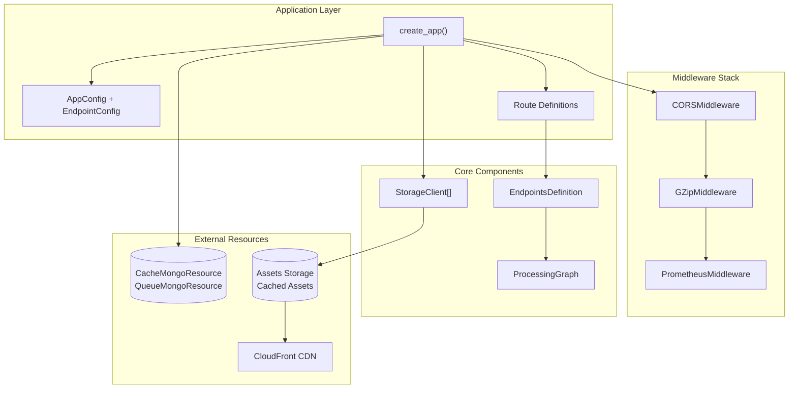
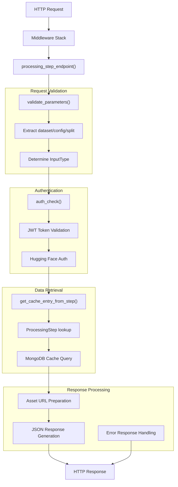
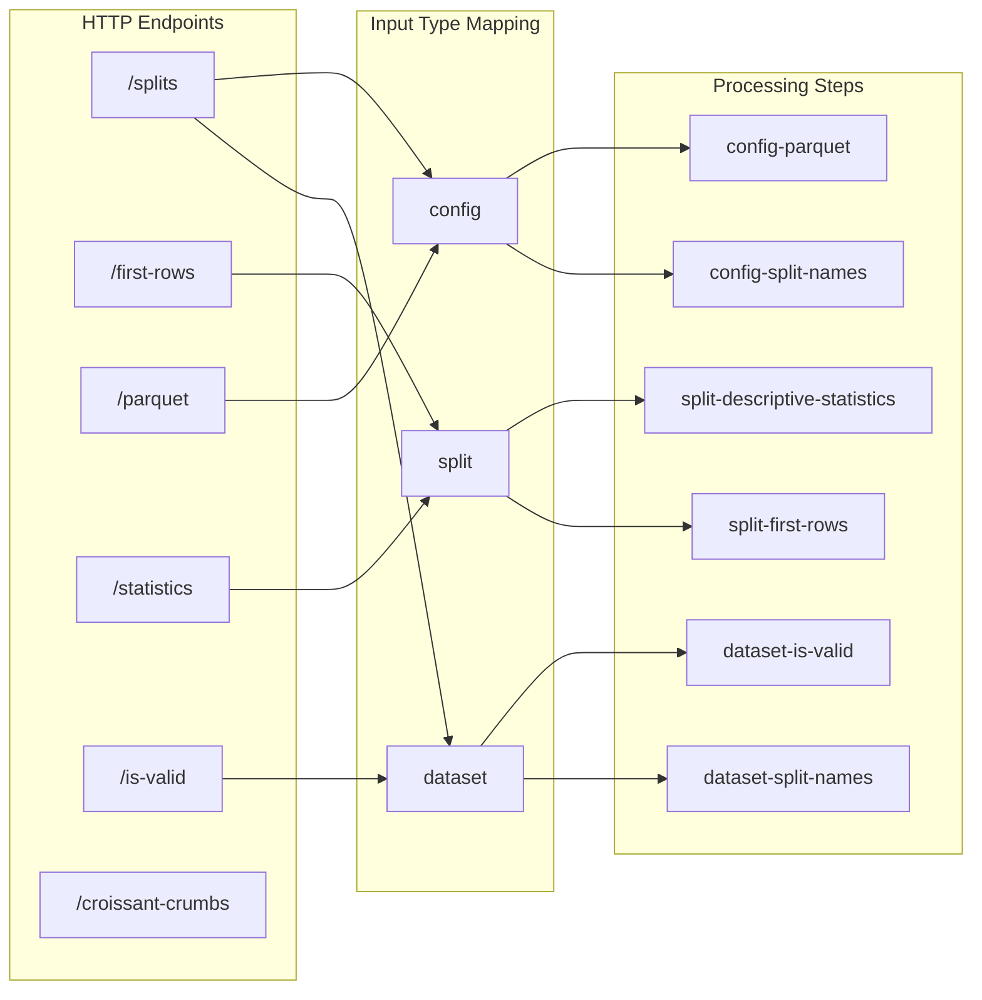
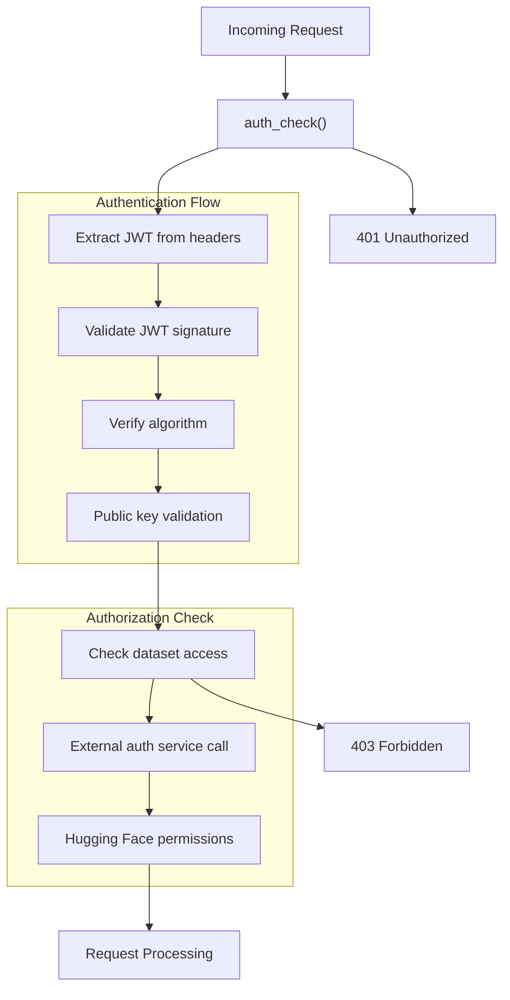
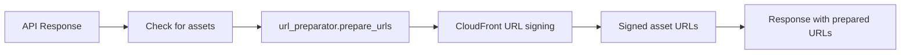

<!-- source: DeepWiki mcp.deepwiki.com · repo huggingface/dataset-viewer · page 3.1 API Service · fetched 2026-10-26 -->

# API Service

<details>
<summary>Relevant source files</summary>

The following files were used as context for generating this wiki page:

- [chart/templates/services/api/_container.tpl](chart/templates/services/api/_container.tpl)
- [docs/source/openapi.json](docs/source/openapi.json)
- [docs/source/statistics.md](docs/source/statistics.md)
- [services/admin/pyproject.toml](services/admin/pyproject.toml)
- [services/api/README.md](services/api/README.md)
- [services/api/pyproject.toml](services/api/pyproject.toml)
- [services/api/src/api/app.py](services/api/src/api/app.py)
- [services/api/src/api/routes/endpoint.py](services/api/src/api/routes/endpoint.py)
- [services/api/tests/conftest.py](services/api/tests/conftest.py)
- [services/api/tests/test_app.py](services/api/tests/test_app.py)
- [services/worker/src/worker/job_runners/split/descriptive_statistics.py](services/worker/src/worker/job_runners/split/descriptive_statistics.py)
- [services/worker/tests/fixtures/datasets.py](services/worker/tests/fixtures/datasets.py)
- [services/worker/tests/fixtures/statistics_dataset.py](services/worker/tests/fixtures/statistics_dataset.py)
- [services/worker/tests/job_runners/split/test_descriptive_statistics.py](services/worker/tests/job_runners/split/test_descriptive_statistics.py)
- [services/worker/tests/test_statistics_utils.py](services/worker/tests/test_statistics_utils.py)

</details>


## Purpose and Scope

The API Service provides a REST API that serves as the primary interface for accessing dataset metadata, statistics, and content from the Hugging Face Dataset Viewer system. It exposes HTTP endpoints that allow external clients to query dataset information, retrieve first rows, access Parquet files, and obtain descriptive statistics.

This document covers the API Service implementation, request processing flow, endpoint definitions, and configuration. For information about the background processing that generates the data served by this API, see [Worker Service](#3.4). For details about the data storage layer, see [Storage Architecture](#2.3).

## Architecture Overview

The API Service is built as a Starlette ASGI application that orchestrates multiple components to serve dataset information efficiently.

### Application Structure



Sources: [services/api/src/api/app.py:27-114]()

### Key Components

The API Service consists of several core components:

- **Application Factory**: `create_app()` function initializes the Starlette application with all dependencies
- **Endpoint Definition**: `EndpointsDefinition` class maps HTTP endpoints to processing steps
- **Storage Integration**: `StorageClient` instances handle asset storage and CDN integration
- **Resource Management**: MongoDB connections for caching and queue management

## Request Processing Flow

### Endpoint Processing Pipeline



Sources: [services/api/src/api/routes/endpoint.py:108-194]()

### Parameter Validation Logic

The API validates request parameters based on the endpoint's input type requirements:

| Input Type | Required Parameters | Validation Function |
|------------|-------------------|-------------------|
| `dataset` | `dataset` | `are_valid_parameters([dataset])` |
| `config` | `dataset`, `config` | `are_valid_parameters([dataset, config])` |
| `split` | `dataset`, `config`, `split` | `are_valid_parameters([dataset, config, split])` |

Sources: [services/api/src/api/routes/endpoint.py:197-218]()

## Endpoint Mapping

### Processing Step Integration



Sources: [services/api/src/api/routes/endpoint.py:39-52](), [docs/source/openapi.json:1-50]()

### Endpoint Configuration Structure

The `EndpointsDefinition` class creates mappings between endpoints and processing steps through the configuration:

```python
processing_step_name_by_input_type_and_endpoint = {
    "/splits": {
        "dataset": "dataset-split-names",
        "config": "config-split-names", 
    },
    "/first-rows": {"split": "split-first-rows"},
    "/parquet": {"config": "config-parquet"},
    "/statistics": {"split": "split-descriptive-statistics"},
}
```

Sources: [services/api/src/api/routes/endpoint.py:44-51]()

## Core API Endpoints

### Dataset Information Endpoints

| Endpoint | Purpose | Input Level | Response Schema |
|----------|---------|-------------|-----------------|
| `/splits` | List available splits | Dataset/Config | `SplitsResponse` |
| `/is-valid` | Check dataset validity | Dataset | `IsValidResponse` |
| `/parquet` | List Parquet files | Config | `ParquetResponse` |
| `/statistics` | Get descriptive statistics | Split | Statistics with histograms |

### Data Access Endpoints

| Endpoint | Purpose | Input Level | Special Features |
|----------|---------|-------------|------------------|
| `/first-rows` | Preview dataset content | Split | Asset URL preparation |
| `/croissant-crumbs` | Croissant metadata | Dataset | Optional feature truncation |

Sources: [docs/source/openapi.json:17-30](), [services/api/README.md:17-30]()

### Response Format Standards

All API responses follow consistent patterns:
- **Success responses**: Include `content`, HTTP 200 status, and cache headers
- **Error responses**: Include error details, appropriate HTTP status codes, and `X-Error-Code` headers
- **Cache control**: Responses include `Cache-Control` headers for optimization

Sources: [docs/source/openapi.json:39-173]()

## Authentication and Security

### JWT Token Authentication



Sources: [services/api/src/api/routes/endpoint.py:128-136](), [services/api/src/api/app.py:38-43]()

### Security Configuration

The API implements multiple security layers:

- **CORS**: Configured to allow cross-origin requests with credentials
- **JWT Validation**: Uses configurable algorithms and public keys
- **Rate Limiting**: Implemented through middleware stack
- **Dataset Access Control**: Validates permissions for private datasets

Sources: [services/api/src/api/app.py:45-56]()

## Storage and Asset Management

### Asset URL Preparation

For endpoints serving media content like `/first-rows`, the API prepares signed URLs for assets:



Sources: [services/api/src/api/routes/endpoint.py:165-169](), [services/api/src/api/app.py:66-76]()

### Storage Client Configuration

The API uses two types of storage clients:

- **Assets Storage**: For user-facing media files with CDN integration
- **Cached Assets**: For internal caching without URL signing

Sources: [services/api/src/api/app.py:58-77]()

## Configuration Management

### Application Configuration

The API service uses two main configuration classes:

- **`AppConfig`**: General application settings, storage, database connections
- **`EndpointConfig`**: Endpoint-to-processing-step mappings

Key configuration areas:
- MongoDB connection settings for cache and queue
- S3 storage configuration for assets
- CloudFront CDN settings
- Authentication parameters
- Cache TTL settings (`max_age_long`, `max_age_short`)

Sources: [services/api/src/api/app.py:28-30](), [services/api/tests/conftest.py:38-56]()

### Environment-Based Configuration

The service loads configuration from environment variables, supporting different settings for development, staging, and production environments.

Sources: [services/api/pyproject.toml:1-67](), [chart/templates/services/api/_container.tpl:1-55]()

---

