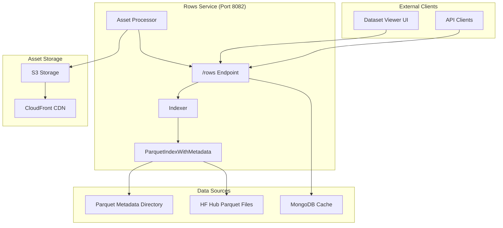
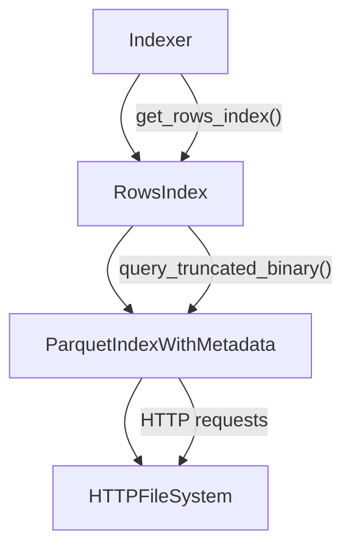
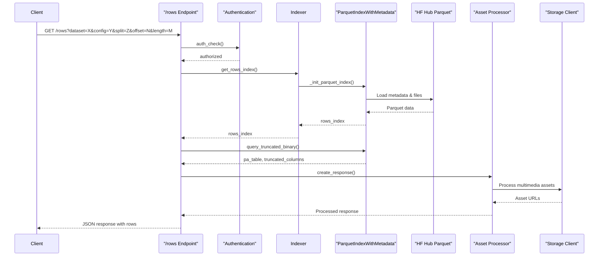
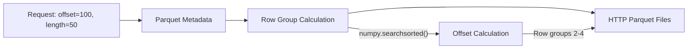
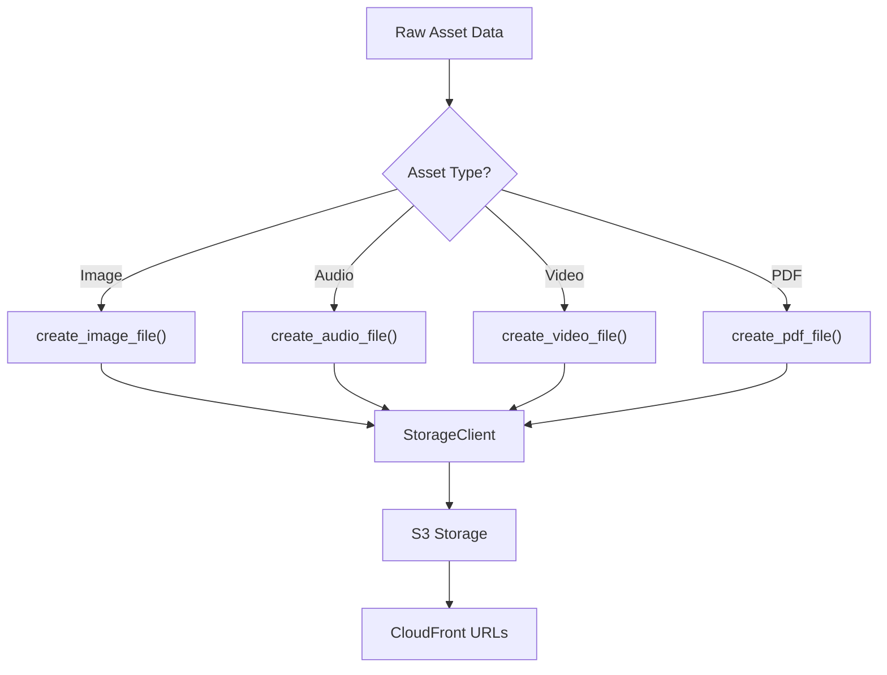

<!-- source: DeepWiki mcp.deepwiki.com · repo huggingface/dataset-viewer · page 3.2 Rows Service · fetched 2026-10-26 -->

# Rows Service

Relevant source files

The following files were used as context for generating this wiki page:

- [chart/templates/services/rows/_container.tpl](chart/templates/services/rows/_container.tpl)
- [chart/templates/services/search/_container.tpl](chart/templates/services/search/_container.tpl)
- [libs/libapi/src/libapi/utils.py](libs/libapi/src/libapi/utils.py)
- [libs/libcommon/src/libcommon/parquet_utils.py](libs/libcommon/src/libcommon/parquet_utils.py)
- [libs/libcommon/src/libcommon/storage_client.py](libs/libcommon/src/libcommon/storage_client.py)
- [libs/libcommon/src/libcommon/viewer_utils/asset.py](libs/libcommon/src/libcommon/viewer_utils/asset.py)
- [libs/libcommon/src/libcommon/viewer_utils/features.py](libs/libcommon/src/libcommon/viewer_utils/features.py)
- [libs/libcommon/tests/conftest.py](libs/libcommon/tests/conftest.py)
- [libs/libcommon/tests/test_integration_s3_cloudfront.py](libs/libcommon/tests/test_integration_s3_cloudfront.py)
- [libs/libcommon/tests/test_url_preparator.py](libs/libcommon/tests/test_url_preparator.py)
- [libs/libcommon/tests/viewer_utils/test_assets.py](libs/libcommon/tests/viewer_utils/test_assets.py)
- [libs/libcommon/tests/viewer_utils/test_features.py](libs/libcommon/tests/viewer_utils/test_features.py)
- [services/rows/src/rows/app.py](services/rows/src/rows/app.py)
- [services/rows/src/rows/routes/rows.py](services/rows/src/rows/routes/rows.py)
- [services/rows/tests/conftest.py](services/rows/tests/conftest.py)
- [services/search/src/search/app.py](services/search/src/search/app.py)
- [services/search/src/search/config.py](services/search/src/search/config.py)
- [services/search/tests/conftest.py](services/search/tests/conftest.py)
- [services/worker/src/worker/job_runners/config/parquet_metadata.py](services/worker/src/worker/job_runners/config/parquet_metadata.py)
- [services/worker/src/worker/job_runners/config/split_names.py](services/worker/src/worker/job_runners/config/split_names.py)
- [services/worker/src/worker/job_runners/split/first_rows.py](services/worker/src/worker/job_runners/split/first_rows.py)
- [services/worker/tests/job_runners/config/test_parquet_metadata.py](services/worker/tests/job_runners/config/test_parquet_metadata.py)
- [services/worker/tests/job_runners/split/test_first_rows.py](services/worker/tests/job_runners/split/test_first_rows.py)

The Rows Service provides paginated access to dataset content through a REST API. It serves individual rows from datasets by reading from converted Parquet files, handling asset processing for multimedia content (images, audio, videos, PDFs), and managing binary data truncation for large datasets. The service is designed to efficiently serve dataset preview functionality for the Hugging Face Dataset Viewer.

For information about dataset search and filtering capabilities, see [Search Service](#3.3). For background data processing that creates the Parquet files this service reads, see [Worker Service](#3.4).

## Architecture Overview

The Rows Service operates as a standalone microservice that bridges dataset storage with user-facing APIs. It reads preprocessed Parquet metadata and streams content from remote Parquet files hosted on Hugging Face Hub.

Sources: [services/rows/src/rows/app.py:90-114](), [services/rows/src/rows/routes/rows.py:41-152]()

## Core Components

### Indexer Class

The `Indexer` class serves as the primary interface for accessing dataset rows. It manages `RowsIndex` instances and handles feature filtering based on dataset allow-lists.

Key responsibilities:
- Manages Parquet metadata directory access
- Handles HTTP file system connections with authentication
- Implements LRU caching for `RowsIndex` instances
- Filters unsupported features based on dataset configuration

Sources: [libs/libcommon/src/libcommon/parquet_utils.py:618-657]()

### ParquetIndexWithMetadata

This class handles the core logic for querying Parquet files and managing memory constraints.

| Method | Purpose | Memory Handling |
|--------|---------|-----------------|
| `query()` | Standard row querying | Checks total row group size |
| `query_truncated_binary()` | Query with binary truncation | Separates binary/non-binary size limits |
| `from_parquet_metadata_items()` | Factory method | Validates metadata and features |

The class implements sophisticated memory management:
- Pre-calculates row group sizes before loading
- Separates binary and non-binary data size calculations
- Applies truncation heuristics for large binary columns
- Raises `TooBigRows` exceptions when memory limits are exceeded

Sources: [libs/libcommon/src/libcommon/parquet_utils.py:182-510]()

## Request Processing Flow

Sources: [services/rows/src/rows/routes/rows.py:64-152](), [libs/libapi/response.py:create_response]()

## Data Access Patterns

### Parquet File Resolution

The service resolves dataset requests through a multi-step process:

1. **Cache Lookup**: Checks MongoDB for `config-parquet-metadata` entries
2. **Metadata Loading**: Reads local Parquet metadata files from `parquet_metadata_directory`
3. **File Streaming**: Opens remote Parquet files via `HTTPFileSystem` with authentication
4. **Row Group Selection**: Calculates which row groups contain the requested offset/length range

### Memory Management

The service implements careful memory management for large datasets:

- **Pre-flight Size Checks**: Calculates row group sizes before loading data
- **Binary Data Truncation**: Applies dynamic truncation to binary columns when memory limits are approached
- **Separate Size Tracking**: Tracks binary and non-binary column sizes independently

Sources: [libs/libcommon/src/libcommon/parquet_utils.py:298-345]()

## Asset Management

### Multimedia Processing

The Rows Service processes multimedia content embedded in datasets and stores processed assets in S3 with CloudFront distribution.

| Asset Type | Processing | Output Format |
|------------|------------|---------------|
| Images | EXIF orientation, format conversion | JPEG/PNG with dimensions |
| Audio | Format conversion, metadata extraction | WAV/MP3/Opus with type info |
| Videos | Path resolution, metadata | Video URLs |
| PDFs | Thumbnail generation, size calculation | PDF + PNG thumbnail |

### Asset URL Management

The service uses a placeholder-based revision system for asset URLs:
- Assets are stored with `{dataset_git_revision}` placeholders
- URLs are dynamically resolved with actual revision hashes
- CloudFront signing is applied for secure access

Sources: [libs/libcommon/src/libcommon/viewer_utils/asset.py:45-260](), [libs/libcommon/src/libcommon/viewer_utils/features.py:70-506]()

## Configuration and Deployment

### Service Configuration

The Rows Service is configured through environment variables and deployed as a containerized service:

| Configuration | Purpose | Default |
|---------------|---------|---------|
| `ROWS_INDEX_MAX_ARROW_DATA_IN_MEMORY` | Memory limit for Arrow data | Configurable |
| `API_UVICORN_PORT` | Service port | 8082 |
| `PARQUET_METADATA_STORAGE_DIRECTORY` | Local metadata cache | `/tmp/parquet-metadata` |

### Kubernetes Deployment

The service runs in Kubernetes with specific resource constraints and health checks:

- **Readiness/Liveness Probes**: `/healthcheck` endpoint on service port
- **Volume Mounts**: Read-only access to parquet metadata directory
- **Resource Limits**: Configured based on expected dataset sizes and concurrency

Sources: [services/rows/src/rows/app.py:32-114](), [chart/templates/services/rows/_container.tpl:1-59]()

## Error Handling and Resilience

The service implements comprehensive error handling:

- **Memory Limit Exceeded**: `TooBigContentError` when datasets exceed memory constraints
- **Authentication Failures**: Integration with HF Hub authentication
- **Missing Cache Entries**: Automatic backfill triggering through `try_backfill_dataset_then_raise()`
- **Parquet Schema Mismatches**: `SchemaMismatchError` for inconsistent file schemas

Special handling exists for specific datasets, such as rate limiting for `HuggingFaceFW/fineweb-edu-score-2` when offset exceeds 1 million rows.

Sources: [services/rows/src/rows/routes/rows.py:76-81](), [services/rows/src/rows/routes/rows.py:123-150]()

---

