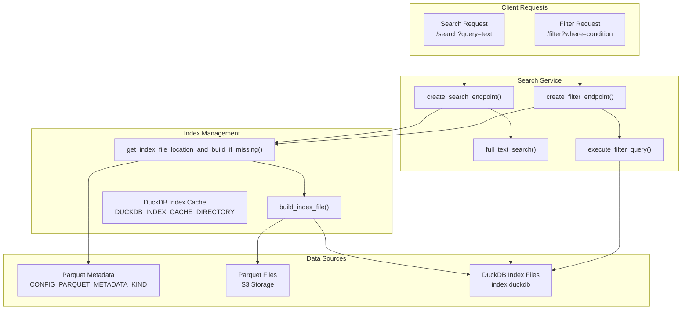
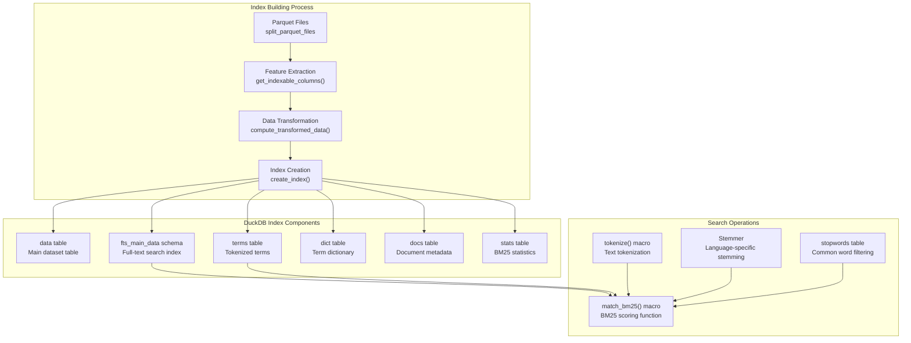
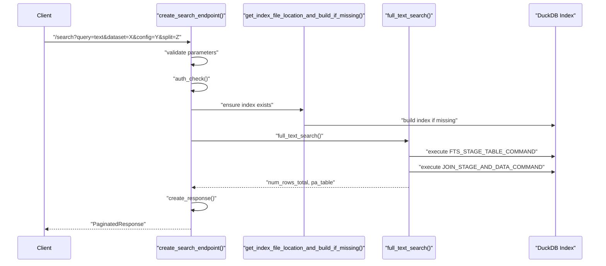
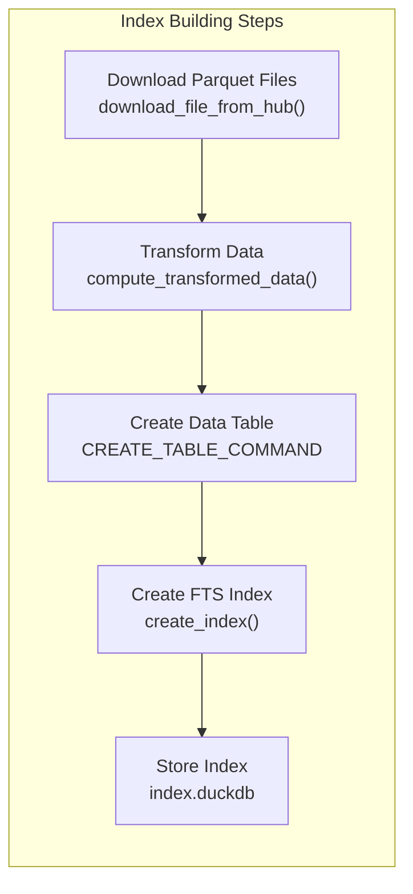

<!-- source: DeepWiki mcp.deepwiki.com · repo huggingface/dataset-viewer · page 3.3 Search Service · fetched 2026-10-26 -->

# Search Service

<details>
<summary>Relevant source files</summary>

The following files were used as context for generating this wiki page:

- [chart/templates/_env/_envWorker.tpl](chart/templates/_env/_envWorker.tpl)
- [libs/libapi/src/libapi/duckdb.py](libs/libapi/src/libapi/duckdb.py)
- [libs/libcommon/src/libcommon/duckdb_utils.py](libs/libcommon/src/libcommon/duckdb_utils.py)
- [services/search/src/search/duckdb_connection.py](services/search/src/search/duckdb_connection.py)
- [services/search/src/search/routes/filter.py](services/search/src/search/routes/filter.py)
- [services/search/src/search/routes/search.py](services/search/src/search/routes/search.py)
- [services/search/tests/routes/test_search.py](services/search/tests/routes/test_search.py)
- [tools/docker-compose-dataset-viewer.yml](tools/docker-compose-dataset-viewer.yml)
- [tools/docker-compose-dev-dataset-viewer.yml](tools/docker-compose-dev-dataset-viewer.yml)

</details>


The Search Service provides full-text search and filtering capabilities for datasets in the dataset-viewer system. It enables users to search through dataset content using natural language queries and apply SQL-like filters to find specific data within dataset splits.

For information about the API service that provides dataset metadata, see [API Service](#3.1). For details about accessing dataset rows, see [Rows Service](#3.2).

## Overview

The Search Service operates as a dedicated microservice that:

- Provides full-text search capabilities using BM25 scoring algorithm
- Enables SQL-like filtering with WHERE and ORDER BY clauses
- Automatically builds and manages DuckDB search indexes
- Integrates with the parquet conversion pipeline for searchable data access
- Supports multiple languages with stemming and stopword filtering

The service runs on port 8083 and exposes two main endpoints: `/search` for full-text queries and `/filter` for structured filtering operations.

## Architecture

### Service Architecture



Sources: [services/search/src/search/routes/search.py:119-250](), [services/search/src/search/routes/filter.py:61-195](), [libs/libapi/src/libapi/duckdb.py:185-264]()

### DuckDB Index Architecture



Sources: [libs/libapi/src/libapi/duckdb.py:82-183](), [libs/libcommon/src/libcommon/duckdb_utils.py:209-544]()

## Endpoints

### Search Endpoint

The search endpoint provides full-text search capabilities with BM25 scoring:

| Parameter | Type | Required | Description |
|-----------|------|----------|-------------|
| `dataset` | string | Yes | Dataset identifier |
| `config` | string | Yes | Dataset configuration name |
| `split` | string | Yes | Dataset split name |
| `query` | string | Yes | Search query text |
| `offset` | integer | No | Starting position (default: 0) |
| `length` | integer | No | Number of results (default: 100) |

The endpoint performs the following operations:

1. **Authentication**: Validates user access using `auth_check()`
2. **Index Management**: Ensures DuckDB index exists via `get_index_file_location_and_build_if_missing()`
3. **Search Execution**: Runs full-text search using `full_text_search()`
4. **Response Creation**: Formats results with `create_response()`



Sources: [services/search/src/search/routes/search.py:138-250](), [services/search/src/search/routes/search.py:55-77]()

### Filter Endpoint

The filter endpoint provides SQL-like filtering capabilities:

| Parameter | Type | Required | Description |
|-----------|------|----------|-------------|
| `dataset` | string | Yes | Dataset identifier |
| `config` | string | Yes | Dataset configuration name |
| `split` | string | Yes | Dataset split name |
| `where` | string | No | SQL WHERE clause |
| `orderby` | string | No | SQL ORDER BY clause |
| `offset` | integer | No | Starting position (default: 0) |
| `length` | integer | No | Number of results (default: 100) |

The filter endpoint validates SQL parameters to prevent injection attacks using `validate_query_parameter()` and executes queries through `execute_filter_query()`.

Sources: [services/search/src/search/routes/filter.py:80-195](), [services/search/src/search/routes/filter.py:198-226]()

## Full-Text Search Implementation

### BM25 Scoring

The search service implements BM25 (Best Matching 25) scoring algorithm for relevance ranking. The implementation uses DuckDB's full-text search extension with custom macro definitions:

```sql
FTS_STAGE_TABLE_COMMAND = "SELECT * FROM (SELECT __hf_index_id, fts_main_data.match_bm25(__hf_index_id, ?) AS __hf_fts_score FROM data) A WHERE __hf_fts_score IS NOT NULL;"
```

The search process involves:

1. **Tokenization**: Text is tokenized using regex-based splitting
2. **Stemming**: Language-specific stemming using configurable stemmers
3. **Stopword Filtering**: Common words are filtered using predefined stopword lists
4. **BM25 Calculation**: Relevance scores are computed using document frequency and term frequency

Sources: [services/search/src/search/routes/search.py:49-51](), [libs/libcommon/src/libcommon/duckdb_utils.py:474-542]()

### Language Support

The search service supports multiple languages through stemming:

| Language | ISO 639-1 | ISO 639-2/3 | Stemmer |
|----------|-----------|-------------|---------|
| English | en | eng | english |
| French | fr | fra | french |
| German | de | deu | german |
| Spanish | es | spa | spanish |
| Italian | it | ita | italian |
| Portuguese | pt | por | portuguese |
| Russian | ru | rus | russian |
| Arabic | ar | ara | arabic |

The stemmer is automatically selected based on dataset language metadata using `get_monolingual_stemmer()`.

Sources: [libs/libcommon/src/libcommon/duckdb_utils.py:53-81](), [libs/libcommon/src/libcommon/duckdb_utils.py:104-115]()

## Index Management

### Index Building Process

The search service automatically builds DuckDB indexes for dataset splits when they don't exist. The process involves:

1. **Parquet File Collection**: Downloads parquet files from dataset repository
2. **Feature Analysis**: Identifies indexable columns using `get_indexable_columns()`
3. **Data Transformation**: Computes additional columns (lengths, durations, etc.)
4. **Index Creation**: Builds full-text search indexes with BM25 support
5. **Caching**: Stores indexes in `DUCKDB_INDEX_CACHE_DIRECTORY`



Sources: [libs/libapi/src/libapi/duckdb.py:82-183](), [libs/libcommon/src/libcommon/duckdb_utils.py:167-187]()

### Index File Management

Index files are stored with specific naming conventions:

- **Full Index**: `index.duckdb` - Complete dataset index
- **Partial Index**: `partial-index.duckdb` - Limited size index
- **Directory Structure**: `{config}/{split_directory}/{index_filename}`

The service uses file locking to prevent concurrent index building and implements cache cleanup through `clean_dir()` operations.

Sources: [libs/libapi/src/libapi/duckdb.py:210-224](), [libs/libcommon/src/libcommon/duckdb_utils.py:31-32]()

## DuckDB Integration

### Connection Management

The search service uses read-only DuckDB connections for safety:

```python
def duckdb_connect_readonly(database, extensions_directory):
    con = duckdb.connect(":memory:")
    con.execute(ATTACH_READ_ONLY_DATABASE.format(database=database))
    con.execute(LOAD_FTS_SAFE_COMMAND)
    return con
```

Key safety measures:
- In-memory connections with attached read-only database
- Disabled external access: `SET enable_external_access=false`
- Configuration locking: `SET lock_configuration=true`

Sources: [services/search/src/search/duckdb_connection.py:10-20]()

### Query Execution

Search queries are executed through optimized SQL commands:

- **Search Stage**: Creates temporary table with BM25 scores
- **Join Stage**: Joins scored results with original data
- **Pagination**: Implements LIMIT/OFFSET for result paging

Filter queries use parameterized SQL with validation to prevent injection attacks.

Sources: [services/search/src/search/routes/search.py:63-77](), [services/search/src/search/routes/filter.py:208-221]()

## Configuration

### Environment Variables

The search service uses the following configuration:

| Variable | Default | Description |
|----------|---------|-------------|
| `DUCKDB_INDEX_CACHE_DIRECTORY` | `/duckdb-index` | Index storage directory |
| `DUCKDB_INDEX_EXTENSIONS_DIRECTORY` | `/tmp/duckdb-extensions` | DuckDB extensions path |
| `PARQUET_METADATA_STORAGE_DIRECTORY` | `/parquet_metadata` | Parquet metadata cache |
| `SEARCH_UVICORN_PORT` | `8083` | Service listening port |
| `SEARCH_UVICORN_NUM_WORKERS` | `2` | Number of worker processes |

Sources: [tools/docker-compose-dev-dataset-viewer.yml:129-137](), [tools/docker-compose-dataset-viewer.yml:121-129]()

### Deployment Configuration

The search service is deployed as part of the dataset-viewer microservices architecture:

- **Port**: 8083 (configurable)
- **Reverse Proxy**: Nginx routes `/search` and `/filter` requests
- **Dependencies**: MongoDB for caching, S3 for parquet storage
- **Volumes**: Persistent storage for DuckDB indexes and parquet metadata

Sources: [tools/docker-compose-dev-dataset-viewer.yml:115-145](), [tools/docker-compose-dataset-viewer.yml:109-137]()

---

