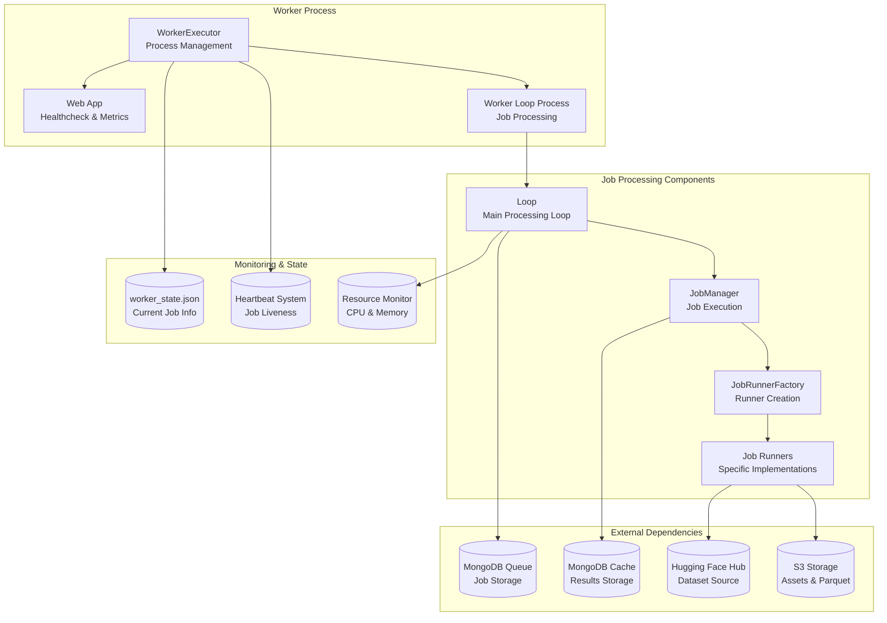
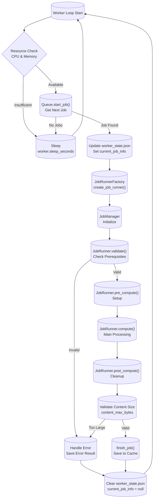
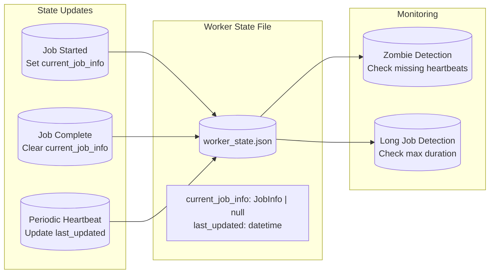
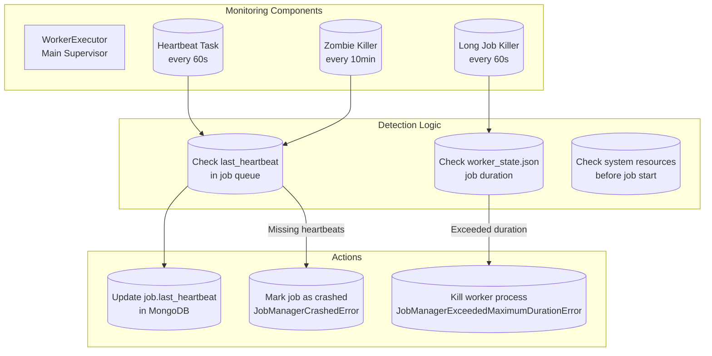
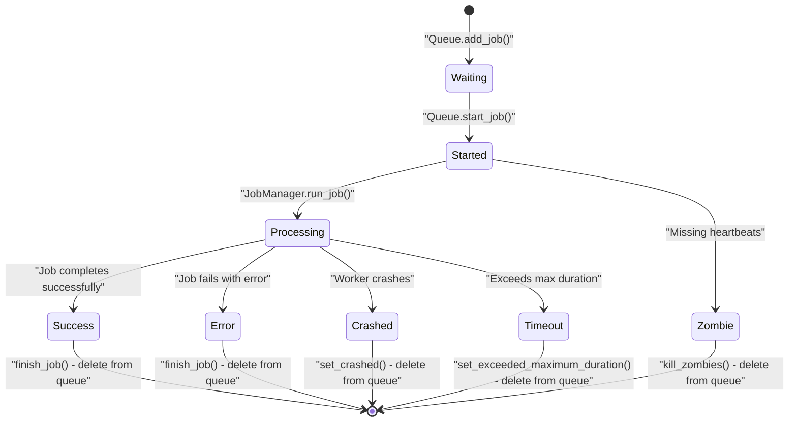

<!-- source: DeepWiki mcp.deepwiki.com · repo huggingface/dataset-viewer · page 3.4 Worker Service · fetched 2026-10-26 -->

# Worker Service

<details>
<summary>Relevant source files</summary>

The following files were used as context for generating this wiki page:

- [chart/templates/worker/_container.tpl](chart/templates/worker/_container.tpl)
- [jobs/mongodb_migration/src/mongodb_migration/collector.py](jobs/mongodb_migration/src/mongodb_migration/collector.py)
- [jobs/mongodb_migration/src/mongodb_migration/deletion_migrations.py](jobs/mongodb_migration/src/mongodb_migration/deletion_migrations.py)
- [jobs/mongodb_migration/src/mongodb_migration/migration.py](jobs/mongodb_migration/src/mongodb_migration/migration.py)
- [jobs/mongodb_migration/tests/test_deletion_migrations.py](jobs/mongodb_migration/tests/test_deletion_migrations.py)
- [services/worker/README.md](services/worker/README.md)
- [services/worker/pyproject.toml](services/worker/pyproject.toml)
- [services/worker/src/worker/config.py](services/worker/src/worker/config.py)
- [services/worker/src/worker/executor.py](services/worker/src/worker/executor.py)
- [services/worker/src/worker/job_manager.py](services/worker/src/worker/job_manager.py)
- [services/worker/src/worker/loop.py](services/worker/src/worker/loop.py)
- [services/worker/src/worker/main.py](services/worker/src/worker/main.py)
- [services/worker/src/worker/start_worker_loop.py](services/worker/src/worker/start_worker_loop.py)
- [services/worker/tests/conftest.py](services/worker/tests/conftest.py)
- [services/worker/tests/test_executor.py](services/worker/tests/test_executor.py)
- [services/worker/tests/test_job_manager.py](services/worker/tests/test_job_manager.py)
- [services/worker/tests/test_job_runner_factory.py](services/worker/tests/test_job_runner_factory.py)
- [services/worker/tests/test_loop.py](services/worker/tests/test_loop.py)

</details>


The Worker Service is the background job processing engine of the dataset-viewer system. It pulls jobs from the MongoDB queue, executes them using specialized job runners, and stores the results in the cache. Workers can be configured to handle jobs within specific difficulty ranges, enabling workload distribution across different worker tiers.

For information about the processing graph that defines job dependencies, see [Processing Graph](#5.1). For details about individual job runners and their implementations, see [Job Runners](#5.2).

## Architecture Overview

The Worker Service follows a multi-layered architecture with clear separation between job orchestration, execution, and monitoring responsibilities.

### Worker Architecture Diagram



Sources: [services/worker/src/worker/executor.py:52-223](), [services/worker/src/worker/loop.py:35-139](), [services/worker/src/worker/job_manager.py:31-249]()

### Core Components

The Worker Service consists of several key components that work together to process jobs reliably:

| Component | Class | Responsibility |
|-----------|-------|----------------|
| **Process Manager** | `WorkerExecutor` | Manages worker processes, handles crashes, monitors long jobs |
| **Job Loop** | `Loop` | Main processing loop, resource monitoring, job orchestration |
| **Job Execution** | `JobManager` | Individual job execution, error handling, result validation |
| **Runner Factory** | `JobRunnerFactory` | Creates appropriate job runners based on job type |
| **Configuration** | `AppConfig` | Centralized configuration management |

Sources: [services/worker/src/worker/executor.py:52-73](), [services/worker/src/worker/loop.py:35-58](), [services/worker/src/worker/job_manager.py:31-69]()

## Job Processing Flow

The worker processes jobs through a well-defined pipeline that ensures reliability and proper error handling.

### Job Processing Pipeline



Sources: [services/worker/src/worker/loop.py:108-133](), [services/worker/src/worker/job_manager.py:117-202]()

### Job State Management

Workers maintain state information in a JSON file that tracks the currently executing job and enables monitoring systems to detect crashes and zombies.



Sources: [services/worker/src/worker/loop.py:134-139](), [services/worker/src/worker/executor.py:130-144]()

## Configuration

The Worker Service uses a comprehensive configuration system that allows fine-tuning of resource limits, job processing parameters, and monitoring settings.

### Worker Configuration Classes

| Config Class | Purpose | Key Settings |
|--------------|---------|--------------|
| `WorkerConfig` | Core worker behavior | `difficulty_min/max`, `max_job_duration_seconds`, `sleep_seconds` |
| `UvicornConfig` | Web server for healthcheck | `hostname`, `port`, `num_workers` |
| `FirstRowsConfig` | First rows job limits | `max_bytes`, `min_number`, `columns_max_number` |
| `ParquetAndInfoConfig` | Parquet conversion settings | `max_dataset_size_bytes`, `target_revision` |
| `DescriptiveStatisticsConfig` | Statistics computation | `max_split_size_bytes`, `cache_directory` |

Sources: [services/worker/src/worker/config.py:60-103](), [services/worker/src/worker/config.py:25-40]()

### Resource Management

Workers implement sophisticated resource monitoring to prevent system overload:

```python
# Resource check implementation
def has_memory(self) -> bool:
    if self.app_config.worker.max_memory_pct <= 0:
        return True
    percent = (swap_memory().used + virtual_memory_used) / (swap_memory().total + virtual_memory_total)
    return percent < self.app_config.worker.max_memory_pct

def has_cpu(self) -> bool:
    if self.app_config.worker.max_load_pct <= 0:
        return True
    load_pct = max(getloadavg()[:2]) / cpu_count() * 100
    return load_pct < self.app_config.worker.max_load_pct
```

Sources: [services/worker/src/worker/loop.py:60-85]()

### Difficulty-Based Job Distribution

Workers can be configured to handle jobs within specific difficulty ranges, enabling workload distribution:

| Configuration | Environment Variable | Default | Purpose |
|---------------|---------------------|---------|---------|
| `difficulty_min` | `WORKER_DIFFICULTY_MIN` | None | Minimum job difficulty (exclusive) |
| `difficulty_max` | `WORKER_DIFFICULTY_MAX` | None | Maximum job difficulty (inclusive) |

Sources: [services/worker/src/worker/config.py:43-44](), [chart/templates/worker/_container.tpl:22-25]()

## Error Handling and Monitoring

The Worker Service implements comprehensive error handling and monitoring to ensure reliable job processing.

### Worker Monitoring System



Sources: [services/worker/src/worker/executor.py:145-186](), [services/worker/src/worker/executor.py:156-164]()

### Error Classification and Handling

The worker handles different types of errors with appropriate responses:

| Error Type | Error Class | Action | Cache Update |
|------------|-------------|---------|--------------|
| **Previous Step Error** | `CachedArtifactError` | Copy previous error | Yes, with error details |
| **Dataset Not Found** | `DatasetNotFoundError` | Skip caching | No (prevent DoS) |
| **Content Too Large** | `TooBigContentError` | Save error | Yes, with size info |
| **Worker Crash** | `JobManagerCrashedError` | Mark as crashed | Yes, with crash details |
| **Job Timeout** | `JobManagerExceededMaximumDurationError` | Kill and mark | Yes, with timeout info |

Sources: [services/worker/src/worker/job_manager.py:158-202](), [services/worker/src/worker/job_manager.py:204-248]()

### Job Lifecycle Management



Sources: [services/worker/src/worker/job_manager.py:114-116](), [services/worker/src/worker/executor.py:156-164]()

## Deployment and Scaling

Workers are deployed as Kubernetes pods with configurable resource limits and difficulty ranges to enable horizontal scaling.

### Container Configuration

The worker container includes health checks and resource monitoring:

```yaml
# From Helm template
readinessProbe:
  failureThreshold: 30
  periodSeconds: 5
  httpGet:
    path: /healthcheck
    port: 8000

livenessProbe:
  failureThreshold: 30
  periodSeconds: 5
  httpGet:
    path: /healthcheck
    port: 8000
```

Sources: [chart/templates/worker/_container.tpl:43-54]()

### Worker Scaling Strategy

Workers can be scaled based on difficulty ranges to handle different workloads:

- **Light workers**: `difficulty_min=0, difficulty_max=40`
- **Medium workers**: `difficulty_min=40, difficulty_max=70`  
- **Heavy workers**: `difficulty_min=70, difficulty_max=100`

Sources: [chart/templates/worker/_container.tpl:22-25]()

---

