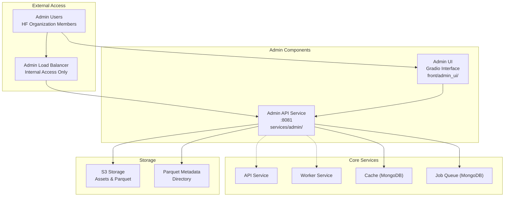
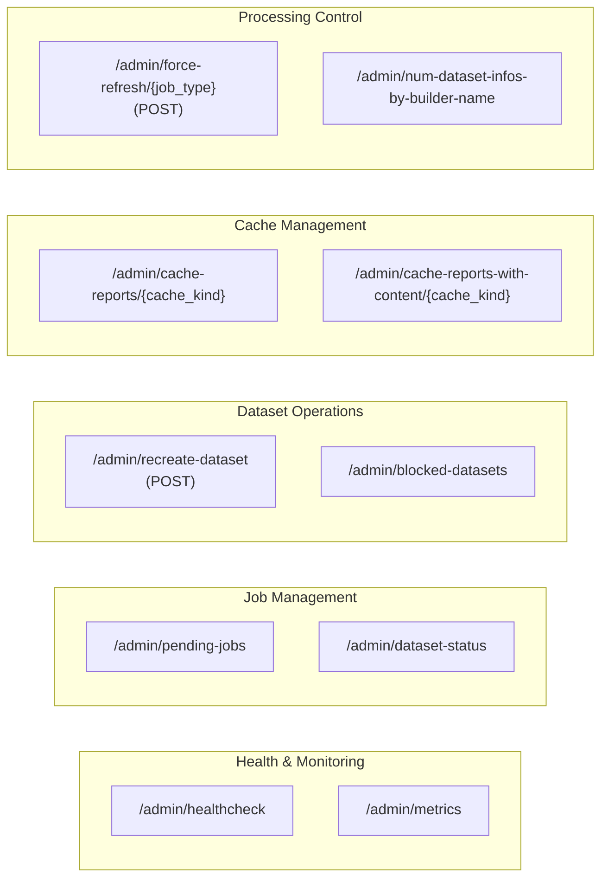
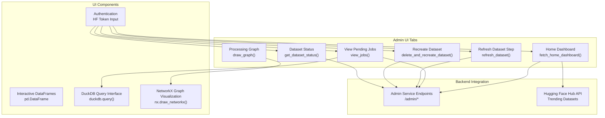
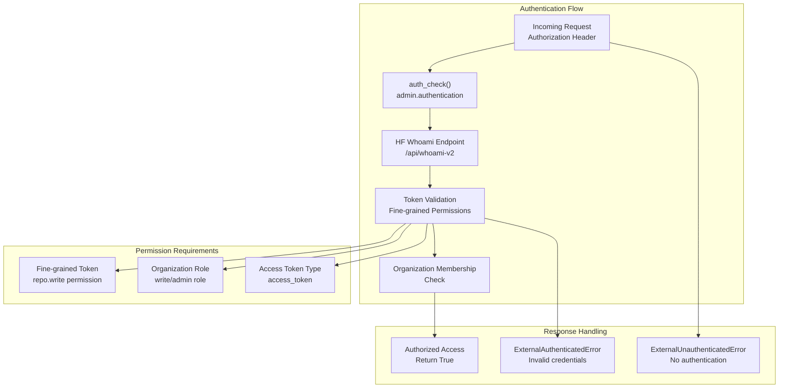
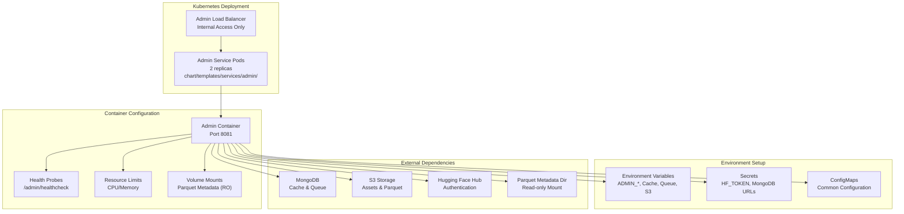

<!-- source: DeepWiki mcp.deepwiki.com · repo huggingface/dataset-viewer · page 3.5 Admin Service · fetched 2026-10-26 -->

# Admin Service

Relevant source files

The following files were used as context for generating this wiki page:

- [chart/templates/services/admin/_container.tpl](chart/templates/services/admin/_container.tpl)
- [front/admin_ui/README.md](front/admin_ui/README.md)
- [front/admin_ui/app.py](front/admin_ui/app.py)
- [front/admin_ui/packages.txt](front/admin_ui/packages.txt)
- [front/admin_ui/pyproject.toml](front/admin_ui/pyproject.toml)
- [front/admin_ui/requirements.txt](front/admin_ui/requirements.txt)
- [services/admin/README.md](services/admin/README.md)
- [services/admin/src/admin/app.py](services/admin/src/admin/app.py)
- [services/admin/src/admin/authentication.py](services/admin/src/admin/authentication.py)
- [services/admin/src/admin/config.py](services/admin/src/admin/config.py)
- [services/admin/tests/test_app.py](services/admin/tests/test_app.py)
- [services/admin/tests/test_authentication.py](services/admin/tests/test_authentication.py)
- [services/admin/tests/utils.py](services/admin/tests/utils.py)
- [tools/Docker.mk](tools/Docker.mk)

The Admin Service provides administrative endpoints and a web interface for monitoring, managing, and controlling the dataset-viewer system. It enables authorized users to view system status, manage job queues, force refresh operations, and perform maintenance tasks across all processing steps.

For information about the core API services that handle dataset requests, see [API Service](#3.1). For details about the background processing system, see [Worker Service](#3.4).

## Purpose and Architecture

The Admin Service consists of two main components: a REST API service that provides administrative endpoints, and a Gradio-based web interface for interactive system management. The service runs on port 8081 by default and requires authentication through Hugging Face organization membership.

**Sources:** [services/admin/src/admin/app.py:1-206](), [front/admin_ui/app.py:1-714](), [services/admin/README.md:1-57]()

## Service Endpoints

The Admin Service provides REST endpoints for system monitoring and management operations. All endpoints require proper authentication and organization membership.

### Core Administrative Endpoints

**Sources:** [services/admin/src/admin/app.py:80-189]()

### Dynamic Route Generation

The Admin Service dynamically generates routes for each processing step in the system:

| Route Pattern | Purpose | Parameters |
|---------------|---------|------------|
| `/admin/force-refresh/{job_type}` | Force refresh specific processing steps | `dataset`, `config`, `split`, `priority`, `difficulty` |
| `/admin/cache-reports/{cache_kind}` | Get cache reports for processing step | `cursor` for pagination |
| `/admin/cache-reports-with-content/{cache_kind}` | Get detailed cache reports with content | `cursor` for pagination |

**Sources:** [services/admin/src/admin/app.py:142-188]()

## Admin UI Features

The Admin UI provides a web-based interface built with Gradio for interactive system management. It connects to the Admin Service endpoints and presents data in user-friendly formats.

**Sources:** [front/admin_ui/app.py:55-714]()

### Key UI Functionalities

#### Home Dashboard
- Displays dataset statistics by builder name (parquet, csv, text, etc.)
- Shows trending dataset coverage statistics for different features
- Calculates percentages for preview, viewer, search, filter, and statistics availability

**Sources:** [front/admin_ui/app.py:115-282]()

#### Job Management Interface
- Fetches and displays pending jobs summary by type and status
- Provides SQL-like querying interface using DuckDB for job analysis
- Shows most recent jobs with timestamp information

**Sources:** [front/admin_ui/app.py:301-407]()

#### Processing Control
- Allows force refresh of specific processing steps with configurable parameters
- Supports multiple datasets/configs/splits through comma-separated input
- Provides difficulty and priority controls for job scheduling

**Sources:** [front/admin_ui/app.py:409-526]()

## Authentication System

The Admin Service implements a comprehensive authentication system that validates Hugging Face tokens and organization membership.

**Sources:** [services/admin/src/admin/authentication.py:13-93]()

### Authentication Configuration

The authentication system supports multiple permission models:

| Permission Type | Requirement | Configuration |
|----------------|-------------|---------------|
| Fine-grained | Token must have `repo.write` permission for organization | `require_fine_grained_permissions` |
| Role-based | Token must have `write` role with `write` or `admin` org role | `require_token_and_org_permissions` |
| Organization | User must be member of specified organization | `ADMIN_HF_ORGANIZATION` |

**Sources:** [services/admin/src/admin/authentication.py:18-20](), [services/admin/src/admin/config.py:44-78]()

## Configuration

The Admin Service configuration is managed through environment variables with the `ADMIN_` prefix:

### Service Configuration

| Variable | Purpose | Default |
|----------|---------|---------|
| `ADMIN_HF_ORGANIZATION` | Required organization membership for access | None (auth disabled) |
| `ADMIN_CACHE_REPORTS_NUM_RESULTS` | Number of results in cache report endpoints | 100 |
| `ADMIN_CACHE_REPORTS_WITH_CONTENT_NUM_RESULTS` | Results in cache reports with content | 100 |
| `ADMIN_HF_TIMEOUT_SECONDS` | Timeout for HF Hub requests | 0.2 seconds |
| `ADMIN_MAX_AGE` | Cache max-age header for technical endpoints | 10 seconds |

**Sources:** [services/admin/src/admin/config.py:41-78]()

### Uvicorn Server Configuration

| Variable | Purpose | Default |
|----------|---------|---------|
| `ADMIN_UVICORN_HOSTNAME` | Server hostname | "localhost" |
| `ADMIN_UVICORN_NUM_WORKERS` | Number of uvicorn workers | 2 |
| `ADMIN_UVICORN_PORT` | Server port | 8000 |

**Sources:** [services/admin/src/admin/config.py:19-38]()

## Deployment Architecture

The Admin Service is deployed as part of the Kubernetes cluster with specific resource allocation and access controls.

**Sources:** [chart/templates/services/admin/_container.tpl:1-64]()

### Resource Management

The Admin Service connects to multiple storage backends and requires appropriate access:

- **MongoDB**: Cache and queue database connections for job management
- **S3 Storage**: Asset and parquet file storage for cleanup operations  
- **Parquet Metadata**: Read-only access to parquet metadata directory
- **Prometheus**: Metrics collection and monitoring integration

**Sources:** [services/admin/src/admin/app.py:44-67]()

---

