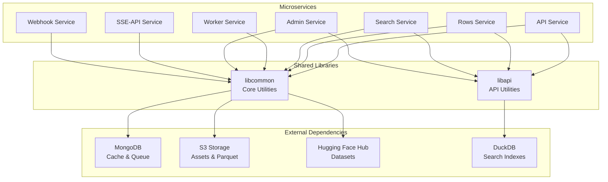
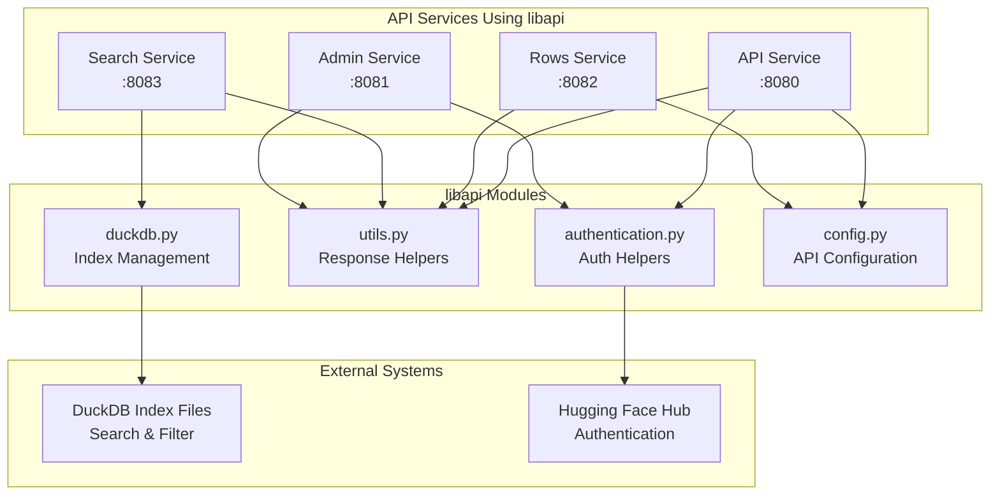
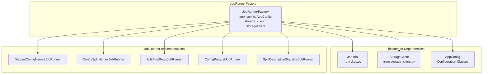

<!-- source: DeepWiki mcp.deepwiki.com · repo huggingface/dataset-viewer · page 4 Shared Libraries · fetched 2026-10-26 -->

# Shared Libraries

<details>
<summary>Relevant source files</summary>

The following files were used as context for generating this wiki page:

- [libs/libcommon/pyproject.toml](libs/libcommon/pyproject.toml)
- [libs/libcommon/src/libcommon/config.py](libs/libcommon/src/libcommon/config.py)
- [libs/libcommon/src/libcommon/constants.py](libs/libcommon/src/libcommon/constants.py)
- [services/api/src/api/config.py](services/api/src/api/config.py)
- [services/api/tests/routes/test_endpoint.py](services/api/tests/routes/test_endpoint.py)
- [services/worker/src/worker/job_runner_factory.py](services/worker/src/worker/job_runner_factory.py)

</details>


This document covers the shared libraries that provide common functionality across all services in the dataset-viewer system. These libraries encapsulate reusable components for configuration management, caching, storage, job processing, and API utilities that are used by multiple microservices.

For information about individual service implementations, see [Core Services](#3). For details about data processing workflows, see [Data Processing](#5).

## Overview

The dataset-viewer system uses two primary shared libraries to provide common functionality across all microservices:

- **libcommon** - Core utilities including configuration management, caching, storage, job queuing, and processing workflows
- **libapi** - API-specific utilities for authentication, response formatting, and DuckDB integration

### Library Dependencies



Sources: [libs/libcommon/pyproject.toml:1-113](), [services/api/src/api/config.py:1-104](), [services/worker/src/worker/job_runner_factory.py:1-236]()

## libcommon Library

The `libcommon` library serves as the foundational shared library providing core functionality used by all services in the system. It handles configuration management, caching, storage operations, job processing, and common utilities.

### Core Components

```mermaid
graph TD
    subgraph "libcommon Modules"
        Constants["constants.py<br/>System Constants"]
        Config["config.py<br/>Configuration Classes"]
        SimpleCache["simple_cache.py<br/>MongoDB Cache Interface"]
        Queue["queue.py<br/>Job Queue Management"]
        ProcessingGraph["processing_graph.py<br/>Dependency Graph"]
        Operations["operations.py<br/>Dataset Lifecycle"]
        Orchestrator["orchestrator.py<br/>Job Orchestration"]
        ViewerUtils["viewer_utils/<br/>Asset Processing"]
        DuckDBUtils["duckdb_utils.py<br/>Search Indexing"]
        StorageClient["storage_client.py<br/>S3 & File Storage"]
        DTOs["dtos.py<br/>Data Transfer Objects"]
    end
    
    subgraph "Configuration Management"
        Config --> AssetsConfig["AssetsConfig"]
        Config --> CacheConfig["CacheConfig"] 
        Config --> QueueConfig["QueueConfig"]
        Config --> S3Config["S3Config"]
        Config --> CommonConfig["CommonConfig"]
        Config --> CloudFrontConfig["CloudFrontConfig"]
    end
    
    subgraph "Data Storage"
        SimpleCache --> CACHE_COLLECTION_RESPONSES["cachedResponsesBlue"]
        Queue --> QUEUE_COLLECTION_JOBS["jobsBlue"]
        Queue --> QUEUE_COLLECTION_PAST_JOBS["pastJobs"]
        Queue --> QUEUE_COLLECTION_LOCKS["locks"]
        StorageClient --> S3Storage["S3 Buckets"]
        StorageClient --> FileStorage["Local Storage"]
    end
    
    Constants --> Config
    Constants --> SimpleCache
    Constants --> Queue
```



Sources: [libs/libcommon/src/libcommon/constants.py:1-109](), [libs/libcommon/src/libcommon/config.py:1-237]()

### Configuration System

The configuration system in `libcommon` provides structured configuration management through dataclasses that can be initialized from environment variables:

| Configuration Class | Purpose | Key Settings |
|---------------------|---------|--------------|
| `AssetsConfig` | Asset storage configuration | `base_url`, `storage_protocol`, `storage_root` |
| `CacheConfig` | MongoDB cache settings | `mongo_url`, `mongo_database` |
| `QueueConfig` | Job queue configuration | `mongo_url`, `mongo_database` |
| `S3Config` | AWS S3 storage settings | `access_key_id`, `secret_access_key`, `region_name` |
| `CommonConfig` | General application settings | `hf_endpoint`, `hf_token`, `blocked_datasets` |
| `CloudFrontConfig` | CDN configuration | `expiration_seconds`, `key_pair_id`, `private_key` |

Each configuration class provides a `from_env()` class method that reads values from environment variables with appropriate prefixes (e.g., `ASSETS_`, `CACHE_`, `QUEUE_`).

Sources: [libs/libcommon/src/libcommon/config.py:20-237]()

### System Constants

The constants module defines critical system-wide values used across all services:

#### MongoDB Collections
- `CACHE_COLLECTION_RESPONSES = "cachedResponsesBlue"` - Main response cache
- `QUEUE_COLLECTION_JOBS = "jobsBlue"` - Active job queue
- `QUEUE_COLLECTION_PAST_JOBS = "pastJobs"` - Historical job records
- `QUEUE_COLLECTION_LOCKS = "locks"` - Distributed locking mechanism

#### Processing Step Types
- Dataset-level: `DATASET_CONFIG_NAMES_KIND`, `DATASET_INFO_KIND`
- Configuration-level: `CONFIG_SPLIT_NAMES_KIND`, `CONFIG_PARQUET_METADATA_KIND`
- Split-level: `SPLIT_HAS_PREVIEW_KIND`, `SPLIT_HAS_STATISTICS_KIND`

#### Job Management
- `DEFAULT_DIFFICULTY = 50` - Base job difficulty score
- `DIFFICULTY_BONUS_BY_FAILED_RUNS = 20` - Penalty for failed attempts
- `MAX_FAILED_RUNS_PER_ERROR_CODE` - Retry limits per error type

Sources: [libs/libcommon/src/libcommon/constants.py:1-109]()

### Dependencies and External Integrations

The `libcommon` library integrates with numerous external systems and libraries:

#### Core Dependencies
- **MongoDB**: `mongoengine ^0.27.0`, `pymongo ^4.6.3` for caching and job queuing
- **HuggingFace**: `huggingface-hub ^0.31.0`, `datasets` for dataset access
- **Storage**: `s3fs 2024.3.1`, `fsspec[s3] 2024.3.1` for file operations
- **Data Processing**: `pyarrow 15.0.2`, `pandas ^2.2.0`, `polars ^1.27.0`
- **Search**: `duckdb ^1.2.2` for indexing and querying

#### Media Processing
- **Images**: `pillow ^10.3.0` for image processing
- **Audio**: `soundfile >=0.12.1`, `pydub ^0.25.1` for audio handling
- **Documents**: `pdfplumber >=0.11.4`, `pymupdf ^1.26.1` for PDF processing

Sources: [libs/libcommon/pyproject.toml:8-38]()

## libapi Library

The `libapi` library provides API-specific utilities and helpers used by the web-facing services (API, Rows, Search, Admin).

### Core API Components



Sources: [services/api/src/api/config.py:7-17]()

### API Configuration Integration

Services combine `libapi` and `libcommon` configurations to create comprehensive application configurations. The API service demonstrates this pattern:

```python
# Example from API service configuration
@dataclass(frozen=True)
class AppConfig:
    api: ApiConfig = field(default_factory=ApiConfig)           # from libapi
    assets: AssetsConfig = field(default_factory=AssetsConfig)  # from libcommon
    cache: CacheConfig = field(default_factory=CacheConfig)     # from libcommon
    # ... other configurations
```

This pattern allows services to compose only the configuration components they need while maintaining consistency across the system.

Sources: [services/api/src/api/config.py:21-46]()

## Service Integration Patterns

### Job Runner Factory Pattern

The Worker service demonstrates how shared libraries enable complex service functionality through the job runner factory pattern:



The factory uses `libcommon` components to instantiate job runners with appropriate dependencies, demonstrating how shared libraries enable consistent patterns across complex systems.

Sources: [services/worker/src/worker/job_runner_factory.py:1-236]()

### Cross-Service Configuration Consistency

All services follow the same configuration pattern enabled by the shared libraries:

1. Import configuration classes from `libcommon` and `libapi`
2. Compose service-specific `AppConfig` dataclasses
3. Initialize configurations from environment variables using `from_env()` methods
4. Pass configurations to service components

This pattern ensures consistent behavior across all services while allowing each service to include only the configuration components it requires.

Sources: [services/api/src/api/config.py:21-46](), [libs/libcommon/src/libcommon/config.py:158-166]()

---

