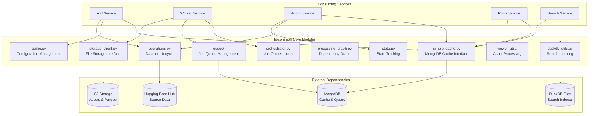
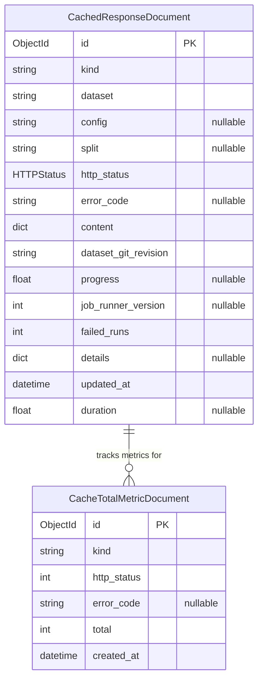
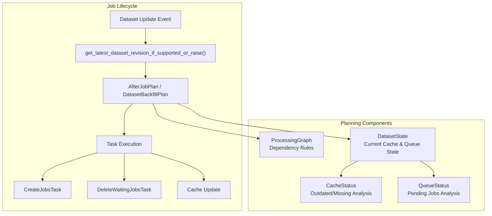
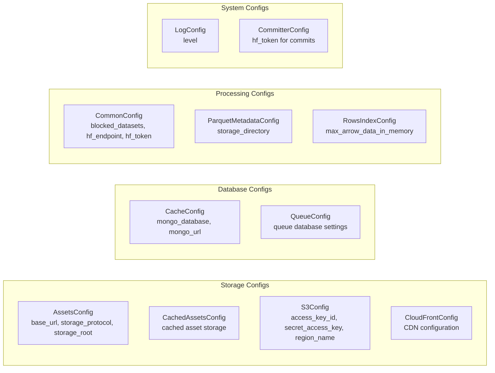
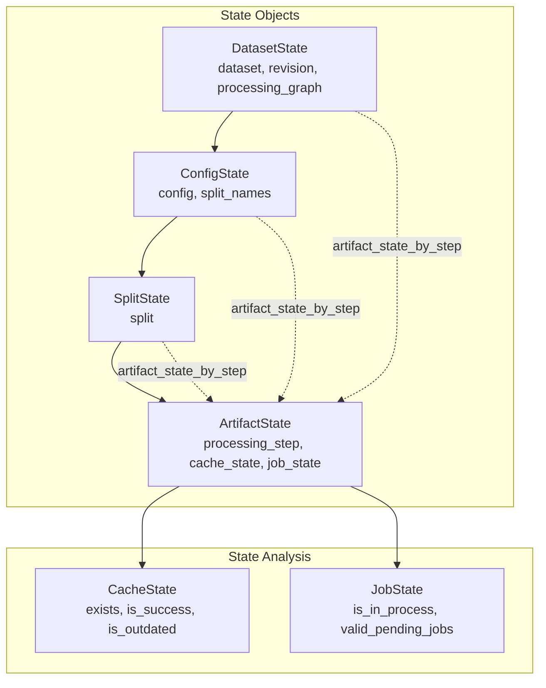

<!-- source: DeepWiki mcp.deepwiki.com · repo huggingface/dataset-viewer · page 4.1 libcommon Library · fetched 2026-10-26 -->

# libcommon Library

Relevant source files

The following files were used as context for generating this wiki page:

- [libs/libcommon/src/libcommon/config.py](libs/libcommon/src/libcommon/config.py)
- [libs/libcommon/src/libcommon/constants.py](libs/libcommon/src/libcommon/constants.py)
- [libs/libcommon/src/libcommon/operations.py](libs/libcommon/src/libcommon/operations.py)
- [libs/libcommon/src/libcommon/orchestrator.py](libs/libcommon/src/libcommon/orchestrator.py)
- [libs/libcommon/src/libcommon/simple_cache.py](libs/libcommon/src/libcommon/simple_cache.py)
- [libs/libcommon/src/libcommon/state.py](libs/libcommon/src/libcommon/state.py)
- [libs/libcommon/tests/test_backfill.py](libs/libcommon/tests/test_backfill.py)
- [libs/libcommon/tests/test_operations.py](libs/libcommon/tests/test_operations.py)
- [libs/libcommon/tests/test_orchestrator.py](libs/libcommon/tests/test_orchestrator.py)
- [libs/libcommon/tests/test_orchestrator_smart_update.py](libs/libcommon/tests/test_orchestrator_smart_update.py)
- [libs/libcommon/tests/test_simple_cache.py](libs/libcommon/tests/test_simple_cache.py)
- [libs/libcommon/tests/test_state.py](libs/libcommon/tests/test_state.py)
- [libs/libcommon/tests/utils.py](libs/libcommon/tests/utils.py)
- [services/admin/tests/test_app_real.py](services/admin/tests/test_app_real.py)
- [services/api/src/api/config.py](services/api/src/api/config.py)
- [services/api/tests/routes/test_endpoint.py](services/api/tests/routes/test_endpoint.py)
- [services/api/tests/test_app_real.py](services/api/tests/test_app_real.py)
- [services/worker/src/worker/job_runner_factory.py](services/worker/src/worker/job_runner_factory.py)

The libcommon library serves as the foundational shared library for the dataset-viewer system, providing core functionality used across all microservices including API, worker, admin, and other components. It abstracts essential operations for cache management, job orchestration, configuration handling, dataset lifecycle management, and state tracking.

This document covers the internal architecture and key modules of libcommon. For information about how individual services use libcommon, see [Core Services](#3). For details about the processing pipeline that libcommon orchestrates, see [Data Processing](#5).

## Library Architecture

The libcommon library is organized into several core modules that provide different aspects of shared functionality:

Sources: [libs/libcommon/src/libcommon/simple_cache.py:1-962](), [libs/libcommon/src/libcommon/orchestrator.py:1-1139](), [libs/libcommon/src/libcommon/config.py:1-237](), [libs/libcommon/src/libcommon/operations.py:1-338](), [libs/libcommon/src/libcommon/state.py:1-376]()

## Cache Management System

The cache management system provides a unified interface for storing and retrieving processed dataset responses in MongoDB. The `simple_cache` module handles all cache operations with automatic metrics tracking and error handling.

### Cache Document Structure

The cache system supports different artifact types identified by `kind` (e.g., "dataset-config-names", "split-first-rows") and provides hierarchical organization by dataset, config, and split levels.

Key cache operations include:
- `upsert_response()` - Create or update cache entries with automatic metrics tracking
- `get_response()` - Retrieve cached content with error handling
- `delete_dataset_responses()` - Clean up all cache entries for a dataset
- `get_cache_reports()` - Admin interface for cache inspection

Sources: [libs/libcommon/src/libcommon/simple_cache.py:121-174](), [libs/libcommon/src/libcommon/simple_cache.py:190-218](), [libs/libcommon/src/libcommon/simple_cache.py:272-301]()

## Job Orchestration System

The orchestration system manages the complex dependencies between processing steps and coordinates job execution across the worker fleet. It implements intelligent planning algorithms to determine what jobs need to be created, updated, or deleted based on dataset changes.

### Orchestration Flow

The orchestrator implements several planning strategies:
- **AfterJobPlan** - Creates follow-up jobs when a processing step completes
- **DatasetBackfillPlan** - Comprehensive planning for new or fully refreshed datasets  
- **SmartDatasetUpdatePlan** - Incremental updates based on git diff analysis

Sources: [libs/libcommon/src/libcommon/orchestrator.py:432-593](), [libs/libcommon/src/libcommon/orchestrator.py:596-690](), [libs/libcommon/src/libcommon/orchestrator.py:45-113]()

## Configuration Management

The configuration system provides environment-based configuration for all services with type-safe dataclasses and validation. Each configuration component handles a specific aspect of the system.

### Configuration Components

All configuration classes follow the same pattern:
- Frozen dataclasses with default values
- `from_env()` class method for environment-based initialization
- Environment variable prefixes (e.g., `CACHE_`, `ASSETS_`, `S3_`)

Sources: [libs/libcommon/src/libcommon/config.py:20-38](), [libs/libcommon/src/libcommon/config.py:189-201](), [libs/libcommon/src/libcommon/config.py:152-166]()

## Dataset Operations

The operations module provides high-level dataset lifecycle management, handling validation, authorization, and orchestrating complex multi-step operations like dataset updates and deletions.

### Dataset Operation Types

- **update_dataset()** - Validate dataset support and trigger processing
- **smart_update_dataset()** - Incremental updates based on git changes
- **backfill_dataset()** - Full reprocessing with error recovery
- **delete_dataset()** - Complete cleanup of cache, queue, and storage

The system includes comprehensive validation for:
- Repository accessibility and permissions
- PRO/Enterprise requirements for private datasets
- NFAA (Not For All Audiences) content restrictions
- Blocked dataset lists with wildcard support

Sources: [libs/libcommon/src/libcommon/operations.py:215-248](), [libs/libcommon/src/libcommon/operations.py:297-337](), [libs/libcommon/src/libcommon/operations.py:126-171]()

## State Management

The state management system provides a comprehensive view of dataset processing status across all levels of the hierarchy (dataset → config → split). It tracks both cache states and job queue states for intelligent decision making.

### State Hierarchy

Each state object aggregates information from:
- Cache entries DataFrame (from MongoDB)
- Pending jobs DataFrame (from job queue)
- Processing graph definitions
- Configuration metadata (config names, split names)

This enables sophisticated queries like "which artifacts are outdated due to newer parent artifacts" or "which jobs are waiting for dependencies".

Sources: [libs/libcommon/src/libcommon/state.py:262-341](), [libs/libcommon/src/libcommon/state.py:127-155](), [libs/libcommon/src/libcommon/state.py:62-125]()

## Storage and Asset Management

The libcommon library provides storage abstractions that support both local filesystem and S3-compatible storage, with integrated CDN support for asset delivery.

### Storage Client Architecture

The `StorageClient` class provides a unified interface for file operations across different storage backends:

- **Protocol Support** - File system (`file://`) and S3 (`s3://`) protocols
- **Asset Management** - Handles images, audio, and other media files with URL generation
- **CDN Integration** - CloudFront support with signed URLs for secure access
- **Metadata Handling** - Parquet metadata and statistics storage

Key storage operations include dataset directory management, revision-based organization, and automatic cleanup during dataset deletion.

Sources: [libs/libcommon/src/libcommon/config.py:20-38](), [libs/libcommon/src/libcommon/config.py:96-110]()

## Integration with Processing Graph

The libcommon library is tightly integrated with the processing graph system, which defines the dependencies between different processing steps. The library uses this graph to:

- **Job Orchestration** - Determine which jobs to create when parent jobs complete
- **State Analysis** - Understand which cache entries are outdated due to dependency changes  
- **Planning Algorithms** - Build comprehensive plans for dataset backfills and updates
- **Validation** - Ensure processing steps are executed in the correct order

The processing graph integration enables the system to handle complex scenarios like fan-out (dataset → multiple configs), fan-in (multiple splits → config), and parallel processing steps.

Sources: [libs/libcommon/src/libcommon/orchestrator.py:26](), [libs/libcommon/src/libcommon/state.py:16]()

---

