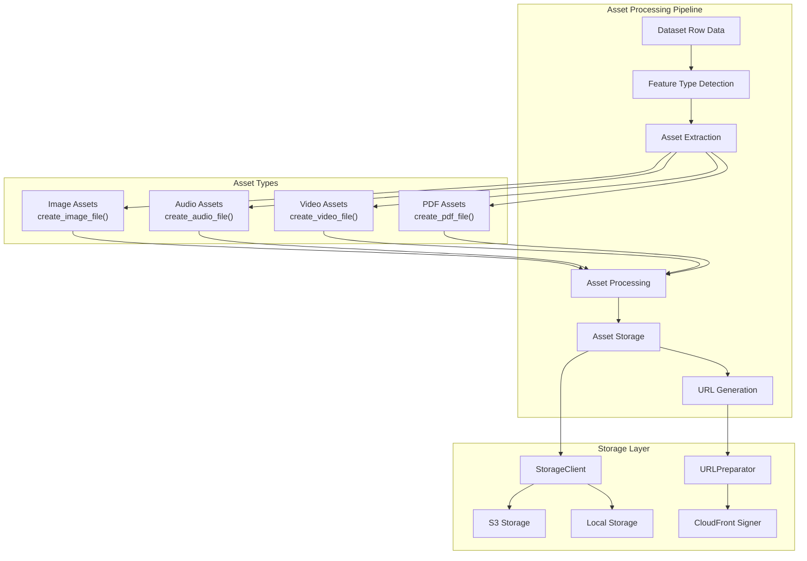
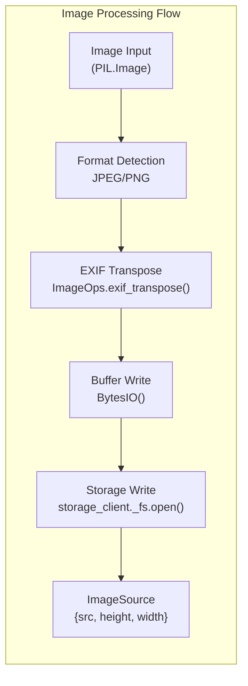
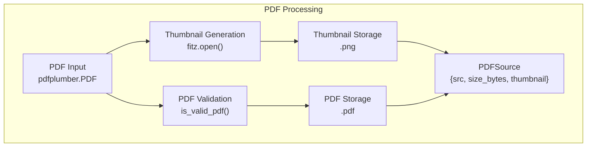
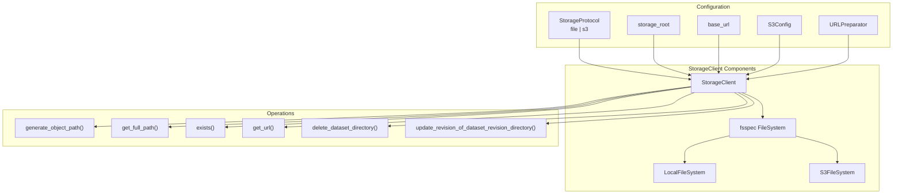
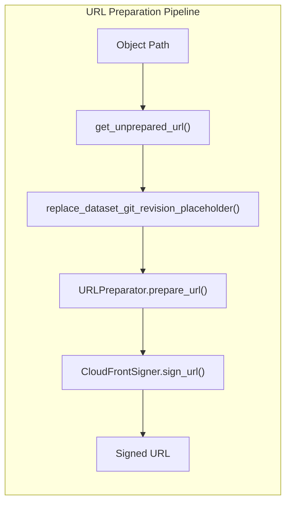
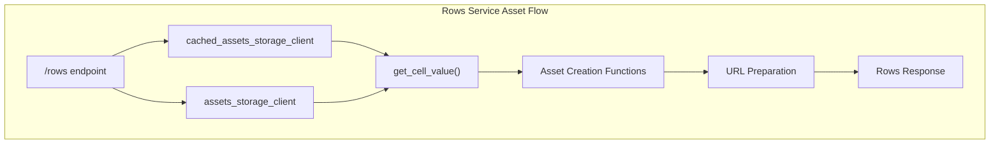

<!-- source: DeepWiki mcp.deepwiki.com · repo huggingface/dataset-viewer · page 4.2 Asset Management · fetched 2026-10-26 -->

# Asset Management

<details>
<summary>Relevant source files</summary>

The following files were used as context for generating this wiki page:

- [chart/templates/services/rows/_container.tpl](chart/templates/services/rows/_container.tpl)
- [chart/templates/services/search/_container.tpl](chart/templates/services/search/_container.tpl)
- [libs/libcommon/src/libcommon/storage_client.py](libs/libcommon/src/libcommon/storage_client.py)
- [libs/libcommon/src/libcommon/viewer_utils/asset.py](libs/libcommon/src/libcommon/viewer_utils/asset.py)
- [libs/libcommon/src/libcommon/viewer_utils/features.py](libs/libcommon/src/libcommon/viewer_utils/features.py)
- [libs/libcommon/tests/conftest.py](libs/libcommon/tests/conftest.py)
- [libs/libcommon/tests/test_integration_s3_cloudfront.py](libs/libcommon/tests/test_integration_s3_cloudfront.py)
- [libs/libcommon/tests/test_url_preparator.py](libs/libcommon/tests/test_url_preparator.py)
- [libs/libcommon/tests/viewer_utils/test_assets.py](libs/libcommon/tests/viewer_utils/test_assets.py)
- [libs/libcommon/tests/viewer_utils/test_features.py](libs/libcommon/tests/viewer_utils/test_features.py)
- [services/rows/src/rows/app.py](services/rows/src/rows/app.py)
- [services/search/src/search/app.py](services/search/src/search/app.py)
- [services/search/src/search/config.py](services/search/src/search/config.py)

</details>


This document covers the asset storage and management system used by the dataset-viewer to handle multimedia files (images, audio, video, PDFs) extracted from datasets. The system processes these assets, stores them in cloud storage, and provides secure access URLs for consumption by client applications.

For information about the broader storage architecture including MongoDB and DuckDB, see [Storage Architecture](#2.3). For details about the core shared library utilities, see [libcommon Library](#4.1).

## Overview

The asset management system handles the extraction, processing, and storage of multimedia assets from dataset rows. When datasets contain image, audio, video, or PDF data, these assets are extracted during processing, converted to web-compatible formats, stored in S3 or local storage, and made available through signed URLs.



**Sources:** [libs/libcommon/src/libcommon/viewer_utils/asset.py:1-260](), [libs/libcommon/src/libcommon/storage_client.py:1-156](), [libs/libcommon/src/libcommon/viewer_utils/features.py:1-552]()

## Asset Processing Functions

The system provides specialized processing functions for each supported asset type, located in the `viewer_utils.asset` module.

### Image Processing

The `create_image_file()` function handles image assets with automatic format detection and conversion:



**Sources:** [libs/libcommon/src/libcommon/viewer_utils/asset.py:45-82]()

### Audio Processing

The `create_audio_file()` function supports multiple audio formats with conversion capabilities:

| Format | Extension | Media Type |
|--------|-----------|------------|
| WAV | `.wav` | `audio/wav` |
| MP3 | `.mp3` | `audio/mpeg` |
| OPUS | `.opus` | `audio/ogg` |

**Sources:** [libs/libcommon/src/libcommon/viewer_utils/asset.py:18-19](), [libs/libcommon/src/libcommon/viewer_utils/asset.py:85-134]()

### PDF Processing

The `create_pdf_file()` function generates both the PDF file and a thumbnail image:



**Sources:** [libs/libcommon/src/libcommon/viewer_utils/asset.py:137-210]()

### Video Processing

The `create_video_file()` function handles video assets, typically referencing existing files rather than processing bytes:

**Sources:** [libs/libcommon/src/libcommon/viewer_utils/asset.py:220-259]()

## Storage Client Architecture

The `StorageClient` class provides a unified interface for asset storage across different protocols and storage backends.



**Sources:** [libs/libcommon/src/libcommon/storage_client.py:20-156]()

## Asset Path Generation

Assets are organized using a hierarchical structure that includes dataset information and revision management:

```
{dataset}/{DATASET_SEPARATOR}/{revision}/{DATASET_SEPARATOR}/{config}/{split}/{row_idx}/{column}/{filename}
```

The system uses a placeholder mechanism for revision management, where `{dataset_git_revision}` is used in stored references and replaced with actual revisions when URLs are accessed.

**Sources:** [libs/libcommon/src/libcommon/viewer_utils/asset.py:20](), [libs/libcommon/src/libcommon/storage_client.py:149-152](), [libs/libcommon/src/libcommon/viewer_utils/asset.py:213-217]()

## URL Management and Signing

The asset management system integrates with CloudFront for secure asset delivery through the `URLPreparator` class.



**Sources:** [libs/libcommon/src/libcommon/storage_client.py:85-98](), [libs/libcommon/src/libcommon/viewer_utils/asset.py:213-217]()

## Service Integration

The asset management system is integrated into multiple services that handle dataset content.

### Rows Service Integration

The Rows service uses asset management for serving dataset content with multimedia assets:



**Sources:** [services/rows/src/rows/app.py:68-82](), [services/rows/src/rows/app.py:96-110]()

### Search Service Integration

The Search service also integrates asset management for search results containing multimedia content:

**Sources:** [services/search/src/search/app.py:72-85](), [services/search/src/search/app.py:99-116]()

## Configuration

Asset management is configured through multiple configuration classes:

| Configuration | Purpose |
|---------------|---------|
| `AssetsConfig` | Base asset storage configuration |
| `CachedAssetsConfig` | Cached asset storage configuration |
| `S3Config` | S3 storage credentials and settings |
| `CloudFrontConfig` | CloudFront signing configuration |

**Sources:** [services/search/src/search/config.py:9-19](), [services/rows/src/rows/app.py:62-74]()

## Error Handling and Validation

The system includes comprehensive error handling for various asset processing scenarios:

- **Format Validation**: Images attempt multiple formats (JPEG, PNG) with fallback handling
- **Audio Format Detection**: Magic number detection for audio file types
- **PDF Validation**: Checks for valid PDF headers before processing
- **Storage Validation**: Verifies storage client connectivity during initialization

**Sources:** [libs/libcommon/src/libcommon/viewer_utils/features.py:100-119](), [libs/libcommon/src/libcommon/viewer_utils/features.py:201-209](), [libs/libcommon/src/libcommon/viewer_utils/asset.py:180-190](), [libs/libcommon/src/libcommon/storage_client.py:71-77]()

---

