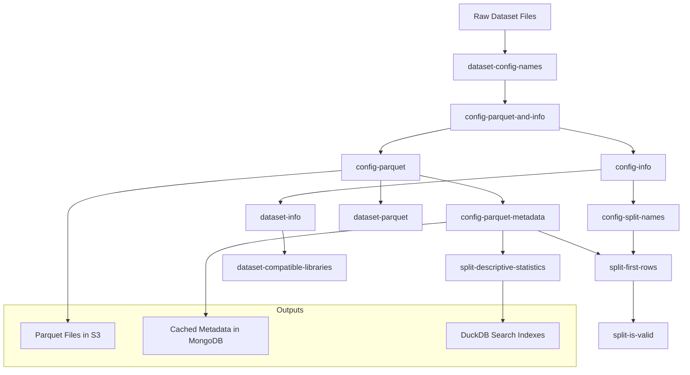
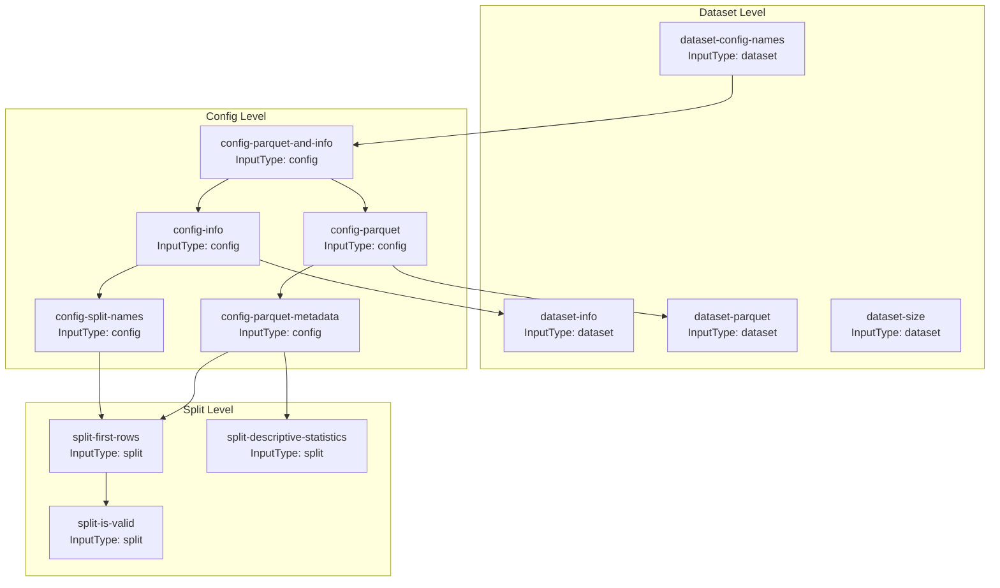
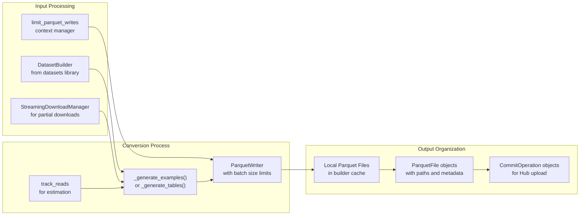
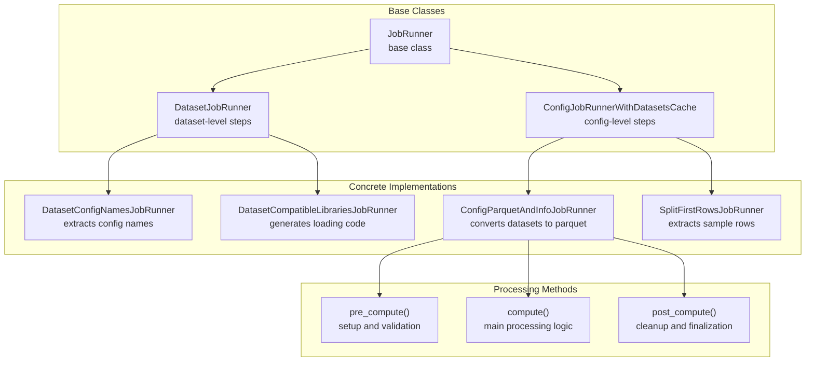
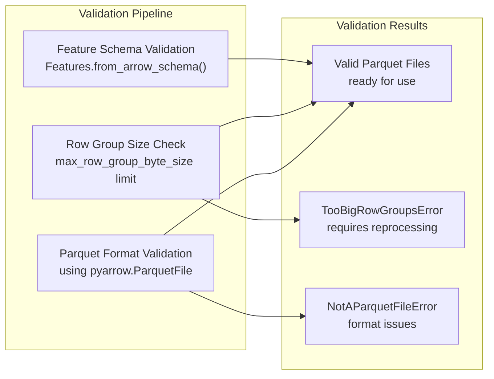

<!-- source: DeepWiki mcp.deepwiki.com · repo huggingface/dataset-viewer · page 5 Data Processing · fetched 2026-10-26 -->

# Data Processing

<details>
<summary>Relevant source files</summary>

The following files were used as context for generating this wiki page:

- [libs/libcommon/src/libcommon/exceptions.py](libs/libcommon/src/libcommon/exceptions.py)
- [libs/libcommon/src/libcommon/processing_graph.py](libs/libcommon/src/libcommon/processing_graph.py)
- [libs/libcommon/tests/test_backfill_on_real_graph.py](libs/libcommon/tests/test_backfill_on_real_graph.py)
- [libs/libcommon/tests/test_processing_graph.py](libs/libcommon/tests/test_processing_graph.py)
- [services/worker/src/worker/dtos.py](services/worker/src/worker/dtos.py)
- [services/worker/src/worker/job_runners/config/parquet_and_info.py](services/worker/src/worker/job_runners/config/parquet_and_info.py)
- [services/worker/src/worker/job_runners/dataset/compatible_libraries.py](services/worker/src/worker/job_runners/dataset/compatible_libraries.py)
- [services/worker/src/worker/job_runners/dataset/hub_cache.py](services/worker/src/worker/job_runners/dataset/hub_cache.py)
- [services/worker/src/worker/utils.py](services/worker/src/worker/utils.py)
- [services/worker/tests/fixtures/files.py](services/worker/tests/fixtures/files.py)
- [services/worker/tests/fixtures/hub.py](services/worker/tests/fixtures/hub.py)
- [services/worker/tests/job_runners/config/test_parquet_and_info.py](services/worker/tests/job_runners/config/test_parquet_and_info.py)
- [services/worker/tests/job_runners/dataset/test_compatible_libraries.py](services/worker/tests/job_runners/dataset/test_compatible_libraries.py)
- [services/worker/tests/job_runners/dataset/test_hub_cache.py](services/worker/tests/job_runners/dataset/test_hub_cache.py)

</details>


This document covers the data processing pipeline in the dataset-viewer system, which transforms raw datasets from the Hugging Face Hub into processed, queryable formats. The pipeline handles dataset conversion to Parquet files, metadata extraction, statistics computation, and preparation for serving through the viewer APIs.

For information about the job orchestration and queue management that drives this processing, see [Job Runners](#5.2). For details about the storage systems that persist the processed data, see [Storage and Caching](#6).

## Processing Pipeline Overview

The data processing system transforms datasets through a directed acyclic graph (DAG) of processing steps. Each step produces artifacts that are cached and used by downstream steps. The pipeline begins with raw dataset files and produces Parquet files, metadata, statistics, and other derived data needed by the viewer services.



**Processing Pipeline Flow**

Sources: [libs/libcommon/src/libcommon/processing_graph.py:490-600](), [services/worker/src/worker/job_runners/config/parquet_and_info.py:1-100]()

## Processing Graph Architecture

The processing graph defines dependencies between processing steps using a `ProcessingGraph` class that manages a NetworkX directed acyclic graph. Each step has an input type (`dataset`, `config`, or `split`) that determines its scope.



**Processing Graph Structure by Input Type**

The `ProcessingStep` class defines each step with attributes including difficulty scores and job runner versions:

| Attribute | Description |
|-----------|-------------|
| `name` | Step identifier (e.g., "config-parquet-and-info") |
| `input_type` | Scope level: "dataset", "config", or "split" |
| `job_runner_version` | Version for cache invalidation |
| `difficulty` | Base difficulty score for job scheduling |
| `bonus_difficulty_if_dataset_is_big` | Additional difficulty for large datasets |

Sources: [libs/libcommon/src/libcommon/processing_graph.py:82-122](), [libs/libcommon/src/libcommon/processing_graph.py:490-600]()

## Parquet Conversion Process

The core processing step `config-parquet-and-info` handles dataset conversion to Parquet format through the `ConfigParquetAndInfoJobRunner`. This process involves streaming data conversion, metadata extraction, and file organization.



**Parquet Conversion Workflow**

The conversion process handles several key aspects:

### File Size Management
The `limit_parquet_writes` context manager tracks bytes written and stops generation when limits are exceeded:

```python
# From limit_parquet_writes class
def track_write_table(self, pa_table: pa.Table) -> None:
    limiter.total_bytes += pa_table.nbytes
```

### Batch Size Optimization
Row group sizes are optimized based on data types using `get_writer_batch_size_from_info()`:

| Data Type | Batch Size | Constant |
|-----------|------------|----------|
| Video datasets | 10 | `PROCESSING_STEP_CONFIG_PARQUET_AND_INFO_ROW_GROUP_SIZE_FOR_VIDEO_DATASETS` |
| Audio datasets | 100 | `PROCESSING_STEP_CONFIG_PARQUET_AND_INFO_ROW_GROUP_SIZE_FOR_AUDIO_DATASETS` |
| Image datasets | 100 | `PROCESSING_STEP_CONFIG_PARQUET_AND_INFO_ROW_GROUP_SIZE_FOR_IMAGE_DATASETS` |
| Binary data | 100 | `PROCESSING_STEP_CONFIG_PARQUET_AND_INFO_ROW_GROUP_SIZE_FOR_BINARY_DATASETS` |
| Text data | 1000 | Default |

### File Path Structure
Parquet files are organized using the `ParquetFile` class with a specific path structure:

```
{config}/{partial_prefix}{split}{part_suffix}/{shard_idx:04d}.parquet
```

Sources: [services/worker/src/worker/job_runners/config/parquet_and_info.py:626-716](), [services/worker/src/worker/job_runners/config/parquet_and_info.py:349-375](), [services/worker/src/worker/job_runners/config/parquet_and_info.py:113-140]()

## Job Runner Implementation

The job runner architecture implements processing steps through specialized classes that inherit from base job runner classes. Each step is executed by a corresponding job runner that handles the specific processing logic.



**Job Runner Class Hierarchy**

### Job Execution Lifecycle

Each job runner follows a three-phase execution pattern:

1. **Pre-compute Phase**: Validates inputs and sets up the processing environment
2. **Compute Phase**: Executes the main processing logic and returns results
3. **Post-compute Phase**: Performs cleanup and uploads results

### Result Types

Job runners return `CompleteJobResult` objects containing:

| Field | Type | Description |
|-------|------|-------------|
| `content` | `Mapping[str, Any]` | Processed data and metadata |
| `progress` | `float` | Completion percentage (always 1.0 for complete jobs) |

### Error Handling

Processing steps can encounter various error conditions that are captured as `CacheableError` exceptions:

- `DatasetGenerationError`: Failures during dataset conversion
- `EmptyDatasetError`: Datasets with no data
- `FileSystemError`: File access or storage issues
- `TooBigRowGroupsError`: Parquet files exceeding size limits

Sources: [services/worker/src/worker/job_runners/config/parquet_and_info.py:84-93](), [services/worker/src/worker/dtos.py:16-30](), [libs/libcommon/src/libcommon/exceptions.py:134-148]()

## Data Validation and Quality Control

The processing pipeline includes validation steps to ensure data quality and compatibility. The `ParquetFileValidator` class validates Parquet files before they are accepted:



**Parquet Validation Process**

### Size Validation

The validator checks row group sizes to ensure optimal performance for the viewer:

```python
# Validation logic for row group size
if row_group_metadata.total_byte_size > self.max_row_group_byte_size:
    raise TooBigRowGroupsError(...)
```

### File Organization Validation

The system validates that Parquet files follow the expected directory structure and naming conventions defined by the `parse_repo_filename()` function.

Sources: [services/worker/src/worker/job_runners/config/parquet_and_info.py:510-542](), [services/worker/src/worker/job_runners/config/parquet_and_info.py:434-450](), [services/worker/src/worker/job_runners/config/parquet_and_info.py:163-177]()

## Performance Optimization

The processing system includes several optimization strategies to handle large datasets efficiently:

### Streaming Processing
Large datasets use `StreamingDownloadManager` to avoid downloading complete files before processing.

### Partial Conversion
When datasets exceed size limits, the system performs partial conversion and provides size estimations:

```python
# Partial processing with estimation
estimated_dataset_info = create_estimated_dataset_info_response_for_partially_generated_big_csv(dataset)
```

### Difficulty-Based Scheduling
Processing steps have difficulty scores that influence job scheduling and resource allocation:

- Base difficulty scores for computational complexity
- Bonus difficulty for large datasets
- Version-based cache invalidation

### Batch Size Tuning
Row group sizes are adjusted based on data types to optimize storage and query performance, with smaller batches for multimedia data and larger batches for text data.

Sources: [services/worker/src/worker/job_runners/config/parquet_and_info.py:895-950](), [services/worker/tests/fixtures/hub.py:585-594](), [libs/libcommon/src/libcommon/processing_graph.py:99-101]()

---

