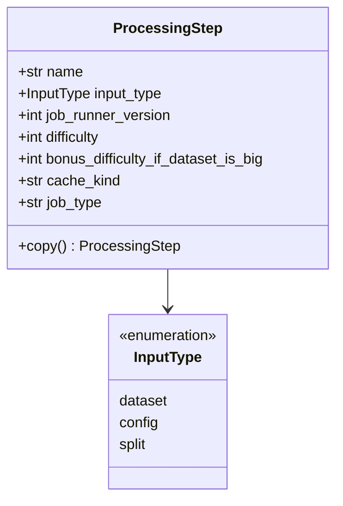
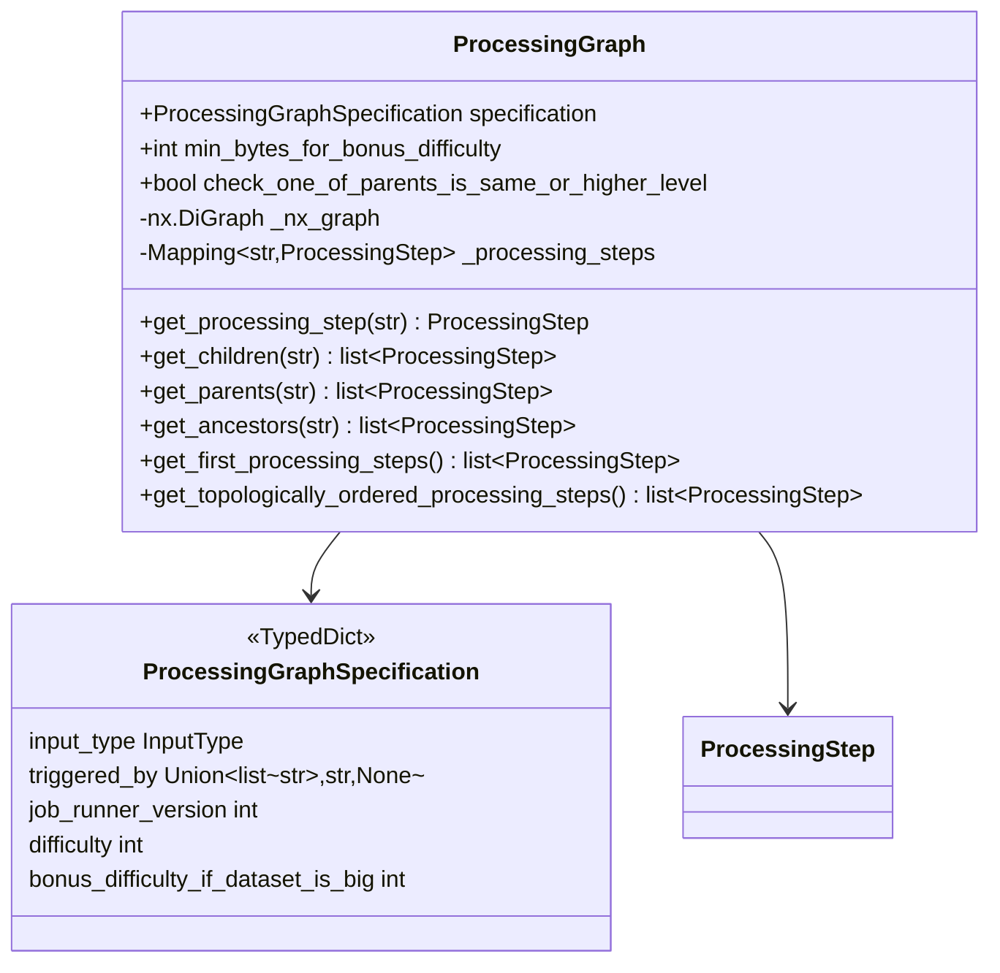
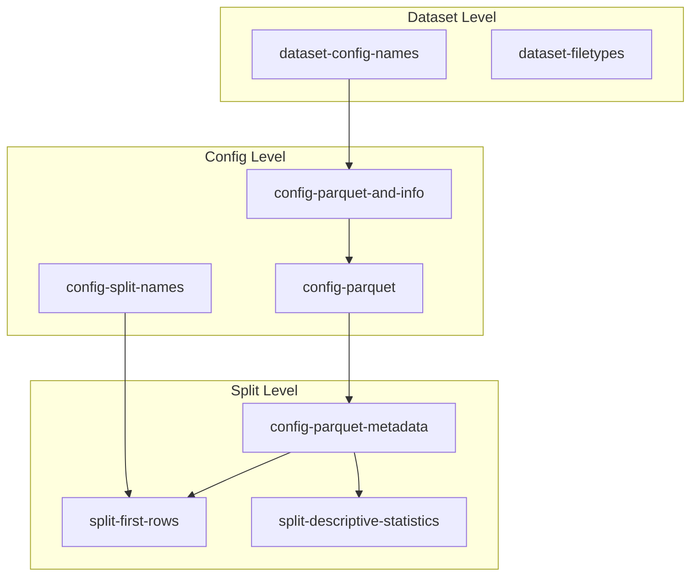
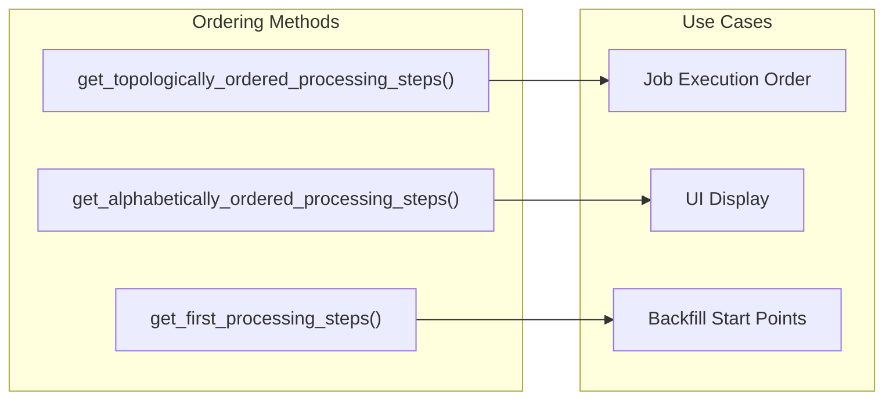
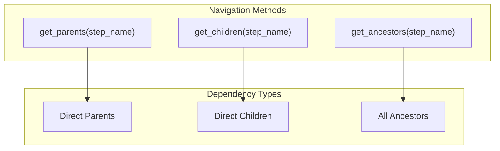
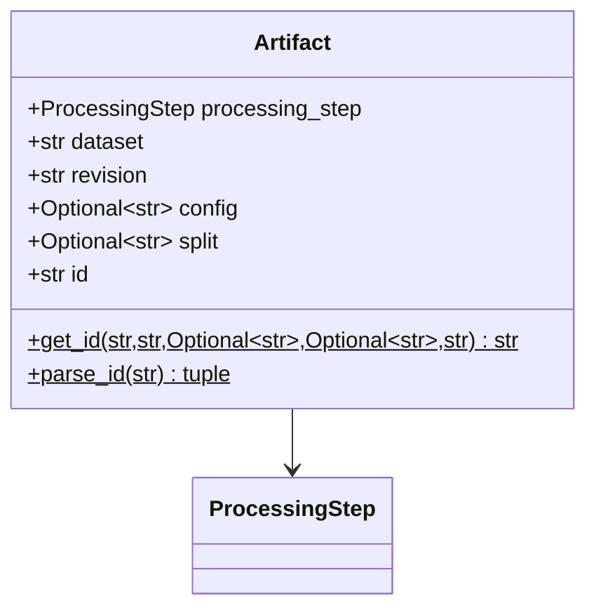
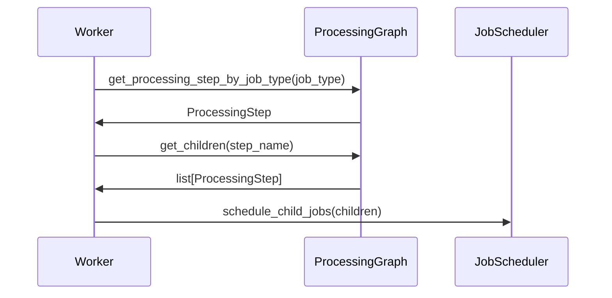
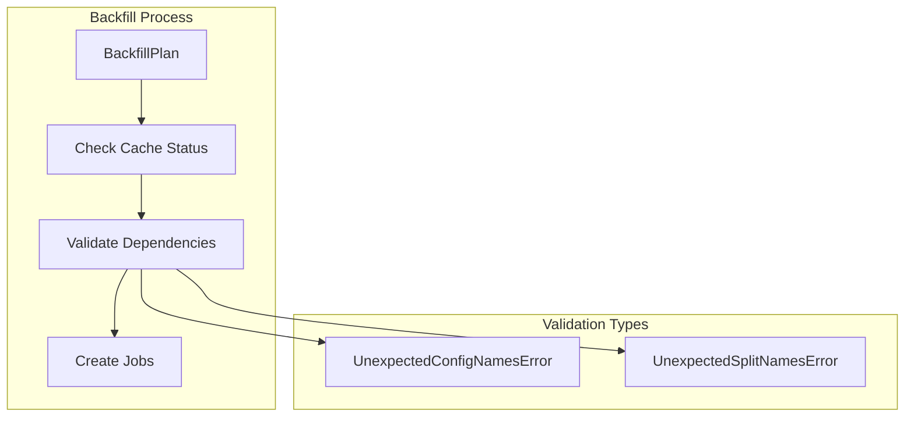

<!-- source: DeepWiki mcp.deepwiki.com · repo huggingface/dataset-viewer · page 5.1 Processing Graph · fetched 2026-10-26 -->

# Processing Graph

Relevant source files

The following files were used as context for generating this wiki page:

- [libs/libcommon/src/libcommon/processing_graph.py](libs/libcommon/src/libcommon/processing_graph.py)
- [libs/libcommon/tests/test_backfill_on_real_graph.py](libs/libcommon/tests/test_backfill_on_real_graph.py)
- [libs/libcommon/tests/test_processing_graph.py](libs/libcommon/tests/test_processing_graph.py)
- [services/worker/src/worker/dtos.py](services/worker/src/worker/dtos.py)
- [services/worker/src/worker/job_runners/dataset/compatible_libraries.py](services/worker/src/worker/job_runners/dataset/compatible_libraries.py)
- [services/worker/src/worker/job_runners/dataset/hub_cache.py](services/worker/src/worker/job_runners/dataset/hub_cache.py)
- [services/worker/tests/job_runners/dataset/test_compatible_libraries.py](services/worker/tests/job_runners/dataset/test_compatible_libraries.py)
- [services/worker/tests/job_runners/dataset/test_hub_cache.py](services/worker/tests/job_runners/dataset/test_hub_cache.py)

## Purpose and Scope

The Processing Graph defines a directed acyclic graph (DAG) of dataset processing steps that determines the order and dependencies of jobs in the dataset-viewer system. It ensures that preprocessing steps execute in the correct sequence, from dataset-level operations down to split-level processing. This document covers the graph structure, validation rules, and step management. For information about individual job runners that execute these steps, see [Job Runners](#5.2).

## Core Components

### ProcessingStep Class

The `ProcessingStep` dataclass represents a single processing operation in the graph:

Each step operates at one of three hierarchical levels:
- `dataset`: Repository-level operations (e.g., extracting configuration names)
- `config`: Configuration-level operations (e.g., converting to Parquet format)  
- `split`: Split-level operations (e.g., computing statistics on train/test splits)

Sources: [libs/libcommon/src/libcommon/processing_graph.py:82-122]()

### ProcessingGraph Class

The `ProcessingGraph` manages the complete dependency graph and provides traversal methods:

Sources: [libs/libcommon/src/libcommon/processing_graph.py:134-419]()

## Graph Structure and Validation

### Hierarchical Validation Rules

The processing graph enforces strict hierarchical rules to ensure data flows correctly:

1. **Root Steps**: Must be dataset-level steps with no parents
2. **Parent Requirements**: Each step must have at least one parent at the same or higher hierarchical level
3. **Acyclicity**: The graph must be a directed acyclic graph (DAG)

Sources: [libs/libcommon/src/libcommon/processing_graph.py:42-65](), [libs/libcommon/src/libcommon/processing_graph.py:207-227]()

### Current Processing Steps

The system defines the following processing steps in the global specification:

| Step Name | Input Type | Difficulty | Triggered By |
|-----------|-----------|------------|--------------|
| `dataset-config-names` | dataset | 50 | *(root)* |
| `dataset-filetypes` | dataset | 50 | *(root)* |
| `config-parquet-and-info` | config | 70 | `dataset-config-names` |
| `config-parquet` | config | 20 | `config-parquet-and-info` |
| `config-parquet-metadata` | config | 50 | `config-parquet` |
| `split-first-rows` | split | 70 | `config-split-names`, `config-parquet-metadata` |
| `split-descriptive-statistics` | split | 70 | `config-parquet-metadata` |
| `dataset-hub-cache` | dataset | 20 | `dataset-is-valid`, `dataset-size`, `dataset-compatible-libraries`, `dataset-modalities` |

Sources: [libs/libcommon/src/libcommon/processing_graph.py:490-702]()

## Graph Traversal and Ordering

### Topological Ordering

The processing graph provides multiple ordering methods for step execution:

The topological ordering ensures that parent steps complete before child steps execute, maintaining data consistency throughout the processing pipeline.

Sources: [libs/libcommon/src/libcommon/processing_graph.py:354-400]()

### Parent-Child Relationships

Steps maintain explicit parent-child relationships for dependency management:

Sources: [libs/libcommon/src/libcommon/processing_graph.py:263-337]()

## Artifact Management

### Artifact Identification

The `Artifact` class provides unique identification for processing outputs:

Artifacts validate that their scope matches the processing step's input type:
- Dataset-level steps: `config` and `split` must be `None`
- Config-level steps: `config` required, `split` must be `None`  
- Split-level steps: Both `config` and `split` required

Sources: [libs/libcommon/src/libcommon/processing_graph.py:421-484]()

## Integration with Job System

### Worker Integration

The processing graph integrates with the worker system through job type mapping:

The `ProcessingStep.job_type` property maps directly to worker job runner class names, enabling seamless integration between graph definition and job execution.

Sources: [libs/libcommon/src/libcommon/processing_graph.py:247-261](), [services/worker/src/worker/dtos.py:11-14]()

### Backfill Operations

The processing graph supports dataset backfill operations that ensure all dependencies are properly satisfied:

Sources: [libs/libcommon/tests/test_backfill_on_real_graph.py:36-278]()

---

