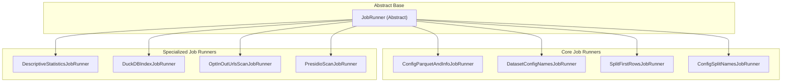
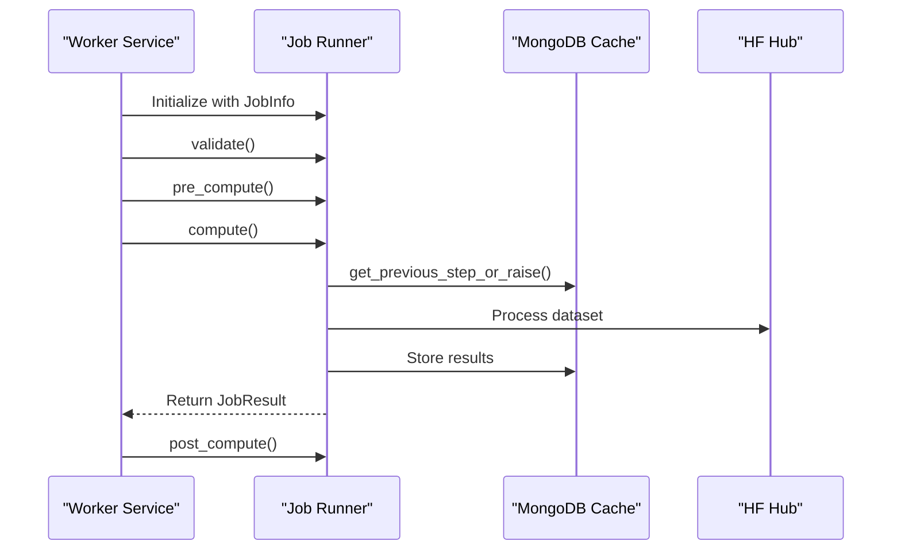
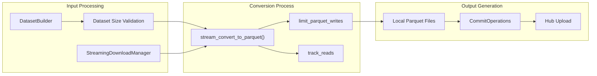
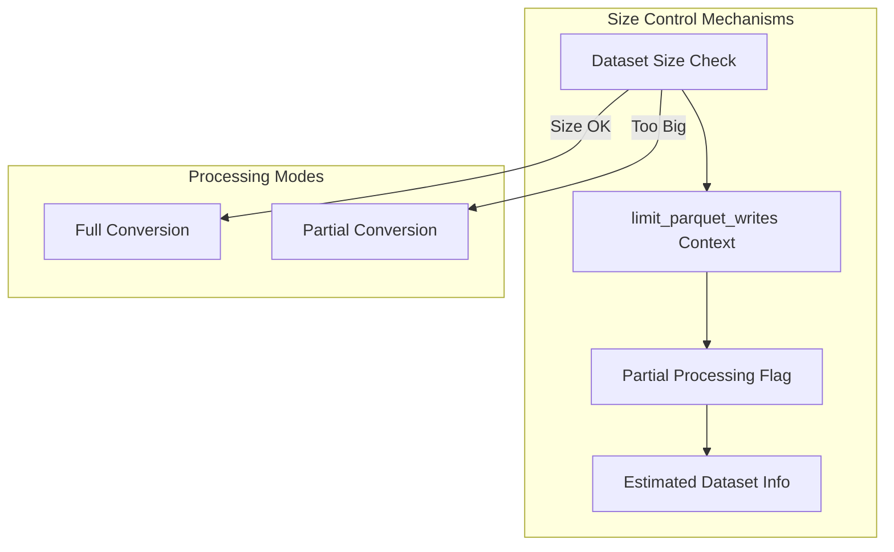
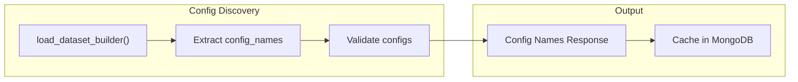
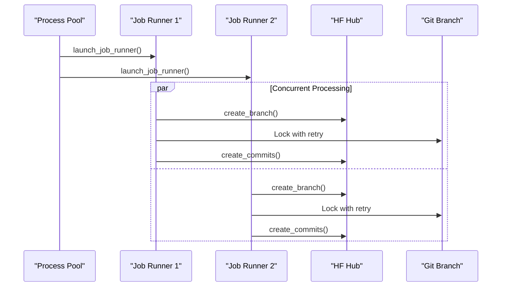

<!-- source: DeepWiki mcp.deepwiki.com · repo huggingface/dataset-viewer · page 5.2 Job Runners · fetched 2026-10-26 -->

# Job Runners

Relevant source files

The following files were used as context for generating this wiki page:

- [libs/libcommon/src/libcommon/exceptions.py](libs/libcommon/src/libcommon/exceptions.py)
- [services/worker/src/worker/job_runner.py](services/worker/src/worker/job_runner.py)
- [services/worker/src/worker/job_runners/config/parquet_and_info.py](services/worker/src/worker/job_runners/config/parquet_and_info.py)
- [services/worker/src/worker/utils.py](services/worker/src/worker/utils.py)
- [services/worker/tests/fixtures/files.py](services/worker/tests/fixtures/files.py)
- [services/worker/tests/fixtures/hub.py](services/worker/tests/fixtures/hub.py)
- [services/worker/tests/job_runners/config/test_parquet_and_info.py](services/worker/tests/job_runners/config/test_parquet_and_info.py)

Job runners are the core execution components that implement specific processing steps in the dataset-viewer's data processing pipeline. Each job runner is responsible for executing a particular type of processing task, such as converting datasets to Parquet format, extracting metadata, or computing statistics. For information about the overall processing pipeline and job dependencies, see [Processing Graph](#5.1).

## Job Runner Architecture

All job runners inherit from the abstract `JobRunner` base class which defines the standard interface and lifecycle for processing jobs.

Sources: [services/worker/src/worker/job_runner.py:12-43](), [services/worker/src/worker/job_runners/config/parquet_and_info.py:84](), [services/worker/tests/job_runners/config/test_parquet_and_info.py:54]()

### Base JobRunner Interface

The `JobRunner` abstract base class defines the standard interface that all job runners must implement:

| Method | Purpose | Required |
|--------|---------|----------|
| `get_job_type()` | Returns the unique job type identifier | Yes |
| `compute()` | Executes the main processing logic | Yes |
| `pre_compute()` | Initialization hook before processing | No |
| `post_compute()` | Cleanup hook after processing | No |
| `validate()` | Validates job parameters and prerequisites | No |

Sources: [services/worker/src/worker/job_runner.py:16-42]()

## Job Runner Lifecycle

Each job runner follows a standardized execution lifecycle managed by the worker service:

Sources: [services/worker/src/worker/job_runner.py:25-35](), [services/worker/tests/job_runners/config/test_parquet_and_info.py:483-485]()

## Major Job Runner Implementations

### ConfigParquetAndInfoJobRunner

The most complex job runner, responsible for converting datasets to Parquet format and extracting dataset metadata.

Key responsibilities:
- Dataset size validation using `_is_too_big_from_hub()` and `_is_too_big_from_datasets()`
- Streaming dataset conversion with `stream_convert_to_parquet()`
- Parquet file validation with `ParquetFileValidator`
- Row group size optimization with `get_writer_batch_size_from_info()`
- Hub repository management with `create_commits()` and `get_delete_operations()`

Sources: [services/worker/src/worker/job_runners/config/parquet_and_info.py:220-291](), [services/worker/src/worker/job_runners/config/parquet_and_info.py:892-950](), [services/worker/src/worker/job_runners/config/parquet_and_info.py:510-541]()

### Key Processing Features

#### Size-Limited Processing
The job runner implements sophisticated size limiting to handle large datasets:

Sources: [services/worker/src/worker/job_runners/config/parquet_and_info.py:626-716](), [services/worker/tests/job_runners/config/test_parquet_and_info.py:587-616]()

#### Parquet File Management
The system uses a structured approach to organize Parquet files in the Hub repository:

| Component | Purpose | Implementation |
|-----------|---------|----------------|
| `ParquetFile` | Represents a parquet file with metadata | [services/worker/src/worker/job_runners/config/parquet_and_info.py:113-140]() |
| `LocalParquetFile` | Extends ParquetFile with local path info | [services/worker/src/worker/job_runners/config/parquet_and_info.py:142-158]() |
| `parse_repo_filename()` | Extracts config/split from file paths | [services/worker/src/worker/job_runners/config/parquet_and_info.py:163-176]() |

Sources: [services/worker/src/worker/job_runners/config/parquet_and_info.py:113-176](), [services/worker/tests/job_runners/config/test_parquet_and_info.py:351-369]()

### DatasetConfigNamesJobRunner

Extracts and validates configuration names from datasets, serving as a foundation step for other processing.

Sources: [services/worker/tests/job_runners/config/test_parquet_and_info.py:426-454](), [services/worker/tests/fixtures/hub.py:475-498]()

## Job Runner Error Handling

Job runners implement comprehensive error handling with specific exception types:

```mermaid
graph TB
    subgraph "Error Categories"
        DatasetErrors["Dataset Errors"]
        ProcessingErrors["Processing Errors"]
        ValidationErrors["Validation Errors"]
        ResourceErrors["Resource Errors"]
    end
    
    subgraph "Dataset Errors"
        DatasetNotFound["DatasetNotFoundError"]
        EmptyDataset["EmptyDatasetError"]
        ScriptNotSupported["DatasetWithScriptNotSupportedError"]
    end
    
    subgraph "Processing Errors"
        GenerationError["DatasetGenerationError"]
        CastError["DatasetGenerationCastError"]
        FileSystemError["FileSystemError"]
    end
    
    subgraph "Validation Errors"
        TooBigRowGroups["TooBigRowGroupsError"]
        ParquetValidation["ParquetValidationError"]
        ConfigNotFound["ConfigNotFoundError"]
    end
    
    DatasetErrors --> DatasetNotFound
    DatasetErrors --> EmptyDataset
    DatasetErrors --> ScriptNotSupported
    ProcessingErrors --> GenerationError
    ProcessingErrors --> CastError
    ProcessingErrors --> FileSystemError
    ValidationErrors --> TooBigRowGroups
    ValidationErrors --> ParquetValidation
    ValidationErrors --> ConfigNotFound
```

Sources: [libs/libcommon/src/libcommon/exceptions.py:75-131](), [services/worker/src/worker/job_runners/config/parquet_and_info.py:440-451]()

## Performance Optimizations

Job runners implement several performance optimizations:

### Row Group Size Optimization
Different data types use optimized row group sizes for efficient access:

| Data Type | Row Group Size | Constant |
|-----------|----------------|----------|
| Image datasets | 100 | `PROCESSING_STEP_CONFIG_PARQUET_AND_INFO_ROW_GROUP_SIZE_FOR_IMAGE_DATASETS` |
| Audio datasets | 100 | `PROCESSING_STEP_CONFIG_PARQUET_AND_INFO_ROW_GROUP_SIZE_FOR_AUDIO_DATASETS` |
| Video datasets | 100 | `PROCESSING_STEP_CONFIG_PARQUET_AND_INFO_ROW_GROUP_SIZE_FOR_VIDEO_DATASETS` |
| PDF datasets | 100 | `PROCESSING_STEP_CONFIG_PARQUET_AND_INFO_ROW_GROUP_SIZE_FOR_PDF_DATASETS` |
| Binary datasets | 100 | `PROCESSING_STEP_CONFIG_PARQUET_AND_INFO_ROW_GROUP_SIZE_FOR_BINARY_DATASETS` |

Sources: [services/worker/src/worker/job_runners/config/parquet_and_info.py:349-374](), [services/worker/tests/job_runners/config/test_parquet_and_info.py:372-385]()

### Concurrent Processing Support
Job runners support concurrent execution with proper resource management and Hub synchronization:

Sources: [services/worker/tests/job_runners/config/test_parquet_and_info.py:489-544](), [services/worker/src/worker/utils.py:174-189]()

---

