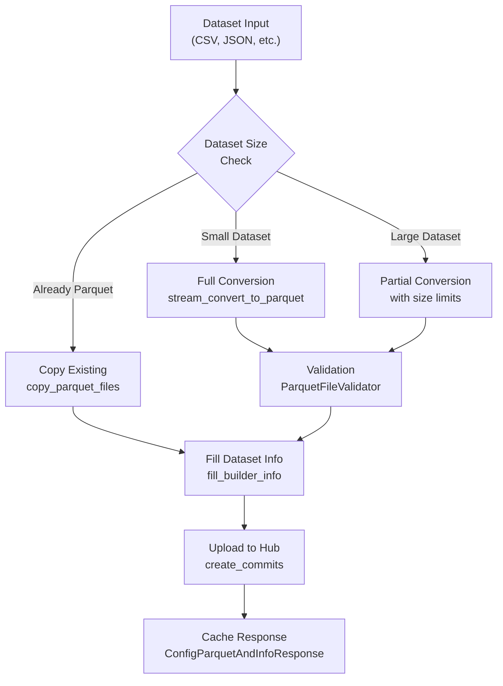
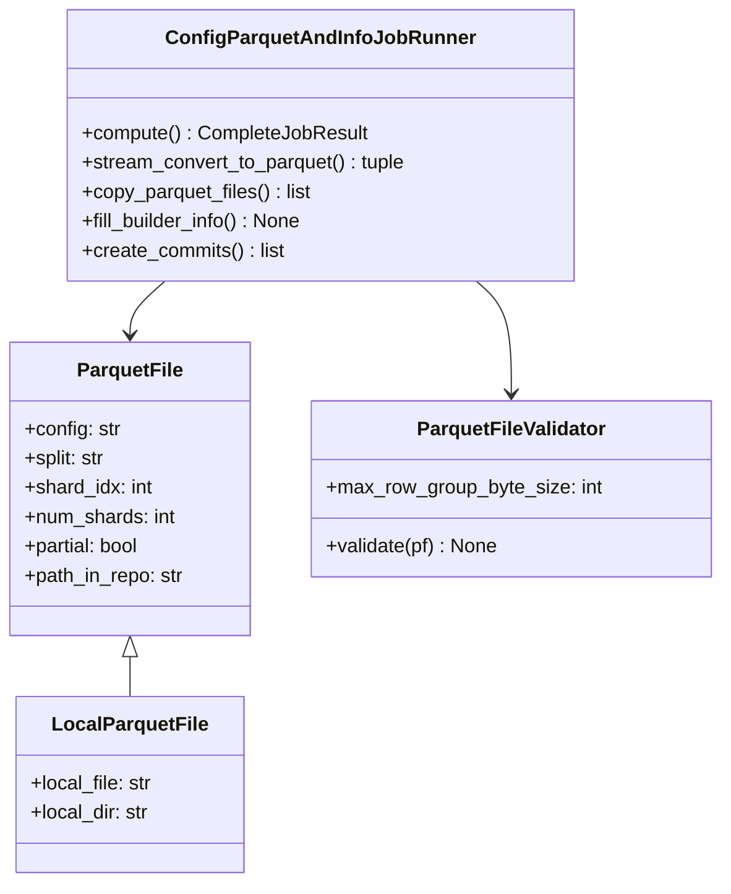
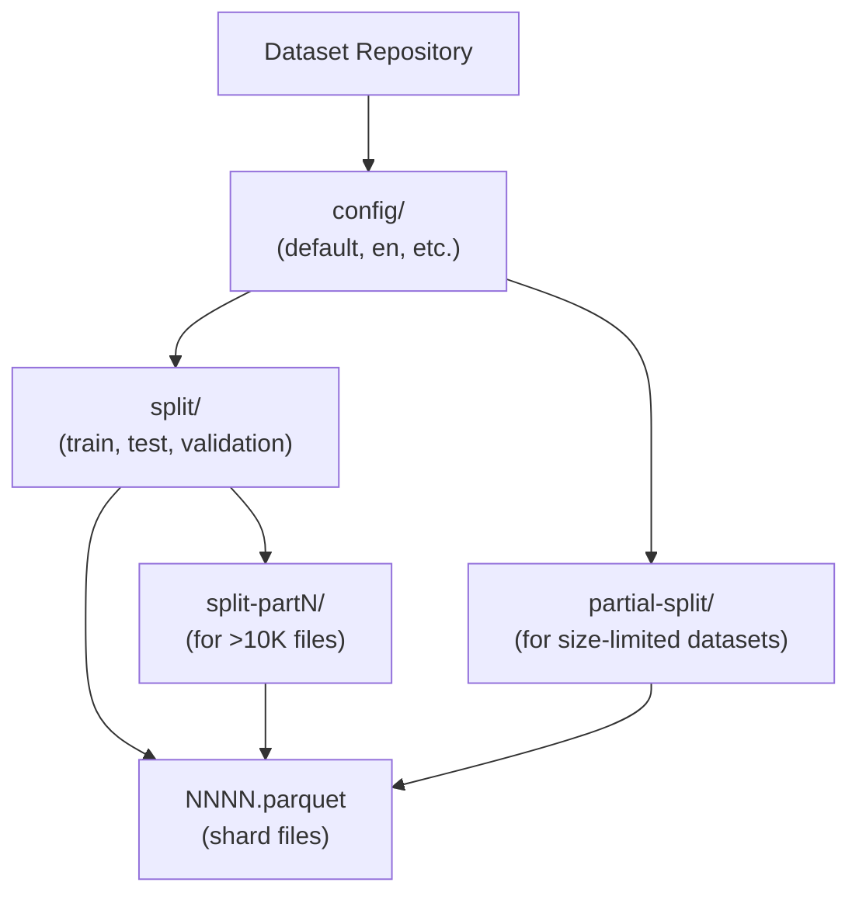
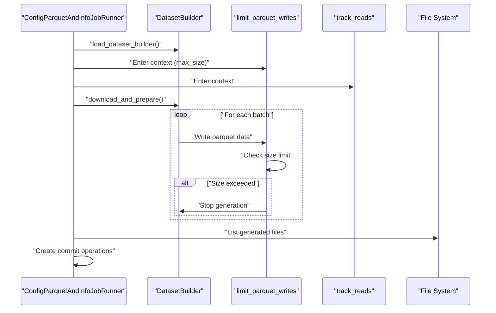
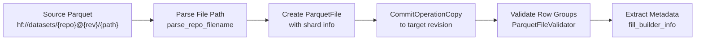
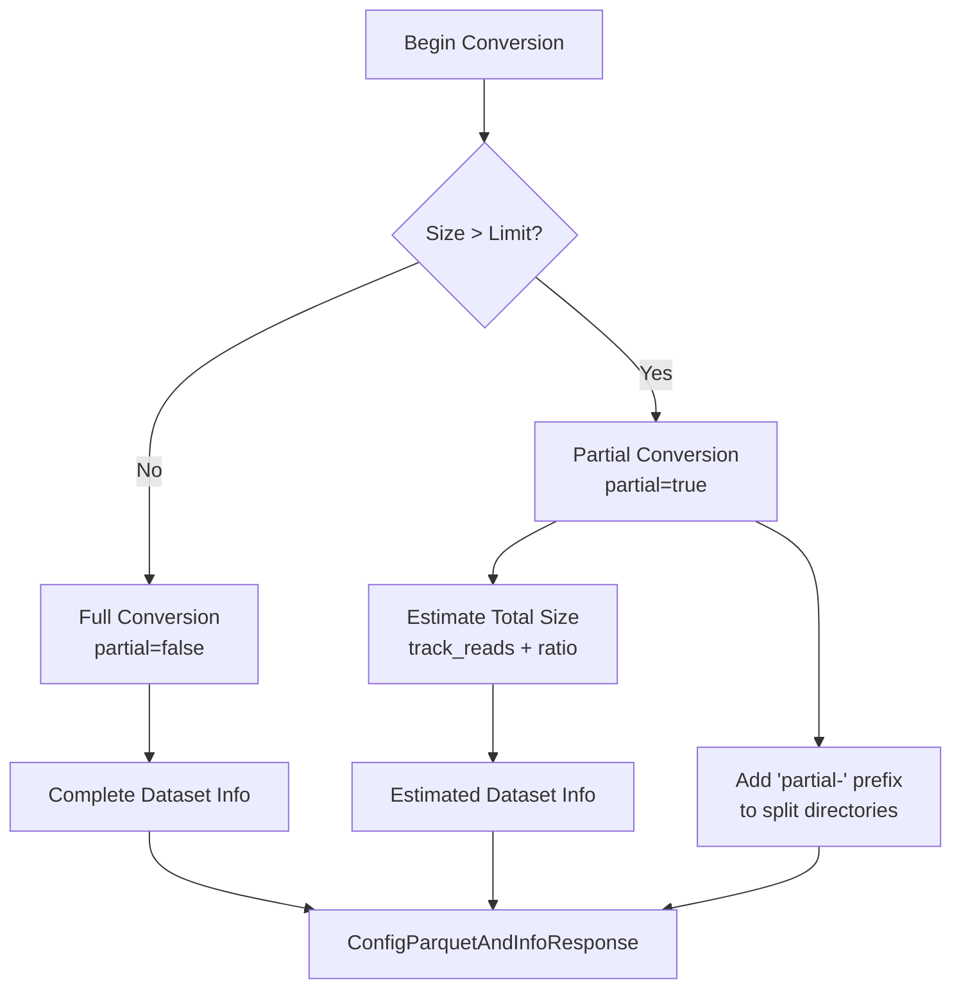
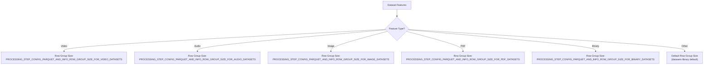
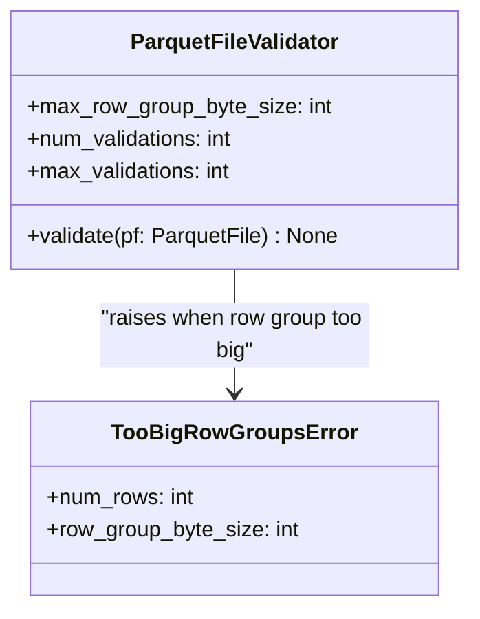

<!-- source: DeepWiki mcp.deepwiki.com · repo huggingface/dataset-viewer · page 5.3 Parquet Conversion · fetched 2026-10-26 -->

# Parquet Conversion

Relevant source files

The following files were used as context for generating this wiki page:

- [libs/libcommon/src/libcommon/exceptions.py](libs/libcommon/src/libcommon/exceptions.py)
- [services/worker/src/worker/job_runners/config/parquet_and_info.py](services/worker/src/worker/job_runners/config/parquet_and_info.py)
- [services/worker/src/worker/utils.py](services/worker/src/worker/utils.py)
- [services/worker/tests/fixtures/files.py](services/worker/tests/fixtures/files.py)
- [services/worker/tests/fixtures/hub.py](services/worker/tests/fixtures/hub.py)
- [services/worker/tests/job_runners/config/test_parquet_and_info.py](services/worker/tests/job_runners/config/test_parquet_and_info.py)

This page documents the Parquet conversion system within the dataset-viewer, which transforms datasets from various formats into Apache Parquet files for efficient storage and querying. The conversion process handles dataset metadata extraction, file organization, size limitations, and validation. For information about the broader data processing pipeline, see [Processing Graph](#5.1). For details about other job runners, see [Job Runners](#5.2).

## Overview

The Parquet conversion system is implemented primarily through the `ConfigParquetAndInfoJobRunner` class, which performs two main operations:

1. **Dataset Conversion**: Transforms datasets from their original format (CSV, JSON, etc.) into Parquet files
2. **Metadata Extraction**: Extracts and validates dataset information including schema, split information, and statistics

The system supports both full conversion for smaller datasets and partial conversion for large datasets that exceed size limits.

Sources: [services/worker/src/worker/job_runners/config/parquet_and_info.py:1-950]()

## Core Components

### ConfigParquetAndInfoJobRunner

The main job runner class that orchestrates the entire conversion process.

Sources: [services/worker/src/worker/job_runners/config/parquet_and_info.py:113-158](), [services/worker/src/worker/job_runners/config/parquet_and_info.py:510-541]()

### Parquet File Organization

The system organizes parquet files in a hierarchical structure within the dataset repository:

| Component | Pattern | Example |
|-----------|---------|---------|
| Config Directory | `{config}/` | `default/` |
| Split Directory | `{split}/` or `partial-{split}/` | `train/` or `partial-train/` |
| Part Directory | `{split}-part{n}/` (for large splits) | `train-part0/` |
| Parquet File | `{shard_idx:04d}.parquet` | `0000.parquet` |

Sources: [services/worker/src/worker/job_runners/config/parquet_and_info.py:126-139](), [services/worker/src/worker/job_runners/config/parquet_and_info.py:160-176]()

## Conversion Workflows

### Streaming Conversion

For datasets that need to be converted from their original format, the system uses streaming conversion to handle large datasets efficiently:

Sources: [services/worker/src/worker/job_runners/config/parquet_and_info.py:626-715](), [services/worker/src/worker/job_runners/config/parquet_and_info.py:769-892]()

### Copy Operation

For datasets already in Parquet format, the system copies existing files:

Sources: [services/worker/src/worker/job_runners/config/parquet_and_info.py:406-431](), [services/worker/src/worker/job_runners/config/parquet_and_info.py:544-624]()

## Size Management

### Dataset Size Limits

The system implements several mechanisms to handle large datasets:

| Limit Type | Purpose | Implementation |
|------------|---------|----------------|
| `max_dataset_size_bytes` | Prevent excessive resource usage | `limit_parquet_writes` context manager |
| `MAX_FILES_PER_DIRECTORY` | Hub file system limitations | Automatic part directory creation |
| `MAX_FILES_PER_REPOSITORY` | Repository size constraints | Validation during file creation |
| `MAX_OPERATIONS_PER_COMMIT` | Git operation limits | Batched commit operations |

### Partial Conversion

When datasets exceed size limits, the system performs partial conversion:

Sources: [services/worker/src/worker/job_runners/config/parquet_and_info.py:714-770](), [libcommon/src/libcommon/parquet_utils.py:76-77]()

## Row Group Size Optimization

The system optimizes Parquet row group sizes based on data types to improve random access performance:

Sources: [services/worker/src/worker/job_runners/config/parquet_and_info.py:349-374](), [services/worker/src/worker/job_runners/config/parquet_and_info.py:377-403]()

## Validation and Error Handling

### Parquet File Validation

The `ParquetFileValidator` class ensures parquet files meet quality standards:

### Error Types

The conversion process handles several categories of errors:

| Error Type | Cause | Handling |
|------------|-------|----------|
| `EmptyDatasetError` | No data files or splits | Fail conversion |
| `TooBigRowGroupsError` | Row groups exceed size limit | Reject for copy, allow regeneration |
| `DatasetGenerationError` | Conversion failure | Retry or fail |
| `FileSystemError` | File access issues | Retry with backoff |
| `CreateCommitError` | Git operation failure | Retry with different strategy |

Sources: [services/worker/src/worker/job_runners/config/parquet_and_info.py:510-541](), [services/worker/src/worker/job_runners/config/parquet_and_info.py:434-450](), [libcommon/src/libcommon/exceptions.py:177-182]()

## Response Format

The conversion process produces a `ConfigParquetAndInfoResponse` containing:

| Field | Type | Description |
|-------|------|-------------|
| `parquet_files` | `list[SplitHubFile]` | List of generated parquet files with URLs |
| `dataset_info` | `dict` | Complete dataset metadata from datasets library |
| `estimated_dataset_info` | `dict \| None` | Size estimates for partial conversions |
| `partial` | `bool` | Whether conversion was partial due to size limits |

Sources: [worker/dtos.py](), [services/worker/src/worker/job_runners/config/parquet_and_info.py:179-203]()

---

