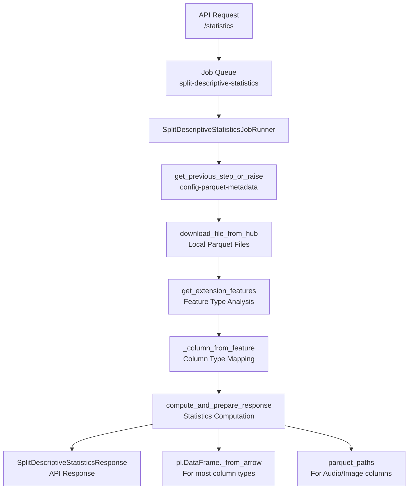
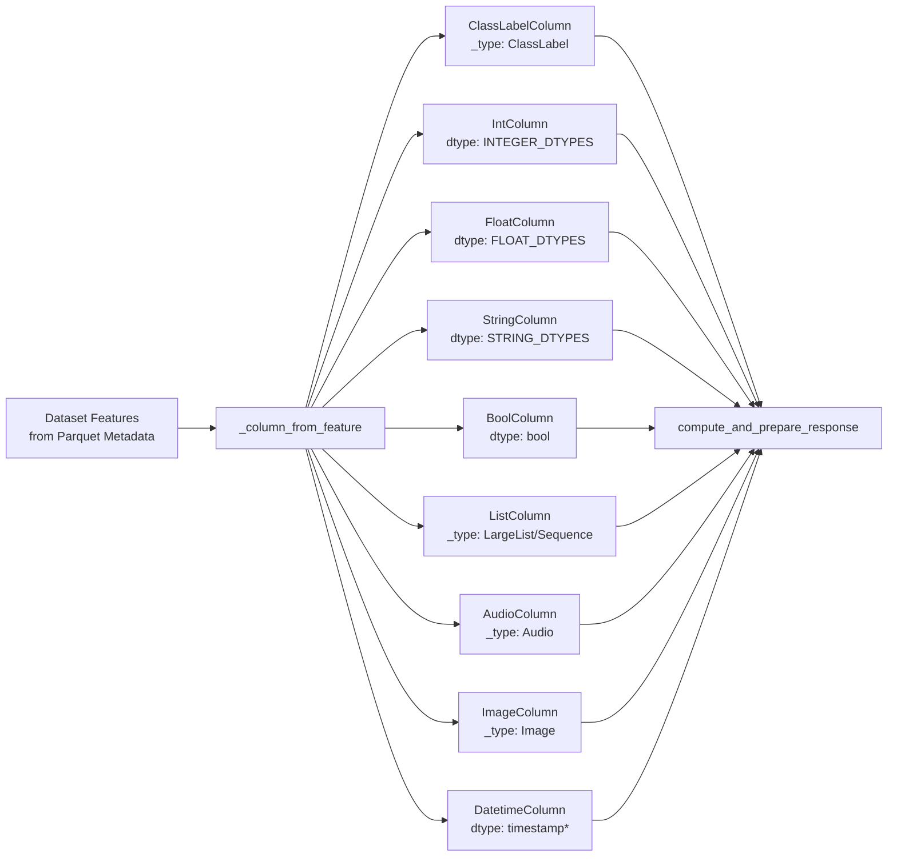
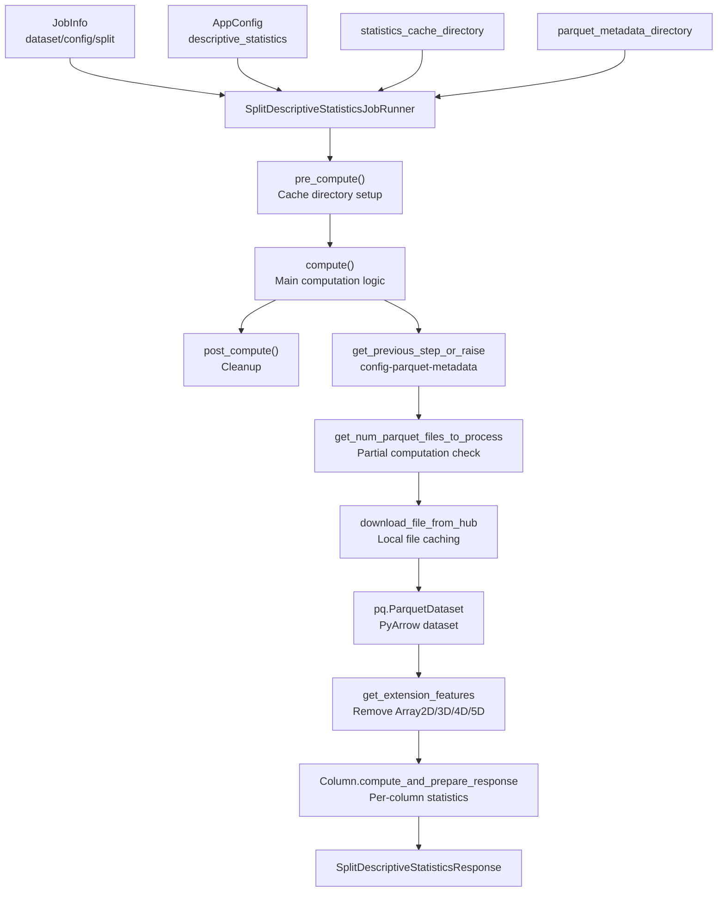
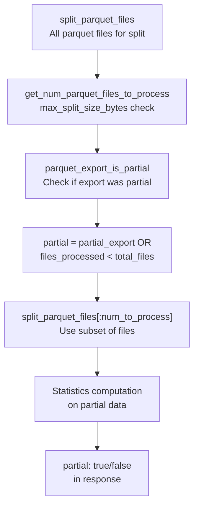
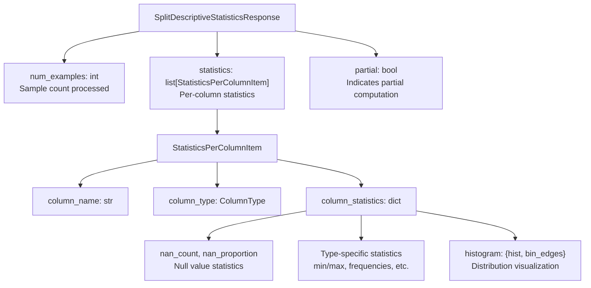
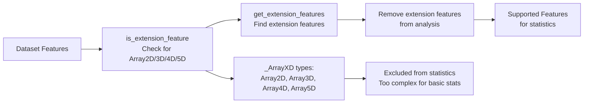

<!-- source: DeepWiki mcp.deepwiki.com · repo huggingface/dataset-viewer · page 5.4 Statistics and Analytics · fetched 2026-10-26 -->

# Statistics and Analytics

Relevant source files

The following files were used as context for generating this wiki page:

- [docs/source/openapi.json](docs/source/openapi.json)
- [docs/source/statistics.md](docs/source/statistics.md)
- [services/worker/src/worker/job_runners/split/descriptive_statistics.py](services/worker/src/worker/job_runners/split/descriptive_statistics.py)
- [services/worker/tests/fixtures/datasets.py](services/worker/tests/fixtures/datasets.py)
- [services/worker/tests/fixtures/statistics_dataset.py](services/worker/tests/fixtures/statistics_dataset.py)
- [services/worker/tests/job_runners/split/test_descriptive_statistics.py](services/worker/tests/job_runners/split/test_descriptive_statistics.py)
- [services/worker/tests/test_statistics_utils.py](services/worker/tests/test_statistics_utils.py)

This document covers the descriptive statistics computation system in the dataset-viewer, which analyzes dataset columns to provide statistical insights about data distributions. The system computes statistics for supported data types including numerical, categorical, temporal, and multimedia data.

For information about data processing pipeline orchestration, see [Processing Graph](#5.1). For details about job execution infrastructure, see [Job Runners](#5.2).

## Overview

The statistics system operates as part of the worker processing pipeline, computing descriptive statistics for dataset splits after Parquet conversion. It supports analysis of various data types with type-specific statistical measures, handling large datasets through partial computation when necessary.

**Sources:** [services/worker/src/worker/job_runners/split/descriptive_statistics.py:1-349](), [docs/source/statistics.md:1-653]()

## Statistics Computation Pipeline

The statistics computation follows a multi-stage pipeline from job initiation to API response:

**Sources:** [services/worker/src/worker/job_runners/split/descriptive_statistics.py:91-349](), [services/worker/src/worker/job_runners/split/descriptive_statistics.py:312-348]()

## Column Type Classification

The system maps dataset features to specialized column classes for statistics computation:

**Sources:** [services/worker/src/worker/job_runners/split/descriptive_statistics.py:213-255](), [services/worker/src/worker/job_runners/split/descriptive_statistics.py:257-267]()

## Data Type Support Matrix

| Column Type | Statistics Computed | Histogram | Special Handling |
|-------------|-------------------|-----------|------------------|
| `ClassLabelColumn` | Frequencies, unique count, null/no-label proportions | No | Uses class label names |
| `IntColumn` | Min, max, mean, median, std, null count | Yes (≤10 bins) | Integer-optimized binning |
| `FloatColumn` | Min, max, mean, median, std, null/NaN count | Yes (10 bins) | NaN treated as null |
| `StringColumn` | Length distribution or categorical frequencies | Yes/No | Categorical vs text classification |
| `BoolColumn` | True/False frequencies, null count | No | Simple frequency counting |
| `ListColumn` | Length distribution statistics | Yes | Analyzes list lengths |
| `AudioColumn` | Duration distribution statistics | Yes | Extracts audio duration |
| `ImageColumn` | Width distribution statistics | Yes | Extracts image width |
| `DatetimeColumn` | Temporal distribution statistics | Yes | String format handling |

**Sources:** [docs/source/statistics.md:166-653](), [libcommon/src/libcommon/statistics_utils.py]() (referenced in imports)

## Job Runner Implementation

The `SplitDescriptiveStatisticsJobRunner` handles the complete statistics computation workflow:

**Sources:** [services/worker/src/worker/job_runners/split/descriptive_statistics.py:312-348](), [services/worker/src/worker/job_runners/split/descriptive_statistics.py:334-348]()

## Partial Computation Handling

The system implements partial computation for large datasets to ensure reasonable processing times:

The system uses the `max_split_size_bytes` configuration to determine how many Parquet files to process, defaulting to approximately 5GB of uncompressed data.

**Sources:** [services/worker/src/worker/job_runners/split/descriptive_statistics.py:175-182](), [docs/source/statistics.md:58-60]()

## API Response Structure

The statistics API returns a structured response containing computed statistics per column:

**Sources:** [services/worker/src/worker/job_runners/split/descriptive_statistics.py:54-57](), [docs/source/openapi.json:854-870]()

## Extension Feature Exclusion

The system excludes certain complex feature types from statistics computation:

Extension features like `Array2D`, `Array3D`, `Array4D`, and `Array5D` are excluded because they represent multi-dimensional arrays that don't fit the column-wise statistical analysis model.

**Sources:** [services/worker/src/worker/job_runners/split/descriptive_statistics.py:73-89](), [services/worker/src/worker/job_runners/split/descriptive_statistics.py:206-211]()

## Configuration and Dependencies

The statistics system relies on several configuration parameters and dependencies:

| Component | Purpose | Configuration |
|-----------|---------|---------------|
| `DescriptiveStatisticsConfig` | Runtime parameters | `max_split_size_bytes`, `parquet_revision` |
| `statistics_cache_directory` | Local file caching | Temporary storage for downloaded files |
| `parquet_metadata_directory` | Metadata access | Shared storage for parquet metadata |
| Polars/PyArrow | Data processing | Column-wise data reading and analysis |

The job runner integrates with the broader processing pipeline by depending on the `config-parquet-metadata` step, which provides the necessary parquet file information and dataset features.

**Sources:** [services/worker/src/worker/job_runners/split/descriptive_statistics.py:315-328](), [services/worker/src/worker/job_runners/split/descriptive_statistics.py:149-155]()

---

