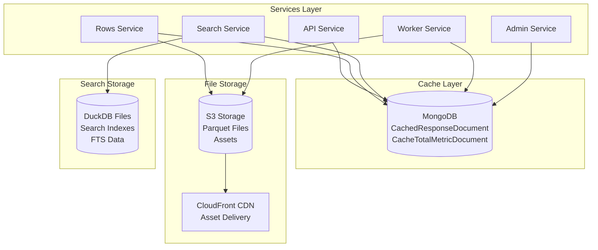
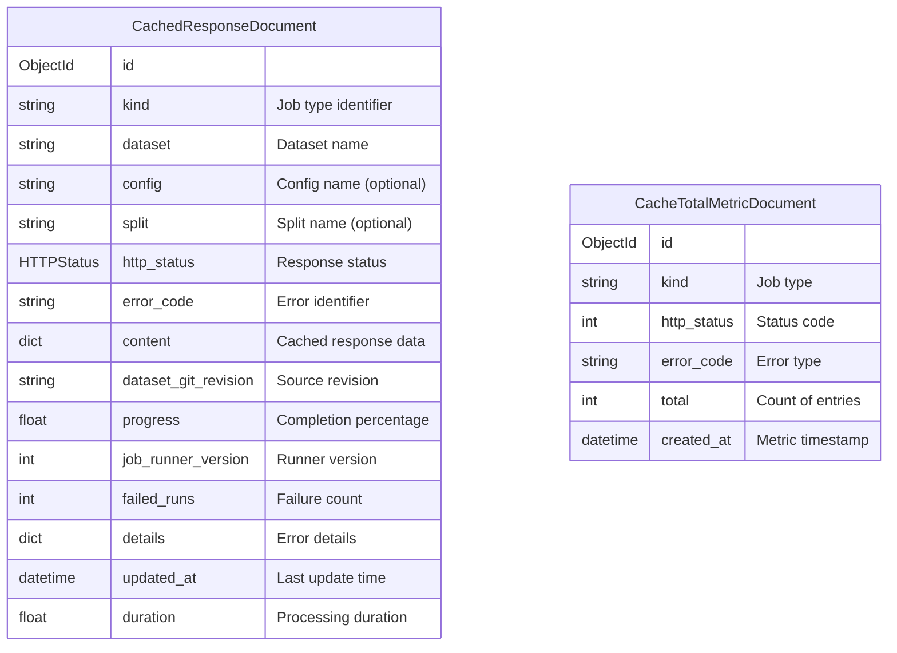
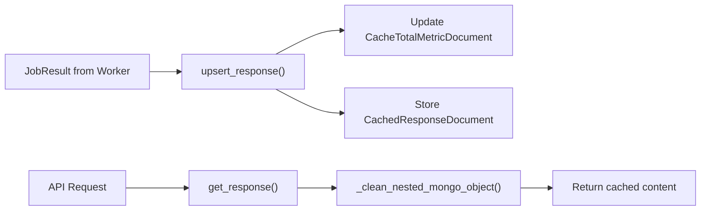
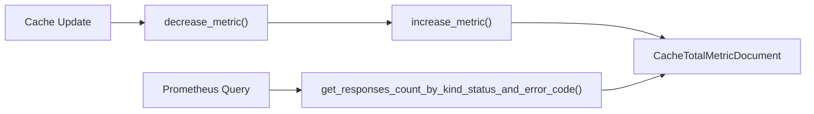
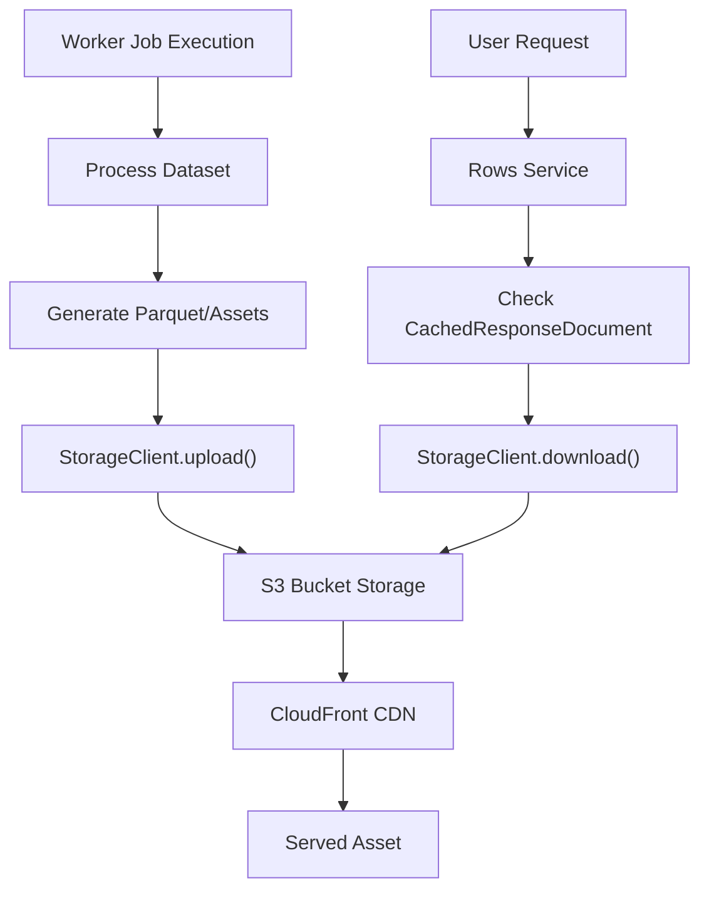
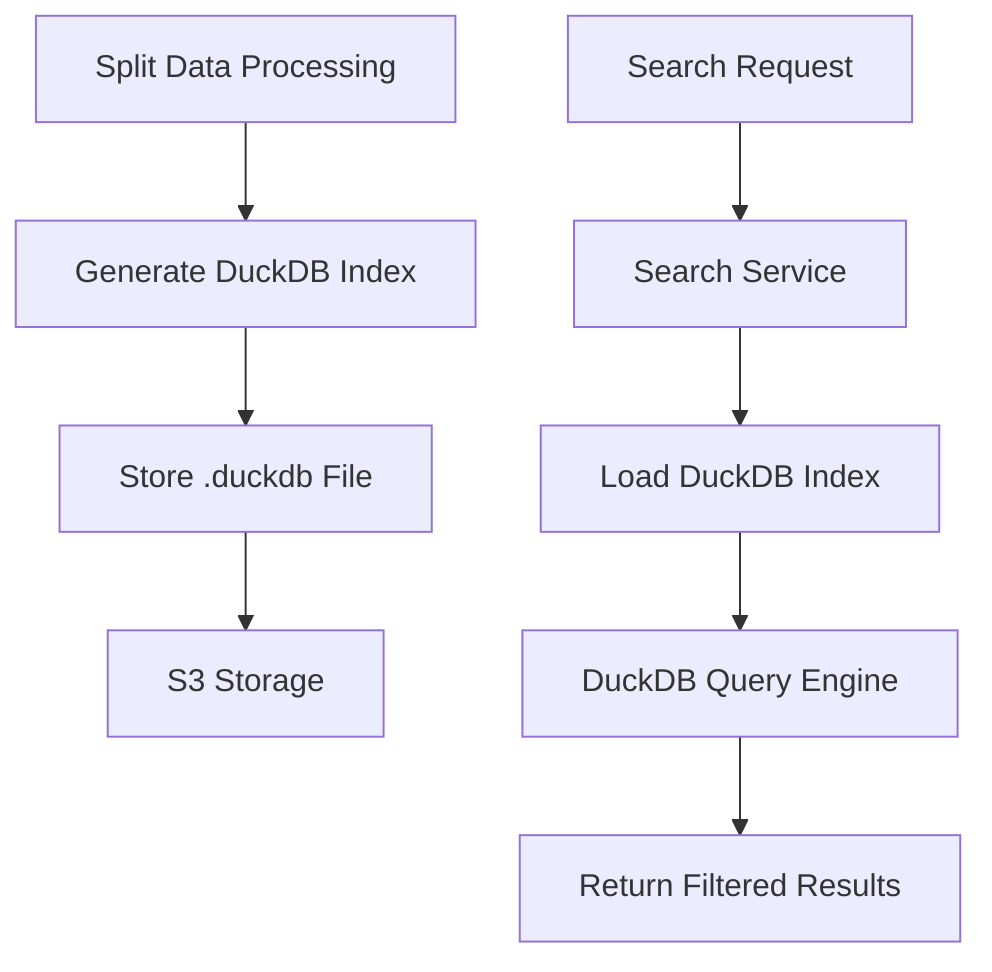
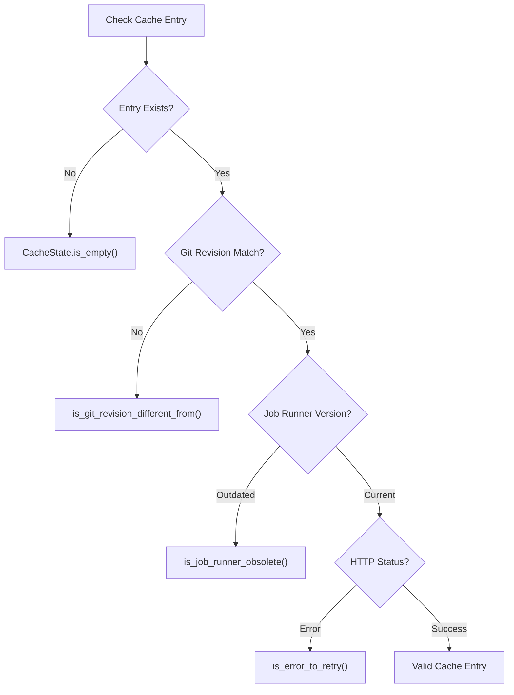
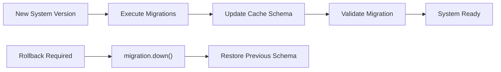

<!-- source: DeepWiki mcp.deepwiki.com · repo huggingface/dataset-viewer · page 6 Storage and Caching · fetched 2026-10-26 -->

# Storage and Caching

Relevant source files

The following files were used as context for generating this wiki page:

- [chart/templates/worker/_container.tpl](chart/templates/worker/_container.tpl)
- [jobs/mongodb_migration/src/mongodb_migration/collector.py](jobs/mongodb_migration/src/mongodb_migration/collector.py)
- [jobs/mongodb_migration/src/mongodb_migration/deletion_migrations.py](jobs/mongodb_migration/src/mongodb_migration/deletion_migrations.py)
- [jobs/mongodb_migration/src/mongodb_migration/migration.py](jobs/mongodb_migration/src/mongodb_migration/migration.py)
- [jobs/mongodb_migration/tests/test_deletion_migrations.py](jobs/mongodb_migration/tests/test_deletion_migrations.py)
- [libs/libcommon/src/libcommon/orchestrator.py](libs/libcommon/src/libcommon/orchestrator.py)
- [libs/libcommon/src/libcommon/simple_cache.py](libs/libcommon/src/libcommon/simple_cache.py)
- [libs/libcommon/src/libcommon/state.py](libs/libcommon/src/libcommon/state.py)
- [libs/libcommon/tests/test_backfill.py](libs/libcommon/tests/test_backfill.py)
- [libs/libcommon/tests/test_orchestrator.py](libs/libcommon/tests/test_orchestrator.py)
- [libs/libcommon/tests/test_orchestrator_smart_update.py](libs/libcommon/tests/test_orchestrator_smart_update.py)
- [libs/libcommon/tests/test_simple_cache.py](libs/libcommon/tests/test_simple_cache.py)
- [libs/libcommon/tests/test_state.py](libs/libcommon/tests/test_state.py)
- [libs/libcommon/tests/utils.py](libs/libcommon/tests/utils.py)
- [services/worker/src/worker/executor.py](services/worker/src/worker/executor.py)
- [services/worker/src/worker/job_manager.py](services/worker/src/worker/job_manager.py)
- [services/worker/src/worker/loop.py](services/worker/src/worker/loop.py)
- [services/worker/tests/test_job_manager.py](services/worker/tests/test_job_manager.py)
- [services/worker/tests/test_loop.py](services/worker/tests/test_loop.py)

This document covers the data persistence layer of the dataset-viewer system, including MongoDB-based caching for processed responses, S3-based asset storage, and DuckDB search indexing. For information about job queue management, see [Job Runners](#5.2). For details about the processing pipeline that generates cached data, see [Data Processing](#5).

## Storage Architecture Overview

The dataset-viewer employs a multi-tier storage architecture to handle different types of data and access patterns:

Sources: [libs/libcommon/src/libcommon/simple_cache.py:121-174](), [services/worker/src/worker/executor.py:1-25](), high-level architecture diagrams

## MongoDB Cache Layer

The primary caching mechanism uses MongoDB to store processed responses from job executions. The cache is implemented through the `CachedResponseDocument` model which stores both successful results and error states.

### Cache Document Structure

The cache uses a composite unique key of `(kind, dataset, config, split)` to identify cached responses. This allows the system to cache results at different granularities - dataset level, config level, or split level depending on the job type.

Sources: [libs/libcommon/src/libcommon/simple_cache.py:121-174](), [libs/libcommon/src/libcommon/simple_cache.py:190-218]()

### Cache Operations

The cache layer provides several key operations through functions in `simple_cache.py`:

| Operation | Function | Purpose |
|-----------|----------|---------|
| Store/Update | `upsert_response()` | Insert or update cache entry |
| Retrieve | `get_response()` | Get cached content |
| Metadata | `get_response_metadata()` | Get cache metadata only |
| Delete | `delete_response()` | Remove specific entry |
| Bulk Delete | `delete_dataset_responses()` | Remove all dataset entries |
| Reports | `get_cache_reports()` | Paginated cache inspection |

Sources: [libs/libcommon/src/libcommon/simple_cache.py:272-301](), [libs/libcommon/src/libcommon/simple_cache.py:515-531](), [libs/libcommon/src/libcommon/simple_cache.py:397-406]()

### Cache Metrics and Monitoring

The system maintains real-time metrics about cache state through `CacheTotalMetricDocument`. These metrics track the distribution of cache entries by status and error codes, enabling monitoring and alerting on system health.

Sources: [libs/libcommon/src/libcommon/simple_cache.py:249-261](), [libs/libcommon/src/libcommon/simple_cache.py:640-668]()

## Asset and File Storage

The system uses S3-compatible storage for large files and assets that cannot be efficiently stored in MongoDB due to size constraints. This includes Parquet files converted from datasets and media assets extracted from datasets.

### Storage Integration

The `StorageClient` class provides the interface to S3 storage, handling file uploads, downloads, and directory management. Storage operations are integrated into the job processing pipeline through worker services.

The storage system handles dataset revision management by organizing files in revision-specific directories, allowing for atomic updates and rollbacks when dataset content changes.

Sources: [libs/libcommon/src/libcommon/orchestrator.py:317-339](), [services/worker/src/worker/executor.py:166-186]()

## Search Indexing Storage

DuckDB files are used to store search indexes for full-text search and filtering capabilities. These indexes are generated by worker jobs and stored as files that can be queried by the search service.

The DuckDB indexes support both full-text search and structured filtering, with stemming and other text processing features enabled based on the cached metadata about index capabilities.

Sources: [libs/libcommon/src/libcommon/simple_cache.py:311-318](), search service integration patterns

## Cache State Management

The system tracks cache state through the `CacheState` class, which determines whether cached data is valid, outdated, or requires regeneration. This state management is crucial for maintaining data consistency across dataset updates.

### Cache Validation Logic

The cache state influences job orchestration decisions, determining when new jobs need to be created or when existing cache entries can be reused.

Sources: [libs/libcommon/src/libcommon/state.py:100-125](), [libs/libcommon/src/libcommon/orchestrator.py:750-798]()

## Database Migrations

The cache schema evolves through MongoDB migrations that handle adding new fields, changing data structures, and cleaning up obsolete data. The migration system ensures backward compatibility while enabling system evolution.

### Migration Categories

| Migration Type | Class | Purpose |
|---------------|-------|---------|
| Cache Deletion | `CacheDeletionMigration` | Remove obsolete cache kinds |
| Field Addition | Various | Add new fields to cache documents |
| Field Removal | `MigrationRemoveFieldFromCache` | Clean up unused fields |
| Index Management | `MigrationDeleteIndex` | Manage database indexes |

Sources: [jobs/mongodb_migration/src/mongodb_migration/deletion_migrations.py:39-62](), [jobs/mongodb_migration/src/mongodb_migration/collector.py:106-421]()

---

