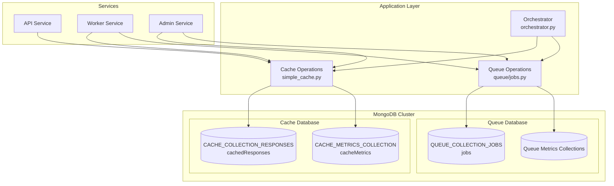
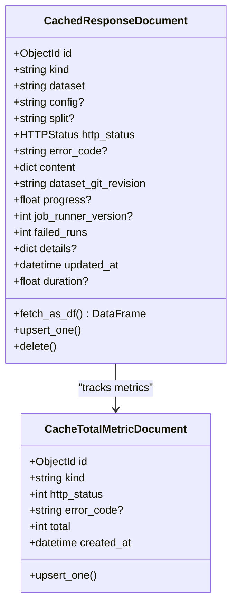
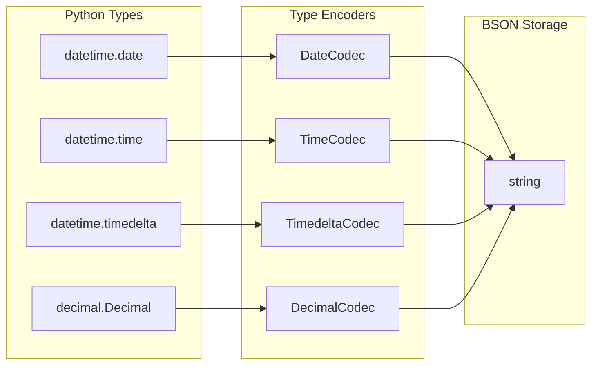
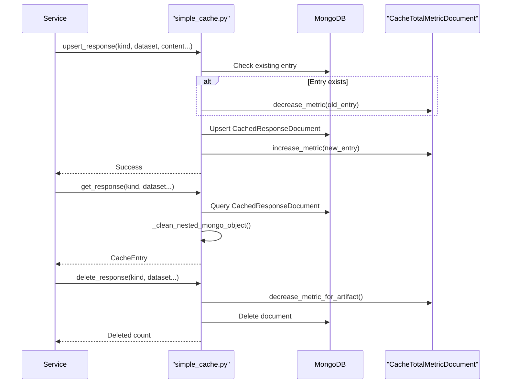
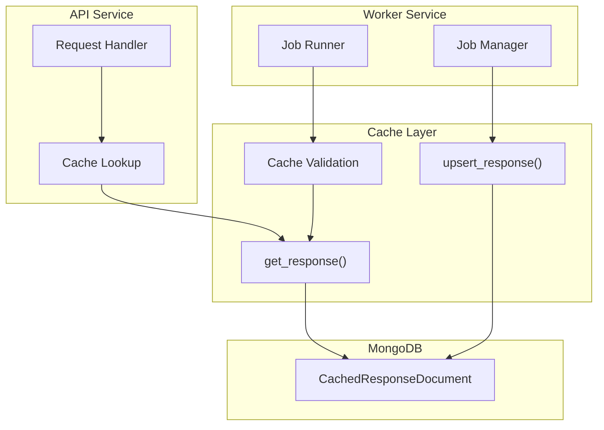
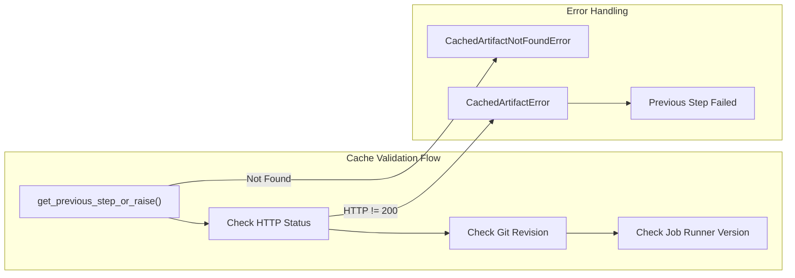
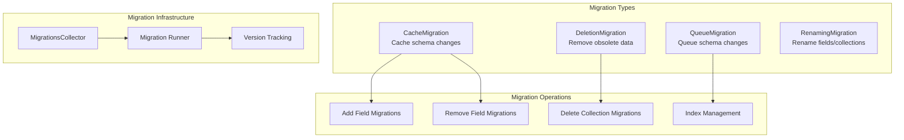
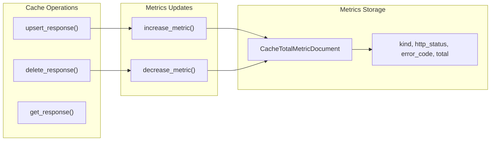

<!-- source: DeepWiki mcp.deepwiki.com · repo huggingface/dataset-viewer · page 6.1 MongoDB Integration · fetched 2026-10-26 -->

# MongoDB Integration

Relevant source files

The following files were used as context for generating this wiki page:

- [chart/templates/worker/_container.tpl](chart/templates/worker/_container.tpl)
- [jobs/mongodb_migration/src/mongodb_migration/collector.py](jobs/mongodb_migration/src/mongodb_migration/collector.py)
- [jobs/mongodb_migration/src/mongodb_migration/deletion_migrations.py](jobs/mongodb_migration/src/mongodb_migration/deletion_migrations.py)
- [jobs/mongodb_migration/src/mongodb_migration/migration.py](jobs/mongodb_migration/src/mongodb_migration/migration.py)
- [jobs/mongodb_migration/tests/test_deletion_migrations.py](jobs/mongodb_migration/tests/test_deletion_migrations.py)
- [libs/libcommon/src/libcommon/orchestrator.py](libs/libcommon/src/libcommon/orchestrator.py)
- [libs/libcommon/src/libcommon/simple_cache.py](libs/libcommon/src/libcommon/simple_cache.py)
- [libs/libcommon/src/libcommon/state.py](libs/libcommon/src/libcommon/state.py)
- [libs/libcommon/tests/test_backfill.py](libs/libcommon/tests/test_backfill.py)
- [libs/libcommon/tests/test_orchestrator.py](libs/libcommon/tests/test_orchestrator.py)
- [libs/libcommon/tests/test_orchestrator_smart_update.py](libs/libcommon/tests/test_orchestrator_smart_update.py)
- [libs/libcommon/tests/test_simple_cache.py](libs/libcommon/tests/test_simple_cache.py)
- [libs/libcommon/tests/test_state.py](libs/libcommon/tests/test_state.py)
- [libs/libcommon/tests/utils.py](libs/libcommon/tests/utils.py)
- [services/worker/src/worker/executor.py](services/worker/src/worker/executor.py)
- [services/worker/src/worker/job_manager.py](services/worker/src/worker/job_manager.py)
- [services/worker/src/worker/loop.py](services/worker/src/worker/loop.py)
- [services/worker/tests/test_job_manager.py](services/worker/tests/test_job_manager.py)
- [services/worker/tests/test_loop.py](services/worker/tests/test_loop.py)

This document covers the MongoDB integration within the dataset-viewer system, including data models, caching mechanisms, and database operations. MongoDB serves as the primary persistence layer for caching processed dataset responses and managing job queues.

For information about job queue management, see [Queue and Job Management](#4.1). For details about the processing pipeline that generates cached data, see [Data Processing](#5).

## Overview

MongoDB is used as the primary database for two main purposes in the dataset-viewer system:

1. **Response Caching**: Storing processed results from dataset analysis jobs to avoid recomputation
2. **Metrics Collection**: Tracking cache statistics and system performance metrics  
3. **Job Queue Storage**: Managing background job execution (covered in detail in [Queue and Job Management](#4.1))

The system uses MongoEngine as the ODM (Object Document Mapper) with custom type encoders to handle Python-specific data types. Two separate database aliases are used to logically separate concerns: `CACHE_MONGOENGINE_ALIAS` for caching and `QUEUE_MONGOENGINE_ALIAS` for job management.

## Database Architecture

**MongoDB Database Structure**
Sources: [libs/libcommon/src/libcommon/simple_cache.py:30-36](), [libs/libcommon/src/libcommon/constants.py]()

## Document Models

### CachedResponseDocument

The primary document model for storing processed job responses in the cache database.

**Cache Document Models**
Sources: [libs/libcommon/src/libcommon/simple_cache.py:121-174](), [libs/libcommon/src/libcommon/simple_cache.py:190-218]()

Key features of `CachedResponseDocument`:
- **Composite Unique Index**: `(kind, dataset, config, split)` ensures one cache entry per artifact
- **Flexible Schema**: `config` and `split` are optional to support dataset, config, and split-level caching
- **Git Revision Tracking**: Links cached results to specific dataset revisions
- **Progress Tracking**: Supports partial results with progress indicators
- **Error Handling**: Stores both HTTP status and structured error codes

### Type Encoding System

MongoDB integration includes custom type encoders to handle Python data types that don't have native BSON representations:

**Custom Type Encoding for MongoDB**
Sources: [libs/libcommon/src/libcommon/simple_cache.py:40-68]()

## Core Cache Operations

### Cache Entry Lifecycle

**Cache Entry Lifecycle Management**
Sources: [libs/libcommon/src/libcommon/simple_cache.py:272-301](), [libs/libcommon/src/libcommon/simple_cache.py:515-531](), [libs/libcommon/src/libcommon/simple_cache.py:341-345]()

### Key Cache Functions

The cache system provides several categories of operations:

**CRUD Operations:**
- `upsert_response()` / `upsert_response_params()` - Create or update cache entries
- `get_response()` - Retrieve complete cache entries with content
- `get_response_without_content()` - Retrieve metadata only (performance optimization)
- `get_response_with_details()` - Retrieve entries including error details
- `delete_response()` - Remove specific cache entries
- `delete_dataset_responses()` - Remove all cache entries for a dataset

**Query Operations:**
- `get_cache_reports()` - Paginated access to cache entries without content
- `get_cache_reports_with_content()` - Paginated access including content
- `fetch_names()` - Extract name lists from cached responses
- `is_successful_response()` - Check if a cache entry represents success

**Metrics Operations:**
- `increase_metric()` / `decrease_metric()` - Update cache statistics
- `get_responses_count_by_kind_status_and_error_code()` - Generate metrics reports

Sources: [libs/libcommon/src/libcommon/simple_cache.py:272-531](), [libs/libcommon/src/libcommon/simple_cache.py:610-631](), [libs/libcommon/src/libcommon/simple_cache.py:640-668]()

## Cache Integration Patterns

### Service Integration

**Service-Cache Integration Patterns**
Sources: [services/worker/src/worker/job_manager.py:114-156](), [libs/libcommon/src/libcommon/orchestrator.py:28-38]()

### Cache Validation and Dependencies

The cache system supports complex dependency validation for multi-step processing:

**Cache Dependency Validation**
Sources: [libs/libcommon/src/libcommon/simple_cache.py:569-599](), [services/worker/src/worker/job_manager.py:134-137]()

## Database Migration System

The system includes a comprehensive migration framework for evolving the MongoDB schema:

**Database Migration System**
Sources: [jobs/mongodb_migration/src/mongodb_migration/collector.py:106-421](), [jobs/mongodb_migration/src/mongodb_migration/migration.py:19-69]()

Key migration patterns include:
- **Field Addition**: Adding new fields to existing documents with default values
- **Field Removal**: Removing deprecated fields from collections
- **Collection Deletion**: Removing entire collections for obsolete job types
- **Index Management**: Creating, updating, or removing database indexes
- **Data Transformation**: Converting data between different formats or structures

## Performance and Monitoring

### Cache Metrics Collection

**Cache Metrics Collection System**
Sources: [libs/libcommon/src/libcommon/simple_cache.py:249-261](), [libs/libcommon/src/libcommon/simple_cache.py:640-668]()

### Performance Optimizations

The MongoDB integration includes several performance optimizations:

1. **Selective Field Loading**: Functions like `get_response_without_content()` load only required fields
2. **Efficient Indexing**: Compound indexes on frequently queried field combinations
3. **Pagination Support**: Cursor-based pagination for large result sets
4. **Bulk Operations**: Support for bulk deletions and updates
5. **Memory-Efficient Queries**: PyArrow integration for DataFrame operations

**Database Indexes:**
- Primary: `(kind, dataset, config, split)` - Unique constraint and fast lookups
- Secondary: `(dataset, kind, http_status)` - Dataset-level queries
- Metrics: `(kind, http_status, error_code)` - Status-based filtering
- Temporal: Various indexes for time-based queries and cleanup

Sources: [libs/libcommon/src/libcommon/simple_cache.py:163-172](), [libs/libcommon/src/libcommon/simple_cache.py:177-183](), [libs/libcommon/src/libcommon/simple_cache.py:702-757]()

---

