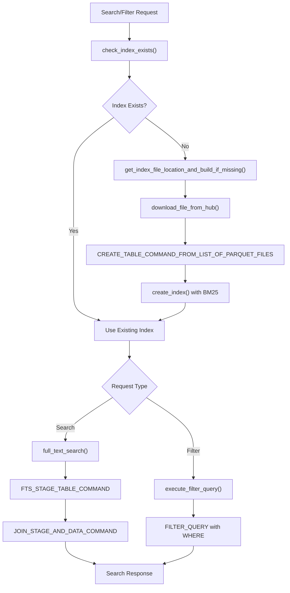
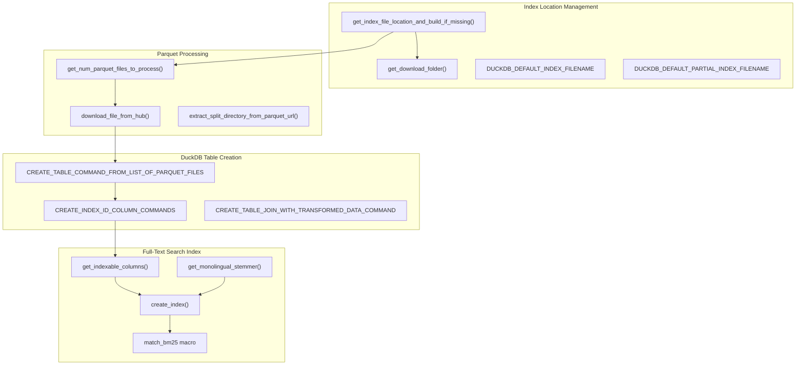
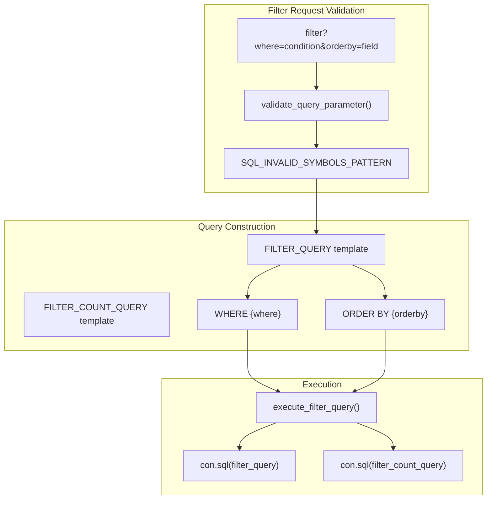
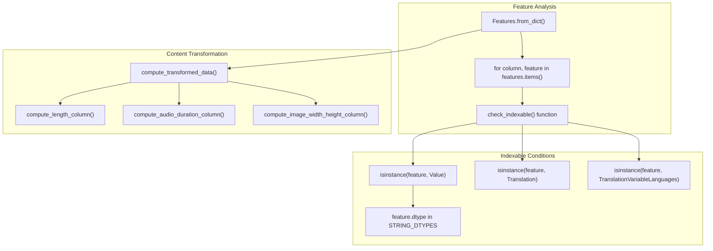

<!-- source: DeepWiki mcp.deepwiki.com · repo huggingface/dataset-viewer · page 6.2 Search Indexing · fetched 2026-10-26 -->

# Search Indexing

<details>
<summary>Relevant source files</summary>

The following files were used as context for generating this wiki page:

- [chart/templates/_env/_envWorker.tpl](chart/templates/_env/_envWorker.tpl)
- [libs/libapi/src/libapi/duckdb.py](libs/libapi/src/libapi/duckdb.py)
- [libs/libcommon/src/libcommon/duckdb_utils.py](libs/libcommon/src/libcommon/duckdb_utils.py)
- [services/search/src/search/duckdb_connection.py](services/search/src/search/duckdb_connection.py)
- [services/search/src/search/routes/filter.py](services/search/src/search/routes/filter.py)
- [services/search/src/search/routes/search.py](services/search/src/search/routes/search.py)
- [services/search/tests/routes/test_search.py](services/search/tests/routes/test_search.py)
- [tools/docker-compose-dataset-viewer.yml](tools/docker-compose-dataset-viewer.yml)
- [tools/docker-compose-dev-dataset-viewer.yml](tools/docker-compose-dev-dataset-viewer.yml)

</details>


This document covers the DuckDB-based search indexing system that enables full-text search and filtering capabilities for dataset content. The system creates on-demand search indexes from Parquet files to support the Search Service's `/search` and `/filter` endpoints.

For information about the Search Service API endpoints and request handling, see [Search Service](#3.3). For details about the broader data processing pipeline that creates the Parquet files used by search indexing, see [Data Processing](#5).

## Architecture Overview

The search indexing system uses DuckDB to create searchable indexes from dataset Parquet files. When a search or filter request is made, the system checks for an existing index and builds one on-demand if needed.

### Core Search Indexing Flow



Sources: [services/search/src/search/routes/search.py:185-201](), [services/search/src/search/routes/filter.py:134-146](), [libs/libapi/src/libapi/duckdb.py:185-264]()

## Index Creation Process

The system creates DuckDB indexes on-demand using a multi-step process that downloads Parquet files, creates tables, and builds full-text search capabilities.

### Index Building Components



Sources: [libs/libapi/src/libapi/duckdb.py:82-183](), [libs/libcommon/src/libcommon/duckdb_utils.py:86-101](), [libs/libcommon/src/libcommon/duckdb_utils.py:209-544]()

### Index File Management

The system determines index file locations based on dataset parameters and manages partial vs. complete indexes:

| Index Type | Filename | Condition |
|------------|----------|-----------|
| Complete Index | `index.duckdb` | All Parquet files processed |
| Partial Index | `partial-index.duckdb` | Size limit exceeded |

**Location Strategy:**
- Path: `{config}/{split_directory}/{index_filename}`
- Cache folder: `{duckdb_index_file_directory}/downloads/{dataset-hash}`
- Size factor: 5x the Parquet file size for disk space estimation

Sources: [libs/libapi/src/libapi/duckdb.py:210-224](), [libs/libcommon/src/libcommon/duckdb_utils.py:31-32]()

## Full-Text Search Implementation

The search system implements BM25-based full-text search using DuckDB's FTS extension with custom tokenization and stemming.

### Search Query Processing

```mermaid
graph LR
    subgraph "Search Request Processing"
        QueryInput["search?query=text"]
        ValidateAuth["auth_check()"]
        GetMetadata["get_cache_entry_from_parquet_metadata_job()"]
    end
    
    subgraph "Index Operations"
        BuildIndex["get_index_file_location_and_build_if_missing()"]
        ConnectDB["duckdb_connect_readonly()"]
    end
    
    subgraph "FTS Query Execution"
        FTSStage["FTS_STAGE_TABLE_COMMAND"]
        BM25Score["match_bm25() macro"]
        JoinData["JOIN_STAGE_AND_DATA_COMMAND"]
        SortResults["ORDER BY hf_fts_score DESC"]
    end
    
    QueryInput --> ValidateAuth
    ValidateAuth --> GetMetadata
    GetMetadata --> BuildIndex
    BuildIndex --> ConnectDB
    ConnectDB --> FTSStage
    FTSStage --> BM25Score
    BM25Score --> JoinData
    JoinData --> SortResults
```



Sources: [services/search/src/search/routes/search.py:55-77](), [services/search/src/search/routes/search.py:138-250]()

### BM25 Scoring Implementation

The system uses a custom BM25 implementation with the following SQL commands:

**Stage Table Creation:**
```sql
SELECT * FROM (SELECT __hf_index_id, fts_main_data.match_bm25(__hf_index_id, ?) AS hf_fts_score FROM data) A WHERE hf_fts_score IS NOT NULL;
```

**Data Join and Ranking:**
```sql
SELECT {columns} FROM memory.fts_stage_table JOIN db.data USING(__hf_index_id) ORDER BY memory.fts_stage_table.hf_fts_score DESC;
```

Sources: [services/search/src/search/routes/search.py:49-50](), [libs/libcommon/src/libcommon/duckdb_utils.py:474-542]()

## Filter Operations

The filter system provides SQL-based filtering capabilities with safety validations to prevent SQL injection.

### Filter Query Structure



Sources: [services/search/src/search/routes/filter.py:42-53](), [services/search/src/search/routes/filter.py:198-221](), [services/search/src/search/routes/filter.py:224-226]()

### SQL Safety Measures

The system implements multiple layers of SQL injection protection:

| Protection Layer | Implementation | Pattern |
|------------------|----------------|---------|
| Symbol Validation | `SQL_INVALID_SYMBOLS_PATTERN` | `;`, `--`, `/*`, `*/` |
| Parameter Quoting | Column name quoting | `"column_name"` |
| Read-only Connection | `duckdb_connect_readonly()` | `ATTACH ... (READ_ONLY)` |
| External Access Disabled | `LOAD_FTS_SAFE_COMMAND` | `SET enable_external_access=false` |

Sources: [services/search/src/search/routes/filter.py:55-56](), [services/search/src/search/duckdb_connection.py:6]()

## Indexable Content Detection

The system automatically identifies which dataset columns are suitable for full-text indexing based on their data types and features.

### Column Type Analysis



Sources: [libs/libcommon/src/libcommon/duckdb_utils.py:86-101](), [libs/libcommon/src/libcommon/duckdb_utils.py:167-187]()

## Language-Specific Stemming

The system supports multilingual stemming for improved search quality using dataset language metadata.

### Stemmer Selection Process

| Language | Stemmer | ISO Codes |
|----------|---------|-----------|
| English | `english` | `en`, `eng` |
| French | `french` | `fr`, `fra` |
| German | `german` | `de`, `deu` |
| Spanish | `spanish` | `es`, `spa` |
| Default | `none` | Exact matching |

**Selection Logic:**
1. Extract language from `DatasetCardData`
2. Match against `STEMMER_MAPPING` dictionary
3. Use monolingual datasets only
4. Fall back to `DEFAULT_STEMMER` for multilingual

Sources: [libs/libcommon/src/libcommon/duckdb_utils.py:104-115](), [libs/libcommon/src/libcommon/duckdb_utils.py:53-81]()

## Storage and Cache Management

The indexing system manages disk space and cache lifecycle to handle large datasets efficiently.

### Cache Directory Structure

```
duckdb_index_file_directory/
├── downloads/
│   └── {dataset-hash}/
│       └── {config}/
│           └── {split_directory}/
│               ├── index.duckdb
│               └── partial-index.duckdb
└── cache/
    └── {parquet_downloads}
```

**Disk Space Management:**
- Pre-check available space with `check_available_disk_space()`
- Size estimation: 5x Parquet file size
- Automatic cleanup with `clean_cache_proba` setting
- Lock-based concurrent access protection

Sources: [libs/libapi/src/libapi/duckdb.py:267-291](), [services/search/src/search/routes/search.py:222-227]()

## Configuration and Deployment

The search indexing system requires specific configuration for DuckDB extensions and cache management.

### Environment Configuration

| Variable | Purpose | Default |
|----------|---------|---------|
| `DUCKDB_INDEX_CACHE_DIRECTORY` | Index storage location | `/duckdb-index` |
| `DUCKDB_INDEX_EXTENSIONS_DIRECTORY` | DuckDB extensions path | `/tmp/duckdb-extensions` |
| `PARQUET_METADATA_STORAGE_DIRECTORY` | Metadata cache location | `/parquet_metadata` |

**Docker Volume Mounts:**
- Index cache: `duckdb-index:${DUCKDB_INDEX_CACHE_DIRECTORY}:rw`
- Extensions: Temporary directory for FTS extension
- Parquet metadata: Read-write for index building

Sources: [tools/docker-compose-dev-dataset-viewer.yml:125-131](), [tools/docker-compose-dataset-viewer.yml:119-123]()

---

