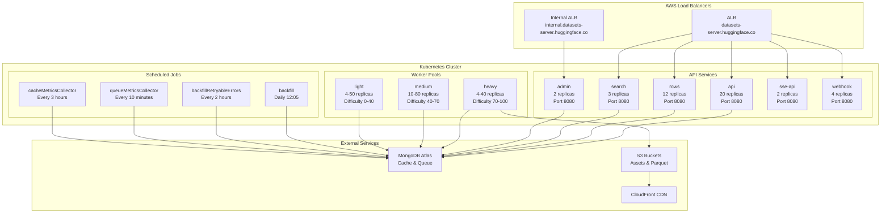
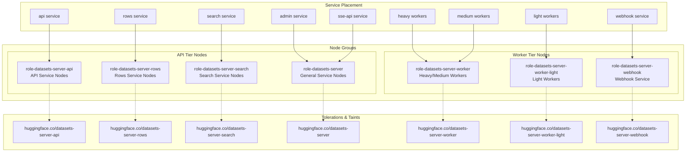
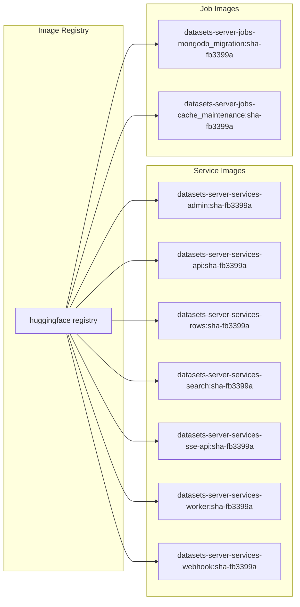
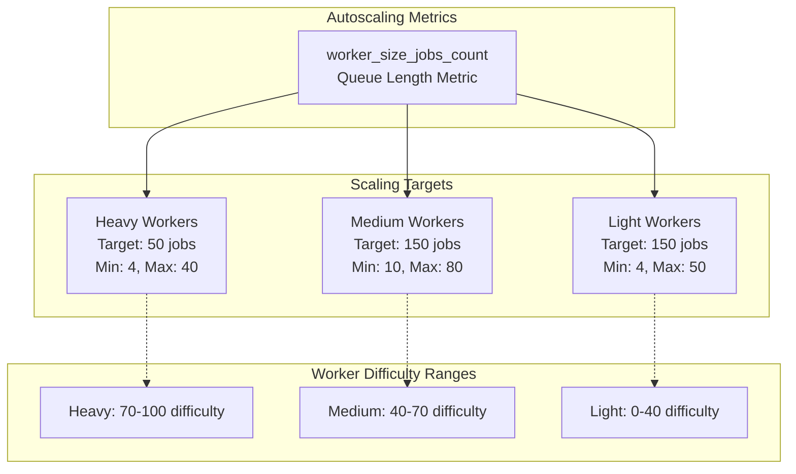
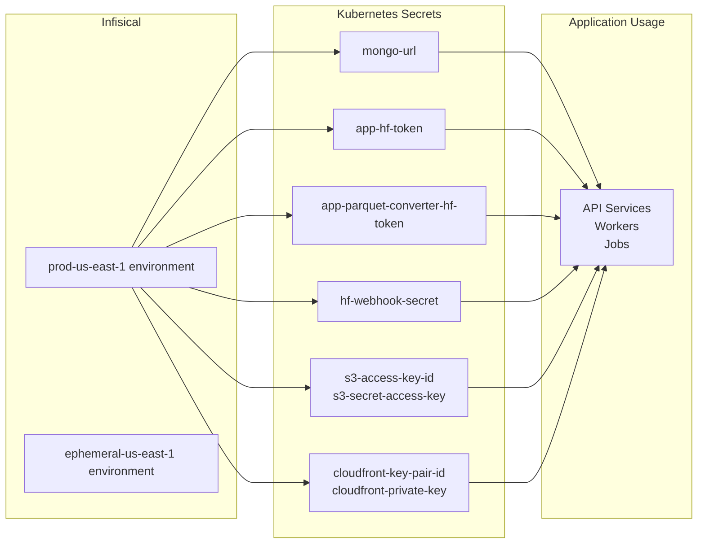
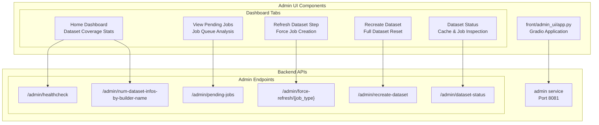
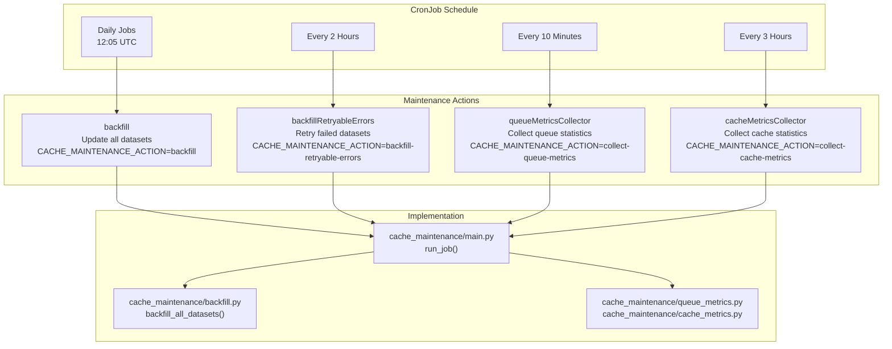

<!-- source: DeepWiki mcp.deepwiki.com · repo huggingface/dataset-viewer · page 7 Deployment and Operations · fetched 2026-10-26 -->

# Deployment and Operations

Relevant source files

The following files were used as context for generating this wiki page:

- [chart/Chart.yaml](chart/Chart.yaml)
- [chart/env/prod.yaml](chart/env/prod.yaml)
- [chart/env/staging.yaml](chart/env/staging.yaml)
- [chart/templates/_common/_helpers.tpl](chart/templates/_common/_helpers.tpl)
- [chart/templates/cron-jobs/backfill/_container.tpl](chart/templates/cron-jobs/backfill/_container.tpl)
- [chart/values.yaml](chart/values.yaml)
- [front/admin_ui/README.md](front/admin_ui/README.md)
- [front/admin_ui/app.py](front/admin_ui/app.py)
- [front/admin_ui/packages.txt](front/admin_ui/packages.txt)
- [front/admin_ui/pyproject.toml](front/admin_ui/pyproject.toml)
- [front/admin_ui/requirements.txt](front/admin_ui/requirements.txt)
- [jobs/cache_maintenance/README.md](jobs/cache_maintenance/README.md)
- [jobs/cache_maintenance/src/cache_maintenance/backfill.py](jobs/cache_maintenance/src/cache_maintenance/backfill.py)
- [jobs/cache_maintenance/src/cache_maintenance/config.py](jobs/cache_maintenance/src/cache_maintenance/config.py)
- [jobs/cache_maintenance/src/cache_maintenance/main.py](jobs/cache_maintenance/src/cache_maintenance/main.py)
- [tools/Docker.mk](tools/Docker.mk)

This page covers the infrastructure deployment, configuration management, and operational procedures for the dataset-viewer system. It provides technical details on Kubernetes deployments, service configuration, monitoring capabilities, and administrative tools.

For information about the individual microservices and their APIs, see [Core Services](#3). For configuration of shared libraries and common functionality, see [Shared Libraries](#4).

## Infrastructure Overview

The dataset-viewer system deploys as a microservices architecture on Kubernetes, using Helm charts for configuration management. The deployment includes API services, worker processes, scheduled jobs, and administrative interfaces.

### Deployment Architecture

Sources: [chart/env/prod.yaml:1-585](), [chart/values.yaml:1-630](), [chart/env/staging.yaml:1-329]()

### Service Node Distribution

Sources: [chart/env/prod.yaml:323-533](), [chart/env/prod.yaml:557-561]()

## Kubernetes Deployment

The system uses Helm charts for Kubernetes deployment with environment-specific value overrides. The main chart is located in the `chart/` directory with templates for all services and jobs.

### Helm Chart Structure

The Helm chart includes:
- **Services**: `admin`, `api`, `rows`, `search`, `sseApi`, `webhook`, `workers`
- **Jobs**: `mongodbMigration` (pre-install hook)  
- **CronJobs**: `backfill`, `backfillRetryableErrors`, `queueMetricsCollector`, `cacheMetricsCollector`, `postMessages`
- **Ingress**: ALB configuration for external and internal access
- **Secrets**: Infisical integration for secret management

### Container Image Management

Sources: [chart/env/prod.yaml:17-66](), [chart/values.yaml:24-78]()

### Resource Allocation

The production environment defines specific resource requests and limits for each service:

| Service | CPU Request | Memory Request | CPU Limit | Memory Limit | Replicas |
|---------|-------------|----------------|-----------|--------------|-----------|
| `api` | 4 | 14Gi | 4 | 14Gi | 20 |
| `rows` | 1 | 6500Mi | 4 | 6500Mi | 12 |
| `search` | 1 | 250Gi | 64 | 250Gi | 3 |
| `admin` | 1 | 8Gi | 4 | 8Gi | 2 |
| `sse-api` | 1 | 512Mi | 4 | 4Gi | 2 |
| `webhook` | 4 | 4Gi | 4 | 4Gi | 4 |

Worker pools have different resource profiles based on workload difficulty:
- **Heavy Workers**: 8 CPU, 34-44Gi memory, 4-40 replicas
- **Medium Workers**: 2 CPU, 14Gi memory, 10-80 replicas  
- **Light Workers**: 200m-2 CPU, 100Mi-1Gi memory, 4-50 replicas

Sources: [chart/env/prod.yaml:307-584]()

### Autoscaling Configuration

Workers implement Horizontal Pod Autoscaling based on queue metrics:

Sources: [chart/env/prod.yaml:477-542]()

## Configuration Management

Configuration is managed through Helm values with environment-specific overrides. The system uses Infisical for secret management and supports both file-based and S3-based storage protocols.

### Environment Configuration

The system supports multiple deployment environments:
- **Production**: `chart/env/prod.yaml` - Full-scale deployment with high availability
- **Staging**: `chart/env/staging.yaml` - Reduced resources for testing

Key configuration differences between environments:

| Setting | Production | Staging |
|---------|------------|---------|
| Domain | `datasets-server.huggingface.co` | `datasets-server.us.dev.moon.huggingface.tech` |
| Log Level | `INFO` | `DEBUG` |
| Backfill | Enabled daily | Disabled |
| Worker Replicas | 4-40 (Heavy) | 1-5 (All) |
| Resource Limits | High (64 CPU for search) | Low (1 CPU limit) |

Sources: [chart/env/prod.yaml:115-122](), [chart/env/staging.yaml:113-119]()

### Secret Management

Sources: [chart/env/prod.yaml:67-102](), [chart/values.yaml:92-140]()

### Storage Configuration

The system supports multiple storage backends for different asset types:

| Asset Type | Storage Protocol | Production Root | Staging Root |
|------------|------------------|-----------------|--------------|
| Assets | `s3` | `hf-datasets-server-statics/assets` | `hf-datasets-server-statics-staging/assets` |
| Cached Assets | `s3` | `hf-datasets-server-statics/cached-assets` | `hf-datasets-server-statics-staging/cached-assets` |
| Parquet Metadata | PVC | `datasets-server-parquet-pvc` | `datasets-server-parquet-pvc` |
| DuckDB Index | PVC | `datasets-server-duckdb-pvc` | `datasets-server-duckdb-pvc` |

Sources: [chart/env/prod.yaml:137-148](), [chart/env/staging.yaml:127-133]()

## Administration and Monitoring

The system provides comprehensive administration and monitoring capabilities through the admin service and scheduled maintenance jobs.

### Admin UI Interface

Sources: [front/admin_ui/app.py:35-44](), [front/admin_ui/app.py:115-272](), [front/admin_ui/app.py:459-526]()

### Scheduled Maintenance Jobs

The system runs several CronJob resources for automated maintenance:

Sources: [chart/env/prod.yaml:170-252](), [jobs/cache_maintenance/src/cache_maintenance/main.py:19-110](), [jobs/cache_maintenance/src/cache_maintenance/backfill.py:43-142]()

### Metrics Collection and Monitoring

The maintenance jobs collect various operational metrics:

- **Queue Metrics**: Job counts by type, status, and worker difficulty
- **Cache Metrics**: Response cache hit rates, error distributions
- **Worker Size Metrics**: `worker_size_jobs_count` for autoscaling
- **Dataset Coverage**: Statistics on dataset processing success rates

Metrics are stored in MongoDB and exposed through the admin API for monitoring dashboards.

Sources: [jobs/cache_maintenance/src/cache_maintenance/main.py:76-90](), [chart/env/prod.yaml:220-252]()

### Operational Procedures

**Deployment Process:**
1. Update image tags in environment-specific values files
2. Deploy using Helm: `helm upgrade -f chart/env/prod.yaml`
3. Monitor deployment through admin UI and Kubernetes events

**Dataset Refresh:**
- Use admin UI "Refresh Dataset Step" tab to force processing
- Select job type, dataset, config, split, difficulty, and priority
- Jobs are queued based on processing graph dependencies

**Error Recovery:**
- `backfillRetryableErrors` CronJob runs every 2 hours to retry failed jobs
- Manual dataset recreation available through admin UI for severe issues
- Full dataset reset deletes all cache entries and assets

Sources: [front/admin_ui/app.py:459-526](), [front/admin_ui/app.py:543-581]()

---

