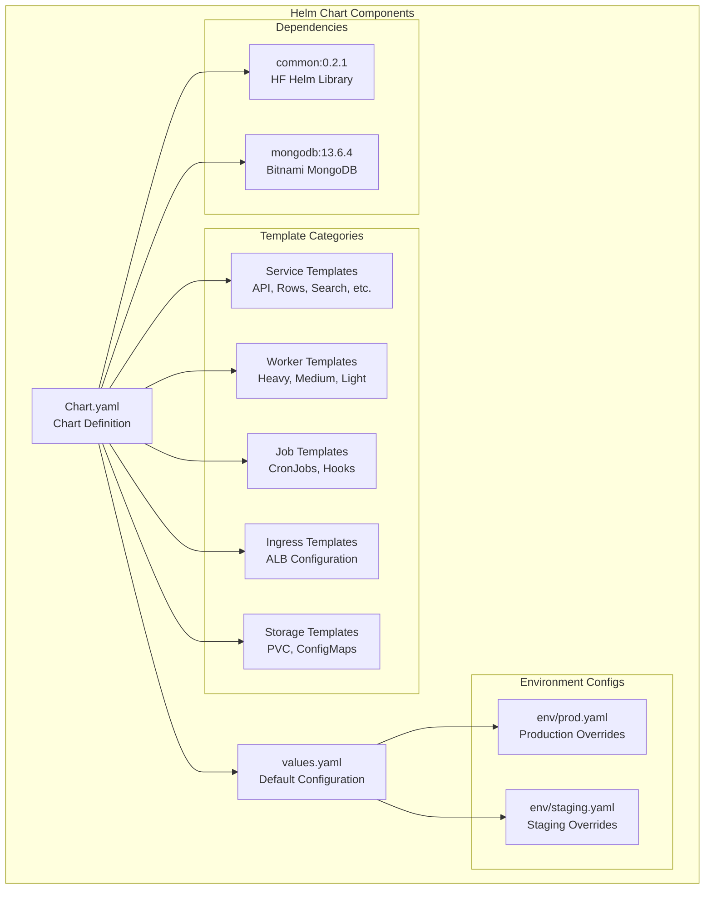
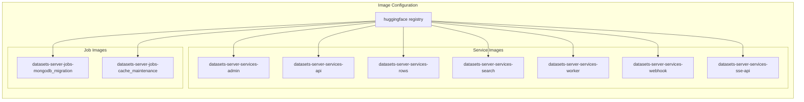
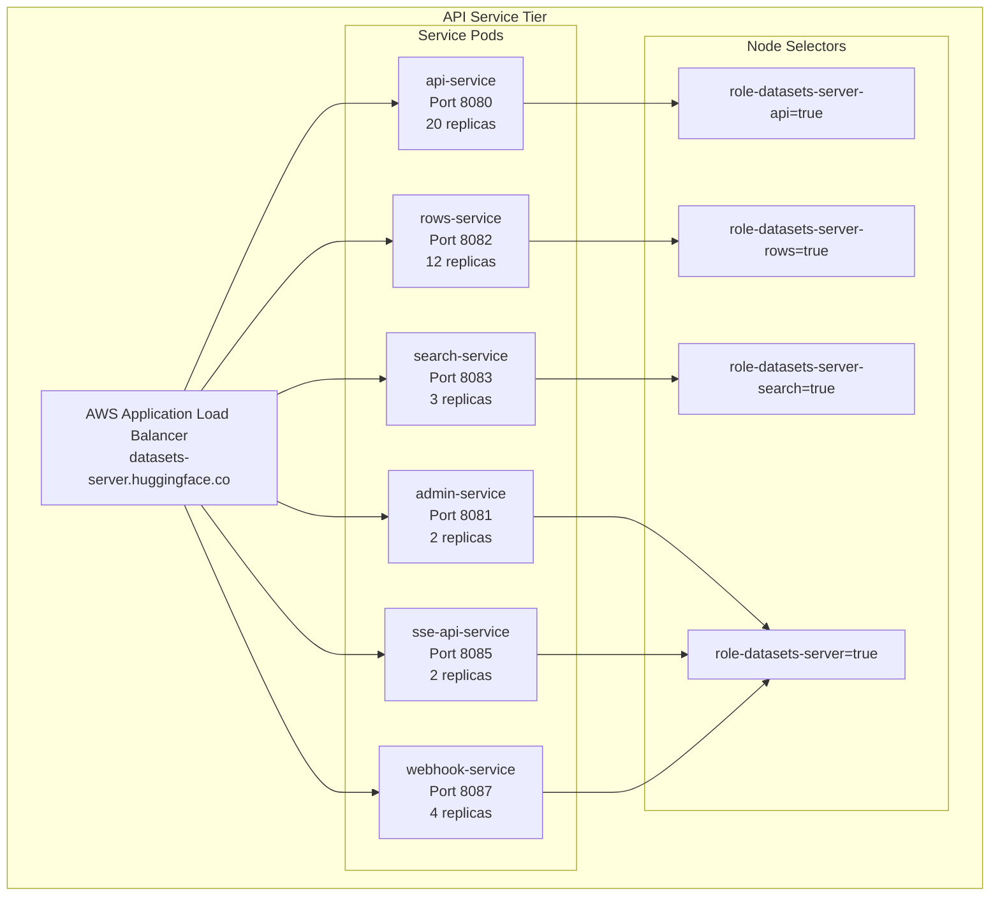
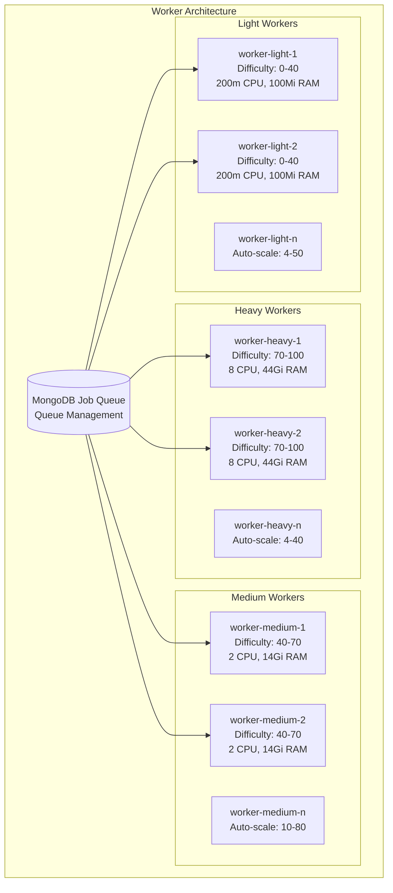
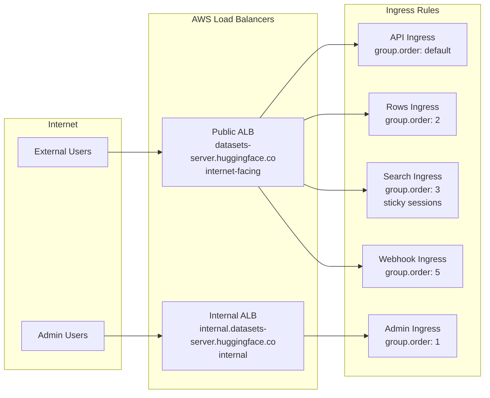
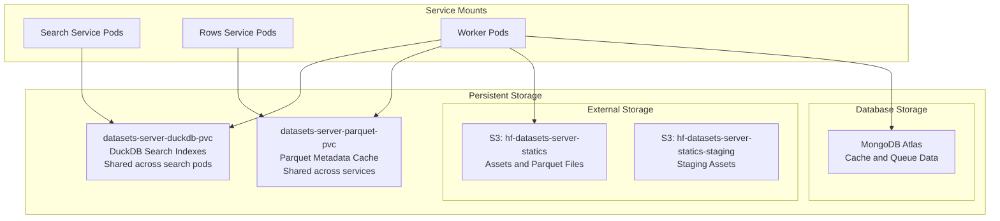
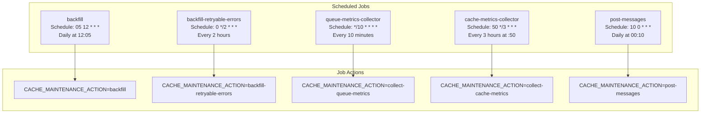
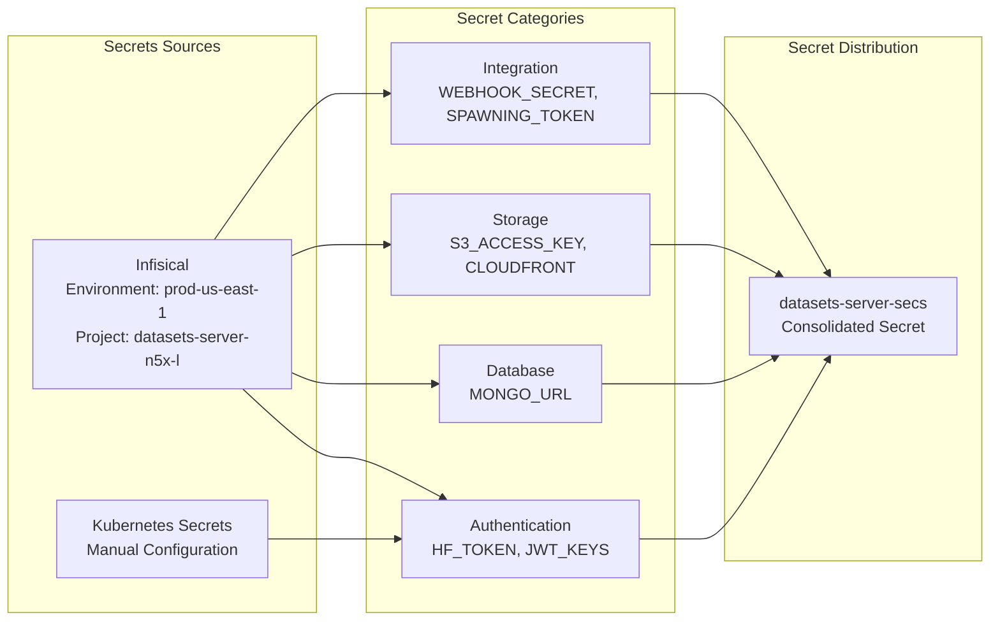
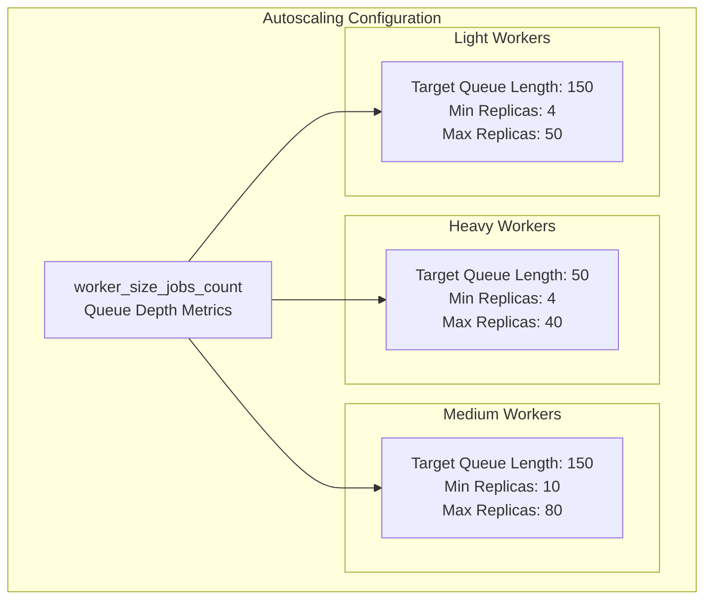
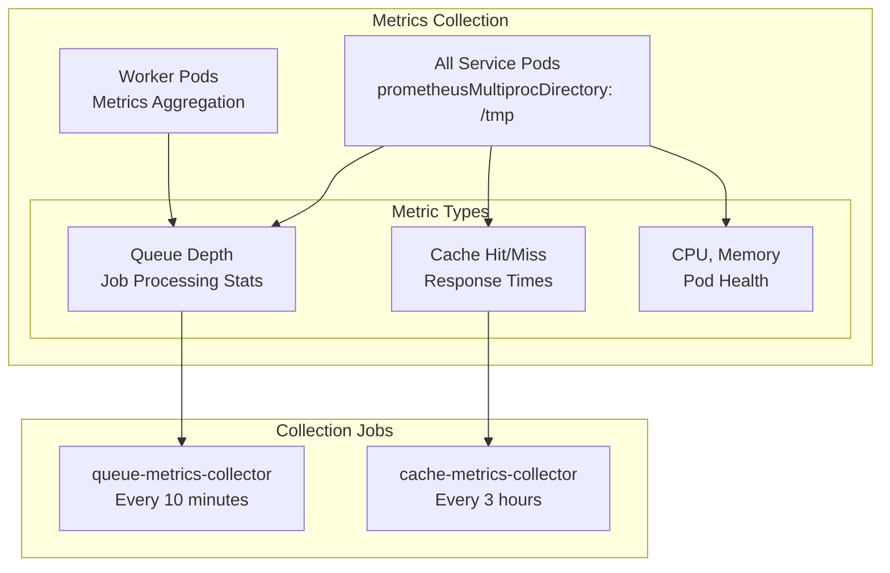

<!-- source: DeepWiki mcp.deepwiki.com · repo huggingface/dataset-viewer · page 7.1 Kubernetes Deployment · fetched 2026-10-26 -->

# Kubernetes Deployment

<details>
<summary>Relevant source files</summary>

The following files were used as context for generating this wiki page:

- [chart/Chart.yaml](chart/Chart.yaml)
- [chart/env/prod.yaml](chart/env/prod.yaml)
- [chart/env/staging.yaml](chart/env/staging.yaml)
- [chart/templates/_common/_helpers.tpl](chart/templates/_common/_helpers.tpl)
- [chart/templates/cron-jobs/backfill/_container.tpl](chart/templates/cron-jobs/backfill/_container.tpl)
- [chart/values.yaml](chart/values.yaml)
- [jobs/cache_maintenance/README.md](jobs/cache_maintenance/README.md)
- [jobs/cache_maintenance/src/cache_maintenance/backfill.py](jobs/cache_maintenance/src/cache_maintenance/backfill.py)
- [jobs/cache_maintenance/src/cache_maintenance/config.py](jobs/cache_maintenance/src/cache_maintenance/config.py)
- [jobs/cache_maintenance/src/cache_maintenance/main.py](jobs/cache_maintenance/src/cache_maintenance/main.py)

</details>


This document covers the Kubernetes deployment architecture and configuration for the dataset-viewer system. It explains the Helm chart structure, environment-specific configurations, service deployments, networking setup, and operational components required to run the system in production and staging environments.

For information about the individual services and their configurations, see [Configuration Management](#7.2). For details about monitoring and administration, see [Administration and Monitoring](#7.3).

## Helm Chart Architecture

The dataset-viewer system is deployed using a comprehensive Helm chart located in the `chart/` directory. The chart defines all microservices, their dependencies, networking, storage, and operational components.

### Chart Structure



The main chart configuration defines the application version and dependencies:

Sources: [chart/Chart.yaml:1-40]()

### Image Management

All container images are centrally managed through the `images` configuration section, with environment-specific overrides for image tags and registries:



Sources: [chart/values.yaml:24-78](), [chart/env/prod.yaml:17-66]()

## Environment Configurations

The system supports multiple deployment environments with specific configurations for production and staging.

### Production Environment

The production environment (`env/prod.yaml`) configures high-availability deployments with:

| Component | Replicas | Resources | Special Config |
|-----------|----------|-----------|----------------|
| API Service | 20 | 4 CPU, 14Gi RAM | Node selector: `role-datasets-server-api` |
| Rows Service | 12 | 4 CPU, 6.5Gi RAM | Node selector: `role-datasets-server-rows` |
| Search Service | 3 | 64 CPU, 250Gi RAM | Sticky sessions enabled |
| Heavy Workers | 4-40 (autoscale) | 8 CPU, 44Gi RAM | Difficulty 70-100 |
| Medium Workers | 10-80 (autoscale) | 2 CPU, 14Gi RAM | Difficulty 40-70 |
| Light Workers | 4-50 (autoscale) | 2 CPU, 1Gi RAM | Difficulty 0-40 |

### Staging Environment  

The staging environment (`env/staging.yaml`) uses reduced resource allocations for cost optimization:

| Component | Replicas | Resources | Domain |
|-----------|----------|-----------|---------|
| All Services | 1 | 1 CPU, 4Gi RAM | `datasets-server.us.dev.moon.huggingface.tech` |
| Workers | 1-5 (autoscale) | 1 CPU, 4Gi RAM | Combined worker pools |

Sources: [chart/env/prod.yaml:274-584](), [chart/env/staging.yaml:177-329]()

## Service Deployment Architecture

### Core API Services



### Worker Deployment Tiers



Sources: [chart/env/prod.yaml:462-550](), [chart/values.yaml:571-597]()

## Networking and Ingress Configuration

### Load Balancer Setup

The system uses AWS Application Load Balancer (ALB) with sophisticated routing rules:



The ALB configuration includes health checks, SSL termination, and target group attributes:

Sources: [chart/env/prod.yaml:254-271](), [chart/env/prod.yaml:294-453]()

### Service Discovery

Each service exposes specific ports through NodePort services:

| Service | Internal Port | NodePort (Prod) | Health Check |
|---------|---------------|-----------------|--------------|
| `admin` | 8080 | 32702 | `/healthcheck` |
| `api` | 8080 | 31370 | `/healthcheck` |
| `rows` | 8080 | 31371 | `/healthcheck` |
| `search` | 8080 | 31372 | `/healthcheck` |
| `sse-api` | 8080 | 31373 | `/healthcheck` |

Sources: [chart/env/prod.yaml:8-15](), [chart/values.yaml:14-22]()

## Storage and Persistence

### Persistent Volume Configuration

The system requires persistent storage for search indexes and parquet metadata:



Storage configuration varies by environment:

- **Production**: `hf-datasets-server-statics/assets` and `hf-datasets-server-statics/cached-assets`
- **Staging**: `hf-datasets-server-statics-staging/assets` and `hf-datasets-server-statics-staging/cached-assets`

Sources: [chart/env/prod.yaml:104-108](), [chart/env/prod.yaml:137-143](), [chart/env/staging.yaml:127-133]()

## Scheduled Jobs and Automation

### CronJob Configuration

The system includes several automated maintenance jobs:



All scheduled jobs use the `datasets-server-jobs-cache_maintenance` image and include resource limits and node selectors.

Sources: [chart/env/prod.yaml:169-253](), [jobs/cache_maintenance/src/cache_maintenance/main.py:19-111]()

### Job Resource Allocation

| Job | CPU Request | Memory Request | CPU Limit | Memory Limit |
|-----|-------------|----------------|-----------|--------------|
| `backfill` | 1 | 16Gi | 2 | 16Gi |
| `backfill-retryable-errors` | 1 | 8Gi | 2 | 8Gi |
| `queue-metrics-collector` | 1 | - | 1 | 512Mi |
| `cache-metrics-collector` | 1 | - | 1 | 512Mi |

Sources: [chart/env/prod.yaml:183-235]()

## Secrets Management

### Infisical Integration

The system uses Infisical for centralized secrets management:



### Secret Configuration

Secrets are configured with `fromSecret: true` for production and staging environments, while development may use direct values:

```yaml
secrets:
  infisical:
    enabled: true
    env: "prod-us-east-1"
  mongoUrl:
    fromSecret: true
  appHfToken:
    fromSecret: true
  s3:
    accessKeyId:
      fromSecret: true
    secretAccessKey:
      fromSecret: true
```

Sources: [chart/env/prod.yaml:67-102](), [chart/values.yaml:92-141](), [chart/templates/_common/_helpers.tpl:218-223]()

## Autoscaling and Resource Management

### Horizontal Pod Autoscaling

Worker pools implement sophisticated autoscaling based on queue depth:



### Node Affinity and Tolerations

Services are deployed with specific node selectors and tolerations to ensure proper resource allocation:

| Service Type | Node Selector | Toleration Key |
|--------------|---------------|----------------|
| API Services | `role-datasets-server-api=true` | `huggingface.co/datasets-server-api` |
| Rows Services | `role-datasets-server-rows=true` | `huggingface.co/datasets-server-rows` |
| Search Services | `role-datasets-server-search=true` | `huggingface.co/datasets-server-search` |
| Workers | `role-datasets-server-worker=true` | `huggingface.co/datasets-server-worker` |
| Light Workers | `role-datasets-server-worker-light=true` | `huggingface.co/datasets-server-worker-light` |

Sources: [chart/env/prod.yaml:470-533](), [chart/env/prod.yaml:323-400]()

## Monitoring Integration

### Prometheus Metrics

All services expose Prometheus metrics through the `/metrics` endpoint with multiprocess support:



The monitoring configuration is enabled in production with `monitoring.enabled: true`.

Sources: [chart/env/prod.yaml:110-111](), [chart/env/prod.yaml:220-235](), [jobs/cache_maintenance/src/cache_maintenance/main.py:76-83]()

---

