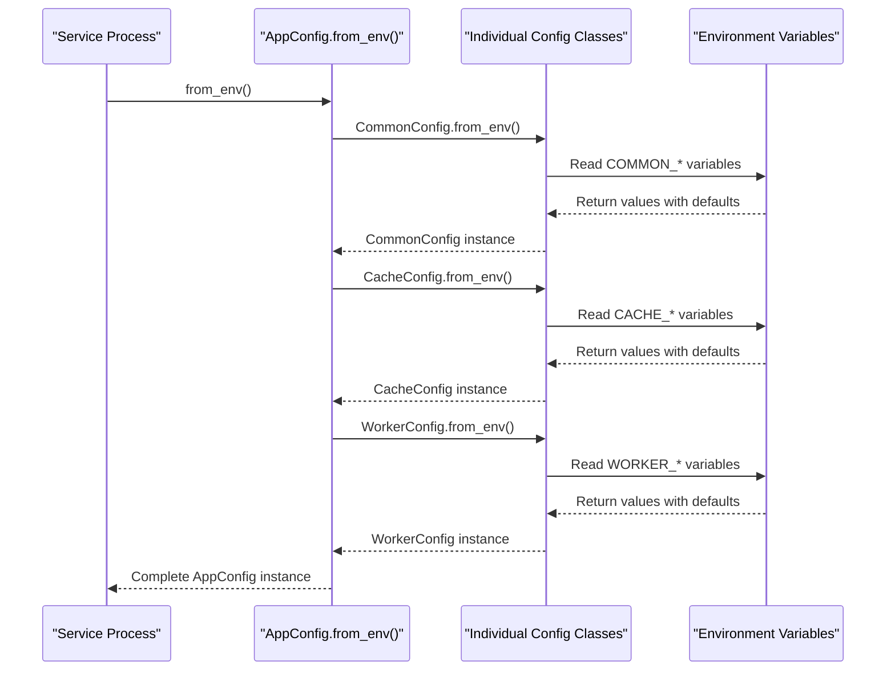
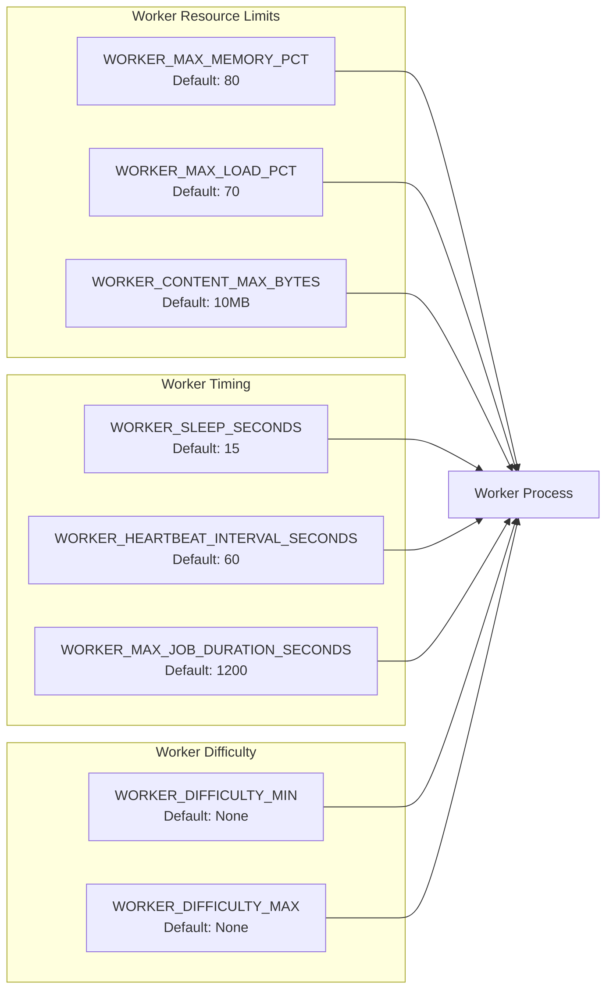
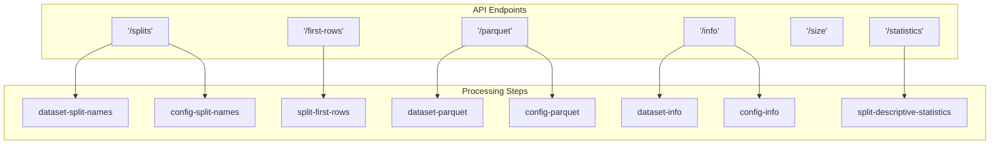

<!-- source: DeepWiki mcp.deepwiki.com · repo huggingface/dataset-viewer · page 7.2 Configuration Management · fetched 2026-10-26 -->

# Configuration Management

<details>
<summary>Relevant source files</summary>

The following files were used as context for generating this wiki page:

- [libs/libcommon/src/libcommon/config.py](libs/libcommon/src/libcommon/config.py)
- [libs/libcommon/src/libcommon/constants.py](libs/libcommon/src/libcommon/constants.py)
- [services/api/src/api/config.py](services/api/src/api/config.py)
- [services/api/tests/routes/test_endpoint.py](services/api/tests/routes/test_endpoint.py)
- [services/worker/README.md](services/worker/README.md)
- [services/worker/src/worker/config.py](services/worker/src/worker/config.py)
- [services/worker/src/worker/job_runner_factory.py](services/worker/src/worker/job_runner_factory.py)
- [services/worker/src/worker/main.py](services/worker/src/worker/main.py)
- [services/worker/src/worker/start_worker_loop.py](services/worker/src/worker/start_worker_loop.py)
- [services/worker/tests/conftest.py](services/worker/tests/conftest.py)
- [services/worker/tests/test_executor.py](services/worker/tests/test_executor.py)
- [services/worker/tests/test_job_runner_factory.py](services/worker/tests/test_job_runner_factory.py)

</details>


This document describes the configuration management system used across all services in the dataset-viewer architecture. The system provides a centralized, environment variable-based approach to configure services, with type-safe dataclasses and hierarchical organization.

For information about deployment configuration and Kubernetes settings, see [Kubernetes Deployment](#7.1). For monitoring and administrative configuration, see [Administration and Monitoring](#7.3).

## Configuration Architecture

The configuration system is built around a hierarchical structure of dataclasses that load settings from environment variables using the `environs` library. Each configuration class follows a consistent pattern with default values, environment variable prefixes, and `from_env()` factory methods.

```mermaid
graph TB
    subgraph "Configuration Classes"
        CommonConfig["CommonConfig<br/>COMMON_ prefix"]
        LogConfig["LogConfig<br/>LOG_ prefix"]
        CacheConfig["CacheConfig<br/>CACHE_ prefix"]
        QueueConfig["QueueConfig<br/>QUEUE_ prefix"]
        AssetsConfig["AssetsConfig<br/>ASSETS_ prefix"]
        S3Config["S3Config<br/>S3_ prefix"]
        CloudFrontConfig["CloudFrontConfig<br/>CLOUDFRONT_ prefix"]
    end
    
    subgraph "Service Configurations"
        APIAppConfig["api.config.AppConfig"]
        WorkerAppConfig["worker.config.AppConfig"]
        RowsAppConfig["rows.config.AppConfig"]
        SearchAppConfig["search.config.AppConfig"]
    end
    
    subgraph "Specialized Configs"
        WorkerConfig["WorkerConfig<br/>WORKER_ prefix"]
        FirstRowsConfig["FirstRowsConfig<br/>FIRST_ROWS_ prefix"]
        ParquetAndInfoConfig["ParquetAndInfoConfig<br/>PARQUET_AND_INFO_ prefix"]
        DescriptiveStatisticsConfig["DescriptiveStatisticsConfig<br/>DESCRIPTIVE_STATISTICS_ prefix"]
    end
    
    CommonConfig --> APIAppConfig
    CommonConfig --> WorkerAppConfig
    LogConfig --> APIAppConfig
    LogConfig --> WorkerAppConfig
    CacheConfig --> APIAppConfig
    CacheConfig --> WorkerAppConfig
    QueueConfig --> APIAppConfig
    QueueConfig --> WorkerAppConfig
    AssetsConfig --> APIAppConfig
    AssetsConfig --> WorkerAppConfig
    S3Config --> APIAppConfig
    S3Config --> WorkerAppConfig
    CloudFrontConfig --> APIAppConfig
    
    WorkerConfig --> WorkerAppConfig
    FirstRowsConfig --> WorkerAppConfig
    ParquetAndInfoConfig --> WorkerAppConfig
    DescriptiveStatisticsConfig --> WorkerAppConfig
```



**Configuration Class Hierarchy**

Sources: [libs/libcommon/src/libcommon/config.py:1-237](), [services/worker/src/worker/config.py:1-361](), [services/api/src/api/config.py:1-104]()

## Environment Variable Patterns

All configuration classes follow a consistent naming pattern where environment variables are prefixed by the configuration scope, followed by the setting name in uppercase. The system uses the `environs` library with prefixed environment contexts.

| Prefix | Configuration Class | Purpose |
|--------|-------------------|---------|
| `COMMON_` | `CommonConfig` | General application settings |
| `LOG_` | `LogConfig` | Logging configuration |
| `CACHE_` | `CacheConfig` | MongoDB cache database settings |
| `QUEUE_` | `QueueConfig` | MongoDB queue database settings |
| `ASSETS_` | `AssetsConfig` | Asset storage configuration |
| `CACHED_ASSETS_` | `CachedAssetsConfig` | Cached asset storage settings |
| `S3_` | `S3Config` | S3 storage credentials and settings |
| `CLOUDFRONT_` | `CloudFrontConfig` | CloudFront CDN configuration |
| `WORKER_` | `WorkerConfig` | Worker process behavior |
| `WORKER_UVICORN_` | `UvicornConfig` | Uvicorn server settings |
| `FIRST_ROWS_` | `FirstRowsConfig` | First rows processing limits |
| `PARQUET_AND_INFO_` | `ParquetAndInfoConfig` | Parquet conversion settings |
| `DESCRIPTIVE_STATISTICS_` | `DescriptiveStatisticsConfig` | Statistics computation settings |

Sources: [libs/libcommon/src/libcommon/config.py:28-38](), [services/worker/src/worker/config.py:34-39](), [services/worker/src/worker/config.py:78-103]()

## Configuration Loading Process

Each service loads its configuration through a centralized `AppConfig` class that composes multiple configuration objects. The loading process follows a consistent pattern across all services.



**Configuration Loading Sequence**

Sources: [services/worker/src/worker/config.py:338-361](), [services/worker/src/worker/main.py:27-27](), [services/worker/src/worker/start_worker_loop.py:20-20]()

## Core Configuration Classes

### Common Configuration

The `CommonConfig` class provides shared settings used across all services, including the Hugging Face Hub endpoint, authentication tokens, and blocked datasets list.

```python
@dataclass(frozen=True)
class CommonConfig:
    blocked_datasets: list[str] = field(default_factory=COMMON_BLOCKED_DATASETS.copy)
    hf_endpoint: str = COMMON_HF_ENDPOINT  # "https://huggingface.co"
    hf_token: Optional[str] = COMMON_HF_TOKEN
```

Key environment variables:
- `COMMON_HF_ENDPOINT`: Hugging Face Hub URL
- `COMMON_HF_TOKEN`: Authentication token for Hub access
- `COMMON_BLOCKED_DATASETS`: Comma-separated list of blocked datasets

Sources: [libs/libcommon/src/libcommon/config.py:152-167]()

### Storage Configuration

Storage configuration is split across multiple classes handling different storage backends and purposes.

**Assets Storage (`AssetsConfig`)**:
- `ASSETS_BASE_URL`: Public URL for serving assets
- `ASSETS_STORAGE_PROTOCOL`: Storage backend (`file` or `s3`)
- `ASSETS_STORAGE_ROOT`: Root directory or S3 bucket path

**S3 Configuration (`S3Config`)**:
- `S3_ACCESS_KEY_ID`: AWS access key
- `S3_SECRET_ACCESS_KEY`: AWS secret key
- `S3_REGION_NAME`: AWS region

**CloudFront Configuration (`CloudFrontConfig`)**:
- `CLOUDFRONT_EXPIRATION_SECONDS`: Signed URL expiration time
- `CLOUDFRONT_KEY_PAIR_ID`: CloudFront key pair ID
- `CLOUDFRONT_PRIVATE_KEY`: CloudFront private key

Sources: [libs/libcommon/src/libcommon/config.py:20-111]()

### Database Configuration

MongoDB is used for both caching and job queue management, with separate database configurations.

**Cache Database (`CacheConfig`)**:
- `CACHE_MONGO_DATABASE`: Database name for cached responses
- `CACHE_MONGO_URL`: MongoDB connection string

**Queue Database (`QueueConfig`)**:
- `QUEUE_MONGO_DATABASE`: Database name for job queue
- `QUEUE_MONGO_URL`: MongoDB connection string

Sources: [libs/libcommon/src/libcommon/config.py:185-221]()

## Worker-Specific Configuration

The worker service has extensive configuration options controlling job processing behavior, resource limits, and specialized processing settings.

### Worker Process Configuration

The `WorkerConfig` class controls worker behavior including resource limits, job timing, and health monitoring.



**Worker Resource and Timing Configuration**

Key worker configuration parameters:
- `WORKER_MAX_MEMORY_PCT`: Maximum memory usage threshold (80%)
- `WORKER_MAX_LOAD_PCT`: Maximum CPU load threshold (70%)
- `WORKER_SLEEP_SECONDS`: Wait time between job checks (15s)
- `WORKER_HEARTBEAT_INTERVAL_SECONDS`: Heartbeat frequency (60s)
- `WORKER_MAX_JOB_DURATION_SECONDS`: Maximum job runtime (20 minutes)

Sources: [services/worker/src/worker/config.py:42-103]()

### Processing Configuration

Specialized processing configurations control specific job runners and their behavior limits.

**First Rows Processing (`FirstRowsConfig`)**:
- `FIRST_ROWS_MAX_BYTES`: Maximum response size (1MB)
- `FIRST_ROWS_MIN_NUMBER`: Minimum rows to fetch (10)
- `FIRST_ROWS_COLUMNS_MAX_NUMBER`: Maximum columns allowed (1,000)

**Parquet Conversion (`ParquetAndInfoConfig`)**:
- `PARQUET_AND_INFO_MAX_DATASET_SIZE_BYTES`: Maximum dataset size for conversion (100MB)
- `PARQUET_AND_INFO_TARGET_REVISION`: Git branch for parquet files (`refs/convert/parquet`)
- `PARQUET_AND_INFO_COMMIT_MESSAGE`: Git commit message for parquet uploads

**Descriptive Statistics (`DescriptiveStatisticsConfig`)**:
- `DESCRIPTIVE_STATISTICS_MAX_SPLIT_SIZE_BYTES`: Maximum split size for statistics (100MB)
- `DESCRIPTIVE_STATISTICS_CACHE_DIRECTORY`: Local cache directory for processing

Sources: [services/worker/src/worker/config.py:121-314]()

## API Service Configuration

The API service configuration focuses on endpoint routing and request handling, with a specialized `EndpointConfig` class that maps API endpoints to processing steps.



**API Endpoint to Processing Step Mapping**

The `EndpointConfig` class defines the relationship between API endpoints and the processing steps that generate their responses. Each endpoint can map to different processing steps based on the input type (dataset, config, or split).

Sources: [services/api/src/api/config.py:54-98](), [services/api/tests/routes/test_endpoint.py:11-77]()

## System Constants

The constants module defines system-wide values used across all services, including collection names, timeouts, and processing limits.

### MongoDB Collections

```python
CACHE_COLLECTION_RESPONSES = "cachedResponsesBlue"
QUEUE_COLLECTION_JOBS = "jobsBlue"
QUEUE_COLLECTION_PAST_JOBS = "pastJobs"
QUEUE_COLLECTION_LOCKS = "locks"
QUEUE_COLLECTION_DATASET_BLOCKAGES = "datasetBlockages"
```

### Processing Limits

```python
MAX_NUM_ROWS_PER_PAGE = 100
MAX_COLUMN_NAME_LENGTH = 500
CROISSANT_MAX_CONFIGS = 100
LOADING_METHODS_MAX_CONFIGS = 100
```

### Timeout Values

```python
QUEUE_TTL_SECONDS = 600  # 10 minutes
LOCK_TTL_SECONDS_NO_OWNER = 600  # 10 minutes
LOCK_TTL_SECONDS_TO_START_JOB = 600  # 10 minutes
LOCK_TTL_SECONDS_TO_WRITE_ON_GIT_BRANCH = 3600  # 1 hour
```

Sources: [libs/libcommon/src/libcommon/constants.py:4-109]()

## Configuration Usage Patterns

Services instantiate their configuration during startup and pass it to components that need access to settings. The configuration objects are immutable (frozen dataclasses) to prevent accidental modification during runtime.

### Worker Service Configuration Usage

```python
# Main worker process
app_config = AppConfig.from_env()
job_runner_factory = JobRunnerFactory(
    app_config=app_config,
    hf_datasets_cache=libraries_resource.hf_datasets_cache,
    parquet_metadata_directory=parquet_metadata_directory,
    statistics_cache_directory=statistics_cache_directory,
    storage_client=storage_client,
)
```

### Job Runner Factory Configuration

The `JobRunnerFactory` uses the application configuration to instantiate appropriate job runners based on job types. Each job runner receives the full `AppConfig` instance to access the settings it needs.

```python
def _create_job_runner(self, job_info: JobInfo) -> JobRunner:
    job_type = job_info["type"]
    if job_type == DatasetConfigNamesJobRunner.get_job_type():
        return DatasetConfigNamesJobRunner(
            job_info=job_info,
            app_config=self.app_config,
            hf_datasets_cache=self.hf_datasets_cache,
        )
```

Sources: [services/worker/src/worker/main.py:61-67](), [services/worker/src/worker/job_runner_factory.py:79-86](), [services/worker/src/worker/start_worker_loop.py:60-66]()

---

