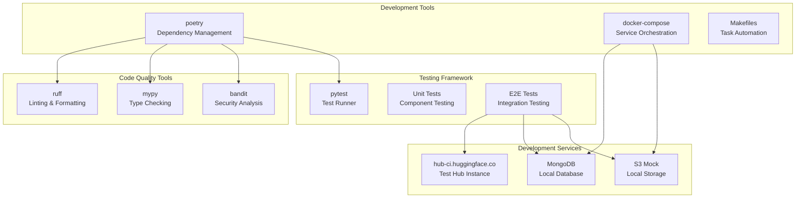
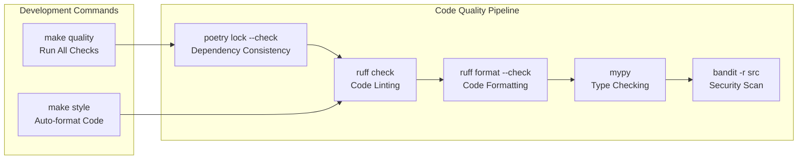
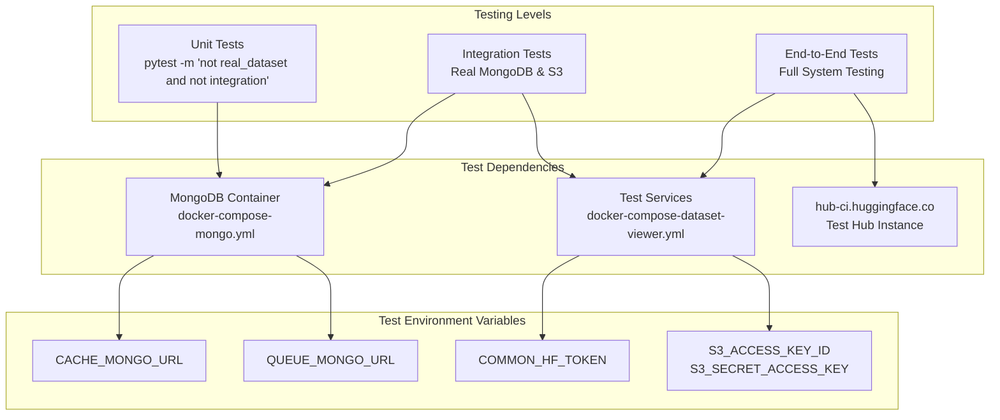
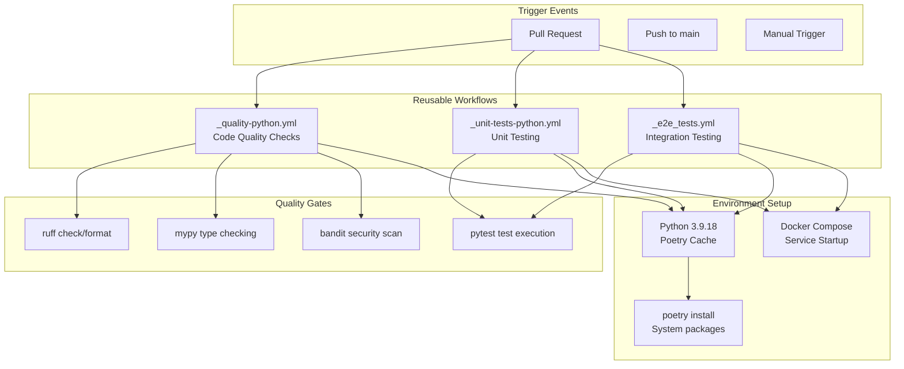
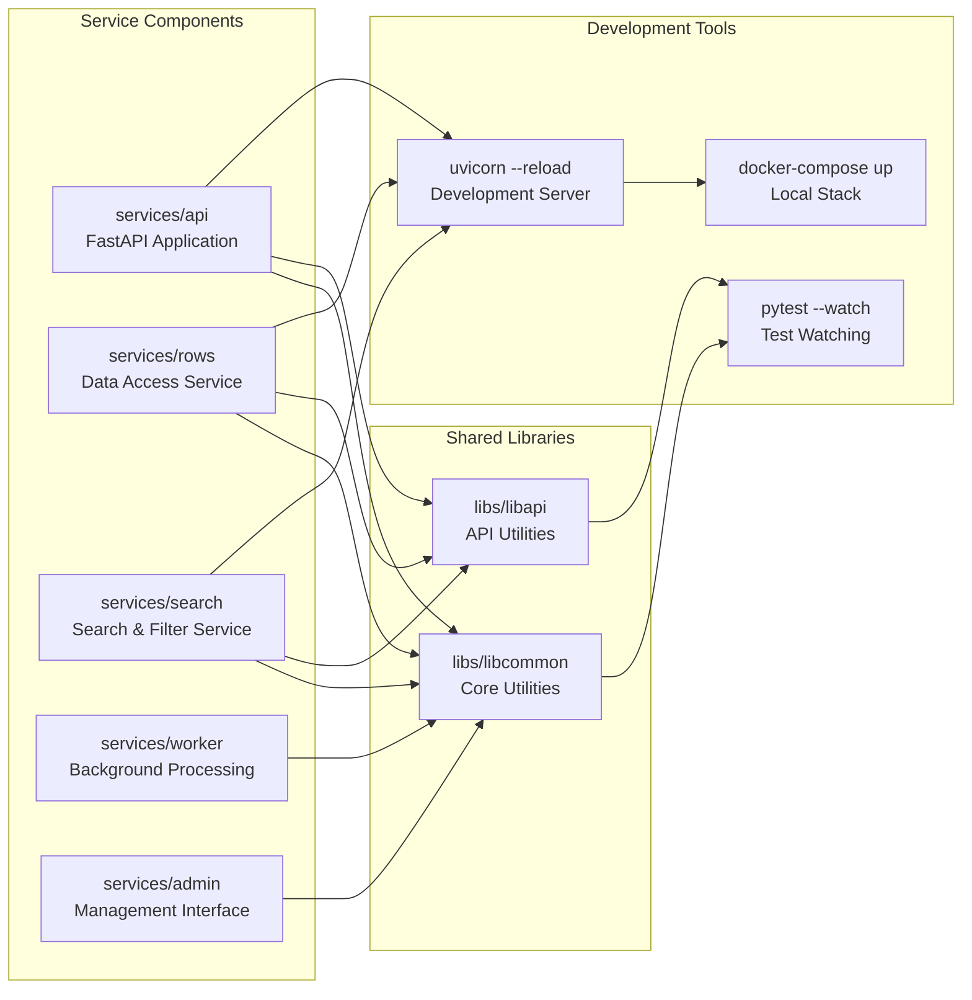
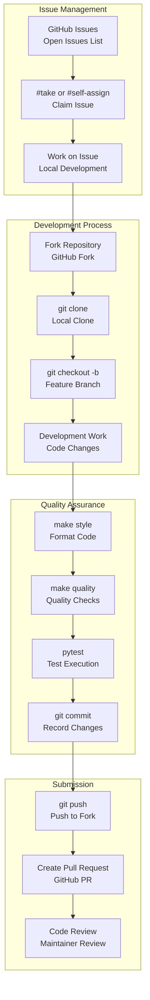

<!-- source: DeepWiki mcp.deepwiki.com · repo huggingface/dataset-viewer · page 8 Development · fetched 2026-10-26 -->

# Development

Relevant source files

The following files were used as context for generating this wiki page:

- [.github/workflows/_e2e_tests.yml](.github/workflows/_e2e_tests.yml)
- [.github/workflows/_quality-python.yml](.github/workflows/_quality-python.yml)
- [.github/workflows/_unit-tests-python.yml](.github/workflows/_unit-tests-python.yml)
- [.github/workflows/openapi-spec.yml](.github/workflows/openapi-spec.yml)
- [CONTRIBUTING.md](CONTRIBUTING.md)
- [e2e/Makefile](e2e/Makefile)
- [tools/Python.mk](tools/Python.mk)

This page provides information for developers working on the dataset-viewer system. It covers development environment setup, code quality standards, testing approaches, and the contribution workflow. For deployment and operational procedures, see [Deployment and Operations](#7). For specific setup instructions, see [Development Setup](#8.1).

## Development Environment Overview

The dataset-viewer system uses a modern Python development stack with Poetry for dependency management and Docker Compose for local service orchestration. The development environment supports both individual component development and full system integration testing.

Sources: [tools/Python.mk:1-50](), [e2e/Makefile:1-59](), [.github/workflows/_quality-python.yml:1-60]()

## Code Quality Standards

The project enforces strict code quality standards through automated tooling integrated into the CI/CD pipeline and development workflow.

### Quality Tools Configuration

| Tool | Purpose | Configuration |
|------|---------|---------------|
| `ruff` | Linting and formatting | Checks `src/` and `tests/` directories |
| `mypy` | Static type checking | Type safety validation |
| `bandit` | Security analysis | Vulnerability scanning |
| `poetry` | Dependency management | Lock file consistency |

### Quality Check Process

Sources: [.github/workflows/_quality-python.yml:36-56](), [tools/Python.mk:22-46]()

## Testing Strategy

The system implements a comprehensive testing strategy with multiple levels of testing to ensure reliability and correctness.

### Test Architecture

Sources: [.github/workflows/_unit-tests-python.yml:50-62](), [.github/workflows/_e2e_tests.yml:70-117]()

### Test Execution Environment

The testing framework uses specific environment configurations to ensure consistent and isolated test execution:

**Unit Test Configuration:**
- MongoDB URL: `mongodb://localhost:27017`
- Asset storage: `/tmp/assets` and `/tmp/cached-assets`
- Excludes real dataset tests and integration tests

**E2E Test Configuration:**
- Uses `hub-ci.huggingface.co` as test Hub instance
- Hardcoded test tokens for CI environment
- Full service stack with reverse proxy on port 8000
- S3 integration with test buckets

Sources: [.github/workflows/_unit-tests-python.yml:50-62](), [.github/workflows/_e2e_tests.yml:25-70]()

## CI/CD Pipeline

The continuous integration and deployment pipeline automates code quality checks, testing, and deployment processes across all components.

### Workflow Architecture

Sources: [.github/workflows/_quality-python.yml:4-60](), [.github/workflows/_unit-tests-python.yml:4-63](), [.github/workflows/_e2e_tests.yml:4-118]()

## Development Workflow

The standard development workflow follows established patterns for code quality, testing, and contribution management.

### Development Commands

The project provides standardized Make targets for common development tasks:

| Command | Purpose | Implementation |
|---------|---------|----------------|
| `make install` | Install dependencies | `poetry install` |
| `make quality` | Run all quality checks | Ruff, mypy, bandit |
| `make style` | Auto-format code | `ruff check --fix`, `ruff format` |
| `make test` | Run tests | `pytest` execution |
| `make lock` | Update dependencies | `poetry lock` and install |

### Service Development

Sources: [tools/Python.mk:5-46](), [e2e/Makefile:30-54]()

## Contributing Process

The project follows a structured contribution process with clear guidelines for code quality, testing, and review procedures.

### Contribution Workflow

Sources: [CONTRIBUTING.md:15-82]()

The contribution process emphasizes code quality through automated tooling and follows HuggingFace docstring guidelines. All contributions must pass the CI/CD pipeline quality gates including linting, type checking, security analysis, and comprehensive testing before merge approval.

Sources: [CONTRIBUTING.md:84-92]()

---

