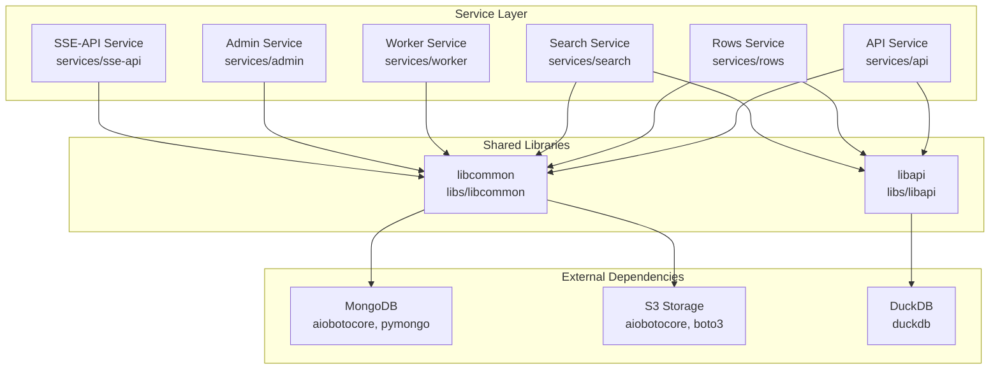
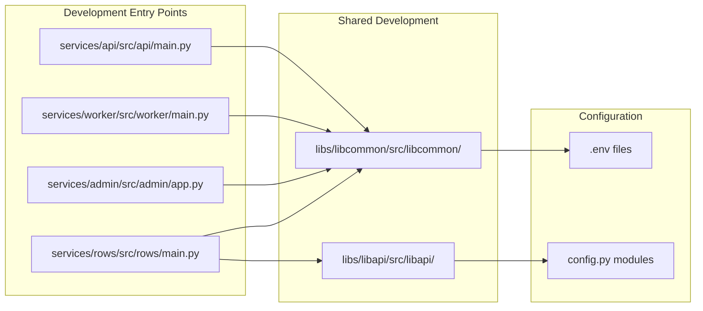

<!-- source: DeepWiki mcp.deepwiki.com · repo huggingface/dataset-viewer · page 8.1 Development Setup · fetched 2026-10-26 -->

# Development Setup

<details>
<summary>Relevant source files</summary>

The following files were used as context for generating this wiki page:

- [CONTRIBUTING.md](CONTRIBUTING.md)
- [front/admin_ui/poetry.lock](front/admin_ui/poetry.lock)
- [jobs/cache_maintenance/poetry.lock](jobs/cache_maintenance/poetry.lock)
- [jobs/mongodb_migration/poetry.lock](jobs/mongodb_migration/poetry.lock)
- [libs/libapi/poetry.lock](libs/libapi/poetry.lock)
- [libs/libcommon/poetry.lock](libs/libcommon/poetry.lock)
- [services/admin/poetry.lock](services/admin/poetry.lock)
- [services/api/poetry.lock](services/api/poetry.lock)
- [services/rows/poetry.lock](services/rows/poetry.lock)
- [services/search/poetry.lock](services/search/poetry.lock)
- [services/sse-api/poetry.lock](services/sse-api/poetry.lock)
- [services/worker/poetry.lock](services/worker/poetry.lock)

</details>


This guide covers setting up a local development environment for the dataset-viewer system. It includes prerequisites, dependency installation, service configuration, and common development workflows for contributors working on the codebase.

For deployment and production configuration, see [Kubernetes Deployment](#7.1). For CI/CD pipeline information, see [CI/CD Pipeline](#8.2).

## Prerequisites

The dataset-viewer system requires several tools and services for local development:

- **Python 3.8+** - All services are Python-based
- **Poetry** - Dependency management for all services and libraries
- **MongoDB** - Required for caching and job queuing
- **DuckDB** - Used for search indexing
- **AWS CLI** - For S3 storage integration (can use LocalStack for local development)
- **Git** - Version control

**Sources:** [services/worker/poetry.lock:1-20](), [services/api/poetry.lock:1-20](), [libs/libcommon/poetry.lock:1-20]()

## Development Architecture Overview

The following diagram shows the service structure and their corresponding code locations:



**Sources:** [services/worker/poetry.lock:1-500](), [services/api/poetry.lock:1-500](), [libs/libcommon/poetry.lock:1-500](), [libs/libapi/poetry.lock:1-500]()

## Dependency Management Structure

Each service and library uses Poetry for dependency management with the following structure:

| Component | Location | Key Dependencies |
|-----------|----------|------------------|
| `libcommon` | `libs/libcommon/` | `aiobotocore`, `pymongo`, `datasets` |
| `libapi` | `libs/libapi/` | `duckdb`, `fastapi`, `starlette` |
| API Service | `services/api/` | `libcommon`, `libapi`, `uvicorn` |
| Worker Service | `services/worker/` | `libcommon`, `datasets`, `transformers` |
| Rows Service | `services/rows/` | `libcommon`, `libapi`, `polars` |
| Search Service | `services/search/` | `libcommon`, `libapi`, `duckdb` |
| Admin Service | `services/admin/` | `libcommon`, `gradio` |
| SSE-API Service | `services/sse-api/` | `libcommon`, `libapi` |

**Sources:** [services/worker/poetry.lock:1-100](), [services/api/poetry.lock:1-100](), [libs/libcommon/poetry.lock:1-100](), [libs/libapi/poetry.lock:1-100]()

## Local Development Setup

### 1. Clone and Initialize Repository

```bash
git clone https://github.com/huggingface/dataset-viewer.git
cd dataset-viewer
```

### 2. Install Poetry Dependencies

Install dependencies for shared libraries first, then services:

```bash
# Install shared libraries
cd libs/libcommon && poetry install && cd ../..
cd libs/libapi && poetry install && cd ../..

# Install services
cd services/api && poetry install && cd ../..
cd services/worker && poetry install && cd ../..
cd services/rows && poetry install && cd ../..
cd services/search && poetry install && cd ../..
cd services/admin && poetry install && cd ../..
cd services/sse-api && poetry install && cd ../..
```

### 3. External Service Dependencies

Set up required external services for local development:

```bash
# Start MongoDB (example using Docker)
docker run -d -p 27017:27017 --name datasets-mongo mongo:latest

# For S3 compatibility, use LocalStack
docker run -d -p 4566:4566 --name localstack localstack/localstack
```

**Sources:** [services/worker/poetry.lock:14-18](), [services/api/poetry.lock:14-18](), [libs/libcommon/poetry.lock:14-18]()

## Development Workflow

### Service Development Structure

The following diagram shows the development workflow and key entry points:



### Running Services Locally

Each service can be run independently for development:

```bash
# Run API service
cd services/api
poetry run uvicorn api.main:app --reload --port 8080

# Run Worker service
cd services/worker
poetry run python -m worker.main

# Run Admin service
cd services/admin
poetry run python -m admin.app

# Run Rows service
cd services/rows
poetry run uvicorn rows.main:app --reload --port 8082
```

### Environment Configuration

Each service requires environment variables for configuration. Create `.env` files in each service directory with required settings:

```bash
# Example .env for services
MONGODB_URL=mongodb://localhost:27017
S3_ENDPOINT_URL=http://localhost:4566
AWS_ACCESS_KEY_ID=test
AWS_SECRET_ACCESS_KEY=test
```

**Sources:** [services/worker/poetry.lock:334-350](), [services/api/poetry.lock:334-350]()

## Common Development Tasks

### Running Tests

```bash
# Run tests for a specific service
cd services/api
poetry run pytest

# Run tests for shared libraries
cd libs/libcommon
poetry run pytest
```

### Code Quality Tools

The project uses several code quality tools configured in the Poetry dependencies:

```bash
# Type checking
poetry run mypy src/

# Code formatting
poetry run black src/

# Linting
poetry run ruff src/

# Security scanning
poetry run bandit -r src/
```

### Dependency Updates

Update dependencies across all services:

```bash
# Update shared libraries first
cd libs/libcommon && poetry update && cd ../..
cd libs/libapi && poetry update && cd ../..

# Then update services
for service in api worker rows search admin sse-api; do
    cd services/$service && poetry update && cd ../..
done
```

**Sources:** [services/worker/poetry.lock:254-275](), [services/api/poetry.lock:232-253](), [CONTRIBUTING.md:1-50]()

## Troubleshooting Common Issues

### Dependency Conflicts

If you encounter dependency conflicts between services and shared libraries:

1. Ensure shared libraries are installed first
2. Check Poetry lock files for version mismatches
3. Use `poetry show --tree` to diagnose dependency issues

### Service Communication

For local development, services communicate via HTTP and shared MongoDB. Ensure:

1. MongoDB is running and accessible
2. Service ports don't conflict (API: 8080, Rows: 8082, etc.)
3. Environment variables are properly configured

**Sources:** [services/worker/poetry.lock:1-50](), [services/api/poetry.lock:1-50](), [libs/libcommon/poetry.lock:1-50]()

---

