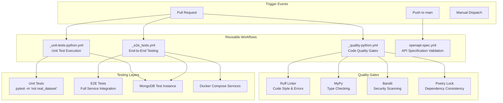
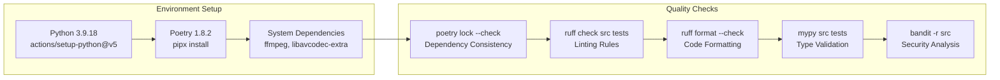
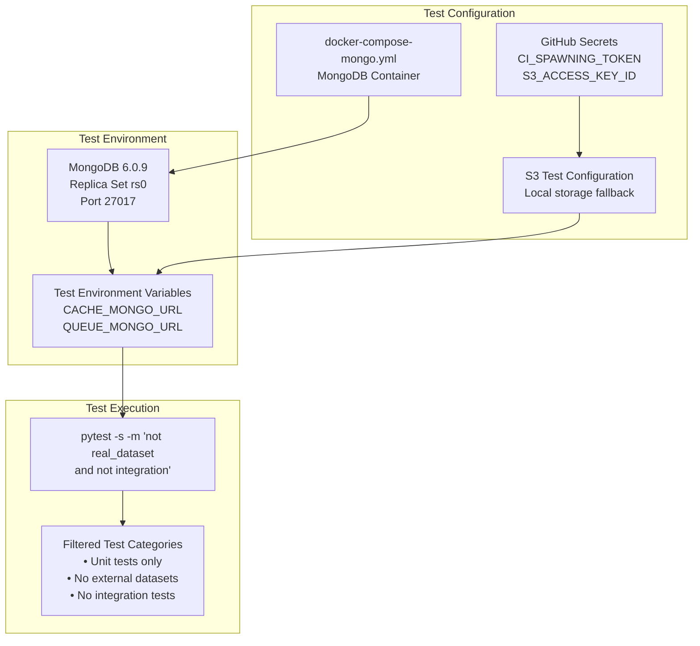
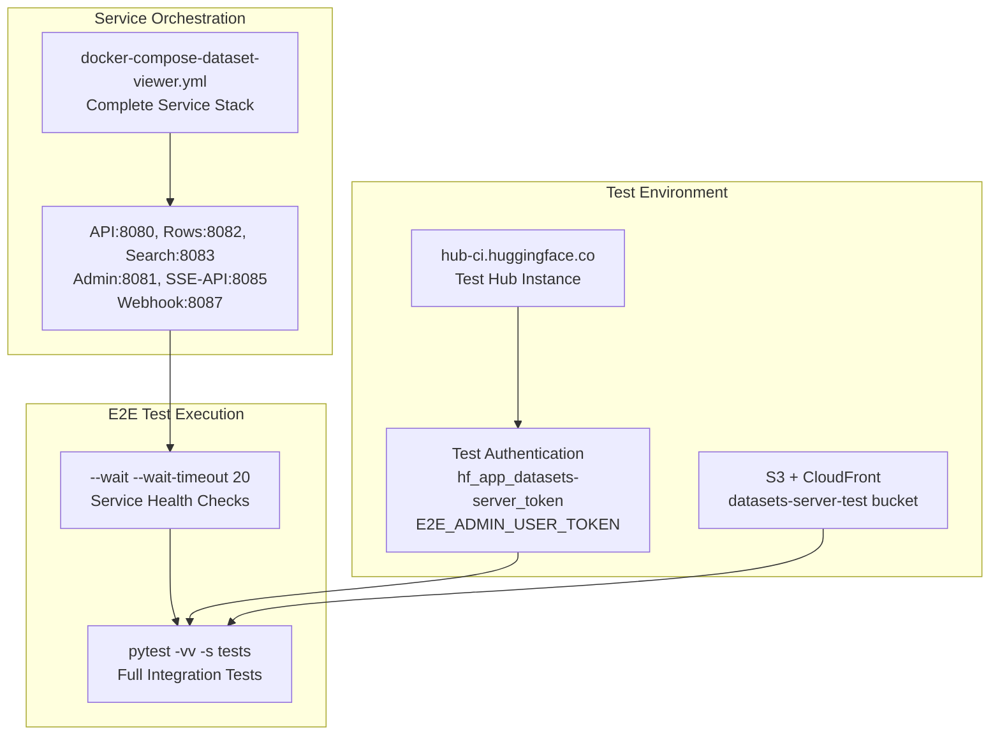
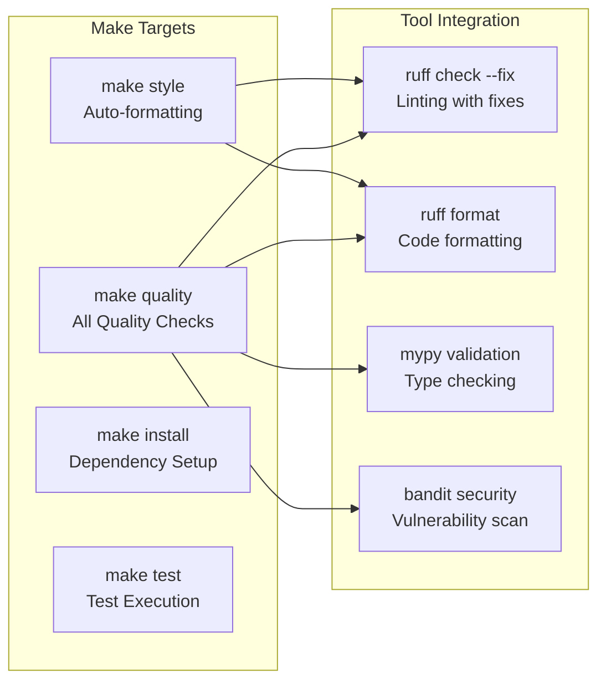
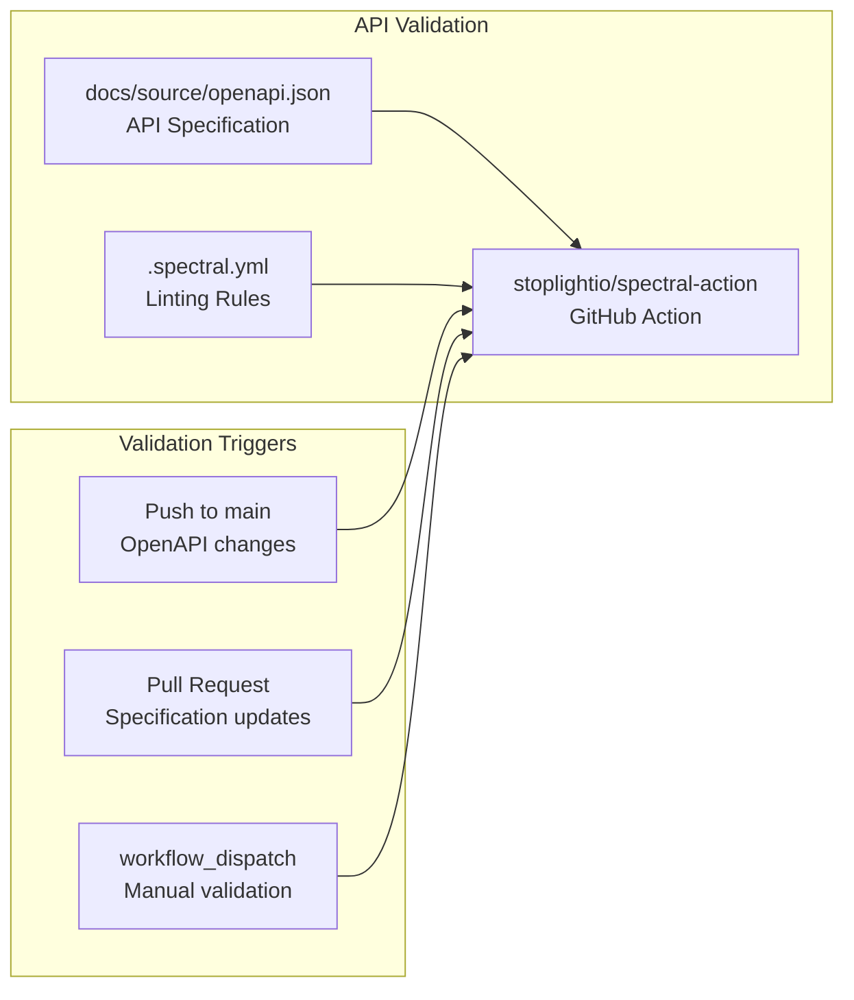

<!-- source: DeepWiki mcp.deepwiki.com · repo huggingface/dataset-viewer · page 8.2 CI/CD Pipeline · fetched 2026-10-26 -->

# CI/CD Pipeline

Relevant source files

The following files were used as context for generating this wiki page:

- [.github/workflows/_e2e_tests.yml](.github/workflows/_e2e_tests.yml)
- [.github/workflows/_quality-python.yml](.github/workflows/_quality-python.yml)
- [.github/workflows/_unit-tests-python.yml](.github/workflows/_unit-tests-python.yml)
- [.github/workflows/openapi-spec.yml](.github/workflows/openapi-spec.yml)
- [e2e/Makefile](e2e/Makefile)
- [tools/Python.mk](tools/Python.mk)

This document describes the continuous integration and continuous deployment (CI/CD) pipeline for the dataset-viewer system. It covers the automated workflows, quality gates, testing strategies, and build processes that ensure code quality and reliable deployments.

For information about local development setup, see [Development Setup](#8.1). For deployment configuration and infrastructure management, see [Kubernetes Deployment](#7.1).

## Pipeline Overview

The CI/CD pipeline is implemented using GitHub Actions workflows that orchestrate code quality checks, testing, and deployment processes across all microservices in the dataset-viewer system.

### Workflow Architecture

Sources: [.github/workflows/_quality-python.yml](), [.github/workflows/_unit-tests-python.yml](), [.github/workflows/_e2e_tests.yml](), [.github/workflows/openapi-spec.yml]()

## Quality Gates

The pipeline enforces multiple quality gates to ensure code meets standards before integration.

### Code Quality Workflow

The `_quality-python.yml` workflow implements comprehensive quality checks that run on every pull request and push.

The workflow uses standardized tool versions and configurations:
- **Python**: Version 3.9.18 with poetry cache enabled
- **Ruff**: Handles both linting and formatting with ARG rule ignored for tests
- **MyPy**: Type checking for both source and test directories
- **Bandit**: Security vulnerability scanning for source code only

Sources: [.github/workflows/_quality-python.yml:14-56](), [tools/Python.mk:22-49]()

## Testing Strategy

The pipeline implements a multi-layered testing approach with unit tests and end-to-end integration tests.

### Unit Testing Pipeline

Unit tests run with isolated dependencies and mock external services, using markers to exclude tests requiring real datasets or integration components.

Sources: [.github/workflows/_unit-tests-python.yml:44-62]()

### End-to-End Testing Pipeline

The E2E testing workflow validates the complete system integration by running all services together.

The E2E tests use production-like configuration with real external dependencies including Hugging Face Hub CI instance and S3 storage.

Sources: [.github/workflows/_e2e_tests.yml:25-117](), [e2e/Makefile:1-58]()

## Build Automation

The system uses Poetry for dependency management and Makefiles for build automation across all services.

### Python Build System

| Component | Tool | Configuration |
|-----------|------|---------------|
| Dependency Management | Poetry 1.8.2 | `poetry.lock` consistency checks |
| Virtual Environment | Poetry | `POETRY_VIRTUALENVS_IN_PROJECT: false` |
| Package Installation | Poetry | `poetry install` with dependency caching |
| Lock File Management | Poetry | `poetry lock --no-update --check` |

### Quality Automation

The build system integrates quality checks through standardized Makefile targets:

Sources: [tools/Python.mk:1-49]()

## Service-Specific Configurations

Each microservice in the system has its own CI/CD configuration while sharing common workflows.

### Environment Configuration Matrix

| Service | Port | Workers | Timeout | Test Configuration |
|---------|------|---------|---------|-------------------|
| API | 8080 | 2 | 10s | `API_UVICORN_NUM_WORKERS=2` |
| Rows | 8082 | 2 | - | `ROWS_UVICORN_NUM_WORKERS=2` |
| Search | 8083 | 2 | - | `SEARCH_UVICORN_NUM_WORKERS=2` |
| Admin | 8081 | 2 | 10s | `ADMIN_UVICORN_NUM_WORKERS=2` |
| SSE-API | 8085 | 2 | - | `SSE_API_UVICORN_NUM_WORKERS=2` |
| Webhook | 8087 | 2 | - | `WEBHOOK_UVICORN_NUM_WORKERS=2` |

### External Dependencies

The pipeline configures integration with external services:

- **Hugging Face Hub**: Uses `hub-ci.huggingface.co` for testing with JWT authentication
- **S3 Storage**: Integrates with `hf-datasets-server-statics-test` bucket for asset testing
- **CloudFront**: Configured with key pair `K3814DK2QUJ71H` for CDN testing
- **MongoDB**: Uses replica set configuration for both unit and E2E tests

Sources: [.github/workflows/_e2e_tests.yml:27-69](), [e2e/Makefile:2-47]()

## OpenAPI Specification Validation

The pipeline includes automated validation of API specifications using Spectral linting.

The validation ensures API specifications follow OpenAPI standards and maintain consistency across service updates.

Sources: [.github/workflows/openapi-spec.yml:1-32]()

---

