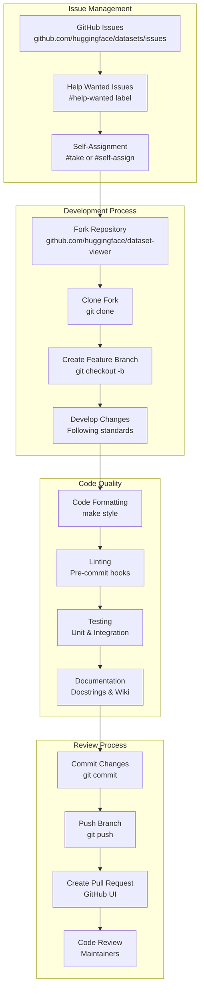
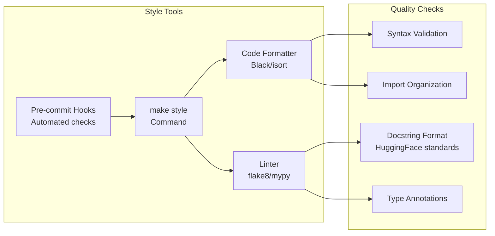
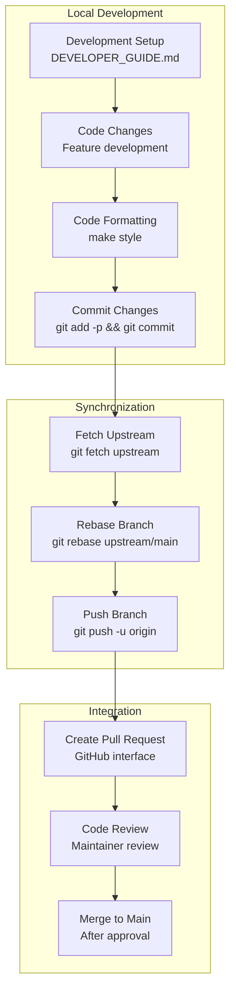
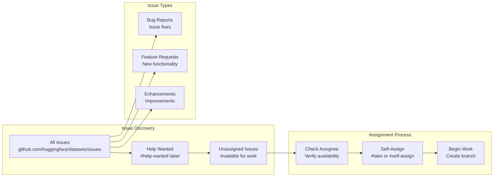
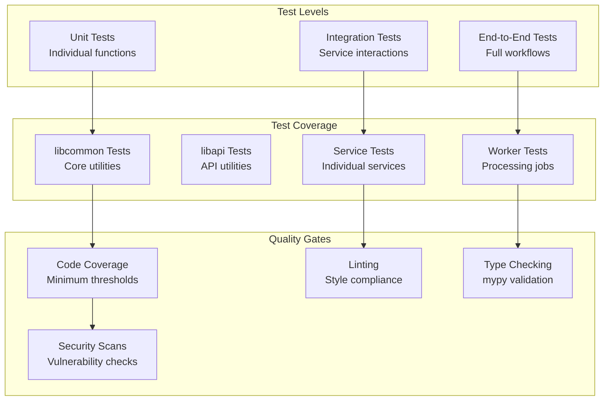

<!-- source: DeepWiki mcp.deepwiki.com · repo huggingface/dataset-viewer · page 8.3 Contributing · fetched 2026-10-26 -->

# Contributing

<details>
<summary>Relevant source files</summary>

The following files were used as context for generating this wiki page:

- [CONTRIBUTING.md](CONTRIBUTING.md)

</details>


This document provides comprehensive guidance for contributing to the dataset-viewer project, including development workflows, coding standards, and pull request processes. It covers both technical requirements and community guidelines for maintaining code quality and collaboration.

For information about setting up the development environment, see [Development Setup](#8.1). For details about the CI/CD pipeline and automated testing, see [CI/CD Pipeline](#8.2).

## Contribution Workflow

The dataset-viewer project follows a standard fork-and-pull-request model for contributions. The workflow involves several key stages from issue identification to code integration.

### Contribution Process Flow



Sources: [CONTRIBUTING.md:15-82]()

## Development Standards

### Code Style and Formatting

The project maintains consistent code quality through automated formatting and linting tools. All code must pass style checks before being merged.



The `make style` command runs comprehensive formatting and linting across the entire codebase. This includes:

- **Code formatting**: Automatic formatting using Black and isort
- **Linting**: Static analysis using flake8 and mypy
- **Import organization**: Consistent import ordering and grouping
- **Docstring validation**: Compliance with HuggingFace documentation standards

Sources: [CONTRIBUTING.md:53-57]()

### Documentation Standards

All code contributions must include appropriate documentation following HuggingFace docstring guidelines. This ensures consistent API documentation across all services and libraries.

| Documentation Type | Requirement | Standard |
|-------------------|-------------|----------|
| Function docstrings | Required | HuggingFace format |
| Class docstrings | Required | HuggingFace format |
| Module docstrings | Required | Purpose and usage |
| API documentation | Required | OpenAPI/Swagger |
| Wiki updates | As needed | Technical documentation |

The project follows [HuggingFace docstring guidelines](https://github.com/huggingface/doc-builder) for all Python code documentation.

Sources: [CONTRIBUTING.md:84-86]()

## Pull Request Process

### Repository Setup

Contributors must fork the repository and set up proper remote tracking to maintain synchronization with the upstream repository.

```bash
# Fork and clone
git clone git@github.com:<username>/dataset-viewer.git
cd dataset-viewer
git remote add upstream https://github.com/huggingface/dataset-viewer.git

# Create feature branch
git checkout -b feature-descriptive-name
```

### Development Workflow



### Branch Management

- **Main branch protection**: Never work directly on the `main` branch
- **Feature branches**: Use descriptive branch names (e.g., `fix-parquet-conversion`, `add-search-filters`)
- **Regular synchronization**: Sync with upstream frequently to avoid conflicts
- **Clean history**: Use interactive rebase to maintain clean commit history

Sources: [CONTRIBUTING.md:29-82]()

## Issue Management

### Working with Issues

The project uses GitHub Issues for tracking bugs, feature requests, and enhancement proposals. Contributors can find available work through the issue tracker.



### Self-Assignment Process

1. **Check availability**: Verify the issue is not already assigned
2. **Self-assign**: Comment with `#take` or `#self-assign` keywords
3. **Begin work**: Create a feature branch and start development
4. **Create PR**: Submit pull request when ready for review

Sources: [CONTRIBUTING.md:15-28]()

## Code Quality Assurance

### Testing Requirements

All contributions must include appropriate tests to ensure code quality and prevent regressions. The testing strategy covers multiple levels of the application stack.



### Pre-commit Validation

Before submitting code, contributors must ensure all quality checks pass:

- **Style formatting**: Run `make style` to format code
- **Test execution**: Run test suite to verify functionality
- **Type checking**: Ensure type annotations are correct
- **Documentation**: Update docstrings and documentation as needed

Sources: [CONTRIBUTING.md:53-57]()

## Community Guidelines

### Code of Conduct

The project adheres to the HuggingFace Code of Conduct, which promotes healthy, constructive behavior in an open and inclusive community. All contributors must respect and abide by these guidelines.

### Contribution Types

The project welcomes various types of contributions:

- **Bug fixes**: Resolving issues and improving stability
- **Feature development**: Adding new functionality
- **Documentation**: Improving guides and API documentation
- **Testing**: Expanding test coverage
- **Performance optimization**: Improving system efficiency
- **Code review**: Participating in review processes

### Communication Channels

- **GitHub Issues**: Bug reports and feature requests
- **Pull Requests**: Code contributions and discussions
- **Code Reviews**: Technical feedback and collaboration

Sources: [CONTRIBUTING.md:1-14](), [CONTRIBUTING.md:89-93]()