# Page: Overview

# Overview

<details>
<summary>Relevant source files</summary>

The following files were used as context for generating this wiki page:

- [Makefile](Makefile)
- [README.md](README.md)
- [chart/Chart.yaml](chart/Chart.yaml)
- [chart/env/prod.yaml](chart/env/prod.yaml)
- [chart/env/staging.yaml](chart/env/staging.yaml)
- [chart/templates/_common/_helpers.tpl](chart/templates/_common/_helpers.tpl)
- [chart/templates/cron-jobs/backfill/_container.tpl](chart/templates/cron-jobs/backfill/_container.tpl)
- [chart/values.yaml](chart/values.yaml)
- [front/admin_ui/poetry.lock](front/admin_ui/poetry.lock)
- [jobs/cache_maintenance/README.md](jobs/cache_maintenance/README.md)
- [jobs/cache_maintenance/poetry.lock](jobs/cache_maintenance/poetry.lock)
- [jobs/cache_maintenance/src/cache_maintenance/backfill.py](jobs/cache_maintenance/src/cache_maintenance/backfill.py)
- [jobs/cache_maintenance/src/cache_maintenance/config.py](jobs/cache_maintenance/src/cache_maintenance/config.py)
- [jobs/cache_maintenance/src/cache_maintenance/main.py](jobs/cache_maintenance/src/cache_maintenance/main.py)
- [jobs/mongodb_migration/poetry.lock](jobs/mongodb_migration/poetry.lock)
- [libs/libapi/poetry.lock](libs/libapi/poetry.lock)
- [libs/libcommon/poetry.lock](libs/libcommon/poetry.lock)
- [services/admin/poetry.lock](services/admin/poetry.lock)
- [services/api/poetry.lock](services/api/poetry.lock)
- [services/rows/poetry.lock](services/rows/poetry.lock)
- [services/search/poetry.lock](services/search/poetry.lock)
- [services/sse-api/poetry.lock](services/sse-api/poetry.lock)
- [services/worker/poetry.lock](services/worker/poetry.lock)

</details>


The dataset-viewer is a microservices backend system that powers the Hugging Face Dataset Viewer interface. It provides pre-computed dataset information and content through REST APIs for all datasets on the Hugging Face Hub. The system automatically processes datasets into optimized formats, extracts metadata, and serves paginated data access, search capabilities, and statistical insights.

This document covers the overall system architecture, core services, and data processing pipeline. For specific service implementation details, see the individual service documentation in sections [3.1](#3.1) through [3.5]. For deployment and infrastructure details, see [7.1](#7.1).

## System Architecture

The dataset-viewer implements a cloud-native microservices architecture deployed on Kubernetes, with services organized into API, processing, and storage layers.

### High-Level Architecture

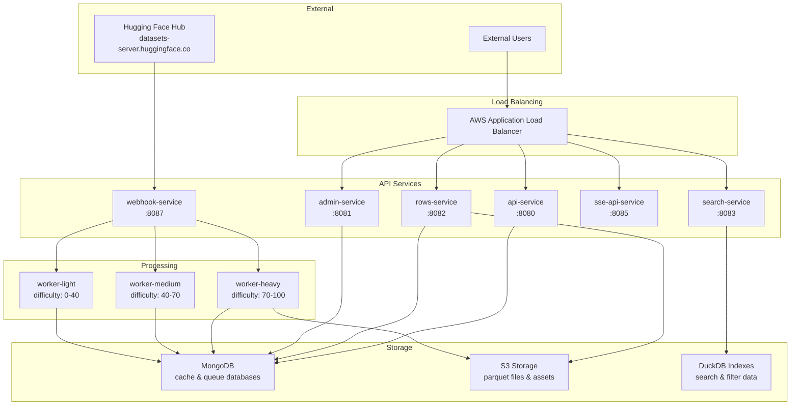

Sources: [chart/env/prod.yaml:1-585](), [chart/values.yaml:1-630](), [README.md:1-67]()

## Core Services

The system consists of six primary microservices, each with distinct responsibilities for serving and processing dataset information.

### Service Architecture Diagram

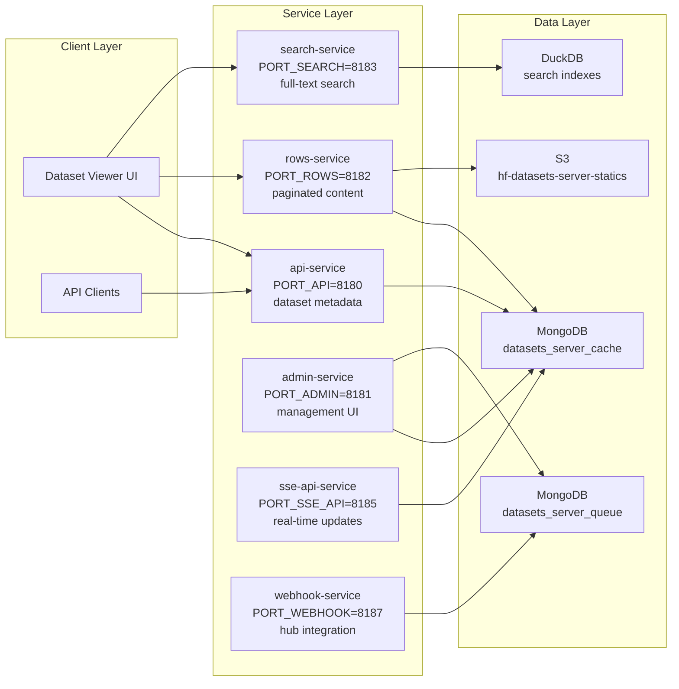

Sources: [Makefile:2-13](), [chart/values.yaml:162-167](), [chart/env/prod.yaml:138-143]()

### Service Responsibilities

| Service | Purpose | Key Features |
|---------|---------|--------------|
| `api-service` | Dataset metadata and configuration | Config names, split info, dataset info endpoints |
| `rows-service` | Paginated dataset content access | Parquet file streaming, asset serving, row slicing |
| `search-service` | Full-text search and filtering | DuckDB integration, search indexing, filter operations |
| `admin-service` | System administration and monitoring | Gradio UI, cache reports, job management |
| `sse-api-service` | Server-sent events for real-time updates | Live status updates, progress streaming |
| `webhook-service` | Hugging Face Hub integration | Dataset change notifications, job triggering |

Sources: [chart/values.yaml:439-629](), [chart/env/prod.yaml:274-584]()

## Data Processing Pipeline

The system processes datasets through a multi-stage pipeline that converts raw datasets into optimized formats for fast access and search.

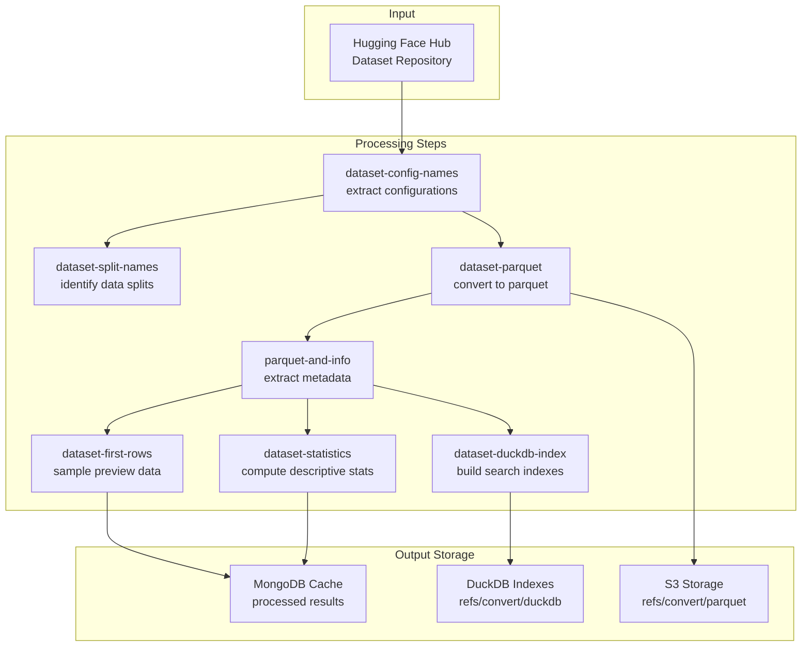

Sources: [chart/values.yaml:199-271](), [chart/env/prod.yaml:127-153]()

## Deployment Configuration

The system deploys to production at `datasets-server.huggingface.co` with the following service scaling:

| Service | Replicas | Resources | Node Selector |
|---------|----------|-----------|---------------|
| `api` | 20 | 4 CPU, 14Gi RAM | `role-datasets-server-api` |
| `rows` | 12 | 1-4 CPU, 6.5Gi RAM | `role-datasets-server-rows` |
| `search` | 3 | 1-64 CPU, 250Gi RAM | `role-datasets-server-search` |
| `worker-heavy` | 4-40 (autoscaling) | 8 CPU, 44Gi RAM | `role-datasets-server-worker` |
| `worker-medium` | 10-80 (autoscaling) | 2 CPU, 14Gi RAM | `role-datasets-server-worker` |
| `worker-light` | 4-50 (autoscaling) | 200m-2 CPU, 1Gi RAM | `role-datasets-server-worker-light` |

Sources: [chart/env/prod.yaml:318-550]()

## Storage Systems

The architecture uses three primary storage systems:

- **MongoDB**: Stores processed cache responses and job queue data in `datasets_server_cache` and `datasets_server_queue` databases
- **S3**: Hosts converted Parquet files and static assets under `hf-datasets-server-statics/` with CloudFront CDN distribution  
- **DuckDB**: Provides search indexes stored as files for full-text search and filtering capabilities

Sources: [chart/values.yaml:162-271](), [chart/env/prod.yaml:138-153]()

---

# Page: System Architecture

# System Architecture

<details>
<summary>Relevant source files</summary>

The following files were used as context for generating this wiki page:

- [Makefile](Makefile)
- [README.md](README.md)
- [chart/Chart.yaml](chart/Chart.yaml)
- [chart/env/prod.yaml](chart/env/prod.yaml)
- [chart/env/staging.yaml](chart/env/staging.yaml)
- [chart/templates/_common/_helpers.tpl](chart/templates/_common/_helpers.tpl)
- [chart/templates/cron-jobs/backfill/_container.tpl](chart/templates/cron-jobs/backfill/_container.tpl)
- [chart/values.yaml](chart/values.yaml)
- [jobs/cache_maintenance/README.md](jobs/cache_maintenance/README.md)
- [jobs/cache_maintenance/src/cache_maintenance/backfill.py](jobs/cache_maintenance/src/cache_maintenance/backfill.py)
- [jobs/cache_maintenance/src/cache_maintenance/config.py](jobs/cache_maintenance/src/cache_maintenance/config.py)
- [jobs/cache_maintenance/src/cache_maintenance/main.py](jobs/cache_maintenance/src/cache_maintenance/main.py)
- [libs/libcommon/src/libcommon/processing_graph.py](libs/libcommon/src/libcommon/processing_graph.py)
- [libs/libcommon/tests/test_backfill_on_real_graph.py](libs/libcommon/tests/test_backfill_on_real_graph.py)
- [libs/libcommon/tests/test_processing_graph.py](libs/libcommon/tests/test_processing_graph.py)
- [services/worker/src/worker/dtos.py](services/worker/src/worker/dtos.py)
- [services/worker/src/worker/job_runners/dataset/compatible_libraries.py](services/worker/src/worker/job_runners/dataset/compatible_libraries.py)
- [services/worker/src/worker/job_runners/dataset/hub_cache.py](services/worker/src/worker/job_runners/dataset/hub_cache.py)
- [services/worker/tests/job_runners/dataset/test_compatible_libraries.py](services/worker/tests/job_runners/dataset/test_compatible_libraries.py)
- [services/worker/tests/job_runners/dataset/test_hub_cache.py](services/worker/tests/job_runners/dataset/test_hub_cache.py)

</details>


## Purpose and Scope

This document provides a comprehensive overview of the dataset-viewer system architecture, covering the microservices design, data processing pipeline, storage systems, and deployment infrastructure. The dataset-viewer is a backend service that processes datasets from the Hugging Face Hub and provides APIs for dataset viewing, search, and metadata access.

For information about specific service implementations, see [Core Services](#3). For details about shared libraries and utilities, see [Shared Libraries](#4). For data processing job runners, see [Data Processing](#5).

## High-Level Architecture Overview

The dataset-viewer follows a microservices architecture with clear separation of concerns. The system processes datasets through a directed acyclic graph of processing steps, caches results in MongoDB, stores assets in S3, and serves data through multiple specialized API services.

### System Components Diagram

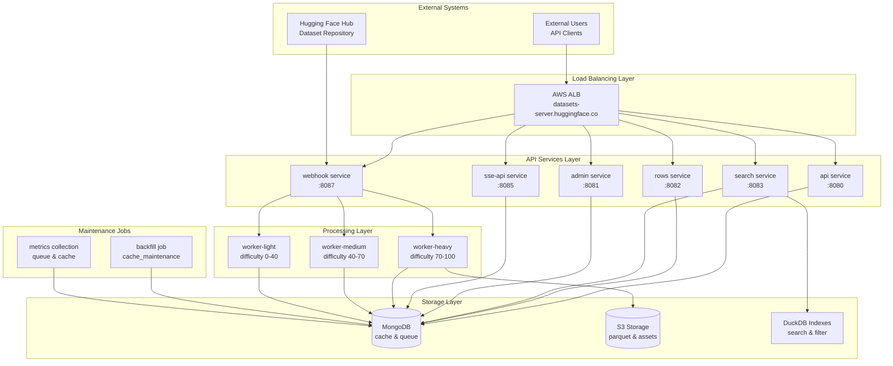

Sources: [chart/env/prod.yaml:1-585](), [Makefile:1-64](), [chart/values.yaml:1-630]()

### Processing Graph Architecture

The system uses a directed acyclic graph defined in `ProcessingGraph` to orchestrate dataset processing steps with dependencies.

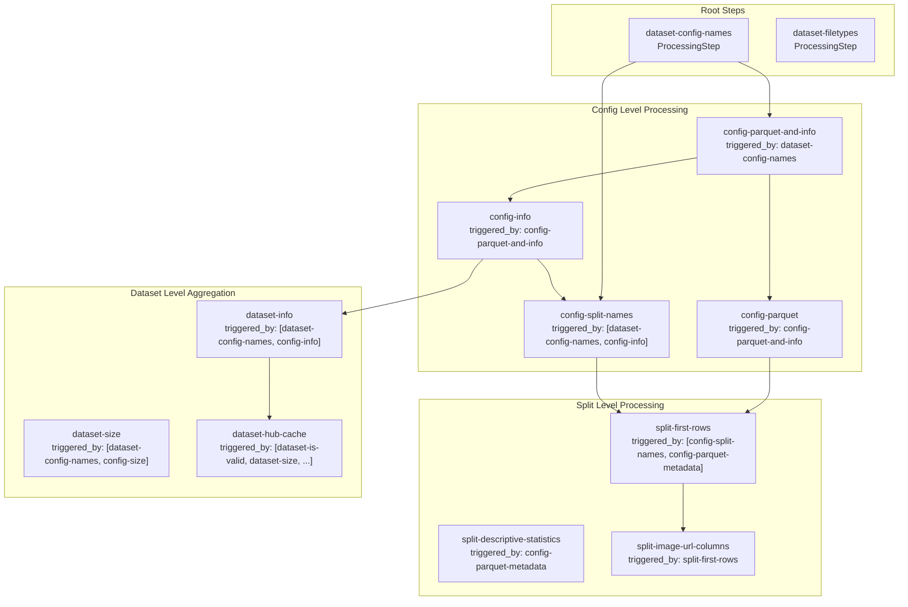

Sources: [libs/libcommon/src/libcommon/processing_graph.py:490-705](), [libs/libcommon/tests/test_processing_graph.py:1-402]()

## Service Architecture  

### Core Service Components

The system consists of six main microservices, each with specific responsibilities:

| Service | Port | Purpose | Key Classes |
|---------|------|---------|-------------|
| `api` | 8080 | Dataset metadata APIs | N/A |
| `rows` | 8082 | Paginated dataset content | N/A |
| `search` | 8083 | Full-text search & filtering | N/A |
| `admin` | 8081 | System administration | N/A |
| `sse-api` | 8085 | Server-sent events | N/A |
| `webhook` | 8087 | Hub webhook integration | N/A |

### Worker Service Architecture

The worker service implements a difficulty-based job distribution system with three worker types:

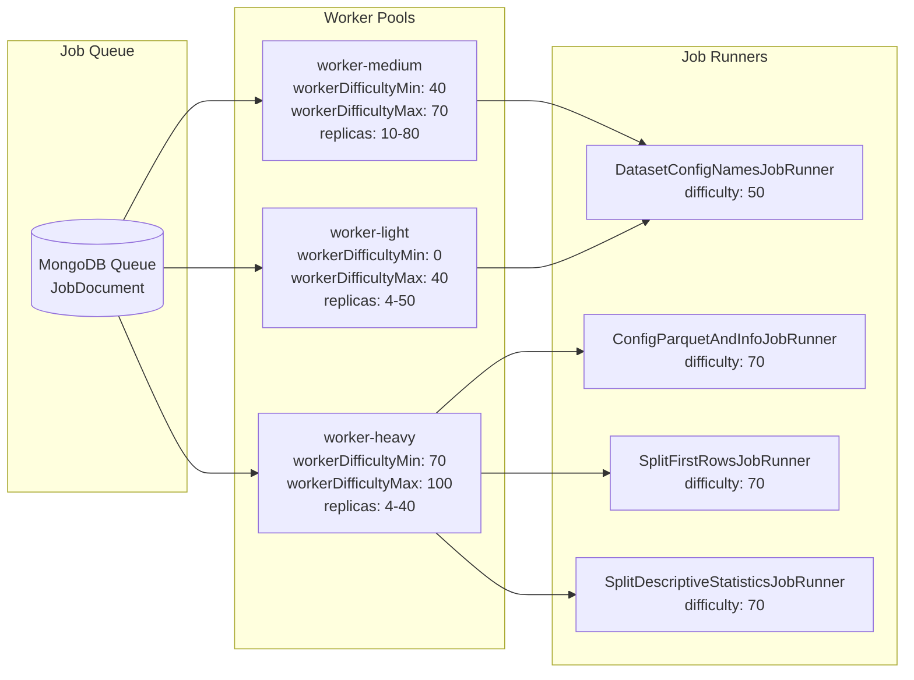

Sources: [chart/env/prod.yaml:462-550](), [services/worker/src/worker/dtos.py:11-14](), [libs/libcommon/src/libcommon/processing_graph.py:490-705]()

### Service Communication Pattern

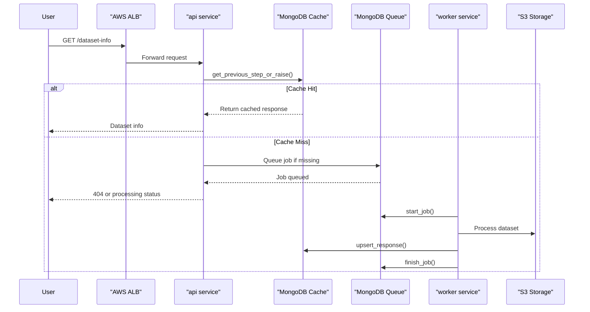

Sources: [libcommon/simple_cache.py functions referenced in services](), [Queue operations in worker service]()

## Data Processing Pipeline

### Processing Step Execution Flow

The data processing follows the `ProcessingGraph` specification with automatic dependency resolution:

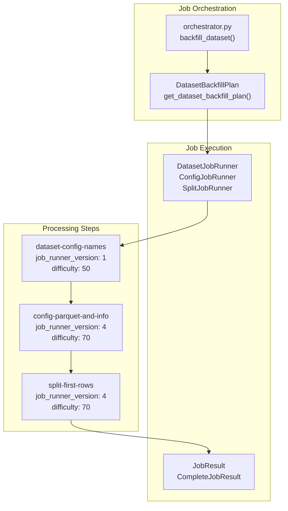

Sources: [libs/libcommon/src/libcommon/operations.py functions](), [services/worker/src/worker/dtos.py:16-30](), [libs/libcommon/src/libcommon/processing_graph.py:82-122]()

### Job Runner Implementation Pattern

Each processing step is implemented as a job runner following a common pattern:

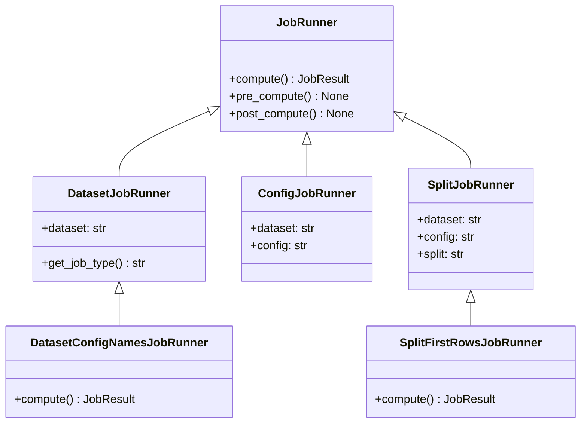

Sources: [services/worker/src/worker/job_runners/ directory structure](), [services/worker/src/worker/dtos.py:17-29]()

## Storage Architecture

### MongoDB Schema and Collections

The system uses MongoDB for caching processed results and managing job queues:

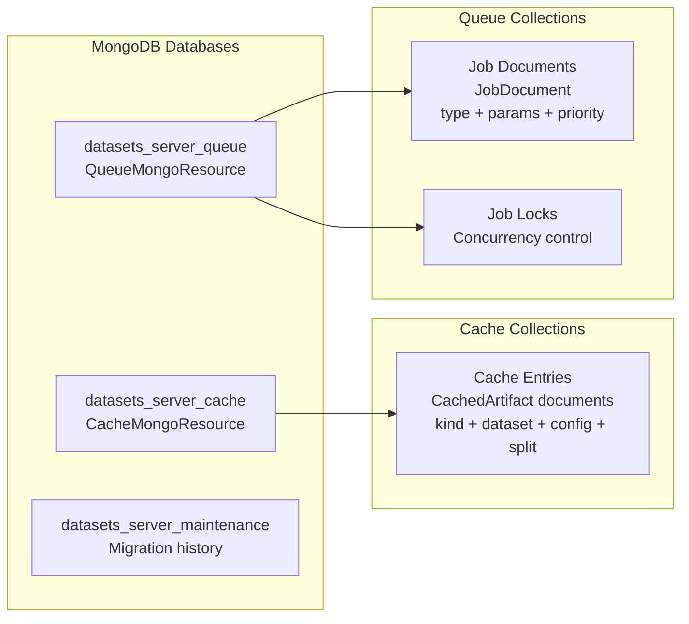

Sources: [chart/values.yaml:162-167](), [libs/libcommon/resources.py MongoDB classes](), [libs/libcommon/simple_cache.py cache operations]()

### S3 Storage Organization

Assets and processed datasets are stored in S3 with organized bucket structure:

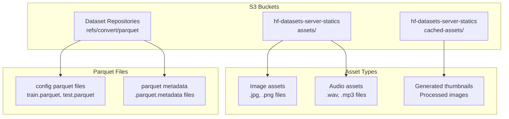

Sources: [chart/env/prod.yaml:137-143](), [chart/values.yaml:240-252](), [libcommon/storage_client.py S3 operations]()

### DuckDB Search Indexes

The search service uses DuckDB for efficient filtering and full-text search:

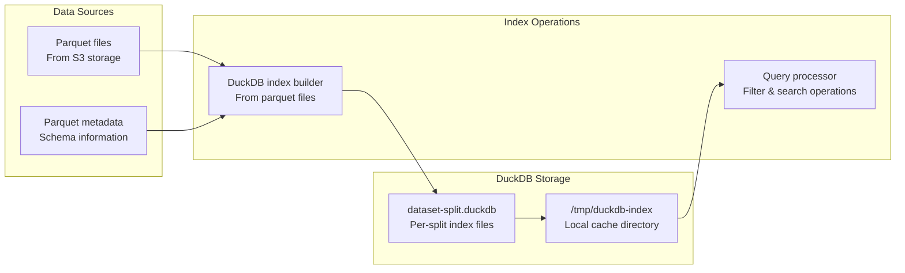

Sources: [chart/values.yaml:258-271](), [libapi/duckdb.py DuckDB operations](), [search service DuckDB integration]()

## Deployment Architecture

### Kubernetes Deployment Structure

The system is deployed on Kubernetes with environment-specific configurations:

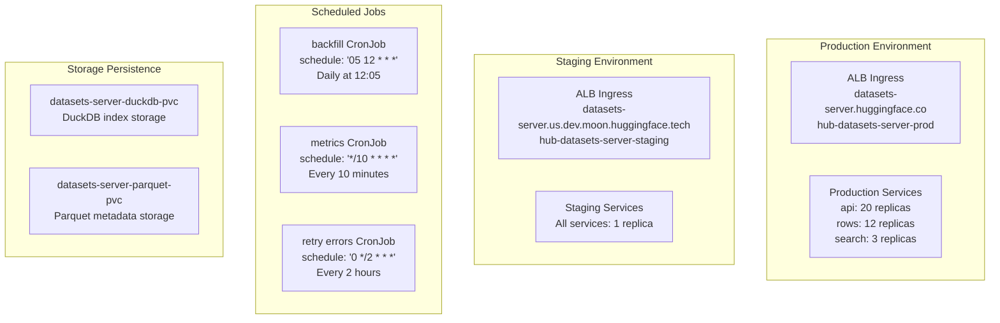

Sources: [chart/env/prod.yaml:255-585](), [chart/env/staging.yaml:160-329](), [chart/values.yaml:307-374]()

### Resource Allocation and Scaling

The deployment uses different resource allocations and autoscaling for each service type:

| Service | CPU Request | Memory Request | CPU Limit | Memory Limit | Autoscaling |
|---------|-------------|----------------|-----------|--------------|-------------|
| `api` | 4 | 14Gi | 4 | 14Gi | 20 replicas |
| `rows` | 1 | 6500Mi | 4 | 6500Mi | 12 replicas |
| `search` | 1 | 250Gi | 64 | 250Gi | 3 replicas |
| `worker-heavy` | 8 | 34Gi | 8 | 44Gi | 4-40 replicas |
| `worker-medium` | 2 | 14Gi | 2 | 14Gi | 10-80 replicas |
| `worker-light` | 200m | 100Mi | 2 | 1Gi | 4-50 replicas |

Sources: [chart/env/prod.yaml:345-549]()

### Monitoring and Maintenance

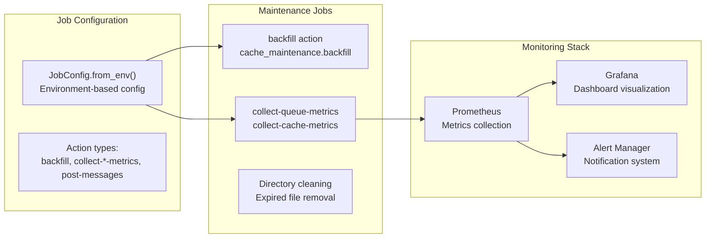

Sources: [jobs/cache_maintenance/src/cache_maintenance/main.py:19-118](), [jobs/cache_maintenance/src/cache_maintenance/config.py:69-97](), [chart/env/prod.yaml:170-253]()

---

# Page: Service Architecture

# Service Architecture

<details>
<summary>Relevant source files</summary>

The following files were used as context for generating this wiki page:

- [chart/templates/_env/_envWorker.tpl](chart/templates/_env/_envWorker.tpl)
- [chart/templates/services/api/_container.tpl](chart/templates/services/api/_container.tpl)
- [libs/libapi/src/libapi/duckdb.py](libs/libapi/src/libapi/duckdb.py)
- [libs/libapi/src/libapi/utils.py](libs/libapi/src/libapi/utils.py)
- [libs/libcommon/src/libcommon/duckdb_utils.py](libs/libcommon/src/libcommon/duckdb_utils.py)
- [libs/libcommon/src/libcommon/parquet_utils.py](libs/libcommon/src/libcommon/parquet_utils.py)
- [services/api/README.md](services/api/README.md)
- [services/api/src/api/app.py](services/api/src/api/app.py)
- [services/api/src/api/routes/endpoint.py](services/api/src/api/routes/endpoint.py)
- [services/api/tests/conftest.py](services/api/tests/conftest.py)
- [services/api/tests/test_app.py](services/api/tests/test_app.py)
- [services/rows/src/rows/routes/rows.py](services/rows/src/rows/routes/rows.py)
- [services/rows/tests/conftest.py](services/rows/tests/conftest.py)
- [services/search/src/search/duckdb_connection.py](services/search/src/search/duckdb_connection.py)
- [services/search/src/search/routes/filter.py](services/search/src/search/routes/filter.py)
- [services/search/src/search/routes/search.py](services/search/src/search/routes/search.py)
- [services/search/tests/conftest.py](services/search/tests/conftest.py)
- [services/search/tests/routes/test_search.py](services/search/tests/routes/test_search.py)
- [services/worker/src/worker/job_runners/config/parquet_metadata.py](services/worker/src/worker/job_runners/config/parquet_metadata.py)
- [services/worker/src/worker/job_runners/config/split_names.py](services/worker/src/worker/job_runners/config/split_names.py)
- [services/worker/src/worker/job_runners/split/first_rows.py](services/worker/src/worker/job_runners/split/first_rows.py)
- [services/worker/tests/job_runners/config/test_parquet_metadata.py](services/worker/tests/job_runners/config/test_parquet_metadata.py)
- [services/worker/tests/job_runners/split/test_first_rows.py](services/worker/tests/job_runners/split/test_first_rows.py)
- [tools/docker-compose-dataset-viewer.yml](tools/docker-compose-dataset-viewer.yml)
- [tools/docker-compose-dev-dataset-viewer.yml](tools/docker-compose-dev-dataset-viewer.yml)

</details>


This document details the microservices architecture of the dataset-viewer system, which provides a backend infrastructure for serving dataset information from the Hugging Face Hub. The system processes datasets through multiple specialized services that handle different aspects of data ingestion, transformation, and serving.

For information about data processing workflows, see [Data Processing Pipeline](#2.2). For storage layer details, see [Storage Architecture](#2.3).

## Overview

The dataset-viewer system implements a distributed microservices architecture where each service has a specific responsibility in the data processing and serving pipeline. Services communicate through HTTP APIs and share data through common storage layers including MongoDB for caching and coordination, S3 for asset storage, and DuckDB for search indexing.

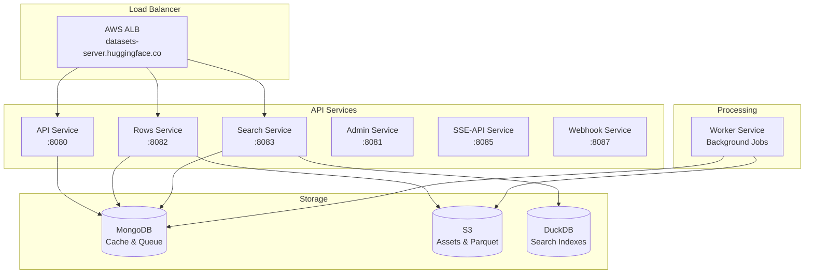

Sources: [services/api/src/api/app.py:27-113](), [services/rows/src/rows/routes/rows.py:41-152](), [services/search/src/search/routes/search.py:119-250](), [tools/docker-compose-dataset-viewer.yml:1-300]()

## Core Services

### API Service

The API Service serves as the main REST API endpoint, providing dataset metadata and orchestrating requests across the system. It implements a Starlette-based web application with multiple endpoints corresponding to different processing steps.

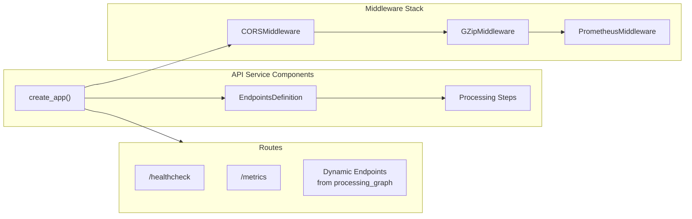

The service uses the `create_endpoint()` function to dynamically generate endpoints based on the processing graph configuration. Each endpoint maps to specific processing steps through `StepByInputType` mappings.

Sources: [services/api/src/api/app.py:27-113](), [services/api/src/api/routes/endpoint.py:39-219](), [services/api/tests/test_app.py:9-123]()

### Rows Service

The Rows Service provides paginated access to dataset content by reading from processed Parquet files. It uses the `Indexer` class to efficiently query large datasets and handle memory constraints.

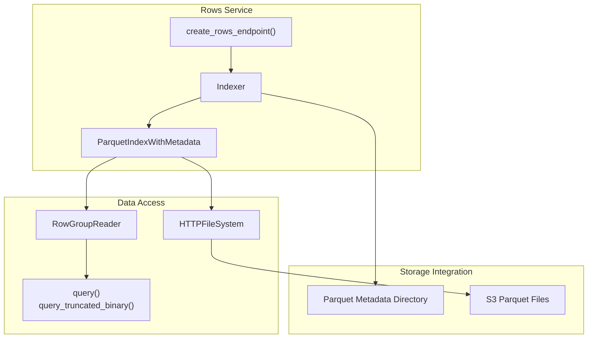

The service implements sophisticated memory management through `max_arrow_data_in_memory` limits and supports binary data truncation for large cells via `query_truncated_binary()`.

Sources: [services/rows/src/rows/routes/rows.py:41-152](), [libs/libcommon/src/libcommon/parquet_utils.py:512-657](), [services/worker/src/worker/job_runners/split/first_rows.py:273-348]()

### Search Service

The Search Service provides full-text search and filtering capabilities using DuckDB indexes. It supports both search queries and SQL-like filtering operations.

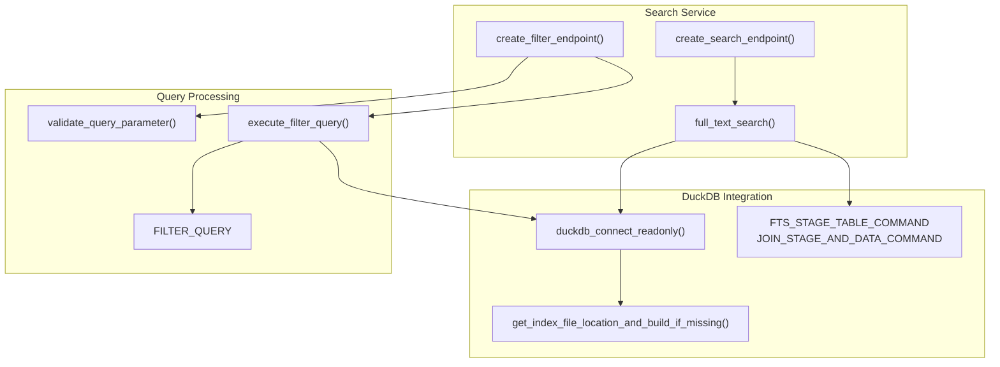

The search service dynamically builds DuckDB indexes from Parquet files when needed and caches them for subsequent queries. It uses specialized SQL commands for full-text search integration.

Sources: [services/search/src/search/routes/search.py:55-250](), [services/search/src/search/routes/filter.py:61-227](), [libs/libapi/src/libapi/duckdb.py:82-313]()

### Worker Service

The Worker Service handles background job processing through a system of specialized job runners. Each job runner implements specific data processing tasks in the pipeline.

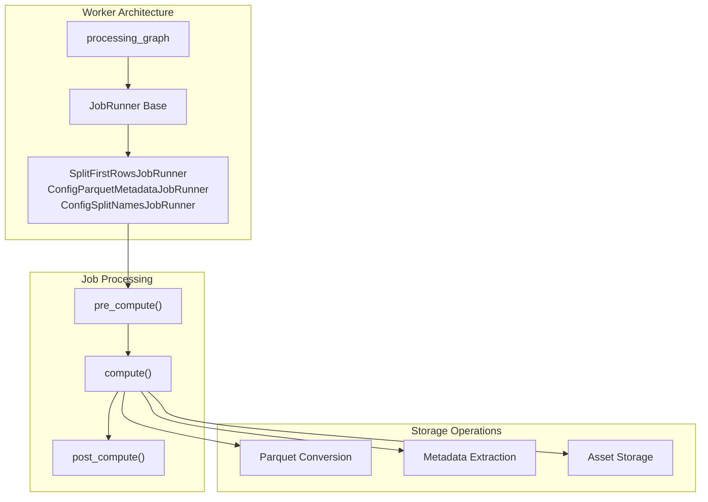

Worker services are distributed across multiple difficulty levels, with job routing based on computational requirements and resource availability.

Sources: [services/worker/src/worker/job_runners/split/first_rows.py:273-348](), [services/worker/src/worker/job_runners/config/parquet_metadata.py:145-173](), [services/worker/src/worker/job_runners/config/split_names.py:138-163]()

## Service Communication Patterns

Services in the dataset-viewer architecture communicate through several patterns:

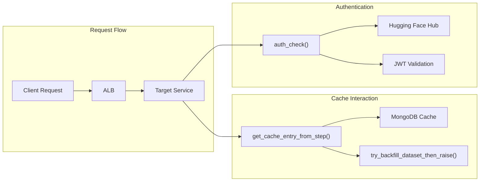

### Response Caching Strategy

All services implement a unified caching strategy through the `libapi.utils` module:

- **Cache Hit**: Return cached response with appropriate `max_age` headers
- **Cache Miss**: Trigger background job processing and return `ResponseNotReadyError`
- **Error Handling**: Use `get_json_api_error_response()` for consistent error formatting

Sources: [libs/libapi/src/libapi/utils.py:147-194](), [services/api/src/api/routes/endpoint.py:108-194]()

### Shared Libraries Integration

The architecture relies heavily on two shared libraries that provide common functionality:

```mermaid
graph TD
    subgraph "libcommon"
        SimpleCache["simple_cache.py"]
        Queue["queue.py"]
        ProcessingGraph["processing_graph.py"]
        ParquetUtils["parquet_utils.py"]
        DuckDBUtils["duckdb_utils.py"]
    end
    
    subgraph "libapi"
        DuckDBAPI["duckdb.py"]
        UtilsAPI["utils.py"]
        AuthAPI["authentication.py"]
        ResponseAPI["response.py"]
    end
    
    subgraph "Services"
        AllServices["API, Rows, Search,<br/>Worker, Admin, SSE-API"]
    end
    
    AllServices --> SimpleCache
    AllServices --> Queue
    AllServices --> ProcessingGraph
    AllServices --> UtilsAPI
    AllServices --> AuthAPI
    Search --> DuckDBAPI
    Rows --> ParquetUtils
    Search --> DuckDBUtils
```

These libraries ensure consistent behavior across services for caching, authentication, error handling, and data processing operations.

Sources: [libs/libapi/src/libapi/utils.py:1-242](), [libs/libcommon/src/libcommon/parquet_utils.py:1-657](), [libs/libcommon/src/libcommon/duckdb_utils.py:1-400]()

---

# Page: Data Processing Pipeline

# Data Processing Pipeline

<details>
<summary>Relevant source files</summary>

The following files were used as context for generating this wiki page:

- [chart/templates/worker/_container.tpl](chart/templates/worker/_container.tpl)
- [jobs/mongodb_migration/src/mongodb_migration/collector.py](jobs/mongodb_migration/src/mongodb_migration/collector.py)
- [jobs/mongodb_migration/src/mongodb_migration/deletion_migrations.py](jobs/mongodb_migration/src/mongodb_migration/deletion_migrations.py)
- [jobs/mongodb_migration/src/mongodb_migration/migration.py](jobs/mongodb_migration/src/mongodb_migration/migration.py)
- [jobs/mongodb_migration/tests/test_deletion_migrations.py](jobs/mongodb_migration/tests/test_deletion_migrations.py)
- [libs/libcommon/src/libcommon/exceptions.py](libs/libcommon/src/libcommon/exceptions.py)
- [libs/libcommon/src/libcommon/processing_graph.py](libs/libcommon/src/libcommon/processing_graph.py)
- [libs/libcommon/tests/test_backfill_on_real_graph.py](libs/libcommon/tests/test_backfill_on_real_graph.py)
- [libs/libcommon/tests/test_processing_graph.py](libs/libcommon/tests/test_processing_graph.py)
- [services/worker/src/worker/dtos.py](services/worker/src/worker/dtos.py)
- [services/worker/src/worker/executor.py](services/worker/src/worker/executor.py)
- [services/worker/src/worker/job_manager.py](services/worker/src/worker/job_manager.py)
- [services/worker/src/worker/job_runners/config/parquet_and_info.py](services/worker/src/worker/job_runners/config/parquet_and_info.py)
- [services/worker/src/worker/job_runners/dataset/compatible_libraries.py](services/worker/src/worker/job_runners/dataset/compatible_libraries.py)
- [services/worker/src/worker/job_runners/dataset/hub_cache.py](services/worker/src/worker/job_runners/dataset/hub_cache.py)
- [services/worker/src/worker/loop.py](services/worker/src/worker/loop.py)
- [services/worker/src/worker/utils.py](services/worker/src/worker/utils.py)
- [services/worker/tests/fixtures/files.py](services/worker/tests/fixtures/files.py)
- [services/worker/tests/fixtures/hub.py](services/worker/tests/fixtures/hub.py)
- [services/worker/tests/job_runners/config/test_parquet_and_info.py](services/worker/tests/job_runners/config/test_parquet_and_info.py)
- [services/worker/tests/job_runners/dataset/test_compatible_libraries.py](services/worker/tests/job_runners/dataset/test_compatible_libraries.py)
- [services/worker/tests/job_runners/dataset/test_hub_cache.py](services/worker/tests/job_runners/dataset/test_hub_cache.py)
- [services/worker/tests/test_job_manager.py](services/worker/tests/test_job_manager.py)
- [services/worker/tests/test_loop.py](services/worker/tests/test_loop.py)

</details>


This document describes the data processing pipeline that powers the dataset-viewer system, explaining how datasets are transformed from their original formats into processed outputs including Parquet files, metadata, and search indexes. For information about the individual services that execute these pipeline steps, see [Core Services](#3). For details about storage systems, see [Storage Architecture](#2.3).

## Overview

The data processing pipeline is a directed acyclic graph (DAG) of interconnected processing steps that transform datasets from the Hugging Face Hub into formats optimized for viewing, searching, and analysis. The pipeline handles dataset discovery, format conversion, metadata extraction, validation, and index generation through a series of dependent job types.

```mermaid
graph TD
    subgraph "Input Sources"
        HubDataset["Hub Dataset Repository"]
        Webhook["Dataset Update Webhooks"]
    end
    
    subgraph "Core Pipeline Steps"
        ConfigNames["dataset-config-names<br/>Discover configurations"]
        SplitNames["config-split-names<br/>Discover splits"]
        ParquetInfo["config-parquet-and-info<br/>Convert & extract info"]
        Parquet["config-parquet<br/>Generate parquet files"]
        ParquetMeta["config-parquet-metadata<br/>Extract metadata"]
        FirstRows["split-first-rows<br/>Extract sample data"]
        Statistics["split-descriptive-statistics<br/>Compute statistics"]
        Search["split-duckdb-index<br/>Build search indexes"]
    end
    
    subgraph "Output Products"
        ParquetFiles["Parquet Files<br/>S3 Storage"]
        Metadata["Dataset Metadata<br/>MongoDB Cache"]
        SearchDB["DuckDB Indexes<br/>Search & Filter"]
        APIs["API Responses<br/>Cached Results"]
    end
    
    HubDataset --> ConfigNames
    Webhook --> ConfigNames
    
    ConfigNames --> SplitNames
    ConfigNames --> ParquetInfo
    ParquetInfo --> Parquet
    ParquetInfo --> ParquetMeta
    Parquet --> ParquetMeta
    ParquetMeta --> FirstRows
    ParquetMeta --> Statistics
    ParquetMeta --> Search
    SplitNames --> FirstRows
    
    ParquetInfo --> ParquetFiles
    ParquetMeta --> Metadata
    FirstRows --> APIs
    Statistics --> APIs
    Search --> SearchDB
```

Sources: [libs/libcommon/src/libcommon/processing_graph.py:490-600](), [services/worker/src/worker/job_runners/config/parquet_and_info.py:1-100]()

## Processing Graph Structure

The pipeline is defined as a `ProcessingGraph` that manages job dependencies and execution order. Each processing step is represented as a `ProcessingStep` with specific input types and dependency relationships.

```mermaid
graph TD
    subgraph "Input Types"
        Dataset["dataset<br/>Dataset-level operations"]
        Config["config<br/>Configuration-level operations"] 
        Split["split<br/>Split-level operations"]
    end
    
    subgraph "Processing Graph Components"
        Step["ProcessingStep<br/>name, input_type<br/>job_runner_version<br/>difficulty"]
        Graph["ProcessingGraph<br/>_nx_graph: nx.DiGraph<br/>_processing_steps<br/>_topologically_ordered"]
        Spec["ProcessingGraphSpecification<br/>step definitions<br/>triggered_by relationships"]
    end
    
    subgraph "Execution Flow"
        Topological["Topological Ordering<br/>nx.topological_sort()"]
        Dependencies["Dependency Resolution<br/>get_parents()<br/>get_children()"]
        Validation["Graph Validation<br/>check_one_of_parents_is_same_or_higher_level()"]
    end
    
    Spec --> Graph
    Graph --> Step
    Graph --> Topological
    Graph --> Dependencies
    Graph --> Validation
    
    Dataset --> Step
    Config --> Step
    Split --> Step
```

The processing graph enforces several key constraints:
- Dataset-level steps can only depend on other dataset-level steps
- Config-level steps can depend on dataset-level or config-level steps  
- Split-level steps can depend on any level
- The graph must be acyclic to prevent infinite loops

Sources: [libs/libcommon/src/libcommon/processing_graph.py:134-228](), [libs/libcommon/src/libcommon/processing_graph.py:42-65]()

## Key Processing Steps

### Dataset Configuration Discovery

The `dataset-config-names` step discovers all available configurations in a dataset repository. This is always the first step executed for any dataset.

```mermaid
graph LR
    Input["Dataset Repository"]
    Discovery["DatasetConfigNamesJobRunner<br/>load_dataset_builder()<br/>get_builder_configs()"]
    Output["config_names list<br/>cached response"]
    
    Input --> Discovery
    Discovery --> Output
```

Sources: [libs/libcommon/src/libcommon/processing_graph.py:491-495]()

### Parquet Conversion and Info Extraction

The `config-parquet-and-info` step is the core processing component that converts datasets to Parquet format and extracts comprehensive metadata.

```mermaid
graph TD
    subgraph "ConfigParquetAndInfoJobRunner"
        Validation["Dataset Validation<br/>is_dataset_too_big()<br/>check size limits"]
        Conversion["Parquet Conversion<br/>stream_convert_to_parquet()<br/>limit_parquet_writes()"]
        Upload["Hub Upload<br/>create_commits()<br/>CommitOperationAdd/Copy"]
        InfoExtraction["Info Extraction<br/>fill_builder_info()<br/>extract features & splits"]
    end
    
    subgraph "Conversion Strategies"
        StreamConvert["Stream Conversion<br/>for large datasets<br/>partial processing"]
        CopyFiles["Copy Existing<br/>for parquet datasets<br/>copy_parquet_files()"]
        ValidateFiles["File Validation<br/>ParquetFileValidator<br/>check row group sizes"]
    end
    
    subgraph "Output Generation"
        ParquetFiles["Parquet Files<br/>uploaded to Hub<br/>refs/convert/parquet branch"]
        DatasetInfo["Dataset Info<br/>features, splits<br/>download & dataset size"]
        EstimatedInfo["Estimated Info<br/>for partial datasets<br/>size extrapolation"]
    end
    
    Validation --> Conversion
    Conversion --> StreamConvert
    Conversion --> CopyFiles
    Conversion --> ValidateFiles
    Conversion --> Upload
    Upload --> ParquetFiles
    InfoExtraction --> DatasetInfo
    InfoExtraction --> EstimatedInfo
```

The conversion process handles multiple scenarios:
- **Streaming conversion**: For large datasets, converts incrementally up to size limits
- **File copying**: For datasets already in Parquet format, copies files efficiently  
- **Partial processing**: When datasets exceed limits, processes subset and estimates total size
- **Validation**: Ensures Parquet files meet quality standards for the viewer

Sources: [services/worker/src/worker/job_runners/config/parquet_and_info.py:84-93](), [services/worker/src/worker/job_runners/config/parquet_and_info.py:406-431](), [services/worker/src/worker/job_runners/config/parquet_and_info.py:895-950]()

### Split Processing Steps

Split-level processing operates on individual dataset splits to extract viewable data and compute analytics.

```mermaid
graph TD
    subgraph "Split Processing Chain"
        ParquetMeta["config-parquet-metadata<br/>Extract schema & file info<br/>ParquetFileMetadataItem[]"]
        FirstRows["split-first-rows<br/>Extract sample rows<br/>get_rows_or_raise()"]
        Statistics["split-descriptive-statistics<br/>Compute column statistics<br/>numerical & categorical analysis"]
        Search["split-duckdb-index<br/>Build search indexes<br/>DuckDB file generation"]
    end
    
    subgraph "Data Sources"
        ParquetFiles["Parquet Files<br/>from config-parquet"]
        StreamingData["Streaming Data<br/>datasets.load_dataset()"]
    end
    
    subgraph "Processing Options"
        ParquetPath["Parquet-based<br/>read from converted files<br/>faster, limited by conversion"]
        StreamingPath["Streaming-based<br/>read from original data<br/>slower, full access"]
    end
    
    ParquetFiles --> ParquetMeta
    ParquetMeta --> FirstRows
    ParquetMeta --> Statistics
    ParquetMeta --> Search
    
    StreamingData --> FirstRows
    
    FirstRows --> ParquetPath
    FirstRows --> StreamingPath
```

The pipeline intelligently chooses between Parquet-based and streaming-based processing depending on data availability and performance requirements.

Sources: [libs/libcommon/src/libcommon/processing_graph.py:496-504](), [libs/libcommon/src/libcommon/processing_graph.py:517-522](), [services/worker/src/worker/utils.py:88-141]()

## Job Execution Flow

Jobs are executed by the Worker service through a managed pipeline that handles dependencies, resource allocation, and error recovery.

```mermaid
graph TD
    subgraph "Job Lifecycle"
        Queue["Job Queue<br/>Priority-based<br/>Difficulty routing"]
        Start["Job Start<br/>JobManager.run_job()<br/>acquire lock"]
        Validate["Validation<br/>JobRunner.validate()<br/>check prerequisites"]
        PreCompute["Pre-compute<br/>JobRunner.pre_compute()<br/>setup resources"]
        Compute["Compute<br/>JobRunner.compute()<br/>main processing"]
        PostCompute["Post-compute<br/>JobRunner.post_compute()<br/>cleanup"]
        Cache["Cache Result<br/>upsert_response()<br/>store in MongoDB"]
    end
    
    subgraph "Dependency Management"
        PrevSteps["Previous Steps<br/>get_previous_step_or_raise()<br/>verify dependencies"]
        Artifacts["Cached Artifacts<br/>retrieve prior results<br/>CachedArtifactError handling"]
        NextJobs["Trigger Next Jobs<br/>orchestrator.finish_job()<br/>start dependent steps"]
    end
    
    subgraph "Error Handling"
        Retry["Retry Logic<br/>exponential backoff<br/>temporary failures"]
        Cache2["Error Caching<br/>CacheableError<br/>prevent re-execution"]
        Zombies["Zombie Detection<br/>heartbeat monitoring<br/>WorkerExecutor"]
    end
    
    Queue --> Start
    Start --> Validate
    Validate --> PreCompute
    PreCompute --> Compute
    Compute --> PostCompute
    PostCompute --> Cache
    
    Validate --> PrevSteps
    PrevSteps --> Artifacts
    Cache --> NextJobs
    
    Compute --> Retry
    Retry --> Cache2
    Start --> Zombies
```

Sources: [services/worker/src/worker/job_manager.py:98-177](), [services/worker/src/worker/loop.py:108-150](), [services/worker/src/worker/executor.py:156-165]()

## Data Flow and Transformations

The pipeline transforms raw datasets through multiple stages, with each step adding value and preparing data for different use cases.

```mermaid
graph LR
    subgraph "Input Formats"
        CSV["CSV Files"]
        JSON["JSON/JSONL Files"] 
        Images["Image Files"]
        Audio["Audio Files"]
        Parquet["Existing Parquet"]
        Scripts["Dataset Scripts"]
    end
    
    subgraph "Processing Layers"
        Discovery["Format Discovery<br/>datasets library<br/>builder detection"]
        Conversion["Format Conversion<br/>Arrow Tables<br/>Parquet generation"]
        Validation["Quality Validation<br/>schema consistency<br/>size limits"]
        Optimization["Optimization<br/>row group sizing<br/>compression"]
    end
    
    subgraph "Output Products"
        ViewerAPI["Viewer API<br/>paginated rows<br/>/rows endpoint"]
        SearchAPI["Search API<br/>filtering & queries<br/>/search endpoint"]
        MetadataAPI["Metadata API<br/>dataset info<br/>/info endpoint"]
        DownloadFiles["Download Files<br/>optimized Parquet<br/>Hub storage"]
    end
    
    CSV --> Discovery
    JSON --> Discovery
    Images --> Discovery
    Audio --> Discovery
    Parquet --> Discovery
    Scripts --> Discovery
    
    Discovery --> Conversion
    Conversion --> Validation
    Validation --> Optimization
    
    Optimization --> ViewerAPI
    Optimization --> SearchAPI
    Optimization --> MetadataAPI
    Optimization --> DownloadFiles
```

Key transformations include:
- **Format standardization**: Converting diverse input formats to Parquet
- **Schema extraction**: Inferring and validating data schemas
- **Size optimization**: Adjusting row group sizes for optimal random access
- **Asset processing**: Converting images, audio to web-compatible formats
- **Index generation**: Building search indexes for efficient querying

Sources: [services/worker/src/worker/job_runners/config/parquet_and_info.py:349-375](), [services/worker/src/worker/job_runners/config/parquet_and_info.py:626-716](), [services/worker/src/worker/utils.py:49-86]()

## Pipeline Configuration and Limits

The processing pipeline includes sophisticated resource management and safety limits to handle datasets of varying sizes and complexities.

| Component | Configuration | Purpose |
|-----------|---------------|---------|
| Dataset Size Limits | `max_dataset_size_bytes` | Prevent processing of excessively large datasets |
| Row Group Sizing | `get_writer_batch_size_from_info()` | Optimize Parquet files for different data types |
| Partial Processing | `limit_parquet_writes` context manager | Handle oversized datasets gracefully |
| File Validation | `ParquetFileValidator` | Ensure quality of copied Parquet files |
| Difficulty Routing | Job difficulty scores | Route jobs to appropriate worker pools |

The pipeline automatically adapts processing strategies based on dataset characteristics, balancing completeness with performance and resource constraints.

Sources: [services/worker/src/worker/job_runners/config/parquet_and_info.py:221-291](), [services/worker/src/worker/job_runners/config/parquet_and_info.py:510-541](), [services/worker/src/worker/job_runners/config/parquet_and_info.py:660-716]()

---

# Page: Storage Architecture

# Storage Architecture

<details>
<summary>Relevant source files</summary>

The following files were used as context for generating this wiki page:

- [chart/templates/_env/_envWorker.tpl](chart/templates/_env/_envWorker.tpl)
- [chart/templates/services/rows/_container.tpl](chart/templates/services/rows/_container.tpl)
- [chart/templates/services/search/_container.tpl](chart/templates/services/search/_container.tpl)
- [libs/libapi/src/libapi/duckdb.py](libs/libapi/src/libapi/duckdb.py)
- [libs/libcommon/src/libcommon/duckdb_utils.py](libs/libcommon/src/libcommon/duckdb_utils.py)
- [libs/libcommon/src/libcommon/orchestrator.py](libs/libcommon/src/libcommon/orchestrator.py)
- [libs/libcommon/src/libcommon/simple_cache.py](libs/libcommon/src/libcommon/simple_cache.py)
- [libs/libcommon/src/libcommon/state.py](libs/libcommon/src/libcommon/state.py)
- [libs/libcommon/src/libcommon/storage_client.py](libs/libcommon/src/libcommon/storage_client.py)
- [libs/libcommon/src/libcommon/viewer_utils/asset.py](libs/libcommon/src/libcommon/viewer_utils/asset.py)
- [libs/libcommon/src/libcommon/viewer_utils/features.py](libs/libcommon/src/libcommon/viewer_utils/features.py)
- [libs/libcommon/tests/conftest.py](libs/libcommon/tests/conftest.py)
- [libs/libcommon/tests/test_backfill.py](libs/libcommon/tests/test_backfill.py)
- [libs/libcommon/tests/test_integration_s3_cloudfront.py](libs/libcommon/tests/test_integration_s3_cloudfront.py)
- [libs/libcommon/tests/test_orchestrator.py](libs/libcommon/tests/test_orchestrator.py)
- [libs/libcommon/tests/test_orchestrator_smart_update.py](libs/libcommon/tests/test_orchestrator_smart_update.py)
- [libs/libcommon/tests/test_simple_cache.py](libs/libcommon/tests/test_simple_cache.py)
- [libs/libcommon/tests/test_state.py](libs/libcommon/tests/test_state.py)
- [libs/libcommon/tests/test_url_preparator.py](libs/libcommon/tests/test_url_preparator.py)
- [libs/libcommon/tests/utils.py](libs/libcommon/tests/utils.py)
- [libs/libcommon/tests/viewer_utils/test_assets.py](libs/libcommon/tests/viewer_utils/test_assets.py)
- [libs/libcommon/tests/viewer_utils/test_features.py](libs/libcommon/tests/viewer_utils/test_features.py)
- [services/rows/src/rows/app.py](services/rows/src/rows/app.py)
- [services/search/src/search/app.py](services/search/src/search/app.py)
- [services/search/src/search/config.py](services/search/src/search/config.py)
- [services/search/src/search/duckdb_connection.py](services/search/src/search/duckdb_connection.py)
- [services/search/src/search/routes/filter.py](services/search/src/search/routes/filter.py)
- [services/search/src/search/routes/search.py](services/search/src/search/routes/search.py)
- [services/search/tests/routes/test_search.py](services/search/tests/routes/test_search.py)
- [tools/docker-compose-dataset-viewer.yml](tools/docker-compose-dataset-viewer.yml)
- [tools/docker-compose-dev-dataset-viewer.yml](tools/docker-compose-dev-dataset-viewer.yml)

</details>


This document describes the storage layer of the dataset-viewer system, covering how data is persisted, cached, and served across different storage backends. This includes MongoDB for caching and job queues, S3/file storage for assets, and DuckDB for search indexing.

For information about data processing workflows, see [Data Processing Pipeline](#2.2). For details about individual services that consume storage, see [Core Services](#3).

## Storage Components Overview

The dataset-viewer system uses a multi-layered storage architecture with specialized storage systems for different data types and access patterns:

```mermaid
graph TB
    subgraph "Client Layer"
        API["API Service"]
        Rows["Rows Service"] 
        Search["Search Service"]
        Admin["Admin Service"]
    end
    
    subgraph "Storage Layer"
        MongoDB[("MongoDB Atlas<br/>Cache & Queue")]
        S3Storage[("S3 Storage<br/>Assets & Parquet")]
        LocalDuckDB[("Local DuckDB<br/>Search Indexes")]
        FileStorage[("File Storage<br/>Alternative Backend")]
    end
    
    subgraph "Storage Clients"
        StorageClient["StorageClient"]
        CachedAssetsClient["Cached Assets Client"]
        AssetsClient["Assets Client"]
    end
    
    subgraph "URL & CDN"
        CloudFront["CloudFront CDN"]
        URLPreparator["URLPreparator"]
    end
    
    API --> MongoDB
    Rows --> MongoDB
    Search --> MongoDB
    Admin --> MongoDB
    
    Rows --> CachedAssetsClient
    Search --> CachedAssetsClient
    
    CachedAssetsClient --> S3Storage
    AssetsClient --> S3Storage
    StorageClient --> FileStorage
    
    Search --> LocalDuckDB
    
    S3Storage --> CloudFront
    CachedAssetsClient --> URLPreparator
    URLPreparator --> CloudFront
```

Sources: [libs/libcommon/src/libcommon/simple_cache.py:121-174](), [libs/libcommon/src/libcommon/storage_client.py:20-156](), [services/search/src/search/app.py:64-86]()

## MongoDB Cache and Queue Storage

MongoDB serves as the primary metadata and job queue storage, implemented through the `CachedResponseDocument` and related classes.

### Cache Document Structure

```mermaid
erDiagram
    CachedResponseDocument {
        ObjectId id PK
        string kind
        string dataset
        string config
        string split
        HTTPStatus http_status
        string error_code
        dict content
        string dataset_git_revision
        float progress
        int job_runner_version
        int failed_runs
        dict details
        datetime updated_at
        float duration
    }
    
    CacheTotalMetricDocument {
        ObjectId id PK
        string kind
        int http_status
        string error_code
        int total
        datetime created_at
    }
    
    CachedResponseDocument ||--o{ CacheTotalMetricDocument : "aggregated_in"
```

### Cache Operations

The cache supports standard CRUD operations with automatic metrics tracking:

- **Upsert Response**: `upsert_response()` stores processed job results
- **Retrieve Response**: `get_response()` fetches cached content
- **Delete Operations**: `delete_response()` and `delete_dataset_responses()` for cleanup
- **Metrics Tracking**: Automatic increment/decrement of `CacheTotalMetricDocument` entries

```mermaid
graph LR
    JobResult["Job Result"] --> UpsertResponse["upsert_response()"]
    UpsertResponse --> CacheDoc["CachedResponseDocument"]
    UpsertResponse --> MetricsUpdate["Update Metrics"]
    
    QueryRequest["Query Request"] --> GetResponse["get_response()"]
    GetResponse --> CacheDoc
    
    CleanupJob["Cleanup Job"] --> DeleteResponse["delete_response()"]
    DeleteResponse --> MetricsUpdate
```

Sources: [libs/libcommon/src/libcommon/simple_cache.py:272-301](), [libs/libcommon/src/libcommon/simple_cache.py:515-531](), [libs/libcommon/src/libcommon/simple_cache.py:341-345]()

## S3 and File Storage for Assets

The `StorageClient` class provides a unified interface for storing dataset assets across different backends, primarily S3 and local file systems.

### Storage Client Architecture

```mermaid
graph TB
    subgraph "Storage Client Interface"
        StorageClient["StorageClient"]
    end
    
    subgraph "Backend Implementations"
        S3FileSystem["S3FileSystem<br/>(s3fs)"]
        LocalFileSystem["LocalFileSystem<br/>(fsspec)"]
    end
    
    subgraph "URL Management"
        URLPreparator["URLPreparator"]
        CloudFrontSigner["CloudFront Signer"]
    end
    
    subgraph "Asset Types"
        ImageAssets["Image Assets<br/>(.jpg, .png)"]
        AudioAssets["Audio Assets<br/>(.wav, .mp3, .opus)"]
        VideoAssets["Video Assets"]
        PDFAssets["PDF Assets + Thumbnails"]
    end
    
    StorageClient --> S3FileSystem
    StorageClient --> LocalFileSystem
    StorageClient --> URLPreparator
    URLPreparator --> CloudFrontSigner
    
    StorageClient --> ImageAssets
    StorageClient --> AudioAssets
    StorageClient --> VideoAssets
    StorageClient --> PDFAssets
```

### Asset Storage Path Structure

Assets are stored using a hierarchical path structure that encodes dataset metadata:

```
{dataset}/{DATASET_SEPARATOR}/{revision}/{DATASET_SEPARATOR}/{config}/{split}/{row_idx}/{column}/{filename}
```

Where `DATASET_SEPARATOR` is `"--"` and components are URL-encoded. For example:
```
my-dataset/--/abc123def/--/default/train/0/image/image-1a2b.jpg
```

Sources: [libs/libcommon/src/libcommon/storage_client.py:149-152](), [libs/libcommon/src/libcommon/constants.py:12]()

### Asset Creation Workflow

```mermaid
sequenceDiagram
    participant Service as "Service (Rows/Search)"
    participant AssetCreator as "Asset Creator"
    participant StorageClient as "StorageClient"
    participant S3 as "S3/File Backend"
    participant URLPreparator as "URLPreparator"
    
    Service->>AssetCreator: Process cell with asset
    AssetCreator->>AssetCreator: Generate filename with hash
    AssetCreator->>StorageClient: generate_object_path()
    AssetCreator->>StorageClient: Check if exists()
    alt Asset doesn't exist
        AssetCreator->>StorageClient: Write asset to storage
        StorageClient->>S3: Store file
    end
    AssetCreator->>StorageClient: get_url()
    StorageClient->>URLPreparator: prepare_url()
    URLPreparator-->>AssetCreator: Signed URL
    AssetCreator-->>Service: Asset metadata with URL
```

Sources: [libs/libcommon/src/libcommon/viewer_utils/asset.py:45-82](), [libs/libcommon/src/libcommon/storage_client.py:85-98]()

## DuckDB Search Indexing

DuckDB provides local search indexes built on-demand from Parquet files, enabling full-text search and filtering capabilities.

### Index File Management

```mermaid
graph TB
    subgraph "Index Storage"
        IndexDirectory["duckdb_index_cache_directory"]
        PartialIndex["partial-index.duckdb"]
        FullIndex["index.duckdb"]
        LockFiles["*.lock files"]
    end
    
    subgraph "Index Building"
        ParquetFiles["Parquet Files"]
        BuildProcess["build_index_file()"]
        DuckDBConnection["DuckDB Connection"]
    end
    
    subgraph "Search Operations"
        SearchEndpoint["Search Endpoint"]
        FilterEndpoint["Filter Endpoint"]
        FTSQuery["Full-Text Search"]
        SQLQuery["SQL Filter Query"]
    end
    
    ParquetFiles --> BuildProcess
    BuildProcess --> DuckDBConnection
    DuckDBConnection --> FullIndex
    DuckDBConnection --> PartialIndex
    
    SearchEndpoint --> FTSQuery
    FilterEndpoint --> SQLQuery
    FTSQuery --> FullIndex
    SQLQuery --> FullIndex
    
    IndexDirectory --> FullIndex
    IndexDirectory --> PartialIndex
    IndexDirectory --> LockFiles
```

### Index Building Process

The index building process downloads Parquet files and creates DuckDB indexes with full-text search capabilities:

1. **Download Parquet Files**: Files are downloaded from the Hub to local cache
2. **Create Data Table**: DuckDB table created from Parquet files with row index column
3. **Build FTS Index**: Full-text search index created on indexable string columns
4. **Stemmer Selection**: Language-specific stemmer applied based on dataset metadata

```mermaid
sequenceDiagram
    participant SearchService as "Search Service"
    participant IndexBuilder as "get_index_file_location_and_build_if_missing()"
    participant FileLock as "AsyncFileLock"
    participant Builder as "build_index_file()"
    participant DuckDB as "DuckDB"
    
    SearchService->>IndexBuilder: Request index
    IndexBuilder->>FileLock: Acquire lock
    FileLock-->>IndexBuilder: Lock acquired
    
    alt Index doesn't exist
        IndexBuilder->>Builder: Build index
        Builder->>Builder: Download Parquet files
        Builder->>DuckDB: CREATE TABLE from Parquet
        Builder->>DuckDB: Add ROW_IDX_COLUMN
        Builder->>DuckDB: CREATE FTS INDEX
        DuckDB-->>Builder: Index ready
        Builder-->>IndexBuilder: Index built
    end
    
    IndexBuilder-->>SearchService: Index location
```

Sources: [libs/libapi/src/libapi/duckdb.py:185-264](), [libs/libapi/src/libapi/duckdb.py:82-183]()

## Storage Configuration and Client Management

The system supports multiple storage configurations through environment-based configuration and multiple client instances.

### Storage Client Types

```mermaid
graph LR
    subgraph "Client Types"
        CachedAssetsClient["cached_assets_storage_client<br/>With URL Signing"]
        AssetsClient["assets_storage_client<br/>Basic Storage"]
    end
    
    subgraph "Configuration"
        S3Config["S3Config<br/>access_key_id<br/>secret_access_key<br/>region_name"]
        URLPreparator["URLPreparator<br/>CloudFront Signing"]
    end
    
    subgraph "Backend Storage"
        S3Backend["S3 Backend"]
        FileBackend["File Backend"]
    end
    
    CachedAssetsClient --> URLPreparator
    CachedAssetsClient --> S3Config
    AssetsClient --> S3Config
    
    CachedAssetsClient --> S3Backend
    CachedAssetsClient --> FileBackend
    AssetsClient --> S3Backend
    AssetsClient --> FileBackend
```

### Storage Client Configuration

The storage clients are configured with different capabilities:

- **Cached Assets Client**: Includes URL signing for CloudFront, used for processed assets
- **Assets Client**: Basic storage without signing, used for raw dataset assets
- **Protocol Support**: Both S3 (`s3://`) and file (`file://`) protocols supported
- **URL Preparation**: Revision replacement and CloudFront signing when configured

Sources: [services/search/src/search/app.py:72-86](), [libs/libcommon/src/libcommon/storage_client.py:40-68]()

## Data Flow Through Storage Layers

The complete data flow shows how different types of data move through the storage architecture:

```mermaid
graph TB
    subgraph "Data Sources"
        HubDatasets["Hugging Face Hub<br/>Raw Datasets"]
        ProcessedJobs["Processing Jobs<br/>Job Results"]
    end
    
    subgraph "Processing Layer"
        Workers["Worker Services"]
        AssetProcessing["Asset Processing<br/>create_image_file()<br/>create_audio_file()"]
    end
    
    subgraph "Storage Destinations"
        MongoDB[("MongoDB<br/>Job Results & Metadata")]
        S3Assets[("S3/File Storage<br/>Processed Assets")]
        DuckDBIndexes[("Local DuckDB<br/>Search Indexes")]
        ParquetFiles[("Parquet Files<br/>Converted Data")]
    end
    
    subgraph "Serving Layer"
        CDN["CloudFront CDN"]
        SearchCache["DuckDB Query Cache"]
    end
    
    HubDatasets --> Workers
    Workers --> ProcessedJobs
    ProcessedJobs --> MongoDB
    
    Workers --> AssetProcessing
    AssetProcessing --> S3Assets
    
    Workers --> ParquetFiles
    ParquetFiles --> DuckDBIndexes
    
    S3Assets --> CDN
    DuckDBIndexes --> SearchCache
    
    MongoDB --> ServingAPIs["API/Rows/Search Services"]
    CDN --> ServingAPIs
    SearchCache --> ServingAPIs
```

Sources: [libs/libcommon/src/libcommon/orchestrator.py:272-301](), [libs/libcommon/src/libcommon/viewer_utils/asset.py:45-259](), [services/search/src/search/routes/search.py:185-264]()

---

# Page: Core Services

# Core Services

<details>
<summary>Relevant source files</summary>

The following files were used as context for generating this wiki page:

- [chart/templates/services/admin/_container.tpl](chart/templates/services/admin/_container.tpl)
- [chart/templates/services/api/_container.tpl](chart/templates/services/api/_container.tpl)
- [services/admin/README.md](services/admin/README.md)
- [services/admin/src/admin/app.py](services/admin/src/admin/app.py)
- [services/admin/src/admin/authentication.py](services/admin/src/admin/authentication.py)
- [services/admin/src/admin/config.py](services/admin/src/admin/config.py)
- [services/admin/tests/test_app.py](services/admin/tests/test_app.py)
- [services/admin/tests/test_authentication.py](services/admin/tests/test_authentication.py)
- [services/admin/tests/utils.py](services/admin/tests/utils.py)
- [services/api/README.md](services/api/README.md)
- [services/api/src/api/app.py](services/api/src/api/app.py)
- [services/api/src/api/routes/endpoint.py](services/api/src/api/routes/endpoint.py)
- [services/api/tests/conftest.py](services/api/tests/conftest.py)
- [services/api/tests/test_app.py](services/api/tests/test_app.py)
- [services/worker/README.md](services/worker/README.md)
- [services/worker/src/worker/config.py](services/worker/src/worker/config.py)
- [services/worker/src/worker/main.py](services/worker/src/worker/main.py)
- [services/worker/src/worker/start_worker_loop.py](services/worker/src/worker/start_worker_loop.py)
- [services/worker/tests/conftest.py](services/worker/tests/conftest.py)
- [services/worker/tests/test_executor.py](services/worker/tests/test_executor.py)
- [services/worker/tests/test_job_runner_factory.py](services/worker/tests/test_job_runner_factory.py)

</details>


This document covers the core microservices that comprise the dataset-viewer system architecture. These services work together to provide dataset metadata, content access, search capabilities, background processing, and administrative functionality.

For information about the shared libraries used by these services, see [Shared Libraries](#4). For details about data processing workflows, see [Data Processing](#5). For deployment configuration, see [Deployment and Operations](#7).

## Service Architecture Overview

The dataset-viewer system consists of multiple specialized microservices, each handling specific aspects of dataset processing and serving:

```mermaid
graph TB
    subgraph "External Access"
        Users["External Users"]
        AdminUsers["Admin Users"]
        HubWebhooks["Hub Webhooks"]
    end
    
    subgraph "Load Balancing"
        ALB["AWS ALB<br/>datasets-server.huggingface.co"]
        AdminALB["Admin ALB<br/>Internal Access"]
    end
    
    subgraph "Core Services"
        API["api<br/>:8080<br/>Dataset Metadata & Info"]
        Rows["rows<br/>:8082<br/>Dataset Content Access"]
        Search["search<br/>:8083<br/>Full-text Search"]
        Admin["admin<br/>:8081<br/>System Management"]
        SSE["sse-api<br/>:8085<br/>Real-time Updates"]
        Webhook["webhook<br/>:8087<br/>Hub Integration"]
        Worker["worker<br/>Background Processing"]
    end
    
    subgraph "Data Layer"
        MongoDB[("MongoDB<br/>Cache & Queue")]
        S3[("S3 Storage<br/>Assets & Parquet")]
        DuckDB[("DuckDB<br/>Search Indexes")]
    end
    
    Users --> ALB
    AdminUsers --> AdminALB
    HubWebhooks --> Webhook
    
    ALB --> API
    ALB --> Rows
    ALB --> Search
    ALB --> SSE
    AdminALB --> Admin
    
    Webhook --> Worker
    
    API --> MongoDB
    Rows --> MongoDB
    Rows --> S3
    Search --> MongoDB
    Search --> DuckDB
    Admin --> MongoDB
    Worker --> MongoDB
    Worker --> S3
    SSE --> MongoDB
```

Sources: [services/api/src/api/app.py:1-125](), [services/admin/src/admin/app.py:1-206](), [services/worker/src/worker/main.py:1-74]()

## Common Service Patterns

All core services follow standardized architectural patterns:

### Service Structure
- **FastAPI/Starlette** web framework for HTTP handling
- **Uvicorn** ASGI server for production deployment
- **MongoDB** connections for cache and queue access
- **Prometheus** metrics collection and exposure
- **CORS** middleware for cross-origin requests

### Standard Endpoints
Each service provides:
- `/healthcheck` - Service health status
- `/metrics` - Prometheus metrics endpoint

### Configuration Management
Services use environment-based configuration with structured dataclasses using the `environs` library pattern.

Sources: [services/api/src/api/app.py:45-56](), [services/admin/src/admin/app.py:68-79](), [services/worker/src/worker/config.py:25-40]()

## API Service

The API service serves as the primary interface for dataset metadata and information requests.

### Service Configuration

```mermaid
graph LR
    subgraph "API Service Components"
        App["create_app()<br/>Starlette Application"]
        Config["AppConfig<br/>from_env()"]
        Endpoints["EndpointsDefinition<br/>Processing Steps"]
        Auth["JWT Authentication<br/>HF Token Validation"]
    end
    
    subgraph "External Dependencies"
        MongoDB[("MongoDB<br/>Cache & Queue")]
        S3[("S3/CloudFront<br/>Asset Storage")]
        HFHub["Hugging Face Hub<br/>Authentication"]
    end
    
    Config --> App
    Endpoints --> App
    Auth --> HFHub
    App --> MongoDB
    App --> S3
```

The API service is configured through the `AppConfig` class which aggregates multiple configuration sections:

- **Endpoint Configuration**: Maps HTTP endpoints to processing steps
- **Authentication**: JWT token validation against Hugging Face Hub
- **Storage**: CloudFront-signed URLs for asset access
- **Rate Limiting**: Configurable cache TTL for responses

Sources: [services/api/src/api/app.py:27-31](), [services/api/src/api/routes/endpoint.py:39-52]()

### Endpoint Processing

```mermaid
graph TD
    Request["HTTP Request"] --> Validate["validate_parameters()<br/>Dataset/Config/Split"]
    Validate --> Auth["auth_check()<br/>JWT Validation"]
    Auth --> Cache["get_cache_entry_from_step()<br/>MongoDB Lookup"]
    Cache --> Assets["prepare_urls_in_first_rows()<br/>Asset URL Signing"]
    Assets --> Response["JSON Response<br/>with Cache Headers"]
    
    Cache --> Error["Error Response<br/>4xx/5xx Status"]
    Error --> Response
```

The API service processes requests through a standardized pipeline defined in `create_endpoint()`:

1. **Parameter Validation**: Validates required dataset/config/split parameters
2. **Authentication**: Checks JWT tokens against Hugging Face Hub
3. **Cache Lookup**: Retrieves processed data from MongoDB cache
4. **Asset Processing**: Signs URLs for media files using CloudFront
5. **Response Generation**: Returns JSON with appropriate cache headers

Sources: [services/api/src/api/routes/endpoint.py:108-194](), [services/api/src/api/routes/endpoint.py:197-218]()

### Supported Endpoints

| Endpoint | Purpose | Input Type | Processing Step |
|----------|---------|------------|-----------------|
| `/splits` | List dataset splits | dataset/config | `dataset-split-names`/`config-split-names` |
| `/first-rows` | Get sample data | split | `split-first-rows` |
| `/parquet` | Get parquet file URLs | config | `config-parquet` |
| `/statistics` | Get data statistics | split | `split-descriptive-statistics` |
| `/is-valid` | Check validity | dataset | `dataset-is-valid` |

Sources: [services/api/README.md:17-30]()

## Worker Service

The worker service handles background processing of datasets through a job queue system.

### Worker Architecture

```mermaid
graph TB
    subgraph "Worker Process"
        Main["main.py<br/>WorkerExecutor"]
        Loop["Loop<br/>Job Processing"]
        Factory["JobRunnerFactory<br/>Runner Creation"]
        State["WorkerState<br/>State Tracking"]
    end
    
    subgraph "Job Execution"
        Queue[("MongoDB Queue<br/>Pending Jobs")]
        Runners["Job Runners<br/>Processing Logic"]
        Cache[("MongoDB Cache<br/>Results Storage")]
    end
    
    subgraph "External Resources"
        HFHub["Hugging Face Hub<br/>Dataset Source"]
        S3Storage[("S3 Storage<br/>Parquet Files")]
        Libraries["LibrariesResource<br/>datasets, numba"]
    end
    
    Main --> Loop
    Loop --> Queue
    Loop --> Factory
    Factory --> Runners
    Runners --> Cache
    Runners --> S3Storage
    Runners --> HFHub
    Main --> Libraries
    Loop --> State
```

The worker service architecture consists of:

- **WorkerExecutor**: Manages worker lifecycle and job execution
- **Loop**: Continuously polls for available jobs based on difficulty
- **JobRunnerFactory**: Creates appropriate job runners for different job types
- **LibrariesResource**: Manages external library initialization (datasets, numba)

Sources: [services/worker/src/worker/main.py:22-74](), [services/worker/src/worker/start_worker_loop.py:19-73]()

### Worker Configuration

Workers can be configured for different job difficulties and resource constraints:

```python
# Worker-specific configuration from worker/config.py
class WorkerConfig:
    difficulty_max: Optional[int]  # Maximum job difficulty (0-100)
    difficulty_min: Optional[int]  # Minimum job difficulty
    max_job_duration_seconds: float  # Job timeout (default 20min)
    max_load_pct: int  # CPU load threshold (default 70%)
    max_memory_pct: int  # Memory threshold (default 80%)
    sleep_seconds: float  # Polling interval (default 15s)
```

Sources: [services/worker/src/worker/config.py:60-103](), [services/worker/README.md:21-36]()

### Job Processing Types

The worker service handles multiple types of processing jobs:

| Job Type | Purpose | Configuration |
|----------|---------|---------------|
| `dataset-config-names` | Extract configuration names | `ConfigNamesConfig` |
| `config-split-names` | Extract split names | `SplitNamesConfig` |
| `config-parquet-and-info` | Convert to Parquet format | `ParquetAndInfoConfig` |
| `split-first-rows` | Extract sample rows | `FirstRowsConfig` |
| `split-descriptive-statistics` | Compute statistics | `DescriptiveStatisticsConfig` |

Sources: [services/worker/src/worker/config.py:260-289](), [services/worker/README.md:62-91]()

## Admin Service

The admin service provides system management and monitoring capabilities.

### Admin Service Architecture

```mermaid
graph TB
    subgraph "Admin Interface"
        Routes["Admin Routes<br/>Management Endpoints"]
        Auth["Authentication<br/>Organization Check"]
        Reports["Cache Reports<br/>System Status"]
    end
    
    subgraph "Management Functions"
        Pending["pending-jobs<br/>Queue Status"]
        Status["dataset-status<br/>Processing State"]
        Refresh["force-refresh<br/>Cache Invalidation"]
        Recreate["recreate-dataset<br/>Full Reprocessing"]
    end
    
    subgraph "Data Access"
        MongoDB[("MongoDB<br/>Cache & Queue")]
        Storage[("S3 Storage<br/>Asset Management")]
    end
    
    Routes --> Auth
    Routes --> Reports
    Reports --> Pending
    Reports --> Status
    Auth --> Refresh
    Auth --> Recreate
    Pending --> MongoDB
    Status --> MongoDB
    Refresh --> MongoDB
    Recreate --> MongoDB
    Recreate --> Storage
```

The admin service provides web-based management interfaces with authentication-protected endpoints.

Sources: [services/admin/src/admin/app.py:80-189]()

### Authentication System

```python
# Admin authentication from admin/authentication.py
async def auth_check(
    external_auth_url: Optional[str],
    request: Optional[Request],
    organization: Optional[str],
    require_fine_grained_permissions: Sequence[str] = ("repo.write",)
) -> Literal[True]:
```

The admin service uses Hugging Face Hub authentication with:
- **Organization membership** validation
- **Fine-grained token permissions** checking
- **Role-based access control** for administrative functions

Sources: [services/admin/src/admin/authentication.py:13-93]()

### Administrative Endpoints

| Endpoint | Purpose | Authentication Required |
|----------|---------|------------------------|
| `/admin/pending-jobs` | View job queue status | Yes |
| `/admin/dataset-status` | Check dataset processing state | Yes |
| `/admin/force-refresh/{job_type}` | Invalidate cache entries | Yes |
| `/admin/recreate-dataset` | Reprocess entire dataset | Yes |
| `/admin/cache-reports/{cache_kind}` | View cache statistics | Yes |
| `/admin/metrics` | Prometheus metrics | No |
| `/admin/healthcheck` | Service health | No |

Sources: [services/admin/README.md:36-57]()

## Rows Service

The rows service provides paginated access to dataset content and handles asset serving.

### Key Responsibilities
- **Paginated Data Access**: Serves dataset rows with configurable page sizes
- **Asset Management**: Handles media files (images, audio) with signed URLs
- **Parquet Integration**: Reads data directly from converted Parquet files
- **Content Filtering**: Applies filtering and search operations

## Search Service

The search service enables full-text search and filtering capabilities across datasets.

### Key Responsibilities
- **Full-text Search**: Uses DuckDB for text search operations
- **Column Filtering**: Provides filtering by column values
- **Index Management**: Maintains search indexes for fast queries
- **Query Optimization**: Optimizes search performance for large datasets

## Service Communication Patterns

### Inter-Service Dependencies

```mermaid
graph LR
    subgraph "Processing Flow"
        Webhook["webhook"] --> Worker["worker"]
        Worker --> Cache[("MongoDB Cache")]
        Cache --> API["api"]
        Cache --> Rows["rows"]
        Cache --> Search["search"]
    end
    
    subgraph "Management Flow"
        Admin["admin"] --> Cache
        Admin --> Queue[("MongoDB Queue")]
        Queue --> Worker
    end
    
    subgraph "User Access"
        Users["Users"] --> API
        Users --> Rows
        Users --> Search
        AdminUsers["Admin Users"] --> Admin
    end
```

Services communicate primarily through:
- **Shared MongoDB databases** for cache and queue data
- **S3 storage** for large files and assets
- **HTTP endpoints** for external API access
- **Processing graph dependencies** for job orchestration

Sources: [services/api/src/api/app.py:79-86](), [services/admin/src/admin/app.py:60-67](), [services/worker/src/worker/main.py:49-59]()

---

# Page: API Service

# API Service

<details>
<summary>Relevant source files</summary>

The following files were used as context for generating this wiki page:

- [chart/templates/services/api/_container.tpl](chart/templates/services/api/_container.tpl)
- [docs/source/openapi.json](docs/source/openapi.json)
- [docs/source/statistics.md](docs/source/statistics.md)
- [services/admin/pyproject.toml](services/admin/pyproject.toml)
- [services/api/README.md](services/api/README.md)
- [services/api/pyproject.toml](services/api/pyproject.toml)
- [services/api/src/api/app.py](services/api/src/api/app.py)
- [services/api/src/api/routes/endpoint.py](services/api/src/api/routes/endpoint.py)
- [services/api/tests/conftest.py](services/api/tests/conftest.py)
- [services/api/tests/test_app.py](services/api/tests/test_app.py)
- [services/worker/src/worker/job_runners/split/descriptive_statistics.py](services/worker/src/worker/job_runners/split/descriptive_statistics.py)
- [services/worker/tests/fixtures/datasets.py](services/worker/tests/fixtures/datasets.py)
- [services/worker/tests/fixtures/statistics_dataset.py](services/worker/tests/fixtures/statistics_dataset.py)
- [services/worker/tests/job_runners/split/test_descriptive_statistics.py](services/worker/tests/job_runners/split/test_descriptive_statistics.py)
- [services/worker/tests/test_statistics_utils.py](services/worker/tests/test_statistics_utils.py)

</details>


## Purpose and Scope

The API Service provides a REST API that serves as the primary interface for accessing dataset metadata, statistics, and content from the Hugging Face Dataset Viewer system. It exposes HTTP endpoints that allow external clients to query dataset information, retrieve first rows, access Parquet files, and obtain descriptive statistics.

This document covers the API Service implementation, request processing flow, endpoint definitions, and configuration. For information about the background processing that generates the data served by this API, see [Worker Service](#3.4). For details about the data storage layer, see [Storage Architecture](#2.3).

## Architecture Overview

The API Service is built as a Starlette ASGI application that orchestrates multiple components to serve dataset information efficiently.

### Application Structure

```mermaid
graph TB
    subgraph "Application Layer"
        App["create_app()"]
        Config["AppConfig + EndpointConfig"]
        Routes["Route Definitions"]
    end
    
    subgraph "Middleware Stack"
        CORS["CORSMiddleware"]
        GZip["GZipMiddleware"] 
        Prometheus["PrometheusMiddleware"]
    end
    
    subgraph "Core Components"
        EndpointsDef["EndpointsDefinition"]
        ProcessingGraph["ProcessingGraph"]
        StorageClients["StorageClient[]"]
    end
    
    subgraph "External Resources"
        MongoDB[("CacheMongoResource<br/>QueueMongoResource")]
        S3[("Assets Storage<br/>Cached Assets")]
        CloudFront["CloudFront CDN"]
    end
    
    App --> Config
    App --> Routes
    Routes --> EndpointsDef
    EndpointsDef --> ProcessingGraph
    App --> CORS
    CORS --> GZip
    GZip --> Prometheus
    App --> StorageClients
    StorageClients --> S3
    S3 --> CloudFront
    App --> MongoDB
```

Sources: [services/api/src/api/app.py:27-114]()

### Key Components

The API Service consists of several core components:

- **Application Factory**: `create_app()` function initializes the Starlette application with all dependencies
- **Endpoint Definition**: `EndpointsDefinition` class maps HTTP endpoints to processing steps
- **Storage Integration**: `StorageClient` instances handle asset storage and CDN integration
- **Resource Management**: MongoDB connections for caching and queue management

## Request Processing Flow

### Endpoint Processing Pipeline

```mermaid
graph TD
    Request["HTTP Request"] --> Middleware["Middleware Stack"]
    Middleware --> EndpointFunc["processing_step_endpoint()"]
    
    subgraph "Request Validation"
        Params["validate_parameters()"]
        Dataset["Extract dataset/config/split"]
        InputType["Determine InputType"]
    end
    
    subgraph "Authentication"
        AuthCheck["auth_check()"]
        JWT["JWT Token Validation"]
        HFAuth["Hugging Face Auth"]
    end
    
    subgraph "Data Retrieval"
        CacheEntry["get_cache_entry_from_step()"]
        ProcessingStep["ProcessingStep lookup"]
        MongoQuery["MongoDB Cache Query"]
    end
    
    subgraph "Response Processing"
        AssetPrep["Asset URL Preparation"]
        ResponseGen["JSON Response Generation"]
        ErrorHandling["Error Response Handling"]
    end
    
    EndpointFunc --> Params
    Params --> Dataset
    Dataset --> InputType
    InputType --> AuthCheck
    AuthCheck --> JWT
    JWT --> HFAuth
    HFAuth --> CacheEntry
    CacheEntry --> ProcessingStep
    ProcessingStep --> MongoQuery
    MongoQuery --> AssetPrep
    AssetPrep --> ResponseGen
    ResponseGen --> Response["HTTP Response"]
    
    ErrorHandling --> Response
```

Sources: [services/api/src/api/routes/endpoint.py:108-194]()

### Parameter Validation Logic

The API validates request parameters based on the endpoint's input type requirements:

| Input Type | Required Parameters | Validation Function |
|------------|-------------------|-------------------|
| `dataset` | `dataset` | `are_valid_parameters([dataset])` |
| `config` | `dataset`, `config` | `are_valid_parameters([dataset, config])` |
| `split` | `dataset`, `config`, `split` | `are_valid_parameters([dataset, config, split])` |

Sources: [services/api/src/api/routes/endpoint.py:197-218]()

## Endpoint Mapping

### Processing Step Integration

```mermaid
graph LR
    subgraph "HTTP Endpoints"
        Splits["/splits"]
        FirstRows["/first-rows"] 
        Parquet["/parquet"]
        Statistics["/statistics"]
        IsValid["/is-valid"]
        CroissantCrumbs["/croissant-crumbs"]
    end
    
    subgraph "Input Type Mapping"
        DatasetLevel["dataset"]
        ConfigLevel["config"]
        SplitLevel["split"]
    end
    
    subgraph "Processing Steps"
        DatasetSplitNames["dataset-split-names"]
        ConfigSplitNames["config-split-names"]
        SplitFirstRows["split-first-rows"]
        ConfigParquet["config-parquet"]
        SplitStats["split-descriptive-statistics"]
        DatasetValid["dataset-is-valid"]
    end
    
    Splits --> DatasetLevel
    Splits --> ConfigLevel
    DatasetLevel --> DatasetSplitNames
    ConfigLevel --> ConfigSplitNames
    
    FirstRows --> SplitLevel
    SplitLevel --> SplitFirstRows
    
    Parquet --> ConfigLevel
    ConfigLevel --> ConfigParquet
    
    Statistics --> SplitLevel
    SplitLevel --> SplitStats
    
    IsValid --> DatasetLevel
    DatasetLevel --> DatasetValid
```

Sources: [services/api/src/api/routes/endpoint.py:39-52](), [docs/source/openapi.json:1-50]()

### Endpoint Configuration Structure

The `EndpointsDefinition` class creates mappings between endpoints and processing steps through the configuration:

```python
processing_step_name_by_input_type_and_endpoint = {
    "/splits": {
        "dataset": "dataset-split-names",
        "config": "config-split-names", 
    },
    "/first-rows": {"split": "split-first-rows"},
    "/parquet": {"config": "config-parquet"},
    "/statistics": {"split": "split-descriptive-statistics"},
}
```

Sources: [services/api/src/api/routes/endpoint.py:44-51]()

## Core API Endpoints

### Dataset Information Endpoints

| Endpoint | Purpose | Input Level | Response Schema |
|----------|---------|-------------|-----------------|
| `/splits` | List available splits | Dataset/Config | `SplitsResponse` |
| `/is-valid` | Check dataset validity | Dataset | `IsValidResponse` |
| `/parquet` | List Parquet files | Config | `ParquetResponse` |
| `/statistics` | Get descriptive statistics | Split | Statistics with histograms |

### Data Access Endpoints

| Endpoint | Purpose | Input Level | Special Features |
|----------|---------|-------------|------------------|
| `/first-rows` | Preview dataset content | Split | Asset URL preparation |
| `/croissant-crumbs` | Croissant metadata | Dataset | Optional feature truncation |

Sources: [docs/source/openapi.json:17-30](), [services/api/README.md:17-30]()

### Response Format Standards

All API responses follow consistent patterns:
- **Success responses**: Include `content`, HTTP 200 status, and cache headers
- **Error responses**: Include error details, appropriate HTTP status codes, and `X-Error-Code` headers
- **Cache control**: Responses include `Cache-Control` headers for optimization

Sources: [docs/source/openapi.json:39-173]()

## Authentication and Security

### JWT Token Authentication

```mermaid
graph TD
    Request["Incoming Request"] --> AuthCheck["auth_check()"]
    
    subgraph "Authentication Flow"
        ExtractToken["Extract JWT from headers"]
        ValidateJWT["Validate JWT signature"]
        CheckAlgorithm["Verify algorithm"]
        PublicKeyLookup["Public key validation"]
    end
    
    subgraph "Authorization Check" 
        DatasetAccess["Check dataset access"]
        ExternalAuth["External auth service call"]
        HFPermissions["Hugging Face permissions"]
    end
    
    AuthCheck --> ExtractToken
    ExtractToken --> ValidateJWT
    ValidateJWT --> CheckAlgorithm
    CheckAlgorithm --> PublicKeyLookup
    PublicKeyLookup --> DatasetAccess
    DatasetAccess --> ExternalAuth
    ExternalAuth --> HFPermissions
    HFPermissions --> Success["Request Processing"]
    
    AuthCheck --> Unauthorized["401 Unauthorized"]
    DatasetAccess --> Forbidden["403 Forbidden"]
```

Sources: [services/api/src/api/routes/endpoint.py:128-136](), [services/api/src/api/app.py:38-43]()

### Security Configuration

The API implements multiple security layers:

- **CORS**: Configured to allow cross-origin requests with credentials
- **JWT Validation**: Uses configurable algorithms and public keys
- **Rate Limiting**: Implemented through middleware stack
- **Dataset Access Control**: Validates permissions for private datasets

Sources: [services/api/src/api/app.py:45-56]()

## Storage and Asset Management

### Asset URL Preparation

For endpoints serving media content like `/first-rows`, the API prepares signed URLs for assets:

```mermaid
graph LR
    Response["API Response"] --> AssetCheck["Check for assets"]
    AssetCheck --> URLPreparator["url_preparator.prepare_urls"]
    URLPreparator --> CloudFrontSigner["CloudFront URL signing"]
    CloudFrontSigner --> SignedURLs["Signed asset URLs"]
    SignedURLs --> FinalResponse["Response with prepared URLs"]
```

Sources: [services/api/src/api/routes/endpoint.py:165-169](), [services/api/src/api/app.py:66-76]()

### Storage Client Configuration

The API uses two types of storage clients:

- **Assets Storage**: For user-facing media files with CDN integration
- **Cached Assets**: For internal caching without URL signing

Sources: [services/api/src/api/app.py:58-77]()

## Configuration Management

### Application Configuration

The API service uses two main configuration classes:

- **`AppConfig`**: General application settings, storage, database connections
- **`EndpointConfig`**: Endpoint-to-processing-step mappings

Key configuration areas:
- MongoDB connection settings for cache and queue
- S3 storage configuration for assets
- CloudFront CDN settings
- Authentication parameters
- Cache TTL settings (`max_age_long`, `max_age_short`)

Sources: [services/api/src/api/app.py:28-30](), [services/api/tests/conftest.py:38-56]()

### Environment-Based Configuration

The service loads configuration from environment variables, supporting different settings for development, staging, and production environments.

Sources: [services/api/pyproject.toml:1-67](), [chart/templates/services/api/_container.tpl:1-55]()

---

# Page: Rows Service

# Rows Service

<details>
<summary>Relevant source files</summary>

The following files were used as context for generating this wiki page:

- [chart/templates/services/rows/_container.tpl](chart/templates/services/rows/_container.tpl)
- [chart/templates/services/search/_container.tpl](chart/templates/services/search/_container.tpl)
- [libs/libapi/src/libapi/utils.py](libs/libapi/src/libapi/utils.py)
- [libs/libcommon/src/libcommon/parquet_utils.py](libs/libcommon/src/libcommon/parquet_utils.py)
- [libs/libcommon/src/libcommon/storage_client.py](libs/libcommon/src/libcommon/storage_client.py)
- [libs/libcommon/src/libcommon/viewer_utils/asset.py](libs/libcommon/src/libcommon/viewer_utils/asset.py)
- [libs/libcommon/src/libcommon/viewer_utils/features.py](libs/libcommon/src/libcommon/viewer_utils/features.py)
- [libs/libcommon/tests/conftest.py](libs/libcommon/tests/conftest.py)
- [libs/libcommon/tests/test_integration_s3_cloudfront.py](libs/libcommon/tests/test_integration_s3_cloudfront.py)
- [libs/libcommon/tests/test_url_preparator.py](libs/libcommon/tests/test_url_preparator.py)
- [libs/libcommon/tests/viewer_utils/test_assets.py](libs/libcommon/tests/viewer_utils/test_assets.py)
- [libs/libcommon/tests/viewer_utils/test_features.py](libs/libcommon/tests/viewer_utils/test_features.py)
- [services/rows/src/rows/app.py](services/rows/src/rows/app.py)
- [services/rows/src/rows/routes/rows.py](services/rows/src/rows/routes/rows.py)
- [services/rows/tests/conftest.py](services/rows/tests/conftest.py)
- [services/search/src/search/app.py](services/search/src/search/app.py)
- [services/search/src/search/config.py](services/search/src/search/config.py)
- [services/search/tests/conftest.py](services/search/tests/conftest.py)
- [services/worker/src/worker/job_runners/config/parquet_metadata.py](services/worker/src/worker/job_runners/config/parquet_metadata.py)
- [services/worker/src/worker/job_runners/config/split_names.py](services/worker/src/worker/job_runners/config/split_names.py)
- [services/worker/src/worker/job_runners/split/first_rows.py](services/worker/src/worker/job_runners/split/first_rows.py)
- [services/worker/tests/job_runners/config/test_parquet_metadata.py](services/worker/tests/job_runners/config/test_parquet_metadata.py)
- [services/worker/tests/job_runners/split/test_first_rows.py](services/worker/tests/job_runners/split/test_first_rows.py)

</details>


The Rows Service provides paginated access to dataset content through a REST API. It serves individual rows from datasets by reading from converted Parquet files, handling asset processing for multimedia content (images, audio, videos, PDFs), and managing binary data truncation for large datasets. The service is designed to efficiently serve dataset preview functionality for the Hugging Face Dataset Viewer.

For information about dataset search and filtering capabilities, see [Search Service](#3.3). For background data processing that creates the Parquet files this service reads, see [Worker Service](#3.4).

## Architecture Overview

The Rows Service operates as a standalone microservice that bridges dataset storage with user-facing APIs. It reads preprocessed Parquet metadata and streams content from remote Parquet files hosted on Hugging Face Hub.

```mermaid
graph TB
    subgraph "External Clients"
        WebUI["Dataset Viewer UI"]
        APIClients["API Clients"]
    end
    
    subgraph "Rows Service (Port 8082)"
        RowsEndpoint["/rows Endpoint"]
        Indexer["Indexer"]
        ParquetIndex["ParquetIndexWithMetadata"]
        AssetProcessor["Asset Processor"]
    end
    
    subgraph "Data Sources"
        ParquetMetadata["Parquet Metadata Directory"]
        HFParquet["HF Hub Parquet Files"]
        MongoDB["MongoDB Cache"]
    end
    
    subgraph "Asset Storage"
        S3Storage["S3 Storage"]
        CloudFront["CloudFront CDN"]
    end
    
    WebUI --> RowsEndpoint
    APIClients --> RowsEndpoint
    RowsEndpoint --> Indexer
    Indexer --> ParquetIndex
    ParquetIndex --> ParquetMetadata
    ParquetIndex --> HFParquet
    RowsEndpoint --> MongoDB
    AssetProcessor --> S3Storage
    S3Storage --> CloudFront
    AssetProcessor --> RowsEndpoint
```

Sources: [services/rows/src/rows/app.py:90-114](), [services/rows/src/rows/routes/rows.py:41-152]()

## Core Components

### Indexer Class

The `Indexer` class serves as the primary interface for accessing dataset rows. It manages `RowsIndex` instances and handles feature filtering based on dataset allow-lists.

```mermaid
graph TD
    IndexerClass["Indexer"]
    RowsIndexClass["RowsIndex"]
    ParquetIndexClass["ParquetIndexWithMetadata"]
    HTTPFileSystem["HTTPFileSystem"]
    
    IndexerClass --> RowsIndexClass
    RowsIndexClass --> ParquetIndexClass
    ParquetIndexClass --> HTTPFileSystem
    
    IndexerClass --> |"get_rows_index()"| RowsIndexClass
    RowsIndexClass --> |"query_truncated_binary()"| ParquetIndexClass
    ParquetIndexClass --> |"HTTP requests"| HTTPFileSystem
```

Key responsibilities:
- Manages Parquet metadata directory access
- Handles HTTP file system connections with authentication
- Implements LRU caching for `RowsIndex` instances
- Filters unsupported features based on dataset configuration

Sources: [libs/libcommon/src/libcommon/parquet_utils.py:618-657]()

### ParquetIndexWithMetadata

This class handles the core logic for querying Parquet files and managing memory constraints.

| Method | Purpose | Memory Handling |
|--------|---------|-----------------|
| `query()` | Standard row querying | Checks total row group size |
| `query_truncated_binary()` | Query with binary truncation | Separates binary/non-binary size limits |
| `from_parquet_metadata_items()` | Factory method | Validates metadata and features |

The class implements sophisticated memory management:
- Pre-calculates row group sizes before loading
- Separates binary and non-binary data size calculations
- Applies truncation heuristics for large binary columns
- Raises `TooBigRows` exceptions when memory limits are exceeded

Sources: [libs/libcommon/src/libcommon/parquet_utils.py:182-510]()

## Request Processing Flow

```mermaid
sequenceDiagram
    participant Client
    participant RowsEndpoint as "/rows Endpoint"
    participant Auth as "Authentication"
    participant Indexer
    participant ParquetIndex as "ParquetIndexWithMetadata"
    participant HFHub as "HF Hub Parquet"
    participant AssetProcessor as "Asset Processor"
    participant StorageClient as "Storage Client"
    
    Client->>RowsEndpoint: GET /rows?dataset=X&config=Y&split=Z&offset=N&length=M
    RowsEndpoint->>Auth: auth_check()
    Auth-->>RowsEndpoint: authorized
    
    RowsEndpoint->>Indexer: get_rows_index()
    Indexer->>ParquetIndex: _init_parquet_index()
    ParquetIndex->>HFHub: Load metadata & files
    HFHub-->>ParquetIndex: Parquet data
    ParquetIndex-->>Indexer: rows_index
    Indexer-->>RowsEndpoint: rows_index
    
    RowsEndpoint->>ParquetIndex: query_truncated_binary()
    ParquetIndex-->>RowsEndpoint: pa_table, truncated_columns
    
    RowsEndpoint->>AssetProcessor: create_response()
    AssetProcessor->>StorageClient: Process multimedia assets
    StorageClient-->>AssetProcessor: Asset URLs
    AssetProcessor-->>RowsEndpoint: Processed response
    
    RowsEndpoint-->>Client: JSON response with rows
```

Sources: [services/rows/src/rows/routes/rows.py:64-152](), [libs/libapi/response.py:create_response]()

## Data Access Patterns

### Parquet File Resolution

The service resolves dataset requests through a multi-step process:

1. **Cache Lookup**: Checks MongoDB for `config-parquet-metadata` entries
2. **Metadata Loading**: Reads local Parquet metadata files from `parquet_metadata_directory`
3. **File Streaming**: Opens remote Parquet files via `HTTPFileSystem` with authentication
4. **Row Group Selection**: Calculates which row groups contain the requested offset/length range

```mermaid
graph LR
    Request["Request: offset=100, length=50"]
    Metadata["Parquet Metadata"]
    RowGroups["Row Group Calculation"]
    HTTPFiles["HTTP Parquet Files"]
    
    Request --> Metadata
    Metadata --> RowGroups
    RowGroups --> HTTPFiles
    
    RowGroups --> |"numpy.searchsorted()"| OffsetCalc["Offset Calculation"]
    OffsetCalc --> |"Row groups 2-4"| HTTPFiles
```

### Memory Management

The service implements careful memory management for large datasets:

- **Pre-flight Size Checks**: Calculates row group sizes before loading data
- **Binary Data Truncation**: Applies dynamic truncation to binary columns when memory limits are approached
- **Separate Size Tracking**: Tracks binary and non-binary column sizes independently

Sources: [libs/libcommon/src/libcommon/parquet_utils.py:298-345]()

## Asset Management

### Multimedia Processing

The Rows Service processes multimedia content embedded in datasets and stores processed assets in S3 with CloudFront distribution.

| Asset Type | Processing | Output Format |
|------------|------------|---------------|
| Images | EXIF orientation, format conversion | JPEG/PNG with dimensions |
| Audio | Format conversion, metadata extraction | WAV/MP3/Opus with type info |
| Videos | Path resolution, metadata | Video URLs |
| PDFs | Thumbnail generation, size calculation | PDF + PNG thumbnail |

```mermaid
graph TD
    RawAsset["Raw Asset Data"]
    AssetType{Asset Type?}
    ImageProcessor["create_image_file()"]
    AudioProcessor["create_audio_file()"]
    VideoProcessor["create_video_file()"]
    PDFProcessor["create_pdf_file()"]
    
    StorageClient["StorageClient"]
    S3["S3 Storage"]
    CloudFront["CloudFront URLs"]
    
    RawAsset --> AssetType
    AssetType -->|Image| ImageProcessor
    AssetType -->|Audio| AudioProcessor
    AssetType -->|Video| VideoProcessor
    AssetType -->|PDF| PDFProcessor
    
    ImageProcessor --> StorageClient
    AudioProcessor --> StorageClient
    VideoProcessor --> StorageClient
    PDFProcessor --> StorageClient
    
    StorageClient --> S3
    S3 --> CloudFront
```

### Asset URL Management

The service uses a placeholder-based revision system for asset URLs:
- Assets are stored with `{dataset_git_revision}` placeholders
- URLs are dynamically resolved with actual revision hashes
- CloudFront signing is applied for secure access

Sources: [libs/libcommon/src/libcommon/viewer_utils/asset.py:45-260](), [libs/libcommon/src/libcommon/viewer_utils/features.py:70-506]()

## Configuration and Deployment

### Service Configuration

The Rows Service is configured through environment variables and deployed as a containerized service:

| Configuration | Purpose | Default |
|---------------|---------|---------|
| `ROWS_INDEX_MAX_ARROW_DATA_IN_MEMORY` | Memory limit for Arrow data | Configurable |
| `API_UVICORN_PORT` | Service port | 8082 |
| `PARQUET_METADATA_STORAGE_DIRECTORY` | Local metadata cache | `/tmp/parquet-metadata` |

### Kubernetes Deployment

The service runs in Kubernetes with specific resource constraints and health checks:

- **Readiness/Liveness Probes**: `/healthcheck` endpoint on service port
- **Volume Mounts**: Read-only access to parquet metadata directory
- **Resource Limits**: Configured based on expected dataset sizes and concurrency

Sources: [services/rows/src/rows/app.py:32-114](), [chart/templates/services/rows/_container.tpl:1-59]()

## Error Handling and Resilience

The service implements comprehensive error handling:

- **Memory Limit Exceeded**: `TooBigContentError` when datasets exceed memory constraints
- **Authentication Failures**: Integration with HF Hub authentication
- **Missing Cache Entries**: Automatic backfill triggering through `try_backfill_dataset_then_raise()`
- **Parquet Schema Mismatches**: `SchemaMismatchError` for inconsistent file schemas

Special handling exists for specific datasets, such as rate limiting for `HuggingFaceFW/fineweb-edu-score-2` when offset exceeds 1 million rows.

Sources: [services/rows/src/rows/routes/rows.py:76-81](), [services/rows/src/rows/routes/rows.py:123-150]()

---

# Page: Search Service

# Search Service

<details>
<summary>Relevant source files</summary>

The following files were used as context for generating this wiki page:

- [chart/templates/_env/_envWorker.tpl](chart/templates/_env/_envWorker.tpl)
- [libs/libapi/src/libapi/duckdb.py](libs/libapi/src/libapi/duckdb.py)
- [libs/libcommon/src/libcommon/duckdb_utils.py](libs/libcommon/src/libcommon/duckdb_utils.py)
- [services/search/src/search/duckdb_connection.py](services/search/src/search/duckdb_connection.py)
- [services/search/src/search/routes/filter.py](services/search/src/search/routes/filter.py)
- [services/search/src/search/routes/search.py](services/search/src/search/routes/search.py)
- [services/search/tests/routes/test_search.py](services/search/tests/routes/test_search.py)
- [tools/docker-compose-dataset-viewer.yml](tools/docker-compose-dataset-viewer.yml)
- [tools/docker-compose-dev-dataset-viewer.yml](tools/docker-compose-dev-dataset-viewer.yml)

</details>


The Search Service provides full-text search and filtering capabilities for datasets in the dataset-viewer system. It enables users to search through dataset content using natural language queries and apply SQL-like filters to find specific data within dataset splits.

For information about the API service that provides dataset metadata, see [API Service](#3.1). For details about accessing dataset rows, see [Rows Service](#3.2).

## Overview

The Search Service operates as a dedicated microservice that:

- Provides full-text search capabilities using BM25 scoring algorithm
- Enables SQL-like filtering with WHERE and ORDER BY clauses
- Automatically builds and manages DuckDB search indexes
- Integrates with the parquet conversion pipeline for searchable data access
- Supports multiple languages with stemming and stopword filtering

The service runs on port 8083 and exposes two main endpoints: `/search` for full-text queries and `/filter` for structured filtering operations.

## Architecture

### Service Architecture

```mermaid
graph TB
    subgraph "Client Requests"
        SearchReq["Search Request<br/>/search?query=text"]
        FilterReq["Filter Request<br/>/filter?where=condition"]
    end
    
    subgraph "Search Service"
        SearchEndpoint["create_search_endpoint()"]
        FilterEndpoint["create_filter_endpoint()"]
        FTSCore["full_text_search()"]
        FilterCore["execute_filter_query()"]
    end
    
    subgraph "Index Management"
        IndexManager["get_index_file_location_and_build_if_missing()"]
        IndexBuilder["build_index_file()"]
        IndexCache["DuckDB Index Cache<br/>DUCKDB_INDEX_CACHE_DIRECTORY"]
    end
    
    subgraph "Data Sources"
        ParquetMeta["Parquet Metadata<br/>CONFIG_PARQUET_METADATA_KIND"]
        ParquetFiles["Parquet Files<br/>S3 Storage"]
        DuckDBIndex["DuckDB Index Files<br/>index.duckdb"]
    end
    
    SearchReq --> SearchEndpoint
    FilterReq --> FilterEndpoint
    
    SearchEndpoint --> IndexManager
    FilterEndpoint --> IndexManager
    
    SearchEndpoint --> FTSCore
    FilterEndpoint --> FilterCore
    
    IndexManager --> IndexBuilder
    IndexBuilder --> ParquetFiles
    IndexBuilder --> DuckDBIndex
    
    FTSCore --> DuckDBIndex
    FilterCore --> DuckDBIndex
    
    IndexManager --> ParquetMeta
```

Sources: [services/search/src/search/routes/search.py:119-250](), [services/search/src/search/routes/filter.py:61-195](), [libs/libapi/src/libapi/duckdb.py:185-264]()

### DuckDB Index Architecture

```mermaid
graph TB
    subgraph "Index Building Process"
        ParquetFiles["Parquet Files<br/>split_parquet_files"]
        FeatureExtract["Feature Extraction<br/>get_indexable_columns()"]
        DataTransform["Data Transformation<br/>compute_transformed_data()"]
        IndexCreation["Index Creation<br/>create_index()"]
    end
    
    subgraph "DuckDB Index Components"
        DataTable["data table<br/>Main dataset table"]
        FTSSchema["fts_main_data schema<br/>Full-text search index"]
        Terms["terms table<br/>Tokenized terms"]
        Dict["dict table<br/>Term dictionary"]
        Docs["docs table<br/>Document metadata"]
        Stats["stats table<br/>BM25 statistics"]
    end
    
    subgraph "Search Operations"
        MatchBM25["match_bm25() macro<br/>BM25 scoring function"]
        Tokenizer["tokenize() macro<br/>Text tokenization"]
        Stemmer["Stemmer<br/>Language-specific stemming"]
        Stopwords["stopwords table<br/>Common word filtering"]
    end
    
    ParquetFiles --> FeatureExtract
    FeatureExtract --> DataTransform
    DataTransform --> IndexCreation
    
    IndexCreation --> DataTable
    IndexCreation --> FTSSchema
    IndexCreation --> Terms
    IndexCreation --> Dict
    IndexCreation --> Docs
    IndexCreation --> Stats
    
    FTSSchema --> MatchBM25
    Terms --> MatchBM25
    Tokenizer --> MatchBM25
    Stemmer --> MatchBM25
    Stopwords --> MatchBM25
```

Sources: [libs/libapi/src/libapi/duckdb.py:82-183](), [libs/libcommon/src/libcommon/duckdb_utils.py:209-544]()

## Endpoints

### Search Endpoint

The search endpoint provides full-text search capabilities with BM25 scoring:

| Parameter | Type | Required | Description |
|-----------|------|----------|-------------|
| `dataset` | string | Yes | Dataset identifier |
| `config` | string | Yes | Dataset configuration name |
| `split` | string | Yes | Dataset split name |
| `query` | string | Yes | Search query text |
| `offset` | integer | No | Starting position (default: 0) |
| `length` | integer | No | Number of results (default: 100) |

The endpoint performs the following operations:

1. **Authentication**: Validates user access using `auth_check()`
2. **Index Management**: Ensures DuckDB index exists via `get_index_file_location_and_build_if_missing()`
3. **Search Execution**: Runs full-text search using `full_text_search()`
4. **Response Creation**: Formats results with `create_response()`

```mermaid
sequenceDiagram
    participant Client
    participant SearchEndpoint as "create_search_endpoint()"
    participant IndexManager as "get_index_file_location_and_build_if_missing()"
    participant FTSCore as "full_text_search()"
    participant DuckDB as "DuckDB Index"
    
    Client->>SearchEndpoint: "/search?query=text&dataset=X&config=Y&split=Z"
    SearchEndpoint->>SearchEndpoint: "validate parameters"
    SearchEndpoint->>SearchEndpoint: "auth_check()"
    SearchEndpoint->>IndexManager: "ensure index exists"
    IndexManager->>DuckDB: "build index if missing"
    SearchEndpoint->>FTSCore: "full_text_search()"
    FTSCore->>DuckDB: "execute FTS_STAGE_TABLE_COMMAND"
    FTSCore->>DuckDB: "execute JOIN_STAGE_AND_DATA_COMMAND"
    FTSCore-->>SearchEndpoint: "num_rows_total, pa_table"
    SearchEndpoint->>SearchEndpoint: "create_response()"
    SearchEndpoint-->>Client: "PaginatedResponse"
```

Sources: [services/search/src/search/routes/search.py:138-250](), [services/search/src/search/routes/search.py:55-77]()

### Filter Endpoint

The filter endpoint provides SQL-like filtering capabilities:

| Parameter | Type | Required | Description |
|-----------|------|----------|-------------|
| `dataset` | string | Yes | Dataset identifier |
| `config` | string | Yes | Dataset configuration name |
| `split` | string | Yes | Dataset split name |
| `where` | string | No | SQL WHERE clause |
| `orderby` | string | No | SQL ORDER BY clause |
| `offset` | integer | No | Starting position (default: 0) |
| `length` | integer | No | Number of results (default: 100) |

The filter endpoint validates SQL parameters to prevent injection attacks using `validate_query_parameter()` and executes queries through `execute_filter_query()`.

Sources: [services/search/src/search/routes/filter.py:80-195](), [services/search/src/search/routes/filter.py:198-226]()

## Full-Text Search Implementation

### BM25 Scoring

The search service implements BM25 (Best Matching 25) scoring algorithm for relevance ranking. The implementation uses DuckDB's full-text search extension with custom macro definitions:

```sql
FTS_STAGE_TABLE_COMMAND = "SELECT * FROM (SELECT __hf_index_id, fts_main_data.match_bm25(__hf_index_id, ?) AS __hf_fts_score FROM data) A WHERE __hf_fts_score IS NOT NULL;"
```

The search process involves:

1. **Tokenization**: Text is tokenized using regex-based splitting
2. **Stemming**: Language-specific stemming using configurable stemmers
3. **Stopword Filtering**: Common words are filtered using predefined stopword lists
4. **BM25 Calculation**: Relevance scores are computed using document frequency and term frequency

Sources: [services/search/src/search/routes/search.py:49-51](), [libs/libcommon/src/libcommon/duckdb_utils.py:474-542]()

### Language Support

The search service supports multiple languages through stemming:

| Language | ISO 639-1 | ISO 639-2/3 | Stemmer |
|----------|-----------|-------------|---------|
| English | en | eng | english |
| French | fr | fra | french |
| German | de | deu | german |
| Spanish | es | spa | spanish |
| Italian | it | ita | italian |
| Portuguese | pt | por | portuguese |
| Russian | ru | rus | russian |
| Arabic | ar | ara | arabic |

The stemmer is automatically selected based on dataset language metadata using `get_monolingual_stemmer()`.

Sources: [libs/libcommon/src/libcommon/duckdb_utils.py:53-81](), [libs/libcommon/src/libcommon/duckdb_utils.py:104-115]()

## Index Management

### Index Building Process

The search service automatically builds DuckDB indexes for dataset splits when they don't exist. The process involves:

1. **Parquet File Collection**: Downloads parquet files from dataset repository
2. **Feature Analysis**: Identifies indexable columns using `get_indexable_columns()`
3. **Data Transformation**: Computes additional columns (lengths, durations, etc.)
4. **Index Creation**: Builds full-text search indexes with BM25 support
5. **Caching**: Stores indexes in `DUCKDB_INDEX_CACHE_DIRECTORY`

```mermaid
graph LR
    subgraph "Index Building Steps"
        Download["Download Parquet Files<br/>download_file_from_hub()"]
        Transform["Transform Data<br/>compute_transformed_data()"]
        CreateTable["Create Data Table<br/>CREATE_TABLE_COMMAND"]
        CreateIndex["Create FTS Index<br/>create_index()"]
        Store["Store Index<br/>index.duckdb"]
    end
    
    Download --> Transform
    Transform --> CreateTable
    CreateTable --> CreateIndex
    CreateIndex --> Store
```

Sources: [libs/libapi/src/libapi/duckdb.py:82-183](), [libs/libcommon/src/libcommon/duckdb_utils.py:167-187]()

### Index File Management

Index files are stored with specific naming conventions:

- **Full Index**: `index.duckdb` - Complete dataset index
- **Partial Index**: `partial-index.duckdb` - Limited size index
- **Directory Structure**: `{config}/{split_directory}/{index_filename}`

The service uses file locking to prevent concurrent index building and implements cache cleanup through `clean_dir()` operations.

Sources: [libs/libapi/src/libapi/duckdb.py:210-224](), [libs/libcommon/src/libcommon/duckdb_utils.py:31-32]()

## DuckDB Integration

### Connection Management

The search service uses read-only DuckDB connections for safety:

```python
def duckdb_connect_readonly(database, extensions_directory):
    con = duckdb.connect(":memory:")
    con.execute(ATTACH_READ_ONLY_DATABASE.format(database=database))
    con.execute(LOAD_FTS_SAFE_COMMAND)
    return con
```

Key safety measures:
- In-memory connections with attached read-only database
- Disabled external access: `SET enable_external_access=false`
- Configuration locking: `SET lock_configuration=true`

Sources: [services/search/src/search/duckdb_connection.py:10-20]()

### Query Execution

Search queries are executed through optimized SQL commands:

- **Search Stage**: Creates temporary table with BM25 scores
- **Join Stage**: Joins scored results with original data
- **Pagination**: Implements LIMIT/OFFSET for result paging

Filter queries use parameterized SQL with validation to prevent injection attacks.

Sources: [services/search/src/search/routes/search.py:63-77](), [services/search/src/search/routes/filter.py:208-221]()

## Configuration

### Environment Variables

The search service uses the following configuration:

| Variable | Default | Description |
|----------|---------|-------------|
| `DUCKDB_INDEX_CACHE_DIRECTORY` | `/duckdb-index` | Index storage directory |
| `DUCKDB_INDEX_EXTENSIONS_DIRECTORY` | `/tmp/duckdb-extensions` | DuckDB extensions path |
| `PARQUET_METADATA_STORAGE_DIRECTORY` | `/parquet_metadata` | Parquet metadata cache |
| `SEARCH_UVICORN_PORT` | `8083` | Service listening port |
| `SEARCH_UVICORN_NUM_WORKERS` | `2` | Number of worker processes |

Sources: [tools/docker-compose-dev-dataset-viewer.yml:129-137](), [tools/docker-compose-dataset-viewer.yml:121-129]()

### Deployment Configuration

The search service is deployed as part of the dataset-viewer microservices architecture:

- **Port**: 8083 (configurable)
- **Reverse Proxy**: Nginx routes `/search` and `/filter` requests
- **Dependencies**: MongoDB for caching, S3 for parquet storage
- **Volumes**: Persistent storage for DuckDB indexes and parquet metadata

Sources: [tools/docker-compose-dev-dataset-viewer.yml:115-145](), [tools/docker-compose-dataset-viewer.yml:109-137]()

---

# Page: Worker Service

# Worker Service

<details>
<summary>Relevant source files</summary>

The following files were used as context for generating this wiki page:

- [chart/templates/worker/_container.tpl](chart/templates/worker/_container.tpl)
- [jobs/mongodb_migration/src/mongodb_migration/collector.py](jobs/mongodb_migration/src/mongodb_migration/collector.py)
- [jobs/mongodb_migration/src/mongodb_migration/deletion_migrations.py](jobs/mongodb_migration/src/mongodb_migration/deletion_migrations.py)
- [jobs/mongodb_migration/src/mongodb_migration/migration.py](jobs/mongodb_migration/src/mongodb_migration/migration.py)
- [jobs/mongodb_migration/tests/test_deletion_migrations.py](jobs/mongodb_migration/tests/test_deletion_migrations.py)
- [services/worker/README.md](services/worker/README.md)
- [services/worker/pyproject.toml](services/worker/pyproject.toml)
- [services/worker/src/worker/config.py](services/worker/src/worker/config.py)
- [services/worker/src/worker/executor.py](services/worker/src/worker/executor.py)
- [services/worker/src/worker/job_manager.py](services/worker/src/worker/job_manager.py)
- [services/worker/src/worker/loop.py](services/worker/src/worker/loop.py)
- [services/worker/src/worker/main.py](services/worker/src/worker/main.py)
- [services/worker/src/worker/start_worker_loop.py](services/worker/src/worker/start_worker_loop.py)
- [services/worker/tests/conftest.py](services/worker/tests/conftest.py)
- [services/worker/tests/test_executor.py](services/worker/tests/test_executor.py)
- [services/worker/tests/test_job_manager.py](services/worker/tests/test_job_manager.py)
- [services/worker/tests/test_job_runner_factory.py](services/worker/tests/test_job_runner_factory.py)
- [services/worker/tests/test_loop.py](services/worker/tests/test_loop.py)

</details>


The Worker Service is the background job processing engine of the dataset-viewer system. It pulls jobs from the MongoDB queue, executes them using specialized job runners, and stores the results in the cache. Workers can be configured to handle jobs within specific difficulty ranges, enabling workload distribution across different worker tiers.

For information about the processing graph that defines job dependencies, see [Processing Graph](#5.1). For details about individual job runners and their implementations, see [Job Runners](#5.2).

## Architecture Overview

The Worker Service follows a multi-layered architecture with clear separation between job orchestration, execution, and monitoring responsibilities.

### Worker Architecture Diagram

```mermaid
graph TB
    subgraph "Worker Process"
        Executor["WorkerExecutor<br/>Process Management"]
        WebApp["Web App<br/>Healthcheck & Metrics"]
        LoopProcess["Worker Loop Process<br/>Job Processing"]
    end
    
    subgraph "Job Processing Components"
        Loop["Loop<br/>Main Processing Loop"]
        JobManager["JobManager<br/>Job Execution"]
        JobRunnerFactory["JobRunnerFactory<br/>Runner Creation"]
        JobRunners["Job Runners<br/>Specific Implementations"]
    end
    
    subgraph "External Dependencies"
        Queue[(MongoDB Queue<br/>Job Storage)]
        Cache[(MongoDB Cache<br/>Results Storage)]
        HFHub[("Hugging Face Hub<br/>Dataset Source")]
        S3[(S3 Storage<br/>Assets & Parquet)]
    end
    
    subgraph "Monitoring & State"
        StateFile[("worker_state.json<br/>Current Job Info")]
        Heartbeat[("Heartbeat System<br/>Job Liveness")]
        ResourceMon[("Resource Monitor<br/>CPU & Memory")]
    end
    
    Executor --> LoopProcess
    Executor --> WebApp
    LoopProcess --> Loop
    Loop --> JobManager
    JobManager --> JobRunnerFactory
    JobRunnerFactory --> JobRunners
    
    Loop --> Queue
    JobManager --> Cache
    JobRunners --> HFHub
    JobRunners --> S3
    
    Executor --> StateFile
    Executor --> Heartbeat
    Loop --> ResourceMon
```

Sources: [services/worker/src/worker/executor.py:52-223](), [services/worker/src/worker/loop.py:35-139](), [services/worker/src/worker/job_manager.py:31-249]()

### Core Components

The Worker Service consists of several key components that work together to process jobs reliably:

| Component | Class | Responsibility |
|-----------|-------|----------------|
| **Process Manager** | `WorkerExecutor` | Manages worker processes, handles crashes, monitors long jobs |
| **Job Loop** | `Loop` | Main processing loop, resource monitoring, job orchestration |
| **Job Execution** | `JobManager` | Individual job execution, error handling, result validation |
| **Runner Factory** | `JobRunnerFactory` | Creates appropriate job runners based on job type |
| **Configuration** | `AppConfig` | Centralized configuration management |

Sources: [services/worker/src/worker/executor.py:52-73](), [services/worker/src/worker/loop.py:35-58](), [services/worker/src/worker/job_manager.py:31-69]()

## Job Processing Flow

The worker processes jobs through a well-defined pipeline that ensures reliability and proper error handling.

### Job Processing Pipeline

```mermaid
graph TD
    Start[("Worker Loop Start")] --> ResourceCheck{"Resource Check<br/>CPU & Memory"}
    ResourceCheck -->|"Insufficient"| Sleep[("Sleep<br/>worker.sleep_seconds")]
    ResourceCheck -->|"Available"| GetJob[("Queue.start_job()<br/>Get Next Job")]
    
    GetJob -->|"No Jobs"| Sleep
    GetJob -->|"Job Found"| UpdateState[("Update worker_state.json<br/>Set current_job_info")]
    
    UpdateState --> CreateRunner[("JobRunnerFactory<br/>create_job_runner()")]
    CreateRunner --> CreateManager[("JobManager<br/>Initialize")]
    CreateManager --> ValidateJob[("JobRunner.validate()<br/>Check Prerequisites")]
    
    ValidateJob -->|"Invalid"| HandleError[("Handle Error<br/>Save Error Result")]
    ValidateJob -->|"Valid"| PreCompute[("JobRunner.pre_compute()<br/>Setup")]
    
    PreCompute --> Compute[("JobRunner.compute()<br/>Main Processing")]
    Compute --> PostCompute[("JobRunner.post_compute()<br/>Cleanup")]
    PostCompute --> ValidateSize[("Validate Content Size<br/>content_max_bytes")]
    
    ValidateSize -->|"Too Large"| HandleError
    ValidateSize -->|"Valid"| SaveResult[("finish_job()<br/>Save to Cache")]
    
    HandleError --> ClearState[("Clear worker_state.json<br/>current_job_info = null")]
    SaveResult --> ClearState
    ClearState --> Start
    
    Sleep --> Start
```

Sources: [services/worker/src/worker/loop.py:108-133](), [services/worker/src/worker/job_manager.py:117-202]()

### Job State Management

Workers maintain state information in a JSON file that tracks the currently executing job and enables monitoring systems to detect crashes and zombies.

```mermaid
graph LR
    subgraph "Worker State File"
        StateFile[("worker_state.json")]
        StateContent["current_job_info: JobInfo | null<br/>last_updated: datetime"]
    end
    
    subgraph "State Updates"
        JobStart[("Job Started<br/>Set current_job_info")]
        JobComplete[("Job Complete<br/>Clear current_job_info")]
        Heartbeat[("Periodic Heartbeat<br/>Update last_updated")]
    end
    
    subgraph "Monitoring"
        ZombieDetection[("Zombie Detection<br/>Check missing heartbeats")]
        LongJobKill[("Long Job Detection<br/>Check max duration")]
    end
    
    JobStart --> StateFile
    JobComplete --> StateFile
    Heartbeat --> StateFile
    StateFile --> ZombieDetection
    StateFile --> LongJobKill
```

Sources: [services/worker/src/worker/loop.py:134-139](), [services/worker/src/worker/executor.py:130-144]()

## Configuration

The Worker Service uses a comprehensive configuration system that allows fine-tuning of resource limits, job processing parameters, and monitoring settings.

### Worker Configuration Classes

| Config Class | Purpose | Key Settings |
|--------------|---------|--------------|
| `WorkerConfig` | Core worker behavior | `difficulty_min/max`, `max_job_duration_seconds`, `sleep_seconds` |
| `UvicornConfig` | Web server for healthcheck | `hostname`, `port`, `num_workers` |
| `FirstRowsConfig` | First rows job limits | `max_bytes`, `min_number`, `columns_max_number` |
| `ParquetAndInfoConfig` | Parquet conversion settings | `max_dataset_size_bytes`, `target_revision` |
| `DescriptiveStatisticsConfig` | Statistics computation | `max_split_size_bytes`, `cache_directory` |

Sources: [services/worker/src/worker/config.py:60-103](), [services/worker/src/worker/config.py:25-40]()

### Resource Management

Workers implement sophisticated resource monitoring to prevent system overload:

```python
# Resource check implementation
def has_memory(self) -> bool:
    if self.app_config.worker.max_memory_pct <= 0:
        return True
    percent = (swap_memory().used + virtual_memory_used) / (swap_memory().total + virtual_memory_total)
    return percent < self.app_config.worker.max_memory_pct

def has_cpu(self) -> bool:
    if self.app_config.worker.max_load_pct <= 0:
        return True
    load_pct = max(getloadavg()[:2]) / cpu_count() * 100
    return load_pct < self.app_config.worker.max_load_pct
```

Sources: [services/worker/src/worker/loop.py:60-85]()

### Difficulty-Based Job Distribution

Workers can be configured to handle jobs within specific difficulty ranges, enabling workload distribution:

| Configuration | Environment Variable | Default | Purpose |
|---------------|---------------------|---------|---------|
| `difficulty_min` | `WORKER_DIFFICULTY_MIN` | None | Minimum job difficulty (exclusive) |
| `difficulty_max` | `WORKER_DIFFICULTY_MAX` | None | Maximum job difficulty (inclusive) |

Sources: [services/worker/src/worker/config.py:43-44](), [chart/templates/worker/_container.tpl:22-25]()

## Error Handling and Monitoring

The Worker Service implements comprehensive error handling and monitoring to ensure reliable job processing.

### Worker Monitoring System

```mermaid
graph TB
    subgraph "Monitoring Components"
        Executor["WorkerExecutor<br/>Main Supervisor"]
        Heartbeat[("Heartbeat Task<br/>every 60s")]
        ZombieKiller[("Zombie Killer<br/>every 10min")]
        LongJobKiller[("Long Job Killer<br/>every 60s")]
    end
    
    subgraph "Detection Logic"
        HeartbeatCheck[("Check last_heartbeat<br/>in job queue")]
        StateCheck[("Check worker_state.json<br/>job duration")]
        ResourceCheck[("Check system resources<br/>before job start")]
    end
    
    subgraph "Actions"
        UpdateHeartbeat[("Update job.last_heartbeat<br/>in MongoDB")]
        KillZombie[("Mark job as crashed<br/>JobManagerCrashedError")]
        KillLongJob[("Kill worker process<br/>JobManagerExceededMaximumDurationError")]
    end
    
    Heartbeat --> HeartbeatCheck
    HeartbeatCheck --> UpdateHeartbeat
    
    ZombieKiller --> HeartbeatCheck
    HeartbeatCheck -->|"Missing heartbeats"| KillZombie
    
    LongJobKiller --> StateCheck
    StateCheck -->|"Exceeded duration"| KillLongJob
```

Sources: [services/worker/src/worker/executor.py:145-186](), [services/worker/src/worker/executor.py:156-164]()

### Error Classification and Handling

The worker handles different types of errors with appropriate responses:

| Error Type | Error Class | Action | Cache Update |
|------------|-------------|---------|--------------|
| **Previous Step Error** | `CachedArtifactError` | Copy previous error | Yes, with error details |
| **Dataset Not Found** | `DatasetNotFoundError` | Skip caching | No (prevent DoS) |
| **Content Too Large** | `TooBigContentError` | Save error | Yes, with size info |
| **Worker Crash** | `JobManagerCrashedError` | Mark as crashed | Yes, with crash details |
| **Job Timeout** | `JobManagerExceededMaximumDurationError` | Kill and mark | Yes, with timeout info |

Sources: [services/worker/src/worker/job_manager.py:158-202](), [services/worker/src/worker/job_manager.py:204-248]()

### Job Lifecycle Management

```mermaid
stateDiagram-v2
    [*] --> Waiting: "Queue.add_job()"
    Waiting --> Started: "Queue.start_job()"
    Started --> Processing: "JobManager.run_job()"
    
    Processing --> Success: "Job completes successfully"
    Processing --> Error: "Job fails with error"
    Processing --> Crashed: "Worker crashes"
    Processing --> Timeout: "Exceeds max duration"
    
    Success --> [*]: "finish_job() - delete from queue"
    Error --> [*]: "finish_job() - delete from queue"
    Crashed --> [*]: "set_crashed() - delete from queue"
    Timeout --> [*]: "set_exceeded_maximum_duration() - delete from queue"
    
    Started --> Zombie: "Missing heartbeats"
    Zombie --> [*]: "kill_zombies() - delete from queue"
```

Sources: [services/worker/src/worker/job_manager.py:114-116](), [services/worker/src/worker/executor.py:156-164]()

## Deployment and Scaling

Workers are deployed as Kubernetes pods with configurable resource limits and difficulty ranges to enable horizontal scaling.

### Container Configuration

The worker container includes health checks and resource monitoring:

```yaml
# From Helm template
readinessProbe:
  failureThreshold: 30
  periodSeconds: 5
  httpGet:
    path: /healthcheck
    port: 8000

livenessProbe:
  failureThreshold: 30
  periodSeconds: 5
  httpGet:
    path: /healthcheck
    port: 8000
```

Sources: [chart/templates/worker/_container.tpl:43-54]()

### Worker Scaling Strategy

Workers can be scaled based on difficulty ranges to handle different workloads:

- **Light workers**: `difficulty_min=0, difficulty_max=40`
- **Medium workers**: `difficulty_min=40, difficulty_max=70`  
- **Heavy workers**: `difficulty_min=70, difficulty_max=100`

Sources: [chart/templates/worker/_container.tpl:22-25]()

---

# Page: Admin Service

# Admin Service

<details>
<summary>Relevant source files</summary>

The following files were used as context for generating this wiki page:

- [chart/templates/services/admin/_container.tpl](chart/templates/services/admin/_container.tpl)
- [front/admin_ui/README.md](front/admin_ui/README.md)
- [front/admin_ui/app.py](front/admin_ui/app.py)
- [front/admin_ui/packages.txt](front/admin_ui/packages.txt)
- [front/admin_ui/pyproject.toml](front/admin_ui/pyproject.toml)
- [front/admin_ui/requirements.txt](front/admin_ui/requirements.txt)
- [services/admin/README.md](services/admin/README.md)
- [services/admin/src/admin/app.py](services/admin/src/admin/app.py)
- [services/admin/src/admin/authentication.py](services/admin/src/admin/authentication.py)
- [services/admin/src/admin/config.py](services/admin/src/admin/config.py)
- [services/admin/tests/test_app.py](services/admin/tests/test_app.py)
- [services/admin/tests/test_authentication.py](services/admin/tests/test_authentication.py)
- [services/admin/tests/utils.py](services/admin/tests/utils.py)
- [tools/Docker.mk](tools/Docker.mk)

</details>


The Admin Service provides administrative endpoints and a web interface for monitoring, managing, and controlling the dataset-viewer system. It enables authorized users to view system status, manage job queues, force refresh operations, and perform maintenance tasks across all processing steps.

For information about the core API services that handle dataset requests, see [API Service](#3.1). For details about the background processing system, see [Worker Service](#3.4).

## Purpose and Architecture

The Admin Service consists of two main components: a REST API service that provides administrative endpoints, and a Gradio-based web interface for interactive system management. The service runs on port 8081 by default and requires authentication through Hugging Face organization membership.

```mermaid
graph TB
    subgraph "Admin Components"
        AdminAPI["Admin API Service<br/>:8081<br/>services/admin/"]
        AdminUI["Admin UI<br/>Gradio Interface<br/>front/admin_ui/"]
    end
    
    subgraph "External Access"
        AdminUsers["Admin Users<br/>HF Organization Members"]
        AdminALB["Admin Load Balancer<br/>Internal Access Only"]
    end
    
    subgraph "Core Services"
        API["API Service"]
        Worker["Worker Service"]
        Cache["Cache (MongoDB)"]
        Queue["Job Queue (MongoDB)"]
    end
    
    subgraph "Storage"
        S3Storage["S3 Storage<br/>Assets & Parquet"]
        ParquetMeta["Parquet Metadata<br/>Directory"]
    end
    
    AdminUsers --> AdminALB
    AdminALB --> AdminAPI
    AdminUsers --> AdminUI
    
    AdminAPI --> Cache
    AdminAPI --> Queue
    AdminAPI --> S3Storage
    AdminAPI --> ParquetMeta
    
    AdminUI --> AdminAPI
    
    AdminAPI -.-> API
    AdminAPI -.-> Worker
```

**Sources:** [services/admin/src/admin/app.py:1-206](), [front/admin_ui/app.py:1-714](), [services/admin/README.md:1-57]()

## Service Endpoints

The Admin Service provides REST endpoints for system monitoring and management operations. All endpoints require proper authentication and organization membership.

### Core Administrative Endpoints

```mermaid
graph LR
    subgraph "Health & Monitoring"
        HealthCheck["/admin/healthcheck"]
        Metrics["/admin/metrics"]
    end
    
    subgraph "Job Management"
        PendingJobs["/admin/pending-jobs"]
        DatasetStatus["/admin/dataset-status"]
    end
    
    subgraph "Dataset Operations"
        RecreateDataset["/admin/recreate-dataset<br/>(POST)"]
        BlockedDatasets["/admin/blocked-datasets"]
    end
    
    subgraph "Cache Management"
        CacheReports["/admin/cache-reports/{cache_kind}"]
        CacheContent["/admin/cache-reports-with-content/{cache_kind}"]
    end
    
    subgraph "Processing Control"
        ForceRefresh["/admin/force-refresh/{job_type}<br/>(POST)"]
        DatasetInfos["/admin/num-dataset-infos-by-builder-name"]
    end
```

**Sources:** [services/admin/src/admin/app.py:80-189]()

### Dynamic Route Generation

The Admin Service dynamically generates routes for each processing step in the system:

| Route Pattern | Purpose | Parameters |
|---------------|---------|------------|
| `/admin/force-refresh/{job_type}` | Force refresh specific processing steps | `dataset`, `config`, `split`, `priority`, `difficulty` |
| `/admin/cache-reports/{cache_kind}` | Get cache reports for processing step | `cursor` for pagination |
| `/admin/cache-reports-with-content/{cache_kind}` | Get detailed cache reports with content | `cursor` for pagination |

**Sources:** [services/admin/src/admin/app.py:142-188]()

## Admin UI Features

The Admin UI provides a web-based interface built with Gradio for interactive system management. It connects to the Admin Service endpoints and presents data in user-friendly formats.

```mermaid
graph TB
    subgraph "Admin UI Tabs"
        HomeDash["Home Dashboard<br/>fetch_home_dashboard()"]
        PendingView["View Pending Jobs<br/>view_jobs()"]
        RefreshStep["Refresh Dataset Step<br/>refresh_dataset()"]
        RecreateTab["Recreate Dataset<br/>delete_and_recreate_dataset()"]
        StatusTab["Dataset Status<br/>get_dataset_status()"]
        GraphTab["Processing Graph<br/>draw_graph()"]
    end
    
    subgraph "UI Components"
        AuthUI["Authentication<br/>HF Token Input"]
        DataFrames["Interactive DataFrames<br/>pd.DataFrame"]
        QueryInterface["DuckDB Query Interface<br/>duckdb.query()"]
        GraphViz["NetworkX Graph Visualization<br/>nx.draw_networkx()"]
    end
    
    subgraph "Backend Integration"
        AdminEndpoints["Admin Service Endpoints<br/>/admin/*"]
        HFHub["Hugging Face Hub API<br/>Trending Datasets"]
    end
    
    HomeDash --> AdminEndpoints
    HomeDash --> HFHub
    PendingView --> AdminEndpoints
    PendingView --> QueryInterface
    RefreshStep --> AdminEndpoints
    RecreateTab --> AdminEndpoints
    StatusTab --> AdminEndpoints
    GraphTab --> GraphViz
    
    AuthUI --> HomeDash
    AuthUI --> PendingView
    AuthUI --> RefreshStep
    AuthUI --> RecreateTab
    AuthUI --> StatusTab
```

**Sources:** [front/admin_ui/app.py:55-714]()

### Key UI Functionalities

#### Home Dashboard
- Displays dataset statistics by builder name (parquet, csv, text, etc.)
- Shows trending dataset coverage statistics for different features
- Calculates percentages for preview, viewer, search, filter, and statistics availability

**Sources:** [front/admin_ui/app.py:115-282]()

#### Job Management Interface
- Fetches and displays pending jobs summary by type and status
- Provides SQL-like querying interface using DuckDB for job analysis
- Shows most recent jobs with timestamp information

**Sources:** [front/admin_ui/app.py:301-407]()

#### Processing Control
- Allows force refresh of specific processing steps with configurable parameters
- Supports multiple datasets/configs/splits through comma-separated input
- Provides difficulty and priority controls for job scheduling

**Sources:** [front/admin_ui/app.py:409-526]()

## Authentication System

The Admin Service implements a comprehensive authentication system that validates Hugging Face tokens and organization membership.

```mermaid
graph TB
    subgraph "Authentication Flow"
        Request["Incoming Request<br/>Authorization Header"]
        AuthCheck["auth_check()<br/>admin.authentication"]
        HFEndpoint["HF Whoami Endpoint<br/>/api/whoami-v2"]
        TokenValidation["Token Validation<br/>Fine-grained Permissions"]
        OrgCheck["Organization Membership<br/>Check"]
    end
    
    subgraph "Permission Requirements"
        FineGrained["Fine-grained Token<br/>repo.write permission"]
        OrgRole["Organization Role<br/>write/admin role"]
        TokenType["Access Token Type<br/>access_token"]
    end
    
    subgraph "Response Handling"
        Authorized["Authorized Access<br/>Return True"]
        AuthError["ExternalAuthenticatedError<br/>Invalid credentials"]
        UnauthError["ExternalUnauthenticatedError<br/>No authentication"]
    end
    
    Request --> AuthCheck
    AuthCheck --> HFEndpoint
    HFEndpoint --> TokenValidation
    TokenValidation --> FineGrained
    TokenValidation --> OrgRole
    TokenValidation --> TokenType
    TokenValidation --> OrgCheck
    OrgCheck --> Authorized
    TokenValidation --> AuthError
    Request --> UnauthError
```

**Sources:** [services/admin/src/admin/authentication.py:13-93]()

### Authentication Configuration

The authentication system supports multiple permission models:

| Permission Type | Requirement | Configuration |
|----------------|-------------|---------------|
| Fine-grained | Token must have `repo.write` permission for organization | `require_fine_grained_permissions` |
| Role-based | Token must have `write` role with `write` or `admin` org role | `require_token_and_org_permissions` |
| Organization | User must be member of specified organization | `ADMIN_HF_ORGANIZATION` |

**Sources:** [services/admin/src/admin/authentication.py:18-20](), [services/admin/src/admin/config.py:44-78]()

## Configuration

The Admin Service configuration is managed through environment variables with the `ADMIN_` prefix:

### Service Configuration

| Variable | Purpose | Default |
|----------|---------|---------|
| `ADMIN_HF_ORGANIZATION` | Required organization membership for access | None (auth disabled) |
| `ADMIN_CACHE_REPORTS_NUM_RESULTS` | Number of results in cache report endpoints | 100 |
| `ADMIN_CACHE_REPORTS_WITH_CONTENT_NUM_RESULTS` | Results in cache reports with content | 100 |
| `ADMIN_HF_TIMEOUT_SECONDS` | Timeout for HF Hub requests | 0.2 seconds |
| `ADMIN_MAX_AGE` | Cache max-age header for technical endpoints | 10 seconds |

**Sources:** [services/admin/src/admin/config.py:41-78]()

### Uvicorn Server Configuration

| Variable | Purpose | Default |
|----------|---------|---------|
| `ADMIN_UVICORN_HOSTNAME` | Server hostname | "localhost" |
| `ADMIN_UVICORN_NUM_WORKERS` | Number of uvicorn workers | 2 |
| `ADMIN_UVICORN_PORT` | Server port | 8000 |

**Sources:** [services/admin/src/admin/config.py:19-38]()

## Deployment Architecture

The Admin Service is deployed as part of the Kubernetes cluster with specific resource allocation and access controls.

```mermaid
graph TB
    subgraph "Kubernetes Deployment"
        AdminPods["Admin Service Pods<br/>2 replicas<br/>chart/templates/services/admin/"]
        AdminLB["Admin Load Balancer<br/>Internal Access Only"]
    end
    
    subgraph "Container Configuration"
        AdminContainer["Admin Container<br/>Port 8081"]
        HealthProbes["Health Probes<br/>/admin/healthcheck"]
        Resources["Resource Limits<br/>CPU/Memory"]
        VolumeMounts["Volume Mounts<br/>Parquet Metadata (RO)"]
    end
    
    subgraph "Environment Setup"
        EnvVars["Environment Variables<br/>ADMIN_*, Cache, Queue, S3"]
        Secrets["Secrets<br/>HF_TOKEN, MongoDB URLs"]
        ConfigMaps["ConfigMaps<br/>Common Configuration"]
    end
    
    subgraph "External Dependencies"
        MongoDB["MongoDB<br/>Cache & Queue"]
        S3["S3 Storage<br/>Assets & Parquet"]
        HFHub["Hugging Face Hub<br/>Authentication"]
        ParquetDir["Parquet Metadata Dir<br/>Read-only Mount"]
    end
    
    AdminLB --> AdminPods
    AdminPods --> AdminContainer
    AdminContainer --> HealthProbes
    AdminContainer --> Resources
    AdminContainer --> VolumeMounts
    
    AdminContainer --> EnvVars
    AdminContainer --> Secrets
    AdminContainer --> ConfigMaps
    
    AdminContainer --> MongoDB
    AdminContainer --> S3
    AdminContainer --> HFHub
    AdminContainer --> ParquetDir
```

**Sources:** [chart/templates/services/admin/_container.tpl:1-64]()

### Resource Management

The Admin Service connects to multiple storage backends and requires appropriate access:

- **MongoDB**: Cache and queue database connections for job management
- **S3 Storage**: Asset and parquet file storage for cleanup operations  
- **Parquet Metadata**: Read-only access to parquet metadata directory
- **Prometheus**: Metrics collection and monitoring integration

**Sources:** [services/admin/src/admin/app.py:44-67]()

---

# Page: Shared Libraries

# Shared Libraries

<details>
<summary>Relevant source files</summary>

The following files were used as context for generating this wiki page:

- [libs/libcommon/pyproject.toml](libs/libcommon/pyproject.toml)
- [libs/libcommon/src/libcommon/config.py](libs/libcommon/src/libcommon/config.py)
- [libs/libcommon/src/libcommon/constants.py](libs/libcommon/src/libcommon/constants.py)
- [services/api/src/api/config.py](services/api/src/api/config.py)
- [services/api/tests/routes/test_endpoint.py](services/api/tests/routes/test_endpoint.py)
- [services/worker/src/worker/job_runner_factory.py](services/worker/src/worker/job_runner_factory.py)

</details>


This document covers the shared libraries that provide common functionality across all services in the dataset-viewer system. These libraries encapsulate reusable components for configuration management, caching, storage, job processing, and API utilities that are used by multiple microservices.

For information about individual service implementations, see [Core Services](#3). For details about data processing workflows, see [Data Processing](#5).

## Overview

The dataset-viewer system uses two primary shared libraries to provide common functionality across all microservices:

- **libcommon** - Core utilities including configuration management, caching, storage, job queuing, and processing workflows
- **libapi** - API-specific utilities for authentication, response formatting, and DuckDB integration

### Library Dependencies

```mermaid
graph TD
    subgraph "Microservices"
        API["API Service"]
        Rows["Rows Service"] 
        Search["Search Service"]
        Worker["Worker Service"]
        Admin["Admin Service"]
        SSE["SSE-API Service"]
        Webhook["Webhook Service"]
    end
    
    subgraph "Shared Libraries"
        LibCommon["libcommon<br/>Core Utilities"]
        LibAPI["libapi<br/>API Utilities"]
    end
    
    subgraph "External Dependencies"
        MongoDB["MongoDB<br/>Cache & Queue"]
        S3["S3 Storage<br/>Assets & Parquet"]
        HF["Hugging Face Hub<br/>Datasets"]
        DuckDB["DuckDB<br/>Search Indexes"]
    end
    
    API --> LibCommon
    API --> LibAPI
    Rows --> LibCommon
    Rows --> LibAPI
    Search --> LibCommon
    Search --> LibAPI
    Worker --> LibCommon
    Admin --> LibCommon
    Admin --> LibAPI
    SSE --> LibCommon
    Webhook --> LibCommon
    
    LibCommon --> MongoDB
    LibCommon --> S3
    LibCommon --> HF
    LibAPI --> DuckDB
```

Sources: [libs/libcommon/pyproject.toml:1-113](), [services/api/src/api/config.py:1-104](), [services/worker/src/worker/job_runner_factory.py:1-236]()

## libcommon Library

The `libcommon` library serves as the foundational shared library providing core functionality used by all services in the system. It handles configuration management, caching, storage operations, job processing, and common utilities.

### Core Components

```mermaid
graph TD
    subgraph "libcommon Modules"
        Constants["constants.py<br/>System Constants"]
        Config["config.py<br/>Configuration Classes"]
        SimpleCache["simple_cache.py<br/>MongoDB Cache Interface"]
        Queue["queue.py<br/>Job Queue Management"]
        ProcessingGraph["processing_graph.py<br/>Dependency Graph"]
        Operations["operations.py<br/>Dataset Lifecycle"]
        Orchestrator["orchestrator.py<br/>Job Orchestration"]
        ViewerUtils["viewer_utils/<br/>Asset Processing"]
        DuckDBUtils["duckdb_utils.py<br/>Search Indexing"]
        StorageClient["storage_client.py<br/>S3 & File Storage"]
        DTOs["dtos.py<br/>Data Transfer Objects"]
    end
    
    subgraph "Configuration Management"
        Config --> AssetsConfig["AssetsConfig"]
        Config --> CacheConfig["CacheConfig"] 
        Config --> QueueConfig["QueueConfig"]
        Config --> S3Config["S3Config"]
        Config --> CommonConfig["CommonConfig"]
        Config --> CloudFrontConfig["CloudFrontConfig"]
    end
    
    subgraph "Data Storage"
        SimpleCache --> CACHE_COLLECTION_RESPONSES["cachedResponsesBlue"]
        Queue --> QUEUE_COLLECTION_JOBS["jobsBlue"]
        Queue --> QUEUE_COLLECTION_PAST_JOBS["pastJobs"]
        Queue --> QUEUE_COLLECTION_LOCKS["locks"]
        StorageClient --> S3Storage["S3 Buckets"]
        StorageClient --> FileStorage["Local Storage"]
    end
    
    Constants --> Config
    Constants --> SimpleCache
    Constants --> Queue
```

Sources: [libs/libcommon/src/libcommon/constants.py:1-109](), [libs/libcommon/src/libcommon/config.py:1-237]()

### Configuration System

The configuration system in `libcommon` provides structured configuration management through dataclasses that can be initialized from environment variables:

| Configuration Class | Purpose | Key Settings |
|---------------------|---------|--------------|
| `AssetsConfig` | Asset storage configuration | `base_url`, `storage_protocol`, `storage_root` |
| `CacheConfig` | MongoDB cache settings | `mongo_url`, `mongo_database` |
| `QueueConfig` | Job queue configuration | `mongo_url`, `mongo_database` |
| `S3Config` | AWS S3 storage settings | `access_key_id`, `secret_access_key`, `region_name` |
| `CommonConfig` | General application settings | `hf_endpoint`, `hf_token`, `blocked_datasets` |
| `CloudFrontConfig` | CDN configuration | `expiration_seconds`, `key_pair_id`, `private_key` |

Each configuration class provides a `from_env()` class method that reads values from environment variables with appropriate prefixes (e.g., `ASSETS_`, `CACHE_`, `QUEUE_`).

Sources: [libs/libcommon/src/libcommon/config.py:20-237]()

### System Constants

The constants module defines critical system-wide values used across all services:

#### MongoDB Collections
- `CACHE_COLLECTION_RESPONSES = "cachedResponsesBlue"` - Main response cache
- `QUEUE_COLLECTION_JOBS = "jobsBlue"` - Active job queue
- `QUEUE_COLLECTION_PAST_JOBS = "pastJobs"` - Historical job records
- `QUEUE_COLLECTION_LOCKS = "locks"` - Distributed locking mechanism

#### Processing Step Types
- Dataset-level: `DATASET_CONFIG_NAMES_KIND`, `DATASET_INFO_KIND`
- Configuration-level: `CONFIG_SPLIT_NAMES_KIND`, `CONFIG_PARQUET_METADATA_KIND`
- Split-level: `SPLIT_HAS_PREVIEW_KIND`, `SPLIT_HAS_STATISTICS_KIND`

#### Job Management
- `DEFAULT_DIFFICULTY = 50` - Base job difficulty score
- `DIFFICULTY_BONUS_BY_FAILED_RUNS = 20` - Penalty for failed attempts
- `MAX_FAILED_RUNS_PER_ERROR_CODE` - Retry limits per error type

Sources: [libs/libcommon/src/libcommon/constants.py:1-109]()

### Dependencies and External Integrations

The `libcommon` library integrates with numerous external systems and libraries:

#### Core Dependencies
- **MongoDB**: `mongoengine ^0.27.0`, `pymongo ^4.6.3` for caching and job queuing
- **HuggingFace**: `huggingface-hub ^0.31.0`, `datasets` for dataset access
- **Storage**: `s3fs 2024.3.1`, `fsspec[s3] 2024.3.1` for file operations
- **Data Processing**: `pyarrow 15.0.2`, `pandas ^2.2.0`, `polars ^1.27.0`
- **Search**: `duckdb ^1.2.2` for indexing and querying

#### Media Processing
- **Images**: `pillow ^10.3.0` for image processing
- **Audio**: `soundfile >=0.12.1`, `pydub ^0.25.1` for audio handling
- **Documents**: `pdfplumber >=0.11.4`, `pymupdf ^1.26.1` for PDF processing

Sources: [libs/libcommon/pyproject.toml:8-38]()

## libapi Library

The `libapi` library provides API-specific utilities and helpers used by the web-facing services (API, Rows, Search, Admin).

### Core API Components

```mermaid
graph TD
    subgraph "libapi Modules"
        DuckDBAPI["duckdb.py<br/>Index Management"]
        UtilsAPI["utils.py<br/>Response Helpers"]
        AuthAPI["authentication.py<br/>Auth Helpers"]
        ConfigAPI["config.py<br/>API Configuration"]
    end
    
    subgraph "API Services Using libapi"
        APIService["API Service<br/>:8080"]
        RowsService["Rows Service<br/>:8082"]
        SearchService["Search Service<br/>:8083"]
        AdminService["Admin Service<br/>:8081"]
    end
    
    subgraph "External Systems"
        DuckDBFiles["DuckDB Index Files<br/>Search & Filter"]
        HFHub["Hugging Face Hub<br/>Authentication"]
    end
    
    APIService --> UtilsAPI
    APIService --> AuthAPI
    APIService --> ConfigAPI
    RowsService --> UtilsAPI
    RowsService --> ConfigAPI
    SearchService --> DuckDBAPI
    SearchService --> UtilsAPI
    AdminService --> UtilsAPI
    AdminService --> AuthAPI
    
    DuckDBAPI --> DuckDBFiles
    AuthAPI --> HFHub
```

Sources: [services/api/src/api/config.py:7-17]()

### API Configuration Integration

Services combine `libapi` and `libcommon` configurations to create comprehensive application configurations. The API service demonstrates this pattern:

```python
# Example from API service configuration
@dataclass(frozen=True)
class AppConfig:
    api: ApiConfig = field(default_factory=ApiConfig)           # from libapi
    assets: AssetsConfig = field(default_factory=AssetsConfig)  # from libcommon
    cache: CacheConfig = field(default_factory=CacheConfig)     # from libcommon
    # ... other configurations
```

This pattern allows services to compose only the configuration components they need while maintaining consistency across the system.

Sources: [services/api/src/api/config.py:21-46]()

## Service Integration Patterns

### Job Runner Factory Pattern

The Worker service demonstrates how shared libraries enable complex service functionality through the job runner factory pattern:

```mermaid
graph TD
    subgraph "JobRunnerFactory"
        Factory["JobRunnerFactory<br/>app_config: AppConfig<br/>storage_client: StorageClient"]
    end
    
    subgraph "libcommon Dependencies"
        JobInfo["JobInfo<br/>from dtos.py"]
        StorageClient["StorageClient<br/>from storage_client.py"]
        AppConfig["AppConfig<br/>Configuration Classes"]
    end
    
    subgraph "Job Runner Implementations"
        DatasetConfigNames["DatasetConfigNamesJobRunner"]
        ConfigSplitNames["ConfigSplitNamesJobRunner"]
        SplitFirstRows["SplitFirstRowsJobRunner"]
        ConfigParquet["ConfigParquetJobRunner"]
        DescriptiveStats["SplitDescriptiveStatisticsJobRunner"]
    end
    
    Factory --> JobInfo
    Factory --> StorageClient
    Factory --> AppConfig
    
    Factory --> DatasetConfigNames
    Factory --> ConfigSplitNames
    Factory --> SplitFirstRows
    Factory --> ConfigParquet
    Factory --> DescriptiveStats
```

The factory uses `libcommon` components to instantiate job runners with appropriate dependencies, demonstrating how shared libraries enable consistent patterns across complex systems.

Sources: [services/worker/src/worker/job_runner_factory.py:1-236]()

### Cross-Service Configuration Consistency

All services follow the same configuration pattern enabled by the shared libraries:

1. Import configuration classes from `libcommon` and `libapi`
2. Compose service-specific `AppConfig` dataclasses
3. Initialize configurations from environment variables using `from_env()` methods
4. Pass configurations to service components

This pattern ensures consistent behavior across all services while allowing each service to include only the configuration components it requires.

Sources: [services/api/src/api/config.py:21-46](), [libs/libcommon/src/libcommon/config.py:158-166]()

---

# Page: libcommon Library

# libcommon Library

<details>
<summary>Relevant source files</summary>

The following files were used as context for generating this wiki page:

- [libs/libcommon/src/libcommon/config.py](libs/libcommon/src/libcommon/config.py)
- [libs/libcommon/src/libcommon/constants.py](libs/libcommon/src/libcommon/constants.py)
- [libs/libcommon/src/libcommon/operations.py](libs/libcommon/src/libcommon/operations.py)
- [libs/libcommon/src/libcommon/orchestrator.py](libs/libcommon/src/libcommon/orchestrator.py)
- [libs/libcommon/src/libcommon/simple_cache.py](libs/libcommon/src/libcommon/simple_cache.py)
- [libs/libcommon/src/libcommon/state.py](libs/libcommon/src/libcommon/state.py)
- [libs/libcommon/tests/test_backfill.py](libs/libcommon/tests/test_backfill.py)
- [libs/libcommon/tests/test_operations.py](libs/libcommon/tests/test_operations.py)
- [libs/libcommon/tests/test_orchestrator.py](libs/libcommon/tests/test_orchestrator.py)
- [libs/libcommon/tests/test_orchestrator_smart_update.py](libs/libcommon/tests/test_orchestrator_smart_update.py)
- [libs/libcommon/tests/test_simple_cache.py](libs/libcommon/tests/test_simple_cache.py)
- [libs/libcommon/tests/test_state.py](libs/libcommon/tests/test_state.py)
- [libs/libcommon/tests/utils.py](libs/libcommon/tests/utils.py)
- [services/admin/tests/test_app_real.py](services/admin/tests/test_app_real.py)
- [services/api/src/api/config.py](services/api/src/api/config.py)
- [services/api/tests/routes/test_endpoint.py](services/api/tests/routes/test_endpoint.py)
- [services/api/tests/test_app_real.py](services/api/tests/test_app_real.py)
- [services/worker/src/worker/job_runner_factory.py](services/worker/src/worker/job_runner_factory.py)

</details>


The libcommon library serves as the foundational shared library for the dataset-viewer system, providing core functionality used across all microservices including API, worker, admin, and other components. It abstracts essential operations for cache management, job orchestration, configuration handling, dataset lifecycle management, and state tracking.

This document covers the internal architecture and key modules of libcommon. For information about how individual services use libcommon, see [Core Services](#3). For details about the processing pipeline that libcommon orchestrates, see [Data Processing](#5).

## Library Architecture

The libcommon library is organized into several core modules that provide different aspects of shared functionality:

```mermaid
graph TB
    subgraph "libcommon Core Modules"
        SimpleCache["simple_cache.py<br/>MongoDB Cache Interface"]
        Orchestrator["orchestrator.py<br/>Job Orchestration"]
        Config["config.py<br/>Configuration Management"]
        Operations["operations.py<br/>Dataset Lifecycle"]
        State["state.py<br/>State Tracking"]
        ProcessingGraph["processing_graph.py<br/>Dependency Graph"]
        Queue["queue/<br/>Job Queue Management"]
        Storage["storage_client.py<br/>File Storage Interface"]
        ViewerUtils["viewer_utils/<br/>Asset Processing"]
        DuckDB["duckdb_utils.py<br/>Search Indexing"]
    end
    
    subgraph "External Dependencies"
        MongoDB[("MongoDB<br/>Cache & Queue")]
        S3[("S3 Storage<br/>Assets & Parquet")]
        HFHub[("Hugging Face Hub<br/>Source Data")]
        DuckDBFiles[("DuckDB Files<br/>Search Indexes")]
    end
    
    subgraph "Consuming Services"
        APIService["API Service"]
        WorkerService["Worker Service"]
        AdminService["Admin Service"]
        RowsService["Rows Service"]
        SearchService["Search Service"]
    end
    
    SimpleCache --> MongoDB
    Queue --> MongoDB
    Storage --> S3
    DuckDB --> DuckDBFiles
    Operations --> HFHub
    
    APIService --> SimpleCache
    APIService --> Config
    APIService --> Operations
    
    WorkerService --> Orchestrator
    WorkerService --> Queue
    WorkerService --> Storage
    
    AdminService --> SimpleCache
    AdminService --> Operations
    AdminService --> State
    
    RowsService --> SimpleCache
    RowsService --> ViewerUtils
    
    SearchService --> DuckDB
    SearchService --> SimpleCache
```

Sources: [libs/libcommon/src/libcommon/simple_cache.py:1-962](), [libs/libcommon/src/libcommon/orchestrator.py:1-1139](), [libs/libcommon/src/libcommon/config.py:1-237](), [libs/libcommon/src/libcommon/operations.py:1-338](), [libs/libcommon/src/libcommon/state.py:1-376]()

## Cache Management System

The cache management system provides a unified interface for storing and retrieving processed dataset responses in MongoDB. The `simple_cache` module handles all cache operations with automatic metrics tracking and error handling.

### Cache Document Structure

```mermaid
erDiagram
    CachedResponseDocument {
        ObjectId id PK
        string kind
        string dataset
        string config "nullable"
        string split "nullable"
        HTTPStatus http_status
        string error_code "nullable"
        dict content
        string dataset_git_revision
        float progress "nullable"
        int job_runner_version "nullable"
        int failed_runs
        dict details "nullable"
        datetime updated_at
        float duration "nullable"
    }
    
    CacheTotalMetricDocument {
        ObjectId id PK
        string kind
        int http_status
        string error_code "nullable"
        int total
        datetime created_at
    }
    
    CachedResponseDocument ||--o{ CacheTotalMetricDocument : "tracks metrics for"
```

The cache system supports different artifact types identified by `kind` (e.g., "dataset-config-names", "split-first-rows") and provides hierarchical organization by dataset, config, and split levels.

Key cache operations include:
- `upsert_response()` - Create or update cache entries with automatic metrics tracking
- `get_response()` - Retrieve cached content with error handling
- `delete_dataset_responses()` - Clean up all cache entries for a dataset
- `get_cache_reports()` - Admin interface for cache inspection

Sources: [libs/libcommon/src/libcommon/simple_cache.py:121-174](), [libs/libcommon/src/libcommon/simple_cache.py:190-218](), [libs/libcommon/src/libcommon/simple_cache.py:272-301]()

## Job Orchestration System

The orchestration system manages the complex dependencies between processing steps and coordinates job execution across the worker fleet. It implements intelligent planning algorithms to determine what jobs need to be created, updated, or deleted based on dataset changes.

### Orchestration Flow

```mermaid
graph TD
    subgraph "Job Lifecycle"
        DatasetUpdate["Dataset Update Event"]
        RevisionCheck["get_latest_dataset_revision_if_supported_or_raise()"]
        PlanCreation["AfterJobPlan / DatasetBackfillPlan"]
        TaskExecution["Task Execution"]
        JobCreation["CreateJobsTask"]
        JobDeletion["DeleteWaitingJobsTask"]
        CacheUpdate["Cache Update"]
    end
    
    subgraph "Planning Components"
        ProcessingGraph["ProcessingGraph<br/>Dependency Rules"]
        DatasetState["DatasetState<br/>Current Cache & Queue State"]
        CacheStatus["CacheStatus<br/>Outdated/Missing Analysis"]
        QueueStatus["QueueStatus<br/>Pending Jobs Analysis"]
    end
    
    DatasetUpdate --> RevisionCheck
    RevisionCheck --> PlanCreation
    PlanCreation --> ProcessingGraph
    PlanCreation --> DatasetState
    DatasetState --> CacheStatus
    DatasetState --> QueueStatus
    
    PlanCreation --> TaskExecution
    TaskExecution --> JobCreation
    TaskExecution --> JobDeletion
    TaskExecution --> CacheUpdate
```

The orchestrator implements several planning strategies:
- **AfterJobPlan** - Creates follow-up jobs when a processing step completes
- **DatasetBackfillPlan** - Comprehensive planning for new or fully refreshed datasets  
- **SmartDatasetUpdatePlan** - Incremental updates based on git diff analysis

Sources: [libs/libcommon/src/libcommon/orchestrator.py:432-593](), [libs/libcommon/src/libcommon/orchestrator.py:596-690](), [libs/libcommon/src/libcommon/orchestrator.py:45-113]()

## Configuration Management

The configuration system provides environment-based configuration for all services with type-safe dataclasses and validation. Each configuration component handles a specific aspect of the system.

### Configuration Components

```mermaid
graph LR
    subgraph "Storage Configs"
        AssetsConfig["AssetsConfig<br/>base_url, storage_protocol, storage_root"]
        CachedAssetsConfig["CachedAssetsConfig<br/>cached asset storage"]
        S3Config["S3Config<br/>access_key_id, secret_access_key, region_name"]
        CloudFrontConfig["CloudFrontConfig<br/>CDN configuration"]
    end
    
    subgraph "Database Configs"
        CacheConfig["CacheConfig<br/>mongo_database, mongo_url"]
        QueueConfig["QueueConfig<br/>queue database settings"]
    end
    
    subgraph "Processing Configs"
        CommonConfig["CommonConfig<br/>blocked_datasets, hf_endpoint, hf_token"]
        ParquetMetadataConfig["ParquetMetadataConfig<br/>storage_directory"]
        RowsIndexConfig["RowsIndexConfig<br/>max_arrow_data_in_memory"]
    end
    
    subgraph "System Configs"
        LogConfig["LogConfig<br/>level"]
        CommitterConfig["CommitterConfig<br/>hf_token for commits"]
    end
```

All configuration classes follow the same pattern:
- Frozen dataclasses with default values
- `from_env()` class method for environment-based initialization
- Environment variable prefixes (e.g., `CACHE_`, `ASSETS_`, `S3_`)

Sources: [libs/libcommon/src/libcommon/config.py:20-38](), [libs/libcommon/src/libcommon/config.py:189-201](), [libs/libcommon/src/libcommon/config.py:152-166]()

## Dataset Operations

The operations module provides high-level dataset lifecycle management, handling validation, authorization, and orchestrating complex multi-step operations like dataset updates and deletions.

### Dataset Operation Types

- **update_dataset()** - Validate dataset support and trigger processing
- **smart_update_dataset()** - Incremental updates based on git changes
- **backfill_dataset()** - Full reprocessing with error recovery
- **delete_dataset()** - Complete cleanup of cache, queue, and storage

The system includes comprehensive validation for:
- Repository accessibility and permissions
- PRO/Enterprise requirements for private datasets
- NFAA (Not For All Audiences) content restrictions
- Blocked dataset lists with wildcard support

Sources: [libs/libcommon/src/libcommon/operations.py:215-248](), [libs/libcommon/src/libcommon/operations.py:297-337](), [libs/libcommon/src/libcommon/operations.py:126-171]()

## State Management

The state management system provides a comprehensive view of dataset processing status across all levels of the hierarchy (dataset → config → split). It tracks both cache states and job queue states for intelligent decision making.

### State Hierarchy

```mermaid
graph TD
    subgraph "State Objects"
        DatasetState["DatasetState<br/>dataset, revision, processing_graph"]
        ConfigState["ConfigState<br/>config, split_names"]
        SplitState["SplitState<br/>split"]
        ArtifactState["ArtifactState<br/>processing_step, cache_state, job_state"]
    end
    
    subgraph "State Analysis"
        CacheState["CacheState<br/>exists, is_success, is_outdated"]
        JobState["JobState<br/>is_in_process, valid_pending_jobs"]
    end
    
    DatasetState --> ConfigState
    ConfigState --> SplitState
    SplitState --> ArtifactState
    ArtifactState --> CacheState
    ArtifactState --> JobState
    
    DatasetState -.->|"artifact_state_by_step"| ArtifactState
    ConfigState -.->|"artifact_state_by_step"| ArtifactState
    SplitState -.->|"artifact_state_by_step"| ArtifactState
```

Each state object aggregates information from:
- Cache entries DataFrame (from MongoDB)
- Pending jobs DataFrame (from job queue)
- Processing graph definitions
- Configuration metadata (config names, split names)

This enables sophisticated queries like "which artifacts are outdated due to newer parent artifacts" or "which jobs are waiting for dependencies".

Sources: [libs/libcommon/src/libcommon/state.py:262-341](), [libs/libcommon/src/libcommon/state.py:127-155](), [libs/libcommon/src/libcommon/state.py:62-125]()

## Storage and Asset Management

The libcommon library provides storage abstractions that support both local filesystem and S3-compatible storage, with integrated CDN support for asset delivery.

### Storage Client Architecture

The `StorageClient` class provides a unified interface for file operations across different storage backends:

- **Protocol Support** - File system (`file://`) and S3 (`s3://`) protocols
- **Asset Management** - Handles images, audio, and other media files with URL generation
- **CDN Integration** - CloudFront support with signed URLs for secure access
- **Metadata Handling** - Parquet metadata and statistics storage

Key storage operations include dataset directory management, revision-based organization, and automatic cleanup during dataset deletion.

Sources: [libs/libcommon/src/libcommon/config.py:20-38](), [libs/libcommon/src/libcommon/config.py:96-110]()

## Integration with Processing Graph

The libcommon library is tightly integrated with the processing graph system, which defines the dependencies between different processing steps. The library uses this graph to:

- **Job Orchestration** - Determine which jobs to create when parent jobs complete
- **State Analysis** - Understand which cache entries are outdated due to dependency changes  
- **Planning Algorithms** - Build comprehensive plans for dataset backfills and updates
- **Validation** - Ensure processing steps are executed in the correct order

The processing graph integration enables the system to handle complex scenarios like fan-out (dataset → multiple configs), fan-in (multiple splits → config), and parallel processing steps.

Sources: [libs/libcommon/src/libcommon/orchestrator.py:26](), [libs/libcommon/src/libcommon/state.py:16]()

---

# Page: Asset Management

# Asset Management

<details>
<summary>Relevant source files</summary>

The following files were used as context for generating this wiki page:

- [chart/templates/services/rows/_container.tpl](chart/templates/services/rows/_container.tpl)
- [chart/templates/services/search/_container.tpl](chart/templates/services/search/_container.tpl)
- [libs/libcommon/src/libcommon/storage_client.py](libs/libcommon/src/libcommon/storage_client.py)
- [libs/libcommon/src/libcommon/viewer_utils/asset.py](libs/libcommon/src/libcommon/viewer_utils/asset.py)
- [libs/libcommon/src/libcommon/viewer_utils/features.py](libs/libcommon/src/libcommon/viewer_utils/features.py)
- [libs/libcommon/tests/conftest.py](libs/libcommon/tests/conftest.py)
- [libs/libcommon/tests/test_integration_s3_cloudfront.py](libs/libcommon/tests/test_integration_s3_cloudfront.py)
- [libs/libcommon/tests/test_url_preparator.py](libs/libcommon/tests/test_url_preparator.py)
- [libs/libcommon/tests/viewer_utils/test_assets.py](libs/libcommon/tests/viewer_utils/test_assets.py)
- [libs/libcommon/tests/viewer_utils/test_features.py](libs/libcommon/tests/viewer_utils/test_features.py)
- [services/rows/src/rows/app.py](services/rows/src/rows/app.py)
- [services/search/src/search/app.py](services/search/src/search/app.py)
- [services/search/src/search/config.py](services/search/src/search/config.py)

</details>


This document covers the asset storage and management system used by the dataset-viewer to handle multimedia files (images, audio, video, PDFs) extracted from datasets. The system processes these assets, stores them in cloud storage, and provides secure access URLs for consumption by client applications.

For information about the broader storage architecture including MongoDB and DuckDB, see [Storage Architecture](#2.3). For details about the core shared library utilities, see [libcommon Library](#4.1).

## Overview

The asset management system handles the extraction, processing, and storage of multimedia assets from dataset rows. When datasets contain image, audio, video, or PDF data, these assets are extracted during processing, converted to web-compatible formats, stored in S3 or local storage, and made available through signed URLs.

```mermaid
graph TD
    subgraph "Asset Processing Pipeline"
        DatasetRow["Dataset Row Data"]
        FeatureDetection["Feature Type Detection"]
        AssetExtraction["Asset Extraction"]
        AssetProcessing["Asset Processing"]
        AssetStorage["Asset Storage"]
        URLGeneration["URL Generation"]
    end
    
    subgraph "Asset Types"
        ImageAsset["Image Assets<br/>create_image_file()"]
        AudioAsset["Audio Assets<br/>create_audio_file()"]
        VideoAsset["Video Assets<br/>create_video_file()"]
        PDFAsset["PDF Assets<br/>create_pdf_file()"]
    end
    
    subgraph "Storage Layer"
        StorageClient["StorageClient"]
        S3Storage["S3 Storage"]
        LocalStorage["Local Storage"]
        URLPreparator["URLPreparator"]
        CloudFrontSigner["CloudFront Signer"]
    end
    
    DatasetRow --> FeatureDetection
    FeatureDetection --> AssetExtraction
    AssetExtraction --> ImageAsset
    AssetExtraction --> AudioAsset
    AssetExtraction --> VideoAsset
    AssetExtraction --> PDFAsset
    
    ImageAsset --> AssetProcessing
    AudioAsset --> AssetProcessing
    VideoAsset --> AssetProcessing
    PDFAsset --> AssetProcessing
    
    AssetProcessing --> AssetStorage
    AssetStorage --> StorageClient
    StorageClient --> S3Storage
    StorageClient --> LocalStorage
    
    AssetStorage --> URLGeneration
    URLGeneration --> URLPreparator
    URLPreparator --> CloudFrontSigner
```

**Sources:** [libs/libcommon/src/libcommon/viewer_utils/asset.py:1-260](), [libs/libcommon/src/libcommon/storage_client.py:1-156](), [libs/libcommon/src/libcommon/viewer_utils/features.py:1-552]()

## Asset Processing Functions

The system provides specialized processing functions for each supported asset type, located in the `viewer_utils.asset` module.

### Image Processing

The `create_image_file()` function handles image assets with automatic format detection and conversion:

```mermaid
graph LR
    subgraph "Image Processing Flow"
        ImageInput["Image Input<br/>(PIL.Image)"]
        FormatDetection["Format Detection<br/>JPEG/PNG"]
        EXIFProcessing["EXIF Transpose<br/>ImageOps.exif_transpose()"]
        BufferWrite["Buffer Write<br/>BytesIO()"]
        StorageWrite["Storage Write<br/>storage_client._fs.open()"]
        ImageSource["ImageSource<br/>{src, height, width}"]
    end
    
    ImageInput --> FormatDetection
    FormatDetection --> EXIFProcessing
    EXIFProcessing --> BufferWrite
    BufferWrite --> StorageWrite
    StorageWrite --> ImageSource
```

**Sources:** [libs/libcommon/src/libcommon/viewer_utils/asset.py:45-82]()

### Audio Processing

The `create_audio_file()` function supports multiple audio formats with conversion capabilities:

| Format | Extension | Media Type |
|--------|-----------|------------|
| WAV | `.wav` | `audio/wav` |
| MP3 | `.mp3` | `audio/mpeg` |
| OPUS | `.opus` | `audio/ogg` |

**Sources:** [libs/libcommon/src/libcommon/viewer_utils/asset.py:18-19](), [libs/libcommon/src/libcommon/viewer_utils/asset.py:85-134]()

### PDF Processing

The `create_pdf_file()` function generates both the PDF file and a thumbnail image:

```mermaid
graph TD
    subgraph "PDF Processing"
        PDFInput["PDF Input<br/>pdfplumber.PDF"]
        ThumbnailGen["Thumbnail Generation<br/>fitz.open()"]
        PDFValidation["PDF Validation<br/>is_valid_pdf()"]
        ThumbnailStorage["Thumbnail Storage<br/>.png"]
        PDFStorage["PDF Storage<br/>.pdf"]
        PDFSource["PDFSource<br/>{src, size_bytes, thumbnail}"]
    end
    
    PDFInput --> ThumbnailGen
    PDFInput --> PDFValidation
    ThumbnailGen --> ThumbnailStorage
    PDFValidation --> PDFStorage
    ThumbnailStorage --> PDFSource
    PDFStorage --> PDFSource
```

**Sources:** [libs/libcommon/src/libcommon/viewer_utils/asset.py:137-210]()

### Video Processing

The `create_video_file()` function handles video assets, typically referencing existing files rather than processing bytes:

**Sources:** [libs/libcommon/src/libcommon/viewer_utils/asset.py:220-259]()

## Storage Client Architecture

The `StorageClient` class provides a unified interface for asset storage across different protocols and storage backends.

```mermaid
graph TB
    subgraph "StorageClient Components"
        StorageClient["StorageClient"]
        FSSpec["fsspec FileSystem"]
        LocalFS["LocalFileSystem"]
        S3FS["S3FileSystem"]
    end
    
    subgraph "Configuration"
        StorageProtocol["StorageProtocol<br/>file | s3"]
        StorageRoot["storage_root"]
        BaseURL["base_url"]
        S3Config["S3Config"]
        URLPreparator["URLPreparator"]
    end
    
    subgraph "Operations"
        GenerateObjectPath["generate_object_path()"]
        GetFullPath["get_full_path()"]
        Exists["exists()"]
        GetURL["get_url()"]
        DeleteDatasetDirectory["delete_dataset_directory()"]
        UpdateRevision["update_revision_of_dataset_revision_directory()"]
    end
    
    StorageClient --> FSSpec
    FSSpec --> LocalFS
    FSSpec --> S3FS
    
    StorageProtocol --> StorageClient
    StorageRoot --> StorageClient
    BaseURL --> StorageClient
    S3Config --> StorageClient
    URLPreparator --> StorageClient
    
    StorageClient --> GenerateObjectPath
    StorageClient --> GetFullPath
    StorageClient --> Exists
    StorageClient --> GetURL
    StorageClient --> DeleteDatasetDirectory
    StorageClient --> UpdateRevision
```

**Sources:** [libs/libcommon/src/libcommon/storage_client.py:20-156]()

## Asset Path Generation

Assets are organized using a hierarchical structure that includes dataset information and revision management:

```
{dataset}/{DATASET_SEPARATOR}/{revision}/{DATASET_SEPARATOR}/{config}/{split}/{row_idx}/{column}/{filename}
```

The system uses a placeholder mechanism for revision management, where `{dataset_git_revision}` is used in stored references and replaced with actual revisions when URLs are accessed.

**Sources:** [libs/libcommon/src/libcommon/viewer_utils/asset.py:20](), [libs/libcommon/src/libcommon/storage_client.py:149-152](), [libs/libcommon/src/libcommon/viewer_utils/asset.py:213-217]()

## URL Management and Signing

The asset management system integrates with CloudFront for secure asset delivery through the `URLPreparator` class.

```mermaid
graph LR
    subgraph "URL Preparation Pipeline"
        ObjectPath["Object Path"]
        UnpreparedURL["get_unprepared_url()"]
        RevisionReplacement["replace_dataset_git_revision_placeholder()"]
        URLSigning["URLPreparator.prepare_url()"]
        CloudFrontSigning["CloudFrontSigner.sign_url()"]
        SignedURL["Signed URL"]
    end
    
    ObjectPath --> UnpreparedURL
    UnpreparedURL --> RevisionReplacement
    RevisionReplacement --> URLSigning
    URLSigning --> CloudFrontSigning
    CloudFrontSigning --> SignedURL
```

**Sources:** [libs/libcommon/src/libcommon/storage_client.py:85-98](), [libs/libcommon/src/libcommon/viewer_utils/asset.py:213-217]()

## Service Integration

The asset management system is integrated into multiple services that handle dataset content.

### Rows Service Integration

The Rows service uses asset management for serving dataset content with multimedia assets:

```mermaid
graph TD
    subgraph "Rows Service Asset Flow"
        RowsEndpoint["/rows endpoint"]
        CachedAssetsStorageClient["cached_assets_storage_client"]
        AssetsStorageClient["assets_storage_client"]
        GetCellValue["get_cell_value()"]
        AssetCreation["Asset Creation Functions"]
        URLPreparation["URL Preparation"]
        RowsResponse["Rows Response"]
    end
    
    RowsEndpoint --> CachedAssetsStorageClient
    RowsEndpoint --> AssetsStorageClient
    CachedAssetsStorageClient --> GetCellValue
    AssetsStorageClient --> GetCellValue
    GetCellValue --> AssetCreation
    AssetCreation --> URLPreparation
    URLPreparation --> RowsResponse
```

**Sources:** [services/rows/src/rows/app.py:68-82](), [services/rows/src/rows/app.py:96-110]()

### Search Service Integration

The Search service also integrates asset management for search results containing multimedia content:

**Sources:** [services/search/src/search/app.py:72-85](), [services/search/src/search/app.py:99-116]()

## Configuration

Asset management is configured through multiple configuration classes:

| Configuration | Purpose |
|---------------|---------|
| `AssetsConfig` | Base asset storage configuration |
| `CachedAssetsConfig` | Cached asset storage configuration |
| `S3Config` | S3 storage credentials and settings |
| `CloudFrontConfig` | CloudFront signing configuration |

**Sources:** [services/search/src/search/config.py:9-19](), [services/rows/src/rows/app.py:62-74]()

## Error Handling and Validation

The system includes comprehensive error handling for various asset processing scenarios:

- **Format Validation**: Images attempt multiple formats (JPEG, PNG) with fallback handling
- **Audio Format Detection**: Magic number detection for audio file types
- **PDF Validation**: Checks for valid PDF headers before processing
- **Storage Validation**: Verifies storage client connectivity during initialization

**Sources:** [libs/libcommon/src/libcommon/viewer_utils/features.py:100-119](), [libs/libcommon/src/libcommon/viewer_utils/features.py:201-209](), [libs/libcommon/src/libcommon/viewer_utils/asset.py:180-190](), [libs/libcommon/src/libcommon/storage_client.py:71-77]()

---

# Page: Data Processing

# Data Processing

<details>
<summary>Relevant source files</summary>

The following files were used as context for generating this wiki page:

- [libs/libcommon/src/libcommon/exceptions.py](libs/libcommon/src/libcommon/exceptions.py)
- [libs/libcommon/src/libcommon/processing_graph.py](libs/libcommon/src/libcommon/processing_graph.py)
- [libs/libcommon/tests/test_backfill_on_real_graph.py](libs/libcommon/tests/test_backfill_on_real_graph.py)
- [libs/libcommon/tests/test_processing_graph.py](libs/libcommon/tests/test_processing_graph.py)
- [services/worker/src/worker/dtos.py](services/worker/src/worker/dtos.py)
- [services/worker/src/worker/job_runners/config/parquet_and_info.py](services/worker/src/worker/job_runners/config/parquet_and_info.py)
- [services/worker/src/worker/job_runners/dataset/compatible_libraries.py](services/worker/src/worker/job_runners/dataset/compatible_libraries.py)
- [services/worker/src/worker/job_runners/dataset/hub_cache.py](services/worker/src/worker/job_runners/dataset/hub_cache.py)
- [services/worker/src/worker/utils.py](services/worker/src/worker/utils.py)
- [services/worker/tests/fixtures/files.py](services/worker/tests/fixtures/files.py)
- [services/worker/tests/fixtures/hub.py](services/worker/tests/fixtures/hub.py)
- [services/worker/tests/job_runners/config/test_parquet_and_info.py](services/worker/tests/job_runners/config/test_parquet_and_info.py)
- [services/worker/tests/job_runners/dataset/test_compatible_libraries.py](services/worker/tests/job_runners/dataset/test_compatible_libraries.py)
- [services/worker/tests/job_runners/dataset/test_hub_cache.py](services/worker/tests/job_runners/dataset/test_hub_cache.py)

</details>


This document covers the data processing pipeline in the dataset-viewer system, which transforms raw datasets from the Hugging Face Hub into processed, queryable formats. The pipeline handles dataset conversion to Parquet files, metadata extraction, statistics computation, and preparation for serving through the viewer APIs.

For information about the job orchestration and queue management that drives this processing, see [Job Runners](#5.2). For details about the storage systems that persist the processed data, see [Storage and Caching](#6).

## Processing Pipeline Overview

The data processing system transforms datasets through a directed acyclic graph (DAG) of processing steps. Each step produces artifacts that are cached and used by downstream steps. The pipeline begins with raw dataset files and produces Parquet files, metadata, statistics, and other derived data needed by the viewer services.

```mermaid
graph TD
    RawDataset["Raw Dataset Files"] --> DatasetConfigNames["dataset-config-names"]
    DatasetConfigNames --> ConfigParquetAndInfo["config-parquet-and-info"]
    ConfigParquetAndInfo --> ConfigParquet["config-parquet"] 
    ConfigParquet --> ConfigParquetMetadata["config-parquet-metadata"]
    ConfigParquetAndInfo --> ConfigInfo["config-info"]
    ConfigParquetMetadata --> SplitFirstRows["split-first-rows"]
    ConfigParquetMetadata --> SplitStatistics["split-descriptive-statistics"]
    ConfigInfo --> ConfigSplitNames["config-split-names"]
    ConfigSplitNames --> SplitFirstRows
    SplitFirstRows --> SplitValid["split-is-valid"]
    
    ConfigParquet --> DatasetParquet["dataset-parquet"]
    ConfigInfo --> DatasetInfo["dataset-info"]
    DatasetInfo --> DatasetLibraries["dataset-compatible-libraries"]
    
    subgraph "Outputs"
        ParquetFiles["Parquet Files in S3"]
        CachedMetadata["Cached Metadata in MongoDB"]
        SearchIndexes["DuckDB Search Indexes"]
    end
    
    ConfigParquet --> ParquetFiles
    ConfigParquetMetadata --> CachedMetadata
    SplitStatistics --> SearchIndexes
```

**Processing Pipeline Flow**

Sources: [libs/libcommon/src/libcommon/processing_graph.py:490-600](), [services/worker/src/worker/job_runners/config/parquet_and_info.py:1-100]()

## Processing Graph Architecture

The processing graph defines dependencies between processing steps using a `ProcessingGraph` class that manages a NetworkX directed acyclic graph. Each step has an input type (`dataset`, `config`, or `split`) that determines its scope.

```mermaid
graph TB
    subgraph "Dataset Level"
        DatasetConfigNames["dataset-config-names<br/>InputType: dataset"]
        DatasetInfo["dataset-info<br/>InputType: dataset"] 
        DatasetParquet["dataset-parquet<br/>InputType: dataset"]
        DatasetSize["dataset-size<br/>InputType: dataset"]
    end
    
    subgraph "Config Level"
        ConfigParquetAndInfo["config-parquet-and-info<br/>InputType: config"]
        ConfigParquet["config-parquet<br/>InputType: config"]
        ConfigInfo["config-info<br/>InputType: config"]
        ConfigSplitNames["config-split-names<br/>InputType: config"]
        ConfigParquetMetadata["config-parquet-metadata<br/>InputType: config"]
    end
    
    subgraph "Split Level"
        SplitFirstRows["split-first-rows<br/>InputType: split"]
        SplitStatistics["split-descriptive-statistics<br/>InputType: split"]
        SplitValid["split-is-valid<br/>InputType: split"]
    end
    
    DatasetConfigNames --> ConfigParquetAndInfo
    ConfigParquetAndInfo --> ConfigParquet
    ConfigParquetAndInfo --> ConfigInfo
    ConfigParquet --> ConfigParquetMetadata
    ConfigParquet --> DatasetParquet
    ConfigInfo --> DatasetInfo
    ConfigInfo --> ConfigSplitNames
    ConfigParquetMetadata --> SplitFirstRows
    ConfigParquetMetadata --> SplitStatistics
    ConfigSplitNames --> SplitFirstRows
    SplitFirstRows --> SplitValid
```

**Processing Graph Structure by Input Type**

The `ProcessingStep` class defines each step with attributes including difficulty scores and job runner versions:

| Attribute | Description |
|-----------|-------------|
| `name` | Step identifier (e.g., "config-parquet-and-info") |
| `input_type` | Scope level: "dataset", "config", or "split" |
| `job_runner_version` | Version for cache invalidation |
| `difficulty` | Base difficulty score for job scheduling |
| `bonus_difficulty_if_dataset_is_big` | Additional difficulty for large datasets |

Sources: [libs/libcommon/src/libcommon/processing_graph.py:82-122](), [libs/libcommon/src/libcommon/processing_graph.py:490-600]()

## Parquet Conversion Process

The core processing step `config-parquet-and-info` handles dataset conversion to Parquet format through the `ConfigParquetAndInfoJobRunner`. This process involves streaming data conversion, metadata extraction, and file organization.

```mermaid
graph LR
    subgraph "Input Processing"
        DatasetBuilder["DatasetBuilder<br/>from datasets library"]
        StreamingDownloadManager["StreamingDownloadManager<br/>for partial downloads"]
        LimitParquetWrites["limit_parquet_writes<br/>context manager"]
    end
    
    subgraph "Conversion Process"
        GenerateExamples["_generate_examples()<br/>or _generate_tables()"]
        ParquetWriter["ParquetWriter<br/>with batch size limits"]
        TrackReads["track_reads<br/>for estimation"]
    end
    
    subgraph "Output Organization"
        LocalParquetFiles["Local Parquet Files<br/>in builder cache"]
        ParquetFileObjects["ParquetFile objects<br/>with paths and metadata"]
        CommitOperations["CommitOperation objects<br/>for Hub upload"]
    end
    
    DatasetBuilder --> GenerateExamples
    StreamingDownloadManager --> GenerateExamples
    LimitParquetWrites --> ParquetWriter
    GenerateExamples --> ParquetWriter
    TrackReads --> GenerateExamples
    ParquetWriter --> LocalParquetFiles
    LocalParquetFiles --> ParquetFileObjects
    ParquetFileObjects --> CommitOperations
```

**Parquet Conversion Workflow**

The conversion process handles several key aspects:

### File Size Management
The `limit_parquet_writes` context manager tracks bytes written and stops generation when limits are exceeded:

```python
# From limit_parquet_writes class
def track_write_table(self, pa_table: pa.Table) -> None:
    limiter.total_bytes += pa_table.nbytes
```

### Batch Size Optimization
Row group sizes are optimized based on data types using `get_writer_batch_size_from_info()`:

| Data Type | Batch Size | Constant |
|-----------|------------|----------|
| Video datasets | 10 | `PROCESSING_STEP_CONFIG_PARQUET_AND_INFO_ROW_GROUP_SIZE_FOR_VIDEO_DATASETS` |
| Audio datasets | 100 | `PROCESSING_STEP_CONFIG_PARQUET_AND_INFO_ROW_GROUP_SIZE_FOR_AUDIO_DATASETS` |
| Image datasets | 100 | `PROCESSING_STEP_CONFIG_PARQUET_AND_INFO_ROW_GROUP_SIZE_FOR_IMAGE_DATASETS` |
| Binary data | 100 | `PROCESSING_STEP_CONFIG_PARQUET_AND_INFO_ROW_GROUP_SIZE_FOR_BINARY_DATASETS` |
| Text data | 1000 | Default |

### File Path Structure
Parquet files are organized using the `ParquetFile` class with a specific path structure:

```
{config}/{partial_prefix}{split}{part_suffix}/{shard_idx:04d}.parquet
```

Sources: [services/worker/src/worker/job_runners/config/parquet_and_info.py:626-716](), [services/worker/src/worker/job_runners/config/parquet_and_info.py:349-375](), [services/worker/src/worker/job_runners/config/parquet_and_info.py:113-140]()

## Job Runner Implementation

The job runner architecture implements processing steps through specialized classes that inherit from base job runner classes. Each step is executed by a corresponding job runner that handles the specific processing logic.

```mermaid
graph TB
    subgraph "Base Classes"
        JobRunner["JobRunner<br/>base class"]
        DatasetJobRunner["DatasetJobRunner<br/>dataset-level steps"]
        ConfigJobRunner["ConfigJobRunnerWithDatasetsCache<br/>config-level steps"]
    end
    
    subgraph "Concrete Implementations"
        ConfigParquetAndInfoJobRunner["ConfigParquetAndInfoJobRunner<br/>converts datasets to parquet"]
        DatasetConfigNamesJobRunner["DatasetConfigNamesJobRunner<br/>extracts config names"]
        SplitFirstRowsJobRunner["SplitFirstRowsJobRunner<br/>extracts sample rows"]
        DatasetCompatibleLibrariesJobRunner["DatasetCompatibleLibrariesJobRunner<br/>generates loading code"]
    end
    
    subgraph "Processing Methods"
        PreCompute["pre_compute()<br/>setup and validation"]
        Compute["compute()<br/>main processing logic"] 
        PostCompute["post_compute()<br/>cleanup and finalization"]
    end
    
    JobRunner --> DatasetJobRunner
    JobRunner --> ConfigJobRunner
    ConfigJobRunner --> ConfigParquetAndInfoJobRunner
    DatasetJobRunner --> DatasetConfigNamesJobRunner
    ConfigJobRunner --> SplitFirstRowsJobRunner
    DatasetJobRunner --> DatasetCompatibleLibrariesJobRunner
    
    ConfigParquetAndInfoJobRunner --> PreCompute
    ConfigParquetAndInfoJobRunner --> Compute
    ConfigParquetAndInfoJobRunner --> PostCompute
```

**Job Runner Class Hierarchy**

### Job Execution Lifecycle

Each job runner follows a three-phase execution pattern:

1. **Pre-compute Phase**: Validates inputs and sets up the processing environment
2. **Compute Phase**: Executes the main processing logic and returns results
3. **Post-compute Phase**: Performs cleanup and uploads results

### Result Types

Job runners return `CompleteJobResult` objects containing:

| Field | Type | Description |
|-------|------|-------------|
| `content` | `Mapping[str, Any]` | Processed data and metadata |
| `progress` | `float` | Completion percentage (always 1.0 for complete jobs) |

### Error Handling

Processing steps can encounter various error conditions that are captured as `CacheableError` exceptions:

- `DatasetGenerationError`: Failures during dataset conversion
- `EmptyDatasetError`: Datasets with no data
- `FileSystemError`: File access or storage issues
- `TooBigRowGroupsError`: Parquet files exceeding size limits

Sources: [services/worker/src/worker/job_runners/config/parquet_and_info.py:84-93](), [services/worker/src/worker/dtos.py:16-30](), [libs/libcommon/src/libcommon/exceptions.py:134-148]()

## Data Validation and Quality Control

The processing pipeline includes validation steps to ensure data quality and compatibility. The `ParquetFileValidator` class validates Parquet files before they are accepted:

```mermaid
graph LR
    subgraph "Validation Pipeline"
        RowGroupSizeCheck["Row Group Size Check<br/>max_row_group_byte_size limit"]
        ParquetFormatCheck["Parquet Format Validation<br/>using pyarrow.ParquetFile"]
        FeatureSchemaCheck["Feature Schema Validation<br/>Features.from_arrow_schema()"]
    end
    
    subgraph "Validation Results"
        ValidParquet["Valid Parquet Files<br/>ready for use"]
        TooBigRowGroups["TooBigRowGroupsError<br/>requires reprocessing"]
        NotAParquetFile["NotAParquetFileError<br/>format issues"]
    end
    
    ParquetFormatCheck --> ValidParquet
    ParquetFormatCheck --> NotAParquetFile
    RowGroupSizeCheck --> ValidParquet
    RowGroupSizeCheck --> TooBigRowGroups
    FeatureSchemaCheck --> ValidParquet
```

**Parquet Validation Process**

### Size Validation

The validator checks row group sizes to ensure optimal performance for the viewer:

```python
# Validation logic for row group size
if row_group_metadata.total_byte_size > self.max_row_group_byte_size:
    raise TooBigRowGroupsError(...)
```

### File Organization Validation

The system validates that Parquet files follow the expected directory structure and naming conventions defined by the `parse_repo_filename()` function.

Sources: [services/worker/src/worker/job_runners/config/parquet_and_info.py:510-542](), [services/worker/src/worker/job_runners/config/parquet_and_info.py:434-450](), [services/worker/src/worker/job_runners/config/parquet_and_info.py:163-177]()

## Performance Optimization

The processing system includes several optimization strategies to handle large datasets efficiently:

### Streaming Processing
Large datasets use `StreamingDownloadManager` to avoid downloading complete files before processing.

### Partial Conversion
When datasets exceed size limits, the system performs partial conversion and provides size estimations:

```python
# Partial processing with estimation
estimated_dataset_info = create_estimated_dataset_info_response_for_partially_generated_big_csv(dataset)
```

### Difficulty-Based Scheduling
Processing steps have difficulty scores that influence job scheduling and resource allocation:

- Base difficulty scores for computational complexity
- Bonus difficulty for large datasets
- Version-based cache invalidation

### Batch Size Tuning
Row group sizes are adjusted based on data types to optimize storage and query performance, with smaller batches for multimedia data and larger batches for text data.

Sources: [services/worker/src/worker/job_runners/config/parquet_and_info.py:895-950](), [services/worker/tests/fixtures/hub.py:585-594](), [libs/libcommon/src/libcommon/processing_graph.py:99-101]()

---

# Page: Processing Graph

# Processing Graph

<details>
<summary>Relevant source files</summary>

The following files were used as context for generating this wiki page:

- [libs/libcommon/src/libcommon/processing_graph.py](libs/libcommon/src/libcommon/processing_graph.py)
- [libs/libcommon/tests/test_backfill_on_real_graph.py](libs/libcommon/tests/test_backfill_on_real_graph.py)
- [libs/libcommon/tests/test_processing_graph.py](libs/libcommon/tests/test_processing_graph.py)
- [services/worker/src/worker/dtos.py](services/worker/src/worker/dtos.py)
- [services/worker/src/worker/job_runners/dataset/compatible_libraries.py](services/worker/src/worker/job_runners/dataset/compatible_libraries.py)
- [services/worker/src/worker/job_runners/dataset/hub_cache.py](services/worker/src/worker/job_runners/dataset/hub_cache.py)
- [services/worker/tests/job_runners/dataset/test_compatible_libraries.py](services/worker/tests/job_runners/dataset/test_compatible_libraries.py)
- [services/worker/tests/job_runners/dataset/test_hub_cache.py](services/worker/tests/job_runners/dataset/test_hub_cache.py)

</details>


## Purpose and Scope

The Processing Graph defines a directed acyclic graph (DAG) of dataset processing steps that determines the order and dependencies of jobs in the dataset-viewer system. It ensures that preprocessing steps execute in the correct sequence, from dataset-level operations down to split-level processing. This document covers the graph structure, validation rules, and step management. For information about individual job runners that execute these steps, see [Job Runners](#5.2).

## Core Components

### ProcessingStep Class

The `ProcessingStep` dataclass represents a single processing operation in the graph:

```mermaid
classDiagram
    class ProcessingStep {
        +str name
        +InputType input_type
        +int job_runner_version
        +int difficulty
        +int bonus_difficulty_if_dataset_is_big
        +str cache_kind
        +str job_type
        +copy() ProcessingStep
    }
    
    class InputType {
        <<enumeration>>
        dataset
        config
        split
    }
    
    ProcessingStep --> InputType
```

Each step operates at one of three hierarchical levels:
- `dataset`: Repository-level operations (e.g., extracting configuration names)
- `config`: Configuration-level operations (e.g., converting to Parquet format)  
- `split`: Split-level operations (e.g., computing statistics on train/test splits)

Sources: [libs/libcommon/src/libcommon/processing_graph.py:82-122]()

### ProcessingGraph Class

The `ProcessingGraph` manages the complete dependency graph and provides traversal methods:

```mermaid
classDiagram
    class ProcessingGraph {
        +ProcessingGraphSpecification specification
        +int min_bytes_for_bonus_difficulty
        +bool check_one_of_parents_is_same_or_higher_level
        -nx.DiGraph _nx_graph
        -Mapping~str,ProcessingStep~ _processing_steps
        +get_processing_step(str) ProcessingStep
        +get_children(str) list~ProcessingStep~
        +get_parents(str) list~ProcessingStep~
        +get_ancestors(str) list~ProcessingStep~
        +get_first_processing_steps() list~ProcessingStep~
        +get_topologically_ordered_processing_steps() list~ProcessingStep~
    }
    
    class ProcessingGraphSpecification {
        <<TypedDict>>
        input_type InputType
        triggered_by Union~list~str~,str,None~
        job_runner_version int
        difficulty int
        bonus_difficulty_if_dataset_is_big int
    }
    
    ProcessingGraph --> ProcessingGraphSpecification
    ProcessingGraph --> ProcessingStep
```

Sources: [libs/libcommon/src/libcommon/processing_graph.py:134-419]()

## Graph Structure and Validation

### Hierarchical Validation Rules

The processing graph enforces strict hierarchical rules to ensure data flows correctly:

1. **Root Steps**: Must be dataset-level steps with no parents
2. **Parent Requirements**: Each step must have at least one parent at the same or higher hierarchical level
3. **Acyclicity**: The graph must be a directed acyclic graph (DAG)

```mermaid
graph TD
    subgraph "Dataset Level"
        DC["dataset-config-names"] 
        DF["dataset-filetypes"]
    end
    
    subgraph "Config Level" 
        CPI["config-parquet-and-info"]
        CP["config-parquet"]
        CSN["config-split-names"]
    end
    
    subgraph "Split Level"
        SFR["split-first-rows"]
        SDS["split-descriptive-statistics"] 
        SPM["config-parquet-metadata"]
    end
    
    DC --> CPI
    CPI --> CP
    CP --> SPM
    CSN --> SFR
    SPM --> SFR
    SPM --> SDS
```

Sources: [libs/libcommon/src/libcommon/processing_graph.py:42-65](), [libs/libcommon/src/libcommon/processing_graph.py:207-227]()

### Current Processing Steps

The system defines the following processing steps in the global specification:

| Step Name | Input Type | Difficulty | Triggered By |
|-----------|-----------|------------|--------------|
| `dataset-config-names` | dataset | 50 | *(root)* |
| `dataset-filetypes` | dataset | 50 | *(root)* |
| `config-parquet-and-info` | config | 70 | `dataset-config-names` |
| `config-parquet` | config | 20 | `config-parquet-and-info` |
| `config-parquet-metadata` | config | 50 | `config-parquet` |
| `split-first-rows` | split | 70 | `config-split-names`, `config-parquet-metadata` |
| `split-descriptive-statistics` | split | 70 | `config-parquet-metadata` |
| `dataset-hub-cache` | dataset | 20 | `dataset-is-valid`, `dataset-size`, `dataset-compatible-libraries`, `dataset-modalities` |

Sources: [libs/libcommon/src/libcommon/processing_graph.py:490-702]()

## Graph Traversal and Ordering

### Topological Ordering

The processing graph provides multiple ordering methods for step execution:

```mermaid
flowchart LR
    subgraph "Ordering Methods"
        TO["get_topologically_ordered_processing_steps()"]
        AO["get_alphabetically_ordered_processing_steps()"] 
        FS["get_first_processing_steps()"]
    end
    
    subgraph "Use Cases"
        JE["Job Execution Order"]
        UI["UI Display"]
        BS["Backfill Start Points"]
    end
    
    TO --> JE
    AO --> UI  
    FS --> BS
```

The topological ordering ensures that parent steps complete before child steps execute, maintaining data consistency throughout the processing pipeline.

Sources: [libs/libcommon/src/libcommon/processing_graph.py:354-400]()

### Parent-Child Relationships

Steps maintain explicit parent-child relationships for dependency management:

```mermaid
graph TD
    subgraph "Navigation Methods"
        GP["get_parents(step_name)"]
        GC["get_children(step_name)"]
        GA["get_ancestors(step_name)"]
    end
    
    subgraph "Dependency Types"
        DP["Direct Parents"]
        DC["Direct Children"] 
        AA["All Ancestors"]
    end
    
    GP --> DP
    GC --> DC
    GA --> AA
```

Sources: [libs/libcommon/src/libcommon/processing_graph.py:263-337]()

## Artifact Management

### Artifact Identification

The `Artifact` class provides unique identification for processing outputs:

```mermaid
classDiagram
    class Artifact {
        +ProcessingStep processing_step
        +str dataset
        +str revision
        +Optional~str~ config
        +Optional~str~ split
        +str id
        +get_id(str,str,Optional~str~,Optional~str~,str)$ str
        +parse_id(str)$ tuple
    }
    
    Artifact --> ProcessingStep
```

Artifacts validate that their scope matches the processing step's input type:
- Dataset-level steps: `config` and `split` must be `None`
- Config-level steps: `config` required, `split` must be `None`  
- Split-level steps: Both `config` and `split` required

Sources: [libs/libcommon/src/libcommon/processing_graph.py:421-484]()

## Integration with Job System

### Worker Integration

The processing graph integrates with the worker system through job type mapping:

```mermaid
sequenceDiagram
    participant W as Worker
    participant PG as ProcessingGraph
    participant JS as JobScheduler
    
    W->>PG: get_processing_step_by_job_type(job_type)
    PG->>W: ProcessingStep
    W->>PG: get_children(step_name)
    PG->>W: list[ProcessingStep]
    W->>JS: schedule_child_jobs(children)
```

The `ProcessingStep.job_type` property maps directly to worker job runner class names, enabling seamless integration between graph definition and job execution.

Sources: [libs/libcommon/src/libcommon/processing_graph.py:247-261](), [services/worker/src/worker/dtos.py:11-14]()

### Backfill Operations

The processing graph supports dataset backfill operations that ensure all dependencies are properly satisfied:

```mermaid
graph TB
    subgraph "Backfill Process"
        BP["BackfillPlan"]
        CC["Check Cache Status"]
        CJ["Create Jobs"]
        VD["Validate Dependencies"]
    end
    
    BP --> CC
    CC --> VD
    VD --> CJ
    
    subgraph "Validation Types"
        UCN["UnexpectedConfigNamesError"]
        USN["UnexpectedSplitNamesError"]
    end
    
    VD --> UCN
    VD --> USN
```

Sources: [libs/libcommon/tests/test_backfill_on_real_graph.py:36-278]()

---

# Page: Job Runners

# Job Runners

<details>
<summary>Relevant source files</summary>

The following files were used as context for generating this wiki page:

- [libs/libcommon/src/libcommon/exceptions.py](libs/libcommon/src/libcommon/exceptions.py)
- [services/worker/src/worker/job_runner.py](services/worker/src/worker/job_runner.py)
- [services/worker/src/worker/job_runners/config/parquet_and_info.py](services/worker/src/worker/job_runners/config/parquet_and_info.py)
- [services/worker/src/worker/utils.py](services/worker/src/worker/utils.py)
- [services/worker/tests/fixtures/files.py](services/worker/tests/fixtures/files.py)
- [services/worker/tests/fixtures/hub.py](services/worker/tests/fixtures/hub.py)
- [services/worker/tests/job_runners/config/test_parquet_and_info.py](services/worker/tests/job_runners/config/test_parquet_and_info.py)

</details>


Job runners are the core execution components that implement specific processing steps in the dataset-viewer's data processing pipeline. Each job runner is responsible for executing a particular type of processing task, such as converting datasets to Parquet format, extracting metadata, or computing statistics. For information about the overall processing pipeline and job dependencies, see [Processing Graph](#5.1).

## Job Runner Architecture

All job runners inherit from the abstract `JobRunner` base class which defines the standard interface and lifecycle for processing jobs.

```mermaid
graph TB
    subgraph "Abstract Base"
        JobRunner["JobRunner (Abstract)"]
    end
    
    subgraph "Core Job Runners"
        ConfigParquetAndInfoJobRunner["ConfigParquetAndInfoJobRunner"]
        DatasetConfigNamesJobRunner["DatasetConfigNamesJobRunner"]
        SplitFirstRowsJobRunner["SplitFirstRowsJobRunner"]
        ConfigSplitNamesJobRunner["ConfigSplitNamesJobRunner"]
    end
    
    subgraph "Specialized Job Runners"
        DescriptiveStatisticsJobRunner["DescriptiveStatisticsJobRunner"]
        DuckDBIndexJobRunner["DuckDBIndexJobRunner"]
        OptInOutUrlsScanJobRunner["OptInOutUrlsScanJobRunner"]
        PresidioScanJobRunner["PresidioScanJobRunner"]
    end
    
    JobRunner --> ConfigParquetAndInfoJobRunner
    JobRunner --> DatasetConfigNamesJobRunner
    JobRunner --> SplitFirstRowsJobRunner
    JobRunner --> ConfigSplitNamesJobRunner
    JobRunner --> DescriptiveStatisticsJobRunner
    JobRunner --> DuckDBIndexJobRunner
    JobRunner --> OptInOutUrlsScanJobRunner
    JobRunner --> PresidioScanJobRunner
```

Sources: [services/worker/src/worker/job_runner.py:12-43](), [services/worker/src/worker/job_runners/config/parquet_and_info.py:84](), [services/worker/tests/job_runners/config/test_parquet_and_info.py:54]()

### Base JobRunner Interface

The `JobRunner` abstract base class defines the standard interface that all job runners must implement:

| Method | Purpose | Required |
|--------|---------|----------|
| `get_job_type()` | Returns the unique job type identifier | Yes |
| `compute()` | Executes the main processing logic | Yes |
| `pre_compute()` | Initialization hook before processing | No |
| `post_compute()` | Cleanup hook after processing | No |
| `validate()` | Validates job parameters and prerequisites | No |

Sources: [services/worker/src/worker/job_runner.py:16-42]()

## Job Runner Lifecycle

Each job runner follows a standardized execution lifecycle managed by the worker service:

```mermaid
sequenceDiagram
    participant Worker as "Worker Service"
    participant JobRunner as "Job Runner"
    participant Cache as "MongoDB Cache"
    participant Hub as "HF Hub"
    
    Worker->>JobRunner: Initialize with JobInfo
    Worker->>JobRunner: validate()
    Worker->>JobRunner: pre_compute()
    Worker->>JobRunner: compute()
    JobRunner->>Cache: get_previous_step_or_raise()
    JobRunner->>Hub: Process dataset
    JobRunner->>Cache: Store results
    JobRunner-->>Worker: Return JobResult
    Worker->>JobRunner: post_compute()
```

Sources: [services/worker/src/worker/job_runner.py:25-35](), [services/worker/tests/job_runners/config/test_parquet_and_info.py:483-485]()

## Major Job Runner Implementations

### ConfigParquetAndInfoJobRunner

The most complex job runner, responsible for converting datasets to Parquet format and extracting dataset metadata.

```mermaid
graph LR
    subgraph "Input Processing"
        DatasetBuilder["DatasetBuilder"]
        StreamingDL["StreamingDownloadManager"]
        ValidationCheck["Dataset Size Validation"]
    end
    
    subgraph "Conversion Process"
        ParquetConversion["stream_convert_to_parquet()"]
        LimitWrites["limit_parquet_writes"]
        TrackReads["track_reads"]
    end
    
    subgraph "Output Generation"
        ParquetFiles["Local Parquet Files"]
        CommitOps["CommitOperations"]
        HubUpload["Hub Upload"]
    end
    
    DatasetBuilder --> ValidationCheck
    ValidationCheck --> ParquetConversion
    StreamingDL --> ParquetConversion
    ParquetConversion --> LimitWrites
    ParquetConversion --> TrackReads
    LimitWrites --> ParquetFiles
    ParquetFiles --> CommitOps
    CommitOps --> HubUpload
```

Key responsibilities:
- Dataset size validation using `_is_too_big_from_hub()` and `_is_too_big_from_datasets()`
- Streaming dataset conversion with `stream_convert_to_parquet()`
- Parquet file validation with `ParquetFileValidator`
- Row group size optimization with `get_writer_batch_size_from_info()`
- Hub repository management with `create_commits()` and `get_delete_operations()`

Sources: [services/worker/src/worker/job_runners/config/parquet_and_info.py:220-291](), [services/worker/src/worker/job_runners/config/parquet_and_info.py:892-950](), [services/worker/src/worker/job_runners/config/parquet_and_info.py:510-541]()

### Key Processing Features

#### Size-Limited Processing
The job runner implements sophisticated size limiting to handle large datasets:

```mermaid
graph TB
    subgraph "Size Control Mechanisms"
        SizeCheck["Dataset Size Check"]
        LimitContext["limit_parquet_writes Context"]
        PartialFlag["Partial Processing Flag"]
        EstimatedInfo["Estimated Dataset Info"]
    end
    
    SizeCheck --> LimitContext
    LimitContext --> PartialFlag
    PartialFlag --> EstimatedInfo
    
    subgraph "Processing Modes"
        FullMode["Full Conversion"]
        PartialMode["Partial Conversion"]
    end
    
    SizeCheck -->|"Size OK"| FullMode
    SizeCheck -->|"Too Big"| PartialMode
```

Sources: [services/worker/src/worker/job_runners/config/parquet_and_info.py:626-716](), [services/worker/tests/job_runners/config/test_parquet_and_info.py:587-616]()

#### Parquet File Management
The system uses a structured approach to organize Parquet files in the Hub repository:

| Component | Purpose | Implementation |
|-----------|---------|----------------|
| `ParquetFile` | Represents a parquet file with metadata | [services/worker/src/worker/job_runners/config/parquet_and_info.py:113-140]() |
| `LocalParquetFile` | Extends ParquetFile with local path info | [services/worker/src/worker/job_runners/config/parquet_and_info.py:142-158]() |
| `parse_repo_filename()` | Extracts config/split from file paths | [services/worker/src/worker/job_runners/config/parquet_and_info.py:163-176]() |

Sources: [services/worker/src/worker/job_runners/config/parquet_and_info.py:113-176](), [services/worker/tests/job_runners/config/test_parquet_and_info.py:351-369]()

### DatasetConfigNamesJobRunner

Extracts and validates configuration names from datasets, serving as a foundation step for other processing.

```mermaid
graph LR
    subgraph "Config Discovery"
        DatasetLoader["load_dataset_builder()"]
        ConfigExtraction["Extract config_names"]
        Validation["Validate configs"]
    end
    
    subgraph "Output"
        ConfigResponse["Config Names Response"]
        CacheStorage["Cache in MongoDB"]
    end
    
    DatasetLoader --> ConfigExtraction
    ConfigExtraction --> Validation
    Validation --> ConfigResponse
    ConfigResponse --> CacheStorage
```

Sources: [services/worker/tests/job_runners/config/test_parquet_and_info.py:426-454](), [services/worker/tests/fixtures/hub.py:475-498]()

## Job Runner Error Handling

Job runners implement comprehensive error handling with specific exception types:

```mermaid
graph TB
    subgraph "Error Categories"
        DatasetErrors["Dataset Errors"]
        ProcessingErrors["Processing Errors"]
        ValidationErrors["Validation Errors"]
        ResourceErrors["Resource Errors"]
    end
    
    subgraph "Dataset Errors"
        DatasetNotFound["DatasetNotFoundError"]
        EmptyDataset["EmptyDatasetError"]
        ScriptNotSupported["DatasetWithScriptNotSupportedError"]
    end
    
    subgraph "Processing Errors"
        GenerationError["DatasetGenerationError"]
        CastError["DatasetGenerationCastError"]
        FileSystemError["FileSystemError"]
    end
    
    subgraph "Validation Errors"
        TooBigRowGroups["TooBigRowGroupsError"]
        ParquetValidation["ParquetValidationError"]
        ConfigNotFound["ConfigNotFoundError"]
    end
    
    DatasetErrors --> DatasetNotFound
    DatasetErrors --> EmptyDataset
    DatasetErrors --> ScriptNotSupported
    ProcessingErrors --> GenerationError
    ProcessingErrors --> CastError
    ProcessingErrors --> FileSystemError
    ValidationErrors --> TooBigRowGroups
    ValidationErrors --> ParquetValidation
    ValidationErrors --> ConfigNotFound
```

Sources: [libs/libcommon/src/libcommon/exceptions.py:75-131](), [services/worker/src/worker/job_runners/config/parquet_and_info.py:440-451]()

## Performance Optimizations

Job runners implement several performance optimizations:

### Row Group Size Optimization
Different data types use optimized row group sizes for efficient access:

| Data Type | Row Group Size | Constant |
|-----------|----------------|----------|
| Image datasets | 100 | `PROCESSING_STEP_CONFIG_PARQUET_AND_INFO_ROW_GROUP_SIZE_FOR_IMAGE_DATASETS` |
| Audio datasets | 100 | `PROCESSING_STEP_CONFIG_PARQUET_AND_INFO_ROW_GROUP_SIZE_FOR_AUDIO_DATASETS` |
| Video datasets | 100 | `PROCESSING_STEP_CONFIG_PARQUET_AND_INFO_ROW_GROUP_SIZE_FOR_VIDEO_DATASETS` |
| PDF datasets | 100 | `PROCESSING_STEP_CONFIG_PARQUET_AND_INFO_ROW_GROUP_SIZE_FOR_PDF_DATASETS` |
| Binary datasets | 100 | `PROCESSING_STEP_CONFIG_PARQUET_AND_INFO_ROW_GROUP_SIZE_FOR_BINARY_DATASETS` |

Sources: [services/worker/src/worker/job_runners/config/parquet_and_info.py:349-374](), [services/worker/tests/job_runners/config/test_parquet_and_info.py:372-385]()

### Concurrent Processing Support
Job runners support concurrent execution with proper resource management and Hub synchronization:

```mermaid
sequenceDiagram
    participant Pool as "Process Pool"
    participant JobRunner1 as "Job Runner 1"
    participant JobRunner2 as "Job Runner 2"
    participant Hub as "HF Hub"
    participant Branch as "Git Branch"
    
    Pool->>JobRunner1: launch_job_runner()
    Pool->>JobRunner2: launch_job_runner()
    
    par Concurrent Processing
        JobRunner1->>Hub: create_branch()
        JobRunner1->>Branch: Lock with retry
        JobRunner1->>Hub: create_commits()
    and
        JobRunner2->>Hub: create_branch()
        JobRunner2->>Branch: Lock with retry
        JobRunner2->>Hub: create_commits()
    end
```

Sources: [services/worker/tests/job_runners/config/test_parquet_and_info.py:489-544](), [services/worker/src/worker/utils.py:174-189]()

---

# Page: Parquet Conversion

# Parquet Conversion

<details>
<summary>Relevant source files</summary>

The following files were used as context for generating this wiki page:

- [libs/libcommon/src/libcommon/exceptions.py](libs/libcommon/src/libcommon/exceptions.py)
- [services/worker/src/worker/job_runners/config/parquet_and_info.py](services/worker/src/worker/job_runners/config/parquet_and_info.py)
- [services/worker/src/worker/utils.py](services/worker/src/worker/utils.py)
- [services/worker/tests/fixtures/files.py](services/worker/tests/fixtures/files.py)
- [services/worker/tests/fixtures/hub.py](services/worker/tests/fixtures/hub.py)
- [services/worker/tests/job_runners/config/test_parquet_and_info.py](services/worker/tests/job_runners/config/test_parquet_and_info.py)

</details>


This page documents the Parquet conversion system within the dataset-viewer, which transforms datasets from various formats into Apache Parquet files for efficient storage and querying. The conversion process handles dataset metadata extraction, file organization, size limitations, and validation. For information about the broader data processing pipeline, see [Processing Graph](#5.1). For details about other job runners, see [Job Runners](#5.2).

## Overview

The Parquet conversion system is implemented primarily through the `ConfigParquetAndInfoJobRunner` class, which performs two main operations:

1. **Dataset Conversion**: Transforms datasets from their original format (CSV, JSON, etc.) into Parquet files
2. **Metadata Extraction**: Extracts and validates dataset information including schema, split information, and statistics

The system supports both full conversion for smaller datasets and partial conversion for large datasets that exceed size limits.

```mermaid
flowchart TD
    Input["Dataset Input<br/>(CSV, JSON, etc.)"] --> Decision{"Dataset Size<br/>Check"}
    Decision -->|"Small Dataset"| FullConvert["Full Conversion<br/>stream_convert_to_parquet"]
    Decision -->|"Large Dataset"| PartialConvert["Partial Conversion<br/>with size limits"]
    Decision -->|"Already Parquet"| CopyFiles["Copy Existing<br/>copy_parquet_files"]
    
    FullConvert --> Validate["Validation<br/>ParquetFileValidator"]
    PartialConvert --> Validate
    CopyFiles --> FillInfo["Fill Dataset Info<br/>fill_builder_info"]
    
    Validate --> FillInfo
    FillInfo --> Upload["Upload to Hub<br/>create_commits"]
    Upload --> Cache["Cache Response<br/>ConfigParquetAndInfoResponse"]
```

Sources: [services/worker/src/worker/job_runners/config/parquet_and_info.py:1-950]()

## Core Components

### ConfigParquetAndInfoJobRunner

The main job runner class that orchestrates the entire conversion process.

```mermaid
classDiagram
    class ConfigParquetAndInfoJobRunner {
        +compute() CompleteJobResult
        +stream_convert_to_parquet() tuple
        +copy_parquet_files() list
        +fill_builder_info() None
        +create_commits() list
    }
    
    class ParquetFile {
        +config: str
        +split: str
        +shard_idx: int
        +num_shards: int
        +partial: bool
        +path_in_repo: str
    }
    
    class LocalParquetFile {
        +local_file: str
        +local_dir: str
    }
    
    class ParquetFileValidator {
        +max_row_group_byte_size: int
        +validate(pf) None
    }
    
    ConfigParquetAndInfoJobRunner --> ParquetFile
    ParquetFile <|-- LocalParquetFile
    ConfigParquetAndInfoJobRunner --> ParquetFileValidator
```

Sources: [services/worker/src/worker/job_runners/config/parquet_and_info.py:113-158](), [services/worker/src/worker/job_runners/config/parquet_and_info.py:510-541]()

### Parquet File Organization

The system organizes parquet files in a hierarchical structure within the dataset repository:

| Component | Pattern | Example |
|-----------|---------|---------|
| Config Directory | `{config}/` | `default/` |
| Split Directory | `{split}/` or `partial-{split}/` | `train/` or `partial-train/` |
| Part Directory | `{split}-part{n}/` (for large splits) | `train-part0/` |
| Parquet File | `{shard_idx:04d}.parquet` | `0000.parquet` |

```mermaid
graph TD
    Repo["Dataset Repository"] --> Config["config/<br/>(default, en, etc.)"]
    Config --> Split["split/<br/>(train, test, validation)"]
    Config --> PartialSplit["partial-split/<br/>(for size-limited datasets)"]
    Split --> Part["split-partN/<br/>(for >10K files)"]
    Split --> Files["NNNN.parquet<br/>(shard files)"]
    Part --> Files
    PartialSplit --> Files
```

Sources: [services/worker/src/worker/job_runners/config/parquet_and_info.py:126-139](), [services/worker/src/worker/job_runners/config/parquet_and_info.py:160-176]()

## Conversion Workflows

### Streaming Conversion

For datasets that need to be converted from their original format, the system uses streaming conversion to handle large datasets efficiently:

```mermaid
sequenceDiagram
    participant JR as "ConfigParquetAndInfoJobRunner"
    participant Builder as "DatasetBuilder"
    participant Limiter as "limit_parquet_writes"
    participant Tracker as "track_reads"
    participant FS as "File System"
    
    JR->>Builder: "load_dataset_builder()"
    JR->>Limiter: "Enter context (max_size)"
    JR->>Tracker: "Enter context"
    JR->>Builder: "download_and_prepare()"
    
    loop "For each batch"
        Builder->>Limiter: "Write parquet data"
        Limiter->>Limiter: "Check size limit"
        alt "Size exceeded"
            Limiter->>Builder: "Stop generation"
        end
    end
    
    JR->>FS: "List generated files"
    JR->>JR: "Create commit operations"
```

Sources: [services/worker/src/worker/job_runners/config/parquet_and_info.py:626-715](), [services/worker/src/worker/job_runners/config/parquet_and_info.py:769-892]()

### Copy Operation

For datasets already in Parquet format, the system copies existing files:

```mermaid
flowchart LR
    Source["Source Parquet<br/>hf://datasets/{repo}@{rev}/{path}"] --> Parse["Parse File Path<br/>parse_repo_filename"]
    Parse --> Create["Create ParquetFile<br/>with shard info"]
    Create --> Copy["CommitOperationCopy<br/>to target revision"]
    Copy --> Validate["Validate Row Groups<br/>ParquetFileValidator"]
    Validate --> Info["Extract Metadata<br/>fill_builder_info"]
```

Sources: [services/worker/src/worker/job_runners/config/parquet_and_info.py:406-431](), [services/worker/src/worker/job_runners/config/parquet_and_info.py:544-624]()

## Size Management

### Dataset Size Limits

The system implements several mechanisms to handle large datasets:

| Limit Type | Purpose | Implementation |
|------------|---------|----------------|
| `max_dataset_size_bytes` | Prevent excessive resource usage | `limit_parquet_writes` context manager |
| `MAX_FILES_PER_DIRECTORY` | Hub file system limitations | Automatic part directory creation |
| `MAX_FILES_PER_REPOSITORY` | Repository size constraints | Validation during file creation |
| `MAX_OPERATIONS_PER_COMMIT` | Git operation limits | Batched commit operations |

### Partial Conversion

When datasets exceed size limits, the system performs partial conversion:

```mermaid
graph TD
    Start["Begin Conversion"] --> Check{"Size > Limit?"}
    Check -->|No| Full["Full Conversion<br/>partial=false"]
    Check -->|Yes| Partial["Partial Conversion<br/>partial=true"]
    
    Partial --> Estimate["Estimate Total Size<br/>track_reads + ratio"]
    Partial --> PartialPrefix["Add 'partial-' prefix<br/>to split directories"]
    
    Full --> Complete["Complete Dataset Info"]
    Estimate --> EstimatedInfo["Estimated Dataset Info"]
    
    Complete --> Response["ConfigParquetAndInfoResponse"]
    EstimatedInfo --> Response
    PartialPrefix --> Response
```

Sources: [services/worker/src/worker/job_runners/config/parquet_and_info.py:714-770](), [libcommon/src/libcommon/parquet_utils.py:76-77]()

## Row Group Size Optimization

The system optimizes Parquet row group sizes based on data types to improve random access performance:

```mermaid
flowchart TD
    Features["Dataset Features"] --> Check{"Feature Type?"}
    Check -->|"Video"| Video["Row Group Size:<br/>PROCESSING_STEP_CONFIG_PARQUET_AND_INFO_ROW_GROUP_SIZE_FOR_VIDEO_DATASETS"]
    Check -->|"Audio"| Audio["Row Group Size:<br/>PROCESSING_STEP_CONFIG_PARQUET_AND_INFO_ROW_GROUP_SIZE_FOR_AUDIO_DATASETS"]
    Check -->|"Image"| Image["Row Group Size:<br/>PROCESSING_STEP_CONFIG_PARQUET_AND_INFO_ROW_GROUP_SIZE_FOR_IMAGE_DATASETS"]
    Check -->|"PDF"| PDF["Row Group Size:<br/>PROCESSING_STEP_CONFIG_PARQUET_AND_INFO_ROW_GROUP_SIZE_FOR_PDF_DATASETS"]
    Check -->|"Binary"| Binary["Row Group Size:<br/>PROCESSING_STEP_CONFIG_PARQUET_AND_INFO_ROW_GROUP_SIZE_FOR_BINARY_DATASETS"]
    Check -->|"Other"| Default["Default Row Group Size<br/>(datasets library default)"]
```

Sources: [services/worker/src/worker/job_runners/config/parquet_and_info.py:349-374](), [services/worker/src/worker/job_runners/config/parquet_and_info.py:377-403]()

## Validation and Error Handling

### Parquet File Validation

The `ParquetFileValidator` class ensures parquet files meet quality standards:

```mermaid
classDiagram
    class ParquetFileValidator {
        +max_row_group_byte_size: int
        +num_validations: int
        +max_validations: int
        +validate(pf: ParquetFile) None
    }
    
    class TooBigRowGroupsError {
        +num_rows: int
        +row_group_byte_size: int
    }
    
    ParquetFileValidator --> TooBigRowGroupsError : "raises when row group too big"
```

### Error Types

The conversion process handles several categories of errors:

| Error Type | Cause | Handling |
|------------|-------|----------|
| `EmptyDatasetError` | No data files or splits | Fail conversion |
| `TooBigRowGroupsError` | Row groups exceed size limit | Reject for copy, allow regeneration |
| `DatasetGenerationError` | Conversion failure | Retry or fail |
| `FileSystemError` | File access issues | Retry with backoff |
| `CreateCommitError` | Git operation failure | Retry with different strategy |

Sources: [services/worker/src/worker/job_runners/config/parquet_and_info.py:510-541](), [services/worker/src/worker/job_runners/config/parquet_and_info.py:434-450](), [libcommon/src/libcommon/exceptions.py:177-182]()

## Response Format

The conversion process produces a `ConfigParquetAndInfoResponse` containing:

| Field | Type | Description |
|-------|------|-------------|
| `parquet_files` | `list[SplitHubFile]` | List of generated parquet files with URLs |
| `dataset_info` | `dict` | Complete dataset metadata from datasets library |
| `estimated_dataset_info` | `dict \| None` | Size estimates for partial conversions |
| `partial` | `bool` | Whether conversion was partial due to size limits |

Sources: [worker/dtos.py](), [services/worker/src/worker/job_runners/config/parquet_and_info.py:179-203]()

---

# Page: Statistics and Analytics

# Statistics and Analytics

<details>
<summary>Relevant source files</summary>

The following files were used as context for generating this wiki page:

- [docs/source/openapi.json](docs/source/openapi.json)
- [docs/source/statistics.md](docs/source/statistics.md)
- [services/worker/src/worker/job_runners/split/descriptive_statistics.py](services/worker/src/worker/job_runners/split/descriptive_statistics.py)
- [services/worker/tests/fixtures/datasets.py](services/worker/tests/fixtures/datasets.py)
- [services/worker/tests/fixtures/statistics_dataset.py](services/worker/tests/fixtures/statistics_dataset.py)
- [services/worker/tests/job_runners/split/test_descriptive_statistics.py](services/worker/tests/job_runners/split/test_descriptive_statistics.py)
- [services/worker/tests/test_statistics_utils.py](services/worker/tests/test_statistics_utils.py)

</details>


This document covers the descriptive statistics computation system in the dataset-viewer, which analyzes dataset columns to provide statistical insights about data distributions. The system computes statistics for supported data types including numerical, categorical, temporal, and multimedia data.

For information about data processing pipeline orchestration, see [Processing Graph](#5.1). For details about job execution infrastructure, see [Job Runners](#5.2).

## Overview

The statistics system operates as part of the worker processing pipeline, computing descriptive statistics for dataset splits after Parquet conversion. It supports analysis of various data types with type-specific statistical measures, handling large datasets through partial computation when necessary.

**Sources:** [services/worker/src/worker/job_runners/split/descriptive_statistics.py:1-349](), [docs/source/statistics.md:1-653]()

## Statistics Computation Pipeline

The statistics computation follows a multi-stage pipeline from job initiation to API response:

```mermaid
graph TD
    API["`API Request
    /statistics`"] --> JobQueue["`Job Queue
    split-descriptive-statistics`"]
    JobQueue --> JobRunner["`SplitDescriptiveStatisticsJobRunner`"]
    JobRunner --> GetMetadata["`get_previous_step_or_raise
    config-parquet-metadata`"]
    GetMetadata --> DownloadFiles["`download_file_from_hub
    Local Parquet Files`"]
    DownloadFiles --> AnalyzeFeatures["`get_extension_features
    Feature Type Analysis`"]
    AnalyzeFeatures --> CreateColumns["`_column_from_feature
    Column Type Mapping`"]
    CreateColumns --> ComputeStats["`compute_and_prepare_response
    Statistics Computation`"]
    ComputeStats --> Response["`SplitDescriptiveStatisticsResponse
    API Response`"]
    
    ComputeStats --> PolarsRead["`pl.DataFrame._from_arrow
    For most column types`"]
    ComputeStats --> ParquetDirect["`parquet_paths
    For Audio/Image columns`"]
```

**Sources:** [services/worker/src/worker/job_runners/split/descriptive_statistics.py:91-349](), [services/worker/src/worker/job_runners/split/descriptive_statistics.py:312-348]()

## Column Type Classification

The system maps dataset features to specialized column classes for statistics computation:

```mermaid
graph LR
    Features["`Dataset Features
    from Parquet Metadata`"] --> FeatureAnalysis["`_column_from_feature`"]
    
    FeatureAnalysis --> ClassLabel["`ClassLabelColumn
    _type: ClassLabel`"]
    FeatureAnalysis --> IntCol["`IntColumn
    dtype: INTEGER_DTYPES`"]
    FeatureAnalysis --> FloatCol["`FloatColumn
    dtype: FLOAT_DTYPES`"]
    FeatureAnalysis --> StringCol["`StringColumn
    dtype: STRING_DTYPES`"]
    FeatureAnalysis --> BoolCol["`BoolColumn
    dtype: bool`"]
    FeatureAnalysis --> ListCol["`ListColumn
    _type: LargeList/Sequence`"]
    FeatureAnalysis --> AudioCol["`AudioColumn
    _type: Audio`"]
    FeatureAnalysis --> ImageCol["`ImageColumn
    _type: Image`"]
    FeatureAnalysis --> DatetimeCol["`DatetimeColumn
    dtype: timestamp*`"]
    
    ClassLabel --> StatsCompute["`compute_and_prepare_response`"]
    IntCol --> StatsCompute
    FloatCol --> StatsCompute
    StringCol --> StatsCompute
    BoolCol --> StatsCompute
    ListCol --> StatsCompute
    AudioCol --> StatsCompute
    ImageCol --> StatsCompute
    DatetimeCol --> StatsCompute
```

**Sources:** [services/worker/src/worker/job_runners/split/descriptive_statistics.py:213-255](), [services/worker/src/worker/job_runners/split/descriptive_statistics.py:257-267]()

## Data Type Support Matrix

| Column Type | Statistics Computed | Histogram | Special Handling |
|-------------|-------------------|-----------|------------------|
| `ClassLabelColumn` | Frequencies, unique count, null/no-label proportions | No | Uses class label names |
| `IntColumn` | Min, max, mean, median, std, null count | Yes (≤10 bins) | Integer-optimized binning |
| `FloatColumn` | Min, max, mean, median, std, null/NaN count | Yes (10 bins) | NaN treated as null |
| `StringColumn` | Length distribution or categorical frequencies | Yes/No | Categorical vs text classification |
| `BoolColumn` | True/False frequencies, null count | No | Simple frequency counting |
| `ListColumn` | Length distribution statistics | Yes | Analyzes list lengths |
| `AudioColumn` | Duration distribution statistics | Yes | Extracts audio duration |
| `ImageColumn` | Width distribution statistics | Yes | Extracts image width |
| `DatetimeColumn` | Temporal distribution statistics | Yes | String format handling |

**Sources:** [docs/source/statistics.md:166-653](), [libcommon/src/libcommon/statistics_utils.py]() (referenced in imports)

## Job Runner Implementation

The `SplitDescriptiveStatisticsJobRunner` handles the complete statistics computation workflow:

```mermaid
graph TD
    JobInfo["`JobInfo
    dataset/config/split`"] --> Runner["`SplitDescriptiveStatisticsJobRunner`"]
    AppConfig["`AppConfig
    descriptive_statistics`"] --> Runner
    CacheDir["`statistics_cache_directory`"] --> Runner
    MetadataDir["`parquet_metadata_directory`"] --> Runner
    
    Runner --> PreCompute["`pre_compute()
    Cache directory setup`"]
    PreCompute --> Compute["`compute()
    Main computation logic`"]
    Compute --> PostCompute["`post_compute()
    Cleanup`"]
    
    Compute --> GetParquetMeta["`get_previous_step_or_raise
    config-parquet-metadata`"]
    GetParquetMeta --> ProcessFiles["`get_num_parquet_files_to_process
    Partial computation check`"]
    ProcessFiles --> DownloadParquet["`download_file_from_hub
    Local file caching`"]
    DownloadParquet --> CreateDataset["`pq.ParquetDataset
    PyArrow dataset`"]
    CreateDataset --> FilterFeatures["`get_extension_features
    Remove Array2D/3D/4D/5D`"]
    FilterFeatures --> ComputePerColumn["`Column.compute_and_prepare_response
    Per-column statistics`"]
    ComputePerColumn --> Response["`SplitDescriptiveStatisticsResponse`"]
```

**Sources:** [services/worker/src/worker/job_runners/split/descriptive_statistics.py:312-348](), [services/worker/src/worker/job_runners/split/descriptive_statistics.py:334-348]()

## Partial Computation Handling

The system implements partial computation for large datasets to ensure reasonable processing times:

```mermaid
graph TD
    SplitFiles["`split_parquet_files
    All parquet files for split`"] --> CheckSize["`get_num_parquet_files_to_process
    max_split_size_bytes check`"]
    CheckSize --> PartialCheck["`parquet_export_is_partial
    Check if export was partial`"]
    PartialCheck --> SetPartial["`partial = partial_export OR
    files_processed < total_files`"]
    SetPartial --> TruncateFiles["`split_parquet_files[:num_to_process]
    Use subset of files`"]
    TruncateFiles --> ComputeStats["`Statistics computation
    on partial data`"]
    ComputeStats --> Response["`partial: true/false
    in response`"]
```

The system uses the `max_split_size_bytes` configuration to determine how many Parquet files to process, defaulting to approximately 5GB of uncompressed data.

**Sources:** [services/worker/src/worker/job_runners/split/descriptive_statistics.py:175-182](), [docs/source/statistics.md:58-60]()

## API Response Structure

The statistics API returns a structured response containing computed statistics per column:

```mermaid
graph TD
    StatsResponse["`SplitDescriptiveStatisticsResponse`"] --> NumExamples["`num_examples: int
    Sample count processed`"]
    StatsResponse --> Statistics["`statistics: list[StatisticsPerColumnItem]
    Per-column statistics`"]
    StatsResponse --> Partial["`partial: bool
    Indicates partial computation`"]
    
    Statistics --> ColumnItem["`StatisticsPerColumnItem`"]
    ColumnItem --> ColumnName["`column_name: str`"]
    ColumnItem --> ColumnType["`column_type: ColumnType`"]
    ColumnItem --> ColumnStats["`column_statistics: dict`"]
    
    ColumnStats --> CommonStats["`nan_count, nan_proportion
    Null value statistics`"]
    ColumnStats --> TypeSpecific["`Type-specific statistics
    min/max, frequencies, etc.`"]
    ColumnStats --> Histogram["`histogram: {hist, bin_edges}
    Distribution visualization`"]
```

**Sources:** [services/worker/src/worker/job_runners/split/descriptive_statistics.py:54-57](), [docs/source/openapi.json:854-870]()

## Extension Feature Exclusion

The system excludes certain complex feature types from statistics computation:

```mermaid
graph LR
    AllFeatures["`Dataset Features`"] --> ExtensionCheck["`is_extension_feature
    Check for Array2D/3D/4D/5D`"]
    ExtensionCheck --> GetExtensions["`get_extension_features
    Find extension features`"]
    GetExtensions --> FilterFeatures["`Remove extension features
    from analysis`"]
    FilterFeatures --> SupportedFeatures["`Supported Features
    for statistics`"]
    
    ExtensionCheck --> ArrayTypes["`_ArrayXD types:
    Array2D, Array3D, Array4D, Array5D`"]
    ArrayTypes --> Excluded["`Excluded from statistics
    Too complex for basic stats`"]
```

Extension features like `Array2D`, `Array3D`, `Array4D`, and `Array5D` are excluded because they represent multi-dimensional arrays that don't fit the column-wise statistical analysis model.

**Sources:** [services/worker/src/worker/job_runners/split/descriptive_statistics.py:73-89](), [services/worker/src/worker/job_runners/split/descriptive_statistics.py:206-211]()

## Configuration and Dependencies

The statistics system relies on several configuration parameters and dependencies:

| Component | Purpose | Configuration |
|-----------|---------|---------------|
| `DescriptiveStatisticsConfig` | Runtime parameters | `max_split_size_bytes`, `parquet_revision` |
| `statistics_cache_directory` | Local file caching | Temporary storage for downloaded files |
| `parquet_metadata_directory` | Metadata access | Shared storage for parquet metadata |
| Polars/PyArrow | Data processing | Column-wise data reading and analysis |

The job runner integrates with the broader processing pipeline by depending on the `config-parquet-metadata` step, which provides the necessary parquet file information and dataset features.

**Sources:** [services/worker/src/worker/job_runners/split/descriptive_statistics.py:315-328](), [services/worker/src/worker/job_runners/split/descriptive_statistics.py:149-155]()

---

# Page: Storage and Caching

# Storage and Caching

<details>
<summary>Relevant source files</summary>

The following files were used as context for generating this wiki page:

- [chart/templates/worker/_container.tpl](chart/templates/worker/_container.tpl)
- [jobs/mongodb_migration/src/mongodb_migration/collector.py](jobs/mongodb_migration/src/mongodb_migration/collector.py)
- [jobs/mongodb_migration/src/mongodb_migration/deletion_migrations.py](jobs/mongodb_migration/src/mongodb_migration/deletion_migrations.py)
- [jobs/mongodb_migration/src/mongodb_migration/migration.py](jobs/mongodb_migration/src/mongodb_migration/migration.py)
- [jobs/mongodb_migration/tests/test_deletion_migrations.py](jobs/mongodb_migration/tests/test_deletion_migrations.py)
- [libs/libcommon/src/libcommon/orchestrator.py](libs/libcommon/src/libcommon/orchestrator.py)
- [libs/libcommon/src/libcommon/simple_cache.py](libs/libcommon/src/libcommon/simple_cache.py)
- [libs/libcommon/src/libcommon/state.py](libs/libcommon/src/libcommon/state.py)
- [libs/libcommon/tests/test_backfill.py](libs/libcommon/tests/test_backfill.py)
- [libs/libcommon/tests/test_orchestrator.py](libs/libcommon/tests/test_orchestrator.py)
- [libs/libcommon/tests/test_orchestrator_smart_update.py](libs/libcommon/tests/test_orchestrator_smart_update.py)
- [libs/libcommon/tests/test_simple_cache.py](libs/libcommon/tests/test_simple_cache.py)
- [libs/libcommon/tests/test_state.py](libs/libcommon/tests/test_state.py)
- [libs/libcommon/tests/utils.py](libs/libcommon/tests/utils.py)
- [services/worker/src/worker/executor.py](services/worker/src/worker/executor.py)
- [services/worker/src/worker/job_manager.py](services/worker/src/worker/job_manager.py)
- [services/worker/src/worker/loop.py](services/worker/src/worker/loop.py)
- [services/worker/tests/test_job_manager.py](services/worker/tests/test_job_manager.py)
- [services/worker/tests/test_loop.py](services/worker/tests/test_loop.py)

</details>


This document covers the data persistence layer of the dataset-viewer system, including MongoDB-based caching for processed responses, S3-based asset storage, and DuckDB search indexing. For information about job queue management, see [Job Runners](#5.2). For details about the processing pipeline that generates cached data, see [Data Processing](#5).

## Storage Architecture Overview

The dataset-viewer employs a multi-tier storage architecture to handle different types of data and access patterns:

```mermaid
graph TB
    subgraph "Services Layer"
        API["API Service"]
        Rows["Rows Service"] 
        Search["Search Service"]
        Worker["Worker Service"]
        Admin["Admin Service"]
    end
    
    subgraph "Cache Layer"
        MongoDB[("MongoDB<br/>CachedResponseDocument<br/>CacheTotalMetricDocument")]
    end
    
    subgraph "File Storage"
        S3[("S3 Storage<br/>Parquet Files<br/>Assets")]
        CloudFront["CloudFront CDN<br/>Asset Delivery"]
    end
    
    subgraph "Search Storage"
        DuckDB[("DuckDB Files<br/>Search Indexes<br/>FTS Data")]
    end
    
    API --> MongoDB
    Rows --> MongoDB
    Rows --> S3
    Search --> MongoDB
    Search --> DuckDB
    Worker --> MongoDB
    Worker --> S3
    Admin --> MongoDB
    
    S3 --> CloudFront
```

Sources: [libs/libcommon/src/libcommon/simple_cache.py:121-174](), [services/worker/src/worker/executor.py:1-25](), high-level architecture diagrams

## MongoDB Cache Layer

The primary caching mechanism uses MongoDB to store processed responses from job executions. The cache is implemented through the `CachedResponseDocument` model which stores both successful results and error states.

### Cache Document Structure

```mermaid
erDiagram
    CachedResponseDocument {
        ObjectId id
        string kind "Job type identifier"
        string dataset "Dataset name"  
        string config "Config name (optional)"
        string split "Split name (optional)"
        HTTPStatus http_status "Response status"
        string error_code "Error identifier"
        dict content "Cached response data"
        string dataset_git_revision "Source revision"
        float progress "Completion percentage"
        int job_runner_version "Runner version"
        int failed_runs "Failure count"
        dict details "Error details"
        datetime updated_at "Last update time"
        float duration "Processing duration"
    }
    
    CacheTotalMetricDocument {
        ObjectId id
        string kind "Job type"
        int http_status "Status code"
        string error_code "Error type"
        int total "Count of entries"
        datetime created_at "Metric timestamp"
    }
```

The cache uses a composite unique key of `(kind, dataset, config, split)` to identify cached responses. This allows the system to cache results at different granularities - dataset level, config level, or split level depending on the job type.

Sources: [libs/libcommon/src/libcommon/simple_cache.py:121-174](), [libs/libcommon/src/libcommon/simple_cache.py:190-218]()

### Cache Operations

The cache layer provides several key operations through functions in `simple_cache.py`:

| Operation | Function | Purpose |
|-----------|----------|---------|
| Store/Update | `upsert_response()` | Insert or update cache entry |
| Retrieve | `get_response()` | Get cached content |
| Metadata | `get_response_metadata()` | Get cache metadata only |
| Delete | `delete_response()` | Remove specific entry |
| Bulk Delete | `delete_dataset_responses()` | Remove all dataset entries |
| Reports | `get_cache_reports()` | Paginated cache inspection |

```mermaid
flowchart LR
    JobResult["JobResult from Worker"] --> UpsertResponse["upsert_response()"]
    UpsertResponse --> UpdateMetrics["Update CacheTotalMetricDocument"]
    UpsertResponse --> StoreDocument["Store CachedResponseDocument"]
    
    APIRequest["API Request"] --> GetResponse["get_response()"]
    GetResponse --> CleanMongo["_clean_nested_mongo_object()"]
    CleanMongo --> ReturnContent["Return cached content"]
```

Sources: [libs/libcommon/src/libcommon/simple_cache.py:272-301](), [libs/libcommon/src/libcommon/simple_cache.py:515-531](), [libs/libcommon/src/libcommon/simple_cache.py:397-406]()

### Cache Metrics and Monitoring

The system maintains real-time metrics about cache state through `CacheTotalMetricDocument`. These metrics track the distribution of cache entries by status and error codes, enabling monitoring and alerting on system health.

```mermaid
graph LR
    CacheUpdate["Cache Update"] --> DecreaseOld["decrease_metric()"]
    DecreaseOld --> IncreaseNew["increase_metric()"]
    IncreaseNew --> MetricsDoc["CacheTotalMetricDocument"]
    
    PrometheusQuery["Prometheus Query"] --> GetCounts["get_responses_count_by_kind_status_and_error_code()"]
    GetCounts --> MetricsDoc
```

Sources: [libs/libcommon/src/libcommon/simple_cache.py:249-261](), [libs/libcommon/src/libcommon/simple_cache.py:640-668]()

## Asset and File Storage

The system uses S3-compatible storage for large files and assets that cannot be efficiently stored in MongoDB due to size constraints. This includes Parquet files converted from datasets and media assets extracted from datasets.

### Storage Integration

The `StorageClient` class provides the interface to S3 storage, handling file uploads, downloads, and directory management. Storage operations are integrated into the job processing pipeline through worker services.

```mermaid
graph TB
    WorkerJob["Worker Job Execution"] --> ProcessData["Process Dataset"]
    ProcessData --> GenerateAssets["Generate Parquet/Assets"]
    GenerateAssets --> StorageClient["StorageClient.upload()"]
    StorageClient --> S3Bucket["S3 Bucket Storage"]
    
    UserRequest["User Request"] --> RowsService["Rows Service"]
    RowsService --> CheckCache["Check CachedResponseDocument"]
    CheckCache --> S3Download["StorageClient.download()"]
    S3Download --> S3Bucket
    S3Bucket --> CloudFront["CloudFront CDN"]
    CloudFront --> UserResponse["Served Asset"]
```

The storage system handles dataset revision management by organizing files in revision-specific directories, allowing for atomic updates and rollbacks when dataset content changes.

Sources: [libs/libcommon/src/libcommon/orchestrator.py:317-339](), [services/worker/src/worker/executor.py:166-186]()

## Search Indexing Storage

DuckDB files are used to store search indexes for full-text search and filtering capabilities. These indexes are generated by worker jobs and stored as files that can be queried by the search service.

```mermaid
flowchart TB
    SplitData["Split Data Processing"] --> DuckDBIndex["Generate DuckDB Index"]
    DuckDBIndex --> IndexFile["Store .duckdb File"]
    IndexFile --> S3Storage["S3 Storage"]
    
    SearchQuery["Search Request"] --> SearchService["Search Service"]
    SearchService --> LoadIndex["Load DuckDB Index"]
    LoadIndex --> QueryEngine["DuckDB Query Engine"]
    QueryEngine --> FilterResults["Return Filtered Results"]
```

The DuckDB indexes support both full-text search and structured filtering, with stemming and other text processing features enabled based on the cached metadata about index capabilities.

Sources: [libs/libcommon/src/libcommon/simple_cache.py:311-318](), search service integration patterns

## Cache State Management

The system tracks cache state through the `CacheState` class, which determines whether cached data is valid, outdated, or requires regeneration. This state management is crucial for maintaining data consistency across dataset updates.

### Cache Validation Logic

```mermaid
flowchart TD
    CheckCache["Check Cache Entry"] --> Exists{"Entry Exists?"}
    Exists -->|No| Empty["CacheState.is_empty()"]
    Exists -->|Yes| CheckRevision{"Git Revision Match?"}
    CheckRevision -->|No| DifferentRevision["is_git_revision_different_from()"]
    CheckRevision -->|Yes| CheckVersion{"Job Runner Version?"}
    CheckVersion -->|Outdated| Obsolete["is_job_runner_obsolete()"]
    CheckVersion -->|Current| CheckStatus{"HTTP Status?"}
    CheckStatus -->|Error| CheckRetry["is_error_to_retry()"]
    CheckStatus -->|Success| Valid["Valid Cache Entry"]
```

The cache state influences job orchestration decisions, determining when new jobs need to be created or when existing cache entries can be reused.

Sources: [libs/libcommon/src/libcommon/state.py:100-125](), [libs/libcommon/src/libcommon/orchestrator.py:750-798]()

## Database Migrations

The cache schema evolves through MongoDB migrations that handle adding new fields, changing data structures, and cleaning up obsolete data. The migration system ensures backward compatibility while enabling system evolution.

### Migration Categories

| Migration Type | Class | Purpose |
|---------------|-------|---------|
| Cache Deletion | `CacheDeletionMigration` | Remove obsolete cache kinds |
| Field Addition | Various | Add new fields to cache documents |
| Field Removal | `MigrationRemoveFieldFromCache` | Clean up unused fields |
| Index Management | `MigrationDeleteIndex` | Manage database indexes |

```mermaid
graph LR
    NewVersion["New System Version"] --> RunMigrations["Execute Migrations"]
    RunMigrations --> UpdateSchema["Update Cache Schema"]
    UpdateSchema --> ValidateChanges["Validate Migration"]
    ValidateChanges --> SystemReady["System Ready"]
    
    RollbackNeeded["Rollback Required"] --> ReverseMigration["migration.down()"]
    ReverseMigration --> PreviousSchema["Restore Previous Schema"]
```

Sources: [jobs/mongodb_migration/src/mongodb_migration/deletion_migrations.py:39-62](), [jobs/mongodb_migration/src/mongodb_migration/collector.py:106-421]()

---

# Page: MongoDB Integration

# MongoDB Integration

<details>
<summary>Relevant source files</summary>

The following files were used as context for generating this wiki page:

- [chart/templates/worker/_container.tpl](chart/templates/worker/_container.tpl)
- [jobs/mongodb_migration/src/mongodb_migration/collector.py](jobs/mongodb_migration/src/mongodb_migration/collector.py)
- [jobs/mongodb_migration/src/mongodb_migration/deletion_migrations.py](jobs/mongodb_migration/src/mongodb_migration/deletion_migrations.py)
- [jobs/mongodb_migration/src/mongodb_migration/migration.py](jobs/mongodb_migration/src/mongodb_migration/migration.py)
- [jobs/mongodb_migration/tests/test_deletion_migrations.py](jobs/mongodb_migration/tests/test_deletion_migrations.py)
- [libs/libcommon/src/libcommon/orchestrator.py](libs/libcommon/src/libcommon/orchestrator.py)
- [libs/libcommon/src/libcommon/simple_cache.py](libs/libcommon/src/libcommon/simple_cache.py)
- [libs/libcommon/src/libcommon/state.py](libs/libcommon/src/libcommon/state.py)
- [libs/libcommon/tests/test_backfill.py](libs/libcommon/tests/test_backfill.py)
- [libs/libcommon/tests/test_orchestrator.py](libs/libcommon/tests/test_orchestrator.py)
- [libs/libcommon/tests/test_orchestrator_smart_update.py](libs/libcommon/tests/test_orchestrator_smart_update.py)
- [libs/libcommon/tests/test_simple_cache.py](libs/libcommon/tests/test_simple_cache.py)
- [libs/libcommon/tests/test_state.py](libs/libcommon/tests/test_state.py)
- [libs/libcommon/tests/utils.py](libs/libcommon/tests/utils.py)
- [services/worker/src/worker/executor.py](services/worker/src/worker/executor.py)
- [services/worker/src/worker/job_manager.py](services/worker/src/worker/job_manager.py)
- [services/worker/src/worker/loop.py](services/worker/src/worker/loop.py)
- [services/worker/tests/test_job_manager.py](services/worker/tests/test_job_manager.py)
- [services/worker/tests/test_loop.py](services/worker/tests/test_loop.py)

</details>


This document covers the MongoDB integration within the dataset-viewer system, including data models, caching mechanisms, and database operations. MongoDB serves as the primary persistence layer for caching processed dataset responses and managing job queues.

For information about job queue management, see [Queue and Job Management](#4.1). For details about the processing pipeline that generates cached data, see [Data Processing](#5).

## Overview

MongoDB is used as the primary database for two main purposes in the dataset-viewer system:

1. **Response Caching**: Storing processed results from dataset analysis jobs to avoid recomputation
2. **Metrics Collection**: Tracking cache statistics and system performance metrics  
3. **Job Queue Storage**: Managing background job execution (covered in detail in [Queue and Job Management](#4.1))

The system uses MongoEngine as the ODM (Object Document Mapper) with custom type encoders to handle Python-specific data types. Two separate database aliases are used to logically separate concerns: `CACHE_MONGOENGINE_ALIAS` for caching and `QUEUE_MONGOENGINE_ALIAS` for job management.

## Database Architecture

```mermaid
graph TB
    subgraph "MongoDB Cluster"
        subgraph "Cache Database"
            CacheResponses[("CACHE_COLLECTION_RESPONSES<br/>cachedResponses")]
            CacheMetrics[("CACHE_METRICS_COLLECTION<br/>cacheMetrics")]
        end
        
        subgraph "Queue Database"
            QueueJobs[("QUEUE_COLLECTION_JOBS<br/>jobs")]
            QueueMetrics[("Queue Metrics Collections")]
        end
    end
    
    subgraph "Application Layer"
        CacheOps["Cache Operations<br/>simple_cache.py"]
        QueueOps["Queue Operations<br/>queue/jobs.py"]
        Orchestrator["Orchestrator<br/>orchestrator.py"]
    end
    
    subgraph "Services"
        API["API Service"]
        Worker["Worker Service"]
        Admin["Admin Service"]
    end
    
    CacheOps --> CacheResponses
    CacheOps --> CacheMetrics
    QueueOps --> QueueJobs
    QueueOps --> QueueMetrics
    
    API --> CacheOps
    Worker --> CacheOps
    Worker --> QueueOps
    Admin --> CacheOps
    Admin --> QueueOps
    
    Orchestrator --> CacheOps
    Orchestrator --> QueueOps
```

**MongoDB Database Structure**
Sources: [libs/libcommon/src/libcommon/simple_cache.py:30-36](), [libs/libcommon/src/libcommon/constants.py]()

## Document Models

### CachedResponseDocument

The primary document model for storing processed job responses in the cache database.

```mermaid
classDiagram
    class CachedResponseDocument {
        +ObjectId id
        +string kind
        +string dataset
        +string config?
        +string split?
        +HTTPStatus http_status
        +string error_code?
        +dict content
        +string dataset_git_revision
        +float progress?
        +int job_runner_version?
        +int failed_runs
        +dict details?
        +datetime updated_at
        +float duration?
        
        +fetch_as_df() DataFrame
        +upsert_one()
        +delete()
    }
    
    class CacheTotalMetricDocument {
        +ObjectId id
        +string kind
        +int http_status
        +string error_code?
        +int total
        +datetime created_at
        
        +upsert_one()
    }
    
    CachedResponseDocument --> CacheTotalMetricDocument : "tracks metrics"
```

**Cache Document Models**
Sources: [libs/libcommon/src/libcommon/simple_cache.py:121-174](), [libs/libcommon/src/libcommon/simple_cache.py:190-218]()

Key features of `CachedResponseDocument`:
- **Composite Unique Index**: `(kind, dataset, config, split)` ensures one cache entry per artifact
- **Flexible Schema**: `config` and `split` are optional to support dataset, config, and split-level caching
- **Git Revision Tracking**: Links cached results to specific dataset revisions
- **Progress Tracking**: Supports partial results with progress indicators
- **Error Handling**: Stores both HTTP status and structured error codes

### Type Encoding System

MongoDB integration includes custom type encoders to handle Python data types that don't have native BSON representations:

```mermaid
graph LR
    subgraph "Python Types"
        Date["datetime.date"]
        Time["datetime.time"] 
        Timedelta["datetime.timedelta"]
        Decimal["decimal.Decimal"]
    end
    
    subgraph "Type Encoders"
        DateCodec["DateCodec"]
        TimeCodec["TimeCodec"]
        TimedeltaCodec["TimedeltaCodec"]
        DecimalCodec["DecimalCodec"]
    end
    
    subgraph "BSON Storage"
        StringBSON["string"]
    end
    
    Date --> DateCodec
    Time --> TimeCodec
    Timedelta --> TimedeltaCodec
    Decimal --> DecimalCodec
    
    DateCodec --> StringBSON
    TimeCodec --> StringBSON
    TimedeltaCodec --> StringBSON
    DecimalCodec --> StringBSON
```

**Custom Type Encoding for MongoDB**
Sources: [libs/libcommon/src/libcommon/simple_cache.py:40-68]()

## Core Cache Operations

### Cache Entry Lifecycle

```mermaid
sequenceDiagram
    participant Service
    participant CacheOps as "simple_cache.py"
    participant MongoDB
    participant Metrics as "CacheTotalMetricDocument"
    
    Service->>CacheOps: upsert_response(kind, dataset, content...)
    CacheOps->>MongoDB: Check existing entry
    alt Entry exists
        CacheOps->>Metrics: decrease_metric(old_entry)
    end
    CacheOps->>MongoDB: Upsert CachedResponseDocument
    CacheOps->>Metrics: increase_metric(new_entry)
    CacheOps-->>Service: Success
    
    Service->>CacheOps: get_response(kind, dataset...)
    CacheOps->>MongoDB: Query CachedResponseDocument
    CacheOps->>CacheOps: _clean_nested_mongo_object()
    CacheOps-->>Service: CacheEntry
    
    Service->>CacheOps: delete_response(kind, dataset...)
    CacheOps->>Metrics: decrease_metric_for_artifact()
    CacheOps->>MongoDB: Delete document
    CacheOps-->>Service: Deleted count
```

**Cache Entry Lifecycle Management**
Sources: [libs/libcommon/src/libcommon/simple_cache.py:272-301](), [libs/libcommon/src/libcommon/simple_cache.py:515-531](), [libs/libcommon/src/libcommon/simple_cache.py:341-345]()

### Key Cache Functions

The cache system provides several categories of operations:

**CRUD Operations:**
- `upsert_response()` / `upsert_response_params()` - Create or update cache entries
- `get_response()` - Retrieve complete cache entries with content
- `get_response_without_content()` - Retrieve metadata only (performance optimization)
- `get_response_with_details()` - Retrieve entries including error details
- `delete_response()` - Remove specific cache entries
- `delete_dataset_responses()` - Remove all cache entries for a dataset

**Query Operations:**
- `get_cache_reports()` - Paginated access to cache entries without content
- `get_cache_reports_with_content()` - Paginated access including content
- `fetch_names()` - Extract name lists from cached responses
- `is_successful_response()` - Check if a cache entry represents success

**Metrics Operations:**
- `increase_metric()` / `decrease_metric()` - Update cache statistics
- `get_responses_count_by_kind_status_and_error_code()` - Generate metrics reports

Sources: [libs/libcommon/src/libcommon/simple_cache.py:272-531](), [libs/libcommon/src/libcommon/simple_cache.py:610-631](), [libs/libcommon/src/libcommon/simple_cache.py:640-668]()

## Cache Integration Patterns

### Service Integration

```mermaid
graph TB
    subgraph "API Service"
        APIHandler["Request Handler"]
        APICache["Cache Lookup"]
    end
    
    subgraph "Worker Service"
        JobRunner["Job Runner"]
        JobManager["Job Manager"]
    end
    
    subgraph "Cache Layer"
        GetResponse["get_response()"]
        UpsertResponse["upsert_response()"]
        CacheCheck["Cache Validation"]
    end
    
    subgraph "MongoDB"
        CacheDoc["CachedResponseDocument"]
    end
    
    APIHandler --> APICache
    APICache --> GetResponse
    GetResponse --> CacheDoc
    
    JobManager --> UpsertResponse
    UpsertResponse --> CacheDoc
    
    JobRunner --> CacheCheck
    CacheCheck --> GetResponse
```

**Service-Cache Integration Patterns**
Sources: [services/worker/src/worker/job_manager.py:114-156](), [libs/libcommon/src/libcommon/orchestrator.py:28-38]()

### Cache Validation and Dependencies

The cache system supports complex dependency validation for multi-step processing:

```mermaid
graph LR
    subgraph "Cache Validation Flow"
        CheckPrevious["get_previous_step_or_raise()"]
        ValidateStatus["Check HTTP Status"]
        ValidateRevision["Check Git Revision"]
        ValidateVersion["Check Job Runner Version"]
    end
    
    subgraph "Error Handling"
        CachedArtifactNotFound["CachedArtifactNotFoundError"]
        CachedArtifactError["CachedArtifactError"]
        PreviousStepError["Previous Step Failed"]
    end
    
    CheckPrevious --> ValidateStatus
    ValidateStatus --> ValidateRevision
    ValidateRevision --> ValidateVersion
    
    ValidateStatus -->|HTTP != 200| CachedArtifactError
    CheckPrevious -->|Not Found| CachedArtifactNotFound
    CachedArtifactError --> PreviousStepError
```

**Cache Dependency Validation**
Sources: [libs/libcommon/src/libcommon/simple_cache.py:569-599](), [services/worker/src/worker/job_manager.py:134-137]()

## Database Migration System

The system includes a comprehensive migration framework for evolving the MongoDB schema:

```mermaid
graph TB
    subgraph "Migration Types"
        CacheMigration["CacheMigration<br/>Cache schema changes"]
        QueueMigration["QueueMigration<br/>Queue schema changes"] 
        DeletionMigration["DeletionMigration<br/>Remove obsolete data"]
        RenamingMigration["RenamingMigration<br/>Rename fields/collections"]
    end
    
    subgraph "Migration Operations"
        AddField["Add Field Migrations"]
        RemoveField["Remove Field Migrations"]
        DeleteCollection["Delete Collection Migrations"]
        UpdateIndex["Index Management"]
    end
    
    subgraph "Migration Infrastructure"
        MigrationCollector["MigrationsCollector"]
        MigrationRunner["Migration Runner"]
        VersionTracking["Version Tracking"]
    end
    
    CacheMigration --> AddField
    CacheMigration --> RemoveField
    QueueMigration --> UpdateIndex
    DeletionMigration --> DeleteCollection
    
    MigrationCollector --> MigrationRunner
    MigrationRunner --> VersionTracking
```

**Database Migration System**
Sources: [jobs/mongodb_migration/src/mongodb_migration/collector.py:106-421](), [jobs/mongodb_migration/src/mongodb_migration/migration.py:19-69]()

Key migration patterns include:
- **Field Addition**: Adding new fields to existing documents with default values
- **Field Removal**: Removing deprecated fields from collections
- **Collection Deletion**: Removing entire collections for obsolete job types
- **Index Management**: Creating, updating, or removing database indexes
- **Data Transformation**: Converting data between different formats or structures

## Performance and Monitoring

### Cache Metrics Collection

```mermaid
graph LR
    subgraph "Cache Operations"
        UpsertOp["upsert_response()"]
        DeleteOp["delete_response()"]
        GetOp["get_response()"]
    end
    
    subgraph "Metrics Updates"
        IncreaseMetric["increase_metric()"]
        DecreaseMetric["decrease_metric()"]
    end
    
    subgraph "Metrics Storage"
        MetricDoc["CacheTotalMetricDocument"]
        MetricFields["kind, http_status, error_code, total"]
    end
    
    UpsertOp --> IncreaseMetric
    DeleteOp --> DecreaseMetric
    IncreaseMetric --> MetricDoc
    DecreaseMetric --> MetricDoc
    MetricDoc --> MetricFields
```

**Cache Metrics Collection System**
Sources: [libs/libcommon/src/libcommon/simple_cache.py:249-261](), [libs/libcommon/src/libcommon/simple_cache.py:640-668]()

### Performance Optimizations

The MongoDB integration includes several performance optimizations:

1. **Selective Field Loading**: Functions like `get_response_without_content()` load only required fields
2. **Efficient Indexing**: Compound indexes on frequently queried field combinations
3. **Pagination Support**: Cursor-based pagination for large result sets
4. **Bulk Operations**: Support for bulk deletions and updates
5. **Memory-Efficient Queries**: PyArrow integration for DataFrame operations

**Database Indexes:**
- Primary: `(kind, dataset, config, split)` - Unique constraint and fast lookups
- Secondary: `(dataset, kind, http_status)` - Dataset-level queries
- Metrics: `(kind, http_status, error_code)` - Status-based filtering
- Temporal: Various indexes for time-based queries and cleanup

Sources: [libs/libcommon/src/libcommon/simple_cache.py:163-172](), [libs/libcommon/src/libcommon/simple_cache.py:177-183](), [libs/libcommon/src/libcommon/simple_cache.py:702-757]()

---

# Page: Search Indexing

# Search Indexing

<details>
<summary>Relevant source files</summary>

The following files were used as context for generating this wiki page:

- [chart/templates/_env/_envWorker.tpl](chart/templates/_env/_envWorker.tpl)
- [libs/libapi/src/libapi/duckdb.py](libs/libapi/src/libapi/duckdb.py)
- [libs/libcommon/src/libcommon/duckdb_utils.py](libs/libcommon/src/libcommon/duckdb_utils.py)
- [services/search/src/search/duckdb_connection.py](services/search/src/search/duckdb_connection.py)
- [services/search/src/search/routes/filter.py](services/search/src/search/routes/filter.py)
- [services/search/src/search/routes/search.py](services/search/src/search/routes/search.py)
- [services/search/tests/routes/test_search.py](services/search/tests/routes/test_search.py)
- [tools/docker-compose-dataset-viewer.yml](tools/docker-compose-dataset-viewer.yml)
- [tools/docker-compose-dev-dataset-viewer.yml](tools/docker-compose-dev-dataset-viewer.yml)

</details>


This document covers the DuckDB-based search indexing system that enables full-text search and filtering capabilities for dataset content. The system creates on-demand search indexes from Parquet files to support the Search Service's `/search` and `/filter` endpoints.

For information about the Search Service API endpoints and request handling, see [Search Service](#3.3). For details about the broader data processing pipeline that creates the Parquet files used by search indexing, see [Data Processing](#5).

## Architecture Overview

The search indexing system uses DuckDB to create searchable indexes from dataset Parquet files. When a search or filter request is made, the system checks for an existing index and builds one on-demand if needed.

### Core Search Indexing Flow

```mermaid
graph TD
    SearchRequest["Search/Filter Request"] --> CheckIndex["check_index_exists()"]
    CheckIndex --> IndexExists{Index Exists?}
    
    IndexExists -->|No| BuildIndex["get_index_file_location_and_build_if_missing()"]
    IndexExists -->|Yes| UseIndex["Use Existing Index"]
    
    BuildIndex --> DownloadParquet["download_file_from_hub()"]
    DownloadParquet --> CreateTable["CREATE_TABLE_COMMAND_FROM_LIST_OF_PARQUET_FILES"]
    CreateTable --> CreateFTS["create_index() with BM25"]
    CreateFTS --> UseIndex
    
    UseIndex --> SearchType{Request Type}
    SearchType -->|Search| FTSQuery["full_text_search()"]
    SearchType -->|Filter| FilterQuery["execute_filter_query()"]
    
    FTSQuery --> FTSStage["FTS_STAGE_TABLE_COMMAND"]
    FTSStage --> JoinData["JOIN_STAGE_AND_DATA_COMMAND"]
    JoinData --> Response["Search Response"]
    
    FilterQuery --> SQLFilter["FILTER_QUERY with WHERE"]
    SQLFilter --> Response
```

Sources: [services/search/src/search/routes/search.py:185-201](), [services/search/src/search/routes/filter.py:134-146](), [libs/libapi/src/libapi/duckdb.py:185-264]()

## Index Creation Process

The system creates DuckDB indexes on-demand using a multi-step process that downloads Parquet files, creates tables, and builds full-text search capabilities.

### Index Building Components

```mermaid
graph TB
    subgraph "Index Location Management"
        GetLocation["get_index_file_location_and_build_if_missing()"]
        GetFolder["get_download_folder()"]
        IndexPath["DUCKDB_DEFAULT_INDEX_FILENAME"]
        PartialPath["DUCKDB_DEFAULT_PARTIAL_INDEX_FILENAME"]
    end
    
    subgraph "Parquet Processing"
        DownloadFiles["download_file_from_hub()"]
        ProcessFiles["get_num_parquet_files_to_process()"]
        ExtractDir["extract_split_directory_from_parquet_url()"]
    end
    
    subgraph "DuckDB Table Creation"  
        CreateTable["CREATE_TABLE_COMMAND_FROM_LIST_OF_PARQUET_FILES"]
        AddRowIndex["CREATE_INDEX_ID_COLUMN_COMMANDS"]
        TransformedData["CREATE_TABLE_JOIN_WITH_TRANSFORMED_DATA_COMMAND"]
    end
    
    subgraph "Full-Text Search Index"
        GetIndexableColumns["get_indexable_columns()"]
        GetStemmer["get_monolingual_stemmer()"]
        CreateFTSIndex["create_index()"]
        BM25Setup["match_bm25 macro"]
    end
    
    GetLocation --> GetFolder
    GetLocation --> ProcessFiles
    ProcessFiles --> DownloadFiles
    DownloadFiles --> CreateTable
    CreateTable --> AddRowIndex
    AddRowIndex --> GetIndexableColumns
    GetIndexableColumns --> CreateFTSIndex
    GetStemmer --> CreateFTSIndex
    CreateFTSIndex --> BM25Setup
```

Sources: [libs/libapi/src/libapi/duckdb.py:82-183](), [libs/libcommon/src/libcommon/duckdb_utils.py:86-101](), [libs/libcommon/src/libcommon/duckdb_utils.py:209-544]()

### Index File Management

The system determines index file locations based on dataset parameters and manages partial vs. complete indexes:

| Index Type | Filename | Condition |
|------------|----------|-----------|
| Complete Index | `index.duckdb` | All Parquet files processed |
| Partial Index | `partial-index.duckdb` | Size limit exceeded |

**Location Strategy:**
- Path: `{config}/{split_directory}/{index_filename}`
- Cache folder: `{duckdb_index_file_directory}/downloads/{dataset-hash}`
- Size factor: 5x the Parquet file size for disk space estimation

Sources: [libs/libapi/src/libapi/duckdb.py:210-224](), [libs/libcommon/src/libcommon/duckdb_utils.py:31-32]()

## Full-Text Search Implementation

The search system implements BM25-based full-text search using DuckDB's FTS extension with custom tokenization and stemming.

### Search Query Processing

```mermaid
graph LR
    subgraph "Search Request Processing"
        QueryInput["search?query=text"]
        ValidateAuth["auth_check()"]
        GetMetadata["get_cache_entry_from_parquet_metadata_job()"]
    end
    
    subgraph "Index Operations"
        BuildIndex["get_index_file_location_and_build_if_missing()"]
        ConnectDB["duckdb_connect_readonly()"]
    end
    
    subgraph "FTS Query Execution"
        FTSStage["FTS_STAGE_TABLE_COMMAND"]
        BM25Score["match_bm25() macro"]
        JoinData["JOIN_STAGE_AND_DATA_COMMAND"]
        SortResults["ORDER BY hf_fts_score DESC"]
    end
    
    QueryInput --> ValidateAuth
    ValidateAuth --> GetMetadata
    GetMetadata --> BuildIndex
    BuildIndex --> ConnectDB
    ConnectDB --> FTSStage
    FTSStage --> BM25Score
    BM25Score --> JoinData
    JoinData --> SortResults
```

Sources: [services/search/src/search/routes/search.py:55-77](), [services/search/src/search/routes/search.py:138-250]()

### BM25 Scoring Implementation

The system uses a custom BM25 implementation with the following SQL commands:

**Stage Table Creation:**
```sql
SELECT * FROM (SELECT __hf_index_id, fts_main_data.match_bm25(__hf_index_id, ?) AS hf_fts_score FROM data) A WHERE hf_fts_score IS NOT NULL;
```

**Data Join and Ranking:**
```sql
SELECT {columns} FROM memory.fts_stage_table JOIN db.data USING(__hf_index_id) ORDER BY memory.fts_stage_table.hf_fts_score DESC;
```

Sources: [services/search/src/search/routes/search.py:49-50](), [libs/libcommon/src/libcommon/duckdb_utils.py:474-542]()

## Filter Operations

The filter system provides SQL-based filtering capabilities with safety validations to prevent SQL injection.

### Filter Query Structure

```mermaid
graph TD
    subgraph "Filter Request Validation"
        FilterInput["filter?where=condition&orderby=field"]
        ValidateSQL["validate_query_parameter()"]
        SQLPattern["SQL_INVALID_SYMBOLS_PATTERN"]
    end
    
    subgraph "Query Construction"
        FilterQuery["FILTER_QUERY template"]
        CountQuery["FILTER_COUNT_QUERY template"]
        WhereClause["WHERE {where}"]
        OrderClause["ORDER BY {orderby}"]
    end
    
    subgraph "Execution"
        ExecuteFilter["execute_filter_query()"]
        DuckDBQuery["con.sql(filter_query)"]
        CountTotal["con.sql(filter_count_query)"]
    end
    
    FilterInput --> ValidateSQL
    ValidateSQL --> SQLPattern
    SQLPattern --> FilterQuery
    FilterQuery --> WhereClause
    FilterQuery --> OrderClause
    WhereClause --> ExecuteFilter
    OrderClause --> ExecuteFilter
    ExecuteFilter --> DuckDBQuery
    ExecuteFilter --> CountTotal
```

Sources: [services/search/src/search/routes/filter.py:42-53](), [services/search/src/search/routes/filter.py:198-221](), [services/search/src/search/routes/filter.py:224-226]()

### SQL Safety Measures

The system implements multiple layers of SQL injection protection:

| Protection Layer | Implementation | Pattern |
|------------------|----------------|---------|
| Symbol Validation | `SQL_INVALID_SYMBOLS_PATTERN` | `;`, `--`, `/*`, `*/` |
| Parameter Quoting | Column name quoting | `"column_name"` |
| Read-only Connection | `duckdb_connect_readonly()` | `ATTACH ... (READ_ONLY)` |
| External Access Disabled | `LOAD_FTS_SAFE_COMMAND` | `SET enable_external_access=false` |

Sources: [services/search/src/search/routes/filter.py:55-56](), [services/search/src/search/duckdb_connection.py:6]()

## Indexable Content Detection

The system automatically identifies which dataset columns are suitable for full-text indexing based on their data types and features.

### Column Type Analysis

```mermaid
graph TD
    subgraph "Feature Analysis"
        FeaturesInput["Features.from_dict()"]
        IterateColumns["for column, feature in features.items()"]
        CheckIndexable["check_indexable() function"]
    end
    
    subgraph "Indexable Conditions"
        ValueType["isinstance(feature, Value)"]
        StringDtype["feature.dtype in STRING_DTYPES"]
        TranslationType["isinstance(feature, Translation)"]
        TranslationVar["isinstance(feature, TranslationVariableLanguages)"]
    end
    
    subgraph "Content Transformation"
        ComputeTransformed["compute_transformed_data()"]
        StringLength["compute_length_column()"]
        AudioDuration["compute_audio_duration_column()"]
        ImageDimensions["compute_image_width_height_column()"]
    end
    
    FeaturesInput --> IterateColumns
    IterateColumns --> CheckIndexable
    CheckIndexable --> ValueType
    CheckIndexable --> TranslationType
    CheckIndexable --> TranslationVar
    ValueType --> StringDtype
    
    FeaturesInput --> ComputeTransformed
    ComputeTransformed --> StringLength
    ComputeTransformed --> AudioDuration
    ComputeTransformed --> ImageDimensions
```

Sources: [libs/libcommon/src/libcommon/duckdb_utils.py:86-101](), [libs/libcommon/src/libcommon/duckdb_utils.py:167-187]()

## Language-Specific Stemming

The system supports multilingual stemming for improved search quality using dataset language metadata.

### Stemmer Selection Process

| Language | Stemmer | ISO Codes |
|----------|---------|-----------|
| English | `english` | `en`, `eng` |
| French | `french` | `fr`, `fra` |
| German | `german` | `de`, `deu` |
| Spanish | `spanish` | `es`, `spa` |
| Default | `none` | Exact matching |

**Selection Logic:**
1. Extract language from `DatasetCardData`
2. Match against `STEMMER_MAPPING` dictionary
3. Use monolingual datasets only
4. Fall back to `DEFAULT_STEMMER` for multilingual

Sources: [libs/libcommon/src/libcommon/duckdb_utils.py:104-115](), [libs/libcommon/src/libcommon/duckdb_utils.py:53-81]()

## Storage and Cache Management

The indexing system manages disk space and cache lifecycle to handle large datasets efficiently.

### Cache Directory Structure

```
duckdb_index_file_directory/
├── downloads/
│   └── {dataset-hash}/
│       └── {config}/
│           └── {split_directory}/
│               ├── index.duckdb
│               └── partial-index.duckdb
└── cache/
    └── {parquet_downloads}
```

**Disk Space Management:**
- Pre-check available space with `check_available_disk_space()`
- Size estimation: 5x Parquet file size
- Automatic cleanup with `clean_cache_proba` setting
- Lock-based concurrent access protection

Sources: [libs/libapi/src/libapi/duckdb.py:267-291](), [services/search/src/search/routes/search.py:222-227]()

## Configuration and Deployment

The search indexing system requires specific configuration for DuckDB extensions and cache management.

### Environment Configuration

| Variable | Purpose | Default |
|----------|---------|---------|
| `DUCKDB_INDEX_CACHE_DIRECTORY` | Index storage location | `/duckdb-index` |
| `DUCKDB_INDEX_EXTENSIONS_DIRECTORY` | DuckDB extensions path | `/tmp/duckdb-extensions` |
| `PARQUET_METADATA_STORAGE_DIRECTORY` | Metadata cache location | `/parquet_metadata` |

**Docker Volume Mounts:**
- Index cache: `duckdb-index:${DUCKDB_INDEX_CACHE_DIRECTORY}:rw`
- Extensions: Temporary directory for FTS extension
- Parquet metadata: Read-write for index building

Sources: [tools/docker-compose-dev-dataset-viewer.yml:125-131](), [tools/docker-compose-dataset-viewer.yml:119-123]()

---

# Page: Deployment and Operations

# Deployment and Operations

<details>
<summary>Relevant source files</summary>

The following files were used as context for generating this wiki page:

- [chart/Chart.yaml](chart/Chart.yaml)
- [chart/env/prod.yaml](chart/env/prod.yaml)
- [chart/env/staging.yaml](chart/env/staging.yaml)
- [chart/templates/_common/_helpers.tpl](chart/templates/_common/_helpers.tpl)
- [chart/templates/cron-jobs/backfill/_container.tpl](chart/templates/cron-jobs/backfill/_container.tpl)
- [chart/values.yaml](chart/values.yaml)
- [front/admin_ui/README.md](front/admin_ui/README.md)
- [front/admin_ui/app.py](front/admin_ui/app.py)
- [front/admin_ui/packages.txt](front/admin_ui/packages.txt)
- [front/admin_ui/pyproject.toml](front/admin_ui/pyproject.toml)
- [front/admin_ui/requirements.txt](front/admin_ui/requirements.txt)
- [jobs/cache_maintenance/README.md](jobs/cache_maintenance/README.md)
- [jobs/cache_maintenance/src/cache_maintenance/backfill.py](jobs/cache_maintenance/src/cache_maintenance/backfill.py)
- [jobs/cache_maintenance/src/cache_maintenance/config.py](jobs/cache_maintenance/src/cache_maintenance/config.py)
- [jobs/cache_maintenance/src/cache_maintenance/main.py](jobs/cache_maintenance/src/cache_maintenance/main.py)
- [tools/Docker.mk](tools/Docker.mk)

</details>


This page covers the infrastructure deployment, configuration management, and operational procedures for the dataset-viewer system. It provides technical details on Kubernetes deployments, service configuration, monitoring capabilities, and administrative tools.

For information about the individual microservices and their APIs, see [Core Services](#3). For configuration of shared libraries and common functionality, see [Shared Libraries](#4).

## Infrastructure Overview

The dataset-viewer system deploys as a microservices architecture on Kubernetes, using Helm charts for configuration management. The deployment includes API services, worker processes, scheduled jobs, and administrative interfaces.

### Deployment Architecture

```mermaid
graph TB
    subgraph "AWS Load Balancers"
        ALB["ALB<br/>datasets-server.huggingface.co"]
        InternalALB["Internal ALB<br/>internal.datasets-server.huggingface.co"]
    end
    
    subgraph "Kubernetes Cluster"
        subgraph "API Services"
            API["api<br/>20 replicas<br/>Port 8080"]
            Rows["rows<br/>12 replicas<br/>Port 8080"] 
            Search["search<br/>3 replicas<br/>Port 8080"]
            Admin["admin<br/>2 replicas<br/>Port 8080"]
            SSE["sse-api<br/>2 replicas<br/>Port 8080"]
            Webhook["webhook<br/>4 replicas<br/>Port 8080"]
        end
        
        subgraph "Worker Pools"
            HeavyWorker["heavy<br/>4-40 replicas<br/>Difficulty 70-100"]
            MediumWorker["medium<br/>10-80 replicas<br/>Difficulty 40-70"]
            LightWorker["light<br/>4-50 replicas<br/>Difficulty 0-40"]
        end
        
        subgraph "Scheduled Jobs"
            Backfill["backfill<br/>Daily 12:05"]
            BackfillRetry["backfillRetryableErrors<br/>Every 2 hours"]
            QueueMetrics["queueMetricsCollector<br/>Every 10 minutes"]
            CacheMetrics["cacheMetricsCollector<br/>Every 3 hours"]
        end
    end
    
    subgraph "External Services"
        MongoDB["MongoDB Atlas<br/>Cache & Queue"]
        S3["S3 Buckets<br/>Assets & Parquet"]
        CloudFront["CloudFront CDN"]
    end
    
    ALB --> API
    ALB --> Rows
    ALB --> Search
    ALB --> SSE
    ALB --> Webhook
    InternalALB --> Admin
    
    API --> MongoDB
    Rows --> MongoDB
    Search --> MongoDB
    Admin --> MongoDB
    
    HeavyWorker --> MongoDB
    HeavyWorker --> S3
    MediumWorker --> MongoDB
    LightWorker --> MongoDB
    
    Backfill --> MongoDB
    BackfillRetry --> MongoDB
    QueueMetrics --> MongoDB
    CacheMetrics --> MongoDB
    
    S3 --> CloudFront
```

Sources: [chart/env/prod.yaml:1-585](), [chart/values.yaml:1-630](), [chart/env/staging.yaml:1-329]()

### Service Node Distribution

```mermaid
graph TB
    subgraph "Node Groups"
        subgraph "API Tier Nodes"
            APINodes["role-datasets-server-api<br/>API Service Nodes"]
            RowsNodes["role-datasets-server-rows<br/>Rows Service Nodes"]
            SearchNodes["role-datasets-server-search<br/>Search Service Nodes"]
            GeneralNodes["role-datasets-server<br/>General Service Nodes"]
        end
        
        subgraph "Worker Tier Nodes"
            WorkerNodes["role-datasets-server-worker<br/>Heavy/Medium Workers"]
            LightNodes["role-datasets-server-worker-light<br/>Light Workers"]
            WebhookNodes["role-datasets-server-webhook<br/>Webhook Service"]
        end
    end
    
    subgraph "Service Placement"
        API["api service"] --> APINodes
        Rows["rows service"] --> RowsNodes
        Search["search service"] --> SearchNodes
        Admin["admin service"] --> GeneralNodes
        SSE["sse-api service"] --> GeneralNodes
        
        HeavyWorker["heavy workers"] --> WorkerNodes
        MediumWorker["medium workers"] --> WorkerNodes
        LightWorker["light workers"] --> LightNodes
        Webhook["webhook service"] --> WebhookNodes
    end
    
    subgraph "Tolerations & Taints"
        APINodes -.-> APItaint["huggingface.co/datasets-server-api"]
        RowsNodes -.-> Rowstaint["huggingface.co/datasets-server-rows"]
        SearchNodes -.-> Searchtaint["huggingface.co/datasets-server-search"]
        GeneralNodes -.-> Generaltaint["huggingface.co/datasets-server"]
        WorkerNodes -.-> Workertaint["huggingface.co/datasets-server-worker"]
        LightNodes -.-> Lighttaint["huggingface.co/datasets-server-worker-light"]
        WebhookNodes -.-> Webhooktaint["huggingface.co/datasets-server-webhook"]
    end
```

Sources: [chart/env/prod.yaml:323-533](), [chart/env/prod.yaml:557-561]()

## Kubernetes Deployment

The system uses Helm charts for Kubernetes deployment with environment-specific value overrides. The main chart is located in the `chart/` directory with templates for all services and jobs.

### Helm Chart Structure

The Helm chart includes:
- **Services**: `admin`, `api`, `rows`, `search`, `sseApi`, `webhook`, `workers`
- **Jobs**: `mongodbMigration` (pre-install hook)  
- **CronJobs**: `backfill`, `backfillRetryableErrors`, `queueMetricsCollector`, `cacheMetricsCollector`, `postMessages`
- **Ingress**: ALB configuration for external and internal access
- **Secrets**: Infisical integration for secret management

### Container Image Management

```mermaid
graph LR
    subgraph "Image Registry"
        Registry["huggingface registry"]
    end
    
    subgraph "Service Images"
        AdminImg["datasets-server-services-admin:sha-fb3399a"]
        APIImg["datasets-server-services-api:sha-fb3399a"]
        RowsImg["datasets-server-services-rows:sha-fb3399a"]
        SearchImg["datasets-server-services-search:sha-fb3399a"]
        SSEImg["datasets-server-services-sse-api:sha-fb3399a"]
        WorkerImg["datasets-server-services-worker:sha-fb3399a"]
        WebhookImg["datasets-server-services-webhook:sha-fb3399a"]
    end
    
    subgraph "Job Images"
        MigrationImg["datasets-server-jobs-mongodb_migration:sha-fb3399a"]
        MaintenanceImg["datasets-server-jobs-cache_maintenance:sha-fb3399a"]
    end
    
    Registry --> AdminImg
    Registry --> APIImg
    Registry --> RowsImg
    Registry --> SearchImg
    Registry --> SSEImg
    Registry --> WorkerImg
    Registry --> WebhookImg
    Registry --> MigrationImg
    Registry --> MaintenanceImg
```

Sources: [chart/env/prod.yaml:17-66](), [chart/values.yaml:24-78]()

### Resource Allocation

The production environment defines specific resource requests and limits for each service:

| Service | CPU Request | Memory Request | CPU Limit | Memory Limit | Replicas |
|---------|-------------|----------------|-----------|--------------|-----------|
| `api` | 4 | 14Gi | 4 | 14Gi | 20 |
| `rows` | 1 | 6500Mi | 4 | 6500Mi | 12 |
| `search` | 1 | 250Gi | 64 | 250Gi | 3 |
| `admin` | 1 | 8Gi | 4 | 8Gi | 2 |
| `sse-api` | 1 | 512Mi | 4 | 4Gi | 2 |
| `webhook` | 4 | 4Gi | 4 | 4Gi | 4 |

Worker pools have different resource profiles based on workload difficulty:
- **Heavy Workers**: 8 CPU, 34-44Gi memory, 4-40 replicas
- **Medium Workers**: 2 CPU, 14Gi memory, 10-80 replicas  
- **Light Workers**: 200m-2 CPU, 100Mi-1Gi memory, 4-50 replicas

Sources: [chart/env/prod.yaml:307-584]()

### Autoscaling Configuration

Workers implement Horizontal Pod Autoscaling based on queue metrics:

```mermaid
graph TB
    subgraph "Autoscaling Metrics"
        QueueMetric["worker_size_jobs_count<br/>Queue Length Metric"]
    end
    
    subgraph "Scaling Targets"
        HeavyTarget["Heavy Workers<br/>Target: 50 jobs<br/>Min: 4, Max: 40"]
        MediumTarget["Medium Workers<br/>Target: 150 jobs<br/>Min: 10, Max: 80"]
        LightTarget["Light Workers<br/>Target: 150 jobs<br/>Min: 4, Max: 50"]
    end
    
    QueueMetric --> HeavyTarget
    QueueMetric --> MediumTarget
    QueueMetric --> LightTarget
    
    subgraph "Worker Difficulty Ranges"
        HeavyRange["Heavy: 70-100 difficulty"]
        MediumRange["Medium: 40-70 difficulty"]
        LightRange["Light: 0-40 difficulty"]
    end
    
    HeavyTarget -.-> HeavyRange
    MediumTarget -.-> MediumRange
    LightTarget -.-> LightRange
```

Sources: [chart/env/prod.yaml:477-542]()

## Configuration Management

Configuration is managed through Helm values with environment-specific overrides. The system uses Infisical for secret management and supports both file-based and S3-based storage protocols.

### Environment Configuration

The system supports multiple deployment environments:
- **Production**: `chart/env/prod.yaml` - Full-scale deployment with high availability
- **Staging**: `chart/env/staging.yaml` - Reduced resources for testing

Key configuration differences between environments:

| Setting | Production | Staging |
|---------|------------|---------|
| Domain | `datasets-server.huggingface.co` | `datasets-server.us.dev.moon.huggingface.tech` |
| Log Level | `INFO` | `DEBUG` |
| Backfill | Enabled daily | Disabled |
| Worker Replicas | 4-40 (Heavy) | 1-5 (All) |
| Resource Limits | High (64 CPU for search) | Low (1 CPU limit) |

Sources: [chart/env/prod.yaml:115-122](), [chart/env/staging.yaml:113-119]()

### Secret Management

```mermaid
graph LR
    subgraph "Infisical"
        InfisicalProd["prod-us-east-1 environment"]
        InfisicalStaging["ephemeral-us-east-1 environment"]
    end
    
    subgraph "Kubernetes Secrets"
        MongoSecret["mongo-url"]
        HFTokenSecret["app-hf-token"]
        ParquetTokenSecret["app-parquet-converter-hf-token"]
        WebhookSecret["hf-webhook-secret"]
        S3Secrets["s3-access-key-id<br/>s3-secret-access-key"]
        CloudFrontSecrets["cloudfront-key-pair-id<br/>cloudfront-private-key"]
    end
    
    subgraph "Application Usage"
        Services["API Services<br/>Workers<br/>Jobs"]
    end
    
    InfisicalProd --> MongoSecret
    InfisicalProd --> HFTokenSecret
    InfisicalProd --> ParquetTokenSecret
    InfisicalProd --> WebhookSecret
    InfisicalProd --> S3Secrets
    InfisicalProd --> CloudFrontSecrets
    
    MongoSecret --> Services
    HFTokenSecret --> Services
    ParquetTokenSecret --> Services
    WebhookSecret --> Services
    S3Secrets --> Services
    CloudFrontSecrets --> Services
```

Sources: [chart/env/prod.yaml:67-102](), [chart/values.yaml:92-140]()

### Storage Configuration

The system supports multiple storage backends for different asset types:

| Asset Type | Storage Protocol | Production Root | Staging Root |
|------------|------------------|-----------------|--------------|
| Assets | `s3` | `hf-datasets-server-statics/assets` | `hf-datasets-server-statics-staging/assets` |
| Cached Assets | `s3` | `hf-datasets-server-statics/cached-assets` | `hf-datasets-server-statics-staging/cached-assets` |
| Parquet Metadata | PVC | `datasets-server-parquet-pvc` | `datasets-server-parquet-pvc` |
| DuckDB Index | PVC | `datasets-server-duckdb-pvc` | `datasets-server-duckdb-pvc` |

Sources: [chart/env/prod.yaml:137-148](), [chart/env/staging.yaml:127-133]()

## Administration and Monitoring

The system provides comprehensive administration and monitoring capabilities through the admin service and scheduled maintenance jobs.

### Admin UI Interface

```mermaid
graph TB
    subgraph "Admin UI Components"
        GradioApp["front/admin_ui/app.py<br/>Gradio Application"]
        
        subgraph "Dashboard Tabs"
            HomeTab["Home Dashboard<br/>Dataset Coverage Stats"]
            JobsTab["View Pending Jobs<br/>Job Queue Analysis"]
            RefreshTab["Refresh Dataset Step<br/>Force Job Creation"]
            RecreateTab["Recreate Dataset<br/>Full Dataset Reset"]
            StatusTab["Dataset Status<br/>Cache & Job Inspection"]
        end
    end
    
    subgraph "Backend APIs"
        AdminAPI["admin service<br/>Port 8081"]
        
        subgraph "Admin Endpoints"
            HealthCheck["/admin/healthcheck"]
            PendingJobs["/admin/pending-jobs"]
            DatasetStatus["/admin/dataset-status"]
            ForceRefresh["/admin/force-refresh/{job_type}"]
            RecreateDataset["/admin/recreate-dataset"]
            NumInfos["/admin/num-dataset-infos-by-builder-name"]
        end
    end
    
    GradioApp --> AdminAPI
    HomeTab --> HealthCheck
    HomeTab --> NumInfos
    JobsTab --> PendingJobs
    RefreshTab --> ForceRefresh
    RecreateTab --> RecreateDataset
    StatusTab --> DatasetStatus
```

Sources: [front/admin_ui/app.py:35-44](), [front/admin_ui/app.py:115-272](), [front/admin_ui/app.py:459-526]()

### Scheduled Maintenance Jobs

The system runs several CronJob resources for automated maintenance:

```mermaid
graph TB
    subgraph "CronJob Schedule"
        Daily["Daily Jobs<br/>12:05 UTC"]
        Hourly["Every 2 Hours"]
        TenMin["Every 10 Minutes"]
        ThreeHour["Every 3 Hours"]
    end
    
    subgraph "Maintenance Actions"
        Backfill["backfill<br/>Update all datasets<br/>CACHE_MAINTENANCE_ACTION=backfill"]
        RetryErrors["backfillRetryableErrors<br/>Retry failed datasets<br/>CACHE_MAINTENANCE_ACTION=backfill-retryable-errors"]
        QueueMetrics["queueMetricsCollector<br/>Collect queue statistics<br/>CACHE_MAINTENANCE_ACTION=collect-queue-metrics"]
        CacheMetrics["cacheMetricsCollector<br/>Collect cache statistics<br/>CACHE_MAINTENANCE_ACTION=collect-cache-metrics"]
    end
    
    subgraph "Implementation"
        MaintenanceMain["cache_maintenance/main.py<br/>run_job()"]
        BackfillModule["cache_maintenance/backfill.py<br/>backfill_all_datasets()"]
        MetricsModules["cache_maintenance/queue_metrics.py<br/>cache_maintenance/cache_metrics.py"]
    end
    
    Daily --> Backfill
    Hourly --> RetryErrors
    TenMin --> QueueMetrics
    ThreeHour --> CacheMetrics
    
    Backfill --> MaintenanceMain
    RetryErrors --> MaintenanceMain
    QueueMetrics --> MaintenanceMain
    CacheMetrics --> MaintenanceMain
    
    MaintenanceMain --> BackfillModule
    MaintenanceMain --> MetricsModules
```

Sources: [chart/env/prod.yaml:170-252](), [jobs/cache_maintenance/src/cache_maintenance/main.py:19-110](), [jobs/cache_maintenance/src/cache_maintenance/backfill.py:43-142]()

### Metrics Collection and Monitoring

The maintenance jobs collect various operational metrics:

- **Queue Metrics**: Job counts by type, status, and worker difficulty
- **Cache Metrics**: Response cache hit rates, error distributions
- **Worker Size Metrics**: `worker_size_jobs_count` for autoscaling
- **Dataset Coverage**: Statistics on dataset processing success rates

Metrics are stored in MongoDB and exposed through the admin API for monitoring dashboards.

Sources: [jobs/cache_maintenance/src/cache_maintenance/main.py:76-90](), [chart/env/prod.yaml:220-252]()

### Operational Procedures

**Deployment Process:**
1. Update image tags in environment-specific values files
2. Deploy using Helm: `helm upgrade -f chart/env/prod.yaml`
3. Monitor deployment through admin UI and Kubernetes events

**Dataset Refresh:**
- Use admin UI "Refresh Dataset Step" tab to force processing
- Select job type, dataset, config, split, difficulty, and priority
- Jobs are queued based on processing graph dependencies

**Error Recovery:**
- `backfillRetryableErrors` CronJob runs every 2 hours to retry failed jobs
- Manual dataset recreation available through admin UI for severe issues
- Full dataset reset deletes all cache entries and assets

Sources: [front/admin_ui/app.py:459-526](), [front/admin_ui/app.py:543-581]()

---

# Page: Kubernetes Deployment

# Kubernetes Deployment

<details>
<summary>Relevant source files</summary>

The following files were used as context for generating this wiki page:

- [chart/Chart.yaml](chart/Chart.yaml)
- [chart/env/prod.yaml](chart/env/prod.yaml)
- [chart/env/staging.yaml](chart/env/staging.yaml)
- [chart/templates/_common/_helpers.tpl](chart/templates/_common/_helpers.tpl)
- [chart/templates/cron-jobs/backfill/_container.tpl](chart/templates/cron-jobs/backfill/_container.tpl)
- [chart/values.yaml](chart/values.yaml)
- [jobs/cache_maintenance/README.md](jobs/cache_maintenance/README.md)
- [jobs/cache_maintenance/src/cache_maintenance/backfill.py](jobs/cache_maintenance/src/cache_maintenance/backfill.py)
- [jobs/cache_maintenance/src/cache_maintenance/config.py](jobs/cache_maintenance/src/cache_maintenance/config.py)
- [jobs/cache_maintenance/src/cache_maintenance/main.py](jobs/cache_maintenance/src/cache_maintenance/main.py)

</details>


This document covers the Kubernetes deployment architecture and configuration for the dataset-viewer system. It explains the Helm chart structure, environment-specific configurations, service deployments, networking setup, and operational components required to run the system in production and staging environments.

For information about the individual services and their configurations, see [Configuration Management](#7.2). For details about monitoring and administration, see [Administration and Monitoring](#7.3).

## Helm Chart Architecture

The dataset-viewer system is deployed using a comprehensive Helm chart located in the `chart/` directory. The chart defines all microservices, their dependencies, networking, storage, and operational components.

### Chart Structure

```mermaid
graph TB
    subgraph "Helm Chart Components"
        Chart["Chart.yaml<br/>Chart Definition"]
        Values["values.yaml<br/>Default Configuration"]
        
        subgraph "Environment Configs"
            ProdEnv["env/prod.yaml<br/>Production Overrides"]
            StagingEnv["env/staging.yaml<br/>Staging Overrides"]
        end
        
        subgraph "Template Categories"
            Services["Service Templates<br/>API, Rows, Search, etc."]
            Workers["Worker Templates<br/>Heavy, Medium, Light"]
            Jobs["Job Templates<br/>CronJobs, Hooks"]
            Ingress["Ingress Templates<br/>ALB Configuration"]
            Storage["Storage Templates<br/>PVC, ConfigMaps"]
        end
        
        subgraph "Dependencies"
            CommonLib["common:0.2.1<br/>HF Helm Library"]
            MongoDB["mongodb:13.6.4<br/>Bitnami MongoDB"]
        end
    end
    
    Chart --> Values
    Values --> ProdEnv
    Values --> StagingEnv
    Chart --> Services
    Chart --> Workers
    Chart --> Jobs
    Chart --> Ingress
    Chart --> Storage
    Chart --> CommonLib
    Chart --> MongoDB
```

The main chart configuration defines the application version and dependencies:

Sources: [chart/Chart.yaml:1-40]()

### Image Management

All container images are centrally managed through the `images` configuration section, with environment-specific overrides for image tags and registries:

```mermaid
graph LR
    subgraph "Image Configuration"
        Registry["huggingface registry"]
        
        subgraph "Service Images"
            AdminImg["datasets-server-services-admin"]
            APIImg["datasets-server-services-api"] 
            RowsImg["datasets-server-services-rows"]
            SearchImg["datasets-server-services-search"]
            WorkerImg["datasets-server-services-worker"]
            WebhookImg["datasets-server-services-webhook"]
            SSEImg["datasets-server-services-sse-api"]
        end
        
        subgraph "Job Images"
            MigrationImg["datasets-server-jobs-mongodb_migration"]
            MaintenanceImg["datasets-server-jobs-cache_maintenance"]
        end
    end
    
    Registry --> AdminImg
    Registry --> APIImg
    Registry --> RowsImg
    Registry --> SearchImg
    Registry --> WorkerImg
    Registry --> WebhookImg
    Registry --> SSEImg
    Registry --> MigrationImg
    Registry --> MaintenanceImg
```

Sources: [chart/values.yaml:24-78](), [chart/env/prod.yaml:17-66]()

## Environment Configurations

The system supports multiple deployment environments with specific configurations for production and staging.

### Production Environment

The production environment (`env/prod.yaml`) configures high-availability deployments with:

| Component | Replicas | Resources | Special Config |
|-----------|----------|-----------|----------------|
| API Service | 20 | 4 CPU, 14Gi RAM | Node selector: `role-datasets-server-api` |
| Rows Service | 12 | 4 CPU, 6.5Gi RAM | Node selector: `role-datasets-server-rows` |
| Search Service | 3 | 64 CPU, 250Gi RAM | Sticky sessions enabled |
| Heavy Workers | 4-40 (autoscale) | 8 CPU, 44Gi RAM | Difficulty 70-100 |
| Medium Workers | 10-80 (autoscale) | 2 CPU, 14Gi RAM | Difficulty 40-70 |
| Light Workers | 4-50 (autoscale) | 2 CPU, 1Gi RAM | Difficulty 0-40 |

### Staging Environment  

The staging environment (`env/staging.yaml`) uses reduced resource allocations for cost optimization:

| Component | Replicas | Resources | Domain |
|-----------|----------|-----------|---------|
| All Services | 1 | 1 CPU, 4Gi RAM | `datasets-server.us.dev.moon.huggingface.tech` |
| Workers | 1-5 (autoscale) | 1 CPU, 4Gi RAM | Combined worker pools |

Sources: [chart/env/prod.yaml:274-584](), [chart/env/staging.yaml:177-329]()

## Service Deployment Architecture

### Core API Services

```mermaid
graph TB
    subgraph "API Service Tier"
        ALB["AWS Application Load Balancer<br/>datasets-server.huggingface.co"]
        
        subgraph "Service Pods"
            API["api-service<br/>Port 8080<br/>20 replicas"]
            Rows["rows-service<br/>Port 8082<br/>12 replicas"]
            Search["search-service<br/>Port 8083<br/>3 replicas"]
            Admin["admin-service<br/>Port 8081<br/>2 replicas"]
            SSE["sse-api-service<br/>Port 8085<br/>2 replicas"]
            Webhook["webhook-service<br/>Port 8087<br/>4 replicas"]
        end
        
        subgraph "Node Selectors"
            APINodes["role-datasets-server-api=true"]
            RowsNodes["role-datasets-server-rows=true"] 
            SearchNodes["role-datasets-server-search=true"]
            GeneralNodes["role-datasets-server=true"]
        end
    end
    
    ALB --> API
    ALB --> Rows  
    ALB --> Search
    ALB --> Admin
    ALB --> SSE
    ALB --> Webhook
    
    API --> APINodes
    Rows --> RowsNodes
    Search --> SearchNodes
    Admin --> GeneralNodes
    SSE --> GeneralNodes
    Webhook --> GeneralNodes
```

### Worker Deployment Tiers

```mermaid
graph TB
    subgraph "Worker Architecture"
        JobQueue[("MongoDB Job Queue<br/>Queue Management")]
        
        subgraph "Heavy Workers"
            HeavyWorker1["worker-heavy-1<br/>Difficulty: 70-100<br/>8 CPU, 44Gi RAM"]
            HeavyWorker2["worker-heavy-2<br/>Difficulty: 70-100<br/>8 CPU, 44Gi RAM"]
            HeavyWorkerN["worker-heavy-n<br/>Auto-scale: 4-40"]
        end
        
        subgraph "Medium Workers" 
            MediumWorker1["worker-medium-1<br/>Difficulty: 40-70<br/>2 CPU, 14Gi RAM"]
            MediumWorker2["worker-medium-2<br/>Difficulty: 40-70<br/>2 CPU, 14Gi RAM"]
            MediumWorkerN["worker-medium-n<br/>Auto-scale: 10-80"]
        end
        
        subgraph "Light Workers"
            LightWorker1["worker-light-1<br/>Difficulty: 0-40<br/>200m CPU, 100Mi RAM"]
            LightWorker2["worker-light-2<br/>Difficulty: 0-40<br/>200m CPU, 100Mi RAM"]
            LightWorkerN["worker-light-n<br/>Auto-scale: 4-50"]
        end
    end
    
    JobQueue --> HeavyWorker1
    JobQueue --> HeavyWorker2
    JobQueue --> MediumWorker1
    JobQueue --> MediumWorker2
    JobQueue --> LightWorker1
    JobQueue --> LightWorker2
```

Sources: [chart/env/prod.yaml:462-550](), [chart/values.yaml:571-597]()

## Networking and Ingress Configuration

### Load Balancer Setup

The system uses AWS Application Load Balancer (ALB) with sophisticated routing rules:

```mermaid
graph LR
    subgraph "Internet"
        Users["External Users"]
        AdminUsers["Admin Users"]
    end
    
    subgraph "AWS Load Balancers"
        PublicALB["Public ALB<br/>datasets-server.huggingface.co<br/>internet-facing"]
        InternalALB["Internal ALB<br/>internal.datasets-server.huggingface.co<br/>internal"]
    end
    
    subgraph "Ingress Rules"
        APIRule["API Ingress<br/>group.order: default"]
        RowsRule["Rows Ingress<br/>group.order: 2"]
        SearchRule["Search Ingress<br/>group.order: 3<br/>sticky sessions"]
        AdminRule["Admin Ingress<br/>group.order: 1"]
        WebhookRule["Webhook Ingress<br/>group.order: 5"]
    end
    
    Users --> PublicALB
    AdminUsers --> InternalALB
    
    PublicALB --> APIRule
    PublicALB --> RowsRule
    PublicALB --> SearchRule
    PublicALB --> WebhookRule
    InternalALB --> AdminRule
```

The ALB configuration includes health checks, SSL termination, and target group attributes:

Sources: [chart/env/prod.yaml:254-271](), [chart/env/prod.yaml:294-453]()

### Service Discovery

Each service exposes specific ports through NodePort services:

| Service | Internal Port | NodePort (Prod) | Health Check |
|---------|---------------|-----------------|--------------|
| `admin` | 8080 | 32702 | `/healthcheck` |
| `api` | 8080 | 31370 | `/healthcheck` |
| `rows` | 8080 | 31371 | `/healthcheck` |
| `search` | 8080 | 31372 | `/healthcheck` |
| `sse-api` | 8080 | 31373 | `/healthcheck` |

Sources: [chart/env/prod.yaml:8-15](), [chart/values.yaml:14-22]()

## Storage and Persistence

### Persistent Volume Configuration

The system requires persistent storage for search indexes and parquet metadata:

```mermaid
graph TB
    subgraph "Persistent Storage"
        DuckDBPVC["datasets-server-duckdb-pvc<br/>DuckDB Search Indexes<br/>Shared across search pods"]
        ParquetPVC["datasets-server-parquet-pvc<br/>Parquet Metadata Cache<br/>Shared across services"]
        
        subgraph "External Storage"
            S3Assets["S3: hf-datasets-server-statics<br/>Assets and Parquet Files"]
            S3Staging["S3: hf-datasets-server-statics-staging<br/>Staging Assets"]
        end
        
        subgraph "Database Storage"
            MongoDB["MongoDB Atlas<br/>Cache and Queue Data"]
        end
    end
    
    subgraph "Service Mounts"
        SearchPods["Search Service Pods"] --> DuckDBPVC
        RowsPods["Rows Service Pods"] --> ParquetPVC
        WorkerPods["Worker Pods"] --> DuckDBPVC
        WorkerPods --> ParquetPVC
    end
    
    WorkerPods --> S3Assets
    WorkerPods --> MongoDB
```

Storage configuration varies by environment:

- **Production**: `hf-datasets-server-statics/assets` and `hf-datasets-server-statics/cached-assets`
- **Staging**: `hf-datasets-server-statics-staging/assets` and `hf-datasets-server-statics-staging/cached-assets`

Sources: [chart/env/prod.yaml:104-108](), [chart/env/prod.yaml:137-143](), [chart/env/staging.yaml:127-133]()

## Scheduled Jobs and Automation

### CronJob Configuration

The system includes several automated maintenance jobs:

```mermaid
graph TB
    subgraph "Scheduled Jobs"
        Backfill["backfill<br/>Schedule: 05 12 * * *<br/>Daily at 12:05"]
        BackfillRetry["backfill-retryable-errors<br/>Schedule: 0 */2 * * *<br/>Every 2 hours"]
        QueueMetrics["queue-metrics-collector<br/>Schedule: */10 * * * *<br/>Every 10 minutes"]
        CacheMetrics["cache-metrics-collector<br/>Schedule: 50 */3 * * *<br/>Every 3 hours at :50"]
        PostMessages["post-messages<br/>Schedule: 10 0 * * *<br/>Daily at 00:10"]
    end
    
    subgraph "Job Actions"
        BackfillAction["CACHE_MAINTENANCE_ACTION=backfill"]
        RetryAction["CACHE_MAINTENANCE_ACTION=backfill-retryable-errors"]  
        QueueAction["CACHE_MAINTENANCE_ACTION=collect-queue-metrics"]
        CacheAction["CACHE_MAINTENANCE_ACTION=collect-cache-metrics"]
        MessageAction["CACHE_MAINTENANCE_ACTION=post-messages"]
    end
    
    Backfill --> BackfillAction
    BackfillRetry --> RetryAction
    QueueMetrics --> QueueAction
    CacheMetrics --> CacheAction
    PostMessages --> MessageAction
```

All scheduled jobs use the `datasets-server-jobs-cache_maintenance` image and include resource limits and node selectors.

Sources: [chart/env/prod.yaml:169-253](), [jobs/cache_maintenance/src/cache_maintenance/main.py:19-111]()

### Job Resource Allocation

| Job | CPU Request | Memory Request | CPU Limit | Memory Limit |
|-----|-------------|----------------|-----------|--------------|
| `backfill` | 1 | 16Gi | 2 | 16Gi |
| `backfill-retryable-errors` | 1 | 8Gi | 2 | 8Gi |
| `queue-metrics-collector` | 1 | - | 1 | 512Mi |
| `cache-metrics-collector` | 1 | - | 1 | 512Mi |

Sources: [chart/env/prod.yaml:183-235]()

## Secrets Management

### Infisical Integration

The system uses Infisical for centralized secrets management:

```mermaid
graph LR
    subgraph "Secrets Sources"
        Infisical["Infisical<br/>Environment: prod-us-east-1<br/>Project: datasets-server-n5x-l"]
        K8sSecrets["Kubernetes Secrets<br/>Manual Configuration"]
    end
    
    subgraph "Secret Categories"
        Auth["Authentication<br/>HF_TOKEN, JWT_KEYS"]
        Database["Database<br/>MONGO_URL"]
        Storage["Storage<br/>S3_ACCESS_KEY, CLOUDFRONT"]
        Integration["Integration<br/>WEBHOOK_SECRET, SPAWNING_TOKEN"]
    end
    
    subgraph "Secret Distribution"
        SecretName["datasets-server-secs<br/>Consolidated Secret"]
    end
    
    Infisical --> Auth
    Infisical --> Database
    Infisical --> Storage
    Infisical --> Integration
    K8sSecrets --> Auth
    
    Auth --> SecretName
    Database --> SecretName
    Storage --> SecretName
    Integration --> SecretName
```

### Secret Configuration

Secrets are configured with `fromSecret: true` for production and staging environments, while development may use direct values:

```yaml
secrets:
  infisical:
    enabled: true
    env: "prod-us-east-1"
  mongoUrl:
    fromSecret: true
  appHfToken:
    fromSecret: true
  s3:
    accessKeyId:
      fromSecret: true
    secretAccessKey:
      fromSecret: true
```

Sources: [chart/env/prod.yaml:67-102](), [chart/values.yaml:92-141](), [chart/templates/_common/_helpers.tpl:218-223]()

## Autoscaling and Resource Management

### Horizontal Pod Autoscaling

Worker pools implement sophisticated autoscaling based on queue depth:

```mermaid
graph TB
    subgraph "Autoscaling Configuration"
        QueueMetrics["worker_size_jobs_count<br/>Queue Depth Metrics"]
        
        subgraph "Heavy Workers"
            HeavyConfig["Target Queue Length: 50<br/>Min Replicas: 4<br/>Max Replicas: 40"]
        end
        
        subgraph "Medium Workers"
            MediumConfig["Target Queue Length: 150<br/>Min Replicas: 10<br/>Max Replicas: 80"]
        end
        
        subgraph "Light Workers"
            LightConfig["Target Queue Length: 150<br/>Min Replicas: 4<br/>Max Replicas: 50"]
        end
    end
    
    QueueMetrics --> HeavyConfig
    QueueMetrics --> MediumConfig
    QueueMetrics --> LightConfig
```

### Node Affinity and Tolerations

Services are deployed with specific node selectors and tolerations to ensure proper resource allocation:

| Service Type | Node Selector | Toleration Key |
|--------------|---------------|----------------|
| API Services | `role-datasets-server-api=true` | `huggingface.co/datasets-server-api` |
| Rows Services | `role-datasets-server-rows=true` | `huggingface.co/datasets-server-rows` |
| Search Services | `role-datasets-server-search=true` | `huggingface.co/datasets-server-search` |
| Workers | `role-datasets-server-worker=true` | `huggingface.co/datasets-server-worker` |
| Light Workers | `role-datasets-server-worker-light=true` | `huggingface.co/datasets-server-worker-light` |

Sources: [chart/env/prod.yaml:470-533](), [chart/env/prod.yaml:323-400]()

## Monitoring Integration

### Prometheus Metrics

All services expose Prometheus metrics through the `/metrics` endpoint with multiprocess support:

```mermaid
graph TB
    subgraph "Metrics Collection"
        Services["All Service Pods<br/>prometheusMultiprocDirectory: /tmp"]
        Workers["Worker Pods<br/>Metrics Aggregation"]
        
        subgraph "Metric Types"
            QueueMetrics["Queue Depth<br/>Job Processing Stats"]
            CacheMetrics["Cache Hit/Miss<br/>Response Times"]
            SystemMetrics["CPU, Memory<br/>Pod Health"]
        end
    end
    
    Services --> QueueMetrics
    Services --> CacheMetrics
    Services --> SystemMetrics
    Workers --> QueueMetrics
    
    subgraph "Collection Jobs"
        MetricsJob["queue-metrics-collector<br/>Every 10 minutes"]
        CacheJob["cache-metrics-collector<br/>Every 3 hours"]
    end
    
    QueueMetrics --> MetricsJob
    CacheMetrics --> CacheJob
```

The monitoring configuration is enabled in production with `monitoring.enabled: true`.

Sources: [chart/env/prod.yaml:110-111](), [chart/env/prod.yaml:220-235](), [jobs/cache_maintenance/src/cache_maintenance/main.py:76-83]()

---

# Page: Configuration Management

# Configuration Management

<details>
<summary>Relevant source files</summary>

The following files were used as context for generating this wiki page:

- [libs/libcommon/src/libcommon/config.py](libs/libcommon/src/libcommon/config.py)
- [libs/libcommon/src/libcommon/constants.py](libs/libcommon/src/libcommon/constants.py)
- [services/api/src/api/config.py](services/api/src/api/config.py)
- [services/api/tests/routes/test_endpoint.py](services/api/tests/routes/test_endpoint.py)
- [services/worker/README.md](services/worker/README.md)
- [services/worker/src/worker/config.py](services/worker/src/worker/config.py)
- [services/worker/src/worker/job_runner_factory.py](services/worker/src/worker/job_runner_factory.py)
- [services/worker/src/worker/main.py](services/worker/src/worker/main.py)
- [services/worker/src/worker/start_worker_loop.py](services/worker/src/worker/start_worker_loop.py)
- [services/worker/tests/conftest.py](services/worker/tests/conftest.py)
- [services/worker/tests/test_executor.py](services/worker/tests/test_executor.py)
- [services/worker/tests/test_job_runner_factory.py](services/worker/tests/test_job_runner_factory.py)

</details>


This document describes the configuration management system used across all services in the dataset-viewer architecture. The system provides a centralized, environment variable-based approach to configure services, with type-safe dataclasses and hierarchical organization.

For information about deployment configuration and Kubernetes settings, see [Kubernetes Deployment](#7.1). For monitoring and administrative configuration, see [Administration and Monitoring](#7.3).

## Configuration Architecture

The configuration system is built around a hierarchical structure of dataclasses that load settings from environment variables using the `environs` library. Each configuration class follows a consistent pattern with default values, environment variable prefixes, and `from_env()` factory methods.

```mermaid
graph TB
    subgraph "Configuration Classes"
        CommonConfig["CommonConfig<br/>COMMON_ prefix"]
        LogConfig["LogConfig<br/>LOG_ prefix"]
        CacheConfig["CacheConfig<br/>CACHE_ prefix"]
        QueueConfig["QueueConfig<br/>QUEUE_ prefix"]
        AssetsConfig["AssetsConfig<br/>ASSETS_ prefix"]
        S3Config["S3Config<br/>S3_ prefix"]
        CloudFrontConfig["CloudFrontConfig<br/>CLOUDFRONT_ prefix"]
    end
    
    subgraph "Service Configurations"
        APIAppConfig["api.config.AppConfig"]
        WorkerAppConfig["worker.config.AppConfig"]
        RowsAppConfig["rows.config.AppConfig"]
        SearchAppConfig["search.config.AppConfig"]
    end
    
    subgraph "Specialized Configs"
        WorkerConfig["WorkerConfig<br/>WORKER_ prefix"]
        FirstRowsConfig["FirstRowsConfig<br/>FIRST_ROWS_ prefix"]
        ParquetAndInfoConfig["ParquetAndInfoConfig<br/>PARQUET_AND_INFO_ prefix"]
        DescriptiveStatisticsConfig["DescriptiveStatisticsConfig<br/>DESCRIPTIVE_STATISTICS_ prefix"]
    end
    
    CommonConfig --> APIAppConfig
    CommonConfig --> WorkerAppConfig
    LogConfig --> APIAppConfig
    LogConfig --> WorkerAppConfig
    CacheConfig --> APIAppConfig
    CacheConfig --> WorkerAppConfig
    QueueConfig --> APIAppConfig
    QueueConfig --> WorkerAppConfig
    AssetsConfig --> APIAppConfig
    AssetsConfig --> WorkerAppConfig
    S3Config --> APIAppConfig
    S3Config --> WorkerAppConfig
    CloudFrontConfig --> APIAppConfig
    
    WorkerConfig --> WorkerAppConfig
    FirstRowsConfig --> WorkerAppConfig
    ParquetAndInfoConfig --> WorkerAppConfig
    DescriptiveStatisticsConfig --> WorkerAppConfig
```

**Configuration Class Hierarchy**

Sources: [libs/libcommon/src/libcommon/config.py:1-237](), [services/worker/src/worker/config.py:1-361](), [services/api/src/api/config.py:1-104]()

## Environment Variable Patterns

All configuration classes follow a consistent naming pattern where environment variables are prefixed by the configuration scope, followed by the setting name in uppercase. The system uses the `environs` library with prefixed environment contexts.

| Prefix | Configuration Class | Purpose |
|--------|-------------------|---------|
| `COMMON_` | `CommonConfig` | General application settings |
| `LOG_` | `LogConfig` | Logging configuration |
| `CACHE_` | `CacheConfig` | MongoDB cache database settings |
| `QUEUE_` | `QueueConfig` | MongoDB queue database settings |
| `ASSETS_` | `AssetsConfig` | Asset storage configuration |
| `CACHED_ASSETS_` | `CachedAssetsConfig` | Cached asset storage settings |
| `S3_` | `S3Config` | S3 storage credentials and settings |
| `CLOUDFRONT_` | `CloudFrontConfig` | CloudFront CDN configuration |
| `WORKER_` | `WorkerConfig` | Worker process behavior |
| `WORKER_UVICORN_` | `UvicornConfig` | Uvicorn server settings |
| `FIRST_ROWS_` | `FirstRowsConfig` | First rows processing limits |
| `PARQUET_AND_INFO_` | `ParquetAndInfoConfig` | Parquet conversion settings |
| `DESCRIPTIVE_STATISTICS_` | `DescriptiveStatisticsConfig` | Statistics computation settings |

Sources: [libs/libcommon/src/libcommon/config.py:28-38](), [services/worker/src/worker/config.py:34-39](), [services/worker/src/worker/config.py:78-103]()

## Configuration Loading Process

Each service loads its configuration through a centralized `AppConfig` class that composes multiple configuration objects. The loading process follows a consistent pattern across all services.

```mermaid
sequenceDiagram
    participant Service as "Service Process"
    participant AppConfig as "AppConfig.from_env()"
    participant EnvConfig as "Individual Config Classes"
    participant Env as "Environment Variables"
    
    Service->>AppConfig: from_env()
    AppConfig->>EnvConfig: CommonConfig.from_env()
    EnvConfig->>Env: Read COMMON_* variables
    Env-->>EnvConfig: Return values with defaults
    EnvConfig-->>AppConfig: CommonConfig instance
    
    AppConfig->>EnvConfig: CacheConfig.from_env()
    EnvConfig->>Env: Read CACHE_* variables
    Env-->>EnvConfig: Return values with defaults
    EnvConfig-->>AppConfig: CacheConfig instance
    
    AppConfig->>EnvConfig: WorkerConfig.from_env()
    EnvConfig->>Env: Read WORKER_* variables
    Env-->>EnvConfig: Return values with defaults
    EnvConfig-->>AppConfig: WorkerConfig instance
    
    AppConfig-->>Service: Complete AppConfig instance
```

**Configuration Loading Sequence**

Sources: [services/worker/src/worker/config.py:338-361](), [services/worker/src/worker/main.py:27-27](), [services/worker/src/worker/start_worker_loop.py:20-20]()

## Core Configuration Classes

### Common Configuration

The `CommonConfig` class provides shared settings used across all services, including the Hugging Face Hub endpoint, authentication tokens, and blocked datasets list.

```python
@dataclass(frozen=True)
class CommonConfig:
    blocked_datasets: list[str] = field(default_factory=COMMON_BLOCKED_DATASETS.copy)
    hf_endpoint: str = COMMON_HF_ENDPOINT  # "https://huggingface.co"
    hf_token: Optional[str] = COMMON_HF_TOKEN
```

Key environment variables:
- `COMMON_HF_ENDPOINT`: Hugging Face Hub URL
- `COMMON_HF_TOKEN`: Authentication token for Hub access
- `COMMON_BLOCKED_DATASETS`: Comma-separated list of blocked datasets

Sources: [libs/libcommon/src/libcommon/config.py:152-167]()

### Storage Configuration

Storage configuration is split across multiple classes handling different storage backends and purposes.

**Assets Storage (`AssetsConfig`)**:
- `ASSETS_BASE_URL`: Public URL for serving assets
- `ASSETS_STORAGE_PROTOCOL`: Storage backend (`file` or `s3`)
- `ASSETS_STORAGE_ROOT`: Root directory or S3 bucket path

**S3 Configuration (`S3Config`)**:
- `S3_ACCESS_KEY_ID`: AWS access key
- `S3_SECRET_ACCESS_KEY`: AWS secret key
- `S3_REGION_NAME`: AWS region

**CloudFront Configuration (`CloudFrontConfig`)**:
- `CLOUDFRONT_EXPIRATION_SECONDS`: Signed URL expiration time
- `CLOUDFRONT_KEY_PAIR_ID`: CloudFront key pair ID
- `CLOUDFRONT_PRIVATE_KEY`: CloudFront private key

Sources: [libs/libcommon/src/libcommon/config.py:20-111]()

### Database Configuration

MongoDB is used for both caching and job queue management, with separate database configurations.

**Cache Database (`CacheConfig`)**:
- `CACHE_MONGO_DATABASE`: Database name for cached responses
- `CACHE_MONGO_URL`: MongoDB connection string

**Queue Database (`QueueConfig`)**:
- `QUEUE_MONGO_DATABASE`: Database name for job queue
- `QUEUE_MONGO_URL`: MongoDB connection string

Sources: [libs/libcommon/src/libcommon/config.py:185-221]()

## Worker-Specific Configuration

The worker service has extensive configuration options controlling job processing behavior, resource limits, and specialized processing settings.

### Worker Process Configuration

The `WorkerConfig` class controls worker behavior including resource limits, job timing, and health monitoring.

```mermaid
graph LR
    subgraph "Worker Resource Limits"
        MaxMemPct["WORKER_MAX_MEMORY_PCT<br/>Default: 80"]
        MaxLoadPct["WORKER_MAX_LOAD_PCT<br/>Default: 70"]
        ContentMaxBytes["WORKER_CONTENT_MAX_BYTES<br/>Default: 10MB"]
    end
    
    subgraph "Worker Timing"
        SleepSeconds["WORKER_SLEEP_SECONDS<br/>Default: 15"]
        HeartbeatInterval["WORKER_HEARTBEAT_INTERVAL_SECONDS<br/>Default: 60"]
        MaxJobDuration["WORKER_MAX_JOB_DURATION_SECONDS<br/>Default: 1200"]
    end
    
    subgraph "Worker Difficulty"
        DifficultyMin["WORKER_DIFFICULTY_MIN<br/>Default: None"]
        DifficultyMax["WORKER_DIFFICULTY_MAX<br/>Default: None"]
    end
    
    MaxMemPct --> WorkerProcess["Worker Process"]
    MaxLoadPct --> WorkerProcess
    ContentMaxBytes --> WorkerProcess
    SleepSeconds --> WorkerProcess
    HeartbeatInterval --> WorkerProcess
    MaxJobDuration --> WorkerProcess
    DifficultyMin --> WorkerProcess
    DifficultyMax --> WorkerProcess
```

**Worker Resource and Timing Configuration**

Key worker configuration parameters:
- `WORKER_MAX_MEMORY_PCT`: Maximum memory usage threshold (80%)
- `WORKER_MAX_LOAD_PCT`: Maximum CPU load threshold (70%)
- `WORKER_SLEEP_SECONDS`: Wait time between job checks (15s)
- `WORKER_HEARTBEAT_INTERVAL_SECONDS`: Heartbeat frequency (60s)
- `WORKER_MAX_JOB_DURATION_SECONDS`: Maximum job runtime (20 minutes)

Sources: [services/worker/src/worker/config.py:42-103]()

### Processing Configuration

Specialized processing configurations control specific job runners and their behavior limits.

**First Rows Processing (`FirstRowsConfig`)**:
- `FIRST_ROWS_MAX_BYTES`: Maximum response size (1MB)
- `FIRST_ROWS_MIN_NUMBER`: Minimum rows to fetch (10)
- `FIRST_ROWS_COLUMNS_MAX_NUMBER`: Maximum columns allowed (1,000)

**Parquet Conversion (`ParquetAndInfoConfig`)**:
- `PARQUET_AND_INFO_MAX_DATASET_SIZE_BYTES`: Maximum dataset size for conversion (100MB)
- `PARQUET_AND_INFO_TARGET_REVISION`: Git branch for parquet files (`refs/convert/parquet`)
- `PARQUET_AND_INFO_COMMIT_MESSAGE`: Git commit message for parquet uploads

**Descriptive Statistics (`DescriptiveStatisticsConfig`)**:
- `DESCRIPTIVE_STATISTICS_MAX_SPLIT_SIZE_BYTES`: Maximum split size for statistics (100MB)
- `DESCRIPTIVE_STATISTICS_CACHE_DIRECTORY`: Local cache directory for processing

Sources: [services/worker/src/worker/config.py:121-314]()

## API Service Configuration

The API service configuration focuses on endpoint routing and request handling, with a specialized `EndpointConfig` class that maps API endpoints to processing steps.

```mermaid
graph TD
    subgraph "API Endpoints"
        SplitsEndpoint["'/splits'"]
        FirstRowsEndpoint["'/first-rows'"]
        ParquetEndpoint["'/parquet'"]
        InfoEndpoint["'/info'"]
        SizeEndpoint["'/size'"]
        StatisticsEndpoint["'/statistics'"]
    end
    
    subgraph "Processing Steps"
        DatasetSplitNames["dataset-split-names"]
        ConfigSplitNames["config-split-names"]
        SplitFirstRows["split-first-rows"]
        DatasetParquet["dataset-parquet"]
        ConfigParquet["config-parquet"]
        DatasetInfo["dataset-info"]
        ConfigInfo["config-info"]
        SplitStatistics["split-descriptive-statistics"]
    end
    
    SplitsEndpoint --> DatasetSplitNames
    SplitsEndpoint --> ConfigSplitNames
    FirstRowsEndpoint --> SplitFirstRows
    ParquetEndpoint --> DatasetParquet
    ParquetEndpoint --> ConfigParquet
    InfoEndpoint --> DatasetInfo
    InfoEndpoint --> ConfigInfo
    StatisticsEndpoint --> SplitStatistics
```

**API Endpoint to Processing Step Mapping**

The `EndpointConfig` class defines the relationship between API endpoints and the processing steps that generate their responses. Each endpoint can map to different processing steps based on the input type (dataset, config, or split).

Sources: [services/api/src/api/config.py:54-98](), [services/api/tests/routes/test_endpoint.py:11-77]()

## System Constants

The constants module defines system-wide values used across all services, including collection names, timeouts, and processing limits.

### MongoDB Collections

```python
CACHE_COLLECTION_RESPONSES = "cachedResponsesBlue"
QUEUE_COLLECTION_JOBS = "jobsBlue"
QUEUE_COLLECTION_PAST_JOBS = "pastJobs"
QUEUE_COLLECTION_LOCKS = "locks"
QUEUE_COLLECTION_DATASET_BLOCKAGES = "datasetBlockages"
```

### Processing Limits

```python
MAX_NUM_ROWS_PER_PAGE = 100
MAX_COLUMN_NAME_LENGTH = 500
CROISSANT_MAX_CONFIGS = 100
LOADING_METHODS_MAX_CONFIGS = 100
```

### Timeout Values

```python
QUEUE_TTL_SECONDS = 600  # 10 minutes
LOCK_TTL_SECONDS_NO_OWNER = 600  # 10 minutes
LOCK_TTL_SECONDS_TO_START_JOB = 600  # 10 minutes
LOCK_TTL_SECONDS_TO_WRITE_ON_GIT_BRANCH = 3600  # 1 hour
```

Sources: [libs/libcommon/src/libcommon/constants.py:4-109]()

## Configuration Usage Patterns

Services instantiate their configuration during startup and pass it to components that need access to settings. The configuration objects are immutable (frozen dataclasses) to prevent accidental modification during runtime.

### Worker Service Configuration Usage

```python
# Main worker process
app_config = AppConfig.from_env()
job_runner_factory = JobRunnerFactory(
    app_config=app_config,
    hf_datasets_cache=libraries_resource.hf_datasets_cache,
    parquet_metadata_directory=parquet_metadata_directory,
    statistics_cache_directory=statistics_cache_directory,
    storage_client=storage_client,
)
```

### Job Runner Factory Configuration

The `JobRunnerFactory` uses the application configuration to instantiate appropriate job runners based on job types. Each job runner receives the full `AppConfig` instance to access the settings it needs.

```python
def _create_job_runner(self, job_info: JobInfo) -> JobRunner:
    job_type = job_info["type"]
    if job_type == DatasetConfigNamesJobRunner.get_job_type():
        return DatasetConfigNamesJobRunner(
            job_info=job_info,
            app_config=self.app_config,
            hf_datasets_cache=self.hf_datasets_cache,
        )
```

Sources: [services/worker/src/worker/main.py:61-67](), [services/worker/src/worker/job_runner_factory.py:79-86](), [services/worker/src/worker/start_worker_loop.py:60-66]()

---

# Page: Administration and Monitoring

# Administration and Monitoring

<details>
<summary>Relevant source files</summary>

The following files were used as context for generating this wiki page:

- [chart/templates/services/admin/_container.tpl](chart/templates/services/admin/_container.tpl)
- [front/admin_ui/README.md](front/admin_ui/README.md)
- [front/admin_ui/app.py](front/admin_ui/app.py)
- [front/admin_ui/packages.txt](front/admin_ui/packages.txt)
- [front/admin_ui/pyproject.toml](front/admin_ui/pyproject.toml)
- [front/admin_ui/requirements.txt](front/admin_ui/requirements.txt)
- [services/admin/README.md](services/admin/README.md)
- [services/admin/src/admin/app.py](services/admin/src/admin/app.py)
- [services/admin/src/admin/authentication.py](services/admin/src/admin/authentication.py)
- [services/admin/src/admin/config.py](services/admin/src/admin/config.py)
- [services/admin/tests/test_app.py](services/admin/tests/test_app.py)
- [services/admin/tests/test_authentication.py](services/admin/tests/test_authentication.py)
- [services/admin/tests/utils.py](services/admin/tests/utils.py)
- [tools/Docker.mk](tools/Docker.mk)

</details>


This document covers the administration and monitoring capabilities of the dataset-viewer system, including the Admin Service REST API, the web-based Admin UI, authentication mechanisms, monitoring tools, and management operations for system maintenance and troubleshooting.

For information about system deployment and infrastructure configuration, see [Kubernetes Deployment](#7.1). For details about configuration management, see [Configuration Management](#7.2).

## Admin Service Architecture

The Admin Service provides a REST API for system administration and monitoring operations. It runs as a separate microservice on port 8081 and offers both programmatic access and web-based management interfaces.

```mermaid
diagram title="Admin Service Components"
graph TB
    subgraph "Admin Service Port 8081"
        AdminApp["AdminApp<br/>Starlette Application"]
        HealthEndpoint["/admin/healthcheck<br/>healthcheck_endpoint"]
        MetricsEndpoint["/admin/metrics<br/>create_metrics_endpoint"] 
        JobsEndpoint["/admin/pending-jobs<br/>create_pending_jobs_endpoint"]
        StatusEndpoint["/admin/dataset-status<br/>create_dataset_status_endpoint"]
        RefreshEndpoint["/admin/force-refresh/{job_type}<br/>create_force_refresh_endpoint"]
        RecreateEndpoint["/admin/recreate-dataset<br/>create_recreate_dataset_endpoint"]
        ReportsEndpoint["/admin/cache-reports/{cache_kind}<br/>create_cache_reports_endpoint"]
    end
    
    subgraph "Authentication Layer"
        AuthCheck["auth_check<br/>admin.authentication"]
        HFOrganization["ADMIN_HF_ORGANIZATION<br/>Environment Config"]
    end
    
    subgraph "Data Access"
        CacheResource["CacheMongoResource<br/>MongoDB Cache"]
        QueueResource["QueueMongoResource<br/>MongoDB Queue"] 
        StorageClients["StorageClient[]<br/>S3 Assets"]
    end
    
    AdminApp --> HealthEndpoint
    AdminApp --> MetricsEndpoint
    AdminApp --> JobsEndpoint
    AdminApp --> StatusEndpoint
    AdminApp --> RefreshEndpoint
    AdminApp --> RecreateEndpoint
    AdminApp --> ReportsEndpoint
    
    JobsEndpoint --> AuthCheck
    StatusEndpoint --> AuthCheck
    RefreshEndpoint --> AuthCheck
    RecreateEndpoint --> AuthCheck
    
    AuthCheck --> HFOrganization
    
    MetricsEndpoint --> CacheResource
    JobsEndpoint --> QueueResource
    StatusEndpoint --> CacheResource
    RefreshEndpoint --> QueueResource
    RecreateEndpoint --> StorageClients
```

The service uses middleware for CORS, compression, and Prometheus metrics collection. All administrative endpoints require authentication except for health checks and metrics.

Sources: [services/admin/src/admin/app.py:37-194](), [services/admin/src/admin/authentication.py:13-93]()

## Admin UI Interface

The Admin UI provides a web-based Gradio interface for system administration, deployed as a separate Hugging Face Space. It offers interactive dashboards and management tools that consume the Admin Service REST API.

```mermaid
diagram title="Admin UI Structure"
graph TB
    subgraph "Gradio Interface"
        GradioApp["gr.Blocks<br/>demo"]
        AuthPage["auth_page<br/>Token Input"]
        MainPage["main_page<br/>Admin Dashboard"]
    end
    
    subgraph "Dashboard Tabs"
        HomeDashboard["Home Dashboard<br/>fetch_home_dashboard"]
        PendingJobs["Pending Jobs<br/>view_jobs"]
        RefreshDataset["Refresh Dataset<br/>refresh_dataset"]
        RecreateDataset["Recreate Dataset<br/>delete_and_recreate_dataset"]
        DatasetStatus["Dataset Status<br/>get_dataset_status"]
        ProcessingGraph["Processing Graph<br/>draw_graph"]
    end
    
    subgraph "Data Queries"
        PendingJobsQuery["DuckDB Query<br/>query_jobs"]
        GlobalPendingJobsDF["pending_jobs_df<br/>Global DataFrame"]
    end
    
    subgraph "External APIs"
        DVEndpoint["DV_ENDPOINT<br/>Admin Service API"]
        HFEndpoint["HF_ENDPOINT<br/>Hugging Face Hub"]
        TrendingAPI["trending?type=dataset<br/>HF Trending API"]
    end
    
    GradioApp --> AuthPage
    AuthPage --> MainPage
    MainPage --> HomeDashboard
    MainPage --> PendingJobs
    MainPage --> RefreshDataset
    MainPage --> RecreateDataset
    MainPage --> DatasetStatus
    MainPage --> ProcessingGraph
    
    PendingJobs --> PendingJobsQuery
    PendingJobsQuery --> GlobalPendingJobsDF
    
    HomeDashboard --> DVEndpoint
    HomeDashboard --> HFEndpoint
    HomeDashboard --> TrendingAPI
    PendingJobs --> DVEndpoint
    RefreshDataset --> DVEndpoint
    RecreateDataset --> DVEndpoint
    DatasetStatus --> DVEndpoint
```

The interface includes features for monitoring trending dataset coverage, querying pending jobs with SQL, managing dataset processing steps, and visualizing the processing graph dependency network.

Sources: [front/admin_ui/app.py:55-714](), [front/admin_ui/README.md:1-40]()

## Authentication and Authorization

Administrative access requires authentication through Hugging Face tokens and organization membership verification. The system supports both fine-grained and role-based access control.

| Authentication Method | Requirements | Permissions |
|----------------------|-------------|-------------|
| Fine-grained Token | `repo.write` permission on organization | Full admin access |
| Role-based Token | `write` role + `write`/`admin` org role | Full admin access |
| No Token | No authentication | Health checks and metrics only |

The `auth_check` function validates tokens against the Hugging Face Hub and verifies organization membership:

```mermaid
diagram title="Authentication Flow"
graph TB
    AdminRequest["Admin Request<br/>Authorization Header"]
    AuthCheck["auth_check<br/>admin.authentication"]
    HFWhoami["HF_ENDPOINT/api/whoami-v2<br/>External Auth URL"]
    
    subgraph "Token Validation"
        FineGrainedCheck["Fine-grained Token<br/>require_fine_grained_permissions"]
        RoleBasedCheck["Role-based Token<br/>require_token_and_org_permissions"]
        OrgMembership["Organization Membership<br/>ADMIN_HF_ORGANIZATION"]
    end
    
    subgraph "Response Types"
        AuthSuccess["Return True<br/>Access Granted"]
        ExternalUnauthenticated["ExternalUnauthenticatedError<br/>401 Response"]
        ExternalAuthenticated["ExternalAuthenticatedError<br/>403 Response"]
    end
    
    AdminRequest --> AuthCheck
    AuthCheck --> HFWhoami
    HFWhoami --> FineGrainedCheck
    HFWhoami --> RoleBasedCheck
    FineGrainedCheck --> OrgMembership
    RoleBasedCheck --> OrgMembership
    
    OrgMembership --> AuthSuccess
    AuthCheck --> ExternalUnauthenticated
    AuthCheck --> ExternalAuthenticated
```

Sources: [services/admin/src/admin/authentication.py:13-93](), [services/admin/src/admin/config.py:50-78]()

## Monitoring and Metrics

The system provides comprehensive monitoring capabilities through Prometheus metrics, job queue monitoring, and dataset status tracking.

### Metrics Collection

The `/admin/metrics` endpoint exposes Prometheus metrics including:

- Request counters and latencies via `PrometheusMiddleware`
- Cache and queue statistics from MongoDB collections  
- Parquet metadata directory usage
- Processing step execution metrics

### Job Queue Monitoring

The pending jobs system provides detailed visibility into background processing:

| Endpoint | Purpose | Data Format |
|----------|---------|-------------|
| `/admin/pending-jobs` | List jobs by type and status | `{job_type: {waiting: [], started: []}}` |
| `/admin/dataset-status` | Detailed dataset processing state | Cache entries + job details |

The Admin UI supports SQL querying of pending jobs using DuckDB for flexible analysis:

```sql
SELECT * FROM pending_jobs_df WHERE dataset LIKE 'allenai/c4'
```

### Dataset Coverage Analysis

The home dashboard analyzes trending dataset coverage across different processing capabilities:

- HTTP Status validation
- Preview availability  
- Viewer functionality
- Search indexing
- Filter operations
- Statistics computation

Sources: [services/admin/src/admin/app.py:85-100](), [front/admin_ui/app.py:115-282](), [front/admin_ui/app.py:301-407]()

## Management Operations

The Admin Service provides several key management operations for system maintenance and troubleshooting.

### Force Refresh Operations

Force refresh endpoints allow manual triggering of specific processing steps:

```http
POST /admin/force-refresh/{job_type}?dataset={dataset}&config={config}&split={split}&priority={priority}&difficulty={difficulty}
```

Available for all processing steps defined in `processing_graph`, with input types:
- `dataset`: Dataset-level operations
- `config`: Configuration-level operations  
- `split`: Split-level operations

### Dataset Recreation

Complete dataset cache invalidation and rebuild:

```http
POST /admin/recreate-dataset?dataset={dataset}&priority={priority}
```

This operation:
1. Deletes all cache entries for the dataset across all revisions
2. Removes associated assets from storage
3. Creates new jobs for complete reprocessing

### Cache Reports

Detailed cache analysis endpoints provide insights into processing results:

| Endpoint Pattern | Purpose | Configuration |
|-----------------|---------|---------------|
| `/admin/cache-reports/{cache_kind}` | Summary reports | `ADMIN_CACHE_REPORTS_NUM_RESULTS` |
| `/admin/cache-reports-with-content/{cache_kind}` | Full content reports | `ADMIN_CACHE_REPORTS_WITH_CONTENT_NUM_RESULTS` |

Reports include HTTP status codes, error codes, job runner versions, and processing timestamps.

Sources: [services/admin/src/admin/app.py:141-188](), [front/admin_ui/app.py:409-581](), [services/admin/README.md:36-57]()

## Configuration and Deployment

### Service Configuration

Key configuration parameters for the Admin Service:

| Environment Variable | Purpose | Default |
|---------------------|---------|---------|
| `ADMIN_HF_ORGANIZATION` | Required organization membership | None |
| `ADMIN_CACHE_REPORTS_NUM_RESULTS` | Report pagination size | 100 |
| `ADMIN_HF_TIMEOUT_SECONDS` | HF API timeout | 0.2 |
| `ADMIN_MAX_AGE` | Response cache duration | 10 |
| `ADMIN_UVICORN_PORT` | Service port | 8000 |
| `ADMIN_UVICORN_NUM_WORKERS` | Worker processes | 2 |

### Kubernetes Deployment

The Admin Service deploys as a Kubernetes service with:

- Readiness and liveness probes on `/admin/healthcheck`
- Prometheus metrics collection via `PrometheusMiddleware`
- Volume mounts for parquet metadata (read-only)
- Resource limits and security contexts

### Admin UI Deployment

The Admin UI runs as a Hugging Face Space with environment-specific endpoints:

- Production: `PROD_DV_ENDPOINT` pointing to datasets-server.huggingface.co
- Development: `DEV_DV_ENDPOINT` for local testing
- Authentication via `HF_TOKEN` environment variable

Sources: [services/admin/src/admin/config.py:19-106](), [chart/templates/services/admin/_container.tpl:1-64](), [front/admin_ui/app.py:19-28]()

---

# Page: Development

# Development

<details>
<summary>Relevant source files</summary>

The following files were used as context for generating this wiki page:

- [.github/workflows/_e2e_tests.yml](.github/workflows/_e2e_tests.yml)
- [.github/workflows/_quality-python.yml](.github/workflows/_quality-python.yml)
- [.github/workflows/_unit-tests-python.yml](.github/workflows/_unit-tests-python.yml)
- [.github/workflows/openapi-spec.yml](.github/workflows/openapi-spec.yml)
- [CONTRIBUTING.md](CONTRIBUTING.md)
- [e2e/Makefile](e2e/Makefile)
- [tools/Python.mk](tools/Python.mk)

</details>


This page provides information for developers working on the dataset-viewer system. It covers development environment setup, code quality standards, testing approaches, and the contribution workflow. For deployment and operational procedures, see [Deployment and Operations](#7). For specific setup instructions, see [Development Setup](#8.1).

## Development Environment Overview

The dataset-viewer system uses a modern Python development stack with Poetry for dependency management and Docker Compose for local service orchestration. The development environment supports both individual component development and full system integration testing.

```mermaid
graph TB
    subgraph "Development Tools"
        Poetry["poetry<br/>Dependency Management"]
        Docker["docker-compose<br/>Service Orchestration"]
        Make["Makefiles<br/>Task Automation"]
    end
    
    subgraph "Code Quality Tools"
        Ruff["ruff<br/>Linting & Formatting"]
        Mypy["mypy<br/>Type Checking"]
        Bandit["bandit<br/>Security Analysis"]
    end
    
    subgraph "Testing Framework"
        Pytest["pytest<br/>Test Runner"]
        UnitTests["Unit Tests<br/>Component Testing"]
        E2ETests["E2E Tests<br/>Integration Testing"]
    end
    
    subgraph "Development Services"
        MongoDB["MongoDB<br/>Local Database"]
        S3Mock["S3 Mock<br/>Local Storage"]
        HubCI["hub-ci.huggingface.co<br/>Test Hub Instance"]
    end
    
    Poetry --> Ruff
    Poetry --> Mypy
    Poetry --> Bandit
    Poetry --> Pytest
    
    Docker --> MongoDB
    Docker --> S3Mock
    
    E2ETests --> HubCI
    E2ETests --> MongoDB
    E2ETests --> S3Mock
```

Sources: [tools/Python.mk:1-50](), [e2e/Makefile:1-59](), [.github/workflows/_quality-python.yml:1-60]()

## Code Quality Standards

The project enforces strict code quality standards through automated tooling integrated into the CI/CD pipeline and development workflow.

### Quality Tools Configuration

| Tool | Purpose | Configuration |
|------|---------|---------------|
| `ruff` | Linting and formatting | Checks `src/` and `tests/` directories |
| `mypy` | Static type checking | Type safety validation |
| `bandit` | Security analysis | Vulnerability scanning |
| `poetry` | Dependency management | Lock file consistency |

### Quality Check Process

```mermaid
graph LR
    subgraph "Code Quality Pipeline"
        LockCheck["poetry lock --check<br/>Dependency Consistency"]
        RuffLint["ruff check<br/>Code Linting"]
        RuffFormat["ruff format --check<br/>Code Formatting"]
        MypyCheck["mypy<br/>Type Checking"]
        BanditScan["bandit -r src<br/>Security Scan"]
    end
    
    subgraph "Development Commands"
        QualityCmd["make quality<br/>Run All Checks"]
        StyleCmd["make style<br/>Auto-format Code"]
    end
    
    LockCheck --> RuffLint
    RuffLint --> RuffFormat
    RuffFormat --> MypyCheck
    MypyCheck --> BanditScan
    
    QualityCmd --> LockCheck
    StyleCmd --> RuffLint
```

Sources: [.github/workflows/_quality-python.yml:36-56](), [tools/Python.mk:22-46]()

## Testing Strategy

The system implements a comprehensive testing strategy with multiple levels of testing to ensure reliability and correctness.

### Test Architecture

```mermaid
graph TB
    subgraph "Testing Levels"
        UnitTests["Unit Tests<br/>pytest -m 'not real_dataset and not integration'"]
        IntegrationTests["Integration Tests<br/>Real MongoDB & S3"]
        E2ETests["End-to-End Tests<br/>Full System Testing"]
    end
    
    subgraph "Test Dependencies"
        MongoDB["MongoDB Container<br/>docker-compose-mongo.yml"]
        TestServices["Test Services<br/>docker-compose-dataset-viewer.yml"]
        HubCI["hub-ci.huggingface.co<br/>Test Hub Instance"]
    end
    
    subgraph "Test Environment Variables"
        CacheMongo["CACHE_MONGO_URL"]
        QueueMongo["QUEUE_MONGO_URL"]
        HFToken["COMMON_HF_TOKEN"]
        S3Config["S3_ACCESS_KEY_ID<br/>S3_SECRET_ACCESS_KEY"]
    end
    
    UnitTests --> MongoDB
    IntegrationTests --> MongoDB
    IntegrationTests --> TestServices
    E2ETests --> TestServices
    E2ETests --> HubCI
    
    MongoDB --> CacheMongo
    MongoDB --> QueueMongo
    TestServices --> HFToken
    TestServices --> S3Config
```

Sources: [.github/workflows/_unit-tests-python.yml:50-62](), [.github/workflows/_e2e_tests.yml:70-117]()

### Test Execution Environment

The testing framework uses specific environment configurations to ensure consistent and isolated test execution:

**Unit Test Configuration:**
- MongoDB URL: `mongodb://localhost:27017`
- Asset storage: `/tmp/assets` and `/tmp/cached-assets`
- Excludes real dataset tests and integration tests

**E2E Test Configuration:**
- Uses `hub-ci.huggingface.co` as test Hub instance
- Hardcoded test tokens for CI environment
- Full service stack with reverse proxy on port 8000
- S3 integration with test buckets

Sources: [.github/workflows/_unit-tests-python.yml:50-62](), [.github/workflows/_e2e_tests.yml:25-70]()

## CI/CD Pipeline

The continuous integration and deployment pipeline automates code quality checks, testing, and deployment processes across all components.

### Workflow Architecture

```mermaid
graph TD
    subgraph "Trigger Events"
        PRTrigger["Pull Request"]
        PushTrigger["Push to main"]
        WorkflowDispatch["Manual Trigger"]
    end
    
    subgraph "Reusable Workflows"
        QualityCheck["_quality-python.yml<br/>Code Quality Checks"]
        UnitTestWorkflow["_unit-tests-python.yml<br/>Unit Testing"]
        E2EWorkflow["_e2e_tests.yml<br/>Integration Testing"]
    end
    
    subgraph "Quality Gates"
        RuffChecks["ruff check/format"]
        MypyValidation["mypy type checking"]
        BanditSecurity["bandit security scan"]
        PytestExecution["pytest test execution"]
    end
    
    subgraph "Environment Setup"
        PythonSetup["Python 3.9.18<br/>Poetry Cache"]
        DependencyInstall["poetry install<br/>System packages"]
        ServiceStart["Docker Compose<br/>Service Startup"]
    end
    
    PRTrigger --> QualityCheck
    PRTrigger --> UnitTestWorkflow
    PRTrigger --> E2EWorkflow
    
    QualityCheck --> RuffChecks
    QualityCheck --> MypyValidation  
    QualityCheck --> BanditSecurity
    
    UnitTestWorkflow --> PytestExecution
    E2EWorkflow --> PytestExecution
    
    QualityCheck --> PythonSetup
    UnitTestWorkflow --> PythonSetup
    E2EWorkflow --> PythonSetup
    
    PythonSetup --> DependencyInstall
    UnitTestWorkflow --> ServiceStart
    E2EWorkflow --> ServiceStart
```

Sources: [.github/workflows/_quality-python.yml:4-60](), [.github/workflows/_unit-tests-python.yml:4-63](), [.github/workflows/_e2e_tests.yml:4-118]()

## Development Workflow

The standard development workflow follows established patterns for code quality, testing, and contribution management.

### Development Commands

The project provides standardized Make targets for common development tasks:

| Command | Purpose | Implementation |
|---------|---------|----------------|
| `make install` | Install dependencies | `poetry install` |
| `make quality` | Run all quality checks | Ruff, mypy, bandit |
| `make style` | Auto-format code | `ruff check --fix`, `ruff format` |
| `make test` | Run tests | `pytest` execution |
| `make lock` | Update dependencies | `poetry lock` and install |

### Service Development

```mermaid
graph LR
    subgraph "Service Components"
        APIService["services/api<br/>FastAPI Application"]
        RowsService["services/rows<br/>Data Access Service"]  
        SearchService["services/search<br/>Search & Filter Service"]
        WorkerService["services/worker<br/>Background Processing"]
        AdminService["services/admin<br/>Management Interface"]
    end
    
    subgraph "Shared Libraries"
        LibCommon["libs/libcommon<br/>Core Utilities"]
        LibAPI["libs/libapi<br/>API Utilities"]
    end
    
    subgraph "Development Tools"
        UvicornDev["uvicorn --reload<br/>Development Server"]
        PytestWatch["pytest --watch<br/>Test Watching"]
        DockerCompose["docker-compose up<br/>Local Stack"]
    end
    
    APIService --> LibCommon
    RowsService --> LibCommon
    SearchService --> LibCommon
    WorkerService --> LibCommon
    AdminService --> LibCommon
    
    APIService --> LibAPI
    RowsService --> LibAPI
    SearchService --> LibAPI
    
    APIService --> UvicornDev
    RowsService --> UvicornDev
    SearchService --> UvicornDev
    
    LibCommon --> PytestWatch
    LibAPI --> PytestWatch
    
    UvicornDev --> DockerCompose
```

Sources: [tools/Python.mk:5-46](), [e2e/Makefile:30-54]()

## Contributing Process

The project follows a structured contribution process with clear guidelines for code quality, testing, and review procedures.

### Contribution Workflow

```mermaid
graph TD
    subgraph "Issue Management"
        IssueList["GitHub Issues<br/>Open Issues List"]
        SelfAssign["#take or #self-assign<br/>Claim Issue"]
        WorkIssue["Work on Issue<br/>Local Development"]
    end
    
    subgraph "Development Process"
        ForkRepo["Fork Repository<br/>GitHub Fork"]
        CloneFork["git clone<br/>Local Clone"]
        CreateBranch["git checkout -b<br/>Feature Branch"]
        DevWork["Development Work<br/>Code Changes"]
    end
    
    subgraph "Quality Assurance"
        RunStyle["make style<br/>Format Code"]
        RunQuality["make quality<br/>Quality Checks"]
        RunTests["pytest<br/>Test Execution"]
        CommitChanges["git commit<br/>Record Changes"]
    end
    
    subgraph "Submission"
        PushBranch["git push<br/>Push to Fork"]
        CreatePR["Create Pull Request<br/>GitHub PR"]
        ReviewProcess["Code Review<br/>Maintainer Review"]
    end
    
    IssueList --> SelfAssign
    SelfAssign --> WorkIssue
    WorkIssue --> ForkRepo
    
    ForkRepo --> CloneFork
    CloneFork --> CreateBranch
    CreateBranch --> DevWork
    
    DevWork --> RunStyle
    RunStyle --> RunQuality
    RunQuality --> RunTests
    RunTests --> CommitChanges
    
    CommitChanges --> PushBranch
    PushBranch --> CreatePR
    CreatePR --> ReviewProcess
```

Sources: [CONTRIBUTING.md:15-82]()

The contribution process emphasizes code quality through automated tooling and follows HuggingFace docstring guidelines. All contributions must pass the CI/CD pipeline quality gates including linting, type checking, security analysis, and comprehensive testing before merge approval.

Sources: [CONTRIBUTING.md:84-92]()

---

# Page: Development Setup

# Development Setup

<details>
<summary>Relevant source files</summary>

The following files were used as context for generating this wiki page:

- [CONTRIBUTING.md](CONTRIBUTING.md)
- [front/admin_ui/poetry.lock](front/admin_ui/poetry.lock)
- [jobs/cache_maintenance/poetry.lock](jobs/cache_maintenance/poetry.lock)
- [jobs/mongodb_migration/poetry.lock](jobs/mongodb_migration/poetry.lock)
- [libs/libapi/poetry.lock](libs/libapi/poetry.lock)
- [libs/libcommon/poetry.lock](libs/libcommon/poetry.lock)
- [services/admin/poetry.lock](services/admin/poetry.lock)
- [services/api/poetry.lock](services/api/poetry.lock)
- [services/rows/poetry.lock](services/rows/poetry.lock)
- [services/search/poetry.lock](services/search/poetry.lock)
- [services/sse-api/poetry.lock](services/sse-api/poetry.lock)
- [services/worker/poetry.lock](services/worker/poetry.lock)

</details>


This guide covers setting up a local development environment for the dataset-viewer system. It includes prerequisites, dependency installation, service configuration, and common development workflows for contributors working on the codebase.

For deployment and production configuration, see [Kubernetes Deployment](#7.1). For CI/CD pipeline information, see [CI/CD Pipeline](#8.2).

## Prerequisites

The dataset-viewer system requires several tools and services for local development:

- **Python 3.8+** - All services are Python-based
- **Poetry** - Dependency management for all services and libraries
- **MongoDB** - Required for caching and job queuing
- **DuckDB** - Used for search indexing
- **AWS CLI** - For S3 storage integration (can use LocalStack for local development)
- **Git** - Version control

**Sources:** [services/worker/poetry.lock:1-20](), [services/api/poetry.lock:1-20](), [libs/libcommon/poetry.lock:1-20]()

## Development Architecture Overview

The following diagram shows the service structure and their corresponding code locations:

```mermaid
graph TB
    subgraph "Service Layer"
        API["API Service<br/>services/api"]
        Rows["Rows Service<br/>services/rows"]
        Search["Search Service<br/>services/search"]
        Worker["Worker Service<br/>services/worker"]
        Admin["Admin Service<br/>services/admin"]
        SSE["SSE-API Service<br/>services/sse-api"]
    end
    
    subgraph "Shared Libraries"
        LibCommon["libcommon<br/>libs/libcommon"]
        LibAPI["libapi<br/>libs/libapi"]
    end
    
    subgraph "External Dependencies"
        MongoDB["MongoDB<br/>aiobotocore, pymongo"]
        S3["S3 Storage<br/>aiobotocore, boto3"]
        DuckDB["DuckDB<br/>duckdb"]
    end
    
    API --> LibCommon
    API --> LibAPI
    Rows --> LibCommon
    Rows --> LibAPI
    Search --> LibCommon
    Search --> LibAPI
    Worker --> LibCommon
    Admin --> LibCommon
    SSE --> LibCommon
    
    LibCommon --> MongoDB
    LibCommon --> S3
    LibAPI --> DuckDB
```

**Sources:** [services/worker/poetry.lock:1-500](), [services/api/poetry.lock:1-500](), [libs/libcommon/poetry.lock:1-500](), [libs/libapi/poetry.lock:1-500]()

## Dependency Management Structure

Each service and library uses Poetry for dependency management with the following structure:

| Component | Location | Key Dependencies |
|-----------|----------|------------------|
| `libcommon` | `libs/libcommon/` | `aiobotocore`, `pymongo`, `datasets` |
| `libapi` | `libs/libapi/` | `duckdb`, `fastapi`, `starlette` |
| API Service | `services/api/` | `libcommon`, `libapi`, `uvicorn` |
| Worker Service | `services/worker/` | `libcommon`, `datasets`, `transformers` |
| Rows Service | `services/rows/` | `libcommon`, `libapi`, `polars` |
| Search Service | `services/search/` | `libcommon`, `libapi`, `duckdb` |
| Admin Service | `services/admin/` | `libcommon`, `gradio` |
| SSE-API Service | `services/sse-api/` | `libcommon`, `libapi` |

**Sources:** [services/worker/poetry.lock:1-100](), [services/api/poetry.lock:1-100](), [libs/libcommon/poetry.lock:1-100](), [libs/libapi/poetry.lock:1-100]()

## Local Development Setup

### 1. Clone and Initialize Repository

```bash
git clone https://github.com/huggingface/dataset-viewer.git
cd dataset-viewer
```

### 2. Install Poetry Dependencies

Install dependencies for shared libraries first, then services:

```bash
# Install shared libraries
cd libs/libcommon && poetry install && cd ../..
cd libs/libapi && poetry install && cd ../..

# Install services
cd services/api && poetry install && cd ../..
cd services/worker && poetry install && cd ../..
cd services/rows && poetry install && cd ../..
cd services/search && poetry install && cd ../..
cd services/admin && poetry install && cd ../..
cd services/sse-api && poetry install && cd ../..
```

### 3. External Service Dependencies

Set up required external services for local development:

```bash
# Start MongoDB (example using Docker)
docker run -d -p 27017:27017 --name datasets-mongo mongo:latest

# For S3 compatibility, use LocalStack
docker run -d -p 4566:4566 --name localstack localstack/localstack
```

**Sources:** [services/worker/poetry.lock:14-18](), [services/api/poetry.lock:14-18](), [libs/libcommon/poetry.lock:14-18]()

## Development Workflow

### Service Development Structure

The following diagram shows the development workflow and key entry points:

```mermaid
graph LR
    subgraph "Development Entry Points"
        APIMain["services/api/src/api/main.py"]
        WorkerMain["services/worker/src/worker/main.py"]
        AdminMain["services/admin/src/admin/app.py"]
        RowsMain["services/rows/src/rows/main.py"]
    end
    
    subgraph "Shared Development"
        CommonSrc["libs/libcommon/src/libcommon/"]
        APISrc["libs/libapi/src/libapi/"]
    end
    
    subgraph "Configuration"
        EnvFiles[".env files"]
        ConfigFiles["config.py modules"]
    end
    
    APIMain --> CommonSrc
    WorkerMain --> CommonSrc
    AdminMain --> CommonSrc
    RowsMain --> CommonSrc
    RowsMain --> APISrc
    
    CommonSrc --> EnvFiles
    APISrc --> ConfigFiles
```

### Running Services Locally

Each service can be run independently for development:

```bash
# Run API service
cd services/api
poetry run uvicorn api.main:app --reload --port 8080

# Run Worker service
cd services/worker
poetry run python -m worker.main

# Run Admin service
cd services/admin
poetry run python -m admin.app

# Run Rows service
cd services/rows
poetry run uvicorn rows.main:app --reload --port 8082
```

### Environment Configuration

Each service requires environment variables for configuration. Create `.env` files in each service directory with required settings:

```bash
# Example .env for services
MONGODB_URL=mongodb://localhost:27017
S3_ENDPOINT_URL=http://localhost:4566
AWS_ACCESS_KEY_ID=test
AWS_SECRET_ACCESS_KEY=test
```

**Sources:** [services/worker/poetry.lock:334-350](), [services/api/poetry.lock:334-350]()

## Common Development Tasks

### Running Tests

```bash
# Run tests for a specific service
cd services/api
poetry run pytest

# Run tests for shared libraries
cd libs/libcommon
poetry run pytest
```

### Code Quality Tools

The project uses several code quality tools configured in the Poetry dependencies:

```bash
# Type checking
poetry run mypy src/

# Code formatting
poetry run black src/

# Linting
poetry run ruff src/

# Security scanning
poetry run bandit -r src/
```

### Dependency Updates

Update dependencies across all services:

```bash
# Update shared libraries first
cd libs/libcommon && poetry update && cd ../..
cd libs/libapi && poetry update && cd ../..

# Then update services
for service in api worker rows search admin sse-api; do
    cd services/$service && poetry update && cd ../..
done
```

**Sources:** [services/worker/poetry.lock:254-275](), [services/api/poetry.lock:232-253](), [CONTRIBUTING.md:1-50]()

## Troubleshooting Common Issues

### Dependency Conflicts

If you encounter dependency conflicts between services and shared libraries:

1. Ensure shared libraries are installed first
2. Check Poetry lock files for version mismatches
3. Use `poetry show --tree` to diagnose dependency issues

### Service Communication

For local development, services communicate via HTTP and shared MongoDB. Ensure:

1. MongoDB is running and accessible
2. Service ports don't conflict (API: 8080, Rows: 8082, etc.)
3. Environment variables are properly configured

**Sources:** [services/worker/poetry.lock:1-50](), [services/api/poetry.lock:1-50](), [libs/libcommon/poetry.lock:1-50]()

---

# Page: CI/CD Pipeline

# CI/CD Pipeline

<details>
<summary>Relevant source files</summary>

The following files were used as context for generating this wiki page:

- [.github/workflows/_e2e_tests.yml](.github/workflows/_e2e_tests.yml)
- [.github/workflows/_quality-python.yml](.github/workflows/_quality-python.yml)
- [.github/workflows/_unit-tests-python.yml](.github/workflows/_unit-tests-python.yml)
- [.github/workflows/openapi-spec.yml](.github/workflows/openapi-spec.yml)
- [e2e/Makefile](e2e/Makefile)
- [tools/Python.mk](tools/Python.mk)

</details>


This document describes the continuous integration and continuous deployment (CI/CD) pipeline for the dataset-viewer system. It covers the automated workflows, quality gates, testing strategies, and build processes that ensure code quality and reliable deployments.

For information about local development setup, see [Development Setup](#8.1). For deployment configuration and infrastructure management, see [Kubernetes Deployment](#7.1).

## Pipeline Overview

The CI/CD pipeline is implemented using GitHub Actions workflows that orchestrate code quality checks, testing, and deployment processes across all microservices in the dataset-viewer system.

### Workflow Architecture

```mermaid
graph TB
    subgraph "Trigger Events"
        PR["Pull Request"]
        Push["Push to main"]
        Manual["Manual Dispatch"]
    end
    
    subgraph "Reusable Workflows"
        QualityCheck["_quality-python.yml<br/>Code Quality Gates"]
        UnitTests["_unit-tests-python.yml<br/>Unit Test Execution"]
        E2ETests["_e2e_tests.yml<br/>End-to-End Testing"]
        OpenAPICheck["openapi-spec.yml<br/>API Specification Validation"]
    end
    
    subgraph "Quality Gates"
        Ruff["Ruff Linter<br/>Code Style & Errors"]
        MyPy["MyPy<br/>Type Checking"]
        Bandit["Bandit<br/>Security Scanning"]
        PoetryLock["Poetry Lock<br/>Dependency Consistency"]
    end
    
    subgraph "Testing Layers"
        UnitTestExec["Unit Tests<br/>pytest -m 'not real_dataset'"]
        E2ETestExec["E2E Tests<br/>Full Service Integration"]
        MongoSetup["MongoDB Test Instance"]
        DockerServices["Docker Compose Services"]
    end
    
    PR --> QualityCheck
    PR --> UnitTests
    PR --> E2ETests
    Push --> OpenAPICheck
    
    QualityCheck --> Ruff
    QualityCheck --> MyPy
    QualityCheck --> Bandit
    QualityCheck --> PoetryLock
    
    UnitTests --> UnitTestExec
    UnitTests --> MongoSetup
    
    E2ETests --> E2ETestExec
    E2ETests --> DockerServices
    E2ETests --> MongoSetup
```

Sources: [.github/workflows/_quality-python.yml](), [.github/workflows/_unit-tests-python.yml](), [.github/workflows/_e2e_tests.yml](), [.github/workflows/openapi-spec.yml]()

## Quality Gates

The pipeline enforces multiple quality gates to ensure code meets standards before integration.

### Code Quality Workflow

The `_quality-python.yml` workflow implements comprehensive quality checks that run on every pull request and push.

```mermaid
graph LR
    subgraph "Environment Setup"
        Python["Python 3.9.18<br/>actions/setup-python@v5"]
        Poetry["Poetry 1.8.2<br/>pipx install"]
        Deps["System Dependencies<br/>ffmpeg, libavcodec-extra"]
    end
    
    subgraph "Quality Checks"
        PoetryCheck["poetry lock --check<br/>Dependency Consistency"]
        RuffLint["ruff check src tests<br/>Linting Rules"]
        RuffFormat["ruff format --check<br/>Code Formatting"]
        MyPyCheck["mypy src tests<br/>Type Validation"]
        BanditScan["bandit -r src<br/>Security Analysis"]
    end
    
    Python --> Poetry
    Poetry --> Deps
    Deps --> PoetryCheck
    PoetryCheck --> RuffLint
    RuffLint --> RuffFormat
    RuffFormat --> MyPyCheck
    MyPyCheck --> BanditScan
```

The workflow uses standardized tool versions and configurations:
- **Python**: Version 3.9.18 with poetry cache enabled
- **Ruff**: Handles both linting and formatting with ARG rule ignored for tests
- **MyPy**: Type checking for both source and test directories
- **Bandit**: Security vulnerability scanning for source code only

Sources: [.github/workflows/_quality-python.yml:14-56](), [tools/Python.mk:22-49]()

## Testing Strategy

The pipeline implements a multi-layered testing approach with unit tests and end-to-end integration tests.

### Unit Testing Pipeline

```mermaid
graph TB
    subgraph "Test Environment"
        TestMongo["MongoDB 6.0.9<br/>Replica Set rs0<br/>Port 27017"]
        TestEnv["Test Environment Variables<br/>CACHE_MONGO_URL<br/>QUEUE_MONGO_URL"]
    end
    
    subgraph "Test Execution"
        PyTest["pytest -s -m 'not real_dataset<br/>and not integration'"]
        TestFilter["Filtered Test Categories<br/>• Unit tests only<br/>• No external datasets<br/>• No integration tests"]
    end
    
    subgraph "Test Configuration"
        MongoSetup["docker-compose-mongo.yml<br/>MongoDB Container"]
        S3Config["S3 Test Configuration<br/>Local storage fallback"]
        Secrets["GitHub Secrets<br/>CI_SPAWNING_TOKEN<br/>S3_ACCESS_KEY_ID"]
    end
    
    MongoSetup --> TestMongo
    TestMongo --> TestEnv
    TestEnv --> PyTest
    PyTest --> TestFilter
    Secrets --> S3Config
    S3Config --> TestEnv
```

Unit tests run with isolated dependencies and mock external services, using markers to exclude tests requiring real datasets or integration components.

Sources: [.github/workflows/_unit-tests-python.yml:44-62]()

### End-to-End Testing Pipeline

The E2E testing workflow validates the complete system integration by running all services together.

```mermaid
graph TB
    subgraph "Service Orchestration"
        DockerCompose["docker-compose-dataset-viewer.yml<br/>Complete Service Stack"]
        Services["API:8080, Rows:8082, Search:8083<br/>Admin:8081, SSE-API:8085<br/>Webhook:8087"]
    end
    
    subgraph "Test Environment"
        HubCI["hub-ci.huggingface.co<br/>Test Hub Instance"]
        TestTokens["Test Authentication<br/>hf_app_datasets-server_token<br/>E2E_ADMIN_USER_TOKEN"]
        S3Integration["S3 + CloudFront<br/>datasets-server-test bucket"]
    end
    
    subgraph "E2E Test Execution"
        PytestE2E["pytest -vv -s tests<br/>Full Integration Tests"]
        ServiceWait["--wait --wait-timeout 20<br/>Service Health Checks"]
    end
    
    DockerCompose --> Services
    Services --> ServiceWait
    ServiceWait --> PytestE2E
    HubCI --> TestTokens
    TestTokens --> PytestE2E
    S3Integration --> PytestE2E
```

The E2E tests use production-like configuration with real external dependencies including Hugging Face Hub CI instance and S3 storage.

Sources: [.github/workflows/_e2e_tests.yml:25-117](), [e2e/Makefile:1-58]()

## Build Automation

The system uses Poetry for dependency management and Makefiles for build automation across all services.

### Python Build System

| Component | Tool | Configuration |
|-----------|------|---------------|
| Dependency Management | Poetry 1.8.2 | `poetry.lock` consistency checks |
| Virtual Environment | Poetry | `POETRY_VIRTUALENVS_IN_PROJECT: false` |
| Package Installation | Poetry | `poetry install` with dependency caching |
| Lock File Management | Poetry | `poetry lock --no-update --check` |

### Quality Automation

The build system integrates quality checks through standardized Makefile targets:

```mermaid
graph LR
    subgraph "Make Targets"
        Quality["make quality<br/>All Quality Checks"]
        Style["make style<br/>Auto-formatting"]
        Install["make install<br/>Dependency Setup"]
        Test["make test<br/>Test Execution"]
    end
    
    subgraph "Tool Integration"
        RuffLint["ruff check --fix<br/>Linting with fixes"]
        RuffFormat["ruff format<br/>Code formatting"]
        MyPyRun["mypy validation<br/>Type checking"]
        BanditRun["bandit security<br/>Vulnerability scan"]
    end
    
    Quality --> RuffLint
    Quality --> RuffFormat
    Quality --> MyPyRun
    Quality --> BanditRun
    Style --> RuffLint
    Style --> RuffFormat
```

Sources: [tools/Python.mk:1-49]()

## Service-Specific Configurations

Each microservice in the system has its own CI/CD configuration while sharing common workflows.

### Environment Configuration Matrix

| Service | Port | Workers | Timeout | Test Configuration |
|---------|------|---------|---------|-------------------|
| API | 8080 | 2 | 10s | `API_UVICORN_NUM_WORKERS=2` |
| Rows | 8082 | 2 | - | `ROWS_UVICORN_NUM_WORKERS=2` |
| Search | 8083 | 2 | - | `SEARCH_UVICORN_NUM_WORKERS=2` |
| Admin | 8081 | 2 | 10s | `ADMIN_UVICORN_NUM_WORKERS=2` |
| SSE-API | 8085 | 2 | - | `SSE_API_UVICORN_NUM_WORKERS=2` |
| Webhook | 8087 | 2 | - | `WEBHOOK_UVICORN_NUM_WORKERS=2` |

### External Dependencies

The pipeline configures integration with external services:

- **Hugging Face Hub**: Uses `hub-ci.huggingface.co` for testing with JWT authentication
- **S3 Storage**: Integrates with `hf-datasets-server-statics-test` bucket for asset testing
- **CloudFront**: Configured with key pair `K3814DK2QUJ71H` for CDN testing
- **MongoDB**: Uses replica set configuration for both unit and E2E tests

Sources: [.github/workflows/_e2e_tests.yml:27-69](), [e2e/Makefile:2-47]()

## OpenAPI Specification Validation

The pipeline includes automated validation of API specifications using Spectral linting.

```mermaid
graph LR
    subgraph "API Validation"
        OpenAPIFile["docs/source/openapi.json<br/>API Specification"]
        SpectralRules[".spectral.yml<br/>Linting Rules"]
        SpectralAction["stoplightio/spectral-action<br/>GitHub Action"]
    end
    
    subgraph "Validation Triggers"
        MainPush["Push to main<br/>OpenAPI changes"]
        PRChanges["Pull Request<br/>Specification updates"]
        ManualTrigger["workflow_dispatch<br/>Manual validation"]
    end
    
    OpenAPIFile --> SpectralAction
    SpectralRules --> SpectralAction
    MainPush --> SpectralAction
    PRChanges --> SpectralAction
    ManualTrigger --> SpectralAction
```

The validation ensures API specifications follow OpenAPI standards and maintain consistency across service updates.

Sources: [.github/workflows/openapi-spec.yml:1-32]()

---

# Page: Contributing

# Contributing

<details>
<summary>Relevant source files</summary>

The following files were used as context for generating this wiki page:

- [CONTRIBUTING.md](CONTRIBUTING.md)

</details>


This document provides comprehensive guidance for contributing to the dataset-viewer project, including development workflows, coding standards, and pull request processes. It covers both technical requirements and community guidelines for maintaining code quality and collaboration.

For information about setting up the development environment, see [Development Setup](#8.1). For details about the CI/CD pipeline and automated testing, see [CI/CD Pipeline](#8.2).

## Contribution Workflow

The dataset-viewer project follows a standard fork-and-pull-request model for contributions. The workflow involves several key stages from issue identification to code integration.

### Contribution Process Flow

```mermaid
graph TD
    subgraph "Issue Management"
        Issues["GitHub Issues<br/>github.com/huggingface/datasets/issues"]
        HelpWanted["Help Wanted Issues<br/>#help-wanted label"]
        SelfAssign["Self-Assignment<br/>#take or #self-assign"]
    end
    
    subgraph "Development Process"
        Fork["Fork Repository<br/>github.com/huggingface/dataset-viewer"]
        Clone["Clone Fork<br/>git clone"]
        Branch["Create Feature Branch<br/>git checkout -b"]
        Develop["Develop Changes<br/>Following standards"]
    end
    
    subgraph "Code Quality"
        Style["Code Formatting<br/>make style"]
        Lint["Linting<br/>Pre-commit hooks"]
        Test["Testing<br/>Unit & Integration"]
        Docs["Documentation<br/>Docstrings & Wiki"]
    end
    
    subgraph "Review Process"
        Commit["Commit Changes<br/>git commit"]
        Push["Push Branch<br/>git push"]
        PR["Create Pull Request<br/>GitHub UI"]
        Review["Code Review<br/>Maintainers"]
    end
    
    Issues --> HelpWanted
    HelpWanted --> SelfAssign
    SelfAssign --> Fork
    Fork --> Clone
    Clone --> Branch
    Branch --> Develop
    Develop --> Style
    Style --> Lint
    Lint --> Test
    Test --> Docs
    Docs --> Commit
    Commit --> Push
    Push --> PR
    PR --> Review
```

Sources: [CONTRIBUTING.md:15-82]()

## Development Standards

### Code Style and Formatting

The project maintains consistent code quality through automated formatting and linting tools. All code must pass style checks before being merged.

```mermaid
graph LR
    subgraph "Style Tools"
        MakeStyle["make style<br/>Command"]
        Formatter["Code Formatter<br/>Black/isort"]
        Linter["Linter<br/>flake8/mypy"]
        PreCommit["Pre-commit Hooks<br/>Automated checks"]
    end
    
    subgraph "Quality Checks"
        Syntax["Syntax Validation"]
        Imports["Import Organization"]
        Docstrings["Docstring Format<br/>HuggingFace standards"]
        TypeHints["Type Annotations"]
    end
    
    MakeStyle --> Formatter
    MakeStyle --> Linter
    Formatter --> Syntax
    Formatter --> Imports
    Linter --> Docstrings
    Linter --> TypeHints
    PreCommit --> MakeStyle
```

The `make style` command runs comprehensive formatting and linting across the entire codebase. This includes:

- **Code formatting**: Automatic formatting using Black and isort
- **Linting**: Static analysis using flake8 and mypy
- **Import organization**: Consistent import ordering and grouping
- **Docstring validation**: Compliance with HuggingFace documentation standards

Sources: [CONTRIBUTING.md:53-57]()

### Documentation Standards

All code contributions must include appropriate documentation following HuggingFace docstring guidelines. This ensures consistent API documentation across all services and libraries.

| Documentation Type | Requirement | Standard |
|-------------------|-------------|----------|
| Function docstrings | Required | HuggingFace format |
| Class docstrings | Required | HuggingFace format |
| Module docstrings | Required | Purpose and usage |
| API documentation | Required | OpenAPI/Swagger |
| Wiki updates | As needed | Technical documentation |

The project follows [HuggingFace docstring guidelines](https://github.com/huggingface/doc-builder) for all Python code documentation.

Sources: [CONTRIBUTING.md:84-86]()

## Pull Request Process

### Repository Setup

Contributors must fork the repository and set up proper remote tracking to maintain synchronization with the upstream repository.

```bash
# Fork and clone
git clone git@github.com:<username>/dataset-viewer.git
cd dataset-viewer
git remote add upstream https://github.com/huggingface/dataset-viewer.git

# Create feature branch
git checkout -b feature-descriptive-name
```

### Development Workflow

```mermaid
graph TD
    subgraph "Local Development"
        Setup["Development Setup<br/>DEVELOPER_GUIDE.md"]
        Changes["Code Changes<br/>Feature development"]
        Format["Code Formatting<br/>make style"]
        Commit["Commit Changes<br/>git add -p && git commit"]
    end
    
    subgraph "Synchronization"
        Fetch["Fetch Upstream<br/>git fetch upstream"]
        Rebase["Rebase Branch<br/>git rebase upstream/main"]
        Push["Push Branch<br/>git push -u origin"]
    end
    
    subgraph "Integration"
        CreatePR["Create Pull Request<br/>GitHub interface"]
        ReviewProcess["Code Review<br/>Maintainer review"]
        Merge["Merge to Main<br/>After approval"]
    end
    
    Setup --> Changes
    Changes --> Format
    Format --> Commit
    Commit --> Fetch
    Fetch --> Rebase
    Rebase --> Push
    Push --> CreatePR
    CreatePR --> ReviewProcess
    ReviewProcess --> Merge
```

### Branch Management

- **Main branch protection**: Never work directly on the `main` branch
- **Feature branches**: Use descriptive branch names (e.g., `fix-parquet-conversion`, `add-search-filters`)
- **Regular synchronization**: Sync with upstream frequently to avoid conflicts
- **Clean history**: Use interactive rebase to maintain clean commit history

Sources: [CONTRIBUTING.md:29-82]()

## Issue Management

### Working with Issues

The project uses GitHub Issues for tracking bugs, feature requests, and enhancement proposals. Contributors can find available work through the issue tracker.

```mermaid
graph LR
    subgraph "Issue Discovery"
        AllIssues["All Issues<br/>github.com/huggingface/datasets/issues"]
        HelpWanted["Help Wanted<br/>#help-wanted label"]
        Unassigned["Unassigned Issues<br/>Available for work"]
    end
    
    subgraph "Assignment Process"
        Check["Check Assignee<br/>Verify availability"]
        Assign["Self-Assign<br/>#take or #self-assign"]
        Work["Begin Work<br/>Create branch"]
    end
    
    subgraph "Issue Types"
        Bugs["Bug Reports<br/>Issue fixes"]
        Features["Feature Requests<br/>New functionality"]
        Enhancements["Enhancements<br/>Improvements"]
    end
    
    AllIssues --> HelpWanted
    HelpWanted --> Unassigned
    Unassigned --> Check
    Check --> Assign
    Assign --> Work
    
    AllIssues --> Bugs
    AllIssues --> Features
    AllIssues --> Enhancements
```

### Self-Assignment Process

1. **Check availability**: Verify the issue is not already assigned
2. **Self-assign**: Comment with `#take` or `#self-assign` keywords
3. **Begin work**: Create a feature branch and start development
4. **Create PR**: Submit pull request when ready for review

Sources: [CONTRIBUTING.md:15-28]()

## Code Quality Assurance

### Testing Requirements

All contributions must include appropriate tests to ensure code quality and prevent regressions. The testing strategy covers multiple levels of the application stack.

```mermaid
graph TB
    subgraph "Test Levels"
        Unit["Unit Tests<br/>Individual functions"]
        Integration["Integration Tests<br/>Service interactions"]
        E2E["End-to-End Tests<br/>Full workflows"]
    end
    
    subgraph "Test Coverage"
        LibCommon["libcommon Tests<br/>Core utilities"]
        LibAPI["libapi Tests<br/>API utilities"]
        Services["Service Tests<br/>Individual services"]
        Workers["Worker Tests<br/>Processing jobs"]
    end
    
    subgraph "Quality Gates"
        Coverage["Code Coverage<br/>Minimum thresholds"]
        Linting["Linting<br/>Style compliance"]
        TypeCheck["Type Checking<br/>mypy validation"]
        Security["Security Scans<br/>Vulnerability checks"]
    end
    
    Unit --> LibCommon
    Integration --> Services
    E2E --> Workers
    
    LibCommon --> Coverage
    Services --> Linting
    Workers --> TypeCheck
    Coverage --> Security
```

### Pre-commit Validation

Before submitting code, contributors must ensure all quality checks pass:

- **Style formatting**: Run `make style` to format code
- **Test execution**: Run test suite to verify functionality
- **Type checking**: Ensure type annotations are correct
- **Documentation**: Update docstrings and documentation as needed

Sources: [CONTRIBUTING.md:53-57]()

## Community Guidelines

### Code of Conduct

The project adheres to the HuggingFace Code of Conduct, which promotes healthy, constructive behavior in an open and inclusive community. All contributors must respect and abide by these guidelines.

### Contribution Types

The project welcomes various types of contributions:

- **Bug fixes**: Resolving issues and improving stability
- **Feature development**: Adding new functionality
- **Documentation**: Improving guides and API documentation
- **Testing**: Expanding test coverage
- **Performance optimization**: Improving system efficiency
- **Code review**: Participating in review processes

### Communication Channels

- **GitHub Issues**: Bug reports and feature requests
- **Pull Requests**: Code contributions and discussions
- **Code Reviews**: Technical feedback and collaboration

Sources: [CONTRIBUTING.md:1-14](), [CONTRIBUTING.md:89-93]()