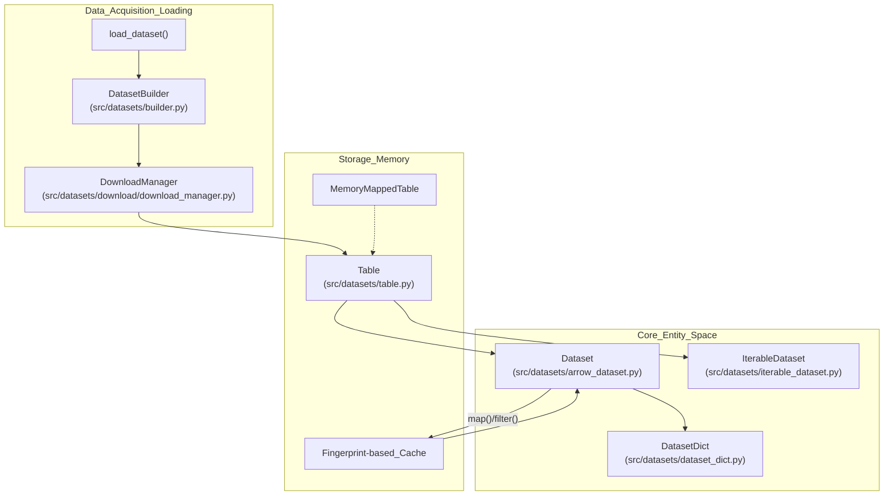
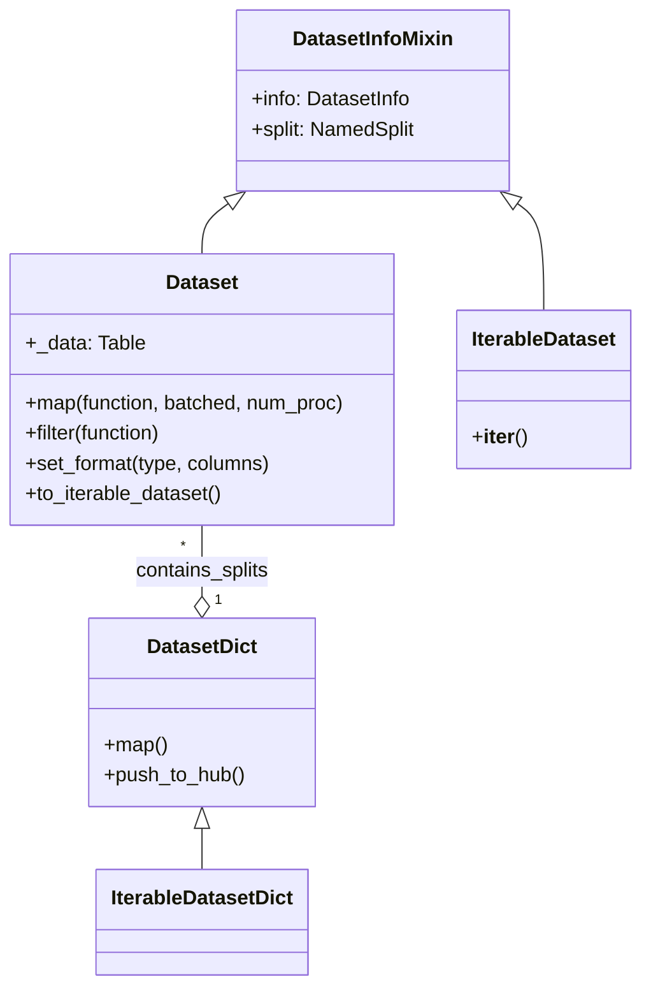

<!-- source: DeepWiki mcp.deepwiki.com · repo huggingface/datasets · page 1 Overview · fetched 2026-10-26 -->

# Overview

Relevant source files

The following files were used as context for generating this wiki page:

- [.github/workflows/ci.yml](.github/workflows/ci.yml)
- [.zenodo.json](.zenodo.json)
- [CONTRIBUTING.md](CONTRIBUTING.md)
- [README.md](README.md)
- [docs/source/access.mdx](docs/source/access.mdx)
- [docs/source/dataset_card.mdx](docs/source/dataset_card.mdx)
- [docs/source/faiss_es.mdx](docs/source/faiss_es.mdx)
- [docs/source/index.mdx](docs/source/index.mdx)
- [docs/source/load_hub.mdx](docs/source/load_hub.mdx)
- [docs/source/quickstart.mdx](docs/source/quickstart.mdx)
- [docs/source/use_dataset.mdx](docs/source/use_dataset.mdx)
- [setup.py](setup.py)
- [src/datasets/__init__.py](src/datasets/__init__.py)
- [tests/utils.py](tests/utils.py)

The Hugging Face Datasets library is a lightweight library designed to provide one-line dataloaders for thousands of public datasets and efficient data pre-processing for various modalities including text, image, audio, video, and 3D medical images (NIfTI). [README.md:21-24]()

Built on **Apache Arrow**, it enables memory-efficient data handling through zero-serialization cost memory-mapping, allowing users to work with datasets that exceed their RAM capacity by leveraging disk-backed storage. [README.md:44-47](), [setup.py:114]()

## Core Architecture

The architecture is divided into three functional layers: the User Interface (API), the Storage Layer (Arrow-based), and the I/O Layer (Data acquisition and Hub integration).

### System Data Flow

The following diagram illustrates how data flows from various sources (Hub, local files) into the library's core entities and out to machine learning frameworks.

Sources: [src/datasets/load.py:34](), [src/datasets/builder.py:19](), [src/datasets/__init__.py:17-47](), [README.md:94-102]()

### Code Entity Relationships

The library uses a mixin-based architecture to provide functionality like metadata management and framework integration.

Sources: [src/datasets/arrow_dataset.py:17](), [src/datasets/iterable_dataset.py:33](), [src/datasets/dataset_dict.py:21](), [src/datasets/info.py:25]()

## Dataset Representation

Datasets are primarily represented by two paradigms depending on the access pattern and size requirements:

### 1. Map-style Datasets (`Dataset`)
The `Dataset` class is the standard implementation for datasets that fit on disk. [src/datasets/arrow_dataset.py:17]()
- **Random Access**: Supports fast random access to rows via indexing (e.g., `dataset[0]`). [docs/source/access.mdx:21-28]()
- **Memory Mapping**: Backed by Apache Arrow, it uses memory-mapping to keep RAM usage low even for large datasets. [README.md:44-45]()
- **Caching**: Operations like `map` and `filter` use deterministic fingerprinting to cache results. If a transformation is repeated, the library reuses the cached Arrow files. [README.md:45](), [src/datasets/fingerprint.py:24]()

### 2. Streaming Datasets (`IterableDataset`)
For datasets that are too large to fit on disk or when immediate access is needed without waiting for a full download, `IterableDataset` provides a lazy-loading interface. [docs/source/access.mdx:3](), [src/datasets/iterable_dataset.py:33]()
- **Lazy Evaluation**: Data is fetched and decoded on-the-fly during iteration. [docs/source/access.mdx:118-123]()
- **Streaming Mode**: Enabled by passing `streaming=True` to `load_dataset`. [docs/source/access.mdx:97-102]()

Sources: [src/datasets/arrow_dataset.py:17](), [src/datasets/iterable_dataset.py:33](), [docs/source/access.mdx:3-158]()

## Data Loading System

The primary entry point is the `load_dataset` function, which handles local files (CSV, JSON, Parquet, etc.) and Hub-hosted datasets. [src/datasets/load.py:34](), [README.md:38-39]()

| Component | Role | Reference |
| :--- | :--- | :--- |
| `load_dataset` | High-level API to load a `Dataset` or `DatasetDict`. | [src/datasets/load.py:34]() |
| `DatasetBuilder` | Abstract base class defining data generation logic. | [src/datasets/builder.py:19]() |
| `DatasetInfo` | Container for metadata (description, features, size). | [src/datasets/info.py:25]() |
| `DownloadManager` | Utility for downloading and extracting remote assets. | [src/datasets/download/__init__.py:22]() |

Sources: [src/datasets/load.py:34](), [src/datasets/builder.py:19](), [README.md:94-102]()

## Features and Type System

The `Features` system defines the internal schema and handles the conversion between raw data and Python-friendly objects. [src/datasets/features/__init__.py:23]()

- **Specialized Media**: 
    - `Audio`: Handles decoding and resampling of audio signals. [docs/source/use_dataset.mdx:102-127]()
    - `Image`: Handles image decoding (via Pillow). [setup.py:144-146]()
- **Structured Data**: Supports nested structures via `Sequence` and `Struct`. [README.md:49-50]()

Sources: [src/datasets/features/__init__.py:23](), [docs/source/use_dataset.mdx:98-138]()

## Data Processing & Transformations

The library provides powerful methods for cleaning and preparing data for models:

- **map()**: Applies a function to every example or batch. Supports multi-processing via `num_proc`. [README.md:47](), [docs/source/use_dataset.mdx:55-62]()
- **filter()**: Filters the dataset based on a condition.
- **cast_column()**: Changes the feature type of a column (e.g., changing audio sampling rate). [docs/source/use_dataset.mdx:124-127]()
- **set_format()**: Configures the `__getitem__` output to be compatible with PyTorch, TensorFlow, NumPy, or Pandas. [docs/source/use_dataset.mdx:68-74]()

Sources: [src/datasets/arrow_dataset.py:17](), [docs/source/use_dataset.mdx:1-138]()

## Framework Interoperability

`datasets` is designed to be framework-agnostic, supporting:
- **PyTorch**: Integration via `set_format(type="torch")`. [docs/source/use_dataset.mdx:68-76]()
- **TensorFlow**: Integration via `to_tf_dataset()`. [docs/source/use_dataset.mdx:77-91]()
- **JAX/NumPy/Pandas/Polars**: Native conversion support. [README.md:46]()

Sources: [docs/source/use_dataset.mdx:64-94](), [setup.py:107-137]()

---

