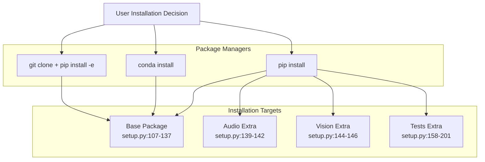
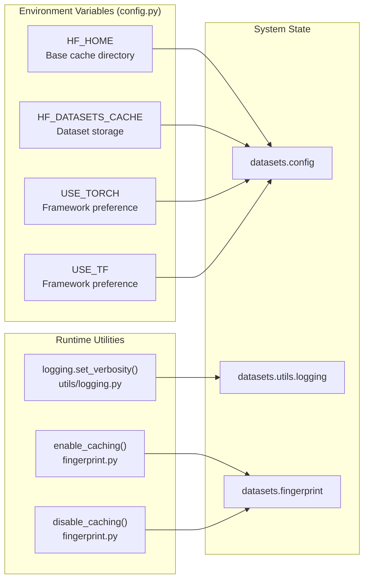

<!-- source: DeepWiki mcp.deepwiki.com · repo huggingface/datasets · page 10 Installation and Configuration · fetched 2026-10-26 -->

# Installation and Configuration

<details>
<summary>Relevant source files</summary>

The following files were used as context for generating this wiki page:

- [.github/workflows/ci.yml](.github/workflows/ci.yml)
- [setup.py](setup.py)
- [src/datasets/__init__.py](src/datasets/__init__.py)
- [src/datasets/config.py](src/datasets/config.py)
- [tests/conftest.py](tests/conftest.py)
- [tests/utils.py](tests/utils.py)

</details>


## Purpose and Scope

This page provides an overview of how to install the `datasets` library and configure its runtime behavior. It covers the available installation methods, dependency requirements, and the configuration system that controls caching, logging, and other operational parameters.

For detailed installation instructions with examples, see [Installation Guide](#10.1). For information about the logging system and debugging utilities, see [Logging and Debugging](#10.2).

## Installation Methods

The `datasets` library can be installed through multiple package managers, each suited to different workflows and environments.



**Installation Method Overview:**

Sources: [setup.py:107-201](), [.github/workflows/ci.yml:68-83]()

### pip Installation

The standard installation method uses `pip` to install from PyPI:

```bash
pip install datasets
```

Optional feature dependencies can be installed using extras syntax defined in `setup.py`:

```bash
pip install datasets[audio]          # Audio feature support
pip install datasets[vision]         # Image feature support
pip install datasets[audio,vision]   # Multiple extras
```

Sources: [setup.py:139-146]()

### Source Installation

Development installations from source enable editable installs. The CI environment frequently uses this method to test the `main` branch:

```bash
git clone https://github.com/huggingface/datasets.git
cd datasets
pip install -e .
```

Sources: [setup.py:10-31](), [.github/workflows/ci.yml:72]()

## Dependency Structure

The library has a tiered dependency structure with required core packages and optional extras for specific data modalities.

```mermaid
graph TB
    subgraph "Core Dependencies (REQUIRED_PKGS)"
        FileSync["filelock<br/>File locking"]
        Numpy["numpy>=1.17<br/>Array operations"]
        Arrow["pyarrow>=21.0.0<br/>Storage backend"]
        Dill["dill>=0.3.0,<0.4.2<br/>Serialization"]
        Pandas["pandas<br/>Performance"]
        Network["requests>=2.32.2<br/>httpx<1.0.0<br/>Network operations"]
        Progress["tqdm>=4.66.3<br/>Progress bars"]
        Hash["xxhash<br/>Fast hashing"]
        Multi["multiprocess<0.70.20<br/>Multiprocessing"]
        FS["fsspec[http]>=2023.1.0<br/>Filesystem abstraction"]
        Hub["huggingface-hub>=0.25.0<br/>Hub integration"]
        Utils["packaging<br/>pyyaml>=5.1<br/>Utilities"]
    end
    
    subgraph "Optional Extras"
        Audio["AUDIO_REQUIRE<br/>torchcodec>=0.6.0<br/>torch>=2.8.0"]
        Vision["VISION_REQUIRE<br/>Pillow>=9.4.0"]
    end
    
    Dataset["datasets Package"]
    
    Dataset --> FileSync
    Dataset --> Numpy
    Dataset --> Arrow
    Dataset --> Dill
    Dataset --> Pandas
    Dataset --> Network
    Dataset --> Progress
    Dataset --> Hash
    Dataset --> Multi
    Dataset --> FS
    Dataset --> Hub
    Dataset --> Utils
    
    Dataset -.optional.-> Audio
    Dataset -.optional.-> Vision
```



**Core Dependencies Table:**

| Dependency | Version Constraint | Purpose |
|------------|-------------------|---------|
| `filelock` | (any) | Thread-safe file locking for cache management [setup.py:109]() |
| `numpy` | `>=1.17` | Array operations and dataset shuffling [setup.py:111]() |
| `pyarrow` | `>=21.0.0` | Columnar storage backend with Parquet support [setup.py:114]() |
| `dill` | `>=0.3.0,<0.4.2` | Enhanced serialization for deterministic caching [setup.py:116]() |
| `pandas` | (any) | Performance gains with Apache Arrow [setup.py:118]() |
| `requests` | `>=2.32.2` | Downloading datasets over HTTPS [setup.py:120]() |
| `httpx` | `<1.0.0` | Async HTTP operations [setup.py:121]() |
| `tqdm` | `>=4.66.3` | Progress bars in downloads and data operations [setup.py:123]() |
| `xxhash` | (any) | Fast hashing for fingerprinting [setup.py:125]() |
| `multiprocess` | `<0.70.20` | Better multiprocessing support [setup.py:127]() |
| `fsspec[http]` | `>=2023.1.0,<=2026.6.0` | Saving datasets locally or on any filesystem [setup.py:130]() |
| `huggingface-hub` | `>=0.25.0,<2.0` | Hub integration and authentication [setup.py:132]() |
| `packaging` | (any) | Version comparison utilities [setup.py:134]() |
| `pyyaml` | `>=5.1` | YAML metadata parsing from dataset cards [setup.py:136]() |

Sources: [setup.py:107-137]()

**Optional Extras Table:**

| Extra | Dependencies | Purpose |
|-------|-------------|---------|
| `audio` | `torchcodec>=0.6.0`, `torch>=2.8.0` | Audio feature support and decoding [setup.py:139-142]() |
| `vision` | `Pillow>=9.4.0` | Image feature support with EXIF tags [setup.py:144-146]() |
| `mesh` | `trimesh>=4.10.0` | 3D mesh data support [setup.py:148-150]() |
| `tests` | Multiple packages | Full test suite dependencies [setup.py:158-201]() |

Sources: [setup.py:139-201]()

### Python Version Requirements

The library is tested on **Python 3.10** and **Python 3.14** in the CI pipeline.

Sources: [.github/workflows/ci.yml:55](), [.github/workflows/ci.yml:106]()

## Configuration System

The `datasets` library uses a combination of environment variables and runtime settings to control its behavior.



Sources: [src/datasets/config.py:1-181](), [src/datasets/fingerprint.py:120-141](), [src/datasets/__init__.py:24-47]()

### Cache Locations

The library stores downloaded data and processed datasets in specific cache directories, which can be overridden via environment variables:

*   **`HF_HOME`**: The base directory for all Hugging Face related data (defaults to `~/.cache/huggingface`) [src/datasets/config.py:155-156]().
*   **`HF_DATASETS_CACHE`**: Specific directory for dataset files (defaults to `$HF_HOME/datasets`) [src/datasets/config.py:158-159]().
*   **`HF_MODULES_CACHE`**: Directory for downloaded dataset scripts [src/datasets/config.py:161-162]().

### Framework Integration

The library automatically detects available deep learning frameworks (`torch`, `tensorflow`, `jax`). Users can force or disable specific frameworks using:
*   `USE_TORCH`: Set to `TRUE`, `FALSE`, or `AUTO` [src/datasets/config.py:43]().
*   `USE_TF`: Set to `TRUE`, `FALSE`, or `AUTO` [src/datasets/config.py:42]().

Sources: [src/datasets/config.py:42-130]()

### Caching Configuration

Caching can be toggled at runtime using functions exported in the main namespace:

```python
import datasets

# Check caching status
print(datasets.is_caching_enabled())

# Disable caching
datasets.disable_caching()

# Re-enable caching
datasets.enable_caching()
```

Sources: [src/datasets/fingerprint.py:120-163](), [src/datasets/__init__.py:24]()

## Version Management

The library version is defined in two synchronized locations:

1. **`setup.py`**: Used for package distribution.
2. **`src/datasets/__init__.py`**: Used for runtime version checks.
   ```python
   __version__ = "5.0.1.dev0"  # Line 15
   ```

Sources: [src/datasets/__init__.py:15](), [setup.py:33-35]()

## Verification and Testing

After installation, the library can be verified by loading a small dataset. The test suite uses `pytest` and relies on environment flags like `RUN_SLOW` or `RUN_REMOTE` to control test execution depth.

Sources: [tests/utils.py:25-44](), [tests/conftest.py:11-17]()

## Configuration Best Practices

1. **Virtual Environment**: Install in a dedicated environment to manage specific versions of `pyarrow` and `dill` [setup.py:114-116]().
2. **Cache Management**: Monitor `HF_DATASETS_CACHE` size, as processed datasets can consume significant disk space [src/datasets/config.py:159]().
3. **Framework Selection**: If using both PyTorch and TensorFlow, use `USE_TORCH` or `USE_TF` environment variables to avoid ambiguity in formatters [src/datasets/config.py:42-49]().

Sources: [src/datasets/config.py:42-159](), [setup.py:114-116]()

---

