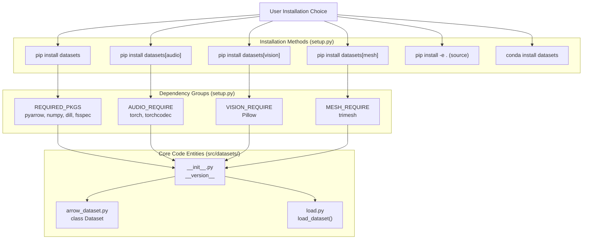
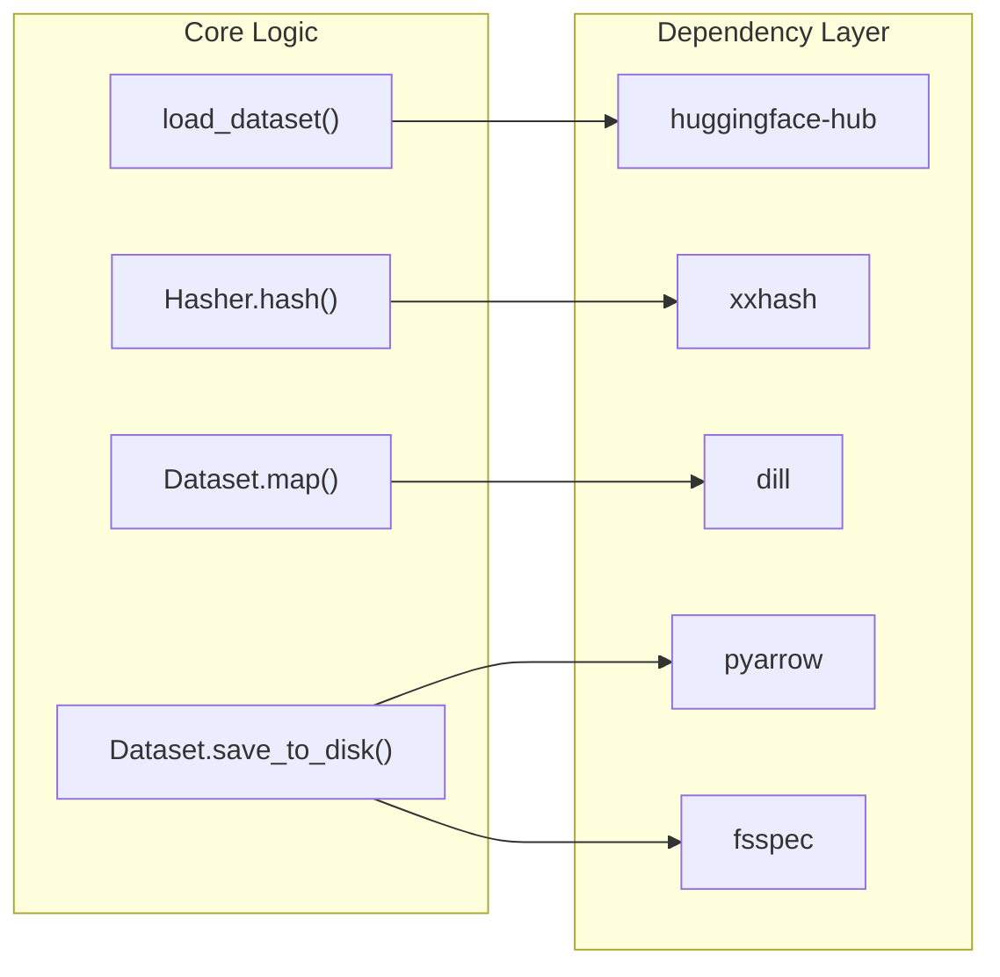

<!-- source: DeepWiki mcp.deepwiki.com · repo huggingface/datasets · page 10.1 Installation Guide · fetched 2026-10-26 -->

# Installation Guide

<details>
<summary>Relevant source files</summary>

The following files were used as context for generating this wiki page:

- [.github/conda/build.sh](.github/conda/build.sh)
- [.github/conda/meta.yaml](.github/conda/meta.yaml)
- [.github/workflows/ci.yml](.github/workflows/ci.yml)
- [.github/workflows/release-conda.yml](.github/workflows/release-conda.yml)
- [docs/source/about_dataset_features.mdx](docs/source/about_dataset_features.mdx)
- [docs/source/create_dataset.mdx](docs/source/create_dataset.mdx)
- [docs/source/installation.md](docs/source/installation.md)
- [docs/source/mesh_dataset.mdx](docs/source/mesh_dataset.mdx)
- [docs/source/mesh_load.mdx](docs/source/mesh_load.mdx)
- [setup.py](setup.py)
- [src/datasets/__init__.py](src/datasets/__init__.py)
- [src/datasets/features/mesh.py](src/datasets/features/mesh.py)
- [tests/features/test_mesh.py](tests/features/test_mesh.py)
- [tests/utils.py](tests/utils.py)

</details>


## Purpose and Scope

This page documents the installation methods, dependencies, and configuration requirements for the Hugging Face Datasets library. It covers basic installation via `pip` and `conda`, optional extras for audio, vision, and mesh processing, and installation from source. The library is tested on **Python 3.10+** [docs/source/installation.md:3](). For information about configuring logging and debugging after installation, see [Logging and Debugging](#10.2).

## Prerequisites

The Datasets library requires **Python 3.10 or higher** [docs/source/installation.md:3](). The library is built on Apache Arrow for columnar data storage and memory-mapping capabilities. Key mandatory dependencies include `pyarrow>=21.0.0`, `numpy>=1.17`, and `huggingface-hub>=0.25.0` [setup.py:107-137]().

## Installation Methods Overview

The following diagram maps user installation choices to the internal package structure and dependency groups defined in `setup.py`.

**Installation Decision to Code Entity Map**

**Sources:** [setup.py:107-151](), [src/datasets/__init__.py:15-34](), [docs/source/installation.md:1-104]()

## Virtual Environment Setup

It is strongly recommended to install the Datasets library in a virtual environment to avoid dependency conflicts. The library integrates with multiple frameworks (PyTorch, TensorFlow, JAX) and file systems (S3, GCS), which can have complex dependency trees.

### Creating a Virtual Environment

```bash
# Create project directory
mkdir ~/my-project
cd ~/my-project

# Create virtual environment
python -m venv .env

# Activate virtual environment (Linux/macOS)
source .env/bin/activate

# Activate virtual environment (Windows)
.env\Scripts\activate
```
**Sources:** [docs/source/installation.md:8-35]()

## Installation via pip

### Basic Installation

The standard installation includes core dependencies for loading, caching, and processing datasets:

```bash
pip install datasets
```

This installs the requirements defined in `REQUIRED_PKGS` [setup.py:107-137]():
- `pyarrow>=21.0.0`: Backend and serialization [setup.py:114]().
- `dill>=0.3.0,<0.4.2`: For smart caching and function serialization [setup.py:116]().
- `huggingface-hub>=0.25.0,<2.0`: To fetch datasets from the Hub [setup.py:132]().
- `fsspec[http]>=2023.1.0,<=2026.6.0`: For filesystem abstraction [setup.py:130]().

### Verification

After installation, verify the library is working correctly:

```bash
python -c "from datasets import load_dataset; print(load_dataset('rajpurkar/squad', split='train')[0])"
```

This command calls `load_dataset` from [src/datasets/load.py:34](), which downloads the SQuAD dataset, caches it via Arrow, and returns the first training example [docs/source/installation.md:48-55]().

**Sources:** [setup.py:107-137](), [docs/source/installation.md:37-55]()

## Optional Dependencies (Extras)

### Audio Processing

To work with audio datasets using the `Audio` feature type, install the audio extra:

```bash
pip install datasets[audio]
```

This triggers the `AUDIO_REQUIRE` group in `setup.py` [setup.py:139-142]():
- `torch>=2.8.0`
- `torchcodec>=0.6.0`

### Vision Processing

To work with image datasets using the `Image` feature type, install the vision extra:

```bash
pip install datasets[vision]
```

This triggers the `VISION_REQUIRE` group [setup.py:144-146]():
- `Pillow>=9.4.0`: Required for handling image metadata and ExifTags.

### Mesh Processing

To work with 3D mesh datasets using the `Mesh` feature type, install the mesh extra:

```bash
pip install datasets[mesh]
```

This triggers the `MESH_REQUIRE` group [setup.py:148-150]():
- `trimesh>=4.10.0`: Used for decoding `.glb`, `.ply`, and `.stl` files in `Mesh.decode_example` [src/datasets/features/mesh.py:112-127]().

**Sources:** [setup.py:139-150](), [docs/source/installation.md:57-80](), [src/datasets/features/mesh.py:23-45]()

## Framework Integration

The Datasets library integrates with deep learning frameworks but does not install them by default to avoid bloat [docs/source/installation.md:6]().

| Framework | Installation Command | Code Integration |
|-----------|---------------------|-------------------|
| PyTorch | `pip install torch` | `TorchFormatter` in `src/datasets/formatting/` |
| TensorFlow | `pip install tensorflow` | `TensorFlowFormatter`, `to_tf_dataset()` |
| JAX | `pip install jax jaxlib` | `JAXFormatter` |

**Sources:** [docs/source/installation.md:6](), [setup.py:185-189](), [tests/utils.py:144-203]()

## Installation from Source

Installing from source is preferred for developers using the latest `main` branch:

```bash
git clone https://github.com/huggingface/datasets.git
cd datasets
pip install -e .
```

The `-e` flag performs an editable install, linking the source directory directly to your site-packages [docs/source/installation.md:81-89]().

**Sources:** [docs/source/installation.md:81-96]()

## Installation via conda

Datasets is available on the `huggingface` and `conda-forge` channels:

```bash
conda install -c huggingface -c conda-forge datasets
```

The conda recipe is defined in `.github/conda/meta.yaml` and includes requirements such as `python-xxhash`, `dill`, and `pandas` [.github/conda/meta.yaml:13-45]().

**Sources:** [docs/source/installation.md:97-104](), [.github/conda/meta.yaml:1-56]()

## Dependency Architecture and Data Flow

The following diagram illustrates how core classes rely on specific dependencies for functionality.

**Dependency to Logic Flow**

**Sources:** [setup.py:107-137](), [src/datasets/__init__.py:17-47]()

### Key Dependency Roles

| Dependency | Purpose | Code Reference |
|------------|---------|----------------|
| `pyarrow` | Columnar storage and memory-mapping | [setup.py:114](), [src/datasets/arrow_dataset.py:17]() |
| `xxhash` | Fast hashing for dataset fingerprinting | [setup.py:125](), [src/datasets/fingerprint.py:24]() |
| `dill` | Serialization of Python functions for multiprocessing | [setup.py:116](), [src/datasets/fingerprint.py:24]() |
| `fsspec` | Abstraction for local and remote filesystems | [setup.py:130](), [src/datasets/download/download_manager.py]() |
| `huggingface-hub` | Interaction with the HF Datasets Hub | [setup.py:132](), [src/datasets/load.py:34]() |

**Sources:** [setup.py:107-137](), [src/datasets/__init__.py:17-47]()

---

