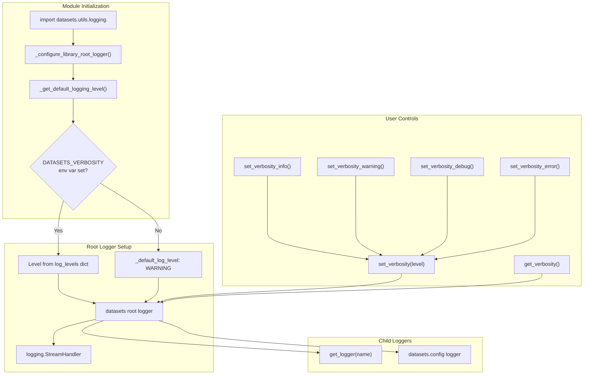

<!-- source: DeepWiki mcp.deepwiki.com · repo huggingface/datasets · page 10.2 Logging and Debugging · fetched 2026-10-26 -->

# Logging and Debugging

<details>
<summary>Relevant source files</summary>

The following files were used as context for generating this wiki page:

- [src/datasets/config.py](src/datasets/config.py)
- [src/datasets/exceptions.py](src/datasets/exceptions.py)
- [src/datasets/utils/logging.py](src/datasets/utils/logging.py)
- [src/datasets/utils/track.py](src/datasets/utils/track.py)
- [tests/conftest.py](tests/conftest.py)
- [tests/test_exceptions.py](tests/test_exceptions.py)

</details>


## Overview

This document explains the logging system, exception hierarchy, and debugging utilities in the `datasets` library. It covers how to control log verbosity, manage progress bars, handle specific error types, and track data generation issues.

For information about caching and fingerprinting mechanisms, see [2.5 Caching and Fingerprinting](). For installation troubleshooting, see [10.1 Installation Guide]().

---

## Logging Architecture

The `datasets` library uses Python's standard `logging` module with a centralized configuration system. All library loggers are children of the root logger named `"datasets"`, which is configured automatically when the logging module is imported.

### Logging System Entity Map



**Sources:** [src/datasets/utils/logging.py:73-78](), [src/datasets/utils/logging.py:49-62](), [src/datasets/utils/logging.py:65-70](), [src/datasets/config.py:13-13]()

The root logger is configured with:
- A `StreamHandler` that outputs to stderr [src/datasets/utils/logging.py:76]().
- A default level of `WARNING` [src/datasets/utils/logging.py:46]() or the level specified by the `DATASETS_VERBOSITY` environment variable [src/datasets/utils/logging.py:54]().
- Automatic initialization when the module is imported [src/datasets/utils/logging.py:175-175]().

---

## Log Levels and Verbosity

The library supports standard Python logging levels, re-exported in `datasets.utils.logging` [src/datasets/utils/logging.py:18-27]().

### Available Levels

| Level | Numeric Value | Use Case |
|-------|---------------|----------|
| `DEBUG` | 10 | Detailed diagnostic information for development [src/datasets/utils/logging.py:20]() |
| `INFO` | 20 | General progress and informational messages [src/datasets/utils/logging.py:23]() |
| `WARNING` | 30 | Potential issues (Default) [src/datasets/utils/logging.py:26]() |
| `ERROR` | 40 | Errors affecting specific operations [src/datasets/utils/logging.py:21]() |
| `CRITICAL` | 50 | Severe errors that may halt execution [src/datasets/utils/logging.py:19]() |

### Programmatic Control

Users can modify the logging behavior at runtime using several convenience functions:

*   `set_verbosity(verbosity: int)`: Sets the library root logger to a specific level [src/datasets/utils/logging.py:110-116]().
*   `set_verbosity_info()`: Shortcut for `INFO` level [src/datasets/utils/logging.py:119-126]().
*   `set_verbosity_debug()`: Shortcut for `DEBUG` level [src/datasets/utils/logging.py:139-146]().
*   `set_verbosity_warning()`: Shortcut for `WARNING` level [src/datasets/utils/logging.py:129-136]().
*   `set_verbosity_error()`: Shortcut for `ERROR` level [src/datasets/utils/logging.py:149-156]().

### Environment Variables

The `DATASETS_VERBOSITY` environment variable allows setting the default level without changing code [src/datasets/utils/logging.py:54](). Valid values include `"debug"`, `"info"`, `"warning"`, `"error"`, and `"critical"` [src/datasets/utils/logging.py:38-44]().

**Sources:** [src/datasets/utils/logging.py:38-62](), [src/datasets/utils/logging.py:110-156]()

---

## Progress Bar Management

The library uses `tqdm` for progress bars. These can be toggled globally via the logging module [src/datasets/utils/logging.py:30-35]().

| Function | Description |
|----------|-------------|
| `disable_progress_bar()` | Globally disables all library progress bars [src/datasets/utils/logging.py:31]() |
| `enable_progress_bar()` | Globally enables all library progress bars [src/datasets/utils/logging.py:32]() |
| `is_progress_bar_enabled()` | Returns a boolean indicating the current state [src/datasets/utils/logging.py:33]() |

**Sources:** [src/datasets/utils/logging.py:30-35](), [tests/conftest.py:40-41]()

---

## Exception System

The library defines a hierarchy of exceptions in `src/datasets/exceptions.py` to handle various failure modes during dataset loading, generation, and verification.

### Exception Hierarchy Entity Map

```mermaid
classDiagram
    class DatasetsError {
        <<Base>>
    }
    class DatasetNotFoundError {
        +FileNotFoundError
    }
    class DatasetBuildError
    class DatasetGenerationError
    class DatasetGenerationCastError {
        +from_cast_error()
    }
    class ChecksumVerificationError
    class NonMatchingChecksumError
    class SplitsVerificationError

    DatasetsError <|-- DatasetNotFoundError
    DatasetsError <|-- DatasetBuildError
    DatasetsError <|-- ChecksumVerificationError
    DatasetsError <|-- SplitsVerificationError
    DatasetBuildError <|-- DatasetGenerationError
    DatasetGenerationError <|-- DatasetGenerationCastError
    ChecksumVerificationError <|-- NonMatchingChecksumError
    
    DatasetsError : Base class for all library exceptions [src/datasets/exceptions.py:12]
    DatasetGenerationCastError : Detailed error for schema mismatches [src/datasets/exceptions.py:53]
    DatasetNotFoundError : Raised for missing or gated datasets [src/datasets/exceptions.py:28]
```

### Key Exception Types

*   **`DatasetsError`**: The base class for all library-specific exceptions [src/datasets/exceptions.py:12-13]().
*   **`DatasetNotFoundError`**: Raised when a dataset cannot be found on the Hub or locally [src/datasets/exceptions.py:28-34]().
*   **`DatasetGenerationCastError`**: A specialized error raised when data files have inconsistent schemas. It provides a detailed explanation including which columns mismatched and the specific file or generator item that caused the failure [src/datasets/exceptions.py:53-87]().
*   **Verification Errors**:
    *   `ChecksumVerificationError`: Base for checksum failures [src/datasets/exceptions.py:90-91]().
    *   `NonMatchingChecksumError`: Raised when a downloaded file's SHA256 does not match the metadata [src/datasets/exceptions.py:102-103]().
    *   `SplitsVerificationError`: Base for split-level failures (e.g., wrong number of examples) [src/datasets/exceptions.py:106-107]().

**Sources:** [src/datasets/exceptions.py:12-120](), [tests/test_exceptions.py:6-15]()

---

## Debugging Utilities

### Data Tracking
To help debug complex generation errors, the library uses "tracked" objects that preserve the origin of a string or the current state of an iterator.

*   **`tracked_str`**: A string subclass that stores its "origin" (e.g., the URL or file path it came from) [src/datasets/utils/track.py:4-18]().
*   **`tracked_list`**: A list that tracks the `last_item` yielded during iteration [src/datasets/utils/track.py:21-36]().
*   **`TrackedIterableFromGenerator`**: Wraps a generator to track the last yielded item, allowing `DatasetGenerationCastError` to report exactly which row caused a schema mismatch [src/datasets/utils/track.py:39-61]().

### Configuration Debugging
The `src/datasets/config.py` module maintains state for environment-based settings:
*   **Library Availability**: Tracks if optional dependencies like `torch`, `tensorflow`, or `jax` are available and logs their versions [src/datasets/config.py:47-130]().
*   **Path Tracking**: Stores default and environment-overridden paths for `HF_DATASETS_CACHE`, `DOWNLOADED_DATASETS_PATH`, and `EXTRACTED_DATASETS_PATH` [src/datasets/config.py:158-170]().

**Sources:** [src/datasets/utils/track.py:4-61](), [src/datasets/config.py:42-170]()

---

## Example: Debugging Schema Mismatches

When a `DatasetGenerationCastError` occurs, the library uses tracked metadata to produce a helpful error message. It iterates through `gen_kwargs` to find tracked origins:

```python
# From src/datasets/exceptions.py:53-87
if isinstance(gen_kwarg, tracked_str):
    gen_kwarg = gen_kwarg.get_origin()
```

If the error occurs while streaming from the Hub, it uses `HfFileSystem` to resolve the path and revision [src/datasets/exceptions.py:75-82](). This ensures that instead of a generic "Cast Error", the user sees:
`"This happened while the [builder_name] dataset builder was generating data using [file_path_or_url]"` [src/datasets/exceptions.py:84-85]().

**Sources:** [src/datasets/exceptions.py:53-87](), [src/datasets/utils/track.py:11-12]()

---

