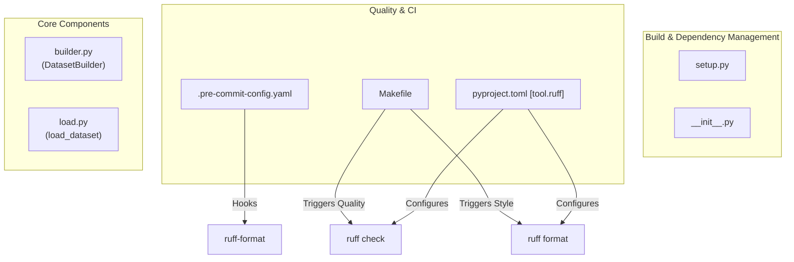
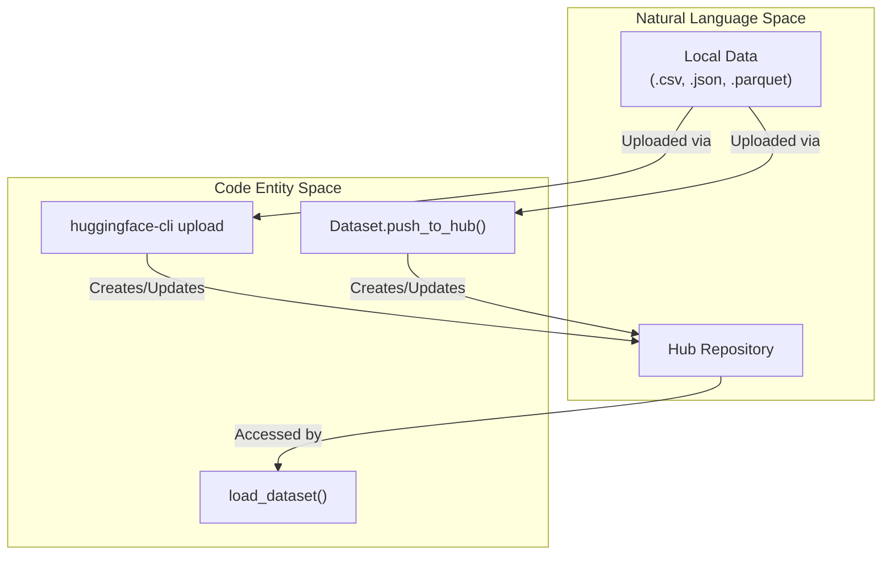

<!-- source: DeepWiki mcp.deepwiki.com · repo huggingface/datasets · page 11 Contributing and Development · fetched 2026-10-26 -->

# Contributing and Development

<details>
<summary>Relevant source files</summary>

The following files were used as context for generating this wiki page:

- [.pre-commit-config.yaml](.pre-commit-config.yaml)
- [ADD_NEW_DATASET.md](ADD_NEW_DATASET.md)
- [Makefile](Makefile)
- [docs/source/share.mdx](docs/source/share.mdx)
- [docs/source/troubleshoot.mdx](docs/source/troubleshoot.mdx)
- [docs/source/upload_dataset.mdx](docs/source/upload_dataset.mdx)
- [pyproject.toml](pyproject.toml)

</details>


This guide covers how to contribute to the 🤗 Datasets library, set up a development environment, write tests, add new datasets, and follow code quality standards. It is intended for developers who want to contribute bug fixes, new features, dataset builders, or documentation improvements.

For information about adding datasets to the Hugging Face Hub (without code contributions), see [Hugging Face Hub Integration](#8). For guidance on writing dataset documentation, see [Dataset Cards and Documentation](#7.2).

## Purpose and Scope

This page documents:
- Development environment setup and contribution workflow.
- Code formatting, testing, and quality standards.
- The builder framework for creating custom dataset loaders.
- Guidelines for writing dataset cards and documentation.
- Troubleshooting common development issues like pickling or authentication.

---

## Development Environment Setup

### Installation for Development

To contribute code to 🤗 Datasets, you need to install the library in editable mode with development dependencies.

**Basic Setup (formatting and linting only)**
```bash
pip install -e ".[quality]"
```

**Full Development Setup (all optional dependencies and testing tools)**
```bash
pip install -e ".[dev]"
```

The `quality` extra includes `ruff` for code linting and formatting. The `dev` extra includes all testing dependencies (`pytest`, `absl-py`), optional format support (audio, vision), and integration tools.

Sources: [Makefile:7-15](), [pyproject.toml:1-18]()

### System Architecture Overview

The following diagram maps high-level development concepts to the specific code entities in the repository.

**Code Entity Map: Development & Build System**



Sources: [Makefile:1-21](), [pyproject.toml:1-15](), [.pre-commit-config.yaml:1-10]()

---

## Contribution Workflow

### Code Quality and Formatting

The project uses `ruff` for both linting and formatting. You can run these checks via the `Makefile`:

| Command | Action | Entity Involved |
| :--- | :--- | :--- |
| `make style` | Formats code and fixes linting errors | `ruff format`, `ruff check --fix` |
| `make quality` | Checks for linting and formatting violations | `ruff check`, `ruff format --check` |

The linter configuration ignores specific rules like line length (`E501`) and function complexity (`C901`) to maintain a balance between strictness and developer velocity.

Sources: [Makefile:7-15](), [pyproject.toml:5-10]()

### Syncing and Committing

Before committing, it is recommended to use `pre-commit` to ensure all files meet the project's standards.

```bash
pip install pre-commit
pre-commit install
```

Sources: [.pre-commit-config.yaml:1-10]()

---

## Testing Framework

### Testing Infrastructure

The testing suite is powered by `pytest`. The configuration in `pyproject.toml` ensures that `FutureWarning` from `huggingface_hub` is treated as an error to catch regressions early.

**Test Categories:**
- `unit`: Isolated tests for specific functions or classes.
- `integration`: Tests that interact with external services or the Hub.

Sources: [pyproject.toml:19-27](), [Makefile:19-21]()

### Running Tests

Tests are located in the `tests/` directory. You can run them using the Makefile or directly via pytest:
```bash
make test
# OR
python -m pytest -n auto --dist=loadfile -s -v ./tests/
```

Sources: [Makefile:19-21]()

---

## Adding New Datasets

### Hub-First Approach

Most datasets should be uploaded directly to the Hugging Face Hub. This allows users to load them using `load_dataset("username/dataset_name")` without needing a local script.

- **CLI Upload**: Use `huggingface-cli upload [repo_id] [local_path] --repo-type dataset`.
- **Metadata**: Define splits and file patterns in the `README.md` YAML frontmatter.

**Code Entity Map: Hub Upload Workflow**



For details, see [Adding New Datasets](#11.1).

Sources: [ADD_NEW_DATASET.md:1-9](), [docs/source/share.mdx:64-87](), [docs/source/upload_dataset.mdx:90-98]()

---

## Troubleshooting

Common issues encountered during development and data contribution:

- **Authentication**: Ensure `huggingface-cli login` is performed with a **write** token when using `push_to_hub`.
- **Pickling**: When using `Dataset.from_generator` or `Dataset.map` with multiprocessing, all objects must be picklable. If you encounter `TypeError: cannot pickle 'generator' object`, ensure you are passing a generator function, not a generator instance.
- **Large Uploads**: If `push_to_hub` fails due to connection issues or "Too Many Requests" (HTTP 429), verify you are on `datasets >= 2.15.0` which includes improved sharding and retry logic.

Sources: [docs/source/troubleshoot.mdx:9-15](), [docs/source/troubleshoot.mdx:31-38](), [docs/source/troubleshoot.mdx:55-65]()

---

## Child Pages

- [Adding New Datasets](#11.1) — Detailed guide for custom dataset builders and Hub uploads.
- [Dataset Card Guidelines](#11.2) — Standards for documenting datasets and metadata.
- [Testing Framework](#11.3) — In-depth look at the testing infrastructure and benchmarking utilities.

---

