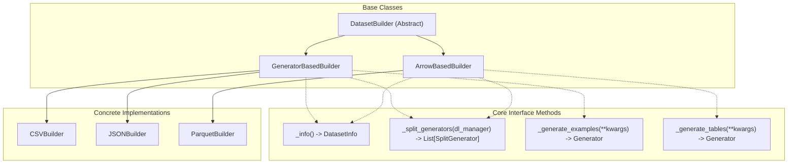
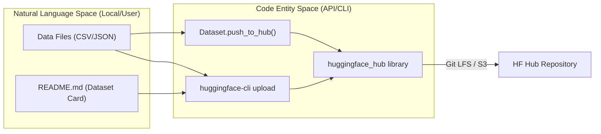
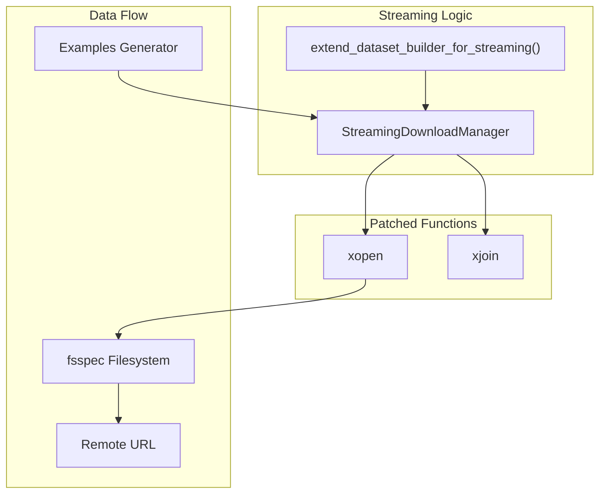

<!-- source: DeepWiki mcp.deepwiki.com · repo huggingface/datasets · page 11.1 Adding New Datasets · fetched 2026-10-26 -->

# Adding New Datasets

<details>
<summary>Relevant source files</summary>

The following files were used as context for generating this wiki page:

- [ADD_NEW_DATASET.md](ADD_NEW_DATASET.md)
- [docs/source/share.mdx](docs/source/share.mdx)
- [docs/source/troubleshoot.mdx](docs/source/troubleshoot.mdx)
- [docs/source/upload_dataset.mdx](docs/source/upload_dataset.mdx)
- [src/datasets/builder.py](src/datasets/builder.py)
- [src/datasets/commands/test.py](src/datasets/commands/test.py)
- [src/datasets/info.py](src/datasets/info.py)
- [templates/README.md](templates/README.md)
- [templates/README_guide.md](templates/README_guide.md)
- [tests/commands/test_test.py](tests/commands/test_test.py)
- [tests/test_builder.py](tests/test_builder.py)

</details>


This document provides a technical guide for adding new datasets to the Hugging Face Hub. It covers the implementation of custom dataset builders, the use of packaged modules, and the integration of streaming capabilities for large-scale data.

---

## Overview of Dataset Addition Methods

There are three primary methods for adding datasets, ranging from no-code Hub uploads to full Python implementation via the `DatasetBuilder` framework.

| Method | Use Case | Implementation Entity | Flexibility |
|--------|----------|-----------------------|-------------|
| **Direct Hub Upload** | Standard file formats (CSV, JSON, Parquet) | Automatic inference | Low |
| **Packaged Builders** | Specialized folder structures or archives | `packaged_modules` | Medium |
| **Custom Builders** | Complex logic or unique formats | `DatasetBuilder` subclass | High |

**Sources:** [ADD_NEW_DATASET.md:1-9](), [docs/source/upload_dataset.mdx:7-105](), [docs/source/share.mdx:18-31]()

---

## The DatasetBuilder Framework

The `DatasetBuilder` is the core abstract class for all dataset loading logic. It manages the lifecycle of a dataset: downloading, processing into Arrow format, and loading as a `Dataset` object.

### Class Hierarchy and Core Methods



**Builder Framework Architecture:** This diagram maps the relationship between abstract base classes and the required implementation methods for custom builders.

**Sources:** [src/datasets/builder.py:101-180](), [tests/test_builder.py:45-100]()

### Key Implementation Details

1.  **`_info()`**: Defines the `Features` (schema), description, and citation. It returns a `DatasetInfo` object [tests/test_builder.py:46-47]().
2.  **`_split_generators()`**: Uses a `DownloadManager` to acquire files and returns a list of `SplitGenerator` instances [tests/test_builder.py:49-50]().
3.  **`_generate_examples()`**: (For `GeneratorBasedBuilder`) Yields a tuple of `(key, example_dict)`. The `key` is used for deterministic shuffling and deduplication [tests/test_builder.py:68-70]().
4.  **`_generate_tables()`**: (For `ArrowBasedBuilder`) Yields a tuple of `(key, pa.Table)`. This is more efficient for data already in columnar formats [tests/test_builder.py:95-97]().

### Configuration Management
Custom builders can define multiple configurations using `BuilderConfig`. This allows a single script to support different subsets or versions of a dataset [src/datasets/builder.py:101-125]().
*   **`BUILDER_CONFIGS`**: A list of `BuilderConfig` instances [tests/test_builder.py:134-137]().
*   **`DEFAULT_CONFIG_NAME`**: Specifies which config to load if none is provided [tests/test_builder.py:141]().

**Sources:** [src/datasets/builder.py:101-180](), [tests/test_builder.py:112-141]()

---

## Packaged Modules and Hub Integration

The library includes built-in builders for common data patterns. Users can also push processed datasets directly to the Hub using the Python API.

### Hub Upload Workflow



**Upload Mapping:** Shows how local files and Python objects are transferred to the Hub.

**Sources:** [docs/source/share.mdx:64-120](), [docs/source/upload_dataset.mdx:90-104]()

### Dataset Cards
A `README.md` file serves as the dataset card. It must contain YAML metadata at the top for discoverability on the Hub, including tags for tasks, languages, and licenses [templates/README.md:1-30](), [templates/README_guide.md:1-44]().

---

## Streaming and Download Management

The library provides two types of download managers to handle data acquisition: `DownloadManager` for standard loading and `StreamingDownloadManager` for lazy access.

### Streaming Architecture

Streaming works by patching standard Python/OS functions with "x-versions" that understand remote filesystems and nested archives via `fsspec`.



**Streaming Patching Mechanism:** Illustrates how the library intercepts standard I/O calls to enable transparent streaming.

**Sources:** [src/datasets/builder.py:50-51](), [src/datasets/streaming.py:68]()

---

## Testing and Verification

New datasets should be verified using the `datasets-cli test` command or the `TestCommand` class.

### Verification Workflow

1.  **Load Builder**: `get_dataset_builder_class` is used to instantiate the builder from a local script or Hub path [src/datasets/commands/test.py:114-115]().
2.  **Download and Prepare**: `builder.download_and_prepare()` is called to trigger the full processing pipeline [src/datasets/commands/test.py:150-158]().
3.  **Check Integrity**: `VerificationMode.ALL_CHECKS` ensures checksums and split sizes match metadata [src/datasets/commands/test.py:156]().
4.  **Save Metadata**: Use `--save_info` to generate or update the `DatasetInfo` stored in the README YAML [src/datasets/commands/test.py:164-168]().

**Sources:** [src/datasets/commands/test.py:35-168](), [tests/commands/test_test.py:34-83]()

### CLI Usage
```bash
datasets-cli test path/to/dataset_script.py --name my_config --save_info
```

**Sources:** [src/datasets/commands/test.py:39-73]()

---

