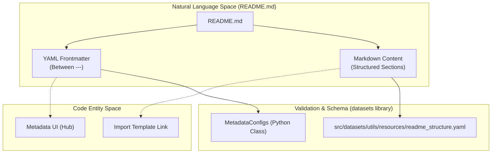
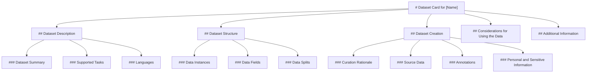

<!-- source: DeepWiki mcp.deepwiki.com · repo huggingface/datasets · page 11.2 Dataset Card Guidelines · fetched 2026-10-26 -->

# Dataset Card Guidelines

Relevant source files

The following files were used as context for generating this wiki page:

- [.zenodo.json](.zenodo.json)
- [CONTRIBUTING.md](CONTRIBUTING.md)
- [README.md](README.md)
- [docs/source/dataset_card.mdx](docs/source/dataset_card.mdx)
- [docs/source/faiss_es.mdx](docs/source/faiss_es.mdx)
- [src/datasets/utils/resources/readme_structure.yaml](src/datasets/utils/resources/readme_structure.yaml)
- [templates/README.md](templates/README.md)
- [templates/README_guide.md](templates/README_guide.md)

This document provides technical guidelines for creating dataset cards (`README.md` files) for datasets in the Hugging Face ecosystem. Dataset cards are standardized documentation files that describe datasets, their structure, provenance, and usage considerations [docs/source/dataset_card.mdx:1-6](). This page covers the required structure, metadata format, and validation rules.

## Dataset Card Structure

A dataset card is a `README.md` file consisting of two main components:
1.  **YAML Frontmatter**: Structured metadata enclosed between `---` delimiters at the beginning of the file [templates/README_guide.md:1-4]().
2.  **Markdown Content**: Human-readable documentation following a standardized template [templates/README.md:5-30]().

The relationship between the physical file and the code entities used for validation and parsing is shown below:

### README Processing Architecture

**Sources:** [docs/source/dataset_card.mdx:9-21](), [src/datasets/utils/resources/readme_structure.yaml:1-117](), [templates/README.md:1-3]()

---

## YAML Frontmatter and Metadata

The YAML frontmatter contains structured tags that facilitate dataset discovery on the Hugging Face Hub. Users are encouraged to use the **Metadata UI** on the Hub to generate these tags [docs/source/dataset_card.mdx:11-16]().

### Key Metadata Fields
| Field | Description | Source |
| :--- | :--- | :--- |
| `license` | The legal license under which the data is shared (e.g., `apache-2.0`). | [docs/source/dataset_card.mdx:11]() |
| `task_categories` | High-level categories like `text-classification` or `question-answering`. | [docs/source/dataset_card.mdx:11]() |
| `language` | BCP-47 codes representing the languages in the dataset. | [templates/README_guide.md:60]() |
| `pretty_name` | A human-readable title for the dataset. | [docs/source/dataset_card.mdx:11]() |
| `size_categories` | Estimated number of examples (e.g., `10K<n<100K`). | [docs/source/dataset_card.mdx:11]() |
| `configs` | Defines YAML-based configurations and splits without code. | [docs/source/dataset_card.mdx:25]() |

**Sources:** [docs/source/dataset_card.mdx:11-25](), [templates/README_guide.md:1-4]()

---

## Markdown Section Guidelines

The human-readable portion of the dataset card is governed by a strict hierarchy defined in `readme_structure.yaml` [src/datasets/utils/resources/readme_structure.yaml:1-5]().

### Required Sections Hierarchy
The library expects the following section structure in the `README.md`:

### Section Validation Rules
The `readme_structure.yaml` file defines whether sections can be empty:
- **Mandatory (No Empty Text)**: `Dataset Summary`, `Table of Contents`, `Contributions`. [src/datasets/utils/resources/readme_structure.yaml:11-19, 115]()
- **Flexible (Allow Empty Text)**: `Data Fields`, `Data Splits`, `Curation Rationale`, `Licensing Information`. [src/datasets/utils/resources/readme_structure.yaml:39-51, 107]()

**Sources:** [src/datasets/utils/resources/readme_structure.yaml:1-117](), [templates/README.md:7-30]()

---

## Content Best Practices

### Dataset Summary and Rationale
The summary should describe the domain, topic, and intended use of the dataset [templates/README_guide.md:48](). The **Curation Rationale** should explain the motivation behind the dataset's creation and major design choices [templates/README_guide.md:100-102]().

### Data Fields and Instances
- **Data Instances**: Provide a JSON-formatted example of a typical record [templates/README_guide.md:66-73]().
- **Data Fields**: List every field, its type, and its role (input/output) [templates/README_guide.md:77-81]().

### Social Impact and Biases
To promote responsible AI, dataset cards must address:
- **Social Impact**: How the dataset might affect society [templates/README_guide.md:144]().
- **Discussion of Biases**: Known biases in the source data or annotation process [templates/README_guide.md:151]().
- **Limitations**: Scenarios where the dataset should not be used [templates/README_guide.md:158]().

**Sources:** [templates/README_guide.md:46-158](), [docs/source/dataset_card.mdx:3-5]()

---

## Technical Integration

Dataset cards are not just documentation; they are functional components of the `datasets` library:

1.  **Code-free Loading**: The `configs` and `splits` defined in the YAML frontmatter allow `load_dataset` to function without a Python loading script [docs/source/dataset_card.mdx:25]().
2.  **Metadata Discovery**: The Hub uses the YAML tags to power the [Dataset Viewer](https://huggingface.co/datasets) and search filters [docs/source/dataset_card.mdx:11]().
3.  **Automatic Templates**: The library provides a template to ensure all relevant fields are present [templates/README.md:1-127]().

**Sources:** [docs/source/dataset_card.mdx:9-25](), [README.md:38-40]()

---

