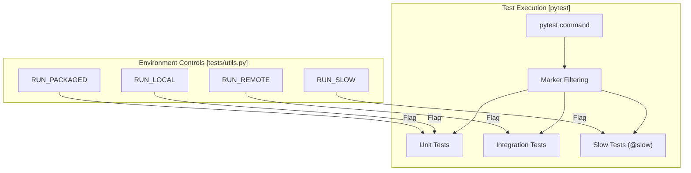
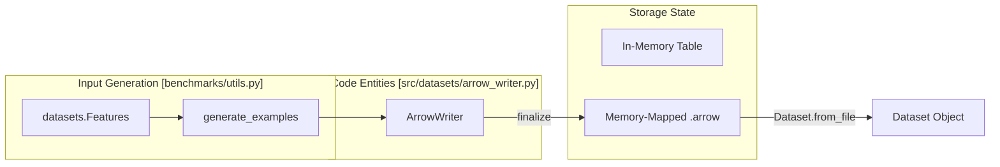

<!-- source: DeepWiki mcp.deepwiki.com · repo huggingface/datasets · page 11.3 Testing Framework · fetched 2026-10-26 -->

# Testing Framework

<details>
<summary>Relevant source files</summary>

The following files were used as context for generating this wiki page:

- [.github/workflows/ci.yml](.github/workflows/ci.yml)
- [.gitignore](.gitignore)
- [.pre-commit-config.yaml](.pre-commit-config.yaml)
- [Makefile](Makefile)
- [benchmarks/benchmark_iterating.py](benchmarks/benchmark_iterating.py)
- [benchmarks/results/benchmark_array_xd.json](benchmarks/results/benchmark_array_xd.json)
- [benchmarks/results/benchmark_indices_mapping.json](benchmarks/results/benchmark_indices_mapping.json)
- [benchmarks/results/benchmark_iterating.json](benchmarks/results/benchmark_iterating.json)
- [benchmarks/results/benchmark_map_filter.json](benchmarks/results/benchmark_map_filter.json)
- [benchmarks/utils.py](benchmarks/utils.py)
- [pyproject.toml](pyproject.toml)
- [setup.py](setup.py)
- [src/datasets/__init__.py](src/datasets/__init__.py)
- [src/datasets/utils/info_utils.py](src/datasets/utils/info_utils.py)
- [tests/test_info_utils.py](tests/test_info_utils.py)
- [tests/utils.py](tests/utils.py)

</details>


This document outlines the testing framework used in the Hugging Face `datasets` library. It describes the organization of tests, implementation of specialized test utilities, data flow for test fixtures, and performance benchmarking infrastructure.

## Overview

The `datasets` library utilizes `pytest` as its primary testing engine, augmented by `absl-py` for parameterized testing. The framework is designed to validate the integrity of Apache Arrow-backed data structures, dataset transformation logic (map/filter), and integration with the Hugging Face Hub and various ML frameworks (PyTorch, TensorFlow, JAX).

## Test Organization and Entity Mapping

The testing suite is divided into functional areas that map directly to core library components.

### Natural Language to Code Entity Space

| Component | Test File / Class | Core Entity Tested |
| :--- | :--- | :--- |
| **Arrow Storage** | `tests/test_arrow_dataset.py` | `datasets.arrow_dataset.Dataset` [src/datasets/__init__.py:17]() |
| **Data Loading** | `tests/test_load.py` | `datasets.load.load_dataset` [src/datasets/__init__.py:34]() |
| **Streaming** | `tests/test_iterable_dataset.py` | `datasets.iterable_dataset.IterableDataset` [src/datasets/__init__.py:33]() |
| **Features** | `tests/features/test_features.py` | `datasets.features.Features` [src/datasets/__init__.py:23]() |
| **Verification Logic** | `tests/test_info_utils.py` [tests/test_info_utils.py:1-23]() | `datasets.utils.info_utils.VerificationMode` [src/datasets/utils/info_utils.py:22-41]() |

### CI Execution Flow

The CI infrastructure uses environment flags parsed via `parse_flag_from_env` [tests/utils.py:25-38]() to toggle test depth.



Sources: [tests/utils.py:41-44](), [.github/workflows/ci.yml:81-83](), [Makefile:19-20]()

## Test Utilities and Decorators

To manage the extensive list of optional dependencies (Audio, Vision, ML Frameworks), the framework uses a suite of "Requirement Decorators" defined in `tests/utils.py`. These utilities rely on `datasets.config` to detect the environment state.

### Dependency Requirements
These decorators check for the presence of packages or specific versions before executing a test case.

*   **ML Frameworks**: `require_torch` [tests/utils.py:144-153](), `require_tf` [tests/utils.py:182-191](), `require_jax` [tests/utils.py:194-203]().
*   **Media Support**: `require_pil` [tests/utils.py:206-215](), `require_torchcodec` [tests/utils.py:230-239](), `require_torchvision` [tests/utils.py:218-227]().
*   **Storage & Formats**: `require_zstandard` [tests/utils.py:49](), `require_sqlalchemy` [tests/utils.py:116-127](), `require_polars` [tests/utils.py:170-179]().
*   **Search**: `require_faiss` [tests/utils.py:64](), `require_elasticsearch` [tests/utils.py:102-113]().

### Environment Simulation
The testing framework often mocks external interactions. For example, `require_moto` [tests/utils.py:65]() is used for S3-related tests, and `require_buckets_support_in_huggingface_hub` [tests/utils.py:74-85]() ensures Hub compatibility.

Sources: [tests/utils.py:46-247](), [setup.py:158-193]()

## Implementation of Dataset Fixtures

Tests frequently require dummy datasets that exist either in-memory or as memory-mapped files on disk. 

### Dummy Dataset Generation Flow



**Key Implementation Details:**
*   **`generate_examples`**: Programmatically creates dummy data based on a `Features` dictionary, handling `_ArrayXD`, `Value`, and `Sequence` types [benchmarks/utils.py:22-44]().
*   **`generate_example_dataset`**: Uses `ArrowWriter` to serialize the generated examples to a local path and returns a `Dataset` object [benchmarks/utils.py:47-64]().
*   **`is_small_dataset`**: Utility used in tests to determine if a dataset should be loaded in-memory based on `config.IN_MEMORY_MAX_SIZE` [src/datasets/utils/info_utils.py:93-106]().

Sources: [benchmarks/utils.py:22-64](), [src/datasets/utils/info_utils.py:93-106](), [tests/test_info_utils.py:9-22]()

## Performance and Memory Benchmarking

The library includes a `benchmarks/` directory for tracking performance regressions, specifically for IO and transformation operations.

### Performance Utilities
*   **`get_duration`**: A decorator that uses `timeit.default_timer()` to measure the execution time of a function [benchmarks/utils.py:10-19]().
*   **Array Benchmarks**: Specialized benchmarks for `ArrayXD` features track write speeds and read speeds across different formats (unformatted, NumPy, batch) [benchmarks/results/benchmark_array_xd.json:1-1]() .

### Benchmark Dependencies
The `BENCHMARKS_REQUIRE` extra in `setup.py` defines a fixed environment to ensure benchmarks are comparable across runs [setup.py:152-156]().

Sources: [benchmarks/utils.py:10-19](), [setup.py:152-156](), [benchmarks/results/benchmark_array_xd.json:1-1]()

## Running Tests

### Standard Command
The `Makefile` provides a shorthand for running tests using `pytest-xdist` for parallelism [Makefile:19-20]().
```bash
make test
```

### CI-Specific Execution
In the GitHub Actions environment, tests are run with specific flags for verbosity and distribution across multiple OS targets (Ubuntu, Windows) and Python versions (3.10, 3.14) [.github/workflows/ci.yml:34-131]().
*   `-rfExX`: Report failures, errors, and skipped tests [.github/workflows/ci.yml:83]().
*   `--dist loadfile`: Distribute tests across processes by file to minimize overhead [.github/workflows/ci.yml:83]().
*   **Dependency Matrices**: Tests are executed against both `deps-latest` and `deps-minimum` to ensure backward compatibility [.github/workflows/ci.yml:73-78]().

Sources: [.github/workflows/ci.yml:34-131](), [Makefile:19-20](), [setup.py:158-193]()

---

