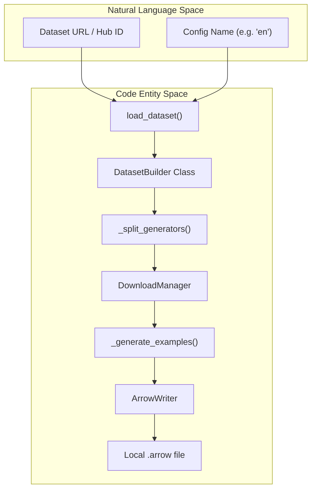
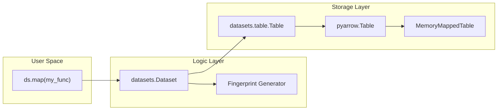

<!-- source: DeepWiki mcp.deepwiki.com · repo huggingface/datasets · page 12 Glossary · fetched 2026-10-26 -->

# Glossary

Relevant source files

The following files were used as context for generating this wiki page:

- [.zenodo.json](.zenodo.json)
- [CONTRIBUTING.md](CONTRIBUTING.md)
- [README.md](README.md)
- [docs/source/about_mapstyle_vs_iterable.mdx](docs/source/about_mapstyle_vs_iterable.mdx)
- [docs/source/dataset_card.mdx](docs/source/dataset_card.mdx)
- [docs/source/faiss_es.mdx](docs/source/faiss_es.mdx)
- [docs/source/package_reference/main_classes.mdx](docs/source/package_reference/main_classes.mdx)
- [docs/source/process.mdx](docs/source/process.mdx)
- [docs/source/stream.mdx](docs/source/stream.mdx)
- [src/datasets/arrow_dataset.py](src/datasets/arrow_dataset.py)
- [src/datasets/builder.py](src/datasets/builder.py)
- [src/datasets/combine.py](src/datasets/combine.py)
- [src/datasets/commands/test.py](src/datasets/commands/test.py)
- [src/datasets/dataset_dict.py](src/datasets/dataset_dict.py)
- [src/datasets/features/__init__.py](src/datasets/features/__init__.py)
- [src/datasets/features/features.py](src/datasets/features/features.py)
- [src/datasets/fingerprint.py](src/datasets/fingerprint.py)
- [src/datasets/info.py](src/datasets/info.py)
- [src/datasets/iterable_dataset.py](src/datasets/iterable_dataset.py)
- [src/datasets/load.py](src/datasets/load.py)
- [src/datasets/search.py](src/datasets/search.py)
- [src/datasets/table.py](src/datasets/table.py)
- [src/datasets/utils/_dill.py](src/datasets/utils/_dill.py)
- [tests/commands/test_test.py](tests/commands/test_test.py)
- [tests/features/test_array_xd.py](tests/features/test_array_xd.py)
- [tests/features/test_features.py](tests/features/test_features.py)
- [tests/test_arrow_dataset.py](tests/test_arrow_dataset.py)
- [tests/test_builder.py](tests/test_builder.py)
- [tests/test_dataset_dict.py](tests/test_dataset_dict.py)
- [tests/test_fingerprint.py](tests/test_fingerprint.py)
- [tests/test_fingerprint_tokenizer_stability.py](tests/test_fingerprint_tokenizer_stability.py)
- [tests/test_iterable_dataset.py](tests/test_iterable_dataset.py)
- [tests/test_load.py](tests/test_load.py)
- [tests/test_search.py](tests/test_search.py)
- [tests/test_table.py](tests/test_table.py)

This page provides definitions for codebase-specific terms, jargon, and domain concepts used throughout the `datasets` library.

## Core Concepts

### Dataset
The primary container for data. It can be either "map-style" (backed by Apache Arrow) or "streaming" (iterable).
*   **Map-style Dataset**: Represented by the `Dataset` class. It allows for random access and is memory-mapped from disk using Apache Arrow [src/datasets/arrow_dataset.py:1652-1656]().
*   **Iterable Dataset**: Represented by the `IterableDataset` class. It is used for streaming data without downloading the entire dataset to disk [src/datasets/iterable_dataset.py:821-825]().

### DatasetDict
A dictionary-like container that maps split names (e.g., "train", "test") to `Dataset` objects [src/datasets/dataset_dict.py:63-65](). It provides helper methods to apply transformations (like `map` or `filter`) to all splits simultaneously [src/datasets/dataset_dict.py:1026-1030]().

### Features
The internal type system defining the schema of a dataset. It maps column names to their types, such as `Value`, `ClassLabel`, `Audio`, or `Image` [src/datasets/features/features.py:183-187]().
*   **Source**: [src/datasets/features/features.py:183-187]()

---

## Data Loading & Building

### DatasetBuilder
The abstract base class responsible for defining how to download data, split it, and generate the final Arrow tables [src/datasets/builder.py:321-325]().
*   **GeneratorBasedBuilder**: A common subclass that generates data row-by-row via a Python generator [src/datasets/builder.py:1120-1124]().
*   **ArrowBasedBuilder**: A subclass for datasets already in Arrow format [src/datasets/builder.py:1101-1105]().

### BuilderConfig
A configuration object for a `DatasetBuilder`. It allows a single dataset script to support multiple versions or subsets (e.g., different languages or task configurations) [src/datasets/builder.py:101-106]().

### DownloadManager
A utility used by `DatasetBuilder` to handle the downloading and extraction of source files [src/datasets/download/download_manager.py:270-275](). In streaming mode, this is replaced by `StreamingDownloadManager` [src/datasets/download/streaming_download_manager.py:465-470]().

### Data Flow: From Source to Arrow
The following diagram illustrates how a `DatasetBuilder` transforms raw source data into a `Dataset`.

**Builder Data Flow**

**Sources**: [src/datasets/load.py:2145-2150](), [src/datasets/builder.py:945-950](), [src/datasets/builder.py:1010-1015]()

---

## Storage & Performance

### Apache Arrow
The underlying columnar memory format used for `Dataset`. It enables high-performance data access and zero-copy memory mapping [src/datasets/arrow_dataset.py:16-17]().

### Memory Mapping
A technique where the dataset is mapped directly from the `.arrow` file on disk into the process's virtual memory address space. This allows the OS to handle caching and enables working with datasets larger than RAM [src/datasets/table.py:119-122]().

### Fingerprinting
A deterministic hash (SHA-256) calculated based on the dataset state and the transformation applied (e.g., a `map` function). It is used to uniquely identify cache files [src/datasets/fingerprint.py:480-485]().
*   **Source**: [src/datasets/fingerprint.py:480-485]()

---

## Technical Jargon & Abbreviations

| Term | Definition | Code Pointer |
| :--- | :--- | :--- |
| **fsspec** | Filesystem Specification; a project used to provide a unified interface to different filesystems (S3, GCS, HF Hub). | [src/datasets/filesystems.py:15-20]() |
| **Split** | A subset of a dataset, such as `train`, `test`, or `validation`. | [src/datasets/splits.py:67-70]() |
| **Mapping** | The process of applying a function to every element in a dataset via `.map()`. | [src/datasets/arrow_dataset.py:2900-2905]() |
| **Streaming** | Accessing data row-by-row without a full local download. | [src/datasets/iterable_dataset.py:821-825]() |
| **Sharding** | Dividing a dataset into multiple smaller files (shards) for parallel processing. | [src/datasets/arrow_dataset.py:4150-4155]() |

---

## System Architecture

The interaction between the user-facing API and the internal storage abstractions is shown below.

**System Entity Mapping**

**Sources**: [src/datasets/arrow_dataset.py:2900-2905](), [src/datasets/table.py:112-115](), [src/datasets/fingerprint.py:480-485]()

### Table Abstraction Layer
The `Table` class acts as a wrapper around `pyarrow.Table`. It handles "replay" mechanisms where operations like column removal or concatenation are stored as a sequence of instructions rather than immediately modifying the underlying Arrow data [src/datasets/table.py:112-115]().
*   **InMemoryTable**: A table where data resides entirely in RAM [src/datasets/table.py:33-37]().
*   **MemoryMappedTable**: A table backed by a memory-mapped file on disk [src/datasets/table.py:119-122]().

**Sources**: [src/datasets/table.py:112-115](), [src/datasets/table.py:33-37](), [src/datasets/table.py:119-122]()