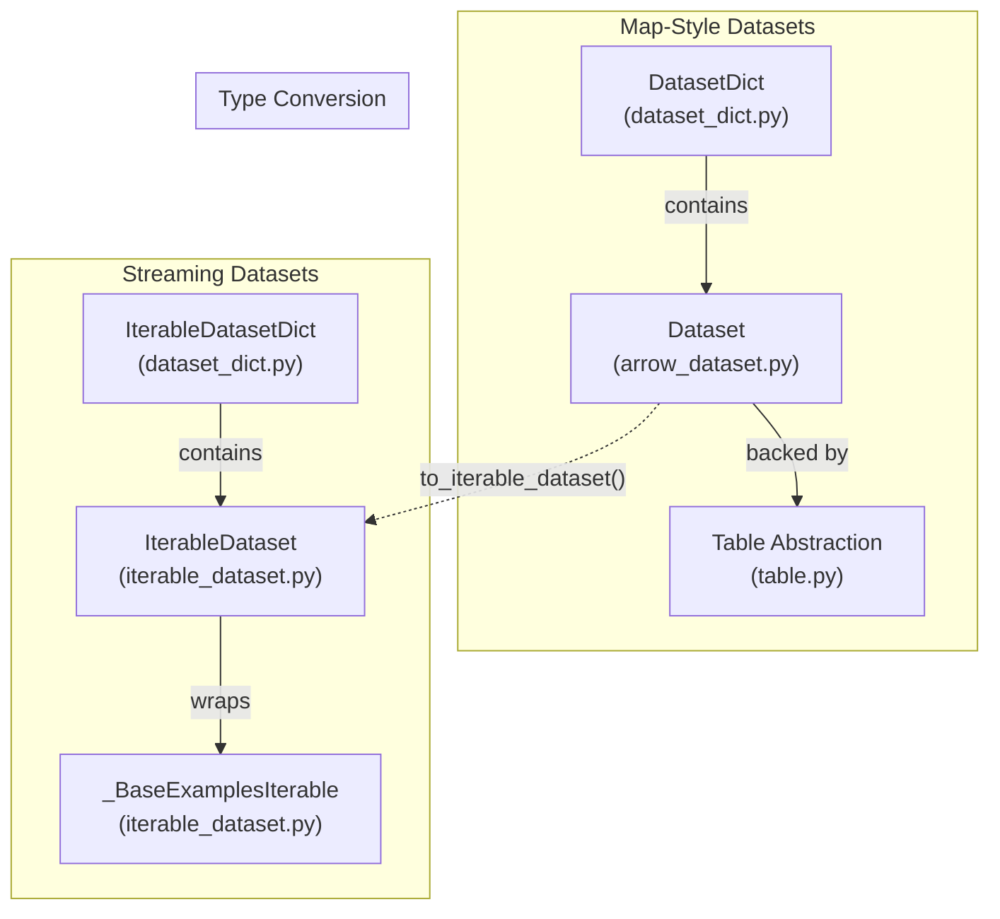
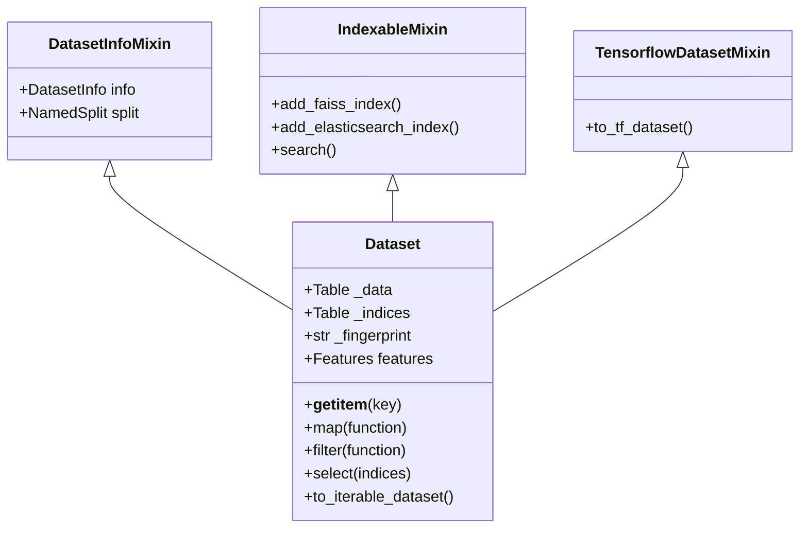

<!-- source: DeepWiki mcp.deepwiki.com · repo huggingface/datasets · page 2 Core Dataset Types · fetched 2026-10-26 -->

# Core Dataset Types

Relevant source files

The following files were used as context for generating this wiki page:

- [docs/source/about_mapstyle_vs_iterable.mdx](docs/source/about_mapstyle_vs_iterable.mdx)
- [docs/source/package_reference/main_classes.mdx](docs/source/package_reference/main_classes.mdx)
- [docs/source/process.mdx](docs/source/process.mdx)
- [docs/source/stream.mdx](docs/source/stream.mdx)
- [src/datasets/arrow_dataset.py](src/datasets/arrow_dataset.py)
- [src/datasets/combine.py](src/datasets/combine.py)
- [src/datasets/dataset_dict.py](src/datasets/dataset_dict.py)
- [src/datasets/iterable_dataset.py](src/datasets/iterable_dataset.py)
- [tests/test_arrow_dataset.py](tests/test_arrow_dataset.py)
- [tests/test_dataset_dict.py](tests/test_dataset_dict.py)
- [tests/test_iterable_dataset.py](tests/test_iterable_dataset.py)

The Hugging Face Datasets library provides two fundamental dataset paradigms: **map-style datasets** and **streaming datasets**. These two approaches serve different use cases and have distinct characteristics in terms of memory usage, access patterns, and performance.

## Overview of Dataset Paradigms

The library's architecture is built around two core abstractions:

*   **Map-Style Datasets (`Dataset`)**: Provide random access to examples with full caching. Backed by Apache Arrow tables stored on disk or in memory. Ideal for datasets that fit on disk and require multiple passes or random access patterns. [src/datasets/arrow_dataset.py:704]()
*   **Streaming Datasets (`IterableDataset`)**: Provide sequential access to examples without downloading the entire dataset. Process examples on-the-fly as they're iterated over. Ideal for very large datasets or when you only need to process data once. [src/datasets/iterable_dataset.py:1285]()

### Dataset Type Hierarchy

This diagram maps the natural language concepts of "Map-Style" and "Streaming" to the specific code entities that implement them.

Sources: [src/datasets/arrow_dataset.py:704](), [src/datasets/iterable_dataset.py:1285](), [src/datasets/dataset_dict.py:63-64](), [src/datasets/dataset_dict.py:1120]()

## Map-Style Datasets (Dataset)

The `Dataset` class is the primary map-style dataset type, providing random access to examples through indexing. It is defined in `src/datasets/arrow_dataset.py`.

### Key Characteristics

- **Random Access**: Access any example by index or slice via `__getitem__`. [src/datasets/arrow_dataset.py:2555-2565]()
- **Arrow-Backed Storage**: Data is stored in Apache Arrow format, utilizing the `Table` abstraction layer which supports memory-mapping for zero-copy reads. [src/datasets/arrow_dataset.py:16-17](), [src/datasets/table.py:112-115]()
- **Caching**: Transformations like `map()` and `filter()` cache their results to disk by default, identified by a unique `_fingerprint`. [src/datasets/arrow_dataset.py:94-105](), [src/datasets/arrow_dataset.py:756]()
- **Indexing Support**: Supports specialized indexing for search (Faiss, Elasticsearch) via `IndexableMixin`. [src/datasets/arrow_dataset.py:704](), [src/datasets/search.py:110]()

For details on the primary map-style class, see [Dataset and DatasetDict Classes](#2.1). For information on the underlying storage, see [Arrow-based Storage System](#2.3).

### Dataset Class Structure

The following diagram bridges the code implementation (Mixins and Classes) to the functional capabilities of the Map-Style system.

Sources: [src/datasets/arrow_dataset.py:704](), [src/datasets/arrow_dataset.py:172](), [src/datasets/search.py:110](), [src/datasets/arrow_dataset.py:244]()

## Streaming Datasets (IterableDataset)

The `IterableDataset` class provides streaming access to datasets without downloading all data upfront. It is defined in `src/datasets/iterable_dataset.py`.

### Key Characteristics

- **Sequential Access**: Iterate through examples one by one using standard Python iteration. [src/datasets/iterable_dataset.py:1367]()
- **Lazy Evaluation**: Transformations like `map` and `filter` are chained within `_BaseExamplesIterable` subclasses and only applied when data is requested. [src/datasets/iterable_dataset.py:700-750](), [src/datasets/iterable_dataset.py:202]()
- **State Management**: Supports `state_dict` and `load_state_dict` for resuming mid-stream, crucial for large-scale training. [src/datasets/iterable_dataset.py:1644-1678]()

For details on streaming behavior and lazy evaluation, see [IterableDataset and Streaming](#2.2).

## Comparison: Dataset vs IterableDataset

| Feature | Dataset (Map-style) | IterableDataset (Streaming) |
|---------|---------|-----------------|
| **Access Pattern** | Random (indexing) [src/datasets/arrow_dataset.py:2555]() | Sequential (iteration) [src/datasets/iterable_dataset.py:1367]() |
| **Storage** | Arrow table on disk/memory [src/datasets/arrow_dataset.py:16]() | No local storage required [docs/source/stream.mdx:3]() |
| **Memory Usage** | Memory-mapped [src/datasets/table.py:114]() | Only current batch [src/datasets/iterable_dataset.py:141]() |
| **Download** | Full dataset downloaded [docs/source/about_mapstyle_vs_iterable.mdx:10]() | On-the-fly streaming [docs/source/stream.mdx:16]() |
| **Caching** | Persistent on disk [src/datasets/arrow_dataset.py:94]() | Not applicable (lazy) [docs/source/about_mapstyle_vs_iterable.mdx:99]() |

## Internal Abstractions

The library relies on several internal layers to manage data efficiently:

*   **Table Abstraction**: A wrapper around Arrow tables (`Table`, `InMemoryTable`, `MemoryMappedTable`) that handles data access and replay of transformations. [src/datasets/table.py:112-115](). For details, see [Table Abstraction Layer](#2.4).
*   **Caching & Fingerprinting**: A deterministic system using `xxhash` to identify dataset states and reuse computed results. [src/datasets/fingerprint.py:94-105](). For details, see [Caching and Fingerprinting](#2.5).

## Converting Between Types

A map-style `Dataset` can be converted into an `IterableDataset` using the `to_iterable_dataset` method. [src/datasets/arrow_dataset.py:4440-4450](). This enables streaming APIs on locally stored Arrow data.

## Summary of Sub-pages

- [Dataset and DatasetDict Classes](#2.1) — Detailed documentation of the `Dataset` class and its multi-split manager `DatasetDict`.
- [IterableDataset and Streaming](#2.2) — Documentation of `IterableDataset` for lazy evaluation and streaming.
- [Arrow-based Storage System](#2.3) — Explanation of Apache Arrow integration and memory-mapping.
- [Table Abstraction Layer](#2.4) — Documentation of the `Table` hierarchy and the replay mechanism.
- [Caching and Fingerprinting](#2.5) — Explanation of the deterministic caching system and fingerprint generation.

---

