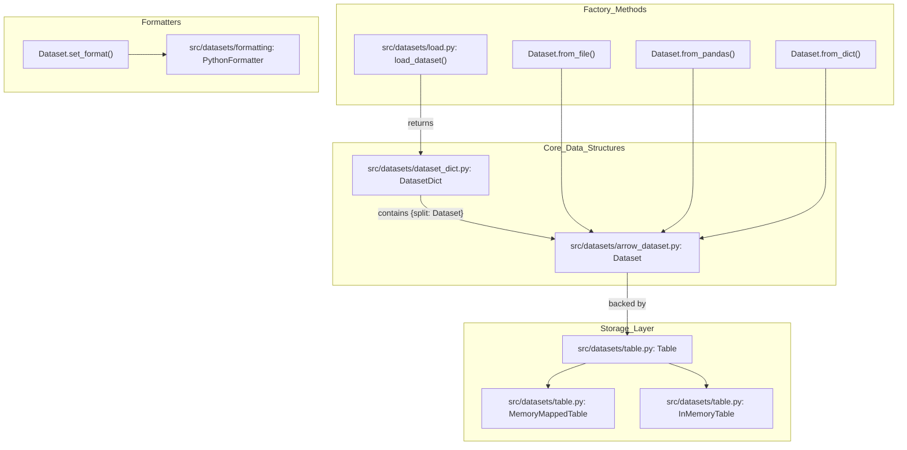

<!-- source: DeepWiki mcp.deepwiki.com · repo huggingface/datasets · page 2.1 Dataset and DatasetDict Classes · fetched 2026-10-26 -->

# Dataset and DatasetDict Classes

<details>
<summary>Relevant source files</summary>

The following files were used as context for generating this wiki page:

- [src/datasets/arrow_dataset.py](src/datasets/arrow_dataset.py)
- [src/datasets/dataset_dict.py](src/datasets/dataset_dict.py)
- [src/datasets/inspect.py](src/datasets/inspect.py)
- [tests/test_arrow_dataset.py](tests/test_arrow_dataset.py)
- [tests/test_dataset_dict.py](tests/test_dataset_dict.py)
- [tests/test_inspect.py](tests/test_inspect.py)
- [tests/test_offline_util.py](tests/test_offline_util.py)

</details>


The `Dataset` and `DatasetDict` classes are the core data structures in the `datasets` library. They serve as the primary interfaces for loading, manipulating, and transforming datasets for machine learning applications.

## Overview

The library uses Apache Arrow as its underlying data structure for efficient memory usage and fast data access. The `Dataset` class wraps an Arrow table and provides a rich API for data manipulation, while the `DatasetDict` class serves as a container for multiple datasets, typically representing different splits (train, validation, test).

Title: Dataset Architecture and Data Flow

Sources: [src/datasets/arrow_dataset.py:628-694](), [src/datasets/dataset_dict.py:63-94](), [src/datasets/table.py:112-124]()

## Dataset Class

### Class Hierarchy and Mixins

The `Dataset` class inherits from several mixins that provide specialized functionality:

Title: Dataset Class Composition
```mermaid
classDiagram
    class DatasetInfoMixin {
        +info: DatasetInfo
        +features: Features
        +split: NamedSplit
    }
    
    class IndexableMixin {
        +add_faiss_index()
        +add_elasticsearch_index()
        +get_nearest_examples()
    }
    
    class TensorflowDatasetMixin {
        +to_tf_dataset()
    }
    
    class Dataset {
        +_data: Table
        +_indices: Table
        +map()
        +filter()
        +select()
        +set_format()
        +save_to_disk()
    }

    DatasetInfoMixin <|-- Dataset : src/datasets/arrow_dataset.py:172
    IndexableMixin <|-- Dataset : src/datasets/search.py:110
    TensorflowDatasetMixin <|-- Dataset : src/datasets/arrow_dataset.py:244
```
Sources: [src/datasets/arrow_dataset.py:172-241](), [src/datasets/arrow_dataset.py:244-532](), [src/datasets/arrow_dataset.py:628-694](), [src/datasets/search.py:110-110]()

### Creating a Dataset

The `Dataset` class provides multiple static factory methods to instantiate datasets:

| Method | Source | Description |
| :--- | :--- | :--- |
| `from_file` | [src/datasets/arrow_dataset.py:1124-1212]() | Load a dataset from an Arrow file on disk. |
| `from_buffer` | [src/datasets/arrow_dataset.py:1214-1262]() | Load from a byte buffer containing Arrow data. |
| `from_pandas` | [src/datasets/arrow_dataset.py:1264-1384]() | Convert a Pandas DataFrame to a Dataset. |
| `from_dict` | [src/datasets/arrow_dataset.py:1386-1469]() | Convert a Python dictionary to a Dataset. |
| `from_generator` | [src/datasets/arrow_dataset.py:1471-1634]() | Create a dataset from a Python generator. |
| `from_spark` | [src/datasets/arrow_dataset.py:1636-1738]() | Create a dataset from a PySpark DataFrame. |

### Core Properties

- `info`: Access metadata via `DatasetInfo` [src/datasets/arrow_dataset.py:182-184]().
- `features`: The schema defined by `Features` [src/datasets/arrow_dataset.py:220-222]().
- `data`: The underlying Apache Arrow `Table` [src/datasets/arrow_dataset.py:1010-1013]().
- `num_rows`: Number of examples in the dataset [src/datasets/arrow_dataset.py:946-949]().

## Data Transformation Methods

The `Dataset` class implements a suite of transformation methods, most of which leverage deterministic caching and fingerprinting.

### Map and Filter

The `map` method is the primary tool for data transformation. It can operate on single examples or batches.

- **`map`**: Applies a function to the dataset. Supports multiprocessing via `num_proc`, batched execution, and custom fingerprinting [src/datasets/arrow_dataset.py:2493-2845]().
- **`filter`**: Returns a subset of the dataset where the provided function returns `True`. It creates a new `Dataset` backed by an indices mapping [src/datasets/arrow_dataset.py:2847-3024]().

### Index-based Operations

- **`select`**: Creates a new dataset using a list of indices. It creates an `_indices` mapping rather than copying the data [src/datasets/arrow_dataset.py:3825-3914]().
- **`shuffle`**: Randomly reorders the dataset indices using a seed. Supports stratified shuffling [src/datasets/arrow_dataset.py:3983-4084]().
- **`sort`**: Sorts the dataset based on the values of one or more columns [src/datasets/arrow_dataset.py:3916-3981]().

Sources: [src/datasets/arrow_dataset.py:2493-4195]()

## DatasetDict Class

`DatasetDict` is a subclass of `dict` [src/datasets/dataset_dict.py:63]() specifically for managing `Dataset` objects mapped to split names (e.g., "train", "test").

### Key Functionalities

- **Shared Operations**: Methods like `map`, `filter`, `sort`, and `shuffle` are implemented to apply the operation to every split in the dictionary simultaneously [src/datasets/dataset_dict.py:534-1212]().
- **Feature Consistency**: The `_check_values_features` method ensures that all datasets within the dictionary share the same schema [src/datasets/dataset_dict.py:71-77]().
- **Serialization**: Supports `save_to_disk` [src/datasets/dataset_dict.py:1214-1314]() and `push_to_hub` [src/datasets/dataset_dict.py:1316-1523]() for the entire collection of splits.

Sources: [src/datasets/dataset_dict.py:63-1523]()

## Format Conversion and Framework Integration

The `set_format` method [src/datasets/arrow_dataset.py:3075-3162]() changes how data is returned when accessing the dataset (e.g., via `__getitem__`).

| Format Type | Description |
| :--- | :--- |
| `numpy` | Returns NumPy arrays. |
| `torch` | Returns PyTorch tensors. |
| `tensorflow` | Returns TensorFlow tensors. |
| `pandas` | Returns Pandas DataFrames. |
| `jax` | Returns JAX arrays. |

The `to_tf_dataset` method [src/datasets/arrow_dataset.py:326-532]() provides deep integration with TensorFlow's `tf.data.Dataset` API, supporting batching, shuffling, and multiprocessing.

Sources: [src/datasets/arrow_dataset.py:3075-3162](), [src/datasets/arrow_dataset.py:326-532]()

## Serialization and Persistence

Datasets can be saved locally or pushed to the Hugging Face Hub.

### Local Persistence
- **`save_to_disk`**: Saves the dataset as Arrow files. It also saves the `DatasetInfo` and state metadata [src/datasets/arrow_dataset.py:4196-4354]().
- **`load_from_disk`**: Static method to reload a saved dataset or `DatasetDict` [src/datasets/load.py:1145-1215]().

### Hub Integration
- **`push_to_hub`**: Uploads the dataset to the Hugging Face Hub. It handles Parquet conversion, repository management, and metadata updates [src/datasets/arrow_dataset.py:4486-5196]().

Sources: [src/datasets/arrow_dataset.py:4196-5196](), [src/datasets/load.py:1145-1215]()

---

