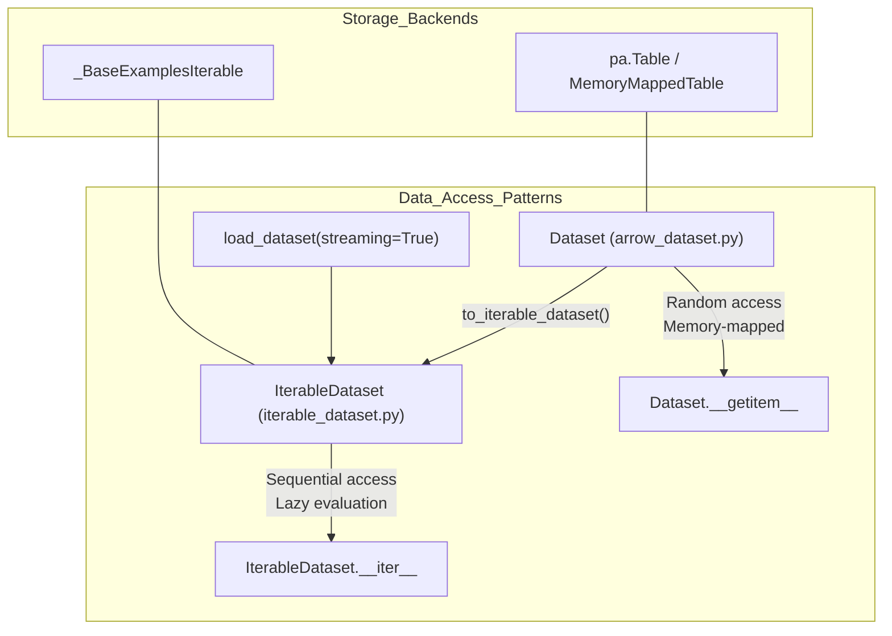
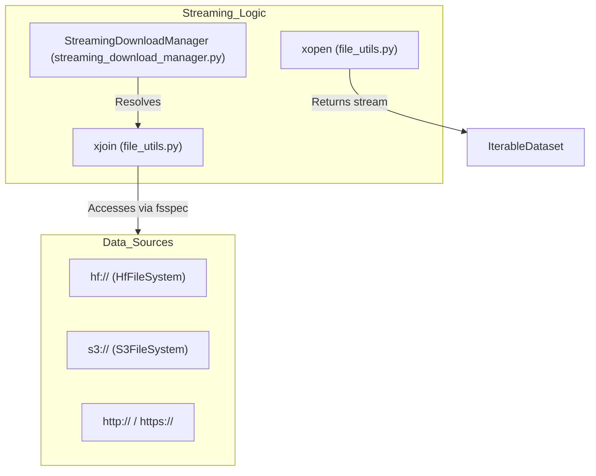

<!-- source: DeepWiki mcp.deepwiki.com · repo huggingface/datasets · page 2.2 IterableDataset and Streaming · fetched 2026-10-26 -->

# IterableDataset and Streaming

<details>
<summary>Relevant source files</summary>

The following files were used as context for generating this wiki page:

- [docs/source/about_mapstyle_vs_iterable.mdx](docs/source/about_mapstyle_vs_iterable.mdx)
- [docs/source/package_reference/main_classes.mdx](docs/source/package_reference/main_classes.mdx)
- [docs/source/process.mdx](docs/source/process.mdx)
- [docs/source/stream.mdx](docs/source/stream.mdx)
- [src/datasets/combine.py](src/datasets/combine.py)
- [src/datasets/download/streaming_download_manager.py](src/datasets/download/streaming_download_manager.py)
- [src/datasets/iterable_dataset.py](src/datasets/iterable_dataset.py)
- [src/datasets/streaming.py](src/datasets/streaming.py)
- [src/datasets/utils/patching.py](src/datasets/utils/patching.py)
- [tests/test_iterable_dataset.py](tests/test_iterable_dataset.py)
- [tests/test_patching.py](tests/test_patching.py)
- [tests/test_streaming_download_manager.py](tests/test_streaming_download_manager.py)

</details>


This page details the streaming and iteration functionality in the Hugging Face Datasets library, focusing on the `IterableDataset` class and related components for efficiently working with large datasets. Streaming allows you to work with datasets without downloading them entirely or processing all examples at once.

## Core Concepts

Datasets provides two main approaches for working with data:

1.  **Random-access datasets**: `Dataset` objects that load data into memory using memory-mapping [src/datasets/arrow_dataset.py:16-17]().
2.  **Streaming datasets**: `IterableDataset` objects that process data on-the-fly as you iterate through it [src/datasets/iterable_dataset.py:161-163]().

Streaming is particularly useful when working with datasets too large to fit in memory or to avoid lengthy download and preprocessing times [docs/source/stream.mdx:5-9]().

### Relationship Between Dataset and IterableDataset

The following diagram illustrates the relationship between the random-access `Dataset` and the sequential `IterableDataset`.

**Data Access Paradigms**

Sources: [src/datasets/arrow_dataset.py:16-53](), [src/datasets/iterable_dataset.py:161-163](), [src/datasets/iterable_dataset.py:202-205](), [docs/source/stream.mdx:79-81]()

## Creating an IterableDataset

There are several ways to create an `IterableDataset`:

### 1. From a regular Dataset
The `to_iterable_dataset` method converts a map-style dataset into a streaming one. It supports sharding, which is useful for parallel loading [src/datasets/arrow_dataset.py:420-430]().

### 2. Directly with streaming=True
When calling `load_dataset`, setting `streaming=True` returns an `IterableDataset` or `IterableDatasetDict` [docs/source/stream.mdx:16-20](). This bypasses the full download and extraction phase.

### 3. From a generator function
The `IterableDataset.from_generator` method allows creating a stream from any Python generator [src/datasets/iterable_dataset.py:417-430]().

### 4. From other formats
`IterableDataset` provides static methods like `from_dict`, `from_pandas`, and `from_list` which wrap the input data in a generator-based iterable [src/datasets/iterable_dataset.py:350-410]().

Sources: [src/datasets/arrow_dataset.py:420-430](), [src/datasets/iterable_dataset.py:417-430](), [src/datasets/iterable_dataset.py:350-410](), [docs/source/stream.mdx:16-20]()

## IterableDataset Architecture

The `IterableDataset` does not hold data; it wraps an internal iterable object that implements the `_BaseExamplesIterable` interface [src/datasets/iterable_dataset.py:202-205]().

**Iterable Implementation Hierarchy**
```mermaid
graph TD
    subgraph "Core_Iterables"
        BaseExIter["_BaseExamplesIterable"]
        ExamplesIter["ExamplesIterable"]
        ArrowExIter["ArrowExamplesIterable"]
        
        BaseExIter --> ExamplesIter
        BaseExIter --> ArrowExIter
    end
    
    subgraph "Transformation_Iterables"
        MapIter["MappedExamplesIterable"]
        FilterIter["FilteredExamplesIterable"]
        BufferShuffleIter["BufferShuffledExamplesIterable"]
        SkipIter["SkipExamplesIterable"]
        TakeIter["TakeExamplesIterable"]
        
        BaseExIter --> MapIter
        BaseExIter --> FilterIter
        BaseExIter --> BufferShuffleIter
        BaseExIter --> SkipIter
        BaseExIter --> TakeIter
    end
    
    IterableDataset["IterableDataset"] o-- BaseExIter
```
Sources: [src/datasets/iterable_dataset.py:202-205](), [src/datasets/iterable_dataset.py:613-615](), [src/datasets/iterable_dataset.py:702-705](), [src/datasets/iterable_dataset.py:821-825](), [src/datasets/iterable_dataset.py:924-927]()

## Streaming Data Processing

`IterableDataset` implements lazy versions of common transformation methods.

### Shuffling
Unlike `Dataset.shuffle`, which reorders indices, `IterableDataset.shuffle` uses a buffer-based approach [src/datasets/iterable_dataset.py:1026-1040](). It first shuffles the list of shards (if available) and then maintains a `buffer_size` window of examples to provide local randomization [src/datasets/iterable_dataset.py:821-825]().

### Taking and Skipping
*   `take(n)`: Wraps the iterable in a `TakeExamplesIterable` to yield only the first `n` items [src/datasets/iterable_dataset.py:1218-1233]().
*   `skip(n)`: Wraps the iterable in a `SkipExamplesIterable` to discard the first `n` items [src/datasets/iterable_dataset.py:1235-1250]().

### Mapping and Filtering
Transformations are applied lazily. When `map` is called, it returns a new `IterableDataset` wrapping a `MappedExamplesIterable` [src/datasets/iterable_dataset.py:1063-1100](). Filtering uses `FilteredExamplesIterable` to skip items that do not meet the predicate [src/datasets/iterable_dataset.py:1157-1177]().

Sources: [src/datasets/iterable_dataset.py:821-825](), [src/datasets/iterable_dataset.py:1026-1040](), [src/datasets/iterable_dataset.py:1063-1100](), [src/datasets/iterable_dataset.py:1157-1177](), [src/datasets/iterable_dataset.py:1218-1250]()

## Streaming Download Manager

Streaming is powered by `StreamingDownloadManager`, which handles virtual file paths using the `::` separator to navigate compressed archives [src/datasets/download/streaming_download_manager.py:47-53]().

**Streaming File Flow**

Sources: [src/datasets/download/streaming_download_manager.py:47-53](), [src/datasets/download/streaming_download_manager.py:102-122](), [src/datasets/streaming.py:42-59]()

### Module Extension for Streaming
To support streaming in dataset builders, the library patches standard Python I/O functions (like `open`, `os.path.join`) within the builder's module using `extend_module_for_streaming` [src/datasets/streaming.py:42-59](). This allows builders to work with remote streamed files as if they were local [src/datasets/streaming.py:78-95]().

## Combining Iterable Datasets

Multiple streaming datasets can be merged using `interleave_datasets` [src/datasets/combine.py:18-27](). This function supports:
*   **Cycling**: Alternating between datasets [src/datasets/combine.py:34-35]().
*   **Probabilistic Sampling**: Sampling from datasets based on provided weights [src/datasets/combine.py:35-36]().
*   **Stopping Strategies**: Determining when iteration ends (`first_exhausted`, `all_exhausted`, etc.) [src/datasets/combine.py:61-68]().

Sources: [src/datasets/combine.py:18-68](), [src/datasets/iterable_dataset.py:1653-1670]()

## State Management

`IterableDataset` supports state management to resume training. It tracks the progress through the underlying iterables.

*   `state_dict()`: Captures the current state of the iterable, including the number of examples yielded and shard information [src/datasets/iterable_dataset.py:1418-1436]().
*   `load_state_dict(state_dict)`: Restores the dataset to a previously saved state [src/datasets/iterable_dataset.py:1438-1456]().

This is implemented by the `_BaseExamplesIterable` and its subclasses which maintain an internal `_state_dict` [src/datasets/iterable_dataset.py:202-205]().

Sources: [src/datasets/iterable_dataset.py:202-205](), [src/datasets/iterable_dataset.py:1418-1456]()

## Performance Considerations

*   **Batching**: Use `batched=True` in `map` to process multiple examples at once, reducing the overhead of the Python loop [src/datasets/iterable_dataset.py:1075-1080]().
*   **Parallelism**: When using PyTorch `DataLoader`, `IterableDataset` automatically handles sharding across workers if the dataset is sharded [docs/source/stream.mdx:99-102]().
*   **Prefetching**: Shuffling with a large `buffer_size` effectively prefetches data from the source [docs/source/stream.mdx:107-109]().
*   **Column Indexing**: `IterableDataset` supports column indexing to iterate over specific fields without loading the entire row [docs/source/stream.mdx:69-75]().

Sources: [src/datasets/iterable_dataset.py:1075-1080](), [docs/source/stream.mdx:69-75](), [docs/source/stream.mdx:99-109]()

---

