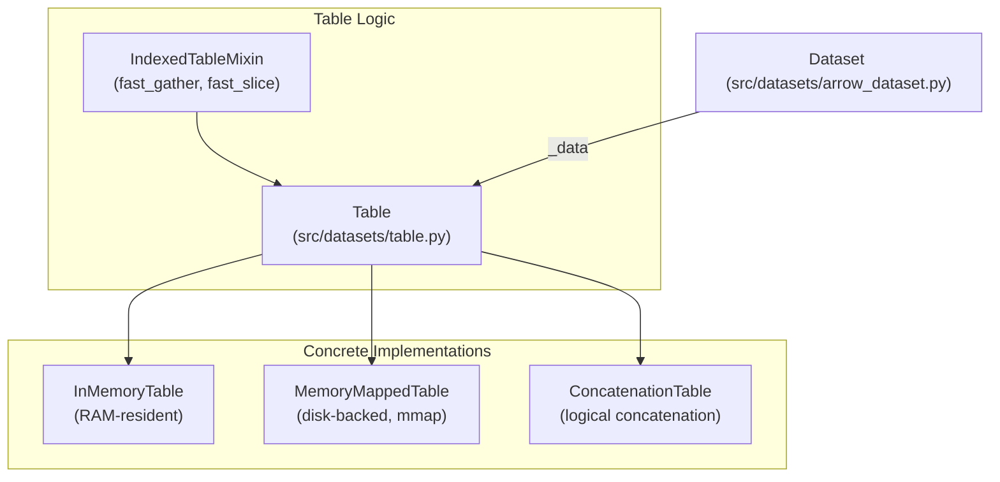
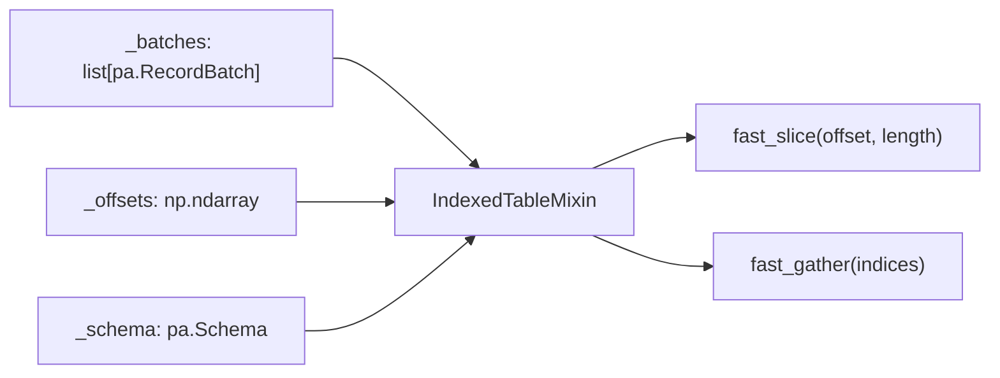
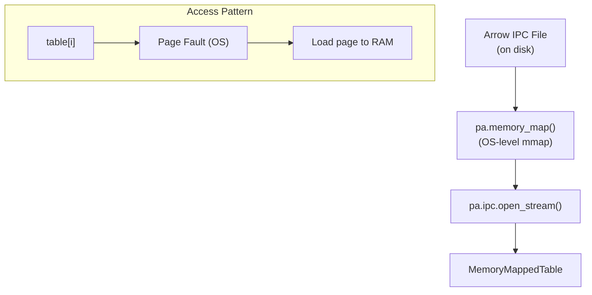
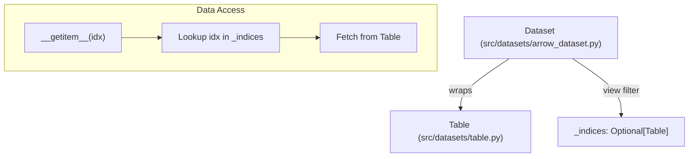

<!-- source: DeepWiki mcp.deepwiki.com · repo huggingface/datasets · page 2.3 Arrow-based Storage System · fetched 2026-10-26 -->

# Arrow-based Storage System

<details>
<summary>Relevant source files</summary>

The following files were used as context for generating this wiki page:

- [docs/source/about_arrow.md](docs/source/about_arrow.md)
- [src/datasets/table.py](src/datasets/table.py)
- [tests/test_table.py](tests/test_table.py)

</details>


## Purpose and Scope

This document explains the Arrow-based storage architecture in the `datasets` library, focusing on how Apache Arrow tables provide efficient, memory-mapped data access. It covers the core Table implementations (`InMemoryTable`, `MemoryMappedTable`, `ConcatenationTable`) and how they enable working with datasets larger than RAM.

For information about how datasets are loaded and written to Arrow format, see [ArrowWriter and Data Serialization](#5.3). For details on the `Dataset` and `DatasetDict` classes that wrap these tables, see [Dataset and DatasetDict Classes](#2.1).

## Apache Arrow as the Storage Backend

The `datasets` library uses Apache Arrow as its core storage format. Arrow provides:

- **Zero-copy reads**: Data can be accessed without deserialization.
- **Memory mapping**: Large datasets can be loaded from disk without consuming RAM.
- **Columnar storage**: Efficient for analytical workloads common in ML.
- **Type safety**: Rich type system with metadata preservation.

All dataset data is stored as PyArrow tables (`pa.Table`) on disk in Arrow IPC (Inter-Process Communication) format. The library provides specialized wrapper classes around these tables to add functionality like efficient slicing, indexing, and concatenation.

**Sources**: [docs/source/about_arrow.md:5-16](), [src/datasets/table.py:161-168]()

## Table Class Hierarchy

The library defines an abstract `Table` base class with three concrete implementations. These classes wrap `pyarrow.Table` to provide extended functionality like replays for pickling and optimized slicing.



**Diagram**: Table class hierarchy and relationship to Dataset.

| Class | Storage Location | Use Case | Memory Overhead |
|-------|-----------------|----------|-----------------|
| `InMemoryTable` | RAM | Small datasets, temporary transformations | Full dataset size |
| `MemoryMappedTable` | Disk (memory-mapped) | Large datasets, cache files | Minimal (OS manages pages) |
| `ConcatenationTable` | Multiple tables | Logical unions, multi-file datasets | Sum of constituent tables |

**Sources**: [src/datasets/table.py:458-460](), [src/datasets/table.py:539-543](), [src/datasets/table.py:679-682]()

## IndexedTableMixin: Fast Operations

All Table implementations inherit from `IndexedTableMixin`, which provides optimized slicing and gathering operations by maintaining internal indices and offsets.



**Diagram**: `IndexedTableMixin` internal structure and core methods.

The mixin stores:
- `_batches`: List of PyArrow `RecordBatch` objects (each batch contains a chunk of rows) [src/datasets/table.py:164-166]().
- `_offsets`: Cumulative offsets for each batch (enables O(log n) lookup via binary search) [src/datasets/table.py:167]().
- `_schema`: PyArrow schema describing column types [src/datasets/table.py:163]().

**Key methods**:

- **`fast_slice(offset, length)`**: Uses binary search on `_offsets` to find relevant batches and slices them without copying the entire table [src/datasets/table.py:186-218]().
- **`fast_gather(indices)`**: Gathers specific rows by computing batch indices via `np.searchsorted` and slicing individual batches [src/datasets/table.py:169-184]().

**Sources**: [src/datasets/table.py:161-218]()

## InMemoryTable

`InMemoryTable` wraps a PyArrow table that resides entirely in RAM. It is used for small datasets created via `Dataset.from_dict()` or temporary transformations where `keep_in_memory=True` is set.

**Key characteristics**:
- Full memory footprint equal to dataset size.
- Fast random access (no disk I/O).
- Created using methods like `from_pydict`, `from_pandas`, or `from_batches`.

**Creation example**:
```python
# Create an in-memory table from a dictionary
table = InMemoryTable.from_pydict({"col1": [1, 2, 3]})
```

**Sources**: [src/datasets/table.py:458-537]()

## MemoryMappedTable

`MemoryMappedTable` is the core storage mechanism for large datasets. It uses `pa.memory_map()` to access Arrow files on disk without loading the entire dataset into RAM.



**Diagram**: Memory-mapped table architecture using `pa.memory_map` and `pa.ipc.open_stream`.

### Replays Mechanism

`MemoryMappedTable` maintains a list of `replays` (slices or selections). This enables efficient pickling: instead of serializing the data, the library serializes the file path and the sequence of operations to re-apply upon unpickling.

- **`path`**: File path to the Arrow file on disk [src/datasets/table.py:545]().
- **`replays`**: List of operations (e.g., slices) to replay when reloading [src/datasets/table.py:546]().

**Sources**: [src/datasets/table.py:539-656](), [src/datasets/table.py:47-49](), [src/datasets/table.py:119-122]()

## ConcatenationTable

`ConcatenationTable` provides a logical view over multiple tables without physically merging them. This is essential for datasets split across multiple shards or files.

### Internal Structure

A `ConcatenationTable` maintains a list of constituent Table objects. It implements logical concatenation by aggregating batches from all underlying tables.

- **`tables`**: List of constituent Table objects [src/datasets/table.py:684]().
- **`_batches`**: Flattened list of all batches from all constituent tables [src/datasets/table.py:716]().

**Sources**: [src/datasets/table.py:679-746]()

## Storage Efficiency and Memory Management

### Zero-Copy Operations

The table implementations prioritize zero-copy operations. Slicing a table returns a new view referencing the same underlying memory buffers. Methods like `_memory_mapped_arrow_table_from_file` ensure that opening a file on disk doesn't increase RAM usage [src/datasets/table.py:119-122]().

### Table Casting

The `table_cast()` function is used to align a table's schema with a target `Features` definition. It attempts to perform zero-copy casting when types are compatible and only copies data when necessary [src/datasets/table.py:1893-2067]().

### Embedding Storage

For specific serialization needs, `embed_table_storage()` allows moving the data from a memory-mapped file directly into the table's metadata as a buffer, making the table self-contained [src/datasets/table.py:2138-2168]().

**Sources**: [src/datasets/table.py:1893-2067](), [src/datasets/table.py:2138-2168]()

## Integration with Dataset Class

The `Dataset` class wraps a `Table` object in its `_data` attribute.



**Diagram**: `Dataset` integration with `Table` abstraction and `_indices` for lazy operations.

### Lazy Operations and Indices

A `Dataset` can have an optional `_indices` table. This is used for "lazy" operations like `filter()` or `shuffle()`. Instead of creating a new data table, the library creates a new `_indices` table that maps the virtual index to the original row index in `_data`.

### Summary of Benefits

| Feature | Implementation | Benefit |
|-----------|---------|-------------|
| **Memory Mapping** | `MemoryMappedTable` | Scale to TB-sized datasets on standard hardware [docs/source/about_arrow.md:15-35](). |
| **Lazy Views** | `_indices` | Instant filtering and shuffling without data duplication. |
| **Replays** | `Table.replays` | Transparent pickling for multi-processing and caching [src/datasets/table.py:575-609](). |
| **Columnar Format** | Apache Arrow | Optimized for batch processing and ML feature extraction [docs/source/about_arrow.md:5-10](). |

**Sources**: [src/datasets/table.py:161-168](), [docs/source/about_arrow.md:1-51]()

---

