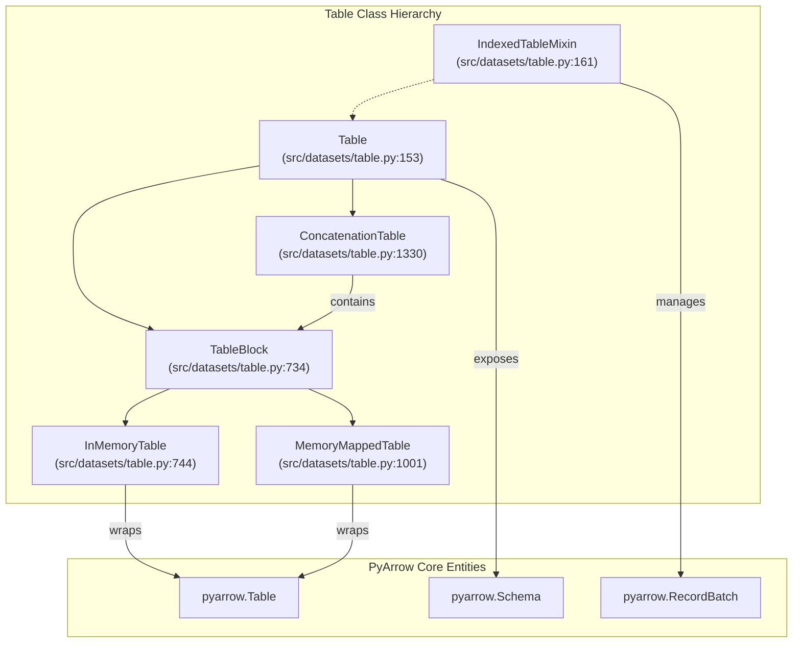
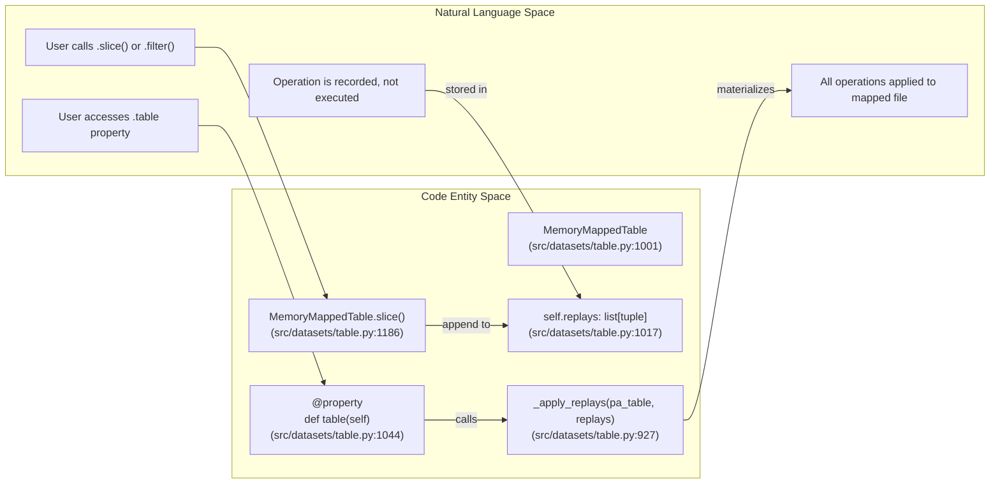

<!-- source: DeepWiki mcp.deepwiki.com · repo huggingface/datasets · page 2.4 Table Abstraction Layer · fetched 2026-10-26 -->

# Table Abstraction Layer

Relevant source files

The following files were used as context for generating this wiki page:

- [src/datasets/table.py](src/datasets/table.py)
- [tests/test_table.py](tests/test_table.py)

## Purpose and Scope

The Table Abstraction Layer provides a unified interface for working with Apache Arrow tables across different storage modes. It wraps PyArrow's `pa.Table` to support both in-memory and memory-mapped data access, enabling efficient handling of datasets that may exceed available RAM. This layer is the foundation for the `Dataset` class's storage backend and provides optimized indexing and slicing mechanisms.

## Architecture Overview

The table abstraction uses composition to wrap PyArrow tables and provides implementations optimized for different use cases. It leverages a mixin pattern to provide fast indexing capabilities to all table types.

### Code Entity Space to System Architecture

**Sources:** [src/datasets/table.py:153-159](), [src/datasets/table.py:161-168](), [src/datasets/table.py:734-742](), [src/datasets/table.py:744-746](), [src/datasets/table.py:1001-1003](), [src/datasets/table.py:1330-1332]()

## Core Classes

### IndexedTableMixin

The `IndexedTableMixin` provides optimized slicing and gathering operations. It pre-calculates row offsets for all record batches in a table, allowing for binary search-based access.

**Key Components:**
- `_batches`: A list of non-empty `pa.RecordBatch` objects extracted from the table [src/datasets/table.py:164-166]().
- `_offsets`: A `np.ndarray` of cumulative row counts used for fast lookup [src/datasets/table.py:167]().
- `fast_slice()`: Uses `_interpolation_search` to find batch boundaries for a slice, avoiding PyArrow's default linear scan [src/datasets/table.py:186-207]().
- `fast_gather()`: Uses `np.searchsorted` to map arbitrary indices to specific record batches efficiently [src/datasets/table.py:169-184]().

**Sources:** [src/datasets/table.py:161-207](), [src/datasets/table.py:135-158]()

### Table (Base Class)

The `Table` class wraps a `pa.Table` and implements the standard PyArrow Table API (schema, columns, num_rows, etc.) by delegating to the underlying object [src/datasets/table.py:222-282](). It handles deepcopying by ensuring the immutable PyArrow table is not unnecessarily duplicated [src/datasets/table.py:226-233]().

**Sources:** [src/datasets/table.py:153-282]()

## InMemoryTable

`InMemoryTable` is used when the dataset is small enough to fit in RAM. It provides constructors for various data formats.

### Creation Workflow

| Method | Logic | Source |
| :--- | :--- | :--- |
| `from_file()` | Uses `pa.ipc.open_stream` to read all data into memory | [src/datasets/table.py:759-762]() |
| `from_pandas()` | Converts DataFrame to Arrow, handling specific schema requirements | [src/datasets/table.py:769-825]() |
| `from_pydict()` | Wraps `pa.Table.from_pydict` | [src/datasets/table.py:847-863]() |
| `from_batches()` | Constructs from a list of `pa.RecordBatch` | [src/datasets/table.py:883-897]() |

**Sources:** [src/datasets/table.py:744-897]()

## MemoryMappedTable and Replay Mechanism

`MemoryMappedTable` enables working with datasets larger than RAM by mapping Arrow files on disk. It implements a **lazy replay mechanism** to handle table transformations without immediate materialization.

### Replay Mechanism Data Flow

**Implementation Details:**
- **Storage:** The table stores the file path and a list of `replays` (method name, args, kwargs) [src/datasets/table.py:1014-1018]().
- **Transformation:** Methods like `slice`, `filter`, `flatten`, and `cast` return a new `MemoryMappedTable` with the new operation appended to the `replays` list [src/datasets/table.py:1186-1238]().
- **Materialization:** When the `.table` property is accessed, `_memory_mapped_arrow_table_from_file` is called if no table is cached, and `_apply_replays` executes the transformation chain [src/datasets/table.py:1044-1054]().
- **Serialization:** The `__getstate__` method ensures only the file path and replay list are pickled, preventing data from being pulled into memory during serialization [src/datasets/table.py:1121-1136]().

**Sources:** [src/datasets/table.py:1001-1136](), [src/datasets/table.py:1186-1238](), [src/datasets/table.py:927-944]()

## ConcatenationTable

`ConcatenationTable` provides a zero-copy way to treat multiple `TableBlock` objects (In-Memory or Memory-Mapped) as a single table.

**Internal Structure:**
- **Blocks:** Data is stored in `self._blocks`, which is a `list[list[TableBlock]]` [src/datasets/table.py:1334](). This structure supports row-wise (outer list) and column-wise (inner list) concatenation.
- **Slicing:** The `slice()` method is optimized to only slice the specific blocks that overlap with the requested range using cumulative `_offsets` [src/datasets/table.py:1578-1633]().
- **Materialization:** Accessing the `.table` property triggers `pa.concat_tables` across all blocks, which is then cached [src/datasets/table.py:1368-1374]().

**Sources:** [src/datasets/table.py:1330-1374](), [src/datasets/table.py:1578-1633]()

## Utility Functions for Table Operations

The module provides several low-level utilities for manipulating Arrow tables and arrays, often used by the higher-level `Dataset` operations:

- **`cast_table_to_schema`**: Recursively casts a table to a target schema, handling nested structures and extension types [src/datasets/table.py:536-559]().
- **`embed_table_storage`**: Converts file-based features (like `Image` or `Audio`) into embedded data within the Arrow table [src/datasets/table.py:613-625]().
- **`concat_tables`**: A wrapper around `pa.concat_tables` that specifically handles `Table` abstraction instances, preserving their underlying types when possible [src/datasets/table.py:1787-1823]().

**Sources:** [src/datasets/table.py:536-559](), [src/datasets/table.py:613-625](), [src/datasets/table.py:1787-1823]()

---

