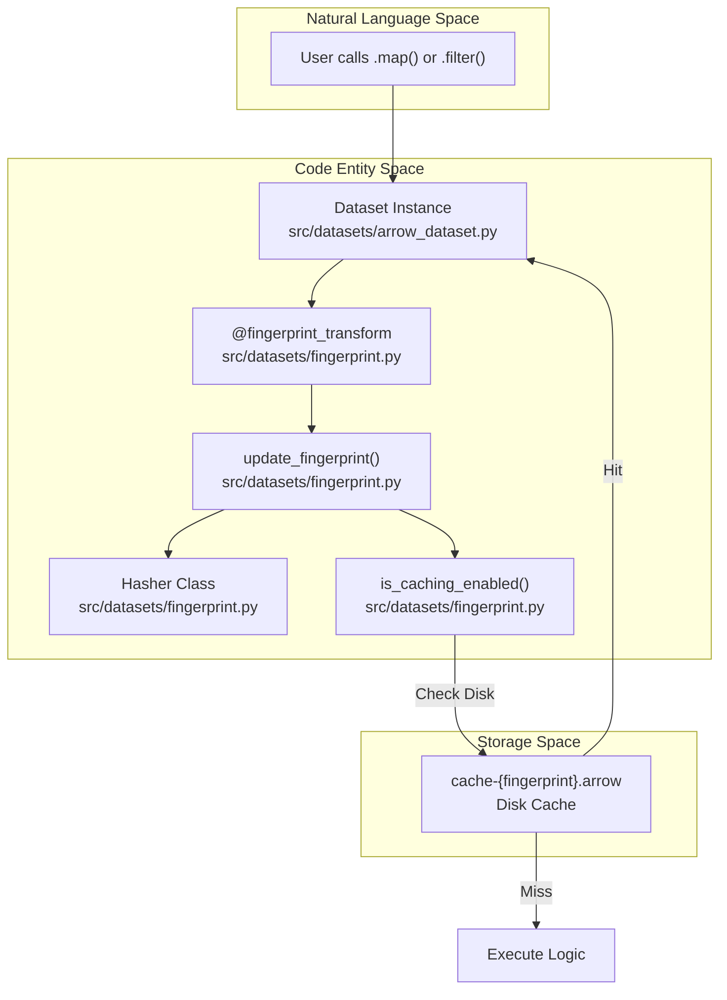
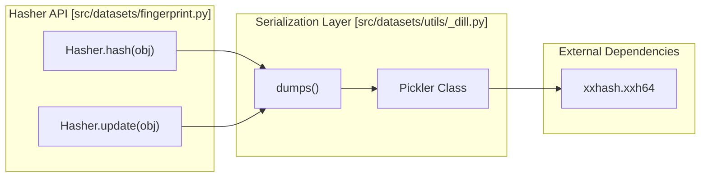
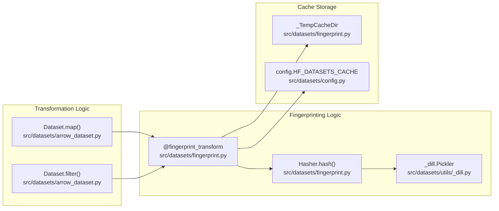

<!-- source: DeepWiki mcp.deepwiki.com · repo huggingface/datasets · page 2.5 Caching and Fingerprinting · fetched 2026-10-26 -->

# Caching and Fingerprinting

Relevant source files

The following files were used as context for generating this wiki page:

- [docs/source/cache.mdx](docs/source/cache.mdx)
- [src/datasets/fingerprint.py](src/datasets/fingerprint.py)
- [src/datasets/search.py](src/datasets/search.py)
- [src/datasets/utils/_dill.py](src/datasets/utils/_dill.py)
- [tests/test_fingerprint.py](tests/test_fingerprint.py)
- [tests/test_fingerprint_tokenizer_stability.py](tests/test_fingerprint_tokenizer_stability.py)
- [tests/test_search.py](tests/test_search.py)

## Purpose and Scope

This document explains the deterministic caching system and fingerprint generation mechanism in the `datasets` library. Fingerprinting enables datasets to track their transformation history through cryptographic hashes, while caching allows the library to reuse previously computed results instead of recomputing transformations.

The system ensures that dataset transformations are reproducible and efficient. Each dataset maintains a unique fingerprint (a 64-character hexadecimal hash) that changes deterministically whenever transformations are applied. This fingerprint serves as the cache key, allowing the library to determine if a transformation has already been computed.

---

## Overview

The caching and fingerprinting system is integrated directly into the `Dataset` class and its transformation methods.

### Key Benefits

| Benefit | Description |
|---------|-------------|
| **Reproducibility** | Same transformations always produce the same fingerprint [src/datasets/fingerprint.py:27-30]() |
| **Efficiency** | Avoid recomputing expensive operations by reusing cached results [src/datasets/fingerprint.py:32-34]() |
| **Automatic Management** | Cache files are automatically discovered and reused without user intervention [src/datasets/fingerprint.py:120-127]() |
| **Persistence** | Cache files are named using the dataset fingerprint, enabling cross-session reloading [src/datasets/fingerprint.py:125-127]() |

---

## System Architecture

### High-Level Flow

The following diagram illustrates the lifecycle of a dataset transformation and how it interacts with the fingerprinting and caching subsystems.

**Dataset Transformation Flow**

**Sources:** [src/datasets/fingerprint.py:27-34](), [src/datasets/fingerprint.py:120-136]()

---

## Core Components

### The Hasher Class

The `Hasher` class provides the low-level hashing functionality using `xxhash`, a fast non-cryptographic hash algorithm. It uses a custom pickling layer based on `dill` to produce consistent dumps across different environments and to handle complex Python objects.

**Hasher Implementation**

**Implementation Details:**
- **Deterministic Serialization**: The `Pickler` in `_dill.py` is extended to support consistent hashing of `pyarrow.Table` (chunk-independent), `torch.Tensor`, and `transformers` tokenizers [src/datasets/utils/_dill.py:28-71]().
- **Consistent Ordering**: Dictionaries and sets are sorted before hashing to ensure that key/element order does not change the fingerprint [src/datasets/utils/_dill.py:73-82](), [src/datasets/utils/_dill.py:135-148]().
- **Tokenizers Stability**: Special logic ensures tokenizers have stable hashes even after being called (which often mutates internal state) [tests/test_fingerprint_tokenizer_stability.py:18-23]().

**Sources:** [src/datasets/fingerprint.py:11-13](), [src/datasets/utils/_dill.py:28-89](), [src/datasets/utils/_dill.py:150-179]()

---

## Fingerprint Generation

### Transform Fingerprints

When a transformation is applied, the new fingerprint is derived from the previous fingerprint and the metadata of the transformation itself.

**Logic in `update_fingerprint`:**
- Captures the function's source code or `__qualname__` [src/datasets/fingerprint.py:1-2]().
- Captures all arguments passed to the transformation method.
- Includes the library version and transform version to invalidate cache if logic changes.

**Sources:** [src/datasets/fingerprint.py:27-30](), [src/datasets/fingerprint.py:125-127]()

### The fingerprint_transform Decorator

This decorator is applied to `Dataset` methods. It wraps the transformation logic to manage fingerprint updates and cache lookups automatically.

**Key Responsibilities:**
- **Cache Lookup**: Before execution, it computes the target fingerprint and checks if a corresponding cache file already exists [src/datasets/fingerprint.py:120-127]().
- **In-place management**: Handles whether the fingerprint update should be applied to the existing object or a new copy.

**Sources:** [src/datasets/fingerprint.py:7-9](), [tests/test_fingerprint.py:42-50]()

---

## Cache Management

### Caching Control API

Users can control caching behavior globally through the following functions:

| Function | File Pointer | Description |
|----------|--------------|-------------|
| `enable_caching()` | [src/datasets/fingerprint.py:120-139]() | Enables deterministic caching and reloading from disk. |
| `disable_caching()` | [src/datasets/fingerprint.py:141-160]() | Forces recreation of cache files in temporary directories. |
| `is_caching_enabled()` | [src/datasets/fingerprint.py:162-181]() | Returns the current global caching state. |

**Sources:** [src/datasets/fingerprint.py:120-181]()

### Temporary Cache Directory

When caching is disabled or a session-only cache is required, the library uses the `_TempCacheDir` class.

**Implementation Details:**
- **Class**: `_TempCacheDir` [src/datasets/fingerprint.py:45-95]()
- **Environment**: Respects `TMPDIR`, `TEMP`, or `TMP` environment variables [src/datasets/fingerprint.py:53-54]().
- **Cleanup**: Uses `weakref.finalize` to ensure the directory is deleted only after all references to the Arrow files (which are memory-mapped) are closed, preventing permission errors on Windows [src/datasets/fingerprint.py:79-90]().

**Sources:** [src/datasets/fingerprint.py:45-95](), [src/datasets/fingerprint.py:97-114]()

---

## Search and Indexing Caching

The caching system extends to search indices (FAISS and Elasticsearch). While dataset transformations are cached as Arrow files, search indices are managed through the `BaseIndex` abstraction.

**Index Caching Logic:**
- **FAISS**: Indices can be serialized to disk using `save()` and reloaded via `load()` [src/datasets/search.py:88-95]().
- **Elasticsearch**: The system uses unique index names (e.g., `huggingface_datasets_{random_id}`) if not specified, but supports persistent index names for reuse [src/datasets/search.py:129-133]().

**Sources:** [src/datasets/search.py:60-95](), [src/datasets/search.py:108-144]()

---

## Data Flow and Integration

### Mapping System to Code Entities

The following diagram maps the logical steps of the caching system to specific functions and classes in the codebase.

**Fingerprint & Cache Entity Mapping**

**Sources:** [src/datasets/fingerprint.py:19-24](), [src/datasets/utils/_dill.py:28-32](), [src/datasets/fingerprint.py:45-51]()

### Cache Directory Configuration

The location of the cache is determined by environment variables and configuration settings:
1. `HF_DATASETS_CACHE` environment variable [docs/source/cache.mdx:29-30]().
2. `HF_HOME` environment variable [docs/source/cache.mdx:20-23]().
3. Default: `~/.cache/huggingface/datasets` [docs/source/cache.mdx:20]().

**Sources:** [docs/source/cache.mdx:18-50]()

---

