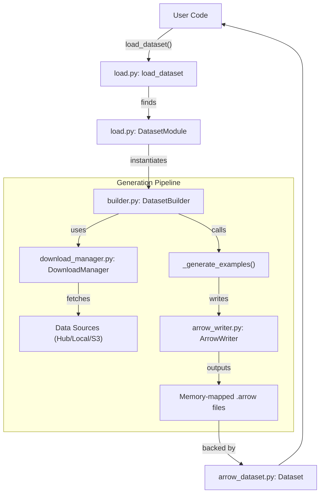
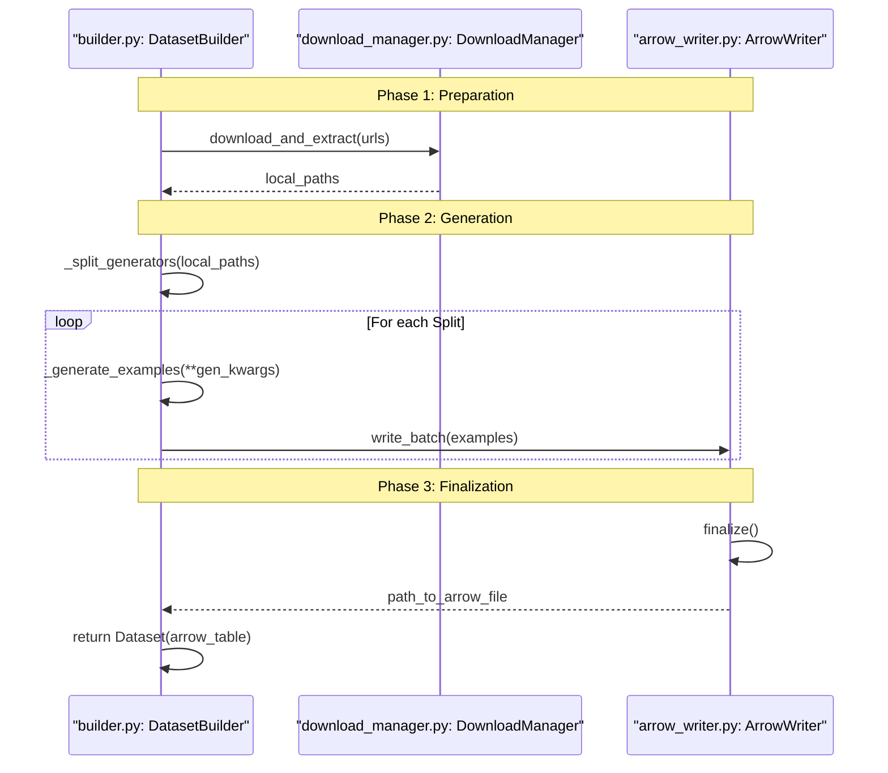

<!-- source: DeepWiki mcp.deepwiki.com · repo huggingface/datasets · page 3 Data Loading System · fetched 2026-10-26 -->

# Data Loading System

Relevant source files

The following files were used as context for generating this wiki page:

- [docs/source/_toctree.yml](docs/source/_toctree.yml)
- [docs/source/how_to.md](docs/source/how_to.md)
- [docs/source/loading.mdx](docs/source/loading.mdx)
- [docs/source/package_reference/loading_methods.mdx](docs/source/package_reference/loading_methods.mdx)
- [docs/source/tabular_load.mdx](docs/source/tabular_load.mdx)
- [src/datasets/load.py](src/datasets/load.py)
- [src/datasets/packaged_modules/__init__.py](src/datasets/packaged_modules/__init__.py)
- [tests/test_load.py](tests/test_load.py)

The Data Loading System is the entry point for bringing data into the Hugging Face `datasets` ecosystem. It abstractly handles data acquisition from the Hugging Face Hub, local filesystems, and remote cloud storage (S3, GCS), converting diverse raw formats into a unified internal representation based on Apache Arrow.

## Overview

The system is architected around the `load_dataset` API, which orchestrates the discovery of data, the selection of an appropriate `DatasetBuilder`, and the execution of the download and generation pipeline.

Sources: [src/datasets/load.py:16-93](), [src/datasets/builder.py:1-62](), [src/datasets/arrow_writer.py:1-46]()

## Core Components

The loading system is composed of several specialized subsystems that handle different stages of the data lifecycle:

### [load_dataset API](#3.1)
The primary functional interface for users. It performs module resolution by identifying whether a dataset is a Hub repository, a local directory, a packaged format (like CSV/JSON), or a community loading script. It uses `DatasetModuleFactory` subclasses to resolve the correct code to execute.
- **Key Entity**: `datasets.load.load_dataset`
- **Source**: [src/datasets/load.py:2554-2615]()

### [DatasetBuilder Framework](#3.2)
The abstract base class logic that defines how a dataset is downloaded, split, and generated. It manages the creation of the local cache directory and coordinates the conversion of raw data into Arrow tables.
- **Key Entity**: `datasets.builder.DatasetBuilder`
- **Source**: [src/datasets/builder.py:315-450]()

### [Packaged Modules](#3.3)
Built-in implementations of `DatasetBuilder` designed to handle common file formats without requiring a custom loading script. This includes support for `json`, `csv`, `parquet`, `arrow`, `text`, and specialized "Folder" builders for vision and audio.
- **Key Entity**: `datasets.packaged_modules._PACKAGED_DATASETS_MODULES`
- **Source**: [src/datasets/packaged_modules/__init__.py:45-66]()

### [Download Managers](#3.4)
Utilities that handle the physical movement of data. The `DownloadManager` handles standard file downloads and extraction, while the `StreamingDownloadManager` enables lazy access to remote files without full local caching.
- **Key Entities**: `datasets.download.download_manager.DownloadManager`, `datasets.download.streaming_download_manager.StreamingDownloadManager`
- **Source**: [src/datasets/download/download_manager.py:1-50](), [src/datasets/download/streaming_download_manager.py:61-100]()

### [Data Files and Pattern Matching](#3.5)
The logic responsible for resolving file paths and URLs. It supports glob patterns (e.g., `data/*.json`) and automatically maps files to dataset splits (train, test, validation) based on filename keywords or directory structures.
- **Key Entity**: `datasets.data_files.DataFilesDict`
- **Source**: [src/datasets/data_files.py:50-57](), [src/datasets/load.py:50-57]()

## Data Flow: From Source to Dataset

The transition from "Natural Language Space" (files and URLs) to "Code Entity Space" (Arrow Tables and Dataset objects) follows a structured sequence managed by the `DatasetBuilder`.

Sources: [src/datasets/builder.py:950-1050](), [src/datasets/arrow_writer.py:173-250]()

## Key Code Entities

| System Concept | Code Class / Function | File Path |
| :--- | :--- | :--- |
| **Main Entry Point** | `load_dataset` | [src/datasets/load.py:2554]() |
| **Base Logic** | `DatasetBuilder` | [src/datasets/builder.py:315]() |
| **Data Writing** | `ArrowWriter` | [src/datasets/arrow_writer.py:173]() |
| **File Resolution** | `DataFilesDict` | [src/datasets/data_files.py:654]() |
| **Module Factory** | `HubDatasetModuleFactory` | [src/datasets/load.py:1722]() |

Sources: [src/datasets/load.py:2554](), [src/datasets/builder.py:315](), [src/datasets/arrow_writer.py:173](), [src/datasets/data_files.py:654](), [src/datasets/load.py:1722]()

---

## Child Pages
- [load_dataset API](#3.1) — Comprehensive documentation of the main `load_dataset` function and its parameters.
- [DatasetBuilder Framework](#3.2) — Documentation of the `DatasetBuilder` abstract class and how custom builders are implemented.
- [Packaged Modules](#3.3) — Documentation of built-in dataset builders for common formats (JSON, CSV, Parquet, ImageFolder, etc.).
- [Download Managers](#3.4) — Explanation of `DownloadManager` and `StreamingDownloadManager` for data acquisition.
- [Data Files and Pattern Matching](#3.5) — Documentation of data file discovery, glob patterns, and archive iteration.

---

