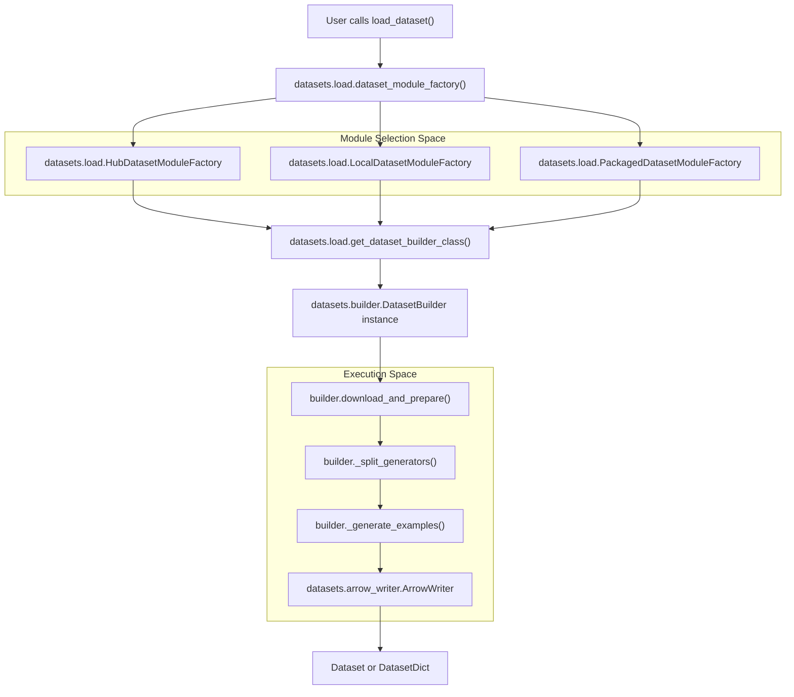

<!-- source: DeepWiki mcp.deepwiki.com · repo huggingface/datasets · page 3.1 load_dataset API · fetched 2026-10-26 -->

# load_dataset API

Relevant source files

The following files were used as context for generating this wiki page:

- [src/datasets/inspect.py](src/datasets/inspect.py)
- [src/datasets/load.py](src/datasets/load.py)
- [tests/test_inspect.py](tests/test_inspect.py)
- [tests/test_load.py](tests/test_load.py)
- [tests/test_offline_util.py](tests/test_offline_util.py)

## Purpose and Scope

The `load_dataset` API is the central entry point for the `datasets` library. It provides a unified interface to load datasets from the Hugging Face Hub, local files (CSV, JSON, Parquet, Arrow, etc.), or local loading scripts. This page documents the `load_dataset` function, its parameters, and the underlying module factory system that orchestrates dataset construction.

---

## Loading Pipeline Overview

The loading process is a multi-stage pipeline that resolves the dataset source, identifies the appropriate `DatasetBuilder`, and executes the build process to produce a memory-mapped Apache Arrow table or an iterable stream.

**Natural Language to Code Entity Space: Loading Flow**

Sources: [src/datasets/load.py:161-194](), [src/datasets/load.py:1725-1820](), [src/datasets/load.py:2100-2180]()

---

## The load_dataset() Function

Defined in `src/datasets/load.py`, `load_dataset` handles the high-level logic of choosing between a standard `Dataset` (map-style) and an `IterableDataset` (streaming).

### Key Parameters

| Parameter | Type | Description |
|-----------|------|-------------|
| `path` | `str` | Path or name of the dataset. Can be a Hub ID, a local directory, or a format like `"csv"`. [src/datasets/load.py:2100-2110]() |
| `name` | `str` | Defining the name of the dataset configuration (e.g., `"en"` for GLUE). [src/datasets/load.py:2112-2115]() |
| `data_files` | `str/list/dict` | Explicit paths to source data files. [src/datasets/load.py:2117-2125]() |
| `split` | `str/Split` | Which split to load (e.g., `train`, `test`). Supports slicing like `train[:10%]`. [src/datasets/load.py:2127-2135]() |
| `cache_dir` | `str` | Directory to read/write cached datasets. [src/datasets/load.py:2137-2140]() |
| `streaming` | `bool` | If `True`, returns an `IterableDataset` instead of downloading everything. [src/datasets/load.py:2160-2165]() |
| `num_proc` | `int` | Number of processes to use for parallel loading (if supported). [src/datasets/load.py:2175-2178]() |

### Implementation Logic
1. **Module Resolution**: It calls `dataset_module_factory` to find the dataset's logic and configuration [src/datasets/load.py:2185-2200]().
2. **Builder Initialization**: It fetches the `DatasetBuilder` class via `get_dataset_builder_class` [src/datasets/load.py:180-194]() and instantiates it [src/datasets/load.py:2210-2225]().
3. **Execution**:
    - **Standard loading**: Calls `builder.download_and_prepare()` to process and cache the data [src/datasets/load.py:2240-2255]().
    - **Streaming**: Returns an `IterableDataset` (or `IterableDatasetDict`) which allows lazy evaluation [src/datasets/load.py:2230-2238]().

Sources: [src/datasets/load.py:2100-2350]()

---

## Module Factory System

The factory system abstracts the complexity of where a dataset "lives". It returns a `DatasetModule` containing the path to the python code and the configuration parameters.

**Code Entity Association: Factory Resolution**

| Code Entity | Logic | Source |
| :--- | :--- | :--- |
| `LocalDatasetModuleFactory` | Checks if `path` is a local directory containing a loading script or data files. | [src/datasets/load.py:1416-1554]() |
| `PackagedDatasetModuleFactory` | Used when `path` is one of the built-in types: `csv`, `json`, `parquet`, `text`, etc. | [src/datasets/load.py:1557-1614]() |
| `HubDatasetModuleFactory` | Queries the Hugging Face Hub for a repository matching the `path`. | [src/datasets/load.py:1617-1723]() |
| `CachedDatasetModuleFactory` | Retrieves a previously used loading module from the local cache. | [src/datasets/load.py:1367-1413]() |

### Packaged Modules Inference
If a user provides a local directory or a list of files without a script, `infer_module_for_data_files_list` is used to guess the format (e.g., a folder full of `.parquet` files defaults to the `parquet` packaged module) [src/datasets/load.py:221-318]().

Sources: [src/datasets/load.py:1310-1723](), [src/datasets/load.py:221-318]()

---

## Dynamic Builder Configuration

The library supports dynamically creating builder classes, particularly for datasets defined via YAML metadata in Hub READMEs.

### configure_builder_class
This function dynamically creates a subclass of a `DatasetBuilder` and sets its `BUILDER_CONFIGS` class variable [src/datasets/load.py:123-160](). This is essential for "scriptless" datasets where configurations are parsed from the `MetadataConfigs` found in the YAML frontmatter of the dataset card [src/datasets/load.py:105-121]().

### Pickle Support
To ensure these dynamically created classes can be used in multiprocessing (e.g., via `num_proc`), they implement a custom `__reduce__` method using `_InitializeConfiguredDatasetBuilder` [src/datasets/load.py:105-121](), [src/datasets/load.py:140-151]().

Sources: [src/datasets/load.py:105-160]()

---

## Inspection Utilities

Before loading a full dataset, several utilities allow users to inspect metadata and available configurations.

- **`get_dataset_infos`**: Returns a dictionary mapping configuration names to `DatasetInfo` objects, containing descriptions and features [src/datasets/inspect.py:42-106]().
- **`get_dataset_config_names`**: Retrieves the list of available configurations for a given path [src/datasets/inspect.py:109-173]().
- **`get_dataset_default_config_name`**: Determines which configuration will be used if the user does not specify one [src/datasets/inspect.py:175-212]().

Sources: [src/datasets/inspect.py:42-212]()

---

## Data File Pattern Matching

The `data_files` parameter supports glob patterns and automatic split inference. The logic in `src/datasets/data_files.py` uses predefined patterns to automatically categorize files into splits (e.g., `train`, `test`, `validation`) if the user doesn't provide an explicit mapping.

| Pattern Category | Examples |
| :--- | :--- |
| **Train** | `train`, `training`, `training_data` |
| **Test** | `test`, `testing`, `evaluation` |
| **Validation** | `val`, `validation`, `dev` |

Sources: [src/datasets/data_files.py:50-90](), [src/datasets/load.py:55-57]()

---

