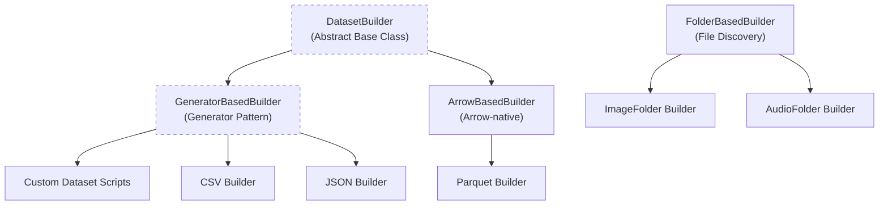
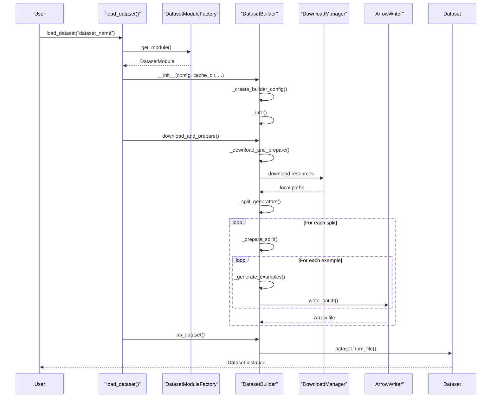
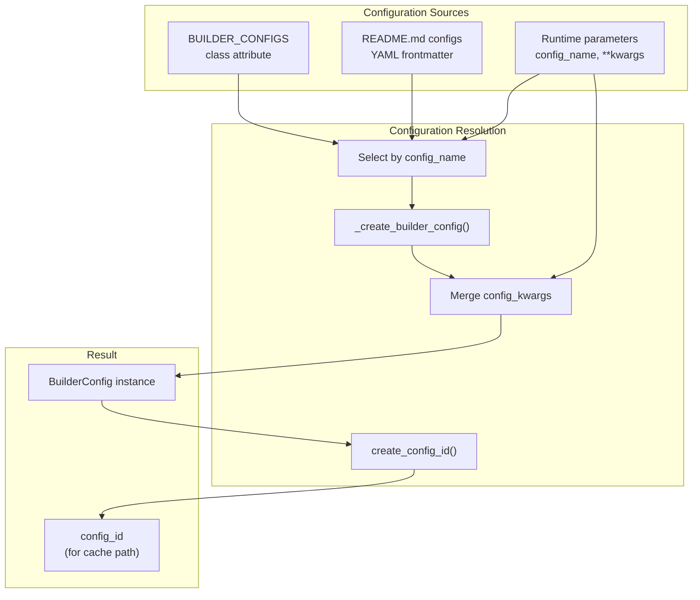
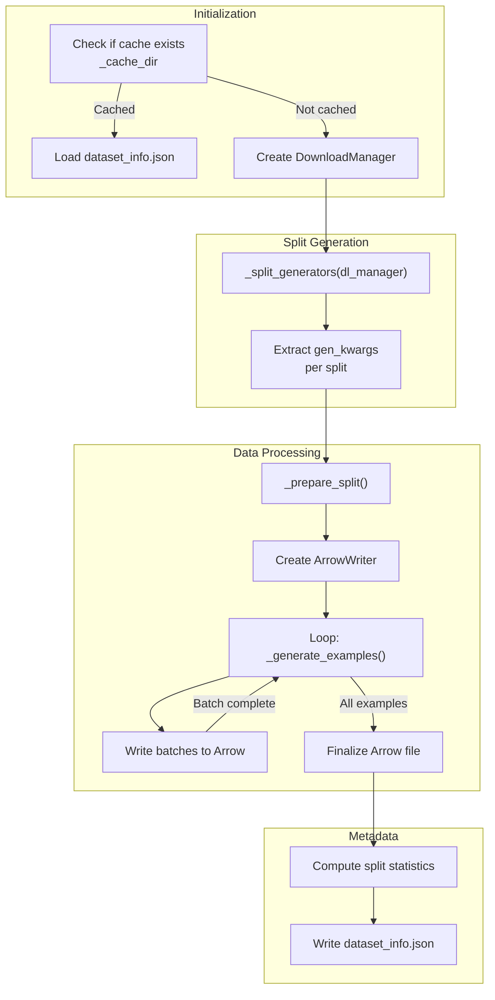

<!-- source: DeepWiki mcp.deepwiki.com · repo huggingface/datasets · page 3.2 DatasetBuilder Framework · fetched 2026-10-26 -->

# DatasetBuilder Framework

<details>
<summary>Relevant source files</summary>

The following files were used as context for generating this wiki page:

- [src/datasets/arrow_reader.py](src/datasets/arrow_reader.py)
- [src/datasets/builder.py](src/datasets/builder.py)
- [src/datasets/commands/test.py](src/datasets/commands/test.py)
- [src/datasets/download/download_manager.py](src/datasets/download/download_manager.py)
- [src/datasets/info.py](src/datasets/info.py)
- [src/datasets/naming.py](src/datasets/naming.py)
- [src/datasets/splits.py](src/datasets/splits.py)
- [tests/commands/test_test.py](tests/commands/test_test.py)
- [tests/test_arrow_reader.py](tests/test_arrow_reader.py)
- [tests/test_builder.py](tests/test_builder.py)

</details>


## Purpose and Scope

This document describes the `DatasetBuilder` abstract class and the framework for implementing dataset loading logic. The `DatasetBuilder` is the core abstraction that defines how datasets are downloaded, processed, and converted into Arrow tables. This page covers the builder lifecycle, configuration system, and implementation patterns for creating custom dataset builders.

For information about invoking builders through the public API, see [load_dataset API](#3.1). For documentation of the built-in packaged builders (CSV, JSON, Parquet, etc.), see [Packaged Modules](#3.3).

---

## DatasetBuilder Class Hierarchy

The `DatasetBuilder` class serves as the abstract base class that all dataset implementations must extend. The framework provides several specialized subclasses for common patterns.



**Diagram: DatasetBuilder Class Hierarchy**

The hierarchy reflects different strategies for loading data:
- `GeneratorBasedBuilder`: Uses Python generators to yield examples one at a time [src/datasets/builder.py:1625-1626]().
- `ArrowBasedBuilder`: Works directly with Arrow tables for maximum efficiency [src/datasets/builder.py:1808-1809]().
- `FolderBasedBuilder`: Discovers files based on folder structure and naming patterns.

Sources: [src/datasets/builder.py:209-280](), [src/datasets/builder.py:1625-1806](), [src/datasets/builder.py:1808-1937]()

---

## Core Components

### DatasetBuilder Abstract Class

The `DatasetBuilder` class defines the contract that all dataset implementations must fulfill. Key attributes and methods include:

| Component | Type | Purpose |
|-----------|------|---------|
| `VERSION` | `Optional[Version]` | Dataset version for cache management [src/datasets/builder.py:284-285]() |
| `BUILDER_CONFIG_CLASS` | `Type[BuilderConfig]` | Configuration class for this builder [src/datasets/builder.py:287-287]() |
| `BUILDER_CONFIGS` | `List[BuilderConfig]` | Pre-defined configuration options [src/datasets/builder.py:288-289]() |
| `DEFAULT_CONFIG_NAME` | `Optional[str]` | Default configuration to use [src/datasets/builder.py:291-292]() |
| `DEFAULT_WRITER_BATCH_SIZE` | `Optional[int]` | Arrow writer batch size [src/datasets/builder.py:294-295]() |
| `info` | `DatasetInfo` | Metadata about the dataset [src/datasets/builder.py:302-302]() |
| `config` | `BuilderConfig` | Active configuration instance [src/datasets/builder.py:304-304]() |

**Table: DatasetBuilder Class Attributes**

The constructor accepts numerous parameters for customization, including `cache_dir`, `config_name`, and `data_files` [src/datasets/builder.py:348-421]().

Sources: [src/datasets/builder.py:209-348]()

### BuilderConfig Dataclass

The `BuilderConfig` class allows datasets to expose multiple variants or configurations. Each configuration can have different data files, preprocessing options, or features.

| Attribute | Type | Description |
|-----------|------|-------------|
| `name` | `str` | Configuration name (used in cache paths) [src/datasets/builder.py:120-120]() |
| `version` | `Version \| str` | Configuration version [src/datasets/builder.py:121-121]() |
| `data_dir` | `Optional[str]` | Directory containing source data [src/datasets/builder.py:122-122]() |
| `data_files` | `Optional[DataFilesDict]` | Explicit data file paths [src/datasets/builder.py:123-123]() |
| `description` | `Optional[str]` | Human-readable description [src/datasets/builder.py:124-124]() |

**Table: BuilderConfig Attributes**

The `create_config_id()` method generates a unique identifier that combines the config name with a hash of custom parameters like `data_files` or `features`, ensuring proper cache isolation [src/datasets/builder.py:144-160]().

Sources: [src/datasets/builder.py:101-207]()

---

## Builder Lifecycle and Execution Flow



**Diagram: DatasetBuilder Lifecycle Sequence**

The execution follows three main phases:

1. **Initialization Phase**: Builder is instantiated with configuration and `DatasetInfo` is initialized via `_info()` [src/datasets/builder.py:348-462]().
2. **Download and Prepare Phase**: Data is acquired via `DownloadManager` and processed into Arrow files through `_download_and_prepare()` [src/datasets/builder.py:934-954]().
3. **Dataset Construction Phase**: Arrow files are wrapped in `Dataset` objects via `as_dataset()` [src/datasets/builder.py:1165-1215]().

Sources: [src/datasets/builder.py:651-745](), [src/datasets/builder.py:746-922](), [src/datasets/builder.py:1165-1215]()

---

## Abstract Methods and Implementation Contract

Every `DatasetBuilder` subclass must implement three abstract methods:

### 1. _info() Method
Returns a `DatasetInfo` object containing dataset metadata [src/datasets/builder.py:1391-1393](). The `features` field defines the schema using the `Features` type system [src/datasets/info.py:142-142]().

Sources: [src/datasets/builder.py:1391-1450](), [src/datasets/info.py:92-157]()

### 2. _split_generators() Method
Returns a list of `SplitGenerator` objects that define how to create each split [src/datasets/builder.py:1452-1454](). This method typically uses the `DownloadManager` to acquire data [src/datasets/builder.py:1516-1518]().

Sources: [src/datasets/builder.py:1452-1553](), [src/datasets/splits.py:31-67]()

### 3. _generate_examples() Method
Yields tuples of `(key, example)` for each data instance [src/datasets/builder.py:1555-1557](). The example dict must match the schema defined in `_info()`.

Sources: [src/datasets/builder.py:1555-1623]()

---

## Builder Configuration System



**Diagram: Builder Configuration Resolution**

### Static Configuration via BUILDER_CONFIGS
Builders can define pre-configured variants as a class attribute `BUILDER_CONFIGS` [src/datasets/builder.py:288-289]().

### Runtime Configuration
Users can override configuration parameters when calling `load_dataset()`. The `_create_builder_config()` method merges provided `config_name` and `kwargs` with existing configs [src/datasets/builder.py:464-558]().

Sources: [src/datasets/builder.py:464-558](), [src/datasets/builder.py:144-201]()

---

## Cache Directory Structure

The builder uses a hierarchical cache structure to isolate different configurations and versions [src/datasets/builder.py:559-648]():

```
~/.cache/huggingface/datasets/
└── {dataset_name}/
    └── {config_name}/
        └── {version}/
            └── {hash}/
                ├── dataset_info.json
                ├── {dataset_name}-train.arrow
                └── ...
```

The `hash` (config ID) is generated to ensure cache isolation when custom parameters are used [src/datasets/builder.py:144-160]().

Sources: [src/datasets/builder.py:559-648](), [src/datasets/builder.py:144-201]()

---

## Download and Prepare Process



**Diagram: Download and Prepare Workflow**

### Download Manager
The `DownloadManager` handles resource acquisition [src/datasets/download/download_manager.py:71-72](). It manages `download()` and recording of checksums [src/datasets/download/download_manager.py:131-180]().

Sources: [src/datasets/download/download_manager.py:71-180](), [src/datasets/builder.py:934-954]()

### ArrowWriter and Batch Processing
The `ArrowWriter` handles conversion of Python dictionaries to Arrow format [src/datasets/builder.py:1244-1246](). The `writer_batch_size` parameter controls the Arrow RecordBatch size [src/datasets/builder.py:1255-1256]().

Sources: [src/datasets/builder.py:1244-1347](), [src/datasets/arrow_writer.py:46-47]()

---

## Verification and Summary

### VerificationMode
Controls data integrity checks, such as `ALL_CHECKS` (verifying checksums and split sizes) or `NO_CHECKS` [src/datasets/utils/info_utils.py:74-74]().

Sources: [src/datasets/builder.py:651-745](), [src/datasets/commands/test.py:150-158]()

### Key Classes and Roles

| Class | Module | Role |
|-------|--------|------|
| `DatasetBuilder` | [src/datasets/builder.py:209]() | Abstract base class for all builders |
| `BuilderConfig` | [src/datasets/builder.py:101]() | Configuration dataclass |
| `GeneratorBasedBuilder` | [src/datasets/builder.py:1625]() | Generator-pattern implementation |
| `ArrowBasedBuilder` | [src/datasets/builder.py:1808]() | Arrow-native implementation |
| `DownloadManager` | [src/datasets/download/download_manager.py:71]() | Resource acquisition manager |
| `DatasetInfo` | [src/datasets/info.py:92]() | Dataset metadata container |

Sources: [src/datasets/builder.py](), [src/datasets/download/download_manager.py](), [src/datasets/info.py]()

---

